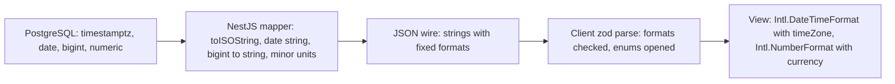

## 72.7 Dates, money, IDs and enums across the wire

#### Concept

JSON has six value types: string, number, boolean, null, object and array. It has no date, no decimal, no 64-bit integer and no enum. Every one of those must be **encoded** into a JSON type by the server and **decoded** by the client, and each side must agree on the encoding. When they do not, the result is rarely a crash. It is a delivery date one day early, a total off by one paisa, an order ID that points at someone else's order, or a status badge that silently disappears.

This section fixes the wire encoding for each awkward type, as this volume's `@shop/contracts` has used since 76.12, and explains why:

| Value | Wire encoding | Example | Client decodes with |
|---|---|---|---|
| Instant (something happened at a moment) | ISO 8601 string, UTC, with `Z` | `"2026-11-05T09:30:00.000Z"` | `new Date(s)`, display with `Intl.DateTimeFormat` and an explicit `timeZone` |
| Calendar date (no time, no zone) | `YYYY-MM-DD` string | `"2026-11-07"` | Keep as a string, or split into parts; never `new Date(s)` |
| Wall-clock time at a place | Local time plus IANA zone | `{ "opensAt": "09:00", "timeZone": "Asia/Kolkata" }` | `Intl` with that `timeZone` |
| Duration | Integer seconds | `"prepSeconds": 900` | Arithmetic on numbers |
| Money | Integer minor units as a string, plus ISO 4217 currency | `{ "totalMinor": "129900", "currency": "INR" }` | String or `BigInt` arithmetic, `Intl.NumberFormat` for display |
| ID | Opaque string | `"id": "1d6c0b6e-..."`, `"riderId": "1849302284551208961"` | Never parsed, compared or sorted as a number |
| Count or size below 2^53 | JSON number | `"itemCount": 3` | Number |
| Enum | String from a documented set, open on responses | `"status": "SHIPPED"` | Known values mapped, unknown to a fallback |
| Absent versus empty | Field present with `null` means "known empty"; missing means "not sent" | `"deliveredAt": null` | `.nullable()` versus `.optional()` |

#### Why does it exist?

Because each JavaScript default is wrong for at least one of these types:

- `new Date('2026-11-07')` is parsed as **UTC midnight**; displayed in New York (UTC-5) it is 6 November. `new Date('2026-11-07T09:00')` without an offset is parsed as **local time**. Same function, two rules.
- `0.1 + 0.2` is `0.30000000000000004`, so prices as JSON numbers invite float arithmetic and rounding drift between client and server.
- JSON numbers become IEEE 754 doubles, exact only up to `2^53 - 1` (9,007,199,254,740,991). `JSON.parse('{"id":1849302284551208961}').id` is `1849302284551208960`. The last digits change, silently.
- An unknown string in a `z.enum` fails the whole parse; an unknown value in a `switch` with no `default` renders nothing.

#### Mental model

Imagine shipping goods across a border where the paperwork only has plain text boxes. You write the weight as "12.500 kg", not "about 12", because the receiver must not guess the precision. You write the delivery day as "7 November" and not "Friday at midnight in our time zone", because the receiver lives in a different zone. You copy the parcel's serial number letter by letter, because the receiver must never "round" it. And you write the category from an agreed list, with an agreed rule for "category not on my list: put it in the miscellaneous pile and tell the office".

#### How it works

**Dates and time zones.** Decide what kind of time each field is:

1. **Instants** (`placedAt`, `deliveredAt`, `cutoffAt`) are points on the global timeline. PostgreSQL stores them as `timestamptz` (always UTC internally). `node-postgres` returns a JS `Date`, and `JSON.stringify` calls `toISOString()`, which emits UTC with `Z`. The client displays them in a chosen zone: the user's (`Intl.DateTimeFormat().resolvedOptions().timeZone`) for "when did I order", or the store's for "when does the kitchen close".
2. **Calendar dates** (`deliveryDate`, `dateOfBirth`) have no time and no zone. PostgreSQL's `date` type is right, but `node-postgres` parses `date` columns into a JS `Date` at midnight in the *server's* time zone by default, which then serialises as the previous day's UTC instant on a server east of UTC. Register a type parser that keeps the string. On the client, keep it a string; to format it, build the date at noon UTC and format with `timeZone: 'UTC'`, or use the parts directly.
3. **Wall-clock rules** ("same-day delivery if ordered before 18:00 in the store's city") belong on the server. The server computes the instant (`cutoffAt: "2026-11-05T12:30:00.000Z"`) and sends it; the client does not reimplement time zone rules.
4. **Relative values go stale.** "Arrives in 12 minutes" is wrong after any cache, retry or slow render. Send an absolute instant (`etaAt`) and let the client compute the countdown. If the client's clock may be wrong, estimate the offset from the response `Date` header and correct the countdown.

**Money.** The server owns every calculation: line totals, discounts, tax, delivery fees and rounding. It sends results in integer **minor units** (paise, cents, yen) as strings, with the currency, because currencies have different exponents: INR and USD have 2 decimal places, JPY has 0, KWD has 3. `Intl.NumberFormat` knows each currency's digits (`resolvedOptions().maximumFractionDigits`). The client converts minor units to a decimal string by inserting the point, then formats. Where the client must add amounts (an optimistic cart badge), it uses `BigInt`, never floats, and replaces the result with the server's total as soon as it arrives.

**IDs and large integers.** IDs are strings on the wire, always, even when the database column is `bigint`. UUIDs are strings already. Snowflake-style IDs (64-bit, time-ordered) exceed 2^53 from day one: Twitter added `id_str` to its API in 2010 for exactly this reason. `node-postgres` returns `bigint` (`int8`) columns as strings by default, and TypeORM `bigint` columns are typed `string`, so the safe path is to keep them strings end to end. Never `parseInt` an ID, never sort by it on the client, never build one from parts. Note that `JSON.stringify` throws `TypeError: Do not know how to serialize a BigInt` if a mapper leaks a `bigint` value.

**Enums.** A response enum is **open**: the server will add values over time, and clients built before that must degrade, not crash. A request enum is **closed**: the server rejects values it does not know. In code, that means the shared contract keeps `OrderStatusSchema = z.enum([...])` for requests and for the server's output types, while each client reads responses through a tolerant wrapper that maps unknown values to `'UNKNOWN'` and reports them.

**Null and missing.** `"deliveredAt": null` means "not delivered"; a missing `deliveredAt` means "this server did not send the field" (an older version, or a sparse fieldset). Make response fields **required and nullable** where possible, so "missing" always signals a contract problem. For `PATCH`, missing means "do not change" and `null` means "clear", as in JSON Merge Patch (RFC 7396, Part 8.8).



#### Practical example

A grocery app in three countries shows an order card: "Placed 5 Nov, 15:00 · Delivery Sat 7 Nov · Total ₹1,299.00 · Shipped". The API sends `placedAt` as an instant, `deliveryDate` as a calendar date, `totalMinor: "129900"` with `currency: "INR"`, `status: "SHIPPED"` and `storeTimeZone: "Asia/Kolkata"`. The card formats `placedAt` in the store's zone (so a customer travelling in London still sees the time the store saw), shows `deliveryDate` without any zone conversion, and formats money with the currency's own digits. When the API later adds `status: "OUT_FOR_DELIVERY"`, old app versions show a neutral "In progress" badge until they update.

#### React / Next.js example

Client-side decoders and formatters, used by every component:

```ts
// apps/web/src/wire/decode.ts
import { z } from 'zod';

// Open enum: known values pass through, unknown become 'UNKNOWN' and are reported once per value.
const seenUnknown = new Set<string>();
export function openEnum<T extends string>(schema: z.ZodEnum<[T, ...T[]]>, name: string) {
  const known = new Set<string>(schema.options);
  return z.string().transform((v): T | 'UNKNOWN' => {
    if (known.has(v)) return v as T;
    if (!seenUnknown.has(`${name}:${v}`)) { seenUnknown.add(`${name}:${v}`); console.warn(`unknown ${name}: ${v}`); } // telemetry in production
    return 'UNKNOWN';
  });
}

// Money: integer minor units (string) to a display string, exact for any size.
export function formatMoney(minor: string, currency: string, locale = 'en-IN'): string {
  const nf = new Intl.NumberFormat(locale, { style: 'currency', currency });
  const digits = nf.resolvedOptions().maximumFractionDigits ?? 2;          // INR 2, JPY 0, KWD 3
  const neg = minor.startsWith('-'); const abs = (neg ? minor.slice(1) : minor).padStart(digits + 1, '0');
  const decimal = digits === 0 ? abs : `${abs.slice(0, -digits)}.${abs.slice(-digits)}`;
  // format() accepts a decimal string in current browsers (exact); older engines convert to Number,
  // which is still exact for amounts below 2^53 minor units.
  return nf.format(`${neg ? '-' : ''}${decimal}` as `${number}`);
}

// Optimistic sums use BigInt, never floats.
export const addMinor = (a: string, b: string) => (BigInt(a) + BigInt(b)).toString();

// Calendar date: format without any time zone shift.
export function formatCalendarDate(ymd: string, locale = 'en-IN'): string {
  const [y, m, d] = ymd.split('-').map(Number);
  return new Intl.DateTimeFormat(locale, { weekday: 'short', day: 'numeric', month: 'short', timeZone: 'UTC' })
    .format(new Date(Date.UTC(y, m - 1, d, 12)));                          // noon UTC: no zone can move the day
}

export const formatInstant = (iso: string, timeZone: string, locale = 'en-IN') =>
  new Intl.DateTimeFormat(locale, { dateStyle: 'medium', timeStyle: 'short', timeZone }).format(new Date(iso));
```

This Part adds three fields to `OrderSummarySchema` in `@shop/contracts`, all required and nullable where they can be empty: `deliveryDate: z.string().date().nullable()` (`YYYY-MM-DD`, zod 3.23+), `deliveredAt: z.string().datetime({ offset: true }).nullable()` and `storeTimeZone: z.string()` (an IANA name). The web's read schema only opens the enum:

```ts
// apps/web/src/orders/schema.ts
import { OrderStatusSchema, OrderSummarySchema } from '@shop/contracts';
import { z } from 'zod';
import { openEnum } from '../wire/decode';

export const OrderSummaryRead = OrderSummarySchema.extend({
  status: openEnum(OrderStatusSchema, 'OrderStatus'),  // the server's type stays closed; the reader is open
});
export type OrderSummaryView = z.infer<typeof OrderSummaryRead>;

export const statusLabel = {
  PENDING: 'Awaiting payment', PAID: 'Confirmed', SHIPPED: 'On the way', DELIVERED: 'Delivered',
  CANCELLED: 'Cancelled', UNKNOWN: 'In progress',     // the fallback is a designed state, not an accident
} satisfies Record<OrderSummaryView['status'], string>;
```

In a server component, pass `timeZone` and `locale` explicitly to these formatters; otherwise server and browser format differently and hydration fails (71.10).

#### Backend side (NestJS)

The mapper is where the encoding is decided, once:

```ts
// apps/api/src/orders/order.mapper.ts
import type { OrderSummary } from '@shop/contracts';
import type { OrderEntity } from './order.entity';

export function toOrderSummary(o: OrderEntity): OrderSummary {
  return {
    id: o.id,                                    // uuid string
    displayId: o.displayId,
    status: o.status,                            // typed as OrderStatus: the server only emits known values
    totalMinor: o.totalMinor,                    // bigint column, already a string from node-postgres
    currency: o.currency,
    placedAt: o.placedAt.toISOString(),          // timestamptz -> UTC 'Z'
    deliveryDate: o.deliveryDate,                // date column kept as 'YYYY-MM-DD' by the type parser below
    deliveredAt: o.deliveredAt ? o.deliveredAt.toISOString() : null,  // required and nullable
    storeTimeZone: o.store.timeZone,             // 'Asia/Kolkata'
    version: o.version,                          // 78.1
    updatedAt: o.updatedAt.toISOString(),        // 78.1
  };
}
```

```ts
// apps/api/src/db/pg-types.ts  (imported once, before the DataSource initialises)
import { types } from 'pg';

types.setTypeParser(types.builtins.DATE, (v: string) => v);   // keep calendar dates as strings
// INT8 (bigint) is already returned as a string by default; do not change that to Number.
```

The entity side, with TypeORM:

```ts
// apps/api/src/orders/order.entity.ts (excerpt)
@Entity('orders')
export class OrderEntity {
  @PrimaryColumn('uuid') id!: string;
  @Column({ name: 'total_minor', type: 'bigint' }) totalMinor!: string;     // TypeORM maps bigint to string
  @Column({ type: 'char', length: 3 }) currency!: string;
  @Column({ name: 'placed_at', type: 'timestamptz' }) placedAt!: Date;
  @Column({ name: 'delivery_date', type: 'date', nullable: true }) deliveryDate!: string | null;
  @Column({ name: 'delivered_at', type: 'timestamptz', nullable: true }) deliveredAt!: Date | null;
  @Column({ type: 'text' }) status!: OrderStatus;
  @VersionColumn() version!: number;
  @UpdateDateColumn({ name: 'updated_at', type: 'timestamptz' }) updatedAt!: Date;
  @ManyToOne(() => StoreEntity, { eager: true }) store!: StoreEntity;
}
```

With Sequelize, `DataTypes.BIGINT` and `DataTypes.DECIMAL` values also come back as strings from PostgreSQL, and `DataTypes.DATEONLY` returns `'YYYY-MM-DD'` strings, so the same mapper rules apply.

The cutoff rule computed in SQL, in the store's zone, and sent as an instant:

```sql
-- Same-day delivery cutoff: 18:00 local time in the store's zone, today, as a UTC instant.
SELECT s.id,
       ((now() AT TIME ZONE s.time_zone)::date + time '18:00') AT TIME ZONE s.time_zone AS cutoff_at
FROM stores s
WHERE s.id = $1;
```

`now() AT TIME ZONE zone` gives the local wall-clock timestamp; adding `18:00` to its date and converting back with `AT TIME ZONE zone` returns a `timestamptz`, which the mapper serialises with `toISOString()`. Daylight saving changes are handled by PostgreSQL's time zone database, not by the client.

#### Production scenario

An international flower delivery site had 0.8 % of orders arrive "on the wrong day" according to customers. Investigation found that the web's delivery-date picker sent `"2026-02-14T00:00:00.000Z"` (an instant from `toISOString()` of local midnight) instead of `"2026-02-14"`. For customers west of UTC, local midnight was already 14 February in UTC; for customers east of UTC, it was 13 February. After switching the field to a calendar date string on both ends, plus a `z.string().date()` check in the request schema, wrong-day complaints fell to 0.05 %, the rate of genuine courier errors.

#### Failure scenario

A cart redesign calculated the "You save" line and the total on the client from list prices and a 15 % promotion, with `Math.round(price * 0.85)`, to make the cart feel instant. The pricing service rounded half-to-even per line and summed. For about 4 % of carts, the totals differed by one minor unit. Checkout sent `expectedTotalMinor` from the client's total, and the API correctly refused with `422 PRICE_CHANGED`. Customers saw "Prices in your cart changed" with no visible change and abandoned at three times the normal rate.

The fix was the rule already in this book: the client displays money computed by the server (71.8's failure scenario is the BFF version of the same mistake). The cart now shows the previous server total with a subtle loading state until the repriced cart arrives, typically 120 ms later.

#### Edge cases & failure modes

- **Daylight saving gaps and overlaps**: 02:30 does not exist on some spring dates and occurs twice on some autumn dates; never construct local times on the client from offsets.
- **`toLocaleString()` without arguments** uses the runtime's locale and zone, which differ between Node.js on the server and the browser (71.10).
- **Negative money** (refunds, credits) must survive formatting; test `"-500"`.
- **Currency changes per order**: a marketplace cart may mix sellers; totals in different currencies must not be summed by anyone.
- **IDs in URLs** are fine as strings; IDs in `<input type="number">` or in JSON numbers from a third-party API are not. Map them at the BFF.
- **Unknown enum values in request echoes**: a client that sends back a status it received (`PATCH { status }`) can send `'UNKNOWN'`; never round-trip display-only values.
- **Empty string as "no value"** from forms: convert `""` to `null` at the form boundary, or `z.string().min(1)` will reject it with a confusing message.

#### How a Senior Full-Stack Engineer thinks about this

The senior refuses to let any value cross the wire in a format that can be misread. Instants are UTC strings, calendar dates are date strings, money is minor units in strings with a currency, IDs are opaque strings, enums are open on responses, and every response field is required and nullable rather than sometimes missing. They put each conversion in exactly one place on each side (the server mapper and the client decoder) so components never meet raw wire values. And they keep calculations on the server: the client formats, the server computes.

To a product manager: "We send dates and prices in a strict format so a customer in another time zone never sees the wrong delivery day, and the price in the cart is always the price we charge."

#### Common mistakes

- **`new Date('YYYY-MM-DD')`** for calendar dates.
- **Money as JSON numbers**, or float arithmetic on prices in the browser.
- **Numeric IDs** from `bigint` columns or third-party APIs.
- **Closed enums on the client**, crashing or rendering nothing on a new value.
- **Server and client formatting dates with different implicit time zones.**
- **Optional response fields** where required-and-nullable was meant.

#### Interview questions

1. **How do you send a delivery date and a delivery deadline?** Expected answer: the date as `YYYY-MM-DD` (calendar date, no zone); the deadline as a UTC instant computed by the server in the store's zone. Follow-up: what goes wrong with `new Date('2026-11-07')`? (Parsed as UTC midnight, shown as the previous day west of UTC.)
2. **Why send money as integer minor units in a string?** Expected answer: exact, no float drift, safe beyond 2^53, currency exponent explicit with the currency code; server computes, client formats.
3. **What happens to a 64-bit ID in `JSON.parse`?** Expected answer: it becomes a double and loses precision above 2^53; send IDs as strings.
4. **How should a web client handle an enum value it does not know?** Expected answer: map to a designed fallback state, report it, never crash; the server must still reject unknown values on input.
5. **Null versus missing: what is the difference and why does it matter?** Expected answer: null is a known empty value; missing means not sent; required-nullable responses make missing a detectable contract error, and PATCH uses missing as "no change".

#### Practical exercise

Audit the order summary contract for wire encodings and fix every field that is ambiguous.

Acceptance criteria:

- A test renders an order with `deliveryDate: "2026-11-07"` under `TZ=America/Los_Angeles` and `TZ=Asia/Tokyo` and both show 7 November.
- `formatMoney` is tested for INR, JPY and KWD, negative amounts and `"900719925474099312"`.
- A response with `status: "RETURN_REQUESTED"` renders the fallback badge and emits one telemetry event.
- The API returns a `bigint` ID column as a string, and a test fails if any response DTO field is a JS `bigint` or a number above `Number.MAX_SAFE_INTEGER`.
- `node-postgres` returns `date` columns as strings, verified by an integration test against PostgreSQL.
