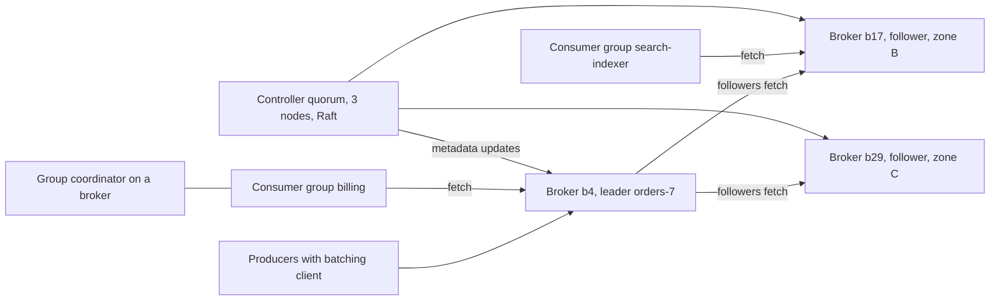
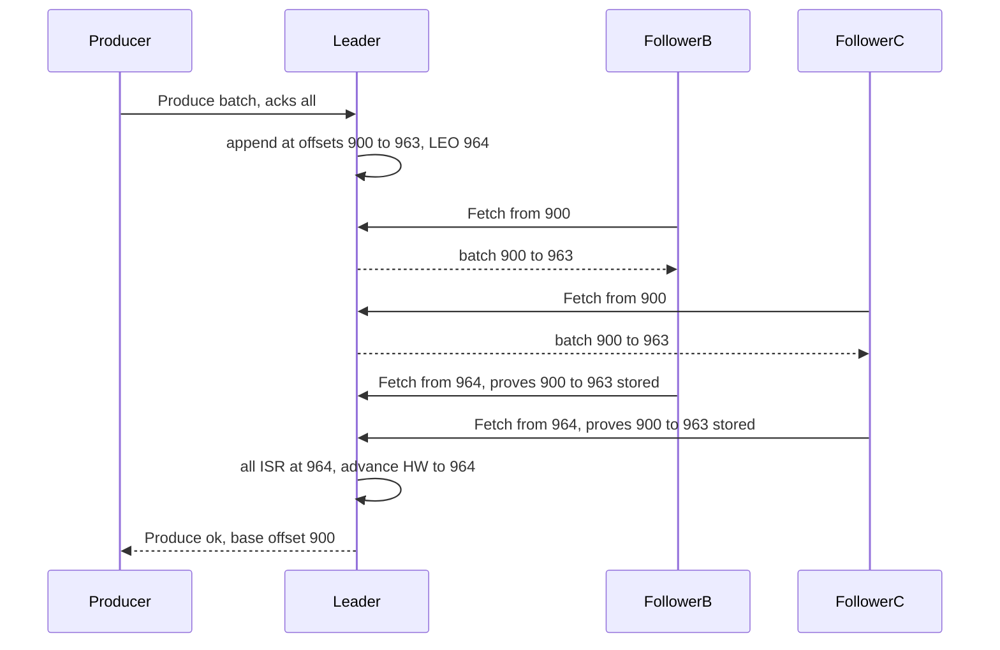
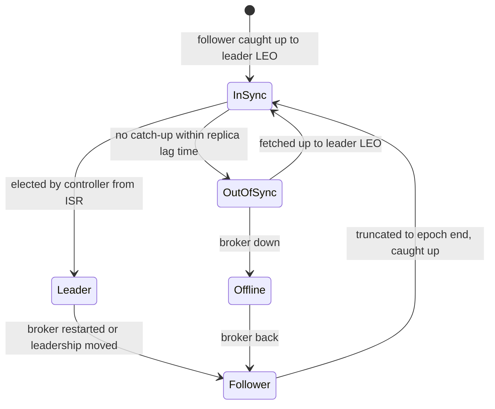

## 72.3 Distributed Message Queue

> **Try it first** · Level: Advanced · About 60 minutes
>
> **Build:** a Kafka-like distributed log that producers append messages to and many independent consumer groups read from, each at its own pace.
>
> **Requirements:**
> - producers append messages to named topics, optionally with a key that keeps related messages in order
> - consumers in a group share a topic's work, each message handled by one member, and resume from where they stopped after a crash
> - many groups read the same topic independently and can replay from any retained point
> - messages are retained by time or size, or compacted to the latest value per key
> - no acknowledged message is lost when a machine fails
>
> **Scale and constraints:** 1 million messages per second at peak (500,000 average), 1 KB each, 3 consumer groups reading every message, 7 days of retention, replication factor 3 (about 900 TB before compression, about 300 TB on disk with 3:1 compression), produce p99 under 20 ms with full replication, end-to-end p99 under 100 ms, no acknowledged message lost if any one broker or one availability zone fails.
>
> **Your task:** sketch the API, the data model and the main components; estimate storage and throughput; name the two hardest problems and how you would solve them.
>
> Spend the time on paper before you read on. The model design follows.

### 72.3.1 Requirements

A distributed message queue lets one part of a system hand messages to other parts without either waiting for the other. Part 31 — Messaging: Queues, Topics, Kafka, RabbitMQ and SQS teaches how to **use** one: topics, keys, consumer groups, idempotent consumers and retries. This design is about **building** one. We design a log-based broker in the style of Apache Kafka, because the log model is the one that scales to a million messages per second and supports replay, and because building it from first principles explains every Kafka setting you have ever had to tune.

The users are backend teams. Producers are services publishing events ("order placed", "payment captured", "driver location updated"); consumers are services and pipelines reacting to them. Some consumers are real-time (a notification service, lag measured in milliseconds), some are batch (a data-lake loader that reads hourly), and some replay history (a new search index built from the last seven days of product events).

#### Mental model

Imagine a ship's logbook that is never erased. The captain's officers write entries at the end, one after another, and number each line. Anyone can read the book, and each reader keeps a bookmark with the last line number they finished. Readers never tear out pages, so ten readers can each be at a different place, and a new reader can start from page one. When the book gets too thick, the oldest volumes are archived. To survive a fire, two other ships keep exact copies, and the captain only tells an officer "your entry is safe" once the copies have it too. The logbook is a **partition**, the line number is the **offset**, the bookmark is the **committed offset**, the archived volumes are deleted **segments**, and the other ships are **follower replicas**.

### 72.3.2 Functional requirements

1. Create topics with a number of partitions, a replication factor and a retention policy.
2. Produce: append a batch of messages to a partition, chosen by key hash, explicitly, or spread evenly when there is no key.
3. Acknowledge a produce according to the producer's durability choice: no wait, leader written, or all in-sync replicas written.
4. Fetch: read messages from a partition starting at an offset, in order.
5. Consumer groups: divide a topic's partitions among the members of a group, rebalance when members join or leave, and store each group's committed offsets.
6. Retention: delete data older than a time or beyond a size per partition; or compact a topic to keep only the latest message per key.
7. Idempotent and transactional production, so that retries do not create duplicates and a consume-transform-produce step can be atomic.

Non-goals: per-message routing rules and priorities (RabbitMQ's model, section 31.4), per-message acknowledgement and redelivery timers (SQS's model, section 31.5), and delayed delivery.

### 72.3.3 Non-functional requirements

| Property | Target | Why |
|---|---|---|
| Throughput | 1M messages/s and 1 GB/s ingress at peak; 3 GB/s egress to consumers | Event streams for a large company |
| Produce latency | p99 under 20 ms with `acks=all` in one region | Producers are often in a request path |
| End-to-end latency | p99 under 100 ms from produce to consumer receive | Real-time consumers |
| Durability | No acknowledged message lost on the failure of any one broker or one availability zone | Messages are business events (payments, orders) |
| Ordering | Total order within a partition; none across partitions | The only order that scales |
| Availability | 99.95 percent for produce and fetch | Producers buffer briefly, but not for long |
| Retention | 7 days by default, configurable per topic; compaction for state topics | Replay and recovery |

### 72.3.4 Constraints

- Three availability zones in one region; replicas of each partition must be in different zones.
- Commodity servers with large local disks (or block storage volumes) and 25 Gbit/s networking; disks are fast for sequential I/O and much slower for random I/O.
- The cluster's metadata (which broker leads which partition) must be strongly consistent, so it needs a consensus protocol; the data path must not go through consensus per message, or throughput collapses.
- Clients exist in many languages and versions; the wire protocol must be versioned and backward compatible.

### 72.3.5 Capacity estimation

| Quantity | Assumption | Calculation | Result |
|---|---|---|---|
| Ingress, average and peak | 500k and 1M messages/s x 1 KB | | 500 MB/s average, 1 GB/s peak |
| Data per day | 500 MB/s x 86,400 | | about 43 TB per day |
| Retained (one copy) | 43 TB x 7 days | | about 300 TB |
| Retained (3 replicas) | 300 TB x 3 | | about 900 TB before compression |
| On disk with 3:1 batch compression | 900 TB / 3 | | about 300 TB |
| Replication traffic | each byte copied to 2 followers | 1 GB/s x 2 | 2 GB/s across the cluster at peak |
| Consumer egress | 3 groups read everything | 1 GB/s x 3 | 3 GB/s at peak |
| Brokers for storage | 16 TB usable disk each, kept under 65 percent full | 300 TB / (16 x 0.65) | about 29, so 30 brokers |
| Partitions | 1 GB/s at peak, about 10 MB/s comfortable per partition, times 3 for consumer parallelism and growth | 100 x 3 | about 300 for the busiest topics; about 3,000 across all topics |
| Per broker at peak | 1/30 of produce, replication in and out, consumer reads (before compression) | 33 + 67 + 67 + 100 MB/s | about 270 MB/s (about 2.2 Gbit/s), under a tenth of a 25 Gbit/s NIC |
| Messages per produce request | producers batch 16 to 64 KB | 64 KB / 1 KB | about 64, so roughly 15,000 produce requests per second cluster-wide |

Three numbers drive the design. **1 GB/s with replication tripling the writes** means the disk path must be sequential and the network path must avoid copies. **Messages are batched about 64 to 1** on the way in, so the broker handles thousands of requests per second, not millions: every per-message cost is paid per batch instead. And **30 brokers** is enough that some broker is always being restarted, patched or replaced, so leader failover is a routine event, not an emergency.

### 72.3.6 API design

The broker speaks a binary request-response protocol over long-lived TCP connections. Every request carries an API key, an API version and a correlation id, so old and new clients can coexist. The main requests, named as in Kafka's protocol:

| Request | Sent to | Key fields | Response | Notes |
|---|---|---|---|---|
| `Metadata` | Any broker | topics | brokers, partitions, leader and replicas per partition | Clients cache it and refresh on errors |
| `Produce` | Partition leader | `acks`, timeout, per partition a record batch | base offset per partition, or error | `acks` is 0, 1 or -1 (all) |
| `Fetch` | Leader (or a follower in the same zone) | partition, fetch offset, max bytes, max wait, min bytes | record batches, high watermark | Long-poll: waits up to max wait for min bytes |
| `ListOffsets` | Leader | partition, timestamp or earliest/latest | offset | "Start from 09:00 yesterday" |
| `FindCoordinator` | Any broker | group id | coordinator broker | One coordinator per group |
| `JoinGroup`, `SyncGroup`, `Heartbeat`, `LeaveGroup` | Group coordinator | group id, member id, generation | assignment | Classic group protocol |
| `OffsetCommit`, `OffsetFetch` | Group coordinator | group, partition, offset | ok, or committed offset | Stored in an internal compacted topic |
| `InitProducerId` | Transaction coordinator | transactional id (optional) | producer id, epoch | Enables idempotence and transactions |
| `AddPartitionsToTxn`, `EndTxn` | Transaction coordinator | producer id, partitions, commit or abort | ok | Exactly-once read-process-write |

Two choices are worth defending. **Fetch is pull, not push**: consumers ask for data at their own pace, which is natural backpressure (a slow consumer simply falls behind; the broker does not buffer per consumer), and it lets a consumer replay from any offset. **Fetch is a long-poll**: with `max wait` of, say, 500 ms and `min bytes` of 1, an idle consumer's request waits on the broker and returns the instant data arrives, giving low latency without busy polling.

### 72.3.7 Data model

**On disk**, each partition replica is a directory of **segments**. A segment is an append-only log file plus two small index files, named by the first offset they contain:

```text
/data/orders-7/
  00000000000041943040.log         1 GB of record batches, appended only
  00000000000041943040.index       sparse: relative offset -> byte position, one entry per ~4 KB
  00000000000041943040.timeindex   sparse: timestamp -> offset
  00000000000042991616.log         the active segment, currently being written
  00000000000042991616.index
  00000000000042991616.timeindex
  leader-epoch-checkpoint          epoch -> first offset written in that epoch
```

The unit of storage is the **record batch**, exactly as the producer sent it, compressed as a whole:

```text
RecordBatch
  baseOffset        int64   assigned by the leader on append
  batchLength       int32
  partitionLeaderEpoch int32 epoch of the leader that wrote it
  magic             int8    format version
  crc               uint32  checksum of everything after it
  attributes        int16   compression codec, transactional flag, control flag
  lastOffsetDelta   int32
  baseTimestamp, maxTimestamp  int64
  producerId        int64   for idempotence
  producerEpoch     int16
  baseSequence      int32   per producer, per partition
  records           [ offsetDelta, timestampDelta, key, value, headers ] compressed together
```

The broker never decompresses or re-encodes batches on the normal path. It validates the CRC and a few fields, assigns the offset, and writes the bytes. That is why compression on the producer saves broker CPU, disk and network all at once.

**Cluster metadata** is a small, strongly consistent model held by the controller quorum:

```text
topics:      name, topic id, config (retention.ms, cleanup.policy, min.insync.replicas ...)
partitions:  topic id, partition, replicas [b4, b17, b29], leader b4, leader_epoch 12, isr [b4, b17, b29]
brokers:     id, rack (availability zone), endpoints, registration epoch
```

**Consumer group state** lives in an internal compacted topic (Kafka calls it `__consumer_offsets`): the key is `(group, topic, partition)` and the value is the committed offset. Because the topic is compacted, only the latest commit per key is kept, and a new coordinator rebuilds the state by reading the topic.

### 72.3.8 High-level architecture



Every partition has one **leader** and some **followers**, spread across zones. Producers write to the leader. Followers replicate by fetching from the leader, using the same fetch path consumers use. Consumers normally read from the leader, or from a follower in their own zone to avoid cross-zone transfer charges. A separate **controller quorum** of three (or five) nodes runs a consensus protocol (Raft, section 32.12) over the cluster metadata: it decides leaders, tracks in-sync replicas and pushes metadata changes to brokers. The controller is on the metadata path only; no message ever passes through it. This is the shape Kafka adopted with KRaft, which replaced its earlier dependency on ZooKeeper; Kafka 4.0 removed ZooKeeper support entirely.

### 72.3.9 Component design

| Component | Responsibility | Notes |
|---|---|---|
| Network layer | Accept connections, parse requests, queue them to handler threads, send responses | A few network threads per broker, request queue, handler pool |
| Log manager | Segments, indexes, appends, reads, rolling segments, retention and compaction | One log per partition replica |
| Replica manager | Lead partitions, serve follower fetches, track follower progress, maintain ISR and high watermark | The heart of durability |
| Request purgatory | Park requests waiting on a condition (produce waiting for replicas, fetch waiting for data) | Timer wheel; thousands of parked requests are normal |
| Group coordinator | Group membership, assignment, offset storage for the groups it owns | Each group maps to one partition of the offsets topic; that partition's leader coordinates it |
| Transaction coordinator | Producer ids, transaction state, commit and abort markers | Same pattern, with its own internal topic |
| Controller quorum | Metadata log, leader election, ISR changes, topic creation, broker liveness | Raft; three nodes tolerate one failure, five tolerate two |
| Client library | Metadata cache, partitioner, batching, compression, retries, idempotence, consumer group protocol | Much of the system's behaviour lives in the client |

### 72.3.10 Deep dive: the log, replication, producers, and consumer groups

#### Deep dive: the append-only log and the fetch path

Why can a log-based broker push a gigabyte per second through ordinary servers? Four mechanical choices:

1. **Sequential I/O only.** Appends go to the end of the active segment; reads by caught-up consumers read the most recently written bytes. Spinning disks and SSDs both deliver their best throughput on sequential access, often hundreds of MB/s per device.
2. **The OS page cache is the cache.** The broker does not keep its own in-memory copy of messages. Writes land in the page cache and the kernel flushes them to disk in the background; reads of recent data are served from the page cache without touching the disk. A broker with 64 GB of RAM can keep the last several minutes of its partitions hot, which covers every caught-up consumer.
3. **Zero-copy transfer.** For a fetch, the broker finds the byte range in the segment file and asks the kernel to send it straight from the page cache to the socket (`sendfile` on Linux). The bytes never enter the broker's process memory. This only works because the stored format equals the wire format, which is why batches are never re-encoded. (TLS encryption prevents plain `sendfile`, which is one reason TLS costs brokers noticeable CPU.)
4. **Batching everywhere.** Producers send batches, the broker appends batches, followers and consumers fetch batches. Per-request overhead is paid once per tens of messages.

**Flushing** surprises people: by default the broker does not `fsync` each write. A message is considered safe once it is in the page cache of enough **replicas** in different zones, on the reasoning that three machines in three zones losing power within the same few seconds is far less likely than one disk failing. You can force `fsync` per message or per interval, at a large throughput cost. This is a deliberate trade of the database model (section 24.9 explains WAL and `fsync` in PostgreSQL) for a replication model.

To serve "fetch from offset 41,950,000", the broker must find that offset's byte position. Offsets are dense, so the segment is found by binary search over segment base offsets. Inside the segment, the **sparse index** holds one entry for roughly every 4 KB of log: `(offset - baseOffset, byte position)`, 8 bytes each. A 1 GB segment's index is about 2 MB, small enough to stay in memory (it is memory-mapped). The broker binary-searches for the largest indexed offset at or below the target, then scans forward a few KB in the log to the exact batch.

```ts
// broker/offset-index.ts: sparse index lookup over a memory-mapped Buffer
// Entry: [relativeOffset uint32][position uint32], sorted by relativeOffset
const ENTRY_BYTES = 8;

export class OffsetIndex {
  constructor(private readonly baseOffset: bigint, private readonly buf: Buffer, private entries: number) {}

  /** Byte position in the .log file from which to scan forward to reach `target`. */
  lookup(target: bigint): number {
    const rel = Number(target - this.baseOffset);       // fits in uint32: segments are well under 4B offsets
    let lo = 0, hi = this.entries - 1, best = -1;
    while (lo <= hi) {
      const mid = (lo + hi) >>> 1;
      const midRel = this.buf.readUInt32BE(mid * ENTRY_BYTES);
      if (midRel <= rel) { best = mid; lo = mid + 1; }  // candidate: largest entry not past the target
      else hi = mid - 1;
    }
    return best < 0 ? 0 : this.buf.readUInt32BE(best * ENTRY_BYTES + 4);
  }

  /** Called while appending: add an entry once ~4 KB of log has been written since the last one. */
  maybeAppend(offset: bigint, position: number, bytesSinceLastEntry: number): boolean {
    if (bytesSinceLastEntry < 4096) return false;
    this.buf.writeUInt32BE(Number(offset - this.baseOffset), this.entries * ENTRY_BYTES);
    this.buf.writeUInt32BE(position, this.entries * ENTRY_BYTES + 4);
    this.entries++;
    return true;
  }
}
```

The time index works the same way with timestamps, which is how `ListOffsets` answers "the first offset after 09:00 yesterday" for a consumer that wants to replay from a point in time.

#### Deep dive: replication, in-sync replicas and the high watermark

Each partition has a leader and, with replication factor 3, two followers in other zones. Followers continuously send `Fetch` requests to the leader, starting at their own log end offset, and append what they receive. The leader tracks, for each follower, how far it has fetched.

Three definitions carry all of the durability logic:

- **Log end offset (LEO)**: the offset after the last message in a replica's log.
- **In-sync replicas (ISR)**: the leader plus every follower that has caught up to the leader's LEO within the last `replica.lag.time.max.ms` (30 seconds by default in recent Kafka versions). A follower that stops fetching or falls behind for longer is removed from the ISR by the leader, through the controller; when it catches up it is added back.
- **High watermark (HW)**: the highest offset that every member of the ISR has replicated. Messages below the HW are **committed**: they exist on every in-sync replica and survive the loss of any of them. Consumers can only read below the HW, so a consumer never sees a message that might later disappear.



Note that a follower's progress is learned from its **next** fetch: asking for offset 964 tells the leader everything before 964 is stored. The leader parks the produce request in purgatory until the HW passes its last offset, or the request times out.

The producer's `acks` setting chooses how long to wait:

| `acks` | Leader replies when | Latency | Lost if |
|---|---|---|---|
| `0` | Never; fire and forget | Lowest | Anything goes wrong, including the leader crashing before it writes |
| `1` | Leader has appended | Low | The leader dies before followers fetch, and a follower becomes leader |
| `all` (`-1`) | All current ISR members have it | One follower round trip, a few ms in-region | All ISR members fail together |

`acks=all` has a trap: if the ISR has shrunk to just the leader, "all ISR" means "the leader alone", and you are back to `acks=1` without noticing. **`min.insync.replicas`** closes it: with replication factor 3 and `min.insync.replicas=2`, a produce with `acks=all` is rejected (`NotEnoughReplicas`) when fewer than two replicas are in sync. The partition stays readable but refuses writes it cannot protect. Replication factor 3, `min.insync.replicas=2` and `acks=all` is the standard durable configuration, and it survives the loss of any one broker or zone without losing an acknowledged message and without stopping writes.

**Leader failover.** When a leader's broker stops heartbeating to the controller, the controller picks a new leader **from the ISR**, increments the partition's **leader epoch**, and publishes the change. Producers and consumers get `NOT_LEADER` errors, refresh metadata and continue, usually within a few seconds. The old leader may have had messages beyond the HW that never reached the followers; those were never acknowledged under `acks=all`. When it comes back, it asks the new leader where its epoch ended (the `OffsetsForLeaderEpoch` request), **truncates** its log to that point, and becomes a follower. Leader epochs exist because the high watermark alone, propagated lazily in fetch responses, could make a returning replica truncate too much or too little in some sequences of double failures; tagging every batch with the epoch that wrote it makes truncation exact.

**Unclean leader election** is the last-resort switch: if every ISR member is gone, should an out-of-sync replica become leader? Yes means availability with lost acknowledged messages; no means the partition is unavailable until an ISR member returns. The default is no, and for business events it should stay no.



#### Deep dive: producers, batching and the idempotent producer

A producer client accumulates messages per partition into batches. It sends a batch when it reaches `batch.size` (16 KB by default; 64 to 256 KB for high-throughput topics) or after `linger.ms` (a few milliseconds is a good default for throughput; recent Kafka clients default to 5 ms). Larger batches mean better compression and fewer requests, at the cost of a few milliseconds of latency. The client also caps memory with `buffer.memory`; when the broker cannot keep up and the buffer fills, `send` blocks for up to `max.block.ms` and then fails. That is **producer backpressure**: the pressure travels back to the application rather than growing an unbounded queue.

Retries create duplicates. The producer sends a batch, the leader appends it, and the response is lost; the producer retries and the leader appends it again. The **idempotent producer** fixes this with sequence numbers, the same technique as idempotency keys in an API (section 34.14):

1. On startup the producer calls `InitProducerId` and receives a **producer id** and an **epoch**.
2. Each batch to a partition carries a **sequence number**, incremented per batch per partition.
3. The leader remembers, per producer id and partition, the sequence numbers of the last five batches it appended. A batch with a sequence already seen is acknowledged again **without** being appended. A batch with a gap in sequence is rejected as out of order.

```ts
// broker/producer-state.ts: per-partition duplicate detection for idempotent producers
interface BatchMeta { firstSeq: number; lastSeq: number; baseOffset: bigint }

export class ProducerStateManager {
  private readonly last = new Map<bigint, { epoch: number; batches: BatchMeta[] }>(); // producerId -> state

  check(pid: bigint, epoch: number, firstSeq: number, lastSeq: number):
      { kind: 'append' } | { kind: 'duplicate'; baseOffset: bigint } | { kind: 'error'; code: string } {
    const s = this.last.get(pid);
    if (!s) return firstSeq === 0 ? { kind: 'append' } : { kind: 'error', code: 'UNKNOWN_PRODUCER_ID' };
    if (epoch < s.epoch) return { kind: 'error', code: 'INVALID_PRODUCER_EPOCH' };  // a fenced, older instance
    if (epoch > s.epoch) return firstSeq === 0 ? { kind: 'append' } : { kind: 'error', code: 'OUT_OF_ORDER_SEQUENCE_NUMBER' };
    const dup = s.batches.find((b) => b.firstSeq === firstSeq && b.lastSeq === lastSeq);
    if (dup) return { kind: 'duplicate', baseOffset: dup.baseOffset };              // ack again, do not append
    const tail = s.batches[s.batches.length - 1];
    if (firstSeq !== tail.lastSeq + 1) return { kind: 'error', code: 'OUT_OF_ORDER_SEQUENCE_NUMBER' };
    return { kind: 'append' };
  }

  record(pid: bigint, epoch: number, meta: BatchMeta): void {
    const s = this.last.get(pid);
    const batches = s && s.epoch === epoch ? s.batches : [];
    batches.push(meta);
    if (batches.length > 5) batches.shift();                                        // matches max 5 in-flight requests
    this.last.set(pid, { epoch, batches });
  }
}
```

The "last five" is not arbitrary: it matches the client limit of at most five in-flight requests per connection with idempotence on, so any retry the broker can receive is within the remembered window, and ordering is preserved even when an earlier batch is retried after a later one was sent. This state is rebuilt from the log's batch headers after a restart, and it is replicated implicitly because followers see the same batches.

Ordering follows from all of this: messages with the same key go to the same partition (by default, a murmur2 hash of the key modulo the partition count), and within a partition the order is the append order. Adding partitions to a topic changes the key-to-partition mapping, so ordering for a key is broken at that moment; topics that need strict key order are created with enough partitions up front.

#### Deep dive: consumer groups, offsets and delivery semantics

A **consumer group** is a set of consumers sharing a topic. Each partition is assigned to exactly one member, so the group's parallelism is capped by the partition count: 12 partitions keep at most 12 members busy. Each group has a **group coordinator** (a broker chosen by hashing the group id onto a partition of the offsets topic). Members send heartbeats; when a member joins, leaves or misses heartbeats for `session.timeout.ms`, the coordinator **rebalances**.

The classic protocol is **eager**: every member gives up all its partitions, the group re-forms, and a leader member computes a new assignment. Nothing is consumed during the pause, which with large groups can be tens of seconds. **Cooperative (incremental) rebalancing** only moves the partitions that must move, so most members keep consuming throughout. Kafka 4.0 also made generally available a newer consumer group protocol in which the coordinator computes assignments itself and members reconcile incrementally, removing the group-wide synchronization barrier. Static membership (`group.instance.id`) lets a member restart within the session timeout without triggering a rebalance at all, which matters for rolling deploys. Section 31.3.4 covers the consumer side of this in practice.

Offsets are where delivery semantics are decided, because they say where a restarted consumer resumes:

| Semantics | Consumer does | After a crash | Use for |
|---|---|---|---|
| At most once | Commit offset, then process | Messages being processed are skipped | Metrics where a gap is acceptable |
| At least once | Process, then commit | Messages since the last commit are processed again | Almost everything, with idempotent processing (section 31.9) |
| Exactly once (inside the log) | Read, process and produce results plus the input offsets in one transaction | Transaction aborted; nothing visible, retried | Stream processing from topic to topic |

**Exactly-once in practice** means exactly-once *effects within the log*. A transactional producer (configured with a `transactional.id`) writes its output messages and the consumer offsets to the offsets topic in one transaction, then the transaction coordinator writes commit markers into every partition involved. Consumers with `isolation.level=read_committed` skip messages from aborted transactions and wait for the commit marker before delivering. The `transactional.id` also **fences zombies**: a new instance with the same id bumps the producer epoch, and the old instance's writes are rejected.

The moment a consumer's effect leaves the log (charging a card, sending an email, writing to PostgreSQL), the broker can no longer make it exactly once. Then the honest design is at-least-once delivery plus an idempotent consumer: store a processed-message key (or the partition and offset) in the same database transaction as the effect, as section 31.9 and Part 33 show. When someone asks for "exactly-once delivery", the senior answer is: exactly-once processing is achievable inside the log and with idempotent sinks; exactly-once delivery over an unreliable network is not.
