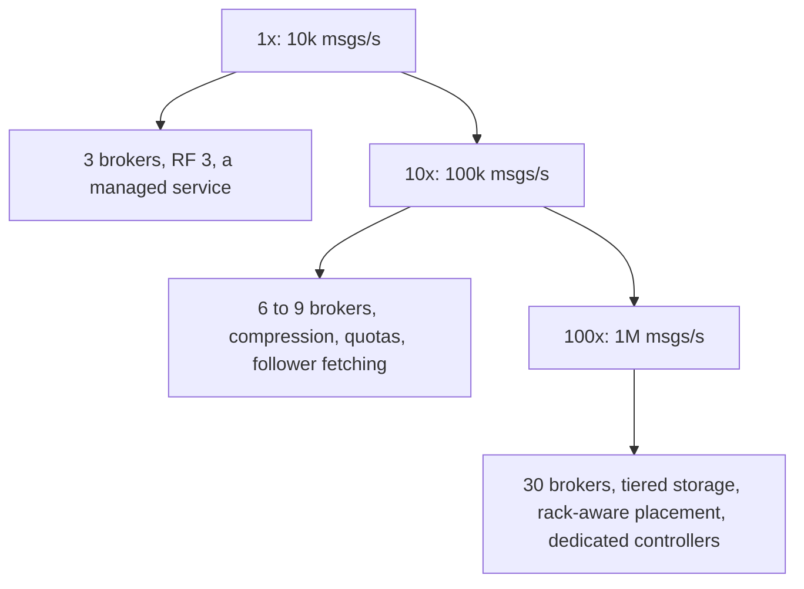

#### Deep dive: retention and compaction

**Time and size retention** never deletes individual messages. A background thread deletes whole **closed segments** whose newest message is older than `retention.ms` (7 days here) or that push the partition beyond `retention.bytes`. Deleting a 1 GB file is one cheap filesystem operation, which is why segment size matters: a huge segment delays deletion, and tiny segments mean many files and open handles.

**Log compaction** (`cleanup.policy=compact`) is for topics that represent **state**: the latest address per customer, the latest price per product, the offsets topic itself. The cleaner rewrites old segments, keeping only the most recent message for each key, so the topic's size tracks the number of keys rather than the number of updates. A message with a key and a null value is a **tombstone**: it deletes the key, and the tombstone itself is removed after `delete.retention.ms`, giving slow consumers time to see the deletion. A new service can rebuild its full state by reading a compacted topic from the beginning. Compaction never touches the active segment, and it preserves offsets (the survivors keep their original offsets, leaving gaps), so consumers must never assume offsets are contiguous.

### 72.3.11 Caching

The broker deliberately has **no message cache of its own**; the operating system's page cache plays that role, as 72.3.10 explained. That has two operational consequences worth knowing before they surprise you.

First, **a lagging consumer can hurt everyone**. Caught-up consumers read the newest bytes, which are in the page cache. A consumer replaying three days of a busy topic reads cold segments from disk, and those reads pull old pages into the cache, pushing out the recent pages that real-time consumers and followers need. Suddenly fetches that used to take 1 ms hit the disk and take 20 ms, and produce latency rises because followers fall behind. The mitigations are to give brokers generous RAM (64 to 128 GB, of which the JVM or process heap uses only a small part), to throttle replay consumers with fetch quotas, and to send big replays to followers rather than leaders.

Second, **retention and RAM are separate decisions**. Seven days of data sit on disk, but only minutes of it need to be in memory. That gap is what **tiered storage** exploits: closed segments are copied to object storage, and the broker keeps only the most recent hours on local disk. Consumers reading old data are served from object storage through the broker. Local disks shrink from 16 TB to a few TB per broker, and retention can grow to months at object-storage prices. Kafka added tiered storage as an early-access feature in 3.6 and declared it production-ready in 3.9. The cost is higher latency for historical reads, which batch consumers do not care about.

Follower fetching is the other "cache": a consumer configured with its availability zone reads from a replica in the same zone (`client.rack` with a rack-aware replica selector on the broker) instead of the leader, which saves cross-zone transfer charges and spreads read load.

### 72.3.12 Messaging inside the cluster: controller, metadata and backpressure

A message queue has messaging inside it too, and it is worth separating the two kinds of traffic.

**Data traffic** is producer to leader, leader to followers (followers fetch, exactly like consumers), and leader or follower to consumers. It never involves the controller, and it scales with brokers.

**Metadata traffic** is about who leads what. The controller quorum (three or five nodes) keeps the cluster metadata as a replicated log agreed through Raft. Every change is a record in that log: "broker 17 registered", "partition orders-7 leader is now b17, epoch 13", "ISR of orders-7 is now [b17, b29]". Brokers follow the metadata log, apply records to their in-memory view, and act on them: a broker that reads "you now lead orders-7" starts accepting produce requests for it. Brokers send heartbeats to the active controller; a broker that misses heartbeats is fenced and its partitions get new leaders. Because the metadata is a log, a broker that restarts catches up by reading only the records it missed, and a controller failover is a Raft leader election measured in seconds, not a full reload of state. Part 32 — Distributed Systems Fundamentals, sections 32.11 and 32.12, explains leader election and consensus, and why three or five nodes rather than two or four.

**Backpressure** has to exist at every hop, or one runaway client fills a broker:

- **Consumers** pull, so they apply their own backpressure: a slow consumer simply fetches less often, and the broker holds nothing extra for it.
- **Producers** are bounded by `buffer.memory` and `max.block.ms` in the client (72.3.10).
- **Brokers** enforce **quotas** per client or user: produce and fetch byte rates, and a request-time percentage. A client over quota is not rejected; the broker delays its response by a computed `throttle_time_ms`, and well-behaved clients also pause sending. Delay rather than error keeps clients from retry-storming.
- **Replication** is protected separately: partition reassignment traffic is throttled so that moving data to a new broker cannot starve live followers.

### 72.3.13 Scaling



| Stage | Load | Cluster | What changes and why |
|---|---|---|---|
| 1x | 10k messages/s, 10 MB/s | 3 brokers across 3 zones, combined controller and broker roles, RF 3 | Nothing exotic; honestly, use a managed service at this size |
| 10x | 100k messages/s, 100 MB/s | 6 to 9 brokers, dedicated 3-node controller quorum, producer compression, client quotas | Noisy neighbours appear; quotas and compression become necessary |
| 100x | 1M messages/s, 1 GB/s, 300 TB | 30 brokers, tiered storage, rack-aware replica placement, follower fetching, separate clusters for very different workloads | Cross-zone traffic and disk become the bill; recovery time of a failed broker matters |
| Beyond | Several GB/s, many teams | Several clusters by domain or criticality, with mirroring between them | Blast radius: one cluster's incident must not stop every team |

Scaling the cluster is **not automatic**. Adding a broker adds empty capacity; partitions stay where they are until a reassignment moves replicas onto it, copying data at a throttled rate. Moving 10 TB at 100 MB/s takes about 28 hours, which is why capacity is added before it is needed and why tiered storage (less local data to move) makes elasticity much better. Scaling a **topic** is also limited: partitions can be added but never removed, and adding them breaks key ordering at that moment, so busy topics are created with headroom (the estimate gave about 300 partitions for the busiest topic, three times its current need).

Throughput numbers to keep in mind, all approximate and hardware-dependent: one partition handles roughly 10 to 50 MB/s of writes; one well-configured broker handles several hundred MB/s to over 1 GB/s; a widely cited 2014 benchmark by Kafka's creators reached about 2 million small writes per second on three commodity machines. End-to-end latency within a region is typically a few milliseconds at p50 and tens of milliseconds at p99 with `acks=all`.

How such a system evolves in a company is predictable: one shared cluster; then quotas and topic naming rules when teams collide; then separate clusters for critical (payments) and bulk (logs, clickstream) traffic; then tiered storage when retention requests grow; then a platform team with self-service topic creation, schemas and ownership metadata.

### 72.3.14 Security

- **Encryption in transit** with TLS between clients and brokers and between brokers. It costs CPU and disables zero-copy `sendfile`, typically a noticeable throughput reduction on the broker, so size for it from the start.
- **Authentication** with mutual TLS or SASL (SCRAM passwords, or OAUTHBEARER tokens from your identity provider), one identity per service, never a shared superuser.
- **Authorization** with ACLs: which principal may produce to which topics, consume which topics, and use which consumer group ids. Prefix-based ACLs (`payments.*` to the payments team) keep this manageable.
- **Quotas** per principal, so one misbehaving client degrades only itself (72.3.12).
- **Encryption at rest** through encrypted volumes; for sensitive fields, encrypt in the producer so brokers and most consumers never see plaintext.
- **Data governance**: topics hold personal data for 7 days or, if compacted, forever; deletion requests for compacted topics need tombstones, and retention must be part of the privacy review.

### 72.3.15 Failure scenarios

| Failure | Detection | Impact | Mitigation | User sees |
|---|---|---|---|---|
| Broker crash | Controller misses heartbeats | Its leaders unavailable for seconds | New leaders elected from ISR; clients refresh metadata and retry | A latency blip; no loss with `acks=all` |
| Whole zone lost | Many brokers fenced at once | One replica of every partition gone | Replicas spread across zones; ISR of 2 remains, `min.insync.replicas=2` still met | Writes continue |
| Two replicas of a partition lost | ISR below 2 | Writes to that partition rejected | `NotEnoughReplicas` protects durability; restore a broker | Producers buffer, then fail for that partition |
| Follower slow (bad disk) | ISR shrink, under-replicated partitions | Less redundancy; with `acks=all` writes wait up to the lag time before it is removed | Replace the disk; alert on ISR shrink rate | Brief produce latency spike |
| Disk full on a broker | Disk usage alert | Broker stops; partitions go offline on it | Retention by size as a backstop, capacity alerts at 70 percent, tiered storage | Writes fail if not caught |
| Producer retries after timeout | Duplicate sequence numbers | Possible duplicates | Idempotent producer deduplicates per partition | Nothing |
| Consumer crashes mid-batch | Missed heartbeats, rebalance | Messages since last commit reprocessed | At-least-once with idempotent processing | Nothing, if consumers are idempotent |
| Rebalance storm | Frequent rebalances, lag grows | Group stops consuming repeatedly | Cooperative or new-protocol rebalancing, static membership, processing within `max.poll.interval.ms` (section 31.3.5) | Rising delays |
| Lagging replay consumer pollutes page cache | Disk reads rise, fetch latency rises | Slower real-time consumers and followers | Fetch quotas for replays, read from followers, tiered storage | Higher latency for others |
| Controller quorum loses majority | No active controller | No leader changes or topic changes; data path continues for healthy partitions | Five-node quorum for critical clusters across zones | Nothing until another failure needs a leader change |
| Unclean leader election enabled | Election from out-of-sync replica | Acknowledged messages silently lost | Keep it disabled for business data | Missing events |

### 72.3.16 Observability

The metrics that tell you the cluster is healthy, roughly in order of importance:

- **Under-replicated partitions** and **offline partitions**: both should be zero in steady state. Offline partitions page immediately; under-replicated partitions page if they persist beyond a deploy window.
- **ISR shrink and expand rates**: a flapping replica shows here before it shows anywhere else.
- **Request latency by phase** for produce and fetch: time in the request queue, local append time, time waiting for followers (remote time), and response send time. "Produce p99 is high" is useless; "remote time is high" means a slow follower.
- **Consumer lag** per group and partition, in offsets **and in seconds** (the age of the oldest unconsumed message). Lag in seconds is what a product manager understands.
- **Active controller count**, which must be exactly 1 across the quorum.
- **Disk usage, network in and out, request handler idle ratio** per broker.
- **Produce error rates by code**: `NotEnoughReplicas`, `NotLeaderOrFollower`, `OutOfOrderSequenceNumber`.

Section 47.7 covers how to wire Kafka metrics into a Prometheus and Grafana stack.

### 72.3.17 Deployment

Brokers are stateful, so deployments are careful rolling restarts, one broker at a time:

1. Wait until under-replicated partitions are zero.
2. Restart the broker with **controlled shutdown**: it asks the controller to move its leaderships to other ISR members first, so clients see a metadata refresh rather than timeouts.
3. Wait for the broker to rejoin and for all its replicas to return to the ISR.
4. Trigger **preferred leader election** so leadership returns to the original balance, then continue with the next broker.

A 30-broker rolling restart therefore takes hours, which is normal; automation, not people, should run it. Replicas are placed with **rack awareness** (rack equals availability zone) so that no two replicas of a partition share a zone. Configuration changes that can be applied dynamically should be, to avoid restarts. On Kubernetes, brokers run as a StatefulSet with persistent volumes and an operator that understands these steps; a plain rolling update that restarts the next broker before replicas catch up is a classic way to take partitions offline.

### 72.3.18 Cost considerations

| Item | Assumption | Monthly ballpark |
|---|---|---|
| Brokers | 30 storage-and-network-optimized instances | about 50,000 to 70,000 USD |
| Block storage | 30 x 16 TB at roughly 0.08 USD per GB-month | about 38,000 USD |
| Cross-zone replication | 1 GB/s peak, about 0.5 GB/s average before compression, 2 copies cross-zone, 3:1 compression, about 0.02 USD per GB (0.01 out plus 0.01 in) | about 17,000 USD |
| Cross-zone consumer reads | 3 groups; two thirds of reads cross zones without follower fetching | about 17,000 USD, mostly avoidable |

On a cloud provider, the surprise is that **network between zones** can cost as much as the brokers once volumes grow: every byte is replicated twice across zones and, without follower fetching, read across zones by most consumers. Producer compression divides all of it by the compression ratio, which is why compression is the first cost lever, follower fetching the second, and tiered storage (replacing replicated block storage with object storage for old segments) the third. Newer designs that write directly to object storage and avoid inter-zone replication altogether trade higher latency for much lower cost; they suit logging and analytics streams better than latency-sensitive business events.

### 72.3.19 Tradeoffs

| Decision | Options | Chosen | Why | Cost |
|---|---|---|---|---|
| Storage model | Per-message queue with acks, append-only log | Append-only partitioned log | Sequential I/O, replay, many independent consumers | No per-message ack, priorities or delays |
| Durability mechanism | `fsync` per write, replication across zones | Replication with `acks=all`, RF 3, min ISR 2 | Throughput of page-cache writes with multi-zone safety | Correlated power loss across zones could lose unflushed data |
| Delivery model | Push, pull | Pull with long-poll | Natural backpressure, replay, batching | Consumers own their offsets and their lag |
| Ordering | Global, per partition, none | Per partition | The only order that scales horizontally | Cross-key order needs a single partition |
| Metadata | External coordination service, built-in Raft quorum | Built-in Raft quorum | One system to run, faster failover, more partitions | Consensus code inside the product |
| Retention | Local disk only, tiered | Local recent plus tiered for old segments | Cheap long retention, faster rebalancing of data | Slower historical reads |
| Unclean election | Allowed, forbidden | Forbidden | Never lose acknowledged business events | A partition can be unavailable until an ISR replica returns |

### 72.3.20 Alternative architectures

**Use a managed service.** Before building any of this, the senior question is whether to build at all. Managed Kafka offerings and cloud-native streams (Kinesis, Pub/Sub, Event Hubs) cover most needs. You design your own only if you are a platform or infrastructure company, or your scale and cost profile justify a team to run it. This design is still worth knowing, because it explains the settings of every managed service you will use.

**Separated serving and storage.** Apache Pulsar splits stateless brokers from a storage layer (Apache BookKeeper) of append-only ledgers. Brokers can be added or replaced without moving data, and multi-tenancy and geo-replication are first-class, at the cost of running two distributed systems instead of one.

**Traditional queue.** RabbitMQ or SQS (sections 31.4 and 31.5) give per-message acknowledgement, redelivery, delays and dead-letter queues. They are better for task queues (send this email, resize this image) where messages are work items rather than an event history, and where nobody needs replay.

**PostgreSQL as the queue.** At hundreds of messages per second, a table with `SELECT ... FOR UPDATE SKIP LOCKED` is a perfectly good queue and needs no new infrastructure. It stops being good when you need many independent readers, replay, or tens of thousands of messages per second.

### 72.3.21 Incident story: the acknowledgement that was not durable

A payments platform ran its event cluster with replication factor 3 and producers using `acks=all`. Everyone believed every acknowledged event existed on three machines. Nobody had looked at `min.insync.replicas`, which was still at its default of 1.

On a Wednesday afternoon a broker in zone B started suffering a failing disk: writes were slow but did not error. Its follower replicas fell behind and, after 30 seconds, were removed from the ISR of about 400 partitions. An unrelated network change the same afternoon briefly isolated the zone C broker; it dropped out of the ISR of an overlapping set of partitions too. For about 90 seconds, 61 partitions of the `payments.captured` topic had an ISR of exactly one: the leader in zone A. With `min.insync.replicas=1`, `acks=all` meant "the leader has it", and the leader happily acknowledged roughly 18,000 events.

The under-replicated-partitions alert fired, as it did most afternoons during deploys, and was acknowledged without investigation. Two minutes later the zone A broker hit a kernel panic. The controller needed a new leader for those 61 partitions; the only replicas were out of sync, and unclean leader election was disabled, so the partitions went **offline**. That part worked as designed. But then, to "restore service", an engineer enabled unclean leader election on the topic. The zone C replicas became leaders, missing everything after their last fetch. When the zone A broker returned, it truncated its log to match the new leaders. The 18,000 acknowledged events were gone.

Reconciliation against the payment processor's settlement files the next morning found 18,214 captured payments with no downstream records: no receipts, no ledger entries. Recovering them took four days of manual reprocessing.

The postmortem changed four things. `min.insync.replicas=2` became mandatory for every topic and enforced at topic creation, so the same afternoon would have produced `NotEnoughReplicas` errors (loud, retryable, buffered by producers) instead of quiet single-copy acknowledgements. Under-replicated partitions outside a deploy window became a paging alert. Unclean leader election was removed from the runbook and blocked by policy for business topics. And slow-disk detection was added, because the root of the cascade was a disk that was failing slowly rather than cleanly. The lesson: **`acks=all` means "all in-sync replicas", and the in-sync set can shrink to one without anyone noticing.**

### 72.3.22 Interview follow-ups

1. **Why is a log-based broker so fast on ordinary hardware?**
   Expected answer: sequential appends, the OS page cache instead of an application cache, zero-copy transfer from page cache to socket because the stored format is the wire format, and batching at every hop. Follow-up: what does TLS change? (No plain `sendfile`; more CPU.)
2. **Walk me through what happens between a produce with `acks=all` and the acknowledgement.**
   Expected answer: the leader appends, followers fetch, their next fetch offsets prove storage, the high watermark advances when all ISR members have it, and the parked request completes; with `min.insync.replicas=2`, writes are refused if fewer than two replicas are in sync.
3. **A leader dies. What happens to messages it had but followers did not?**
   Expected answer: they were above the high watermark, never acknowledged under `acks=all`, and are truncated when the old leader returns as a follower, using leader epochs to find the exact point.
4. **How does the idempotent producer prevent duplicates, and why at most five in-flight requests?**
   Expected answer: producer id, epoch and per-partition sequence numbers; the broker remembers the last five batches per producer and partition, which matches the in-flight limit so every possible retry is recognizable.
5. **Can you give me exactly-once delivery?**
   Expected answer: exactly-once processing within the log via transactions and `read_committed`; for external side effects, at-least-once delivery plus idempotent consumers.
6. **Why can a consumer group not have more active members than partitions, and how do you choose the partition count?**
   Expected answer: each partition is owned by one member to preserve order; size by target throughput per partition and consumer parallelism with headroom, because adding partitions later breaks key ordering.

### 72.3.23 Practical exercise

Build a single-node, then two-node, log broker in Node.js and TypeScript.

1. Implement a partition log with 64 MB segments, a sparse offset index every 4 KB (the `OffsetIndex` from 72.3.10) and time-based segment deletion.
2. Expose `produce(partition, batch)` and `fetch(partition, offset, maxBytes, maxWaitMs)` over HTTP or a small TCP protocol, with fetch as a long-poll.
3. Add idempotent production with `ProducerStateManager` and test retries of the same batch.
4. Add a follower process that fetches from the leader, and implement a high watermark: `fetch` for consumers returns only messages below it, and `produce` with `acks=all` waits until the follower has the batch.
5. Implement a consumer group of two members with a coordinator that assigns partitions and stores committed offsets in a compacted internal log.

Acceptance criteria:

- Sustains at least 50 MB/s of 1 KB messages on a laptop with batches of 64 KB.
- Killing the leader after a successful `acks=all` produce never loses that batch once the follower is promoted.
- Retrying the same batch 100 times produces exactly one copy in the log.
- A consumer that crashes and restarts resumes from its last committed offset, reprocessing at most one batch.
- Fetching from an arbitrary offset in a 10 GB log returns the first message in under 5 ms.

#### Worked answer to the exercise

The piece most people get wrong is `acks=all`: the produce must wait until the follower has fetched past the batch. A partition leader keeps the followers' fetch positions, derives the high watermark from them, and resolves parked produce requests when it advances. That parking is a tiny version of the broker's request purgatory:

```ts
// broker/partition-leader.ts
import { EventEmitter } from 'node:events';
import { PartitionLog } from './partition-log';   // append(batch) -> { baseOffset, lastOffset }; read(offset, maxBytes)

export class PartitionLeader extends EventEmitter {
  private readonly followerLeo = new Map<string, bigint>();   // follower id -> next offset it asked for
  // `isr` holds the follower ids currently in sync; the leader itself is always in sync
  private hw = 0n;
  private readonly waiters: Array<{ lastOffset: bigint; resolve: () => void; timer: NodeJS.Timeout }> = [];

  constructor(private readonly log: PartitionLog, private readonly isr: Set<string>, private readonly minIsr = 2) { super(); }

  async produce(batch: Buffer, acks: 0 | 1 | -1, timeoutMs = 30_000): Promise<bigint> {
    if (acks === -1 && this.isr.size + 1 < this.minIsr) throw new Error('NOT_ENOUGH_REPLICAS');
    const { baseOffset, lastOffset } = await this.log.append(batch);
    this.emit('appended');                                     // wakes long-polling fetches
    if (acks !== -1) return baseOffset;
    await new Promise<void>((resolve, reject) => {
      if (this.hw > lastOffset) return resolve();              // a single-replica partition may already be there
      const timer = setTimeout(() => reject(new Error('REQUEST_TIMED_OUT')), timeoutMs);
      this.waiters.push({ lastOffset, resolve, timer });
    });
    return baseOffset;
  }

  /** A follower's fetch from `offset` proves it stores everything before `offset`. */
  onFollowerFetch(followerId: string, offset: bigint): void {
    this.followerLeo.set(followerId, offset);
    let newHw = this.log.endOffset();
    for (const id of this.isr) newHw = (this.followerLeo.get(id) ?? 0n) < newHw ? (this.followerLeo.get(id) ?? 0n) : newHw;
    if (newHw <= this.hw) return;
    this.hw = newHw;
    for (let i = this.waiters.length - 1; i >= 0; i--) {
      const w = this.waiters[i];
      if (w.lastOffset < this.hw) { clearTimeout(w.timer); w.resolve(); this.waiters.splice(i, 1); }
    }
  }

  highWatermark(): bigint { return this.hw; }                 // consumer fetches never read at or beyond this
}
```

Consumer fetches cap their reads at `highWatermark()`, follower fetches do not (they must be able to fetch beyond it, or the high watermark could never advance). Long-poll fetch is a promise that resolves on the `appended` event or after `maxWaitMs`.

How the acceptance criteria are proved: throughput comes from appending whole batches with one `write` per batch and serving fetches with `fs.read` into a reused buffer (or a `createReadStream` range piped to the socket). The durability test produces with `acks=-1`, waits for success, kills the leader with `SIGKILL`, promotes the follower and reads the batch back. The idempotence test resends one batch with the same producer id and sequence 100 times and counts records. The restart test commits offsets after each processed batch to the compacted offsets log, kills the consumer between processing and committing, and asserts the replay is at most one batch. The 5 ms random-access test exercises `OffsetIndex.lookup` plus a scan of at most 4 KB.
