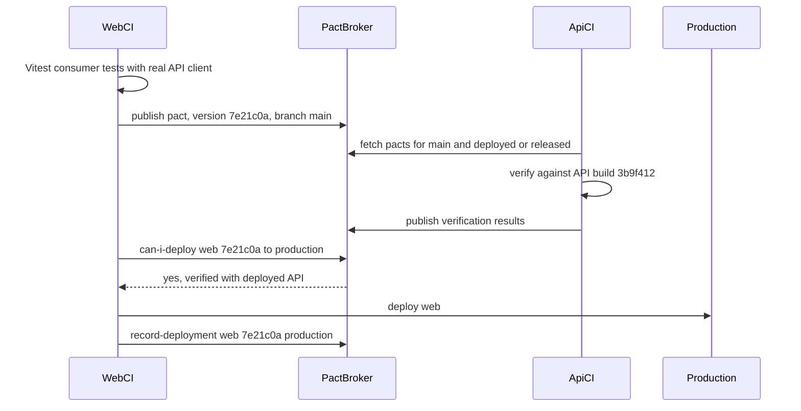

## 72.10 Contract testing between web and API

#### Concept

A **consumer-driven contract test** records what a consumer actually sends and reads, and replays it against the provider. Part 92.7 introduced Pact for service-to-service calls: the consumer writes a test against a Pact mock server, the test produces a **pact file**, a **Pact Broker** stores it, and the provider's CI **verifies** every relevant pact against a running instance of itself. This section applies it to the pair this volume cares about, the web app and the NestJS API, and adds what is specific to browsers: pacts generated from the real frontend client, verification against the web versions that are still in users' tabs, and the deploy gate (`can-i-deploy`) on both sides.

Contract tests sit between the other tools in this Part:

| Tool | Proves | Blind spot |
|---|---|---|
| Shared types (68.9, 80.3) | Code in one commit agrees | Deployed versions; other repositories |
| Spec diff (72.2, 32.7) | The published API did not break its own promise | What consumers actually rely on; undocumented behaviour |
| Runtime validation with telemetry (72.1) | What arrives in production matches | Only after deploy |
| Consumer contract tests (this section) | The provider still satisfies what each deployed consumer version uses | Fields and cases nobody wrote an interaction for |
| End-to-end tests (Part 75) | One journey works with both sides running | Slow, few paths, one version pair |

#### Why does it exist?

The spec diff answers "did the API break its promise?" It cannot answer "did the API break the merchant portal?", because the promise may be wider or narrower than what the portal uses. A field the spec marks optional may be one the portal cannot live without; a field the spec marks required may be one nobody reads, so removing it would be harmless. End-to-end tests answer the question for one pair of versions on one path, slowly. Consumer contract tests answer it for every consumer and every deployed version, in seconds, and they tell the API team who their consumers are.

#### Mental model

Imagine every tenant in a building writing down exactly which pipes and sockets their flat uses, and handing the list to the building manager. Before any renovation, the manager checks the plan against every tenant's list, including tenants who are away on holiday but still have a lease. The building's blueprint (the OpenAPI spec) shows every pipe; the tenant lists show which pipes matter to whom.

#### How it works



1. **Consumer tests use the real client.** The web's Pact tests call the same functions the UI uses (the `openapi-fetch` client of 72.2 and its parsers) against the Pact mock server. If the UI's client changes what it sends or reads, the pact changes with it.
2. **Assert only what the UI reads.** Matchers (`like`, `eachLike`, `regex`, `uuid`) describe types and formats, not exact values. A pact that pins every field of the response makes harmless API changes fail.
3. **Publish with version and branch.** The pact is tagged with the web build's Git SHA and branch.
4. **Provider verification** in the API's CI fetches the pacts selected by **consumer version selectors**, typically `{ mainBranch: true }` (what consumers are about to ship) and `{ deployedOrReleased: true }` (what is in production now). **Provider states** ("order 1d6c exists for user u1") are set up by state handlers that seed the database.
5. **Deploy gates on both sides.** Before deploying either app, CI runs `can-i-deploy` against the target environment. The broker checks its matrix of verified version pairs. After deploying, CI runs `record-deployment`.
6. **Old tabs count as releases.** `record-deployment` replaces the previous deployed version. For a web app whose old builds live on in open tabs, also run `record-release` for each build, and `record-support-ended` once version telemetry (72.9) shows its traffic is gone. Then `deployedOrReleased` covers every build still in use, not just the newest.

Messages work the same way. The order-status events streamed to the browser over SSE (70.8, and Part 77) can be covered with Pact's message pacts (`MessageConsumerPact`), where the consumer asserts the event payloads it handles and the provider verifies that its event builders produce them.

#### Practical example

The web app has 14 interactions with the orders API: list, get, cancel, create, and their important error cases (`404`, `409 ORDER_NOT_CANCELLABLE`, `422 PRICE_CHANGED`, `400 VALIDATION_FAILED`). The merchant portal has 6. The API's verification job runs 20 interactions against a test instance with a PostgreSQL container in 40 seconds. When an API engineer proposes changing `409` to `422` for non-cancellable orders, the web's interaction for that case fails verification, and the conversation about whether the change is worth it happens in the pull request, not in an incident.

#### React / Next.js example

A web consumer test, run by Vitest, using the real client:

```ts
// apps/web/src/api/orders.pact.test.ts  (@pact-foundation/pact 12, PactV3)
import { describe, expect, it } from 'vitest';
import { MatchersV3, PactV3 } from '@pact-foundation/pact';
import { createApi } from './client';               // createClient<paths>({ baseUrl }) plus middleware (80.2)
import { getOrder, cancelOrder } from '../orders/api';
import { ApiError } from './errors';

const { like, regex, uuid, eachLike, integer } = MatchersV3;
const pact = new PactV3({ consumer: 'web', provider: 'orders-api', dir: './pacts' });
const ORDER_ID = '1d6c0b6e-2f3a-4c55-9d1e-8a7b6c5d4e3f';

describe('web -> orders-api', () => {
  it('reads an order the way the order page does', () =>
    pact
      .given('order exists', { orderId: ORDER_ID, userId: 'u1', status: 'PAID' })
      .uponReceiving('a request for one order')
      .withRequest({ method: 'GET', path: `/v1/orders/${ORDER_ID}`, headers: { 'X-Client': 'web' } })
      .willRespondWith({
        status: 200,
        headers: { 'Content-Type': regex('application/json.*', 'application/json; charset=utf-8') },
        body: {                                     // only the fields OrderSummaryRead and the page use
          id: uuid(ORDER_ID),
          displayId: like('DK-20481'),
          status: like('PAID'),                     // open enum: type only, no fixed value set
          totalMinor: regex('^\\d+$', '129900'),    // integer minor units as a string (80.7)
          currency: regex('^[A-Z]{3}$', 'INR'),
          placedAt: regex('^\\d{4}-\\d{2}-\\d{2}T.*Z$', '2026-11-05T09:30:00.000Z'),
          version: integer(3),
          items: eachLike({ sku: like('TB-SONIC-01'), name: like('Sonic toothbrush'), quantity: integer(1) }),
        },
      })
      .executeTest(async (mock) => {
        const order = await getOrder(createApi(mock.url), ORDER_ID);   // parses with OrderSummaryRead
        expect(order.status).toBe('PAID');
      }));

  it('shows the not-cancellable error as the UI expects', () =>
    pact
      .given('order exists', { orderId: ORDER_ID, userId: 'u1', status: 'SHIPPED' })
      .uponReceiving('a cancel for a shipped order')
      .withRequest({ method: 'POST', path: `/v1/orders/${ORDER_ID}/cancel`, body: { reason: 'CHANGED_MIND' } })
      .willRespondWith({
        status: 409,
        headers: { 'Content-Type': 'application/problem+json' },
        body: { code: 'ORDER_NOT_CANCELLABLE', status: 409, title: like('Order cannot be cancelled'), issues: [] },
      })
      .executeTest(async (mock) => {
        const err = await cancelOrder(createApi(mock.url), ORDER_ID, 'CHANGED_MIND', 'key-1').catch((e) => e);
        expect(err).toBeInstanceOf(ApiError);
        expect((err as ApiError).code).toBe('ORDER_NOT_CANCELLABLE');   // the classifier's input (80.6)
      }));
});
```

The idempotency key header is deliberately not asserted with a fixed value; if the API made it required, a separate interaction asserts that the client sends one (`'Idempotency-Key': uuid()` in the request headers). The `X-Client` header is asserted because the API's version metrics rely on it.

Mocks used in component tests (MSW, Part 75) drift from reality in the same way hand-written types do. Two habits keep them honest: build MSW fixtures through the same zod schemas (`OrderSummarySchema.parse(fixture)` in the fixture module), and generate them from the spec where possible (`orval`'s `mock: true`, 72.2).

#### Backend side (NestJS)

Provider verification runs as a Jest test that boots the real Nest application against a test database:

```ts
// apps/api/test/pact/orders.provider.pact.spec.ts
import { Test } from '@nestjs/testing';
import type { INestApplication } from '@nestjs/common';
import { Verifier } from '@pact-foundation/pact';
import { DataSource } from 'typeorm';
import { AppModule } from '../../src/app.module';
import { ProblemDetailsFilter } from '../../src/common/problem-details.filter';
import { seedOrder, testAccessToken } from '../fixtures';

describe('orders-api provider verification', () => {
  let app: INestApplication;
  beforeAll(async () => {
    const mod = await Test.createTestingModule({ imports: [AppModule] }).compile();
    app = mod.createNestApplication();
    app.useGlobalFilters(new ProblemDetailsFilter());             // same wiring as main.ts, or the errors differ
    await app.listen(0);
  });
  afterAll(() => app.close());

  it('satisfies every selected consumer pact', async () => {
    const ds = app.get(DataSource);
    await new Verifier({
      provider: 'orders-api',
      providerBaseUrl: await app.getUrl(),
      pactBrokerUrl: process.env.PACT_BROKER_BASE_URL,
      pactBrokerToken: process.env.PACT_BROKER_TOKEN,
      providerVersion: process.env.GIT_SHA,
      providerVersionBranch: process.env.GIT_BRANCH,
      publishVerificationResult: process.env.CI === 'true',
      consumerVersionSelectors: [{ mainBranch: true }, { deployedOrReleased: true }],
      enablePending: true,                                        // new pacts warn until first verified
      stateHandlers: {
        'order exists': async (params) => {
          const p = params as { orderId: string; userId: string; status: string };
          await seedOrder(ds, p);                                 // TRUNCATE + INSERT in the test schema
        },
      },
      requestFilter: (req, _res, next) => {                       // authenticate as the state's user
        req.headers.authorization = `Bearer ${testAccessToken('u1')}`;
        next();
      },
    }).verifyProvider();
  }, 120_000);
});
```

Things the API team owns in this setup:

- **Provider states are an API.** Name them for business facts ("order exists" with parameters), keep handlers small, and never let them call external services.
- **Wire the test app like production**: global prefix, filters, pipes, interceptors. Otherwise verification checks a different API from the one deployed. Exporting a `configureApp(app)` function used by both `main.ts` and tests removes the duplication.
- **Gate deploys.** The API's pipeline runs `can-i-deploy --pacticipant orders-api --version $GIT_SHA --to-environment production` before deploying and `record-deployment` after.
- **Bi-directional option.** If running the provider for verification is impractical, PactFlow's bi-directional contract testing compares consumer pacts with the provider's published OpenAPI spec instead. It is cheaper and weaker: it trusts the spec to match the code, which 72.2's response validation in e2e tests must then guarantee.

The broker commands in CI:

```bash
# web pipeline
pnpm --filter web test:pact                                    # writes apps/web/pacts/web-orders-api.json
pact-broker publish apps/web/pacts --consumer-app-version "$GIT_SHA" --branch "$GIT_BRANCH"
pact-broker can-i-deploy --pacticipant web --version "$GIT_SHA" --to-environment production
# ... deploy ...
pact-broker record-deployment --pacticipant web --version "$GIT_SHA" --environment production
pact-broker record-release --pacticipant web --version "$GIT_SHA" --environment production   # old tabs keep it alive
# when version telemetry shows a build has no traffic (80.9)
pact-broker record-support-ended --pacticipant web --version "$OLD_SHA" --environment production
```

When not to bother: a single web app that lives in the API's monorepo, deploys with it in one pipeline, and has a measured old-tab tail of hours gains little from Pact over shared schemas, a spec diff and the reload nudge of 72.9. Pact earns its broker, its provider states and its extra CI minutes when there are consumers in other repositories, consumers on their own release trains, or consumer versions that must stay supported for weeks.

#### Production scenario

A food delivery company ran Pact between its web app, two mobile apps, a restaurant tablet app and the orders API: 7 consumers, 112 interactions. Verification took 70 seconds per API pull request. In a year, `can-i-deploy` blocked 26 API deploys; 19 were genuine breaks for a deployed consumer version (most often a mobile release still in support), and 7 were over-specified pacts that asserted exact values. After a pact review guideline ("type matchers by default, exact values only for codes and enums the UI branches on"), false failures dropped to about one a quarter.

#### Failure scenario

A web team adopted Pact and published pacts only from `main`, and the API verified only `{ mainBranch: true }`. A Tuesday API change removed `items[].imageUrl`, which the web's `main` branch had stopped using a week earlier. Verification passed. But production still ran the previous web build, which rendered order thumbnails from `imageUrl`, and the web's own deploy was frozen for a release. Order history showed broken images for 30 hours.

The broker knew which web version was in production only if someone told it. Adding `record-deployment` and `record-release` to the web pipeline, and `{ deployedOrReleased: true }` to the API's selectors, made the next such change fail verification before merge.

#### Edge cases & failure modes

- **Over-specified pacts** that assert exact strings or whole objects fail on harmless changes and teach teams to ignore failures.
- **Under-specified pacts** that use `like({})` for a body prove nothing.
- **Provider states that depend on test order** or shared data make verification flaky; reset per interaction.
- **Auth in verification**: a request filter that injects a valid test token is normal; disabling auth in the test app is not, because the auth guard's error shape is part of the contract.
- **Pending and WIP pacts**: `enablePending` lets a new consumer expectation warn instead of failing the provider until it is verified once; without it, a consumer can block the provider's main branch.
- **Contract tests are not functional tests**: they check shape and the cases written, not that cancellation actually cancels.

#### How a Senior Full-Stack Engineer thinks about this

The senior uses contract tests where the coupling is real and the consumers are known: the web app, the company's mobile apps and internal portals. They keep the spec diff for everything (including unknown public consumers) and add Pact for the consumers whose deployed versions the API must not break. They insist on pacts generated from the real client, matchers instead of values, deploy gates on both sides, and recorded releases for long-lived web builds. And they treat a red `can-i-deploy` as a conversation between two teams, not a test to be retried.

#### Common mistakes

- **Writing pacts against hand-rolled `fetch` calls** instead of the client the UI uses.
- **Verifying only `main`**, ignoring what is deployed.
- **Not recording deployments and releases**, so the broker's matrix is empty.
- **Exact-value assertions everywhere.**
- **Testing the provider with different wiring** from production.

#### Interview questions

1. **What does Pact catch that an OpenAPI diff does not?** Expected answer: breaks that matter to a specific deployed consumer version, including undocumented reliance; who the consumers are. Follow-up: and the reverse? (Spec diff covers unknown consumers and anything no pact asserts.)
2. **What are consumer version selectors and which would you use for a web app?** Expected answer: which pacts the provider verifies; `mainBranch` plus `deployedOrReleased`, with releases recorded for builds still in open tabs.
3. **How do you set up data for verification?** Expected answer: named provider states with parameters, handled by small seeding functions against a test database, reset per interaction.
4. **What is `can-i-deploy` checking?** Expected answer: the broker's matrix of verification results, for the version being deployed against the versions in the target environment.
5. **When would you use bi-directional contract testing?** Expected answer: when provider verification is too costly; it compares pacts with the provider's spec, so the spec must be validated against the code.

#### Practical exercise

Add Pact between the web app and the orders API.

Acceptance criteria:

- At least six web interactions, including two error cases, generated through the web's real API client.
- The API verifies `mainBranch` and `deployedOrReleased` pacts in CI against an app wired by the same `configureApp` function as `main.ts`.
- Removing a field the production web build reads fails API verification, even if the web's `main` branch no longer reads it.
- Both pipelines run `can-i-deploy` before deploying and `record-deployment` after; the web pipeline also records releases and ends support for builds with no traffic.
