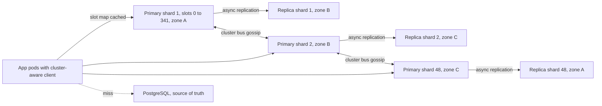
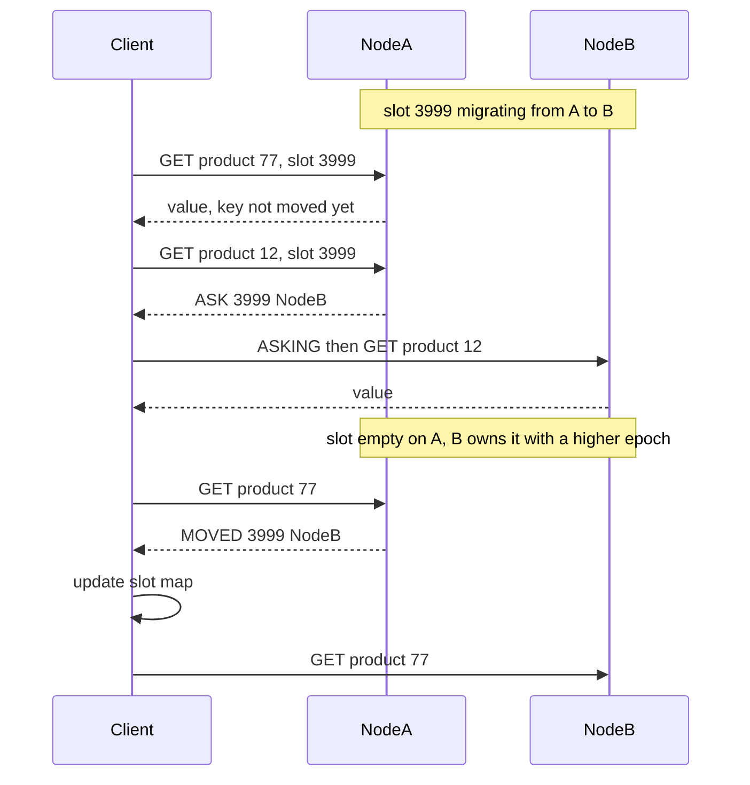
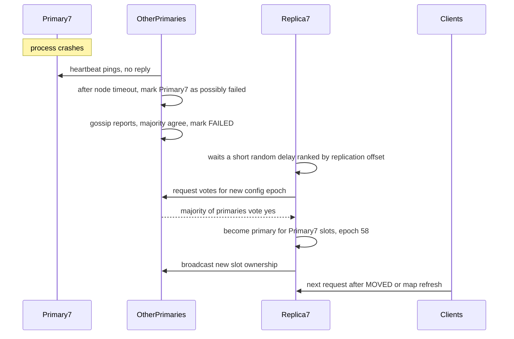

## 72.4 Distributed Cache

> **Try it first** · Level: Intermediate · About 45 minutes
>
> **Build:** a Redis- or Memcached-like in-memory key-value cache that spreads data across many servers and keeps working when servers fail.
>
> **Requirements:**
> - get, set with an expiry, delete, and atomic increment on keys, with sub-millisecond latency
> - spread keys across nodes and add or remove nodes without a full reshuffle
> - evict the least useful keys when memory is full, and expire keys when their TTL passes
> - replicate each shard and fail over automatically when a primary dies
> - survive hot keys, big keys and mass expiry without overloading the database behind it
>
> **Scale and constraints:** 5 million operations per second at peak (90 percent reads), 2 billion keys with values of about 1 KB (about 2.7 TB of memory including overhead and fragmentation, 5.4 TB with one replica per shard), p99 under 1 ms on the server and under 2 ms seen by clients in the same zone, 99.99 percent availability, failover of a dead primary within about 15 seconds; losing some cached data on a failure is acceptable, overloading the database is not.
>
> **Your task:** sketch the API, the data model and the main components; estimate storage and throughput; name the two hardest problems and how you would solve them.
>
> Spend the time on paper before you read on. The model design follows.

### 72.4.1 Requirements

A distributed cache keeps frequently read data in memory, close to the application, so that most reads never reach the database. Part 30 — Caching and Redis teaches how to **use** one: cache-aside, TTLs, invalidation, stampedes and Redis data structures. This design is about **building** one: a cluster in the style of Redis Cluster or a Memcached fleet, which must partition data across dozens of nodes, replicate it, evict and expire it, route every request to the right node in well under a millisecond, and fail over without a human.

The users are application services: product pages reading catalogue entries, session lookups, rate-limit counters, feature-flag reads, rendered fragments. All of them treat the cache as **disposable**: the truth is in PostgreSQL or another service, and a miss means "go and fetch it". That disposability is the most important requirement, because it shapes every decision. We can use asynchronous replication, lose a few seconds of writes on failover, and evict keys freely. What we cannot do is turn a cache failure into a database failure.

#### Mental model

Imagine a busy restaurant kitchen with a long counter of prep stations. Each cook owns a range of dishes and keeps the most-ordered ingredients within arm's reach; rarely used ones go back to the walk-in fridge (the database) when the counter gets full. Every waiter carries a card saying which station handles which dish, so orders go straight to the right cook. Each cook has an apprentice who copies everything they set out, ready to take over if the cook collapses. Ingredients with a "use by" sticker are thrown out when the cook notices them, or when a kitchen porter does a quick sweep. The stations are **shards**, the card is the **slot map**, the apprentice is the **replica**, the counter space is **memory**, and the sweep is **active expiry**.

### 72.4.2 Functional requirements

1. `GET`, `SET` with optional expiry and conditions (only if absent, only if present), `DEL`, `INCR`, `EXPIRE`, `TTL`, and multi-key `MGET` for keys on the same shard.
2. Partition keys across nodes; let clients route each key to its node directly.
3. Add and remove nodes online, moving only a fraction of keys, with no downtime.
4. Evict keys under memory pressure according to a configurable policy (approximate LRU, LFU, TTL-based, or never).
5. Expire keys at their TTL, without scanning the whole keyspace.
6. Replicate each shard to at least one replica in another zone and promote a replica automatically when a primary fails.
7. Expose enough introspection (memory, hot keys, big keys, slow commands) to operate the cluster.

Non-goals: being a durable database (section 30.10 explains the source-of-truth question), rich data structures beyond strings and counters (Redis's sorted sets, streams and so on are a superset worth having but are not the design problem), and cross-shard transactions.

### 72.4.3 Non-functional requirements

| Property | Target | Why |
|---|---|---|
| Latency | p99 under 1 ms on the server, under 2 ms seen by clients in-zone | The cache exists to be faster than the database (1 to 5 ms) |
| Throughput | 5M operations/s peak, 90 percent reads | Large product with many services |
| Capacity | 2 billion keys, about 2.7 TB of memory per copy | Hot working set of the business |
| Availability | 99.99 percent per shard; failover within about 15 s | Every service depends on it |
| Durability | Not required; a few seconds of writes may be lost on failover | It is a cache; the truth lives elsewhere |
| Elasticity | Add capacity online, moving about 1/N of keys | Growth must not mean downtime |
| Protection | A node loss or mass expiry must not multiply database load | The cache's real job is shielding the database |

### 72.4.4 Constraints

- Memory is the expensive resource; CPU and network are comparatively cheap. Every byte of per-key overhead is multiplied by 2 billion.
- The server should do as little as possible per request: no disk on the request path, no locks, no consensus round per write.
- Clients are many services in several languages. Smart clients must be available for each; otherwise a proxy is needed.
- Three availability zones; primaries and their replicas must be in different zones.

### 72.4.5 Capacity estimation

| Quantity | Assumption | Calculation | Result |
|---|---|---|---|
| Operations | given, 90 percent reads | | 5M/s peak: 4.5M reads, 0.5M writes |
| Keys | given | | 2 billion |
| Bytes per key | key ~40 B + value ~1,000 B + ~70 B of per-key overhead (hash table entry, object header, expiry entry, allocator rounding) | | about 1,110 bytes |
| Raw memory | 2B x 1,110 B | | about 2.2 TB |
| With fragmentation | allocator fragmentation ratio about 1.2 | 2.2 x 1.2 | about 2.7 TB per copy |
| With one replica | x 2 | | about 5.4 TB |
| Memory per primary | `maxmemory` 64 GB on a node with about 100 GB of RAM (headroom for replication buffers, client buffers, snapshots on replicas) | | 64 GB |
| Primaries for memory | 2.7 TB / 64 GB | | 42, round up to 48 for growth |
| Ops per primary | 5M / 48 | | about 105,000/s, inside one event loop's range of roughly 100,000 to 200,000 simple operations per second |
| Network per primary | 105,000 x ~1.1 KB | | about 115 MB/s, under 1 Gbit/s |
| Nodes | 48 primaries + 48 replicas | | 96 nodes |
| Client connections | 2,000 application pods x 1 to 2 connections per node (pipelined) | | up to about 4,000 connections per node |

Two numbers decide the design. **105,000 operations per second per primary** says a single-threaded event loop per shard is enough, provided every command is O(1) or close to it, and that one hot key, which cannot be split across shards, will be a problem long before total throughput is. **The 70 bytes of overhead per key** is 140 GB across 2 billion keys; it is why the server's in-memory layout matters, and why small values are often packed (many fields in one hash) rather than stored as separate keys.

### 72.4.6 API design

The protocol is a simple text-framed request-response protocol over persistent TCP connections (Redis's RESP is the model): a command name and arguments in, a typed reply out. Clients pipeline many commands on one connection without waiting for each reply.

| Command | Semantics | Complexity | Notes |
|---|---|---|---|
| `GET key` | Value or nil | O(1) | Updates the key's LRU or LFU metadata |
| `SET key value [EX s \| PX ms] [NX \| XX]` | Store, optionally with TTL and condition | O(1) | `NX` is "only if absent", the basis of locks and single-flight |
| `DEL key` / `UNLINK key` | Remove | O(1) / O(1) plus background free | `UNLINK` frees big values in a background thread |
| `INCR key` / `INCRBY key n` | Atomic increment, returns new value | O(1) | Counters and rate limits |
| `EXPIRE key s` / `TTL key` | Set or read remaining TTL | O(1) | |
| `MGET k1 k2 ...` | Several values | O(n) | Only if all keys are in the same hash slot (hash tags) |
| `CLUSTER SHARDS` | Slot ranges and nodes per shard | O(shards) | Clients build their routing table from it |

Two replies make the cluster work. **`-MOVED 3999 10.0.4.17:6379`** tells a client "slot 3999 lives on that node now; update your map and retry there". **`-ASK 3999 10.0.4.22:6379`** means "this slot is being migrated; for this one request, try the target node", without updating the map. Clients that understand these are called **cluster-aware** or **smart** clients (ioredis's `Cluster` class in Node.js is one).

### 72.4.7 Data model

**Partitioning.** The keyspace is divided into **16,384 hash slots**. A key's slot is `CRC16(key) mod 16384`; each primary owns a set of slot ranges. If a key contains a **hash tag**, a substring inside `{...}`, only that substring is hashed, so `cart:{user42}:items` and `cart:{user42}:total` land in the same slot and can be read with one `MGET` or updated in one script.

**Inside a node**, the keyspace is a hash table plus a second table for expiries:

```text
main dict:     key (string) -> object { type, encoding, lru_or_lfu (24 bits), refcount, value pointer }
expires dict:  key -> absolute expiry time in ms (only keys that have a TTL)
slot index:    slot -> keys in that slot (to migrate or count a slot without scanning everything)

encodings keep small things small:
  integer values stored inside the object header; short strings embedded with the header;
  small hashes and lists stored as compact, contiguous listpacks until they grow
```

The hash table grows by **incremental rehashing**: when it needs to double, a second table is allocated and each subsequent operation moves a few buckets, so there is never a long pause to rehash 40 million keys at once. The 24-bit `lru_or_lfu` field holds either a coarse last-access clock (for LRU) or an 8-bit logarithmic frequency counter plus a 16-bit decay timestamp (for LFU); 72.4.10 explains both.

**Cluster metadata** (the slot map) is small: 16,384 entries mapping to node ids, plus node addresses, roles, and a **configuration epoch** per primary. The epoch is a monotonically increasing number that decides conflicts: if two nodes both claim a slot, the higher epoch wins. That rule is what makes failover safe against a returning old primary.

### 72.4.8 High-level architecture



There is no central request router and no master node. Each application pod's client holds the slot map and sends each command directly to the primary that owns the key's slot (one network hop, about 0.2 to 0.5 ms in-zone). Primaries stream their writes asynchronously to replicas in other zones. All nodes talk to each other over a **cluster bus**, exchanging heartbeats and slot-map information by gossip; failure detection and failover happen there. The database sits beside the cache, not behind it: on a miss, the application fetches from PostgreSQL and writes the result to the cache (cache-aside, section 30.2).

### 72.4.9 Component design

| Component | Responsibility | Notes |
|---|---|---|
| Cache node | Execute commands on its slots, manage memory, expire and evict keys, replicate | Single-threaded command execution, optional I/O threads for socket reads and writes |
| Cluster bus | Heartbeats, gossip about other nodes, failure detection, failover votes, slot-map propagation | Separate port; small messages every second or so |
| Smart client | Compute slot, keep slot map, route, follow `MOVED` and `ASK`, pipeline, retry on failover | Most of the routing intelligence lives here |
| Optional proxy | Route for clients that are not cluster-aware; pool connections | Adds a hop (about 0.1 to 0.3 ms) but shields the cluster from tens of thousands of connections |
| Operator or control plane | Provision nodes, rebalance slots, replace failed nodes, apply config | Not on the request path |
| Near cache in the client | Optional in-process cache for a few very hot keys, invalidated by the server | 72.4.11 |

Why single-threaded command execution? Because with all data in memory and O(1) commands, a command takes about a microsecond, and the cost of locks, cache-line contention and context switches would exceed the work itself. One thread per shard gives every command atomicity for free (`INCR` cannot race) and makes latency predictable. Scaling is by adding shards, not threads. The price is that any slow command (`KEYS *`, deleting a 2 GB value synchronously, a long script) blocks **every** client of that shard, as section 30.7.1 shows. Memcached chose the other way: a multithreaded server with a slab allocator, simpler data types and no replication. It uses all cores of a large machine in one process, at the cost of fine-grained locking and fewer features.

### 72.4.10 Deep dive: partitioning, memory and eviction, replication and failover

#### Deep dive: consistent hashing versus hash slots, and routing

The naive scheme, `hash(key) mod N`, moves almost every key when N changes from 48 to 49, which empties the cache and stampedes the database. Two schemes fix that.

**Consistent hashing with virtual nodes** (section 70.2 builds it in full) places each node at many points (say 160) on a hash ring; a key belongs to the first node clockwise from its hash. Adding a node takes over small arcs from many nodes, moving about 1/N of the keys. This is what Memcached client libraries commonly do (the "ketama" scheme): the servers know nothing about each other, and every client computes the same ring from the same server list. It is simple, but every client must have exactly the same list, and there is no server-side notion of "who owns what" to coordinate migration or failover.

**Hash slots** add one level of indirection: keys map to a fixed number of slots (16,384), and slots map to nodes through an explicit table. Adding a node means **moving whole slots**, chosen by the operator or a rebalancer; removing one means moving its slots elsewhere. The table is small enough to gossip and to cache in every client, and moving one slot is an explicit, observable operation that can be throttled, paused or reversed.

| Scheme | Keys moved when adding a node | Who knows the mapping | Migration | Choose when |
|---|---|---|---|---|
| `hash mod N` | Nearly all | Everyone, trivially | Not possible without emptying | Never for a cache that matters |
| Consistent hashing, virtual nodes | About 1/N | Each client computes it | Implicit: new owner starts empty, keys refill from the database | Simple fleets without replication (Memcached) |
| Hash slots with explicit table | About 1/N, in slot units | Servers own and gossip it; clients cache it | Explicit, live, key by key with `ASK` redirects | Replicated clusters needing online resharding (Redis Cluster) |

We choose hash slots. Live migration of a slot from node A to node B works like this: B marks the slot as importing and A as migrating; a mover copies keys in batches with an atomic migrate command; during the move, A still serves keys it has and answers `ASK` for keys already moved, so a client looking for a moved key asks B for that one request; when the slot is empty on A, the new owner is announced with a bumped epoch, and clients that still go to A get `MOVED` and update their maps.



The client side of routing is small and worth seeing:

```ts
// cache-client/slot-router.ts: slot computation and MOVED handling for a cluster-aware client
function crc16(buf: Buffer): number {                 // CRC16-CCITT (XMODEM), as used for hash slots
  let crc = 0;
  for (const byte of buf) {
    crc ^= byte << 8;
    for (let i = 0; i < 8; i++) crc = crc & 0x8000 ? ((crc << 1) ^ 0x1021) & 0xffff : (crc << 1) & 0xffff;
  }
  return crc;
}

export function slotOf(key: string): number {
  const open = key.indexOf('{');
  if (open !== -1) {
    const close = key.indexOf('}', open + 1);
    if (close > open + 1) key = key.slice(open + 1, close);   // hash tag: hash only what is inside {...}
  }
  return crc16(Buffer.from(key)) % 16384;
}

export class SlotRouter {
  private readonly owner = new Array<string>(16384);        // slot -> "host:port" of the primary

  constructor(private readonly refreshMap: () => Promise<Array<{ from: number; to: number; node: string }>>) {}

  async init(): Promise<void> {
    for (const r of await this.refreshMap()) for (let s = r.from; s <= r.to; s++) this.owner[s] = r.node;
  }

  nodeFor(key: string): string { return this.owner[slotOf(key)]; }

  /** Call when a node replies with an error string; returns where to retry, or null. */
  onError(err: string): { node: string; asking: boolean } | null {
    const [kind, slot, node] = err.split(' ');                // "MOVED 3999 10.0.4.17:6379"
    if (kind === 'MOVED') { this.owner[Number(slot)] = node; return { node, asking: false }; }
    if (kind === 'ASK') return { node, asking: true };        // send ASKING then the command, map unchanged
    return null;
  }
}
```

A production client also refreshes the whole map after any `MOVED` (one move usually means more are coming), caps redirect hops at a few, and handles `CLUSTERDOWN` and `TRYAGAIN` during failover and migration. In NestJS you would not write this yourself; you would use ioredis's `Cluster` client behind a provider, but knowing what it does tells you why a resharding causes a brief burst of extra round trips.

#### Deep dive: memory, eviction and expiry

When memory reaches `maxmemory`, the node must evict something on the next write. The policy decides what:

| Policy | Evicts | Use for |
|---|---|---|
| `allkeys-lru` | Approximately least recently used, any key | General caches where recent use predicts future use |
| `allkeys-lfu` | Approximately least frequently used, any key | Caches with a stable popular set and scans of cold keys |
| `volatile-lru`, `volatile-lfu`, `volatile-ttl` | Only keys with a TTL, by recency, frequency or soonest expiry | Mixed data where some keys must not be evicted |
| `noeviction` | Nothing; writes fail with an error | Data you cannot lose (section 71.1 tells the story of what happens otherwise) |

**Exact LRU is too expensive here.** A true LRU (section 10.17 in Part 10 — Computer Science Fundamentals: Data Structures) keeps a doubly linked list through every key and moves a key to the front on every access: two extra pointers per key (16 bytes, 32 GB across 2 billion keys) and pointer writes on every read. Instead, each object stores a 24-bit coarse access clock, and eviction **samples**: pick 5 random keys (`maxmemory-samples`), add the best candidates to a small pool of 16 kept across evictions, and evict the one idle longest. With 10 samples the result is very close to true LRU in practice, at zero per-key cost beyond the 24 bits already in the header.

**LRU has a weakness**: one scan over cold keys (a batch job reading every product once) makes them all "recent" and pushes out the genuinely popular ones. **LFU** fixes this by counting frequency in the same 24 bits: 16 bits hold a minutes-resolution timestamp of the last decay, and 8 bits hold a **logarithmic counter** that can represent millions of hits by incrementing with decreasing probability:

```ts
// The probabilistic counter behind LFU: 8 bits that can represent millions of accesses
const LFU_INIT_VAL = 5;                       // new keys start here so they are not evicted instantly

export function lfuIncrement(counter: number, logFactor = 10): number {
  if (counter === 255) return 255;
  const base = Math.max(counter - LFU_INIT_VAL, 0);
  const p = 1 / (base * logFactor + 1);       // the higher the counter, the less likely it grows
  return Math.random() < p ? counter + 1 : counter;
}

export function lfuDecay(counter: number, minutesSinceDecay: number, decayMinutes = 1): number {
  return Math.max(counter - Math.floor(minutesSinceDecay / decayMinutes), 0);   // popularity fades
}
// With logFactor 10, reaching 255 takes on the order of a million hits; 100 hits reach only about 10.
```

The decay step is essential: without it, a key that was popular last month would stay "frequent" forever.

**Expiry** uses two mechanisms together, because neither works alone:

1. **Lazy expiry**: every access to a key first checks its expiry time; an expired key is deleted and reported as missing. This is exact for keys that are read, and costs nothing.
2. **Active expiry**: keys that expire and are never read again would sit in memory forever. So about ten times a second the node checks a batch of about 20 keys from the expires table (random samples in the classic description of the algorithm; recent Redis versions walk the table incrementally instead), deletes the expired ones, and if a large share of the batch was expired (more than a quarter in the classic description; recent versions use a lower threshold tuned by `active-expire-effort`), repeats immediately, within a CPU time limit. The memory held by already-expired keys therefore stays a small fraction of the keys with TTLs.

Both are probabilistic and cheap, which is the theme of the whole node: no global scans, no per-key timers, no extra pointers.

#### Deep dive: replication, failure detection and failover

Each primary streams every write command to its replica **asynchronously**: the primary replies to the client first and sends the write to the replica a moment later. A replica that disconnects briefly resumes from a **replication backlog**, a ring buffer of recent writes (sized to cover a minute or so of writes; at 0.5M writes per second across 48 shards, about 10,000 writes per second per shard, a 64 MB backlog covers about 6 seconds at 1 KB per write, so production backlogs are often 256 MB to 1 GB). A replica that falls further behind needs a **full resync**: the primary takes a snapshot and ships the whole dataset, which for 64 GB takes minutes and loads the primary heavily.

Failure detection and failover, in the Redis Cluster style:



1. Every node pings others over the cluster bus. If a primary does not answer within `cluster-node-timeout` (15 seconds by default; production clusters often use 5 to 15), the observer marks it as **possibly failing**.
2. Nodes gossip these suspicions. When a **majority of primaries** report it, it is marked **failed**, cluster-wide.
3. Its replicas wait a short delay, shorter for the replica with the most data (highest replication offset), then ask the primaries for votes for a new **configuration epoch**.
4. A majority of primaries vote; the winning replica becomes primary for those slots with the new, higher epoch and announces it.
5. Clients get `MOVED` (or refresh their map after connection errors) and carry on.

Total failover time is roughly the node timeout plus a second or two, which is where "about 15 seconds" in the requirements comes from. During that window, keys in that shard's slots fail; with 48 shards that is about 2 percent of keys.

**What gets lost?** Writes the primary acknowledged but had not yet sent to the replica, typically the last few milliseconds to a second. For a cache that is acceptable: the next read misses and refills from the database. The `WAIT numreplicas timeout` command lets a client block until its writes reach replicas, which narrows the window but does not make the system strongly consistent (a failover can still choose a replica that missed the write).

**Split brain.** If a network partition isolates a primary with a minority of the cluster, the majority side promotes its replica, and the old primary may keep accepting writes from clients on its side. Two defences limit the damage: a primary that cannot reach a majority of primaries for the node timeout stops accepting writes, and when the partition heals, the higher configuration epoch wins, so the old primary becomes a replica of the new one and discards its divergent writes. The writes accepted on the minority side during the timeout are lost. Again: acceptable for a cache, unacceptable for a database, which is the deepest reason a cache is not a database (section 32.3 discusses split brain in general).
