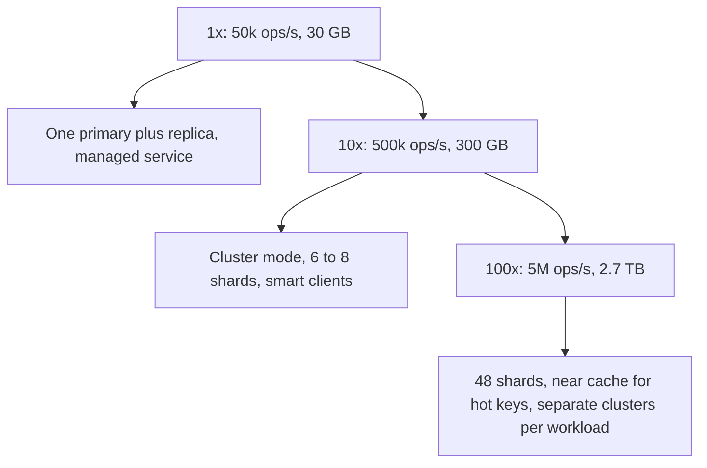

#### Deep dive: persistence options and what they cost

A cache does not need persistence for correctness, but an empty cache after a restart can hurt the database badly enough that some persistence is worth having. Each option has a real cost, and section 30.7.3 compares them from the user's side.

| Option | How it works | Restart behaviour | Cost on the node |
|---|---|---|---|
| None (pure cache) | Memory only | Restarts empty; refills from the database | Nothing, but a cold restart sends a shard's full miss load to the database |
| Snapshots (RDB) | Periodically `fork()`; the child writes the whole dataset to a file while the parent keeps serving | Loads the last snapshot: minutes of data lost | The fork copies page tables (tens of ms for 64 GB, which stalls the event loop), and every page the parent writes during the snapshot is duplicated (copy-on-write), up to doubling memory under heavy writes |
| Append-only file (AOF) | Log every write; `fsync` every second; rewrite the log in the background (also by fork) | Replays the log: about one second of data lost | Disk write bandwidth, periodic rewrite forks, slower restarts for big logs |
| Hybrid | AOF whose rewrite starts with a snapshot | Fast load plus about a second of loss | Both of the above |

The design choice for this cluster: **no persistence on primaries, snapshots on replicas only, and replication to a replica in another zone as the real protection.** A primary failure promotes a warm replica, so nothing restarts empty. Snapshots on replicas cover the rare loss of both copies of a shard, and they keep the fork's copy-on-write cost off the primaries that serve traffic. Every node is sized with memory headroom (64 GB of data on about 100 GB of RAM) because any node may need to fork, for a snapshot or to serve a full resync to a new replica. Whatever you choose, one rule is non-negotiable and is the subject of the incident in 72.4.21: a primary without persistence must never come back from a crash as an empty primary.

### 72.4.11 Caching

A cache design still has its own caching questions, because the hardest problems are not total throughput but **uneven** load: one key, one value or one moment that is far hotter than average.

**Hot keys.** A key read 300,000 times per second (the homepage configuration, a celebrity's profile, a flash-sale product) lives in one slot on one primary. That primary's single thread saturates at around 100,000 to 200,000 operations per second, whatever the size of the cluster. Mitigations, from cheapest to most complex:

1. **Near cache in the client.** Keep the hottest keys in each application pod's memory for a short time. Redis 6 and later support **server-assisted client-side caching** (`CLIENT TRACKING`): the server remembers which keys a connection has read and sends an invalidation message when one changes, so the near cache can hold keys until they change rather than for a guessed TTL. With 2,000 pods, 300,000 reads per second become a few thousand.
2. **Read from replicas.** In cluster mode a client can send `READONLY` to replicas and spread reads of a hot shard across its primary and replicas, accepting replication lag.
3. **Key splitting.** Store N copies (`flags:home#0` to `flags:home#7`, which hash to different slots) and have readers pick one at random; writers update all N. This turns one hot shard into eight warm ones, at the cost of N writes and brief inconsistency between copies.

Finding hot keys needs data, not guesses: with an LFU policy, `redis-cli --hotkeys` samples the keyspace and reports the highest-frequency keys; per-shard CPU and operations-per-second skew show which shard to look at first (section 30.5.5).

**Big keys.** A 50 MB value (a giant serialized list, a hash with millions of fields) makes every read move 50 MB through the single thread and the network, makes migration of its slot stall, and blocks the node when deleted synchronously. Find them with `redis-cli --bigkeys` or `MEMORY USAGE key`; split them into bounded pieces; delete with `UNLINK` (memory freed in a background thread) and enable lazy freeing for eviction and expiry (section 30.5.6).

**Stampedes.** When a hot key expires or its shard fails over, thousands of concurrent requests miss at once and all query the database for the same row. Protections, which section 30.5.2 covers in depth: **single-flight** in each pod (one fetch per key per pod, others wait for it), a short **lock** in the cache (`SET lock:key token NX PX 3000`) so only one pod in the fleet refreshes, **stale-while-revalidate** (keep serving the old value while one caller refreshes), **probabilistic early refresh** (each reader near expiry refreshes with a small, rising probability, so one of them does it before the key actually expires), and **TTL jitter** so keys written together do not all expire together (an avalanche).

```ts
// cache/early-refresh.ts: probabilistic early recomputation (the "XFetch" idea)
export interface Entry<T> { value: T; computeMs: number; expiresAt: number }

/** True if this reader should recompute now, before the entry actually expires. */
export function shouldRefreshEarly<T>(e: Entry<T>, now = Date.now(), beta = 1.0): boolean {
  // -ln(random) is usually small and occasionally large; slow-to-compute values start refreshing earlier
  const head = e.computeMs * beta * -Math.log(Math.random());
  return now + head >= e.expiresAt;
}
```

Combined with single-flight, this means a hot key is refreshed by one caller slightly before it expires, and the database sees one query instead of a spike.

### 72.4.12 Messaging

The cluster has three internal message flows, and one external one that is often misused:

- **Replication stream**: primary to replica, every write command, asynchronous, resumable from the backlog.
- **Cluster bus gossip**: every node pings a few others each second with its view of the cluster (node states, slot ownership, epochs). At 96 nodes the traffic is small, but it grows with the square of the node count in the worst case, which is one practical reason very large single clusters (many hundreds of nodes) are avoided in favour of several clusters.
- **Invalidation messages** for client-side caching, sent to clients that have read a key when it changes.
- **Keyspace notifications** (pub/sub messages such as "key expired") are fire-and-forget: a disconnected subscriber misses them, and an expiry event fires when the key is actually removed, which can be later than its TTL. They are fine for hints and dashboards, never for business logic like "charge the customer when the reservation key expires". Use a real queue or a durable scheduler for that (Part 31 — Messaging: Queues, Topics, Kafka, RabbitMQ and SQS).

### 72.4.13 Scaling



| Stage | Load | Cluster | What changes and why |
|---|---|---|---|
| 1x | 50,000 ops/s, 30 GB | One primary and one replica in another zone, automatic failover | A single shard handles it; do not shard what fits |
| 10x | 500,000 ops/s, 300 GB | Cluster mode with 6 to 8 shards, cluster-aware clients, hash tags for multi-key operations | Memory and the single thread force sharding; multi-key commands now need key design |
| 100x | 5M ops/s, 2.7 TB | 48 shards, near caches for hot keys, value compression, separate clusters for sessions, rate limits and general caching | Hot keys and noisy neighbours matter more than raw capacity |
| Beyond | Tens of TB, many teams | Several clusters behind a routing layer, per-tenant quotas, some data tiered to SSD | Gossip and blast radius cap cluster size |

**Online resharding** is how the cluster grows: add a new primary and replica, then move slots to it a few at a time with live migration (72.4.10). Moving 1/49 of 2.7 TB (about 55 GB) at a throttled 50 MB/s takes about 20 minutes, during which clients see occasional `ASK` redirects and slightly higher latency for keys in moving slots. Rebalancing should be done before memory reaches about 75 percent, because migration itself needs headroom.

Separating workloads into different clusters is a scaling step as much as a safety step: a session store (must not be evicted, `noeviction`), a rate-limit store (small, write-heavy) and a general cache (large, `allkeys-lfu`) have different policies, sizes and failure tolerances, and one cluster cannot be configured correctly for all three.

### 72.4.14 Security

- **Never reachable from the internet.** Open, unauthenticated cache servers on the public internet have been a long-running source of data leaks and compromised machines. Run in private subnets, with security groups allowing only application subnets.
- **Authentication and authorization** with ACL users: one user per service, with only the commands and key patterns it needs (for example, a service may run `GET` and `SET` only on keys matching `catalog:*`). Dangerous commands (`FLUSHALL`, `KEYS`, `CONFIG`, `DEBUG`) are denied to application users.
- **TLS** in transit between clients and nodes and on the cluster bus and replication links. It costs CPU (I/O threads help), so measure throughput with TLS enabled, not without.
- **Data hygiene.** Caches often hold personal data copied from the database. Apply the same classification: TTLs on personal data, no secrets or full card numbers, encryption at rest for snapshots, and deletion requests that reach the cache as well as the database.

### 72.4.15 Failure scenarios

| Failure | Detection | Impact | Mitigation | User sees |
|---|---|---|---|---|
| Primary crash | Cluster bus timeout, majority agreement | Its slots (about 2 percent of keys) unavailable for about 15 s | Automatic replica promotion; clients treat errors as misses with a short timeout and circuit breaker | Slightly slower pages for affected keys |
| Primary restarts empty before failover | Sudden key count drop on one shard, hit ratio drop | Shard emptied, replica resyncs to empty | Never auto-restart a non-persistent primary faster than the node timeout (72.4.21) | Database overload risk |
| Network partition | Nodes in minority cannot reach majority | Minority primary stops writes after the timeout; its writes in that window lost | Epochs resolve ownership on heal | Brief errors for some keys |
| Hot key | One shard's CPU near 100 percent | High latency for every key on that shard | Near cache, replica reads, key splitting | Slow pages |
| Big key read or delete | Slow log, latency spikes | Event loop blocked for many ms | Split values, `UNLINK`, lazy freeing | Latency spikes |
| Mass expiry | Miss rate spike at a round time | Database load spike | TTL jitter, early refresh, single-flight | Possible slowness |
| Memory full with `noeviction` | Write errors (OOM command not allowed) | Writes fail | Alert at 80 percent; right policy per cluster | Errors for writes |
| Fork during snapshot or full resync | Latency spike, memory jump | Stall, possible OOM | Snapshots on replicas only, headroom, transparent huge pages disabled | Spike or outage of a shard |
| Client connection storm after a deploy | Connection count spike | Node CPU spent on accepts and TLS handshakes | Connection pooling, gradual rollouts, proxy for very large fleets | Brief latency |
| Whole cache cluster down | All requests error | Every read goes to the database | Load shedding and rate limits in front of the database, degraded features (section 34.8) | Degraded but working product, if planned |

The last row is the one to rehearse. If the database cannot survive the cache being gone, the cache has become part of the database's capacity, and its availability target must be treated as the database's. Know your **cold-cache capacity**: how much traffic the system serves with an empty cache, and how load shedding protects the database while the cache refills.

### 72.4.16 Observability

Per node and per cluster:

- **Hit ratio** (hits over hits plus misses) per cluster and, through client metrics, per key prefix. A drop is often the first sign of a deploy that changed key formats.
- **Memory**: used memory against `maxmemory`, fragmentation ratio, and **evicted keys** per second. Steady evictions are expected in an LRU or LFU cache; evictions in a `noeviction` or session cluster are an incident.
- **Expired keys** per second and keys with TTLs, to spot TTL mistakes (keys with no TTL growing forever).
- **Latency**: client-observed p99 per command and per shard, the slow log, and latency monitoring for fork and expiry events.
- **Throughput skew**: operations per second and CPU per shard. A shard at three times the average has a hot key.
- **Replication**: offset lag between primary and replica, full resyncs per hour (should be near zero), link status.
- **Cluster state**: all slots covered, number of failovers, nodes in failed state.

Alerts: memory above 80 percent of `maxmemory` on any shard; any full resync loop; hit ratio down 10 points in 10 minutes; shard CPU above 80 percent for 10 minutes; cluster state not ok.

### 72.4.17 Deployment

Nodes are stateful, so changes roll one shard at a time, replicas first:

1. Upgrade or restart the replica of shard 1 and wait for it to resync (partial resync from the backlog if it was quick).
2. Run a manual failover from that replica (`CLUSTER FAILOVER` on the replica), which hands over with no lost writes because the primary pauses clients until the replica has caught up.
3. Upgrade the old primary, now a replica. Move to shard 2.

Host settings matter as much as cache settings: transparent huge pages disabled (they turn copy-on-write of a 4 KB page into a 2 MB copy), memory overcommit configured so `fork()` does not fail, `maxmemory` set well below physical RAM, and no CPU limits that throttle the event loop. On Kubernetes, use an operator that understands primaries and replicas, pod anti-affinity across zones, and process restart rules that respect the incident below. Most teams should simply use a managed service, which handles all of this; the knowledge is still needed to configure it and to diagnose it.

### 72.4.18 Cost considerations

| Item | Assumption | Monthly ballpark |
|---|---|---|
| 96 memory-optimized nodes, about 100 GB RAM each, self-managed | roughly 0.60 to 0.90 USD per hour each | about 42,000 to 63,000 USD |
| Same capacity on a managed cache service | managed premium | roughly 1.3 to 2x the self-managed figure |
| Cross-zone traffic | replication of writes plus clients reading from other zones | a few thousand USD; more if clients ignore zone locality |

Memory is the bill, so memory efficiency is the cost lever. **Compress values** on the client: 1 KB of JSON often compresses to 300 to 400 bytes, which can nearly halve the cluster. **Shorten keys** and drop fields nobody reads. **Pack small values** into hashes (one hash per user with 20 small fields instead of 20 keys saves the per-key overhead 19 times). **Set TTLs on everything** so dead keys do not occupy paid memory. And check the business case: if the cache saves several large database replicas, it pays for itself many times; if its hit ratio is 40 percent, it may not.

### 72.4.19 Tradeoffs

| Decision | Options | Chosen | Why | Cost |
|---|---|---|---|---|
| Partitioning | `mod N`, consistent hashing, hash slots | 16,384 hash slots | Explicit ownership, live migration, small map to gossip | Multi-key operations need hash tags |
| Routing | Smart client, proxy | Smart client; proxy only for non-cluster-aware clients | One hop, lowest latency | Every language needs a good cluster client |
| Threading | Single-threaded per shard, multithreaded | Single-threaded execution, I/O threads | Atomic commands, predictable latency | Hot keys cap at one core; slow commands block a shard |
| Replication | Synchronous, asynchronous | Asynchronous, `WAIT` where needed | Sub-ms writes | Last writes lost on failover |
| Failover coordination | Gossip with majority vote, external control plane | Gossip with majority vote and epochs | No extra system to run | Failover time tied to the node timeout |
| Eviction | Exact LRU, sampled LRU, LFU | Sampled LFU for the general cache | Resists scans, zero extra per-key memory | Approximate; new keys need an initial counter |
| Persistence | None, RDB, AOF, hybrid | None on primaries, RDB on replicas | Speed on primaries, cheap safety net | A both-copies loss restarts cold |

### 72.4.20 Alternative architectures

**Memcached fleet with client-side consistent hashing.** Multithreaded servers, a slab allocator, no replication, no persistence, servers unaware of each other. Very fast and very simple, and a node loss simply means its keys refill from the database. It wins for pure look-aside caching of simple values when the database can absorb a node's worth of misses. It lacks data structures, replication and online migration.

**Managed services.** ElastiCache, Memorystore, Azure Cache and similar run the cluster for you, including failover and patching; some offer durable variants (MemoryDB keeps a multi-zone transaction log, making it usable as a primary database at higher write latency). For most teams this is the right answer.

**Multithreaded Redis-compatible servers.** Valkey (the open-source fork of Redis created in 2024), KeyDB and Dragonfly use more cores per process in different ways. Fewer, larger nodes reduce the shard count and soften the hot-key ceiling, at the cost of a different operational profile and, in some cases, less mature clustering.

**In-process cache only.** For small, read-mostly datasets (configuration, feature flags, a few thousand products), each pod holding its own copy with a short TTL or an invalidation feed needs no cache cluster at all. It breaks down when the data is large or per-user, or when pods must agree on a value.

### 72.4.21 Incident story: the primary that came back empty

The cache cluster ran with persistence disabled on all nodes, by design: "it's a cache". Pods were managed by an orchestrator that restarted any crashed container within a few seconds.

At 11:02 on a weekday, the operator replaced the replica of shard 17 during a routine node rotation. The new replica requested a full resync, so the primary forked to stream its 58 GB dataset. Shard 17 was write-heavy that morning because of a catalogue import, and the host still had transparent huge pages enabled. Copy-on-write duplicated memory in 2 MB pages, and within about 40 seconds the primary's process grew past the container's memory limit. At 11:03:10 the kernel's OOM killer ended it.

The orchestrator restarted the container 4 seconds later. The cluster's node timeout was 15 seconds, so the other primaries never marked shard 17 as failed; from their point of view it had blinked. It came back with its identity and its slots, as a primary, and with **no data**, because there was no persistence to load. The new replica, still syncing, dutifully resynced from its primary and became empty too. Shard 17 now answered every request for its 341 slots with a miss.

Those slots happened to hold the product-detail entries for the bestselling categories. Miss traffic to PostgreSQL jumped from about 4,000 to 31,000 queries per second within a minute. Read replicas hit 100 percent CPU, product pages timed out, and because the cache-aside code had no single-flight, each popular product was being fetched by hundreds of pods at once. The checkout path, which shared the database, started failing at 11:06. The incident lasted 38 minutes: the team rate-limited cache-miss queries at the database proxy, which let the cache refill gradually.

The postmortem changed five things:

1. **Restart policy.** A primary without persistence now waits longer than the node timeout before restarting, so the cluster fails over to a replica instead of accepting an empty primary. (The Redis documentation warns about exactly this combination of disabled persistence and automatic restarts.)
2. **Host settings.** Transparent huge pages disabled fleet-wide; memory limits set to leave headroom for copy-on-write during a fork; full resyncs rate-limited to one per cluster at a time.
3. **Single-flight and stale-while-revalidate** in the shared cache library, so a cold shard produces one database query per key per pod, not hundreds.
4. **Cold-cache capacity** measured and load shedding put in front of the database, so a cold shard degrades product pages instead of breaking checkout.
5. **An alert on key count drops**: any shard losing more than 20 percent of its keys in a minute pages immediately.

The lesson: **a cache failure becomes a database incident unless you design for the cache being empty.**

### 72.4.22 Interview follow-ups

1. **Why hash slots rather than `hash(key) mod N`, and what does consistent hashing add?**
   Expected answer: `mod N` remaps nearly every key when N changes; consistent hashing and hash slots move about 1/N; slots add explicit, gossiped ownership and live migration with `MOVED` and `ASK`. Follow-up: how do you do a multi-key operation in a sharded cache? (Hash tags put related keys in one slot.)
2. **How does the server evict "least recently used" keys without a linked list through 2 billion keys?**
   Expected answer: a 24-bit access clock per object and sampling of a few keys into an eviction pool; LFU uses an 8-bit logarithmic counter with decay in the same bits.
3. **How do keys with a TTL get removed if nobody reads them?**
   Expected answer: lazy expiry on access plus an active cycle that samples keys with TTLs about ten times a second and repeats while many are expired, within a CPU budget.
4. **A primary dies. What happens, how long does it take, and what is lost?**
   Expected answer: peers time out, a majority marks it failed, the replica with the most data wins a vote for a new epoch, clients follow `MOVED`; about the node timeout plus a second; asynchronously replicated writes not yet sent are lost.
5. **One key gets 300,000 reads per second. What do you do?**
   Expected answer: near cache with server-assisted invalidation, replica reads, or splitting into N copies; adding shards does not help because one key lives on one shard.
6. **Size a cache for 2 billion 1 KB values.**
   Expected answer: about 1,110 bytes per key with overhead, times fragmentation, about 2.7 TB per copy, 5.4 TB with replicas; at 64 GB per primary about 42, rounded to 48 shards, which also gives about 105,000 operations per second per shard.

### 72.4.23 Practical exercise

Build a small distributed cache in Node.js and TypeScript, then compare it with Redis Cluster.

1. Write a single-node cache server that speaks a subset of RESP (`GET`, `SET` with `EX` and `NX`, `DEL`, `INCR`, `TTL`) with lazy and active expiry and sampled-LRU eviction under a configurable memory limit.
2. Run three nodes and write a client that uses `slotOf` and `SlotRouter` from 72.4.10 with a static slot map, then implement live migration of one slot with `ASK` and `MOVED`.
3. Add asynchronous replication from each primary to a replica process and a manual failover command.
4. In a NestJS service, add a cache-aside read path for product data in PostgreSQL with single-flight and probabilistic early refresh, using ioredis's `Cluster` client against a real Redis Cluster for comparison.

Acceptance criteria:

- Under a memory limit, the eviction policy keeps a Zipf-distributed hot set with a hit ratio within 5 points of an exact LRU simulation.
- Keys written with a 10-second TTL and never read occupy no memory 30 seconds later.
- Migrating a slot under a load of 10,000 operations per second produces no client errors.
- Expiring a key that 500 concurrent requests read at once causes at most one database query per service instance.
- Killing a primary and its restart within 2 seconds never leaves an empty primary serving its slots (your restart policy must prove it).

#### Worked answer to the exercise

The single-node server's two background behaviours, active expiry and sampled eviction, fit in a few dozen lines once the key table is a `Map` plus a separate `Map` of expiry times:

```ts
// cache-node/store.ts
interface Item { value: Buffer; lastAccess: number }

export class Store {
  private readonly data = new Map<string, Item>();
  private readonly expires = new Map<string, number>();      // key -> absolute ms
  private used = 0;

  constructor(private readonly maxBytes: number, private readonly samples = 5) {
    setInterval(() => this.activeExpire(), 100);               // about ten cycles per second
  }

  get(key: string): Buffer | undefined {
    const exp = this.expires.get(key);
    if (exp !== undefined && exp <= Date.now()) { this.delete(key); return undefined; }   // lazy expiry
    const item = this.data.get(key);
    if (item) item.lastAccess = Date.now();
    return item?.value;
  }

  set(key: string, value: Buffer, ttlMs?: number): void {
    this.delete(key);
    while (this.used + value.length > this.maxBytes && this.data.size > 0) this.evictOne();
    this.data.set(key, { value, lastAccess: Date.now() });
    this.used += value.length;
    if (ttlMs) this.expires.set(key, Date.now() + ttlMs);
  }

  delete(key: string): void {
    const item = this.data.get(key);
    if (item) { this.used -= item.value.length; this.data.delete(key); }
    this.expires.delete(key);
  }

  private randomKeys(from: Map<string, unknown>, n: number): string[] {
    const keys = [...from.keys()];                            // fine for an exercise; real servers sample buckets
    return Array.from({ length: Math.min(n, keys.length) }, () => keys[Math.floor(Math.random() * keys.length)]);
  }

  private evictOne(): void {                                  // sampled LRU: oldest of a few random keys
    let victim: string | undefined, oldest = Infinity;
    for (const k of this.randomKeys(this.data, this.samples)) {
      const t = this.data.get(k)!.lastAccess;
      if (t < oldest) { oldest = t; victim = k; }
    }
    if (victim) this.delete(victim);
  }

  private activeExpire(): void {
    const deadline = Date.now() + 25;                         // CPU budget per cycle
    for (;;) {
      const sample = this.randomKeys(this.expires, 20);
      if (sample.length === 0) return;
      const now = Date.now();
      const expired = sample.filter((k) => (this.expires.get(k) ?? Infinity) <= now);
      expired.forEach((k) => this.delete(k));
      if (expired.length <= sample.length / 4 || Date.now() > deadline) return;   // repeat only if many expired
    }
  }
}
```

Copying all keys into an array to sample them is O(n) and only acceptable at exercise scale; a real server samples random buckets of its own hash table in O(1).

How the acceptance criteria are proved: the hit-ratio test replays a Zipf-distributed key trace (exponent about 1.0) through this store and through an exact LRU built on a `Map` (delete and re-insert on access keeps insertion order as recency order), and compares hit ratios; raising `samples` from 5 to 10 closes most of the gap. The TTL test writes 100,000 keys with a 10-second TTL, never reads them, and checks the store's size after 30 seconds. The migration test runs a load generator through `SlotRouter` while moving one slot and counts errors (`ASK` and `MOVED` must be handled, never surfaced). The stampede test fires 500 concurrent reads at an expiring key through a NestJS service whose cache-aside method uses a per-key promise map (single-flight) and counts PostgreSQL queries with a query logger. The restart test configures the process supervisor with a restart delay longer than the failover timeout and asserts, after killing the primary, that its replica owns the slots before the old process returns as a replica.
