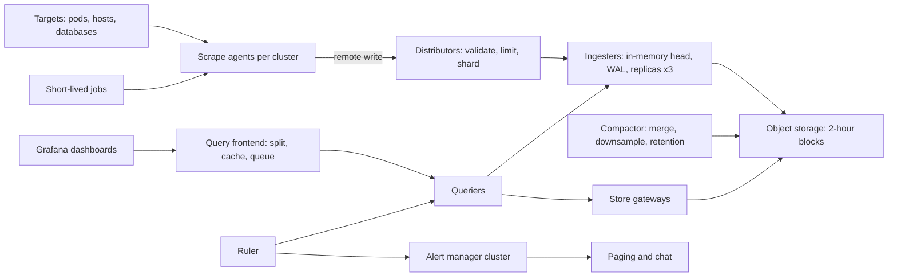
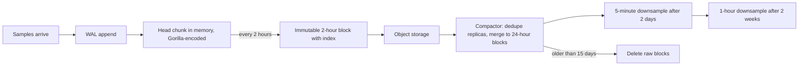

## 72.7 Monitoring and Alerting

> **Try it first** · Level: Advanced · About 60 minutes
>
> **Build:** a monitoring and alerting platform that collects metrics from every service and host, stores them as time series, answers dashboard queries, and pages the right on-call engineer when something breaks.
>
> **Requirements:**
> - collect metrics from 20,000 targets (pods, hosts, databases) by scraping, and accept pushes from short-lived jobs
> - store labelled time series: 15 days at full resolution and 13 months downsampled
> - answer PromQL-style queries for dashboards and investigations
> - evaluate alert rules continuously, then deduplicate, group, silence and route alerts to on-call schedules
> - keep working when the systems it watches fail, and tell someone when it is failing itself
>
> **Scale and constraints:** 10 million active series, 15-second scrape interval (about 670,000 samples per second), 20,000 alert rules evaluated every 30 to 60 seconds, 500 dashboard queries per second at peak, a page sent within 1 minute of an alert starting to fire, 99.9 percent availability in a failure domain separate from the production systems.
>
> **Your task:** sketch the API, the data model and the main components; estimate storage and throughput; name the two hardest problems and how you would solve them.
>
> Spend the time on paper before you read on. The model design follows.

### 72.7.1 Requirements

A monitoring platform answers two questions all day: "is everything healthy right now?" and, when it is not, "who needs to know, and what do they need to see?" Every service exposes **metrics**: numbers that change over time, such as requests per second, error counts, latency histograms, queue depth, memory used. The platform collects them as **time series** (a sequence of timestamped values identified by a metric name and labels), stores them, lets people query and graph them, and turns rules like "error rate above 5 percent for 5 minutes" into pages.

This design is about **building** the platform. How to *use* one from a NestJS service (metric types, labels, `/metrics`, PromQL, dashboards) is Part 47 — Observability: Logs, Metrics and Traces, section 47.3; what to alert on (SLOs, burn rates, on-call practice) is Part 53 — Site Reliability Engineering; and counting business events exactly, for billing, is the different problem of 71.4. Monitoring accepts approximation (a missed scrape is a small gap in a graph) but not silence.

Imagine the central nursing station of a large hospital. Every bed has a monitor sampling heart rate and oxygen every few seconds. The station shows all of them, keeps the history for the doctors, and sounds an alarm at the right nurse's pager when a patient crosses a threshold. A good station does not ring twenty alarms for one patient whose sensor slipped, does not page the night nurse about a scheduled procedure, and above all notices when a monitor itself goes dark. Collection, storage, display, alarms, and watching the watchers: that is this design.

### 72.7.2 Functional requirements

1. Discover targets automatically (Kubernetes pods, hosts, managed databases) and scrape their metrics endpoints every 15 seconds.
2. Accept pushed metrics from short-lived batch jobs and from agents that cannot be scraped.
3. Store time series with labels; 15 days at full resolution, 13 months at 5-minute resolution.
4. Answer instant and range queries in PromQL (the Prometheus query language) for dashboards, ad-hoc investigation and alert rules.
5. Evaluate alert and recording rules on a schedule.
6. Deduplicate, group, inhibit and silence alerts, then route them to the right team by labels: page, chat message or ticket.
7. Page on-call engineers with escalation if nobody acknowledges.
8. Monitor itself and alert through an independent path when it is unhealthy.

**Non-goals.** Storing and searching logs and traces (separate systems, linked from metrics; 72.7.20). Exact business counts for billing (71.4). Automated anomaly detection with machine learning. Building the on-call scheduling product itself (we integrate with one).

### 72.7.3 Non-functional requirements

| Property | Target | Why |
|---|---|---|
| Ingest | 670,000 samples/s steady, 2x headroom for bursts and restarts | 10 million series every 15 s |
| Query latency | p99 under 2 s for a dashboard panel over 24 hours | Engineers investigating an incident cannot wait |
| Alert latency | Notification within 1 minute of an alert firing | Detection time is part of every outage |
| Availability | 99.9 percent, independent of production | Monitoring must be up exactly when production is down |
| Retention | 15 days raw, 13 months downsampled | Incident investigation, then capacity trends |
| Isolation | One team's mistake cannot take monitoring down for all | Cardinality explosions are the classic outage (72.7.10) |

### 72.7.4 Constraints

- **The workload is write-heavy and append-only.** Every series receives a new sample every 15 seconds; samples are almost never updated or deleted individually.
- **Reads are recent-biased.** Most queries cover the last hour; a few cover months.
- **Labels are chosen by hundreds of teams.** The platform cannot review every metric, so it must protect itself from bad ones.
- **It must not share fate with what it watches.** If monitoring runs on the same Kubernetes cluster, network and cloud account as production, the outage that matters most will take both down.

### 72.7.5 Capacity estimation

| Quantity | Assumption | Calculation | Result |
|---|---|---|---|
| Active series | 20,000 targets x 500 series each | | 10 million |
| Samples per second | 10 million / 15 s | | about 670,000/s |
| Samples per day | 670,000 x 86,400 | | about 58 billion |
| Bytes per sample, compressed | Gorilla-style encoding, 1 to 2 bytes; use 1.5 | | |
| Raw storage per day | 58 billion x 1.5 B | | about 86 GB/day (plus index) |
| 15 days raw | | 86 GB x 15 | about 1.3 TB |
| 5-minute downsampled | 10M series x 288 points/day x 4 aggregates (min, max, sum, count) x 1.5 B | about 17 GB/day x 395 days | about 7 TB |
| Ingester memory | about 4 to 8 KB per in-memory series (Part 47, section 47.3.3), replication factor 3 | 30 million in-memory series x 6 KB | about 180 GB, e.g. 30 ingesters with 16 GB each |
| Rule evaluation load | 20,000 rules every 60 s | | about 330 queries/s |
| Dashboard load | | given | 500 queries/s at peak |
| Heavy query | 7-day panel over 1,000 series at 15 s resolution | 1,000 x 40,320 samples | 40 million samples: needs downsampled data or splitting |

The estimate says: the storage is small (a few terabytes, cheap in object storage), but **memory** is the scarce resource, because every active series costs a few kilobytes on the ingesters whether anyone queries it or not. Cost and stability therefore scale with the number of **series**, not samples or bytes. That makes cardinality, the number of distinct label combinations, the central capacity number of the whole platform. Second, queries over long ranges must use downsampled data or they read tens of millions of samples. Third, alert rules alone are a constant 330 queries per second that must never be starved by a heavy dashboard.

### 72.7.6 API design

| Interface | Shape | Notes |
|---|---|---|
| Scrape | `GET /metrics` on each target, Prometheus text or OpenMetrics format | Target exposes current values; the scraper adds the timestamp |
| Remote write | `POST /api/v1/push`, protobuf body compressed with Snappy | Prometheus `remote_write` and OpenTelemetry collectors send batches |
| Instant query | `GET /api/v1/query?query=<promql>&time=` | Used by alert rules |
| Range query | `GET /api/v1/query_range?query=&start=&end=&step=` | Used by dashboards |
| Series and labels | `GET /api/v1/series`, `GET /api/v1/labels` | Discovery, autocomplete |
| Rules | YAML rule groups per team, stored in Git, loaded by the ruler | Reviewed like code |
| Alerts in | `POST /api/v2/alerts` on the alert manager | From rule evaluators |
| Silences | `POST /api/v2/silences` with label matchers and an end time | Planned maintenance |

These are the Prometheus and Alertmanager HTTP APIs, which nearly every compatible system implements, so Grafana and existing tooling work unchanged. A scrape returns plain text:

```text
# TYPE http_requests_total counter
http_requests_total{service="checkout",route="/orders",method="POST",status="201"} 1048231
http_requests_total{service="checkout",route="/orders",method="POST",status="500"} 312
# TYPE http_request_duration_seconds histogram
http_request_duration_seconds_bucket{service="checkout",route="/orders",le="0.1"} 980112
http_request_duration_seconds_bucket{service="checkout",route="/orders",le="+Inf"} 1048543
```

### 72.7.7 Data model

A **series** is identified by its metric name plus its full set of label pairs. Change any label value and it is a different series. Each series is a list of **samples**: a 64-bit millisecond timestamp and a 64-bit float value.

```text
series   {__name__="http_requests_total", service="checkout", route="/orders", method="POST", status="500"}
series id = hash of the sorted label pairs  -> 0x9f3a1c...
samples  (1762862400000, 312) (1762862415000, 312) (1762862430000, 315) ...

inverted index (per block):
  service="checkout"   -> postings [12, 98, 1033, 5550, ...]   (sorted series ids)
  status="500"         -> postings [98, 7001, 9932, ...]
  query {service="checkout", status="500"} = intersect the two lists -> [98, ...]
```

The **inverted index** maps each label pair to a sorted **postings list** of the series that have it, exactly like a search engine's index maps words to documents (Part 37 — Search). A query selects series by intersecting postings lists, then reads only those series' samples for the time range. Samples are grouped into **chunks** (about 120 samples, roughly 30 minutes at 15 s), compressed, and chunks are grouped into **blocks** covering a fixed time range (2 hours, later compacted into larger blocks). Each block is immutable once written and carries its own index, which makes retention trivial: deleting old data is deleting old blocks.

### 72.7.8 High-level architecture



**Scrape agents** run in each production cluster, discover targets and scrape them, then forward samples with remote write. **Distributors** validate samples, enforce per-tenant limits and hash each series to three **ingesters**, which keep recent data in memory with a write-ahead log and flush 2-hour blocks to **object storage**. The **compactor** merges blocks, downsamples and applies retention. Reads go through a **query frontend** that splits and caches queries, to **queriers** that read recent data from ingesters and older data from **store gateways** over object storage. The **ruler** evaluates rules through the same query path and sends alerts to a clustered **alert manager**, which routes notifications to paging and chat. This is the architecture of horizontally scalable Prometheus-compatible systems such as Cortex and Grafana Mimir; Thanos reaches a similar result by attaching sidecars to ordinary Prometheus servers.

### 72.7.9 Component design

| Component | Responsibility | Scales by |
|---|---|---|
| Scrape agent | Service discovery, scraping, relabelling, local buffering, remote write | One or more per cluster, sharded by target |
| Distributor | Authentication by tenant, validation, rate and series limits, replication to ingesters via a hash ring | Stateless replicas |
| Ingester | Head block in memory, WAL, chunk compression, flush blocks to object storage | Series count (memory) |
| Object storage | Durable, cheap block storage (72.5) | Effectively unlimited |
| Compactor | Merge small blocks, deduplicate replicas, downsample, delete expired blocks | Tenants and time ranges |
| Query frontend | Split by day, align steps, cache results, fair queueing per tenant | Stateless replicas |
| Querier and store gateway | Execute PromQL; fetch index and chunks from ingesters and blocks | Query load |
| Ruler | Evaluate rule groups on schedule, write recording rules back, send alerts | Rule groups, sharded |
| Alert manager | Deduplicate, group, inhibit, silence, route, notify | Small cluster gossiping state |

### 72.7.10 Deep dive: collection, storage and cardinality

The hard problems are storing 670,000 samples a second in a few bytes each while answering queries fast, protecting the platform from cardinality explosions, and making alerts arrive reliably without drowning people. The first two are here; the alert pipeline and monitoring the monitor are in 72.7.12 and 72.7.16.

#### Deep dive: pull versus push

In the **pull** model (Prometheus's default), the monitoring system scrapes each target's `/metrics` endpoint on a schedule. In the **push** model (StatsD, OpenTelemetry's OTLP export, CloudWatch agents), targets send their metrics to a collector.

| Question | Pull (scrape) | Push |
|---|---|---|
| Is the target dead or just quiet? | Obvious: the scrape fails, and the synthetic `up` series becomes 0 | Ambiguous: no data could mean idle or dead |
| Who controls load? | The monitoring system sets the interval | Targets can flood the collector |
| Short-lived jobs | Missed if they end between scrapes | Natural fit |
| Targets behind NAT or firewalls | Hard | Easy |
| Configuration | Central, via service discovery | Every target must know where to send |

The design uses both, in a common pattern: **pull at the edge, push to the core**. Agents in each cluster scrape local targets (getting `up` and load control for free) and then push batches with remote write to the central platform, which is easy to place behind a load balancer. Short-lived batch jobs push to the agent, or use a push gateway sparingly; a push gateway remembers the last value forever, so a job that stopped running still looks alive unless you also push and alert on a "last success" timestamp.

#### Deep dive: the time-series storage engine

Ingesters receive samples for their share of series. Each sample is appended to a **write-ahead log** (sequential writes to disk, replayed after a crash) and to the series' open in-memory **chunk**. Compression is where the bytes go: the encoding published by Facebook in its 2015 Gorilla paper, which Prometheus adapted, exploits the regularity of monitoring data.

- **Timestamps** are stored as the **delta of deltas**. Scrapes are every 15 s, so the deltas are 15000, 15000, 15001, 14999 ms, and the deltas of those deltas are 0, 1, -2. A delta-of-delta of 0 is stored as a single bit.
- **Values** are stored as the **XOR** with the previous value. A counter that changes slowly or a gauge that holds steady shares most bits with its previous value; XOR leaves mostly zero bits, and only the meaningful middle bits are written.

```ts
// Why regular scrapes compress well: most delta-of-deltas are zero (one bit each).
export function deltaOfDeltas(timestampsMs: number[]): number[] {
  const out: number[] = [];
  for (let i = 2; i < timestampsMs.length; i++) {
    const d1 = timestampsMs[i] - timestampsMs[i - 1];
    const d0 = timestampsMs[i - 1] - timestampsMs[i - 2];
    out.push(d1 - d0);
  }
  return out;
}
// deltaOfDeltas([0, 15000, 30000, 45001, 60000, 75000]) -> [0, 1, -2, 1]
// Encoded as: '0' bit for zero, a short prefix plus 7 bits for small values like 1 or -2.
```

The Gorilla paper reported about 1.37 bytes per sample on Facebook's data; Prometheus documents 1 to 2 bytes per sample, compared with 16 bytes uncompressed. That is how 58 billion samples a day fit in about 86 GB.

Every 2 hours, an ingester cuts the head into an immutable **block** (chunks plus an inverted index for that time range), uploads it to object storage, and truncates its WAL. With replication factor 3, three ingesters upload overlapping blocks for the same series; the **compactor** later merges them into one deduplicated block, then merges small blocks into larger ones (for example 2 hours, then 12 hours, then 24 hours) so queries over long ranges open fewer index files.

**Downsampling** makes long-range queries affordable. For data older than a couple of days, the compactor writes a second copy at 5-minute resolution, and for data older than a few weeks at 1-hour resolution, keeping **min, max, sum and count** per interval (Thanos, for example, does exactly this). Keeping four aggregates rather than one average matters: an average hides the 30-second spike that was the incident, while max preserves it, and sum plus count recompute a correct average at any coarser step. **Retention** is block deletion: raw blocks after 15 days, 5-minute blocks after 13 months.



#### Deep dive: cardinality, the resource that takes monitoring down

Every distinct combination of label values is a new series, and each active series costs memory in the ingesters, an entry in every block's index, and work in every query that touches its metric. Cardinality multiplies: a histogram with 12 buckets, on 40 routes, 4 methods, 8 status codes and 300 pods is `12 x 40 x 4 x 8 x 300 = 4.6 million` series from one metric. Add a label holding a user id, an order id or a raw URL path with ids inside, and the count grows with traffic instead of with code.

The platform cannot rely on every team getting labels right (Part 47, section 47.3.3, lists the rules for application developers). It defends itself in layers:

1. **Limits at the distributor**, per tenant: maximum active series, maximum series per metric, maximum label value length, maximum samples per second. A sample that would create a series beyond the limit is rejected, counted in a `discarded_samples_total{reason="per_metric_series_limit"}` metric, and reported back to the sender.
2. **Relabelling at the agent**: drop known-dangerous labels or whole metrics before they leave the cluster.
3. **Visibility**: a per-tenant, per-metric cardinality report, so a team sees that `http_requests_total` grew from 20,000 to 900,000 series after Tuesday's deploy.

```promql
# Top 10 metrics by series count: the first query to run when ingesters' memory jumps
topk(10, count by (__name__) ({__name__=~".+"}))

# Which label exploded on one metric
count(count by (path) (http_requests_total{service="checkout"}))
```

The limits turn a platform-wide outage into a single team's partial data loss, which is the correct trade: the team that added `userId` as a label loses its new series, and everyone else keeps their alerts. Without limits, the classic sequence is what 72.7.21 describes: ingesters run out of memory, crash, replay a WAL full of the same series on restart, and crash again, taking every team's alerts with them.

#### Deep dive: the query path

A dashboard asks for `sum by (route) (rate(http_requests_total{service="checkout"}[5m]))` over the last 7 days at 1-minute steps. The **query frontend** first **splits** the range into one sub-query per day and **aligns** the step to round timestamps so results can be cached; six of the seven days are usually already in the **results cache**, so only today's sub-query runs. Each sub-query goes to a **querier**, which asks the ingesters for the last few hours (data not yet in blocks) and the store gateways for older blocks, choosing the 5-minute downsampled blocks automatically when the step is large enough. Results from the three replicas of each series are deduplicated, then PromQL evaluates the expression.

Two protections keep queries from hurting ingestion and alerting. **Fair queueing per tenant** in the frontend stops one team's heavy dashboard from starving others. **Limits per query** (maximum series touched, maximum samples loaded, maximum time range at full resolution) reject a query that would read 40 million samples, with an error telling the user to narrow it. Rule evaluation uses its own querier pool, so alerts keep running even when dashboards are overloaded during an incident, which is exactly when everyone opens dashboards at once.
