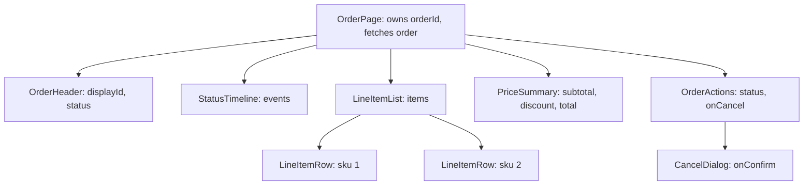
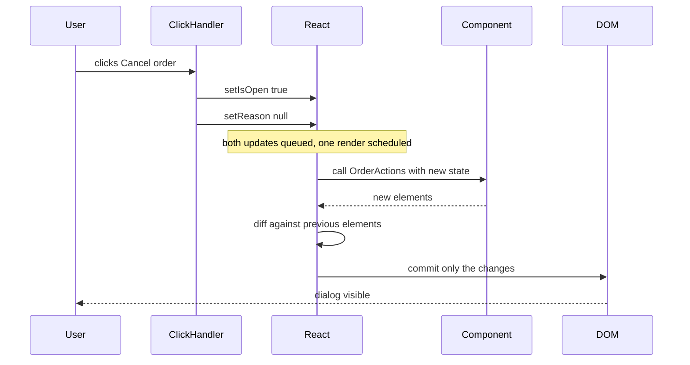

# Part 73 — React Fundamentals for Backend Engineers

Most backend engineers meet React sideways. A bug report says "the order page shows the wrong total after applying a coupon", and the stack trace ends in `OrderSummary.tsx`. It looks like TypeScript you know, then it gets strange: the function runs again and again, a variable you set does not change the screen, an API call fires twice in development, typed text jumps to another row, and "Place order" creates two orders on a slow phone.

None of that is magic. React is a small number of rules applied very consistently, and each has a reason a backend engineer can understand in backend terms: a component is a serializer, state is a row React keeps for you, re-rendering is a reconciliation job, and an effect is a resource you must release.

Part 71 — How the Browser Builds a Page showed what the browser does with HTML, CSS and JavaScript (including forms in 71.2 and long tasks in 71.7). Part 72 — Frontend Tooling and TypeScript in the Browser showed how `.tsx` becomes a bundle, how Fast Refresh works (72.4) and how `packages/contracts` shares zod schemas between NestJS and React (72.12). This Part covers what React does with your components once the bundle has loaded, and ends with a worked checkout form wired to a NestJS API.

The baseline is **React 18** (29.2 and 29.3), what most production codebases and Next.js 14 run. **React 19** (stable since December 2024) adds the `use` API, Actions, `useActionState`, `useFormStatus`, `useOptimistic`, `ref` as a prop and `<Context>` as a provider; each is called out where it matters. The React Compiler (1.0, October 2025) automates much of the memoisation in 73.6 and 73.12.

As in the rest of this Volume, every concept ends with a **Backend side (NestJS)** block: what the API must do so that the React code above it can be simple, correct and fast.

## 73.1 Components, props and JSX: thinking in components for an order page

#### Concept

A **component** is a TypeScript function whose name starts with a capital letter and which returns a description of some UI. That description is written in **JSX**, a syntax extension that looks like HTML inside TypeScript. **Props** (short for properties) are the single argument to that function: a plain object of inputs the parent passes down.

```tsx
type Props = { displayId: string; status: 'PENDING' | 'PAID' | 'SHIPPED' };

export function OrderHeader({ displayId, status }: Props) {
  return (
    <header className="order-header">
      <h1>Order {displayId}</h1>
      <span className={`badge badge--${status.toLowerCase()}`}>{status}</span>
    </header>
  );
}
```

That is the whole idea. A React app is a tree of these functions. The root component renders children, which render their own children, down to plain elements like `<h1>` and `<span>`. Data flows down the tree through props. Events flow up through callback props (`onCancel`, `onSubmit`).

**JSX is not HTML.** It compiles to function calls: `<h1>Order {displayId}</h1>` becomes `jsx('h1', { children: ['Order ', displayId] })` (the React 17+ automatic runtime; older code used `React.createElement`). Those calls return plain objects called **React elements**. A component never touches the DOM; it returns descriptions, and React decides what to change.

#### Why does it exist?

Before component frameworks, a page was server HTML plus jQuery scripts that found elements by selector and mutated them. On an order page where the total appears in four places and a status change must update a badge, a timeline, the buttons and the title, every mutation was manual, and forgetting one produced a page showing "Shipped" in the header and "Cancel order" in the footer.

Components solve two problems. **UI as a function of data**: you describe the screen for a given order and React makes the DOM match. **Encapsulation**: `OrderTimeline` owns its markup and behaviour behind a typed interface (its props), like a NestJS service.

#### Mental model

Imagine a NestJS serializer. Given an `Order` entity it returns an `OrderResponseDto`, calls smaller serializers for nested objects, never writes to the database, and returns the same output for the same input however often it is called.

A React component is that serializer with a UI description as output. It must be **pure during rendering**: no network calls, no writes to globals, no `Math.random()`. React may call it once or a hundred times and relies on the same answer for the same inputs.

#### How it works



1. **Your code returns elements.** `OrderPage` returns `<OrderHeader displayId="A7K2Q9P" status="SHIPPED" />` among others. JSX attributes become props. Children between tags become `props.children`.
2. **React walks the tree.** For every element whose `type` is a function (a component), React calls that function with the props and gets more elements back. For every element whose `type` is a string (`'h1'`, `'div'`), it is a host element: something the DOM will contain.
3. **The result is a tree of host elements.** On the first render React creates DOM nodes for all of them and inserts them into the page. This is called **mounting**.
4. **Later renders produce a new tree.** React compares it with the previous tree (73.3) and applies only the differences to the DOM.

Some JSX rules that trip backend engineers:

- **Capitalisation matters.** `<orderHeader />` is treated as an unknown HTML tag called `orderheader`; `<OrderHeader />` calls your function.
- **Expressions, not statements, go inside `{}`.** `{order.total}` works. `{if (x) ...}` does not. Use `{x && <Badge />}`, a ternary, or compute a variable before `return`.
- **`{0 && <Badge />}` renders `0`.** `&&` returns its left side when it is falsy, and React renders numbers. Write `{count > 0 && <Badge />}`.
- **Text is escaped.** `{order.note}` with `<script>` inside renders as literal text. React escapes everything you interpolate, which is why XSS in React needs `dangerouslySetInnerHTML` or a `href="javascript:..."` (Part 77 — Auth and Security in the Browser).

#### Practical example

"Thinking in components" is the skill of looking at a screen and drawing boxes. For an order details page, a senior draws them by **responsibility and by data ownership**, not by visual size:

| Component | Props in | Owns state? | Why it is its own component |
|---|---|---|---|
| `OrderPage` | `orderId` from the URL | Yes: the loaded order, loading and error | The only place that talks to the API |
| `OrderHeader` | `displayId`, `status` | No | Reused on order list cards |
| `StatusTimeline` | `events[]` | No | Complex markup, tested alone |
| `LineItemList` / `LineItemRow` | `items[]` / one item | No | List rendering with keys (73.3) |
| `PriceSummary` | money fields as strings, `currency` | No | Formatting rules for money in one place |
| `OrderActions` | `status`, `onCancel`, `onReturn` | Yes: "is the dialog open" | UI state that nobody else needs |
| `CancelDialog` | `onConfirm`, `onClose` | Yes: chosen reason | Focus trap, accessibility (71.9) |

The rule of thumb: **most components should take props and return JSX, with no state and no API calls**. A few components near the top own data. This is the frontend version of "controllers are thin, services own logic, DTOs are dumb".

#### React / Next.js example

The page and two of its pieces, in React 18 with TypeScript, using the shared contract types from `@shop/contracts` (72.12):

```tsx
// src/orders/PriceSummary.tsx: presentational, no state, no fetching
import type { OrderView } from '@shop/contracts';

const fmt = (minor: string, currency: string) =>
  new Intl.NumberFormat('en-IN', { style: 'currency', currency }).format(Number(minor) / 100);

type Props = Pick<OrderView, 'subtotalMinor' | 'discountMinor' | 'totalMinor' | 'currency'>;

export function PriceSummary({ subtotalMinor, discountMinor, totalMinor, currency }: Props) {
  const hasDiscount = discountMinor !== '0'; // compare strings, never parse money twice
  return (
    <dl className="price-summary">
      <dt>Subtotal</dt><dd>{fmt(subtotalMinor, currency)}</dd>
      {hasDiscount && (<><dt>Discount</dt><dd>-{fmt(discountMinor, currency)}</dd></>)}
      <dt>Total</dt><dd><strong>{fmt(totalMinor, currency)}</strong></dd>
    </dl>
  );
}
```

```tsx
// src/orders/OrderDetails.tsx: composes the page from small components
import type { OrderView } from '@shop/contracts';
import { OrderHeader } from './OrderHeader';
import { StatusTimeline } from './StatusTimeline';
import { LineItemList } from './LineItemList';
import { PriceSummary } from './PriceSummary';
import { OrderActions } from './OrderActions';

type Props = { order: OrderView; onCancel: (reason: string) => Promise<void> };

export function OrderDetails({ order, onCancel }: Props) {
  return (
    <article aria-labelledby="order-title">
      <OrderHeader displayId={order.displayId} status={order.status} />
      <StatusTimeline events={order.events} />
      <LineItemList items={order.items} />
      <PriceSummary
        subtotalMinor={order.subtotalMinor} discountMinor={order.discountMinor}
        totalMinor={order.totalMinor} currency={order.currency}
      />{/* explicit props: {...order} would pass every field at runtime */}
      {order.allowedActions.includes('CANCEL') && <OrderActions onCancel={onCancel} />}
    </article>
  );
}
```

`PriceSummary` never computes a total, and `OrderActions` renders only when the server allows cancelling. Neither knows how the order was fetched (73.4 and Part 74 — Client State, Data Fetching and Caching cover that).

In the Next.js 14 App Router, `OrderDetails` and `PriceSummary` could be **server components** (the default there) because they have no state or event handlers; only `OrderActions` would need `'use client'`. Part 75 — Next.js and Rendering Strategies covers that boundary.

#### Backend side (NestJS)

The API response shape decides the component tree. Return raw entities and "can this order be cancelled?" gets copied into three components, each slightly different from the real rule. Shape the response for the screen and keep rules on the server:

```ts
// apps/api/src/orders/order-view.mapper.ts
import { Injectable } from '@nestjs/common';
import type { OrderView } from '@shop/contracts';
import { Order } from './order.entity';
import { OrderPolicy } from './order.policy';

@Injectable()
export class OrderViewMapper {
  constructor(private readonly policy: OrderPolicy) {}

  toView(order: Order, now = new Date()): OrderView {
    return {
      id: order.id,
      displayId: order.displayId,
      status: order.status,
      currency: order.currency,
      subtotalMinor: order.subtotalMinor.toString(), // bigint column -> string, exact
      discountMinor: order.discountMinor.toString(),
      totalMinor: order.totalMinor.toString(),
      items: order.items.map((i) => ({
        sku: i.sku, name: i.name, quantity: i.quantity, unitPriceMinor: i.unitPriceMinor.toString(),
      })),
      events: order.events.map((e) => ({ status: e.status, at: e.createdAt.toISOString() })),
      // The rule lives here, once. The UI just reads the list.
      allowedActions: this.policy.allowedActions(order, now), // e.g. ['CANCEL'] within 30 min of payment
    };
  }
}
```

Three backend habits make component code simpler:

- **Send derived business facts, not raw inputs to rules.** `allowedActions`, `isReturnable`, `estimatedDeliveryAt`. The UI should never re-implement your cancellation window.
- **Send money as strings in minor units, with the currency.** The component formats; it never adds. Part 76 — Frontend–Backend Contracts covers money, dates and IDs on the wire.
- **One endpoint per screen region that loads together.** If `OrderPage` must call five endpoints before it can render, you have built a network waterfall. A view endpoint, or a BFF (Part 75), turns it into one round trip.

#### Production scenario

A food delivery app's order page was one 1,400-line component that re-rendered entirely on every rider location ping (every 4 s), making the chat input lag 120 to 200 ms per keystroke on mid-range Android phones.

Splitting it into 14 components took two sprints. The rider map received only `riderLocation`; the chat owned its own input state. Pings then re-rendered one component (73.12 explains why), and input lag fell under 16 ms.

#### Failure scenario

At 19:40 on a Friday, customers started cancelling orders that were already out for delivery. The backend rejected none of them.

The cause was two layers of "the UI decides". The `OrderActions` component showed the Cancel button when `status !== 'DELIVERED'`. A new status `OUT_FOR_DELIVERY` had been added on the backend that afternoon, the frontend had not been updated, so the button appeared. And the cancel endpoint had no guard of its own, because "the button is hidden when you can't cancel".

The fix was the pattern above: the server computes `allowedActions`, the UI renders from it, and the cancel endpoint checks the same policy and returns `409 Conflict` with `code: "ORDER_NOT_CANCELLABLE"` when it is violated. The UI is a hint; the server is the rule.

#### Edge cases & failure modes

- **`{count && ...}` renders `0`** on the page when the count is zero.
- **Unknown enum values** from the API (a new status) fall through `switch` statements and render nothing, or the wrong thing. Always have a default branch (Part 76 covers unknown enums).
- **Impure render**: `Date.now()` or `Math.random()` in render gives different output each call and causes hydration mismatches in server rendering (Part 75).
- **Mutating props** (`props.items.sort()`) changes the parent's data in place; React will not notice, and other components see a reordered array. Copy first: `[...items].sort(...)` or `items.toSorted(...)`.

#### How a Senior Full-Stack Engineer thinks about this

A senior draws the component tree before writing code, marks the few boxes that own data, and keeps props narrow: `PriceSummary` gets four fields, not the whole order. In review they look for business logic hiding in JSX conditions (`status === 'PAID' && Date.now() - paidAt < 1800000`) and move it behind the API.

#### Common mistakes

- **One giant component per page**, which re-renders everything and is impossible to test.
- **Re-implementing backend rules in JSX conditions**, which drift as soon as the backend changes.
- **Calling `fetch` directly inside the component body**, which runs on every render (73.4 shows the right place).
- **Defining a component inside another component's body.** The inner function is a new type on every render, so React unmounts and remounts it each time, losing its state and DOM.

#### Interview questions

1. **What does JSX compile to, and what does a component actually return?**
   Expected answer: calls to `jsx()` (or `React.createElement` in the classic runtime) that return plain element objects describing type and props. The component does not create DOM. Why it matters: explains why components can be called repeatedly and why they must be pure. Follow-up: what is the difference between a component and an element?
2. **Why must components be pure during rendering?** Expected answer: React may call them many times (Strict Mode, concurrent rendering, re-renders) and may discard a render; side effects in render would run unpredictably. Follow-up: where do side effects go then? (Event handlers and effects.)
3. **Why is defining a component inside another component a bug?** Expected answer: the inner component's identity changes every render, so React remounts it and loses state.
4. **Where should "can this order be cancelled?" be computed?** Expected answer: on the server, returned as data and enforced again on the write endpoint.

#### Practical exercise

Take an existing order or product page from any app (or the NestJS order API from Part 15) and draw its component tree.

Acceptance criteria:

- A diagram with every component, its props, and a mark on the ones that own state or fetch data. No more than two components fetch.
- A `PriceSummary` component that formats money from string minor units and renders a discount row only when the discount is not `"0"`.
- The NestJS order endpoint returns an `allowedActions` array computed by one policy class, and the cancel endpoint enforces the same policy with `409`.

## 73.2 State and re-rendering: `useState` and how React decides what to re-render

#### Concept

**State** is data a component remembers between renders and that changes what is shown: whether the cancel dialog is open, the text in a search box, the step of a checkout. You declare it with the `useState` hook:

```tsx
const [isOpen, setIsOpen] = useState(false);
```

`useState` returns the current value and a **setter**. Calling the setter does not change the variable you are holding; it asks React to **re-render** the component, which means calling the component function again. In that next call, `useState` returns the new value.

A component re-renders for exactly three reasons:

1. Its own state changed (a setter was called with a new value).
2. Its parent re-rendered (by default, all children re-render with it).
3. A context it reads changed (73.5).

Props changing is not a separate reason: props only change when the parent re-renders.

**Hooks** are functions whose names start with `use` that let a component use React features (state, effects, context). They have two rules: call them only at the top level of a component or custom hook (never inside `if`, loops or nested functions), and call them only from React functions. React identifies each hook by its **call order**, so the order must be the same on every render. `eslint-plugin-react-hooks` enforces both rules; treat its errors as compile errors.

#### Why does it exist?

A component is a function, and its local variables vanish when it returns. A click handler that sets `let isOpen = true` changes nothing React knows about, and the next render resets it. React needs storage outside your function, tied to one component instance, and a signal to re-run it. `useState` is both.

#### Mental model

Imagine React keeps a table with one row per mounted component instance, keyed by tree position, and one slot per hook call. The first `useState(false)` stores `false` in slot 0. `setIsOpen(true)` does not touch your running code; it queues `true` for slot 0 and schedules "re-run this component", where `useState` reads slot 0 and returns `true`.

That is why hooks must be called in the same order: React knows "the second hook call of this component instance", not your variable names.

#### How it works



React's work happens in two phases:

1. **Trigger.** A setter is called. React compares the new value with the current one using `Object.is`. If they are the same, React may skip the render entirely (it "bails out").
2. **Render phase.** React calls your component (and, by default, all components below it) to get a new element tree. This is pure computation. Nothing on screen has changed yet. In React 18's concurrent features (`startTransition`), this phase can be paused, resumed or thrown away.
3. **Commit phase.** React compares the new tree with the old one (reconciliation, 73.3) and applies the minimum DOM changes: change a text node, toggle an attribute, insert a dialog. Then it runs effects (73.4).
4. **Paint.** The browser lays out and paints (71.1).

Rules that follow from this mechanism:

- **State is a snapshot.** Inside one render, `isOpen` is a constant. Calling `setCount(count + 1)` three times in one handler sets it to `count + 1` once, because `count` is the same value in all three calls. Use the **updater form** when the new value depends on the old: `setCount((c) => c + 1)` three times adds three.
- **Batching.** React groups several setter calls into one render. React 17 batched only inside React event handlers; **React 18 with `createRoot` batches everywhere**, including after `await`, in timeouts and in native listeners. `flushSync` from `react-dom` forces an immediate render in the rare case you need it.
- **Replace, do not mutate.** React detects changes by identity (`Object.is`), not by deep comparison. `cart.items.push(item); setCart(cart)` passes the same object, so React bails out and the screen does not update. Create a new object: `setCart({ ...cart, items: [...cart.items, item] })`.
- **Re-rendering is not slow by default.** Calling a function that returns 40 elements takes microseconds. A typical component renders in 0.05 to 0.5 ms. Rendering becomes a problem only when one update re-renders thousands of components or one component does heavy work in render (73.12).

#### Practical example

A cart quantity stepper should keep only UI state locally and treat the server as the source of truth for the cart:

| Data | Where it lives | Why |
|---|---|---|
| Cart lines, prices, totals | Server, fetched and cached (Part 74) | Taxes, promotions, stock: only the server knows |
| Quantity being edited, before it is sent | `useState` in the stepper | Pure UI, nobody else needs it |
| "Saving..." indicator | `useState` or the mutation's pending flag | Pure UI |
| Coupon code text in the input | `useState` or the form library (73.7) | Pure UI until submitted |

The test for "should this be state?": if you can compute it from props or other state during render, it is not state. `totalItems = items.reduce(...)` is computed, not stored. Storing it creates two sources of truth that will eventually disagree.

#### React / Next.js example

```tsx
// src/cart/QuantityStepper.tsx  (React 18)
import { useState } from 'react';

type Props = {
  sku: string;
  quantity: number;               // from the server's cart
  maxQuantity: number;            // from the server: stock and per-order limits
  onChange: (sku: string, quantity: number) => Promise<void>;
};

export function QuantityStepper({ sku, quantity, maxQuantity, onChange }: Props) {
  const [saving, setSaving] = useState(false);
  const [error, setError] = useState<string | null>(null);

  async function update(next: number) {
    if (next < 1 || next > maxQuantity || saving) return;
    setSaving(true);              // batched with the next line into one render
    setError(null);
    try {
      await onChange(sku, next);  // parent sends PATCH and refreshes the cart from the response
    } catch {
      setError('Could not update quantity. Please try again.');
    } finally {
      setSaving(false);           // after await: still batched in React 18
    }
  }

  return (
    <div className="stepper" aria-busy={saving}>
      <button type="button" aria-label="Decrease" disabled={saving || quantity <= 1}
        onClick={() => update(quantity - 1)}>-</button>
      <output aria-live="polite">{quantity}</output>
      <button type="button" aria-label="Increase" disabled={saving || quantity >= maxQuantity}
        onClick={() => update(quantity + 1)}>+</button>
      {error && <p role="alert">{error}</p>}
    </div>
  );
}
```

Notice what is *not* in state: the quantity. It comes from the server via props, so the stepper never shows a number the server did not confirm (Part 74 shows optimistic updates as a deliberate alternative).

**Lazy initial state.** `useState(expensive())` calls `expensive()` on every render and throws the result away after the first. Pass a function to run it once: `useState(() => JSON.parse(sessionStorage.getItem('draft') ?? '{}'))`.

**Strict Mode.** In development, `<StrictMode>` calls your component function twice per render (and React 18 also mounts, unmounts and re-mounts every component once, see 73.4) to surface impure code. A `console.log` in render printing twice is expected in development, not a bug.

#### Backend side (NestJS)

The frontend can keep little state only if write endpoints return what the screen needs next. A `PATCH` returning `204` forces the UI to guess new totals or make a second `GET` (80 to 150 ms on mobile). Return the recomputed resource:

```ts
// apps/api/src/cart/cart.controller.ts
import { Body, Controller, HttpCode, Param, ParseUUIDPipe, Patch, UseGuards } from '@nestjs/common';
import { UpdateCartLineSchema, type CartView, type UpdateCartLine } from '@shop/contracts';
import { ZodValidationPipe } from '../common/zod-validation.pipe';
import { JwtAuthGuard } from '../auth/jwt-auth.guard';
import { CurrentUser, type AuthUser } from '../auth/current-user.decorator';
import { CartService } from './cart.service';

@Controller('v1/cart')
@UseGuards(JwtAuthGuard)
export class CartController {
  constructor(private readonly cart: CartService) {}

  @Patch('lines/:sku')
  @HttpCode(200)
  async updateLine(
    @CurrentUser() user: AuthUser,
    @Param('sku') sku: string,
    @Body(new ZodValidationPipe(UpdateCartLineSchema)) body: UpdateCartLine,
  ): Promise<CartView> {
    // The service clamps quantity to stock and per-order limits, reprices, re-applies promotions,
    // and returns the whole cart so the UI replaces its copy in one step.
    return this.cart.updateLineAndView(user.id, sku, body.quantity);
  }
}
```

Return `maxQuantity` per line so the stepper can disable "+" without guessing stock, and a cart `version` so stale writes from another tab get `409` (Part 21 — Database Transactions and Concurrency Control).

#### Production scenario

An electronics retailer kept `subtotal`, `discount` and `total` in `useState` and recomputed them in the browser. On carts with "buy 2 get 1" plus a percentage coupon, the browser applied them in a different order than the pricing service: 1.8 % of checkouts showed a cart total that differed from the payment page by up to 12 %, and those sessions converted at half the normal rate.

The fix deleted 300 lines of client pricing; the `PATCH` returned the repriced cart (median 38 ms) and the mismatch rate went to zero.

#### Failure scenario

A support agent reported that clicking "Add note" on an order sometimes showed the note and sometimes did not. The code:

```tsx
function addNote(text: string) {
  order.notes.push({ text, at: new Date().toISOString() }); // mutates the object in state
  setOrder(order);                                           // same reference: React bails out
}
```

`setOrder` received the same reference, `Object.is` returned `true`, and React skipped the render. The note appeared only when something else re-rendered the component. The fix: `setOrder({ ...order, notes: [...order.notes, newNote] })`, plus the `react-hooks` lint rules turned on as errors.

#### Edge cases & failure modes

- **Stale closures**: a handler created in render N captures state from render N. A `setTimeout` that reads `count` five seconds later reads the old value. Use the updater form or a ref (73.5).
- **Setting state during render** for something that is not derived causes an infinite loop ("Too many re-renders").
- **Copying props into state** (`useState(props.quantity)`) only uses the prop on mount; later prop changes are ignored. Either read the prop directly or reset with a key (73.3).

#### How a Senior Full-Stack Engineer thinks about this

A senior keeps state minimal and close to where it is used, asking of each value: who owns it? Server-owned data goes in a server cache (Part 74), computable data is computed, shared data is lifted to the nearest common parent (73.10). They design for re-renders being cheap rather than trying to prevent them everywhere.

#### Common mistakes

- **Mutating state objects** and wondering why the screen does not update.
- **Reading state right after setting it** and expecting the new value (`setStep(2); console.log(step)` prints the old one).
- **Storing derived values** (totals, filtered lists, "isValid") in state.
- **Duplicating server data into local state** and then trying to keep the two in sync with effects.

#### Interview questions

1. **What happens, step by step, when you call a state setter?**
   Expected answer: the update is queued; React compares with `Object.is` and may bail out; it schedules a render of that component and its children; render phase computes new elements; commit applies DOM changes; effects run. Why it matters: it explains batching, snapshots and why mutation does not work. Follow-up: what changed about batching in React 18?
2. **Why does `setCount(count + 1)` called three times only add one?** Expected answer: `count` is a snapshot constant for that render; use the updater function.
3. **What are the rules of hooks, and why do they exist?** Expected answer: top level only, React functions only; React identifies hooks by call order.
4. **When does a component re-render?** Expected answer: own state change, parent re-render, consumed context change. Follow-up: does a prop change cause a re-render? (Only via the parent re-rendering.)

#### Practical exercise

Build a `QuantityStepper` against a NestJS `PATCH /v1/cart/lines/:sku` endpoint.

Acceptance criteria:

- The endpoint returns the full repriced cart including `maxQuantity` per line; a "buy 2 get 1" rule is applied server-side.
- The component holds no copy of the quantity or totals in state; it renders the server's numbers.
- Clicking "+" five times quickly results in at most one in-flight request at a time (the button is disabled while saving).
- A deliberate bug that mutates the cart array is shown not to re-render, then fixed with an immutable update.
