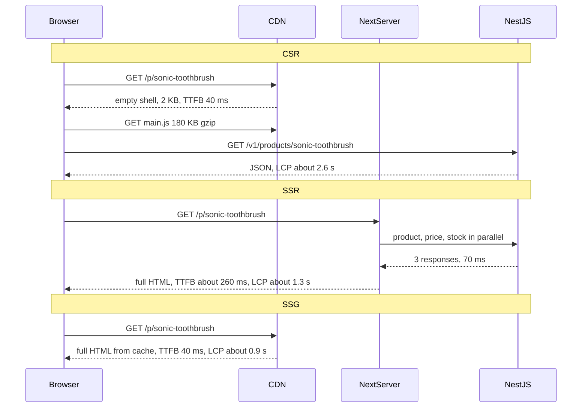

# Part 73 — Next.js and Rendering Strategies

Part 70 — Frontend Tooling and TypeScript in the Browser ended with a choice between a Vite SPA, Next.js and plain server-rendered pages (70.11). Parts 71, 72 built React screens and a client-side data layer on the assumption that the browser does the rendering. This Part removes that assumption. In Next.js the same React component can run at build time, on a server for each request, at the edge, or in the browser, and the choice decides your time to first byte (TTFB), your server bill, what search engines see and how stale a page can get.

The baseline is **Next.js 14 with the App Router** and React 18. Where Next.js 15 or 16 changed behaviour (async `params` and `cookies()`, `fetch` no longer cached by default, the move from route segment config to `"use cache"`, `middleware.ts` becoming `proxy.ts`, Turbopack as the default bundler), the text says so at the point it matters. The NestJS API, `@shop/contracts`, `ZodValidationPipe`, the `{ code, issues, requestId }` error shape and the TanStack Query setup from Part 72 are reused unchanged.

## 73.1 Rendering strategies: client-side, server-side and static rendering

#### Concept

**Rendering** means turning data plus components into HTML the browser can paint. The question is *where* and *when* that happens:

- **Client-side rendering (CSR)**: the server sends a nearly empty HTML shell plus JavaScript. The browser downloads and runs the bundle, the bundle calls the API, and React builds the DOM. Every Vite SPA in Parts 71, 72 works this way.
- **Server-side rendering (SSR)**: for each request, a server runs the React components, fetches data, and sends complete HTML. The browser paints it immediately, then downloads JavaScript and **hydrates** it (attaches event handlers to the existing DOM, 73.10).
- **Static site generation (SSG)**: the HTML is rendered once, at build time, and served as a file from a CDN to every visitor until the next build.

Two more strategies are refinements of these: **incremental static regeneration (ISR)**, which re-renders static pages in the background after a time limit or on demand, and **streaming**, which sends server HTML in chunks as each part's data arrives. Both are in 73.2.

None of these is "the modern way". Each moves work to a different place and time, and each has a bill: latency, server CPU, freshness or SEO.

#### Why does it exist?

Because the three things you want from a page pull against each other:

1. **Fast first paint**, which needs HTML that exists before the user asks (static) or is produced near them quickly (SSR in-region).
2. **Fresh, personal data**, which needs work at request time with the user's cookies (SSR or CSR).
3. **Cheap operation**, which wants no per-request server work at all (static, or CSR from a CDN).

A product page needs 1 and is mostly the same for everyone. A cart needs 2 and is different for everyone. An internal admin table needs neither SEO nor first-paint speed for anonymous users. One strategy for all three is either slow, expensive or stale somewhere. Frameworks like Next.js exist so you can choose per route, and in the App Router per component.

#### Mental model

Imagine a bakery. **SSG** is bread baked at 05:00 and stacked on the shelf: instant to hand over, identical for everyone, and yesterday's if nobody bakes again. **SSR** is a sandwich made to order: exactly what you asked for, but you wait while it is made and the kitchen needs staff for every customer. **CSR** is a meal kit: the shop hands you a box at once, but you cook at home, and on a weak stove (a cheap phone) dinner is late. **ISR** is the shelf with a rule: "if a loaf has been out more than 5 minutes, hand it over anyway but bake a fresh one for the next customer". **Streaming** is the waiter bringing the starter while the main course is still in the oven.

#### How it works

The same product page, three ways. Numbers are typical for a mid-range Android phone on 4G (round trip about 80 ms) with the Next.js server and NestJS in the same region as the user.



Step by step, what each costs:

1. **CSR.** TTFB is tiny because the shell is static. But nothing meaningful paints until the JavaScript has downloaded (180 KB gzip is about 600 KB parsed), compiled and run (300 to 900 ms of main-thread time on a mid-range phone, Part 69 — How the Browser Builds a Page, 69.7), and then the data request has made its own round trip. The LCP element appears only after that chain: often 2.5 to 4 s. Crawlers that do not run JavaScript see an empty page; Googlebot does run it, but in a deferred second wave, and other crawlers and link-preview bots (Slack, WhatsApp, X) usually do not.
2. **SSR.** The server does the data fetching close to the API (1 to 5 ms between them in one VPC instead of 80 ms per call from a phone), renders React to HTML (20 to 80 ms of CPU for a typical product page), and sends it. TTFB rises to the sum of API time plus render time plus network. The browser paints as soon as the HTML and critical CSS arrive. JavaScript still downloads and hydrates afterwards; until then the page is visible but buttons do nothing (the "uncanny valley" between paint and interactive).
3. **SSG.** All of that work happened once at `next build`. The CDN serves a file. TTFB is the CDN's (20 to 60 ms at a nearby edge), and the server sees no traffic at all for that page. The price is freshness: the page shows data as of the build.

The decision matrix the rest of this Part keeps returning to:

| | CSR | SSR | SSG | ISR (73.2) | Streaming SSR (73.2) |
|---|---|---|---|---|---|
| TTFB | 20 to 60 ms (shell) | 150 to 600 ms (API + render) | 20 to 60 ms (CDN) | 20 to 60 ms on hit | 50 to 150 ms (shell first) |
| LCP on mid-range 4G phone | 2.5 to 4 s | 1.2 to 2 s | 0.8 to 1.5 s | 0.8 to 1.5 s | 1 to 1.8 s |
| Server CPU per view | None (API calls only) | Full render every request | None | One render per revalidation | Full render every request |
| Freshness | Live | Live | As of build | Bounded: revalidate window or on-demand | Live |
| Personalisation | Full, in browser | Full, on server | None (or client islands) | None (or client islands) | Full |
| SEO and link previews | Weak | Strong | Strong | Strong | Strong (bots wait for the stream) |
| Failure when the API is down | Page shell loads, data errors | Page errors (500) | Page still served | Stale page still served | Shell served, sections error |
| Scales with traffic by | API capacity | Render servers + API | CDN | CDN | Render servers + API |

The last two rows matter most to a backend engineer. **SSR multiplies your render tier and API load by your page views.** **Static and ISR pages survive API outages**, because the CDN keeps serving the last good HTML.

#### Practical example

A grocery delivery storefront has these pages:

- Home and category pages: same for everyone in a city, changed by merchandisers a few times a day, high traffic from search and ads. Static, refreshed by ISR.
- Product page: same for everyone, but price and stock change. Static shell with ISR every few minutes, plus a small client-rendered stock badge if stock must be live.
- Cart and checkout: different for every user, must be exact. Rendered on the client (or SSR without caching) from the user's session.
- Order history: personal, behind login, not indexed. Either SSR per request with cookies, or CSR.
- Admin dashboard for warehouse staff: behind login, desktop, interactive. CSR, possibly a separate Vite SPA (70.11).

The point is the shape: one site, four strategies, chosen per page by who sees it, how fresh it must be, and whether search matters. 73.12 turns this into a decision table.

#### React / Next.js example

In the Next.js 14 App Router you rarely say "SSR" or "SSG" explicitly. Next.js decides at build time whether each route can be **static** (rendered once) or must be **dynamic** (rendered per request), based on what the code does. You can also force it with **route segment config**, exported constants in a `page.tsx` or `layout.tsx`.

```tsx
// apps/web/app/p/[slug]/page.tsx  (Next.js 14, App Router)
import { notFound } from 'next/navigation';
import { ProductViewSchema } from '@shop/contracts';
import { AddToCartButton } from './AddToCartButton'; // a client component (79.4)

export const revalidate = 300; // static, re-rendered at most every 5 min (ISR, 79.2)

async function getProduct(slug: string) {
  const res = await fetch(`${process.env.CATALOG_API_URL}/v1/products/${slug}`, {
    next: { revalidate: 300, tags: [`product:${slug}`] }, // Data Cache entry (79.7)
    signal: AbortSignal.timeout(2_000),                  // never let a build or render hang
  });
  if (res.status === 404) return null;
  if (!res.ok) throw new Error(`catalog ${res.status}`); // nearest error.tsx renders (79.3)
  return ProductViewSchema.parse(await res.json());      // same zod contract as the API
}

export default async function ProductPage({ params }: { params: { slug: string } }) {
  const product = await getProduct(params.slug);
  if (!product) notFound();
  return (
    <main>
      <h1>{product.name}</h1>
      <p>{formatInr(product.priceMinor)}</p>
      <AddToCartButton sku={product.sku} />
    </main>
  );
}

const inr = new Intl.NumberFormat('en-IN', { style: 'currency', currency: 'INR' });
function formatInr(minor: string) { return inr.format(Number(minor) / 100); } // fixed locale: no hydration drift (79.10)
```

Three things decide whether this page is static or dynamic in Next.js 14:

| Code in the route | Effect |
|---|---|
| `fetch` with default options or `next: { revalidate: N }` | Cached; page can stay static |
| `fetch(..., { cache: 'no-store' })` or `next: { revalidate: 0 }` | Page becomes dynamic |
| Calling `cookies()`, `headers()` or reading `searchParams` | Page becomes dynamic (it depends on the request) |
| `export const dynamic = 'force-dynamic'` | Always dynamic, every request |
| `export const dynamic = 'force-static'` | Always static; `cookies()` and `headers()` return empty values |
| `export const dynamic = 'error'` | Static, and the build fails if anything dynamic is used |

`next build` prints the verdict per route: `○ (Static)`, `● (SSG)` for pages prerendered with `generateStaticParams`, and `λ (Dynamic)` in early 14.x releases (shown as `ƒ (Dynamic)` in later releases). Read that table in every pull request that touches data fetching; a route that silently flipped from static to dynamic just moved from the CDN to your servers.

**Next.js 15 changed the default.** In 15, `fetch` is no longer cached unless you ask (`cache: 'force-cache'` or `next: { revalidate }`), and `params`, `searchParams`, `cookies()` and `headers()` are Promises you must `await`. A route that does not use request data is still prerendered at build time in 15; it is the per-request data cache that stopped being implicit. 73.5 and 73.7 cover the details.

#### Backend side (NestJS)

The rendering strategy changes who calls your API and how often:

- **CSR**: every visitor's browser calls NestJS. You need browser auth (cookies, Part 75 — Auth and Security in the Browser), CORS or same-origin routing (Part 11 — Networking and HTTP, 11.13), and enough capacity for peak page views times API calls per page.
- **SSR**: the Next.js server calls NestJS once or more per page view, server to server. Latency between them lands straight in TTFB, so put them in the same region and VPC, reuse connections (keep-alive, Part 11.9), and give every call a timeout. A page that calls three endpoints sequentially at 60 ms each spends 180 ms before rendering starts; in parallel it spends 60.
- **SSG and ISR**: NestJS is called at build time and on each revalidation, not per view. A catalogue of 40,000 products built at deploy means 40,000 calls in a few minutes; rate limits and connection pools on the catalogue service must allow that burst, or the build must prerender only the popular pages (73.5).

Whatever the strategy, the API should send honest cache headers. A public catalogue endpoint can say `Cache-Control: public, s-maxage=60, stale-while-revalidate=300` so a CDN in front of it absorbs browser CSR traffic; a personal endpoint must say `private, no-cache` (72.4). Next.js's own Data Cache ignores those response headers; it follows the options on the `fetch` call, which is a common surprise (73.7).

#### Production scenario

An online pharmacy ran a Vite SPA. Search traffic landed on product pages; p75 LCP on mobile was 3.4 s and 22 % of visitors from ads left before the page painted. They moved product and category pages to Next.js with ISR (`revalidate = 600` plus on-demand revalidation on price change), kept the account area client-rendered, and left the API alone.

After the change: p75 TTFB on product pages 52 ms (CDN hit rate 96 %), p75 LCP 1.4 s, bounce from ads down to 13 %. The Next.js tier rendered about 40 pages a minute for revalidations, on two small containers. The catalogue API's traffic actually fell by 70 %, because browsers no longer called it on every product view.

#### Failure scenario

A fashion retailer moved its home page to SSR "for freshness" so that a "Recommended for you" carousel could be personalised. The home page called five NestJS endpoints per request, two of them sequentially. On a sale morning at 09:00, traffic went from 300 to 4,500 page views per second in two minutes. Each view now meant five API calls and 60 ms of render CPU; the 12-pod Next.js deployment saturated its CPUs, p99 TTFB went from 400 ms to 9 s, and the load balancer's 10 s timeout started returning 504s on the most important page of the year.

Before the change, the same home page had been a static file. The fix was to make the page static with ISR again and render the personalised carousel as a client component that called a cached recommendations endpoint after paint. TTFB returned to 45 ms; the carousel arrived 300 ms after first paint, which nobody minded.

#### Edge cases & failure modes

- **A single `cookies()` call in a shared layout** makes every page under it dynamic: the whole site moves from the CDN to your servers on one line.
- **Build-time API failure**: SSG pages built while the API returned errors are baked in until the next build. Fail the build on non-2xx, never render an error page as static output.
- **Huge static builds**: 200,000 product pages at 50 ms each is almost 3 hours of build. Prerender the top pages, render the rest on first request (73.5).
- **CSR and bots**: link previews in chat apps show a blank title and no image for a CSR page, which hurts sharing even if Google indexes it.
- **SSR without timeouts** turns one slow dependency into a slow page for everyone, and holds render-server memory while it waits.
- **Static pages and personal data**: anything rendered into static HTML is visible to every visitor. A "Hello, Priya" in a static layout is a privacy incident, not a cosmetic bug.

#### How a Senior Full-Stack Engineer thinks about this

The senior asks four questions per page before choosing: Is it the same for everyone? How stale may it be, and who notices? Does search or link sharing matter? What happens to it when the API is down? "Same for everyone, a few minutes stale is fine" means static or ISR, with personal bits rendered on the client. "Different per user and must be exact" means request-time rendering, client or server. They prefer the option that keeps the CDN in front, because a CDN is the cheapest, most reliable server you will ever run. And they read SSR as a cost: a render tier that scales with page views, with its own on-call.

To a product manager: "Static pages are instant and survive outages, but show data a few minutes old. Server-rendered pages are fresh but slower and cost money per view. We'll make the shared parts static and load the personal parts in the browser."

#### Common mistakes

- **Choosing SSR for everything "for SEO"** when the page is the same for everyone and ISR would be faster and cheaper.
- **Choosing CSR for public landing pages** and losing link previews and first-paint speed.
- **Not reading the build output**, so nobody notices a page became dynamic.
- **Rendering personal data into static or cached HTML.**
- **Sequential server-side API calls** that add their latencies into TTFB.

#### Interview questions

1. **Compare CSR, SSR and SSG on TTFB, LCP and server cost.** Expected answer: CSR has tiny TTFB but late LCP (JS then data); SSR has higher TTFB (API plus render) but early paint and per-request CPU; SSG has CDN TTFB and early paint with no per-request cost but data as of build. Follow-up: which survives an API outage? (SSG/ISR.)
2. **How does Next.js App Router decide whether a route is static or dynamic?** Expected answer: by usage of dynamic functions (`cookies`, `headers`, `searchParams`), uncached `fetch`, and route segment config like `dynamic` and `revalidate`; the build output shows the result.
3. **Why might moving a page from static to SSR cause an outage?** Expected answer: every page view now costs render CPU and API calls; peak traffic hits origin instead of the CDN.
4. **A page needs SEO and a personalised section. What do you do?** Expected answer: static or ISR for the shared content, client component (or streamed dynamic section) for the personal part, with reserved space to avoid layout shift.
5. **What changed about `fetch` caching in Next.js 15?** Expected answer: it is not cached by default; you opt in with `cache: 'force-cache'` or `next.revalidate`; request APIs became async.

#### Practical exercise

Build one product page three ways in a Next.js 14 app: CSR (a client component fetching in TanStack Query), SSR (`dynamic = 'force-dynamic'`) and SSG/ISR (`revalidate = 300`). Throttle DevTools to "Fast 4G" with 4x CPU slowdown.

Acceptance criteria:

- A table of TTFB, LCP and total JavaScript transferred for each version, measured with Lighthouse in three runs each.
- The `next build` output shows the expected `○`, `●` or `ƒ`/`λ` marker for each route.
- With the NestJS catalogue stopped, the ISR page still loads and the SSR page shows the route's `error.tsx`.
- `curl -s` of each URL shows whether the product name is in the initial HTML.
