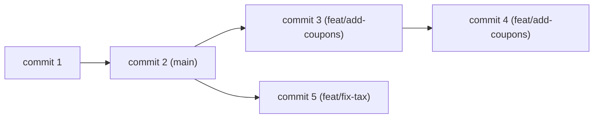

# Part 73 — Git Basics and the Development Workflow

Every real software project uses version control, and in practice that means Git. Git records the history of your code: every change, who made it, when, and why. It lets many people work on the same codebase without overwriting each other, lets you undo mistakes, and lets you see how any line of code came to be. You cannot work on a team — or even safely on your own — without it.

This Part is the beginner's on-ramp to Git. Part 30 covers Git deeply (internals, rebasing strategies, bisect, reflog recovery, advanced workflows); this Part teaches the foundation you need before that makes sense: what Git is and why, the core commands (`init`, `clone`, `add`, `commit`, `status`, `log`), branches and merging, remotes and pull requests, and how to resolve a conflict without panic. By the end you will be able to clone a repository, make a change on a branch, commit it, push it, open a pull request, and handle a merge conflict — the everyday loop of professional development.

We teach the command line Git here, because it is universal and because understanding the commands makes the graphical tools make sense. Once you know the commands, use whatever interface you like.

## 73.1 What Git is and why it exists

### 73.1.1 Version control and the commit

#### Concept

Git is a **version control system**: a tool that records snapshots of your project over time. Each snapshot is called a **commit**. A commit captures the exact state of all your files at a moment, along with a message explaining the change, who made it, and when. The full history of commits is your project's memory — you can look at any past state, compare any two, and undo back to any point.

#### Why does it exist?

Without version control, you save over your files and the previous version is gone. You keep folders named `project-final`, `project-final-v2`, `project-really-final`. Two people editing the same file overwrite each other. You cannot tell when a bug was introduced or by whom. Git solves all of this: every version is kept forever, changes from different people merge together, and every line's history is recoverable. It is the difference between working with a safety net and working without one.

#### Mental model

Imagine a photographer taking a snapshot of your entire project every time you finish a meaningful change, and filing each snapshot with a note about what changed. You can flip back through the album to any past snapshot, see exactly what the project looked like then, and compare any two snapshots to see what moved. You can even start an alternate album (a branch) to try something risky, and either merge it back or throw it away without affecting the main album. Git is that photographer and that album system, automated and precise.

#### How it works

Git tracks your project through three "places" a change moves through:

```text
Working directory  ->  Staging area (index)  ->  Repository (commits)
   (your files)         (changes you          (permanent history)
                         marked to save)
      |                       |                        |
   you edit               git add                  git commit
```

1. **Working directory**: the actual files you edit. Git watches them and notices changes.
2. **Staging area**: a holding area where you place the specific changes you want in your next commit. `git add` moves changes here. This lets you commit some changes but not others.
3. **Repository**: the permanent history. `git commit` takes everything staged and records it as a new commit forever.

Each commit has a unique id (a long hash like `a43fe077...`), a parent (the commit before it), an author, a timestamp, and a message. The chain of commits, each pointing to its parent, is the history.

#### The core commands

```bash
git init                 # start tracking a new project in the current directory
git clone <url>          # copy an existing remote repository to your machine
git status               # what has changed, what is staged (run this constantly)
git add file.ts          # stage one file's changes for the next commit
git add .                # stage all changes in the current directory
git commit -m "message"  # record staged changes as a commit with a message
git log                  # show the history of commits
git log --oneline        # compact one-line-per-commit history
git diff                 # show unstaged changes (what you edited but didn't stage)
git diff --staged        # show staged changes (what will go in the next commit)
```

`git status` is the command you run most. It tells you where you are: what has changed, what is staged, which branch you are on. Run it before and after almost everything until the state is obvious to you.

#### Writing a good commit message

A commit message explains **why** a change was made, not just what. "Fix bug" is useless in six months; "Fix order total to include tax before applying discount" tells the next person (often you) what happened and why. The common convention is a short summary line (under ~50 characters), a blank line, then more detail if needed.

```bash
git commit -m "Add idempotency key to order creation

Clients retry failed POST /orders requests, which was creating
duplicate orders. The idempotency key lets the server detect and
reject duplicates. Fixes TSB-4422."
```

#### Practical example — your first commits

```bash
mkdir my-api && cd my-api
git init                              # start a repository
echo "node_modules/" > .gitignore     # tell git to ignore node_modules
git add .gitignore
git commit -m "Add gitignore"
# ... create src/index.ts ...
git add src/index.ts
git status                            # confirm it is staged
git commit -m "Add entry point"
git log --oneline                     # see your two commits
```

#### The .gitignore file

Some files should never be committed: `node_modules/` (huge, rebuildable), `.env` (secrets), build output (`dist/`), editor settings. A `.gitignore` file lists patterns Git should ignore. Setting it up early is important — committing `node_modules` or `.env` is a classic beginner mistake (the first bloats the repo, the second leaks secrets).

#### Edge cases & failure modes

- **Committing secrets** (`.env`, API keys) puts them in history forever, even if deleted in a later commit; this is a security incident requiring secret rotation (Part 23). Prevent it with `.gitignore`.
- **Committing `node_modules`** bloats the repository massively; always gitignore it.
- **Huge commits** mixing many unrelated changes are hard to review and hard to revert cleanly; make focused commits.
- **Useless messages** ("stuff", "wip", "fix") make history worthless for understanding why code is the way it is.
- **Forgetting to `git add`** before commit, so your change is not actually included; `git status` catches this.

#### How a Senior Backend Engineer thinks about this

A senior treats commit history as documentation that future engineers (including themselves) will read to understand why the code is the way it is. They make small, focused commits each doing one thing, with messages that explain the reasoning, so that history can be read, searched and selectively reverted. They set up `.gitignore` before the first commit to keep secrets and junk out of history permanently, because what enters git history is effectively permanent. They run `git status` and `git diff` before every commit to know exactly what they are recording, never blindly `git add .` without looking.

#### Common mistakes

- Committing secrets or `node_modules` (prevent with `.gitignore`).
- Giant unfocused commits mixing unrelated changes.
- Vague commit messages that explain nothing.
- `git add .` without checking what it is staging, accidentally committing unintended files.

#### Interview questions

1. **What are the three areas a change moves through in Git?** Working directory (your files), staging area (changes marked for the next commit via `git add`), and the repository (committed history via `git commit`).
2. **Why does a committed secret require rotating the secret, not just deleting it?** Git history is permanent; the secret remains in past commits even after deletion, so anyone with the repo can recover it.
3. **What makes a good commit message?** A concise summary of what changed and, importantly, why; focused on a single logical change.
4. **Why make small, focused commits?** They are easier to review, understand and revert cleanly, and they make the history a useful record.

#### Practical exercise

Create a new Git repository, add a `.gitignore` that excludes `node_modules/` and `.env`, make two separate focused commits (one for a config file, one for a source file) with clear messages, and view the history with `git log --oneline`. Then run `git status` and `git diff` to confirm the working directory is clean. Acceptance criteria: history shows two focused commits with meaningful messages, and neither `node_modules` nor `.env` is tracked.

## 73.2 Branches

### 73.2.1 Working in parallel without stepping on each other

#### Concept

A **branch** is an independent line of development. The default branch (usually `main`) holds the stable, shared code. When you start work, you create a branch off `main`, make your commits there, and later merge them back. Branches let many people (and many features) progress in parallel without interfering, and let you keep risky or unfinished work away from the stable code.

#### Why does it exist?

If everyone committed directly to `main`, every unfinished or broken change would immediately affect everyone else, and two people editing the same area would constantly overwrite each other. Branches isolate work-in-progress. Your feature lives on your branch, broken or unfinished, until it is ready; only when it is reviewed and working does it merge into `main`. This is how teams of dozens work on one codebase without chaos.

#### Mental model

Think of `main` as the trunk of a tree and branches as limbs growing off it. You climb out onto your own limb to build something, in your own space, without disturbing anyone on the trunk or on other limbs. When your work is solid, you graft your limb back onto the trunk (merge), and everyone on the trunk now has your work. If the limb turns out to be a bad idea, you simply cut it off, and the trunk is untouched.

#### How it works

```bash
git branch                           # list branches; * marks the current one
git branch feat/add-coupons          # create a branch (does not switch to it)
git switch feat/add-coupons          # switch to that branch
git switch -c feat/add-coupons       # create AND switch in one step (common)
git switch main                      # go back to main
git branch -d feat/add-coupons       # delete a merged branch
```

(You will also see the older `git checkout -b feat/...` and `git checkout main`; `switch` is the newer, clearer command for changing branches.)

A branch is really just a movable pointer to a commit. When you commit on a branch, the pointer advances. `main` points to the latest stable commit; your feature branch points to your latest work. This is why branching in Git is instant and cheap — it is just creating a pointer, not copying files.



Here, two feature branches grew from the same point on `main`. Each developer works independently. When each is ready and reviewed, it merges back into `main`.

#### Branch naming

Teams use conventions so a branch name tells you what it is. A common one, which matches this book's example repo:

```text
feat/TSB-4422-notification-filter    a feature, with the ticket number
fix/login-timeout                    a bug fix
chore/upgrade-nestjs                 maintenance
```

Including the ticket number (like `TSB-4422`) links the branch to the task tracker (Jira, in this project), so anyone can trace code back to the reason it exists.

#### Practical example — the everyday loop

```bash
git switch main                       # start from the stable branch
git pull                              # get the latest from the remote (73.3)
git switch -c feat/add-coupons        # create your feature branch
# ... edit code, make commits ...
git add .
git commit -m "Add coupon validation to checkout"
# ... more work, more commits ...
git push -u origin feat/add-coupons   # push your branch to the remote (73.3)
# then open a pull request (73.3)
```

This is the loop you will run every working day: branch off up-to-date `main`, commit your work, push, open a pull request. Never work directly on `main`.

#### Edge cases & failure modes

- **Working directly on `main`** defeats the purpose of branches and makes every unfinished change affect everyone; always branch.
- **A long-lived branch** that diverges from `main` for weeks accumulates painful conflicts when it finally merges; keep branches short-lived and merge often.
- **Uncommitted changes when switching branches**: Git may refuse to switch or carry changes along confusingly; commit or `git stash` first.
- **Forgetting which branch you are on** and committing to the wrong one; `git status` always shows the current branch.
- **Deleting an unmerged branch** with `git branch -D` (capital D forces it) loses that work; the lowercase `-d` refuses to delete unmerged branches as a safeguard.

#### How a Senior Backend Engineer thinks about this

A senior keeps branches short-lived and focused — one branch per feature or fix, merged within days, not weeks — because the longer a branch lives apart from `main`, the more it diverges and the more painful the eventual merge. They always branch off an up-to-date `main` and never commit directly to the shared branch. They use clear, ticket-linked branch names so work is traceable. They treat `git stash` as the tool for "I need to switch branches but am mid-change", and they rely on `git status` to always know where they are, because committing to the wrong branch is a common and avoidable slip.

#### Common mistakes

- Committing directly to `main`.
- Long-lived branches that become a merge nightmare.
- Switching branches with uncommitted changes and getting confused.
- Losing work by force-deleting an unmerged branch.

#### Interview questions

1. **What is a branch, mechanically?** A movable pointer to a commit; branching is cheap because it creates a pointer rather than copying files.
2. **Why work on a branch instead of directly on `main`?** To isolate unfinished or risky work from the stable shared code and let people work in parallel without conflict.
3. **Why keep branches short-lived?** The longer a branch diverges from `main`, the more conflicts accumulate; frequent small merges are far less painful than one big one.
4. **What does `git stash` do and when would you use it?** It temporarily shelves uncommitted changes so you can switch branches cleanly, then reapply them later.

#### Practical exercise

From an up-to-date `main`, create a branch `feat/practice`, make two commits on it, switch back to `main` and confirm those commits are not there, then switch back to your branch. Try switching branches with an uncommitted change and observe Git's behavior, then use `git stash` to handle it. Acceptance criteria: you can explain why the commits appear only on your branch and demonstrate stashing to switch cleanly.
