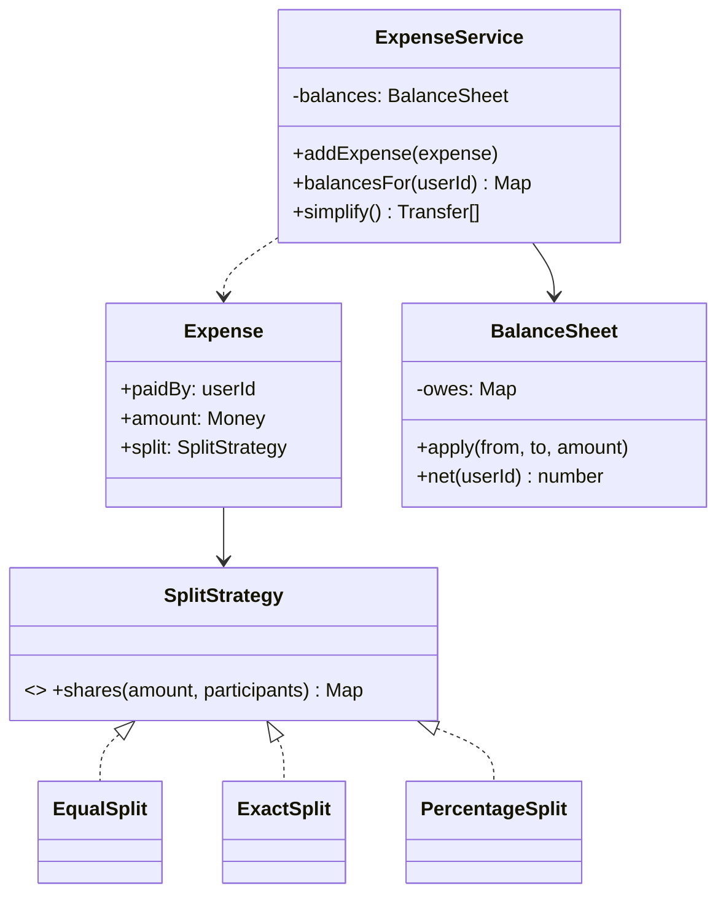
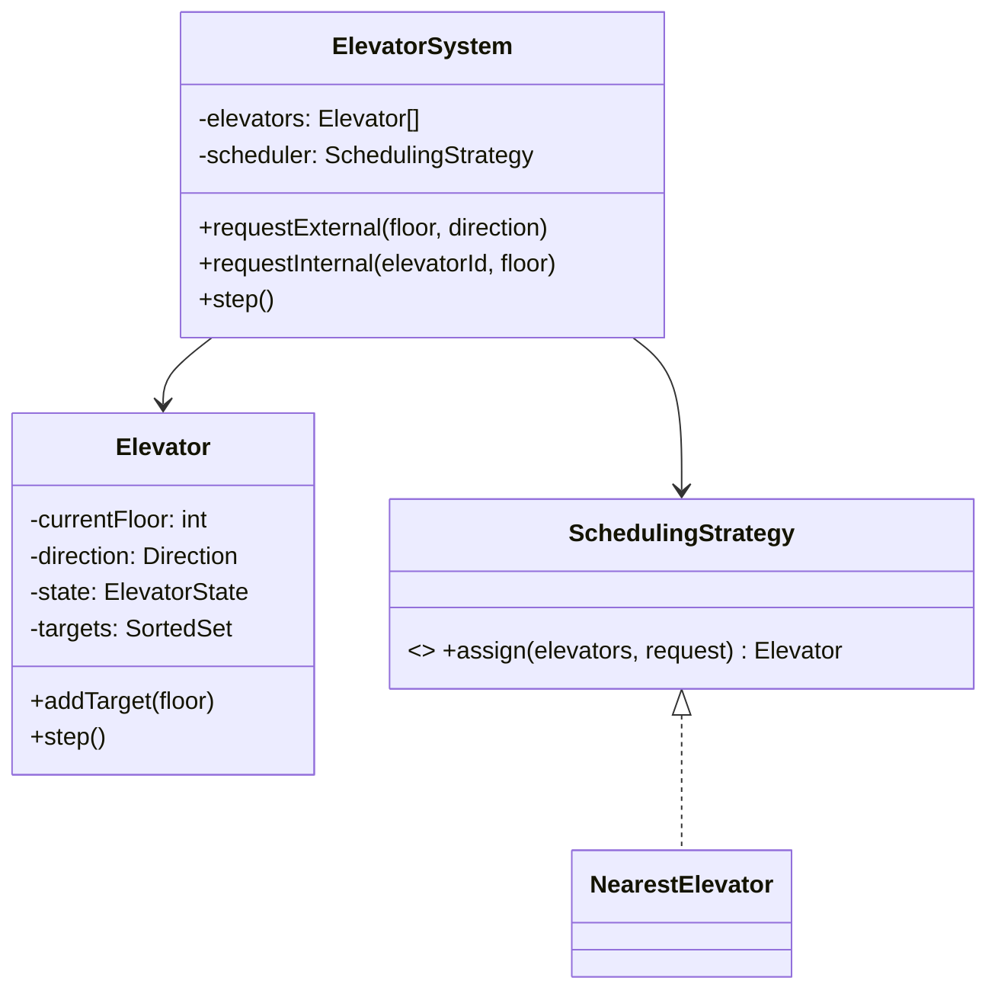

## 73.3 Worked problem: Splitwise

> **Try it first** · Level: Intermediate · About 45 minutes
>
> **Build:** an expense-sharing library where group members add shared expenses and see who owes whom.
>
> **Requirements:**
> - Add an expense paid by one user and split among members equally, by exact amounts, or by percentage.
> - Track balances between users.
> - Simplify debts: settle the group in as few transfers as possible.
> - Record settlements; payment processing is out of scope.
>
> **Constraints:** money in integer minor units (paise or cents), never floats; shares must always add up to the amount; new split types should not mean editing the service; runnable TypeScript within the time box.
>
> **Your task:** draw the classes and interfaces, write the key methods (`addExpense`, `balancesFor`, `simplify`), and list the tests you would write.
>
> Spend the time on paper before you read on. The model design follows.

### 73.3.1 Requirements

Design an expense-sharing system: users in groups add expenses split among members (equally, by exact amounts, or by percentage), the system tracks who owes whom, and can simplify debts (minimize the number of transactions to settle). Clarify: split types (equal, exact, percentage); track balances; simplify debts; handle settlements. In scope: expenses, balances, debt simplification; out of scope: payment processing.

Two clarifications change the design, so ask them: amounts are integer minor units (paise or cents, never floats), and "who owes whom" means *net* balances, not a full history of pairwise debts. Once you track one net number per user, simplification is a small algorithm instead of a graph problem.

### 73.3.2 Class diagram



The **strategy pattern** again for split types (the obvious variation point), and a `BalanceSheet` that tracks net balances. Debt simplification is a small algorithm on the net balances.

### 73.3.3 Code

Two corrections compared with the first draft of this code: `ExactSplit` was in the diagram but missing from the code, and `PercentageSplit` used `Math.round` per share, so 1000 split 33.33 / 33.33 / 33.34 produced 333 + 333 + 333 = 999 and one paisa vanished from the ledger. Largest-remainder rounding below always sums to the amount.

```ts
export class InvalidSplitError extends Error {}

export interface SplitStrategy { shares(amountCents: number, participants: string[]): Record<string, number>; }

export class EqualSplit implements SplitStrategy {
  shares(amount: number, participants: string[]) {
    const each = Math.floor(amount / participants.length);
    const rem = amount - each * participants.length;     // give the remainder to the first
    const out: Record<string, number> = {};
    participants.forEach((p, i) => (out[p] = each + (i === 0 ? rem : 0)));
    return out;
  }
}

export class ExactSplit implements SplitStrategy {
  constructor(private readonly exact: Record<string, number>) {}
  shares(amount: number, participants: string[]) {
    const out: Record<string, number> = {};
    for (const p of participants) out[p] = this.exact[p] ?? 0;
    const total = Object.values(out).reduce((a, b) => a + b, 0);
    if (total !== amount) throw new InvalidSplitError(`exact shares sum to ${total}, expected ${amount}`);
    return out;
  }
}

export class PercentageSplit implements SplitStrategy {
  constructor(private readonly pct: Record<string, number>) {}  // must sum to 100
  shares(amount: number, participants: string[]) {
    const pctTotal = participants.reduce((a, p) => a + (this.pct[p] ?? 0), 0);
    if (Math.abs(pctTotal - 100) > 1e-9) throw new InvalidSplitError(`percentages sum to ${pctTotal}`);
    // Floor every share, then hand leftover cents to the largest fractional parts.
    const raw = participants.map((p) => ({ p, exact: (amount * (this.pct[p] ?? 0)) / 100 }));
    const out: Record<string, number> = {};
    for (const r of raw) out[r.p] = Math.floor(r.exact);
    let leftover = amount - Object.values(out).reduce((a, b) => a + b, 0);
    for (const r of [...raw].sort((a, b) => (b.exact % 1) - (a.exact % 1))) {
      if (leftover === 0) break;
      out[r.p] += 1; leftover--;
    }
    return out;
  }
}
```

```ts
export class BalanceSheet {
  // net[user] > 0 means others owe this user; < 0 means this user owes.
  private net = new Map<string, number>();
  private add(user: string, delta: number) { this.net.set(user, (this.net.get(user) ?? 0) + delta); }

  applyExpense(paidBy: string, amount: number, shares: Record<string, number>) {
    this.add(paidBy, amount);                              // payer is owed the full amount
    for (const [user, share] of Object.entries(shares)) this.add(user, -share);  // each owes their share
  }

  netOf(user: string) { return this.net.get(user) ?? 0; }
  entries() { return [...this.net.entries()]; }
}

export interface Transfer { from: string; to: string; amountCents: number; }

export class ExpenseService {
  private sheet = new BalanceSheet();

  addExpense(paidBy: string, amountCents: number, participants: string[], split: SplitStrategy) {
    this.sheet.applyExpense(paidBy, amountCents, split.shares(amountCents, participants));
  }

  netOf(user: string) { return this.sheet.netOf(user); }

  // Simplify debts: greedily match biggest creditor with biggest debtor.
  simplify(): Transfer[] {
    const creditors = this.sheet.entries().filter(([, v]) => v > 0).map(([u, v]) => ({ u, v }));
    const debtors = this.sheet.entries().filter(([, v]) => v < 0).map(([u, v]) => ({ u, v: -v }));
    creditors.sort((a, b) => b.v - a.v); debtors.sort((a, b) => b.v - a.v);
    const transfers: Transfer[] = [];
    let i = 0, j = 0;
    while (i < debtors.length && j < creditors.length) {
      const amount = Math.min(debtors[i].v, creditors[j].v);
      transfers.push({ from: debtors[i].u, to: creditors[j].u, amountCents: amount });
      debtors[i].v -= amount; creditors[j].v -= amount;
      if (debtors[i].v === 0) i++;
      if (creditors[j].v === 0) j++;
    }
    return transfers;
  }
}
```

### 73.3.4 Tests

The first draft's tests only checked a total and `length <= 2`, which a broken simplifier could pass. These assert the actual balances and transfers.

```ts
import { EqualSplit, ExactSplit, ExpenseService, InvalidSplitError, PercentageSplit } from './splitwise';

describe('ExpenseService', () => {
  it('equal split tracks balances', () => {
    const s = new ExpenseService();
    s.addExpense('alice', 3000, ['alice', 'bob', 'carol'], new EqualSplit());  // alice paid 30.00
    expect(s.netOf('alice')).toBe(2000);           // owed 30.00 minus her own 10.00
    expect(s.netOf('bob')).toBe(-1000);
    expect(s.netOf('carol')).toBe(-1000);
  });

  it('simplify settles everything in at most n - 1 transfers', () => {
    const s = new ExpenseService();
    s.addExpense('alice', 3000, ['alice', 'bob', 'carol'], new EqualSplit());
    s.addExpense('bob', 3000, ['alice', 'bob', 'carol'], new EqualSplit());
    const t = s.simplify();
    expect(t).toEqual(expect.arrayContaining([
      { from: 'carol', to: 'alice', amountCents: 1000 },
      { from: 'carol', to: 'bob', amountCents: 1000 },
    ]));
    expect(t).toHaveLength(2);
  });

  it('percentage shares always sum to the amount', () => {
    const shares = new PercentageSplit({ a: 33.33, b: 33.33, c: 33.34 }).shares(1000, ['a', 'b', 'c']);
    expect(Object.values(shares).reduce((x, y) => x + y, 0)).toBe(1000);  // naive rounding gives 999
  });

  it('rejects exact shares that do not add up', () => {
    expect(() => new ExactSplit({ a: 600, b: 300 }).shares(1000, ['a', 'b'])).toThrow(InvalidSplitError);
  });
});
```

### 73.3.5 Interviewer twist

"Add support for different currencies, and for settling only part of a debt." Currencies are absorbed by making `Money` currency-aware (and converting, or keeping per-currency balance sheets) — a localized change to the value object and `BalanceSheet`. Partial settlement is a new operation on `BalanceSheet` (`applyPayment(from, to, amount)`) that adjusts the nets, which the simplify algorithm then reflects. Because splits are a **strategy** and balances are isolated in `BalanceSheet`, both twists are localized. A design that computed balances ad hoc inside expense handling would struggle; isolating the balance logic is what makes it extensible.

### 73.3.6 The twist, implemented

The ledger keeps one net sheet per currency. Converting at expense time is tempting but wrong for a shared-expense app: the rate changes between the dinner and the settlement, and someone ends up paying the difference. Keeping currencies apart and letting users settle each one (or convert at settlement, with the rate recorded) is the honest model. The split strategies are reused untouched.

```ts
import { SplitStrategy, Transfer } from './splitwise';

export type Currency = 'INR' | 'USD' | 'EUR';

export class Money {
  constructor(readonly cents: number, readonly currency: Currency) {
    if (!Number.isInteger(cents)) throw new Error('money is integer minor units');
  }
}

export class OverpaymentError extends Error {}

export class Ledger {
  private nets = new Map<Currency, Map<string, number>>();

  private sheet(c: Currency) {
    let sheet = this.nets.get(c);
    if (!sheet) { sheet = new Map(); this.nets.set(c, sheet); }
    return sheet;
  }
  private add(c: Currency, user: string, delta: number) {
    const sheet = this.sheet(c);
    sheet.set(user, (sheet.get(user) ?? 0) + delta);
  }

  addExpense(paidBy: string, amount: Money, participants: string[], split: SplitStrategy) {
    this.add(amount.currency, paidBy, amount.cents);
    for (const [user, share] of Object.entries(split.shares(amount.cents, participants))) {
      this.add(amount.currency, user, -share);
    }
  }

  // Twist: settle part of a debt. A payment moves both nets toward zero.
  recordPayment(from: string, to: string, amount: Money) {
    const owes = -this.netOf(from, amount.currency);
    if (amount.cents > owes) throw new OverpaymentError(`${from} owes only ${owes} ${amount.currency}`);
    this.add(amount.currency, from, amount.cents);
    this.add(amount.currency, to, -amount.cents);
  }

  netOf(user: string, c: Currency) { return this.nets.get(c)?.get(user) ?? 0; }

  simplify(c: Currency): Transfer[] {
    const entries = [...this.sheet(c).entries()];
    const creditors = entries.filter(([, v]) => v > 0).map(([u, v]) => ({ u, v })).sort((a, b) => b.v - a.v);
    const debtors = entries.filter(([, v]) => v < 0).map(([u, v]) => ({ u, v: -v })).sort((a, b) => b.v - a.v);
    const out: Transfer[] = [];
    for (let i = 0, j = 0; i < debtors.length && j < creditors.length;) {
      const amount = Math.min(debtors[i].v, creditors[j].v);
      out.push({ from: debtors[i].u, to: creditors[j].u, amountCents: amount });
      debtors[i].v -= amount; creditors[j].v -= amount;
      if (debtors[i].v === 0) i++;
      if (creditors[j].v === 0) j++;
    }
    return out;
  }
}
```

```ts
import { EqualSplit } from './splitwise';
import { Ledger, Money, OverpaymentError } from './splitwise-twist';

describe('Ledger twist', () => {
  let ledger: Ledger;
  beforeEach(() => {
    ledger = new Ledger();
    ledger.addExpense('alice', new Money(3000, 'INR'), ['alice', 'bob', 'carol'], new EqualSplit());
  });

  it('a partial payment reduces the debt and the simplified transfers', () => {
    ledger.recordPayment('bob', 'alice', new Money(400, 'INR'));
    expect(ledger.netOf('bob', 'INR')).toBe(-600);
    expect(ledger.netOf('alice', 'INR')).toBe(1600);
    expect(ledger.simplify('INR')).toContainEqual({ from: 'bob', to: 'alice', amountCents: 600 });
  });

  it('keeps currencies apart', () => {
    ledger.addExpense('bob', new Money(900, 'USD'), ['alice', 'bob', 'carol'], new EqualSplit());
    expect(ledger.netOf('bob', 'INR')).toBe(-1000);   // INR debt untouched by the USD expense
    expect(ledger.netOf('bob', 'USD')).toBe(600);
  });

  it('refuses to pay more than is owed', () => {
    expect(() => ledger.recordPayment('bob', 'alice', new Money(1500, 'INR'))).toThrow(OverpaymentError);
  });
});
```

### 73.3.7 Edge cases, production mapping and follow-ups

#### Edge cases & failure modes

- **The ledger invariant**: the sum of all nets in one currency is always zero. If it is not, money was created or lost by rounding. Make it a test, and in production a nightly check.
- **Payer not among participants**: "I paid for Bob and Carol's taxi" is valid; the payer's net simply rises by the full amount.
- **Empty participant list**: `EqualSplit` divides by zero and produces `NaN` balances. Validate at the edge (a DTO with `@ArrayMinSize(1)` from `class-validator`).
- **Greedy is not optimal**: matching the largest debtor with the largest creditor always settles in at most n − 1 transfers, but the true minimum is NP-hard (it needs a search for subsets of users whose nets sum to zero). Say this out loud; it is a favourite follow-up.
- **Editing or deleting an expense**: with net balances, you reverse the old expense's effect and apply the new one, which is easy only if every expense is stored, not just the nets.

#### Production scenario

A real expense app stores expenses and their shares as rows, never only the nets, because users edit, dispute and delete expenses. Nets are derived: `SELECT user_id, sum(delta) FROM ledger_entries WHERE group_id = $1 AND currency = $2 GROUP BY user_id`. Each expense writes its ledger entries in one transaction (the payer's positive entry and every participant's negative entry), so the sum-to-zero invariant holds per expense and can be checked by a reconciliation job. A group of 10 people with 2,000 expenses has about 20,000 entries; the aggregate runs in a few milliseconds with an index on `(group_id, currency, user_id)`.

#### Common mistakes

- Floats for money. One `0.1 + 0.2` and the ledger stops summing to zero.
- A pairwise "A owes B" matrix updated on every expense: correct but O(n²) memory, and simplification then becomes a graph problem you do not need.
- Splitting logic inside `addExpense` as a `switch (type)`: the twist "split by shares (2:1:1)" then edits the service instead of adding a class.

#### Interview questions

1. **Why net balances instead of pairwise debts?** Settlement only depends on each user's net position; nets are O(n), always consistent, and make simplification a linear pass after sorting.
2. **Is your simplification minimal?** It is at most n − 1 transfers but not always minimal; exact minimization is NP-hard. For groups of 5 to 20, greedy is what users expect.
3. **How do you stop a rounding error from losing a paisa?** Integer minor units and an allocation method (largest remainder) whose shares always sum to the amount, plus a test of the invariant.
4. **Two users add expenses to the same group at the same moment. Any race?** Not with append-only ledger entries: each expense is an insert, and nets are computed by aggregation. A race appears only if you store a mutable net per user and update it with read-modify-write.

#### Practical exercise

Add a `SharesSplit` (split by ratio, for example 2:1:1) and an `undoExpense(expenseId)` operation. Acceptance criteria: no change to `BalanceSheet`'s public interface for the new split, a test that the per-currency nets still sum to zero after an add and an undo, and a test with 7 users where greedy simplification produces at most 6 transfers.

## 73.4 Worked problem: Elevator System

> **Try it first** · Level: Intermediate · About 45 minutes
>
> **Build:** the control software for a bank of elevators that serves floor requests and decides which car goes where.
>
> **Requirements:**
> - Several elevators; external requests (a floor and a direction) and internal requests (a destination from inside a car).
> - A scheduling policy that decides which elevator serves a request and the order of stops.
> - Track each car's floor, direction and state (idle, moving, doors open).
> - Physical hardware control is out of scope.
>
> **Constraints:** the behaviour must be testable without real timers; the scheduling policy is likely to change, so swapping it should not mean rewriting the system; runnable TypeScript within the time box.
>
> **Your task:** draw the classes and interfaces, write the key methods (`requestExternal`, `requestInternal`, `step`), and list the tests you would write.
>
> Spend the time on paper before you read on. The model design follows.

### 73.4.1 Requirements

Design an elevator system: one or more elevators serve floor requests, moving up/down, picking up and dropping off, with a scheduling policy deciding which elevator serves a request and the order of stops. Clarify: multiple elevators; external requests (a floor, a direction) and internal requests (a destination floor from inside); a scheduling strategy; door and movement states. In scope: request handling, scheduling, elevator state; out of scope: physical hardware control.

Imagine the building as a simulation that advances in ticks: each `step()` moves every car one floor or opens its doors. Modelling time as discrete steps is the single best decision in this problem, because it makes the whole system deterministic and therefore testable without timers.

### 73.4.2 Class diagram



Scheduling is a **strategy** (the obvious variation and twist point); each elevator is a **state machine** (idle, moving up/down, doors open). Composition: the system has elevators and a scheduler.

### 73.4.3 Code

```ts
export type Direction = 'up' | 'down' | 'idle';
export type ElevatorState = 'idle' | 'moving' | 'doors_open';

export interface SchedulingStrategy { assign(elevators: Elevator[], floor: number, dir: Direction): Elevator; }

export class Elevator {
  currentFloor = 0;
  direction: Direction = 'idle';
  state: ElevatorState = 'idle';
  private targets = new Set<number>();
  constructor(readonly id: string) {}

  addTarget(floor: number) { this.targets.add(floor); this.updateDirection(); }

  private updateDirection() {
    if (this.targets.size === 0) { this.direction = 'idle'; this.state = 'idle'; return; }
    const next = this.nextTarget();
    this.direction = next > this.currentFloor ? 'up' : next < this.currentFloor ? 'down' : 'idle';
    this.state = this.direction === 'idle' ? 'doors_open' : 'moving';
  }

  private nextTarget(): number {
    // simplest policy: the nearest target, ignoring direction (the twist replaces this)
    const arr = [...this.targets].sort((a, b) => Math.abs(a - this.currentFloor) - Math.abs(b - this.currentFloor));
    return arr[0];
  }

  step() {
    if (this.targets.size === 0) return;
    const next = this.nextTarget();
    if (this.currentFloor < next) this.currentFloor++;
    else if (this.currentFloor > next) this.currentFloor--;
    if (this.currentFloor === next) { this.targets.delete(next); this.state = 'doors_open'; }
    this.updateDirection();
  }

  distanceTo(floor: number) { return Math.abs(this.currentFloor - floor); }
}

export class NearestElevator implements SchedulingStrategy {
  assign(elevators: Elevator[], floor: number): Elevator {
    return elevators.slice().sort((a, b) => a.distanceTo(floor) - b.distanceTo(floor))[0];
  }
}

export class ElevatorSystem {
  constructor(private readonly elevators: Elevator[], private readonly scheduler: SchedulingStrategy) {}
  requestExternal(floor: number, dir: Direction) { this.scheduler.assign(this.elevators, floor, dir).addTarget(floor); }
  requestInternal(elevatorId: string, floor: number) {
    this.elevators.find((e) => e.id === elevatorId)?.addTarget(floor);
  }
  step() { for (const e of this.elevators) e.step(); }
}
```

### 73.4.4 Tests

```ts
import { Elevator, ElevatorSystem, NearestElevator } from './elevator';

it('assigns the nearest elevator and moves toward the target', () => {
  const a = new Elevator('a'); a.currentFloor = 0;
  const b = new Elevator('b'); b.currentFloor = 8;
  const sys = new ElevatorSystem([a, b], new NearestElevator());
  sys.requestExternal(2, 'up');                   // nearest is a (floor 0)
  sys.step(); sys.step();
  expect(a.currentFloor).toBe(2);                 // a moved up to floor 2
  expect(b.currentFloor).toBe(8);                 // b did not move
});

it('serves an internal request', () => {
  const a = new Elevator('a');
  const sys = new ElevatorSystem([a], new NearestElevator());
  sys.requestInternal('a', 5);
  for (let i = 0; i < 5; i++) sys.step();
  expect(a.currentFloor).toBe(5);
});
```

### 73.4.5 Interviewer twist

"Change the scheduling to a SCAN/elevator algorithm (keep going in one direction serving all requests, then reverse) instead of nearest-first." Because scheduling is a **strategy** and the elevator's target selection is encapsulated, you add a new `SchedulingStrategy` and adjust the `nextTarget` policy (ideally also behind a strategy), without rewriting the system. A second twist — "add express elevators that only serve certain floors" — is absorbed by giving an elevator a set of serviceable floors and having the scheduler respect it. The state machine and the pluggable scheduler are what make these twists localized changes rather than rewrites.

### 73.4.6 The twist, implemented

The twist exposes a real flaw in the first version: nearest-first can starve passengers. An elevator heading up from floor 4 to 8 that receives a call at floor 3 turns around, and if calls keep arriving near floor 3, the passenger waiting for floor 8 never arrives. The fix is to pull stop selection out of `Elevator` into a `StopPolicy` strategy and add LOOK (SCAN that reverses at the last request rather than the top floor). Express cars become a `serves` predicate, and the scheduler filters by it.

```ts
export type Direction = 'up' | 'down' | 'idle';
export class InvalidFloorError extends Error {}
export class NoElevatorError extends Error {}

export interface StopPolicy { next(current: number, direction: Direction, targets: ReadonlySet<number>): number; }

export class NearestStop implements StopPolicy {
  next(current: number, _d: Direction, targets: ReadonlySet<number>) {
    return [...targets].sort((a, b) => Math.abs(a - current) - Math.abs(b - current))[0];
  }
}

// LOOK: keep going while there are stops ahead, then reverse.
export class LookStop implements StopPolicy {
  next(current: number, direction: Direction, targets: ReadonlySet<number>) {
    const all = [...targets];
    const above = all.filter((f) => f >= current).sort((a, b) => a - b);
    const below = all.filter((f) => f <= current).sort((a, b) => b - a);
    if (direction === 'down') return below[0] ?? above[0];
    return above[0] ?? below[0];                   // 'up' and 'idle' prefer going up
  }
}

export class Elevator {
  currentFloor = 0;
  direction: Direction = 'idle';
  readonly visited: number[] = [];                // stops served, handy for tests and metrics
  private readonly targets = new Set<number>();

  constructor(
    readonly id: string,
    private readonly policy: StopPolicy = new NearestStop(),
    private readonly serves: (floor: number) => boolean = () => true,
  ) {}

  canServe(floor: number) { return this.serves(floor); }

  addTarget(floor: number) {
    if (!this.canServe(floor)) throw new InvalidFloorError(`${this.id} does not stop at ${floor}`);
    this.targets.add(floor);
  }

  step() {
    if (this.targets.size === 0) { this.direction = 'idle'; return; }
    const next = this.policy.next(this.currentFloor, this.direction, this.targets);
    this.direction = next > this.currentFloor ? 'up' : next < this.currentFloor ? 'down' : this.direction;
    if (this.currentFloor < next) this.currentFloor++;
    else if (this.currentFloor > next) this.currentFloor--;
    if (this.currentFloor === next) { this.targets.delete(next); this.visited.push(next); }
  }

  distanceTo(floor: number) { return Math.abs(this.currentFloor - floor); }
  get pending() { return this.targets.size; }
}

export class NearestCapableElevator {
  assign(elevators: Elevator[], floor: number): Elevator {
    const capable = elevators.filter((e) => e.canServe(floor));
    if (capable.length === 0) throw new NoElevatorError(`no elevator serves floor ${floor}`);
    return capable.sort((a, b) => a.distanceTo(floor) - b.distanceTo(floor))[0];
  }
}
```

The `visited` log makes the starvation bug visible in a test: same elevator, same requests, two policies, two different stop orders.

```ts
import { Elevator, LookStop, NearestCapableElevator, NearestStop, NoElevatorError } from './elevator-twist';

function runUntilIdle(e: Elevator, maxSteps = 100) {
  for (let i = 0; i < maxSteps && e.pending > 0; i++) e.step();
}

describe('stop policies', () => {
  function elevatorGoingUpFrom4(policy: NearestStop | LookStop) {
    const e = new Elevator('a', policy);
    e.currentFloor = 4;
    e.direction = 'up';                              // it was already heading up
    e.addTarget(8);
    e.addTarget(3);
    return e;
  }

  it('nearest-first turns around and abandons the passenger going up', () => {
    const e = elevatorGoingUpFrom4(new NearestStop());
    runUntilIdle(e);
    expect(e.visited).toEqual([3, 8]);
  });

  it('LOOK finishes the trip up before reversing', () => {
    const e = elevatorGoingUpFrom4(new LookStop());
    runUntilIdle(e);
    expect(e.visited).toEqual([8, 3]);
  });
});

describe('express elevators', () => {
  const express = () => new Elevator('x', new LookStop(), (f) => f === 0 || f >= 20);
  const local = () => new Elevator('l', new LookStop(), (f) => f <= 20);

  it('routes a floor-30 request to the express car even when the local car is nearer', () => {
    const x = express(); const l = local(); l.currentFloor = 19;
    expect(new NearestCapableElevator().assign([x, l], 30).id).toBe('x');
  });

  it('fails loudly when no elevator serves the floor', () => {
    expect(() => new NearestCapableElevator().assign([local()], 35)).toThrow(NoElevatorError);
  });
});
```

### 73.4.7 Edge cases, production mapping and follow-ups

#### Edge cases & failure modes

- **Request for the current floor**: the car is already there; open the doors without moving. The `step()` above handles it because the target is removed on the first step.
- **Out-of-range floor**: floor 40 in a 30-floor building, or a basement that does not exist. Validate in `addTarget` with a specific error rather than letting the car drive forever.
- **Duplicate requests**: ten people pressing "up" on floor 3. A `Set` of targets deduplicates for free.
- **Car out of service**: maintenance or an overload sensor. Add `inService` to the elevator and filter in the scheduler, the same shape as the express-car filter.
- **Direction-aware hall calls**: a person on floor 5 pressing "down" should not be picked up by a car going up past them. The scheduler should prefer a car moving toward the floor in the requested direction; this is the next twist interviewers ask for.

#### Production scenario

Real elevator controllers are embedded systems, but the same design shows up in backends as a **dispatch** problem: assigning delivery riders to orders, warehouse robots to picks, or support agents to tickets. The shape is identical: a pool of workers with state, a stream of requests, and a pluggable assignment strategy measured by wait time. In those systems you log every assignment decision with the candidates and their scores, because "why did rider 17 get this order?" is the first question operations will ask.

#### Common mistakes

- Using `setInterval` and real time inside the elevator. The simulation becomes non-deterministic and the tests need real waiting. A `step()` driven by the caller (or by fake timers) keeps it testable.
- Putting scheduling inside `Elevator`. The car should know how to move; choosing which car serves a call is a system-level decision.
- Ignoring direction entirely, which produces the starvation bug shown above.

#### Interview questions

1. **Why is the stop order a strategy separate from the scheduler?** They vary independently: which car takes a call (system level) and the order a car visits its stops (car level). Combining them means every new scheduler re-implements stop ordering.
2. **How do you show LOOK avoids starvation?** Every stop ahead in the current direction is served before reversing, so a request waits at most about two sweeps of the building. A test with a stream of requests near one floor shows the far request is still served.
3. **How would you minimise average wait time instead of distance?** A scheduler that scores each car by estimated time to arrive (distance, stops in between, door time) and picks the lowest; it is one more `SchedulingStrategy`.
4. **How would you test this with real time?** You would not; you drive `step()` from the test. If production uses a timer, inject it, or use Jest fake timers with `jest.advanceTimersByTime`.

#### Practical exercise

Implement a `DirectionAwareScheduler` that prefers a car already moving toward the requested floor in the requested direction, falls back to an idle car, and only then to the nearest car. Acceptance criteria: a test where the nearest car is moving away and a farther car moving toward the floor is chosen; existing tests unchanged; the scheduler is selected by constructor injection.
