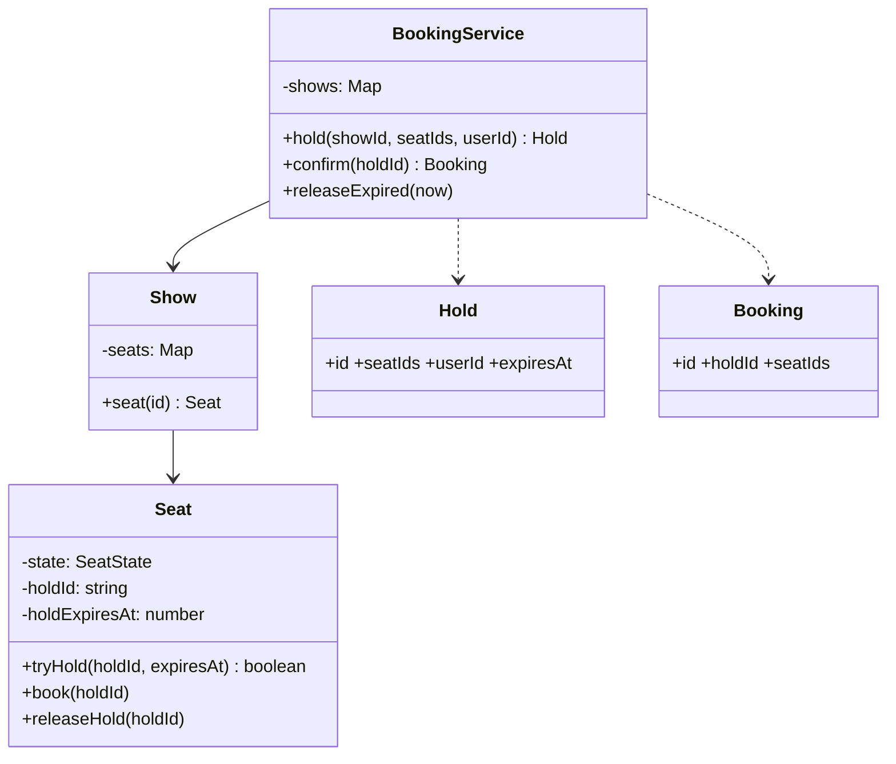
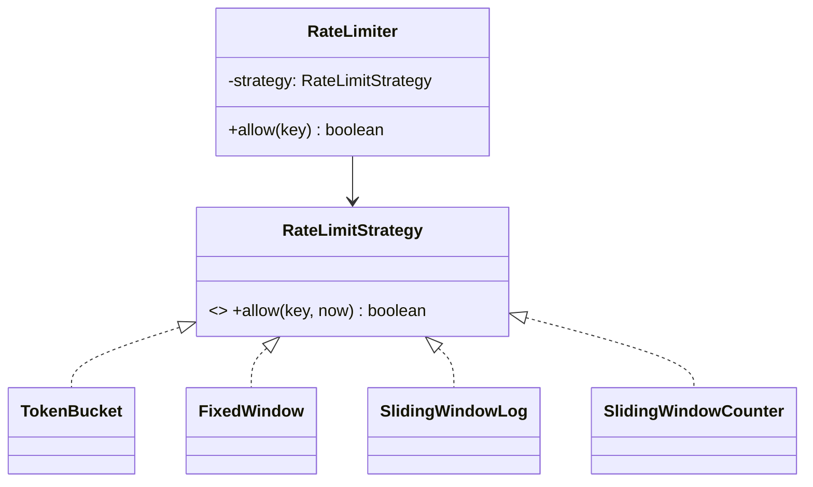

## 73.5 Worked problem: Movie Ticket Booking (seat locking)

> **Try it first** · Level: Intermediate · About 45 minutes
>
> **Build:** a movie ticket booking library where users hold seats for a show while they pay, then confirm the booking.
>
> **Requirements:**
> - Shows have seats in one of three states: available, held, booked.
> - Hold one or more seats for a user with a timeout; confirm the hold into a booking.
> - Release expired holds so the seats become available again.
> - The same seat is never booked twice.
>
> **Constraints:** a hold of several seats is all-or-nothing; two users racing for one seat means exactly one wins; a retried confirm must not book twice; runnable TypeScript within the time box.
>
> **Your task:** draw the classes and interfaces, write the key methods (`hold`, `confirm`, `releaseExpired`), and list the tests you would write.
>
> Spend the time on paper before you read on. The model design follows.

### 73.5.1 Requirements

Design a movie ticket booking system: shows have seats, users select and book seats, and the same seat is never booked twice — with a brief hold on selected seats while the user pays, releasing the hold on timeout. Clarify: shows, seats per show, seat states (available, held, booked), a hold timeout, no double-booking. This is the LLD cousin of the seat-booking system design (Part 70); here we focus on the object model and the locking logic rather than the distributed scale.

### 73.5.2 Class diagram



The no-double-book invariant lives in `Seat.tryHold`, which is an atomic check-and-set: it only holds a seat that is currently available, returning false otherwise. This mirrors the conditional update from the system-design version (Part 70).

### 73.5.3 Code

Two bugs in the first draft of this code are fixed below, and both are the kind interviewers plant on purpose. First, when a multi-seat hold failed halfway, the rollback called `releaseIfExpired` on the seats already taken — but those holds were seconds old, not expired, so they stayed `held` for five minutes and nobody could buy them. Each seat now has `releaseHold(holdId)`, which undoes *our own* hold regardless of expiry. Second, `confirm` booked seats one at a time and threw on the first expired one, leaving a hold half-booked; it now checks every seat first and books only if all are still held.

```ts
import { randomUUID } from 'node:crypto';

export type SeatState = 'available' | 'held' | 'booked';
export class HoldFailedError extends Error {}
export class UnknownSeatError extends Error {}

export class Seat {
  private state: SeatState = 'available';
  private holdId: string | null = null;
  private holdExpiresAt = 0;
  constructor(readonly id: string) {}

  // Atomic within the event loop: no await, so no interleaving (see 73.1.3).
  tryHold(holdId: string, expiresAt: number, now: number): boolean {
    if (this.state === 'available' || (this.state === 'held' && this.holdExpiresAt <= now)) {
      this.state = 'held'; this.holdId = holdId; this.holdExpiresAt = expiresAt;
      return true;
    }
    return false;                                   // already held (valid) or booked
  }

  isHeldBy(holdId: string, now: number): boolean {
    return this.state === 'held' && this.holdId === holdId && this.holdExpiresAt > now;
  }

  book(holdId: string, now: number) {
    if (!this.isHeldBy(holdId, now)) throw new HoldFailedError(`seat ${this.id} is not held by ${holdId}`);
    this.state = 'booked';
  }

  releaseHold(holdId: string) {                     // undo our own hold, whatever its expiry
    if (this.state === 'held' && this.holdId === holdId) { this.state = 'available'; this.holdId = null; }
  }

  releaseIfExpired(now: number) {
    if (this.state === 'held' && this.holdExpiresAt <= now) { this.state = 'available'; this.holdId = null; }
  }
  get stateValue() { return this.state; }
}

export class Show {
  private seats = new Map<string, Seat>();
  constructor(readonly id: string, seatIds: string[]) { for (const s of seatIds) this.seats.set(s, new Seat(s)); }
  seat(id: string) { const s = this.seats.get(id); if (!s) throw new UnknownSeatError(id); return s; }
  allSeats() { return [...this.seats.values()]; }
}
```

```ts
export interface Hold { id: string; showId: string; seatIds: string[]; userId: string; expiresAt: number; }
export interface Booking { id: string; holdId: string; seatIds: string[]; }

export class BookingService {
  private shows = new Map<string, Show>();
  private holds = new Map<string, Hold>();
  private bookings = new Map<string, Booking>();      // by holdId, makes confirm idempotent
  constructor(private readonly holdMs = 5 * 60000) {}

  addShow(show: Show) { this.shows.set(show.id, show); }
  private show(id: string) { const s = this.shows.get(id); if (!s) throw new Error(`no show ${id}`); return s; }

  hold(showId: string, seatIds: string[], userId: string, now = Date.now()): Hold {
    const show = this.show(showId);
    const holdId = randomUUID();
    const expiresAt = now + this.holdMs;
    const held: Seat[] = [];
    for (const id of seatIds) {
      const seat = show.seat(id);
      if (seat.tryHold(holdId, expiresAt, now)) { held.push(seat); continue; }
      held.forEach((s) => s.releaseHold(holdId));   // all or nothing: undo the seats we did get
      throw new HoldFailedError(`seat ${id} unavailable`);
    }
    const hold: Hold = { id: holdId, showId, seatIds, userId, expiresAt };
    this.holds.set(holdId, hold);
    return hold;
  }

  confirm(holdId: string, now = Date.now()): Booking {
    const existing = this.bookings.get(holdId);
    if (existing) return existing;                   // a retried confirm gets the same booking
    const hold = this.holds.get(holdId);
    if (!hold) throw new HoldFailedError('no such hold');
    const seats = hold.seatIds.map((id) => this.show(hold.showId).seat(id));
    // Check every seat first, then book every seat: never half-confirm a hold.
    if (!seats.every((s) => s.isHeldBy(holdId, now))) throw new HoldFailedError('hold expired');
    seats.forEach((s) => s.book(holdId, now));
    this.holds.delete(holdId);
    const booking: Booking = { id: randomUUID(), holdId, seatIds: hold.seatIds };
    this.bookings.set(holdId, booking);
    return booking;
  }

  releaseExpired(now = Date.now()) { for (const show of this.shows.values()) for (const s of show.allSeats()) s.releaseIfExpired(now); }
}
```

### 73.5.4 Tests

```ts
import { BookingService, HoldFailedError, Show } from './booking';

describe('BookingService', () => {
  it('two holds for the same seat: only one succeeds', () => {
    const svc = new BookingService();
    svc.addShow(new Show('s1', ['A1', 'A2']));
    svc.hold('s1', ['A1'], 'alice');
    expect(() => svc.hold('s1', ['A1'], 'bob')).toThrow(HoldFailedError);  // no double-book
  });

  it('hold expires and seat becomes available', () => {
    const svc = new BookingService(1000);
    svc.addShow(new Show('s1', ['A1']));
    svc.hold('s1', ['A1'], 'alice', 0);
    svc.releaseExpired(2000);                         // past expiry
    expect(() => svc.hold('s1', ['A1'], 'bob', 2000)).not.toThrow();
  });

  it('confirm fails after hold expires', () => {
    const svc = new BookingService(1000);
    svc.addShow(new Show('s1', ['A1']));
    const h = svc.hold('s1', ['A1'], 'alice', 0);
    expect(() => svc.confirm(h.id, 2000)).toThrow(HoldFailedError);
  });

  it('a failed multi-seat hold releases the seats it already took', () => {
    const svc = new BookingService();
    const show = new Show('s1', ['A1', 'A2']);
    svc.addShow(show);
    svc.hold('s1', ['A2'], 'bob', 0);
    expect(() => svc.hold('s1', ['A1', 'A2'], 'alice', 0)).toThrow(HoldFailedError);
    expect(show.seat('A1').stateValue).toBe('available');  // was stuck as 'held' before the fix
  });

  it('confirm is idempotent for a retried request', () => {
    const svc = new BookingService();
    svc.addShow(new Show('s1', ['A1']));
    const h = svc.hold('s1', ['A1'], 'alice', 0);
    expect(svc.confirm(h.id, 10)).toEqual(svc.confirm(h.id, 20));
  });
});
```

### 73.5.5 Interviewer twist

"Make this work across multiple server instances." This is where the Node single-process atomicity (73.1.3) breaks down: the in-memory `Seat` is per-instance, so two instances could each hold the same seat. The answer is to move the seat state and the atomic hold into a shared store — the conditional update in PostgreSQL (`UPDATE ... WHERE status = 'available'`) or an atomic Redis operation — exactly the seat-booking system design (Part 70). Narrating this transition from the single-process LLD to the distributed design shows you understand both the LLD craft and how it maps to real multi-instance production, which is a strong signal. A second twist — "hold the best-available seats automatically for a party of N" — is a new allocation method over the same seat primitives.

### 73.5.6 The twist, implemented

**Across instances.** The same contract as `Seat.tryHold`, with the check-and-set inside PostgreSQL. The rows are locked in sorted order first, so two holds for overlapping seats always lock in the same sequence and cannot deadlock each other, then one conditional `UPDATE` holds every seat or the transaction throws and rolls back.

```ts
import { Column, DataSource, Entity, Index, PrimaryColumn } from 'typeorm';
import { HoldFailedError } from './booking';

@Entity('show_seats')
@Index(['showId', 'status'])
export class ShowSeat {
  @PrimaryColumn({ name: 'show_id', type: 'uuid' }) showId!: string;
  @PrimaryColumn({ name: 'seat_id', type: 'text' }) seatId!: string;
  @Column({ type: 'text', default: 'available' }) status!: 'available' | 'held' | 'booked';
  @Column({ name: 'hold_id', type: 'uuid', nullable: true }) holdId!: string | null;
  @Column({ name: 'hold_expires_at', type: 'timestamptz', nullable: true }) holdExpiresAt!: Date | null;
}

export class PgSeatHolds {
  constructor(private readonly dataSource: DataSource) {}

  async hold(showId: string, seatIds: string[], holdId: string, holdSeconds: number): Promise<void> {
    const sorted = [...seatIds].sort();               // same lock order everywhere: no deadlocks
    await this.dataSource.transaction(async (manager) => {
      await manager.query(
        'SELECT seat_id FROM show_seats WHERE show_id = $1 AND seat_id = ANY($2::text[]) ORDER BY seat_id FOR UPDATE',
        [showId, sorted],
      );
      const result = await manager
        .createQueryBuilder()
        .update(ShowSeat)
        .set({ status: 'held', holdId, holdExpiresAt: () => "now() + :secs * interval '1 second'" })
        .where('show_id = :showId AND seat_id IN (:...seatIds)', { showId, seatIds: sorted })
        .andWhere("(status = 'available' OR (status = 'held' AND hold_expires_at <= now()))")
        .setParameters({ secs: holdSeconds })
        .execute();
      if (result.affected !== sorted.length) {
        throw new HoldFailedError(`only ${result.affected} of ${sorted.length} seats were free`);  // rolls back
      }
    });
  }
}
```

The time comes from the database's `now()`, not from each app server, so hold expiry is consistent even when pod clocks drift. A hold for 4 seats is two statements touching 4 rows, about 2 to 4 ms on a warm primary.

**Best N adjacent seats.** A new pure function over the seat map, composed with the unchanged `hold()`. Keeping it pure (seat map and an `isFree` predicate in, seat ids out) is what makes it trivial to test.

```ts
export interface SeatMap { rows: Record<string, string[]>; }   // row -> seat ids left to right
export interface RowScorer { score(row: string): number; }       // lower is better
export class NoAdjacentSeatsError extends Error {}

export function findAdjacent(map: SeatMap, isFree: (seatId: string) => boolean, party: number, scorer: RowScorer): string[] {
  const rows = Object.keys(map.rows).sort((a, b) => scorer.score(a) - scorer.score(b));
  for (const row of rows) {
    const seats = map.rows[row];
    const rowCentre = (seats.length - 1) / 2;
    let run: string[] = [];
    let best: string[] | null = null;
    let bestDistance = Infinity;
    for (let i = 0; i < seats.length; i++) {
      run = isFree(seats[i]) ? [...run, seats[i]] : [];   // a taken seat breaks the run
      if (run.length < party) continue;
      const distance = Math.abs(i - (party - 1) / 2 - rowCentre);  // block centre vs row centre
      if (distance < bestDistance) { best = run.slice(-party); bestDistance = distance; }
    }
    if (best) return best;
  }
  throw new NoAdjacentSeatsError(`no ${party} adjacent seats`);
}
```

```ts
import { BookingService, Show } from './booking';
import { NoAdjacentSeatsError, findAdjacent } from './booking-twist';

const map = { rows: { A: ['A1', 'A2', 'A3', 'A4', 'A5'], B: ['B1', 'B2', 'B3', 'B4', 'B5'] } };
const preferB = { score: (row: string) => (row === 'B' ? 0 : 1) };

describe('findAdjacent', () => {
  it('picks the most central block in the best row', () => {
    expect(findAdjacent(map, () => true, 3, preferB)).toEqual(['B2', 'B3', 'B4']);
  });

  it('falls back to the next row when the best row has no run long enough', () => {
    const taken = new Set(['B3']);
    expect(findAdjacent(map, (s) => !taken.has(s), 3, preferB)).toEqual(['A2', 'A3', 'A4']);
  });

  it('composes with hold() so the party gets the seats atomically', () => {
    const svc = new BookingService();
    const show = new Show('s1', Object.values(map.rows).flat());
    svc.addShow(show);
    const seats = findAdjacent(map, (s) => show.seat(s).stateValue === 'available', 2, preferB);
    expect(svc.hold('s1', seats, 'family', 0).seatIds).toHaveLength(2);
  });

  it('throws when the party cannot sit together', () => {
    expect(() => findAdjacent(map, () => true, 6, preferB)).toThrow(NoAdjacentSeatsError);
  });
});
```

### 73.5.7 Edge cases, production mapping and follow-ups

#### Edge cases & failure modes

- **Partial multi-seat hold**: fixed above; always test it, because it is the bug interviewers look for.
- **Confirm racing expiry**: the user pays at 4:59.9 and the sweeper runs at 5:00.0. Decide which wins and make it deterministic: here `confirm` checks `holdExpiresAt > now`, so a confirm after expiry fails even if the sweeper has not yet run. In production, add a small grace period to the hold the user sees (show 5:00, expire at 5:30).
- **Payment succeeded but confirm failed**: the money moved but the hold expired. You need a refund path or a "late confirm if the seats are still free" path; never silently keep the money (Part 33 — external providers and the unknown outcome).
- **Retried confirm**: a network timeout makes the client resend; the idempotent `confirm` returns the same booking instead of an error.
- **Abandoned holds at scale**: on a sell-out, 30 percent of holds may be abandoned. Expired holds are reusable immediately by `tryHold` even before the sweeper runs, because `tryHold` treats an expired hold as available.

#### Common mistakes

- Holding seats with `setTimeout` per hold. It loses every hold on restart and does not work across instances; store `expiresAt` and compare.
- Checking availability in one call and holding in another (`isAvailable()` then `hold()`), which reintroduces check-then-act.
- Releasing seats by expiry only, which leaves failed partial holds locked.

#### Interview questions

1. **Where does the no-double-booking invariant live?** In one place: the atomic check-and-set (`Seat.tryHold` in memory, the conditional `UPDATE` in PostgreSQL). Everything else calls it.
2. **Why lock rows in sorted order?** Two transactions holding overlapping seat sets in opposite orders can each lock one seat and wait for the other: a deadlock. PostgreSQL detects it after `deadlock_timeout` (1 s by default) and aborts one. Sorted order prevents the cycle.
3. **Redis instead of PostgreSQL for holds?** `SET seat:{show}:{seat} {holdId} NX PX 300000` per seat is fast and expires by itself, but a multi-seat hold then needs a Lua script for all-or-nothing, and the booking still has to be durable in the database. Many systems hold in Redis and book in PostgreSQL.
4. **How do you make "best seats" fair under contention?** Two users computing "best 2 seats" at the same moment pick the same pair; one hold fails. Retry with the next best block (bounded, say 3 times) rather than showing an error.

#### Practical exercise

Add a `cancel(holdId)` that releases a hold early and a `BookingService` test that runs 100 simulated users each trying to hold 2 random seats in a 50-seat show. Acceptance criteria: every seat ends up held by at most one hold, the count of held seats equals twice the number of successful holds, and failed holds leave no seat in `held` state.

## 73.6 Worked problem: Rate Limiter Library (pluggable strategies)

> **Try it first** · Level: Beginner · About 45 minutes
>
> **Build:** a reusable rate limiter library that answers "is this request for this key allowed?" using a configurable algorithm.
>
> **Requirements:**
> - Per-key limits (per user, per IP), each key independent.
> - Several algorithms: token bucket, fixed window, sliding window.
> - One clean interface, so callers do not care which algorithm runs.
>
> **Constraints:** time must be injectable so tests are deterministic; adding an algorithm should not change callers; runnable TypeScript within the time box.
>
> **Your task:** draw the classes and interfaces, write the key method (`allow(key)`) and at least two algorithms, and list the tests you would write.
>
> Spend the time on paper before you read on. The model design follows.

### 73.6.1 Requirements

Design a reusable rate limiter library with pluggable algorithms: a caller asks "is this request (for this key) allowed?" and the limiter answers yes/no based on a configurable strategy (token bucket, fixed window, sliding window). Clarify: per-key limits (per user, per IP), multiple algorithms, a clean interface so callers do not care which algorithm. This is the LLD of the rate limiter whose algorithms are in Part 11 and whose distributed version is in Part 59.

### 73.6.2 Class diagram



The whole point is the **strategy pattern**: the algorithm is pluggable behind one interface, so the caller and the library are independent of which algorithm is used — this is the design the problem is really testing.

### 73.6.3 Code

```ts
export interface RateLimitStrategy { allow(key: string, now: number): boolean; }

// Token bucket: refill tokens over time, allow if a token is available.
export class TokenBucket implements RateLimitStrategy {
  private buckets = new Map<string, { tokens: number; last: number }>();
  constructor(private readonly capacity: number, private readonly refillPerSec: number) {}
  allow(key: string, now: number): boolean {
    const b = this.buckets.get(key) ?? { tokens: this.capacity, last: now };
    const elapsed = (now - b.last) / 1000;
    b.tokens = Math.min(this.capacity, b.tokens + elapsed * this.refillPerSec);  // refill
    b.last = now;
    if (b.tokens >= 1) { b.tokens -= 1; this.buckets.set(key, b); return true; }
    this.buckets.set(key, b);
    return false;
  }
}

// Fixed window: a count per fixed time window.
export class FixedWindow implements RateLimitStrategy {
  private windows = new Map<string, { windowStart: number; count: number }>();
  constructor(private readonly limit: number, private readonly windowMs: number) {}
  allow(key: string, now: number): boolean {
    const start = Math.floor(now / this.windowMs) * this.windowMs;
    const w = this.windows.get(key);
    if (!w || w.windowStart !== start) { this.windows.set(key, { windowStart: start, count: 1 }); return true; }
    if (w.count < this.limit) { w.count++; return true; }
    return false;                                    // over the limit for this window
  }
}

// Sliding window log: timestamps within the window; precise but more memory.
export class SlidingWindowLog implements RateLimitStrategy {
  private log = new Map<string, number[]>();
  constructor(private readonly limit: number, private readonly windowMs: number) {}
  allow(key: string, now: number): boolean {
    const times = (this.log.get(key) ?? []).filter((t) => t > now - this.windowMs);  // drop old
    if (times.length < this.limit) { times.push(now); this.log.set(key, times); return true; }
    this.log.set(key, times);
    return false;
  }
}

export class RateLimiter {
  constructor(private readonly strategy: RateLimitStrategy) {}
  allow(key: string, now = Date.now()): boolean { return this.strategy.allow(key, now); }
}
```

### 73.6.4 Tests

```ts
import { FixedWindow, RateLimiter, TokenBucket } from './ratelimiter';

it('token bucket allows up to capacity then refills', () => {
  const rl = new RateLimiter(new TokenBucket(2, 1));     // capacity 2, 1/sec refill
  expect(rl.allow('u1', 0)).toBe(true);
  expect(rl.allow('u1', 0)).toBe(true);
  expect(rl.allow('u1', 0)).toBe(false);                 // bucket empty
  expect(rl.allow('u1', 1000)).toBe(true);               // 1s later, 1 token refilled
});

it('fixed window resets each window', () => {
  const rl = new RateLimiter(new FixedWindow(2, 1000));
  expect(rl.allow('u1', 0)).toBe(true);
  expect(rl.allow('u1', 500)).toBe(true);
  expect(rl.allow('u1', 600)).toBe(false);               // 3rd in the window
  expect(rl.allow('u1', 1100)).toBe(true);               // new window
});

it('different keys are independent', () => {
  const rl = new RateLimiter(new FixedWindow(1, 1000));
  expect(rl.allow('u1', 0)).toBe(true);
  expect(rl.allow('u2', 0)).toBe(true);                  // separate key, own limit
});
```

### 73.6.5 Interviewer twist

"Make it distributed, shared across instances, and add a sliding-window-counter algorithm." Distributed is the key transition: the in-memory maps are per-instance, so a shared limit needs the state in Redis with atomic operations (the Lua-script approach in Part 59's rate limiter). Because the algorithm is behind the `RateLimitStrategy` interface, you add a `RedisTokenBucket` implementation that keeps state in Redis — the `RateLimiter` and callers are unchanged. Adding the sliding-window-counter algorithm is just another strategy class. The strategy interface is exactly what makes both twists additive: a new implementation, no change to the core. This is the payoff of designing the variation point as an interface from the start.

There is one honest caveat to say out loud: the interface above is synchronous, and Redis is not. A `RedisTokenBucket` cannot implement `allow(): boolean`. The twist therefore changes the contract once, to `consume(key): Promise<Decision>`, and the in-memory strategies join it through a small adapter. If the interviewer mentioned "distributed" anywhere in the requirements, start with the async contract and avoid the change entirely.

### 73.6.6 The twist, implemented

**Sliding window counter.** Two integers per key instead of a timestamp log: the count in the current fixed window plus the previous window's count weighted by how much of it still overlaps the sliding window. It removes the fixed window's boundary burst at a fraction of the log's memory.

```ts
export class SlidingWindowCounter implements RateLimitStrategy {
  private counters = new Map<string, { windowStart: number; current: number; previous: number }>();
  constructor(private readonly limit: number, private readonly windowMs: number) {}

  allow(key: string, now: number): boolean {
    const start = Math.floor(now / this.windowMs) * this.windowMs;
    let c = this.counters.get(key) ?? { windowStart: start, current: 0, previous: 0 };
    if (c.windowStart !== start) {
      // roll forward; the old count only matters if it was the window right before this one
      const adjacent = start - c.windowStart === this.windowMs;
      c = { windowStart: start, current: 0, previous: adjacent ? c.current : 0 };
    }
    this.counters.set(key, c);
    const previousWeight = 1 - (now - start) / this.windowMs;  // share of last window still "inside"
    if (c.previous * previousWeight + c.current >= this.limit) return false;
    c.current++;
    return true;
  }
}
```

```ts
import { FixedWindow, RateLimiter, SlidingWindowCounter } from './ratelimiter';

const burst = (rl: RateLimiter, n: number, at: number) =>
  Array.from({ length: n }, () => rl.allow('u1', at)).filter(Boolean).length;

it('fixed window lets 2x the limit through across a boundary', () => {
  const rl = new RateLimiter(new FixedWindow(10, 1000));
  expect(burst(rl, 10, 900) + burst(rl, 10, 1100)).toBe(20);   // 20 requests in 200 ms
});

it('sliding window counter smooths the boundary burst', () => {
  const rl = new RateLimiter(new SlidingWindowCounter(10, 1000));
  expect(burst(rl, 10, 900)).toBe(10);
  expect(burst(rl, 10, 1100)).toBe(1);     // 10 x 0.9 = 9 already counted, room for 1
  expect(burst(rl, 10, 1500)).toBe(4);     // 10 x 0.5 + 1 = 6, room for 4
});
```

**Distributed token bucket.** A Lua script runs atomically inside Redis (no other command interleaves with it), and it reads Redis's own clock with `TIME`, so app servers with skewed clocks still agree. The key expires once the bucket would have refilled completely, so idle users cost no memory.

```ts
import Redis from 'ioredis';

export interface Decision { allowed: boolean; remaining: number; retryAfterMs: number; }
export interface AsyncRateLimitStrategy { consume(key: string): Promise<Decision>; }

const TOKEN_BUCKET_LUA = `
local capacity = tonumber(ARGV[1])
local refill_per_ms = tonumber(ARGV[2])
local t = redis.call('TIME')
local now = tonumber(t[1]) * 1000 + math.floor(tonumber(t[2]) / 1000)
local state = redis.call('HMGET', KEYS[1], 'tokens', 'ts')
local tokens = tonumber(state[1]) or capacity
local ts = tonumber(state[2]) or now
tokens = math.min(capacity, tokens + (now - ts) * refill_per_ms)
local allowed = 0
local retry_after = 0
if tokens >= 1 then
  tokens = tokens - 1
  allowed = 1
else
  retry_after = math.ceil((1 - tokens) / refill_per_ms)
end
redis.call('HSET', KEYS[1], 'tokens', tostring(tokens), 'ts', now)
redis.call('PEXPIRE', KEYS[1], math.ceil(capacity / refill_per_ms))
return { allowed, math.floor(tokens), retry_after }
`;

export class RedisTokenBucket implements AsyncRateLimitStrategy {
  constructor(private readonly redis: Redis, private readonly capacity: number, private readonly refillPerSec: number) {}

  async consume(key: string): Promise<Decision> {
    const [allowed, remaining, retryAfterMs] = (await this.redis.eval(
      TOKEN_BUCKET_LUA, 1, `rl:tb:${key}`, this.capacity, this.refillPerSec / 1000,
    )) as [number, number, number];
    return { allowed: allowed === 1, remaining, retryAfterMs };
  }
}
```

**The NestJS edge.** A guard turns a `Decision` into HTTP: `429 Too Many Requests` with `Retry-After`. For most APIs `@nestjs/throttler` already does this; the point here is that the library you designed plugs into Nest through one injection token. If Redis is unreachable, this guard fails open (allows traffic) and logs; for a login endpoint you would fail closed instead.

```ts
import { CanActivate, ExecutionContext, HttpException, HttpStatus, Inject, Injectable, Logger } from '@nestjs/common';
import { AsyncRateLimitStrategy, Decision } from './ratelimiter-redis';

export const RATE_LIMITER = Symbol('RATE_LIMITER');

@Injectable()
export class RateLimitGuard implements CanActivate {
  private readonly logger = new Logger(RateLimitGuard.name);
  constructor(@Inject(RATE_LIMITER) private readonly limiter: AsyncRateLimitStrategy) {}

  async canActivate(context: ExecutionContext): Promise<boolean> {
    const http = context.switchToHttp();
    const req = http.getRequest<{ ip?: string; user?: { id: string } }>();
    const res = http.getResponse<{ setHeader(name: string, value: string): void }>();
    const key = req.user?.id ?? req.ip ?? 'anonymous';

    let decision: Decision;
    try {
      decision = await this.limiter.consume(key);
    } catch (err) {
      this.logger.warn(`rate limiter unavailable, failing open: ${(err as Error).message}`);
      return true;
    }
    res.setHeader('RateLimit-Remaining', String(decision.remaining));
    if (!decision.allowed) {
      res.setHeader('Retry-After', String(Math.ceil(decision.retryAfterMs / 1000)));
      throw new HttpException('Too many requests', HttpStatus.TOO_MANY_REQUESTS);
    }
    return true;
  }
}
```

```ts
import { ExecutionContext, HttpException, HttpStatus } from '@nestjs/common';
import { RateLimitGuard } from './ratelimit.guard';
import { AsyncRateLimitStrategy } from './ratelimiter-redis';

function contextFor(req: object, headers: Record<string, string>): ExecutionContext {
  const res = { setHeader: (name: string, value: string) => { headers[name] = value; } };
  return { switchToHttp: () => ({ getRequest: () => req, getResponse: () => res }) } as unknown as ExecutionContext;
}

it('rejects with 429 and a Retry-After header when the limiter says no', async () => {
  const limiter: AsyncRateLimitStrategy = { consume: jest.fn().mockResolvedValue({ allowed: false, remaining: 0, retryAfterMs: 2500 }) };
  const headers: Record<string, string> = {};
  const error = await new RateLimitGuard(limiter).canActivate(contextFor({ ip: '10.0.0.7' }, headers)).catch((e: unknown) => e);
  expect((error as HttpException).getStatus()).toBe(HttpStatus.TOO_MANY_REQUESTS);
  expect(headers['Retry-After']).toBe('3');
});

it('keys by user id when authenticated, and fails open if Redis is down', async () => {
  const limiter: AsyncRateLimitStrategy = { consume: jest.fn().mockRejectedValue(new Error('ECONNREFUSED')) };
  await expect(new RateLimitGuard(limiter).canActivate(contextFor({ ip: '10.0.0.7', user: { id: 'u-42' } }, {}))).resolves.toBe(true);
  expect(limiter.consume).toHaveBeenCalledWith('u-42');
});
```

### 73.6.7 Edge cases, production mapping and follow-ups

#### Edge cases & failure modes

- **Unbounded memory**: every in-memory strategy keeps one entry per key forever. A scan of 10 million spoofed IPs is 10 million map entries. Evict idle keys (an LRU, Part 10 — LRU Cache, or a periodic sweep); Redis gets this for free from `PEXPIRE`.
- **Sliding window log cost**: it stores every timestamp, so a 1,000-per-minute limit is up to 1,000 numbers per key and an O(n) filter per call. Use it only for small limits where precision matters.
- **Clock going backwards**: NTP corrections can move `Date.now()` back; a token bucket then computes negative elapsed time. Clamp elapsed at zero, or use `performance.now()` for in-process limits.
- **Redis down**: fail open or closed is a product decision per endpoint. Write it down in the design, emit a metric, and alert on it.
- **Key choice**: `req.ip` behind a load balancer is the balancer's address unless the app trusts `X-Forwarded-For` correctly (Express `trust proxy`). One wrong setting rate-limits the whole world as one user.

#### Common mistakes

- An `if (algorithm === 'token')` switch inside `RateLimiter`: the twist then edits the core.
- A `GET` then `SET` pair against Redis instead of one script: the read-modify-write race of 73.1.3, now across instances.
- Returning only a boolean. Clients need `Retry-After` to back off politely; without it they retry immediately and make the overload worse.

#### Interview questions

1. **Token bucket or sliding window?** Token bucket allows controlled bursts up to capacity and is cheap; sliding window counter enforces a smooth rate with no boundary burst. Public APIs often use token bucket; login and OTP endpoints use a strict window.
2. **Why a Lua script and not `MULTI`/`EXEC`?** `MULTI` queues commands but cannot branch on a value read inside the transaction; the script reads, decides and writes atomically in one round trip (about 0.2 to 0.5 ms).
3. **How does this scale to 200,000 requests per second?** One Redis primary handles roughly 100,000 simple script calls per second; shard keys across a Redis Cluster (the key is the user, so a user stays on one shard), or keep a local token bucket per pod with a share of the global limit and accept small inaccuracy.
4. **Where should rate limiting live: gateway or service?** Coarse per-IP limits at the gateway or CDN, fine-grained per-user and per-plan limits in the service where the user and plan are known. Both, not either.

#### Practical exercise

Add a `CompositeLimiter` that applies several strategies (10 per second and 1,000 per day) and allows a request only if all allow it, without consuming from the second when the first denies. Acceptance criteria: it implements `AsyncRateLimitStrategy`, it is composed in a NestJS provider without changing the guard, and a test shows a denied request does not use up the daily allowance.
