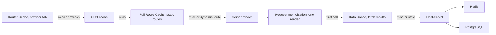
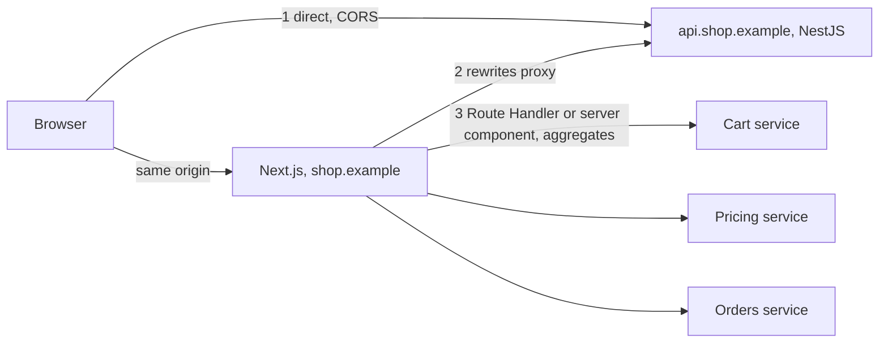

## 73.7 Next.js caching layers and how to invalidate each

#### Concept

A Next.js 14 App Router app has **four caches of its own**, stacked between the user and your NestJS API. Each stores something different, lives in a different place and is cleared by a different action:

1. **Request memoisation**: during one server render, identical `GET` `fetch` calls (same URL and options) run once and share the result. React's `cache()` does the same for any function you wrap.
2. **Data Cache**: fetch results stored on the server across requests, users and (on most hosts) deployments, governed by `revalidate` and `tags` (73.5).
3. **Full Route Cache**: the rendered HTML and RSC payload of static routes, produced at build or on revalidation (73.2).
4. **Router Cache**: an in-memory cache of RSC payloads in the browser tab, filled by visits and prefetches (73.3).

Outside Next.js sit two more you already know: the CDN cache (Part 46 — Cloud Architecture, 46.8) and the browser HTTP cache (Part 11.11). Behind NestJS sits Redis (Part 27 — Caching and Redis). "The page shows old data" can come from any of these six layers, and fixing the wrong one changes nothing.

#### Why does it exist?

Each layer removes a different cost. Memoisation stops the page, its layout and `generateMetadata` from calling the same endpoint three times in one render. The Data Cache stops every render from calling NestJS at all. The Full Route Cache stops the server from rendering at all. The Router Cache stops the browser from asking the server at all when the user clicks Back or a prefetched link. The price is the classic one: every cache is a place where data can be stale and needs an invalidation path.

#### Mental model

Imagine a newspaper. The reporter checks a fact once and uses it in three articles in the same edition (memoisation). The newsroom keeps a filing cabinet of facts checked earlier today (Data Cache). The printing press keeps printed copies of today's edition (Full Route Cache). The reader keeps the copy they already bought on the kitchen table (Router Cache). If a price was wrong, correcting the filing cabinet does not change the copies already printed, and reprinting does not change the copy on the reader's table. You must know which copy the reader is looking at.

#### How it works



The layers in Next.js 14, side by side:

| Layer | Where | Stores | Lifetime | Invalidated by | Opt out |
|---|---|---|---|---|---|
| Request memoisation | Server, per render | Return values of identical `GET` fetches and `cache()` calls | One request | Nothing needed | Not using `fetch`; passing your own `signal` |
| Data Cache | Server, persistent | Fetch responses | Until `revalidate` expires or a tag/path is revalidated | `revalidateTag`, `revalidatePath`, time | `cache: 'no-store'` |
| Full Route Cache | Server, persistent | HTML + RSC payload of static routes | Until revalidated or redeployed | Revalidating its data, redeploy | Dynamic rendering |
| Router Cache | Browser tab memory | RSC payloads per segment | Session; 30 s for dynamic pages, 5 min for static or fully prefetched pages (14.x defaults) | `router.refresh()`, `revalidatePath`/`revalidateTag`/`cookies().set()` **inside a Server Action**, hard reload | Cannot be disabled in 14; `staleTimes` from 14.2 |

Four mechanics trip people up:

1. **Memoisation is narrower than it looks.** It applies only to `GET` fetches inside the React tree (server components, `generateMetadata`, `generateStaticParams`), not to Route Handlers. A fetch that passes its own `signal`, such as the `AbortSignal.timeout(2_000)` used throughout this Part, opts out of fetch memoisation by design, because React assumes someone else controls that request's lifetime. That is one more reason the data functions in 73.4 are wrapped in React's `cache()`, which deduplicates regardless of the fetch options inside.
2. **The Data Cache ignores HTTP headers.** `Cache-Control: no-store` from NestJS does not stop Next.js 14 from caching a `fetch` with default options. In 14, a fetch that carries an `Authorization` or `Cookie` header is still cached unless an uncached request or a dynamic function came before it in the tree. Personal fetches must say `cache: 'no-store'` explicitly.
3. **Who calls revalidation matters for the browser.** `revalidateTag` in a Server Action invalidates the server caches *and* the calling user's Router Cache, and returns fresh RSC in the same response. The same call in a Route Handler (a webhook from NestJS) clears the server caches only; users who already have the page in their Router Cache keep seeing it until the 30 s or 5 min timer expires, they navigate with a hard reload, or the app calls `router.refresh()`.
4. **Redeploys clear the Full Route Cache but not necessarily the Data Cache.** On Vercel the Data Cache survives deployments. Self-hosted, it lives in `.next/cache` on the container's disk, so each new container starts empty unless you configure a shared cache handler (73.11).

**Version changes.** Next.js 14.2 added `experimental.staleTimes: { dynamic, static }` to tune the Router Cache. Next.js 15 changed the default for dynamic pages to 0 s (page segments are refetched on every navigation; Back and Forward still restore from the cache, and layouts are still reused). Next.js 16 with `cacheComponents: true` replaces fetch-level options with the `"use cache"` directive plus `cacheLife()` and `cacheTag()` from `next/cache`, adds `updateTag()` (Server Actions only, read-your-own-writes: the caller waits for fresh data) and requires a cache profile as the second argument of `revalidateTag(tag, 'max')`, which then serves stale while revalidating.

#### Practical example

A customer cancels an order. Which layers hold the old "Paid" status, and what clears each?

- The order page is dynamic (it reads the session cookie), so there is no Full Route Cache entry and no Data Cache entry, as long as the order fetch uses `no-store`.
- The customer's **Router Cache** holds the order list visited 10 seconds ago. Navigating back to `/orders` within 30 seconds (Next.js 14) shows "Paid" with a Cancel button.
- The **CDN** should hold nothing, because the response is `private, no-store`.

So the fix belongs in exactly one place: perform the cancel in a Server Action that calls `revalidatePath('/orders')`, or call `router.refresh()` after a client-side mutation.

#### React / Next.js example

The cancel as a Server Action, clearing the caller's Router Cache along with the server caches:

```ts
// apps/web/app/(account)/orders/actions.ts  (Next.js 14)
'use server';
import { revalidatePath } from 'next/cache';
import { getSession } from '@/lib/session.server';

export async function cancelOrder(orderId: string, idempotencyKey: string) {
  const session = await getSession();
  if (!session) return { ok: false as const, code: 'UNAUTHENTICATED' };
  const res = await fetch(`${process.env.API_URL}/v1/orders/${encodeURIComponent(orderId)}/cancel`, {
    method: 'POST',
    headers: { Authorization: `Bearer ${session.accessToken}`, 'Idempotency-Key': idempotencyKey,
               'Content-Type': 'application/json' },
    body: JSON.stringify({ reason: 'CHANGED_MIND' }),
    cache: 'no-store',
    signal: AbortSignal.timeout(3_000),
  });
  if (!res.ok) return { ok: false as const, code: ((await res.json().catch(() => ({}))) as { code?: string }).code ?? 'UPSTREAM_ERROR' };
  revalidatePath('/orders');            // server caches for /orders AND this user's Router Cache
  revalidatePath(`/orders/${orderId}`); // the detail page too
  return { ok: true as const };
}
```

Tuning the Router Cache from 14.2 on, and the same product loader written for Next.js 16's model:

```js
// apps/web/next.config.js  (Next.js 14.2+; still experimental in 15)
module.exports = {
  experimental: { staleTimes: { dynamic: 0, static: 180 } }, // personal pages never reused from the tab cache
};
```

```ts
// apps/web/lib/catalog.server.ts  (Next.js 16, cacheComponents: true)
import 'server-only';
import { cacheLife, cacheTag } from 'next/cache';
import { ProductViewSchema } from '@shop/contracts';

export async function getProduct(slug: string) {
  'use cache';                      // arguments (slug) are part of the cache key automatically
  cacheLife('minutes');             // built-in profile; replaces next.revalidate
  cacheTag(`product:${slug}`);      // replaces next.tags
  const res = await fetch(`${process.env.CATALOG_API_URL}/v1/products/${slug}`, { signal: AbortSignal.timeout(2_000) });
  if (res.status === 404) return null;
  if (!res.ok) throw new Error(`catalog ${res.status}`);
  return ProductViewSchema.parse(await res.json());
}
```

Inside a `"use cache"` function you cannot call `cookies()` or `headers()`; request data must be read outside and passed in as an argument, which makes it part of the key. That rule is the framework enforcing the lesson of the `unstable_cache` leak in 73.5.

#### Backend side (NestJS)

- **Own the tag vocabulary.** Put tag builders in `@shop/contracts` (`cacheTags.product(slug)`, `cacheTags.category(slug)`) so the web tier that tags fetches and the NestJS publisher that revalidates them cannot drift apart. A typo in a tag fails silently: nothing is ever invalidated.
- **Personal responses say so.** Send `Cache-Control: private, no-store` on user-scoped endpoints. Next.js ignores it, but CDNs, proxies and browsers do not, and it documents intent for whoever writes the `fetch`.
- **Mutations return the new state.** A `200` with the updated resource and its `version` (72.5) lets a Server Action or client patch the UI without a second read that might hit a stale layer.
- **The publisher purges what Next.js cannot.** After calling the revalidation endpoint, the same NestJS job can call CloudFront `CreateInvalidation` for the handful of hottest paths, or the CDN TTL for HTML can be capped low (73.11).

#### Production scenario

An electronics retailer kept getting "old price" tickets after adding on-demand revalidation. The on-call engineer wrote a runbook that walks the layers from the outside in:

| Check | Tool | What it told them |
|---|---|---|
| Browser Router Cache | Hard reload vs client navigation | Hard reload showed the new price: tab cache, not server |
| CDN | `Age` and `x-cache` response headers | `Age: 241`, `Hit from cloudfront`: CDN holding a 4-minute-old copy |
| Full Route Cache | `x-nextjs-cache` from origin, bypassing CDN | `HIT` with fresh content |
| Data Cache | Server log of tag revalidation | Tag revalidated 3 s after the change |
| NestJS and Redis | `GET` the API directly | Correct price |

Next.js had set `s-maxage=600` on the ISR page, so CloudFront held it for up to 10 minutes regardless of revalidation. They capped the CloudFront cache policy's maximum TTL for HTML at 30 seconds, leaving hashed assets at a year. Origin requests for HTML rose from about 40 to about 90 per second, all served from the Full Route Cache in under 5 ms, and old-price tickets stopped.

#### Failure scenario

A food-delivery app on Next.js 14.1 implemented "Cancel order" as a client component calling NestJS through the BFF proxy, then `router.push('/orders')`. The cancel succeeded, but the list page came out of the Router Cache, visited 12 seconds earlier, still showing "Preparing" with a Cancel button. Customers pressed Cancel again, got `409 ORDER_NOT_CANCELLABLE` ("already cancelled"), assumed the app was broken and called support. Tickets about "cancel not working" ran at about 150 a day before anyone connected them to the 30-second Router Cache, which 14.1 did not let them configure.

The fix moved the mutation into a Server Action with `revalidatePath('/orders')`. The team also added a test that cancels, navigates back within 5 seconds and asserts the new status, because the bug never appeared in `next dev`, where prefetching and the Router Cache behave differently.

#### Edge cases & failure modes

- **Webhook revalidation leaves open tabs stale** until their Router Cache expires; pages that must reflect external changes quickly need polling, SSE (72.8) or `router.refresh()` on focus.
- **Back and Forward always restore from the Router Cache**, even in Next.js 15 with `dynamic: 0`.
- **Self-hosted replicas each have their own Data Cache and Full Route Cache**; a revalidation reaches one replica unless the cache handler is shared (73.11).
- **Fetch responses over 2 MB are not stored** in the Data Cache, silently making a page call the API on every render.
- **`revalidatePath('/p/[slug]', 'page')`** revalidates every product page at once: a thundering herd against the catalogue API.
- **Cookies and auth headers in a cached fetch** in Next.js 14 can store one user's response for everyone if nothing dynamic ran first.

#### How a Senior Full-Stack Engineer thinks about this

The senior keeps a diagram of every cache between the user and PostgreSQL, with the owner, TTL and invalidation path of each, exactly as for Redis in Part 27. For every piece of data they ask: which layers may hold it, how stale may it be in each, and what event clears each one? Personal data is kept out of every shared layer by construction (`no-store`, `private`), not by care. Mutations that a user must see immediately go through Server Actions or are followed by `router.refresh()`. And they debug from the outside in, because the closest cache to the user is usually the one serving the stale copy.

#### Common mistakes

- **Revalidating the Data Cache and forgetting the CDN** that sits in front of it.
- **Expecting a webhook's `revalidateTag` to update pages already open** in users' tabs.
- **Relying on NestJS `Cache-Control` headers** to control Next.js's Data Cache.
- **Tag names written as string literals** in two codebases.

#### Interview questions

1. **Name the four Next.js caches and how to clear each.** Expected answer: request memoisation (per render, nothing to clear), Data Cache (`revalidateTag`/`revalidatePath`, time), Full Route Cache (revalidating its data, redeploy), Router Cache (`router.refresh()`, revalidation inside a Server Action, hard reload). Follow-up: which survives a redeploy on Vercel? (The Data Cache.)
2. **A user cancels an order and the list still shows it as active. Where do you look?** Expected answer: the Router Cache first; then whether the order fetch is accidentally cached; fix with a Server Action that revalidates or `router.refresh()`.
3. **Why does `revalidateTag` from a Route Handler behave differently from the same call in a Server Action?** Expected answer: only the action's response can carry fresh RSC and invalidate the caller's Router Cache.
4. **How does Next.js 16 change caching?** Expected answer: explicit `"use cache"` with `cacheLife` and `cacheTag`, arguments as keys, no request APIs inside, `updateTag` for read-your-writes, `revalidateTag(tag, profile)`.
5. **How do you make a CDN in front of ISR respect on-demand revalidation?** Expected answer: cap the CDN TTL for HTML, purge hot paths from the publisher, or route revalidation-sensitive pages around the CDN.

#### Practical exercise

Instrument a product page and an order list so you can see each cache.

Acceptance criteria:

- A runbook table like the one above, filled with real header values from your app for one product page.
- After a price change and webhook revalidation, a hard reload shows the new price within 5 s; a client navigation shows it within the `staleTimes.static` window you configured.
- Cancelling an order and pressing Back within 5 s shows the cancelled status (Playwright test against `next start`, not `next dev`).
- A code search proves every `fetch` that sends a user token sets `cache: 'no-store'`.

## 73.8 The backend-for-frontend (BFF) pattern: Next.js in front of NestJS

#### Concept

A **backend-for-frontend (BFF)** is a server-side layer built for one frontend and usually owned by the team that builds it. It aggregates calls to several backend services into one response shaped for a screen, keeps tokens and service credentials on the server, translates backend errors into what the UI needs, and hides internal service topology from the browser. It does not own business rules or data; those stay in the services.

A Next.js app is already a server, so it is a natural BFF. Server components aggregate data for rendering (73.5), Server Actions handle page mutations (73.6), and Route Handlers or `rewrites` give client components a same-origin path to the API. The question is not whether Next.js *can* be the BFF, but how much it should do and when a separate API gateway is still needed.

#### Why does it exist?

General-purpose APIs are shaped around resources; screens are shaped around tasks. An order-details screen needs the order, its items, the shipment, the rider's location and the payment status. Called from a phone, that is five requests over 80 ms round trips, five sets of CORS preflights if the API is on another origin, a token stored in JavaScript to authorise them, and five error shapes to handle. A BFF makes those calls inside the data centre in parallel (1 to 5 ms each), returns one view model, and keeps the token in an `HttpOnly` cookie that only the BFF reads.

#### Mental model

Imagine a personal shopper in a department store. You give them one list; they visit the shoe, shirt and tie departments, which are next door to each other, and bring back one bag. But the shopper does not set prices or decide refund policy; if they started doing that, two shoppers would quote two prices for the same shirt.

#### How it works

Three ways the browser can reach NestJS from a Next.js app:



1. **Direct calls** from client components to `api.shop.example`. Simple and keeps Next.js out of the hot path, but needs CORS with credentials (Part 11.13), cookies scoped to the parent domain, and the API must be public.
2. **`rewrites`** in `next.config.js` proxy `/api/v1/*` on the web origin to NestJS. The browser sees one origin, so no CORS and cookies flow naturally. Next.js adds no logic; it forwards. Destinations are resolved at build, so the API URL is baked into the build (73.11).
3. **Route Handlers** (and server components) that read the session cookie, call one or more services with the user's token, and return a view model. This is the full BFF, and the **token-handler pattern**: the browser holds only an `HttpOnly` session cookie; access tokens never reach JavaScript (Part 75 — Auth and Security in the Browser).

| | Direct | `rewrites` proxy | Route Handler BFF |
|---|---|---|---|
| CORS | Needed | Not needed | Not needed |
| Token in browser JavaScript | Often | No (cookie forwarded) | No |
| Aggregation and shaping | No | No | Yes |
| Extra hop latency | None | 1 to 3 ms in-region | 1 to 3 ms plus your code |
| Next.js tier in the failure path | No | Yes | Yes |
| Best for | Public, cacheable APIs | Existing APIs, quick same-origin | Screens needing several services |

When to keep (or add) a separate **API gateway** in front of NestJS:

| Situation | Recommendation |
|---|---|
| One web app, one NestJS monolith | Next.js server components and a few Route Handlers; no gateway |
| Web plus mobile apps plus partner API | Gateway for auth, rate limits, API keys and WAF; Next.js BFF calls services through it or inside the VPC |
| Many teams and microservices | Gateway for routing and cross-cutting policy; one BFF per frontend |
| Strict compliance (PCI scope) | Keep payment calls off the web tier; browser talks to the payment provider's hosted fields directly |

#### Practical example

The cart drawer (a client component, 73.4) needs items, prices after promotions and a delivery-fee estimate, from the cart and pricing services. Instead of three browser calls, it calls `GET /api/bff/cart` on the same origin. The Route Handler reads the session cookie, calls both services in parallel with the user's token, tolerates a pricing timeout by falling back to list prices with a `promotionsUnavailable` flag, and returns a 2 KB `CartView`. TanStack Query on the client caches it under `['cart']` (Part 72).

#### React / Next.js example

```ts
// apps/web/app/api/bff/cart/route.ts  (Next.js 14)
import { cookies } from 'next/headers';
import { CartViewSchema, ServiceCartSchema, PromotionsSchema } from '@shop/contracts';
import { getSession } from '@/lib/session.server';
import { toCartView } from '@/lib/cart-view';

export const dynamic = 'force-dynamic';                 // personal: never a static GET handler (79.6)
const PRIVATE = { 'Cache-Control': 'private, no-store' };

export async function GET(request: Request): Promise<Response> {
  const session = await getSession();
  const guestCartId = cookies().get('cart_id')?.value;    // anonymous carts keyed by an opaque id
  const requestId = request.headers.get('x-request-id') ?? crypto.randomUUID();
  const headers: Record<string, string> = { 'x-request-id': requestId };
  if (session) headers.Authorization = `Bearer ${session.accessToken}`;
  else if (guestCartId) headers['x-cart-id'] = guestCartId;
  else return Response.json(CartViewSchema.parse({ items: [], count: 0, subtotalMinor: '0', promotionsUnavailable: false }), { headers: PRIVATE });

  const [cartRes, promos] = await Promise.all([
    fetch(`${process.env.CART_API_URL}/v1/cart`, { headers, cache: 'no-store', signal: AbortSignal.timeout(1_500) }),
    fetch(`${process.env.PRICING_API_URL}/v1/promotions/applicable`, { headers, cache: 'no-store', signal: AbortSignal.timeout(800) })
      .then(async (r) => (r.ok ? PromotionsSchema.parse(await r.json()) : null))
      .catch(() => null),                                // optional: degrade, do not fail the cart
  ]);
  if (!cartRes.ok) {
    const status = cartRes.status === 401 ? 401 : 502;   // never leak upstream 500 bodies to the browser
    return Response.json({ code: status === 401 ? 'UNAUTHENTICATED' : 'CART_UNAVAILABLE', issues: [], requestId }, { status, headers: PRIVATE });
  }
  const cart = ServiceCartSchema.parse(await cartRes.json());
  return Response.json(CartViewSchema.parse(toCartView(cart, promos)), { headers: PRIVATE }); // display shaping only
}
```

`toCartView` only reshapes and formats; the totals come from the cart service, which applied promotions itself. And the plain proxy for everything else:

```js
// apps/web/next.config.js
module.exports = {
  async rewrites() {
    return [{ source: '/api/v1/:path*', destination: `${process.env.API_URL}/v1/:path*` }]; // read at build time
  },
};
```

#### Backend side (NestJS)

With a BFF in front, every request to NestJS comes from a handful of web-tier IP addresses, which breaks assumptions:

- **Rate limit by user, not by IP.** `ThrottlerGuard` keys on the client IP by default; behind a BFF all customers share a few IPs and one busy minute throttles everyone. Override `getTracker` and register the guard so it runs after authentication:

```ts
// apps/api/src/common/user-throttler.guard.ts
import { Injectable } from '@nestjs/common';
import { ThrottlerGuard } from '@nestjs/throttler';

@Injectable()
export class UserThrottlerGuard extends ThrottlerGuard {
  protected async getTracker(req: Record<string, any>): Promise<string> {
    // Authenticated: per user. Anonymous: the original client IP from X-Forwarded-For,
    // which Express only trusts after app.set('trust proxy', 1) on a NestExpressApplication.
    return req.user?.id ? `user:${req.user.id}` : `ip:${req.ips?.[0] ?? req.ip}`;
  }
}
```

- **Trust the forwarded headers deliberately.** Configure `trust proxy` for exactly the hops you control, or any client can forge `X-Forwarded-For` and pick its own rate-limit bucket.
- **Propagate `x-request-id`** from the BFF and log it, so one cart drawer error traces through the BFF into both services (Part 43 — Observability).
- **Keep resource APIs generic.** Do not add `GET /v1/web-cart-drawer`; the BFF composes screens, the services expose resources that mobile and partners can reuse.
- **Keep internal endpoints internal.** Services the BFF calls should listen on an internal load balancer; the public gateway exposes only what browsers and apps may call.

#### Production scenario

An order-tracking page made six browser calls (order, items, shipment, rider location, payment, help articles), two of which depended on the first. On a 4G connection p75 time to complete data was 2.1 s. A Route Handler BFF aggregated them inside the VPC: the dependent calls now cost 3 ms each instead of 80 to 150 ms. p75 fell to 640 ms, and NestJS saw the same number of calls, just from closer.

#### Failure scenario

A web team put a "web-only 5 % welcome discount" calculation into the BFF's cart view to ship before a campaign, because the pricing service's team was busy. Three weeks later the mobile app showed one total, the web cart another, and checkout (which priced through the pricing service) a third. Over a weekend 2,300 orders were placed where the web cart had shown a lower total than the one charged. Refunds cost more than the campaign earned. The discount moved into the pricing service, and the team wrote down a rule: the BFF may format, aggregate and hide; it may not calculate anything that a backend also calculates.

#### Edge cases & failure modes

- **The BFF becomes a single point of failure** for every API call when all browser traffic goes through it; size and monitor it like an API tier.
- **Header forwarding by copy-paste** (`headers: request.headers`) forwards `Host`, `Cookie` and `Content-Length` to the wrong service; forward an allow-list.
- **Missing timeouts** in a BFF hold one Node.js process's sockets and memory per slow upstream call; a 30 s upstream stall can exhaust the web tier.
- **`rewrites` to an internal URL resolved at build** break "build once, deploy many" across staging and production.
- **Streaming responses** (SSE, 72.8) through `rewrites` or a buffering proxy may be held until they end; test them, or let the browser connect to the stream endpoint directly.

#### How a Senior Full-Stack Engineer thinks about this

The senior uses Next.js as a thin BFF: aggregation, view shaping, token handling and error translation, with every call timed out and every optional dependency allowed to fail. Business rules, pricing and authorisation stay in NestJS, because the BFF is one client among several. They add a separate gateway when there are several kinds of clients or teams, not because a diagram looks more complete with one. A BFF in a different region from the API is a latency bug.

#### Common mistakes

- **Putting business logic in the BFF** "just for the web".
- **Rate limiting by IP behind a proxy**, which throttles all users at once.
- **Copying all request headers** to upstream calls.
- **Exposing access tokens to client JavaScript** when the BFF could hold them server-side.

#### Interview questions

1. **What belongs in a BFF and what does not?** Expected answer: aggregation, view shaping, token handling, error translation; not business rules, pricing or authorisation decisions. Follow-up: what happens when you break the rule? (Clients disagree on totals.)
2. **Direct calls, `rewrites` or Route Handlers: how do you choose?** Expected answer: direct for public cacheable APIs; `rewrites` for same-origin forwarding without logic; Route Handlers when aggregation or token handling is needed.
3. **Why does rate limiting break behind a BFF and how do you fix it?** Expected answer: all requests share the BFF's IPs; key by user id, trust forwarded headers only from known proxies.
4. **When do you still need an API gateway with Next.js as BFF?** Expected answer: multiple client types, partner APIs, cross-cutting policy, many services and teams.
5. **How does a BFF improve security for a browser app?** Expected answer: tokens stay server-side behind an `HttpOnly` cookie; internal services are not exposed; error details are filtered.

#### Practical exercise

Build `GET /api/bff/cart` and the `UserThrottlerGuard`.

Acceptance criteria:

- The cart drawer makes one request; the Network panel shows no request to any service origin.
- With the pricing service delayed by 2 s, the BFF answers within 900 ms with `promotionsUnavailable: true`.
- With the cart service returning `500`, the browser receives `502 CART_UNAVAILABLE` with a `requestId` that appears in both the BFF and NestJS logs, and no upstream stack trace.
- A load test with 200 virtual users behind one IP is throttled per user, not as a group.
