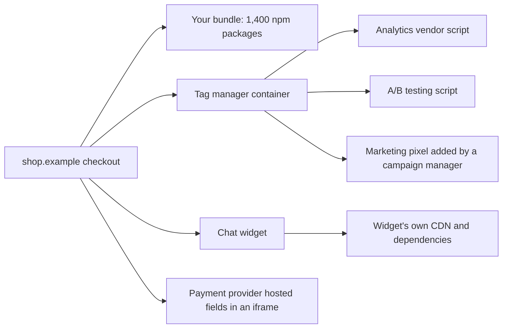
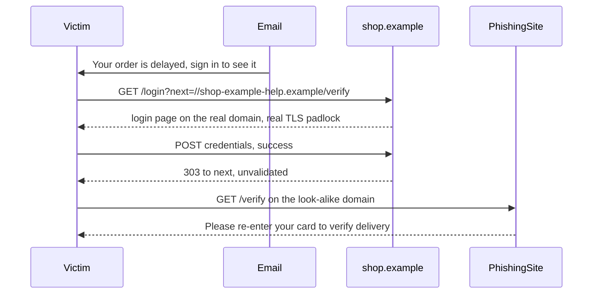

## 73.8 Third-party scripts, supply-chain risk and Subresource Integrity

#### Concept

Every script that runs in your page has the same power as your own code: it can read the DOM, including what the user types into the card form; it can ride the session (73.1); it can send data anywhere CSP's `connect-src` allows. That includes three kinds of code you did not write:

1. **Third-party scripts** loaded at runtime from another company's servers: analytics, tag managers, A/B testing, chat, reviews, ads, session replay.
2. **Libraries loaded from public CDNs** by URL.
3. **npm dependencies bundled into your own JavaScript**, which run in your origin with no separate URL at all.

**Supply-chain risk** is the chance that one of those is changed by someone hostile: a vendor is breached, a CDN domain changes owner, an npm maintainer's account is phished. **Subresource Integrity (SRI)** is the browser feature that refuses to run a fetched script whose bytes do not match a hash you published: `<script src="..." integrity="sha384-..." crossorigin="anonymous">`.

#### Why does it exist?

Because it keeps happening. In 2018 attackers modified 22 lines of a JavaScript file on British Airways' site, sending card details typed into the payment page to a look-alike domain; about 400,000 customers were affected and the UK regulator fined the company 20 million GBP. In June 2024 the `polyfill.io` domain, embedded on more than 100,000 sites, came under new ownership and began serving code that redirected mobile users to scam sites. In September 2025, a phished maintainer account published versions of widely used npm packages (`chalk`, `debug` and others, billions of weekly downloads combined) with code that hooked browser `fetch` and wallet APIs to redirect cryptocurrency payments; any web app that built and deployed during the hours those versions were live shipped the payload in its own bundle. None of these needed a bug in the victim's code.

The payment industry made it a rule: PCI DSS 4.0 requirements 12.4.3 and 11.6.1, mandatory since 31 March 2025, require merchants to inventory and justify every script on payment pages, assure their integrity, and detect unauthorised changes to those pages and their security headers.

#### Mental model

Imagine your shop's front door has a lock and an alarm. Then you hand keys to the cleaning company, the security firm, the window cleaner and the coffee machine technician. Each is trustworthy, but each has their own keys, their own staff and their own suppliers. SRI is accepting a delivery only if the seal matches the one you recorded. CSP's `connect-src` is a rule that nothing may leave the shop except through the loading bay you watch. Isolation in an iframe is giving the coffee technician a door to a separate room instead of a key to the shop.

#### How it works

The trust chain on a typical checkout page:



Each arrow is a party who can change code that runs on your checkout. The controls, in order of strength:

1. **Remove.** Every script on a payment or account page needs an owner and a reason. A tag manager container that marketing can edit without review is an unreviewed deploy pipeline into your checkout; keep it off payment pages.
2. **Isolate.** Card entry belongs in the payment provider's hosted fields or hosted page (an iframe on the provider's origin). The card number never exists in your page's DOM, so no script in your page can read it. This is also what keeps most of your stack out of PCI scope.
3. **Pin and verify.** For scripts with versioned, immutable URLs, add SRI. If the file changes, the browser refuses to run it and the page loses that feature instead of leaking data. SRI cannot protect "evergreen" URLs that vendors update in place, such as most analytics and tag manager scripts; for those, self-hosting a reviewed copy is the only way to pin.
4. **Contain.** A strict CSP limits *where* scripts can send data (`connect-src`, `img-src`, `form-action`), which is the step every skimmer needs. With `'strict-dynamic'`, host allow-lists in `script-src` are ignored by supporting browsers, so `connect-src` and `form-action` are your exfiltration controls.
5. **Monitor.** CSP reports, a scheduled job that fetches checkout pages and hashes every script, and alerts when a hash or header changes (what PCI 18.6.1 asks for).
6. **Dependency hygiene** for the bundled code: commit lockfiles and install with `npm ci` or `pnpm install --frozen-lockfile`; delay adoption of brand-new releases (pnpm 10.16 added a `minimumReleaseAge` setting, and Renovate has an equivalent), so a malicious version is usually caught and pulled before you install it; pnpm 10 no longer runs dependencies' install scripts unless allowed; review lockfile diffs for unexpected new packages; and use `npm audit signatures` to check registry signatures and provenance.

#### Practical example

A grocery delivery checkout had 23 scripts. The inventory found: 6 owned by the web team (bundles), 2 required (payment SDK, fraud-detection device fingerprint), 4 analytics, 7 marketing pixels added through the tag manager over three years (two for campaigns that had ended), a chat widget, a heatmap tool, an accessibility overlay and a currency converter nobody remembered. After the review, checkout loaded 9: the bundles, payment hosted fields, the fraud script with SRI on a pinned version, and one self-hosted analytics script. Marketing pixels fired on the order confirmation page instead, after payment. Checkout JavaScript fell from 1.1 MB to 420 KB, and INP improved from 310 ms to 170 ms at p75 (Part 74 — Web Performance).

#### React / Next.js example

Loading a pinned third-party script with SRI and the CSP nonce:

```tsx
// apps/web/app/(checkout)/layout.tsx
import Script from 'next/script';
import { headers } from 'next/headers';
import type { ReactNode } from 'react';

export default function CheckoutLayout({ children }: { children: ReactNode }) {
  const nonce = headers().get('x-nonce') ?? undefined;         // set by the CSP middleware (81.7)
  return (
    <>
      {children}
      <Script
        src="https://cdn.fraudvendor.example/device/4.12.3/device.min.js"   // versioned, immutable URL
        integrity="sha384-8F5r1aYk3cP7mJt0eXk4M0u8m0Q7pD9yHq3o3o8cJYxk7W2tq9f4m1Jb6nYc2Lza" // illustrative; generate with the command below
        crossOrigin="anonymous"                               // required for SRI on cross-origin scripts
        strategy="afterInteractive"
        nonce={nonce}
      />
    </>
  );
}
```

Generate the hash from the exact file you reviewed, and pin it in code review:

```bash
curl -s https://cdn.fraudvendor.example/device/4.12.3/device.min.js \
  | openssl dgst -sha384 -binary | openssl base64 -A
```

`next/script` passes `integrity`, `crossOrigin` and `nonce` through to the `<script>` element. If the vendor changes the file without changing the URL, the browser blocks it and logs an integrity error; your monitoring should treat that as an incident to investigate, not a bug to "fix" by updating the hash without looking at the diff.

For the bundled dependencies, a CI step that fails on unexpected changes:

```yaml
# .github/workflows/web.yml (excerpt)
- name: Install with the committed lockfile only
  run: pnpm install --frozen-lockfile
- name: Verify registry signatures and provenance
  run: npm audit signatures
- name: Fail if new packages appeared without review
  run: git diff --exit-code pnpm-lock.yaml
```

#### Backend side (NestJS)

The API decides how much of the dangerous work happens in the browser at all:

- **Create payment intents on the server** and send the browser only a client secret for the provider's hosted fields. The NestJS service never receives card numbers, and neither does your page's DOM.
- **Keep the CORS allow-list to your own web origins.** A vendor domain in `Access-Control-Allow-Origin` with credentials lets that vendor's scripts, from their own pages, call your API as the user.
- **Collect and alert on CSP reports** (73.7) and integrity failures reported by your RUM tool.
- **Rate-limit and anomaly-check sensitive endpoints**, because a skimmer that cannot exfiltrate directly may try to change the account email through your own API from inside the page (step-up in 73.5 stops that).
- **Expose a script inventory**: a small internal endpoint or a checked-in JSON file listing every allowed third-party script, its owner and hash, which the monitoring job compares with production.

#### Production scenario

A ticketing site serving 25 million page views a month ran a nightly headless browser job against its five checkout pages, recording every script URL, its SHA-384 and the CSP header. Over a year it raised 31 alerts: 24 were vendors publishing new versions at the same URL (each reviewed and either pinned or moved off checkout), 6 were marketing changes to the tag manager on pages it should not reach, and 1 was an analytics vendor's CDN briefly serving a file with an unexpected 2 KB appended, which the vendor confirmed as a compromise of their build. SRI had already blocked that file in browsers; the job told the team within six hours.

#### Failure scenario

On a Tuesday at 11:00 a campaign manager added a "conversion booster" pixel to every page through the tag manager. It came from a small vendor. Eight days later, a bank's fraud team contacted the retailer: cards used only on its site were being sold. The pixel's script had been replaced on the vendor's server two days after it was added; the new version read the card form on checkout (the retailer used its own card fields, not hosted fields) and posted the data to an image URL. The CSP allowed `img-src *` "for marketing". About 12,000 cards were exposed.

The remediation followed the list above: hosted payment fields, no tag manager on checkout, a strict `connect-src` and `img-src`, SRI on the remaining pinned scripts, the nightly integrity job, and a written rule that new third-party scripts need security review. The PCI forensic investigation cost more than the year's revenue from the campaign.

#### Edge cases & failure modes

- **SRI and evergreen URLs**: a vendor that updates in place will break your pinned hash; that breakage is the feature working, and the vendor relationship decides whether you self-host.
- **Missing `crossorigin="anonymous"`**: SRI on a cross-origin script without CORS fails closed (the script is blocked).
- **Scripts loaded by scripts**: SRI on a tag manager does not cover what it loads; CSP and inventory do.
- **Bundled dependency compromise** bypasses SRI and CSP entirely, because the code is in your own file from your own origin. Lockfiles, release-age delays and review are the controls.
- **`'strict-dynamic'` trusts whatever a nonced script loads**, so a compromised nonced loader can load anything; containment is in `connect-src`.
- **Browser extensions** inject scripts outside your control; CSP reports from them are noise to filter, not incidents.

#### How a Senior Full-Stack Engineer thinks about this

The senior treats every third-party script as a production dependency with the access of a senior engineer and no code review. They keep an inventory with owners, keep payment data in provider iframes, pin what can be pinned, contain what cannot with CSP, and monitor what ships. They push back on "just add this tag" with numbers: performance cost, data exposure, PCI scope. They know the npm tree is the largest third party of all, and they want lockfile review and a release-age delay in CI before anyone argues about one analytics script.

#### Common mistakes

- **Tag managers on payment pages**, editable by non-engineers.
- **Card fields in your own DOM** when the provider offers hosted fields.
- **`img-src *` or `connect-src *`**, leaving skimmers an open exit.
- **Updating an SRI hash** without reviewing why the file changed.
- **Installing without a frozen lockfile** in CI, so builds pick up whatever was published an hour ago.

#### Interview questions

1. **What does Subresource Integrity protect against, and what can it not protect?** Expected answer: a modified file at a fixed URL; not evergreen URLs, not scripts loaded by scripts, not bundled npm code. Follow-up: what covers those? (Self-hosting, CSP containment, lockfiles and review.)
2. **How would you reduce the risk of a Magecart-style skimmer on checkout?** Expected answer: hosted payment fields, minimal scripts, strict CSP exfiltration directives, SRI, integrity monitoring.
3. **What do PCI DSS 4.0 requirements 12.4.3 and 11.6.1 ask of a web team?** Expected answer: inventory and authorise every payment-page script, assure integrity, detect changes to scripts and headers.
4. **How do you defend against a compromised npm package in a frontend bundle?** Expected answer: frozen lockfiles, release-age delay, lockfile diff review, signature checks, fewer dependencies.
5. **Why does `'strict-dynamic'` change how you think about CSP host allow-lists?** Expected answer: supporting browsers ignore host lists in `script-src`; trust flows from nonced scripts, so exfiltration directives carry the containment.

#### Practical exercise

Inventory and lock down the checkout page.

Acceptance criteria:

- A checked-in `third-party-scripts.json` lists every script on checkout with owner, purpose, URL and hash.
- Card entry uses the provider's hosted fields; searching the checkout DOM for an `input` with `autocomplete="cc-number"` finds none in your origin.
- A pinned script with a deliberately wrong SRI hash is blocked by the browser and reported by monitoring.
- CI fails when `pnpm-lock.yaml` changes without being committed, and when a dependency's registry signature is invalid.
- `connect-src` and `img-src` on checkout list only your origins and the payment and fraud vendors.

## 73.9 Clickjacking, open redirects and other browser-only attacks

#### Concept

Some attacks exist only because a browser holds a logged-in session while it renders pages from many origins, follows redirects for you, keeps snapshots of pages you left, and lets windows talk to each other. None of them needs a bug in your SQL or your business logic. Each has a small, specific defence that is easy to forget:

| Attack | What the attacker does | Defence |
|---|---|---|
| **Clickjacking** | Loads your page in an invisible iframe over a decoy ("Click to win") so the user's click lands on your "Confirm" button | `Content-Security-Policy: frame-ancestors 'none'` (plus `X-Frame-Options: DENY` for very old browsers) |
| **Open redirect** | Uses your trusted domain to bounce users to a phishing page: `shop.example/login?next=https://evil.example` | Allow only relative paths on your origin; validate with `new URL` |
| **Reverse tabnabbing** | A page you opened with `target="_blank"` uses `window.opener` to navigate *your* tab to a fake login | `rel="noopener noreferrer"`; modern browsers imply `noopener` for `target="_blank"` |
| **`postMessage` confusion** | Another window sends messages your listener trusts | Check `event.origin` against an exact allow-list; validate `event.data` with a schema |
| **Token leakage through `Referer`** | A reset-password URL with a token is sent to third parties as the `Referer` of the next request | `Referrer-Policy: strict-origin-when-cross-origin` site-wide, `no-referrer` on token pages |
| **Back-button exposure after logout** | The next person on a shared computer presses Back and sees the previous user's orders from the back/forward cache | `Cache-Control: no-store` on personal pages, re-check the session on `pageshow`, `Clear-Site-Data` on logout |
| **Web cache deception** | Tricks a CDN into caching a personal page by requesting `/account/orders/x.css` | Cache by explicit rules and `Cache-Control`, never by file extension; `private, no-store` on personal responses |

#### Why does it exist?

The browser is designed to compose content from many sources: frames, windows, redirects, caches. Each composition feature was built for a legitimate use (embedding a map, a "Continue to your order" redirect after login, fast Back navigation) and each has a hostile use when a session is attached. Phishing in particular loves open redirects, because a link that starts with your real domain passes users' and email filters' checks.

#### Mental model

Imagine a bank branch. Clickjacking is someone holding a sheet of glass with a painted "Free coffee" button over the teller's "Approve transfer" button. An open redirect is the bank's own receptionist agreeing to escort any visitor to any address they name, including the con man's office across the road. Back-button exposure is leaving yesterday's customer's papers on the counter because the next customer might press the "show me what was here" bell.

#### How it works

The open redirect, which is the one most teams have somewhere:



The steps to defend each attack:

1. **Framing**: send `frame-ancestors 'none'` on every HTML response (or `'self'` if you frame your own pages). It belongs in the CSP header, not a `<meta>` tag, which cannot carry it.
2. **Redirect targets**: accept only a path that starts with a single `/`, parse it with `new URL(raw, yourOrigin)`, and require the resulting origin to equal yours. The parser handles the tricks that string checks miss: `//evil.example` (protocol-relative), `/\evil.example` (browsers treat `\` as `/`), and tabs or newlines inside the string, which URL parsing strips.
3. **New windows**: rely on the implied `noopener`, and still set `rel="noopener noreferrer"` on user-supplied links so older browsers and `window.open` calls behave the same.
4. **Messages**: in every `message` listener, compare `event.origin` with an exact string, then parse `event.data` with zod. When sending, always pass a target origin to `postMessage`, never `'*'` for anything sensitive.
5. **Logout on shared devices**: the back/forward cache (bfcache) keeps a whole page in memory. Browsers have historically skipped bfcache for `Cache-Control: no-store` pages, and Chrome has been experimenting with relaxing that for pages whose cookies have not changed. So also listen for `pageshow` with `event.persisted === true` and re-check the session.

#### Practical example

A pharmacy delivery site sends "Your prescription is ready" emails linking to `/login?next=/orders/ord_9`. Its login handler, the OIDC start route (73.4), the refresh redirect (73.3) and the logout handler all accept a `next` parameter, so all four use one `safeNextPath` function. The account pages send `Cache-Control: private, no-store`, logout sends `Clear-Site-Data`, and every HTML response carries `frame-ancestors 'none'` from the CSP middleware (73.7). The prescription-upload page opens the pharmacist's help article with `target="_blank"` and `rel="noopener noreferrer"`.

#### React / Next.js example

```ts
// apps/web/lib/safe-redirect.ts
const ORIGIN = process.env.NEXT_PUBLIC_APP_ORIGIN ?? 'https://shop.example';

export function safeNextPath(raw: string | null | undefined, fallback = '/'): string {
  if (!raw || !raw.startsWith('/') || raw.startsWith('//') || raw.startsWith('/\\')) return fallback;
  try {
    const url = new URL(raw, ORIGIN);                       // strips tabs and newlines, resolves dot segments
    if (url.origin !== ORIGIN) return fallback;             // catches every remaining trick
    if (url.pathname.startsWith('/api/')) return fallback;  // never bounce into an endpoint
    return `${url.pathname}${url.search}${url.hash}`;
  } catch {
    return fallback;
  }
}
```

```tsx
// apps/web/src/auth/BfcacheGuard.tsx
'use client';
import { useEffect } from 'react';

export function BfcacheGuard() {
  useEffect(() => {
    const onShow = async (e: PageTransitionEvent) => {
      if (!e.persisted) return;                              // normal load: the server already checked
      const res = await fetch('/api/v1/me', { credentials: 'include', cache: 'no-store' });
      if (res.status === 401) window.location.replace('/login?reason=signed-out');
    };
    window.addEventListener('pageshow', onShow);
    return () => window.removeEventListener('pageshow', onShow);
  }, []);
  return null;
}
```

Mount `BfcacheGuard` in the `(account)` layout only. A `message` listener follows the same discipline: `if (event.origin !== 'https://pay.provider.example') return;` then `PaymentEventSchema.safeParse(event.data)`.

#### Backend side (NestJS)

The API's share is headers and redirect discipline:

- **Frame protection on the API too.** helmet's defaults (39.33) send `X-Frame-Options: SAMEORIGIN`; set CSP `frame-ancestors 'none'` for any HTML the API serves (Swagger UI, email previews, OAuth consent pages).
- **No open redirects in the API.** Endpoints such as `GET /v1/email/click?to=...` for tracking links must sign the target (`HMAC(to)`, 39.18) or map an id to a stored URL; never redirect to a raw parameter.
- **`Cache-Control: private, no-store`** on every cookie-authenticated response, and never let a CDN cache by extension. Web cache deception works when the CDN caches `/account/orders/x.css` because of `.css` while the origin ignores the suffix and returns the orders page. Configure the CDN to respect origin `Cache-Control` and make NestJS return `404` for unknown path suffixes.
- **`Referrer-Policy: strict-origin-when-cross-origin`** globally, and `no-referrer` on pages with tokens in the URL (password reset, email verification); the token in those links should be single-use and short-lived anyway.

#### Production scenario

A marketplace's security team ran a quarterly review of these "small" defences across 140 routes. Findings over a year: 6 open redirects (a `returnTo` in a promo page, two in legacy login variants, one in a logout `GET`, two in email click tracking), 2 pages missing `frame-ancestors` (an embedded seller help page and an old payment confirmation page), and 11 personal pages without `no-store`. Each fix was a few lines. The open redirects mattered most: the company's brand-protection vendor had linked 4 phishing campaigns to them in the previous year.

#### Failure scenario

At 08:30 on a Monday the support queue filled with customers saying the site had asked them to "re-verify their card" after signing in. A phishing email had linked to `https://shop.example/login?next=/\shop-example-verify.example/card`. The login page's check was `next.startsWith('/') && !next.startsWith('//')`. Browsers normalise `\` to `/` in URLs, so `/\host` became `//host`, a protocol-relative URL to the attacker's domain. Customers saw the real login page with the real padlock, signed in successfully, and landed on a perfect copy of the payment page. About 1,900 customers entered card details before the email filter vendor blocked the campaign at 11:10.

The fix was the `new URL` origin comparison above, applied to every redirect parameter found by a search for `next`, `returnTo`, `redirect`, `continue` and `url` in route handlers and pages, plus a unit test table of 25 known bypass strings.

#### Edge cases & failure modes

- **Legitimate framing**: a partner widget or your own help centre may need to frame a page; allow exact origins in `frame-ancestors`, per route.
- **Login popups and COOP**: `Cross-Origin-Opener-Policy: same-origin` breaks popup-based login flows that use `window.opener` (73.4); use `same-origin-allow-popups` on the opening page.
- **Redirects after OAuth** must carry the `next` value through the sealed transaction (73.4), not through the provider's redirect URI.
- **`Clear-Site-Data` is broad**: `"cookies"` clears every cookie for the registrable domain, including consent and A/B cookies, and `"cache"` can be slow on large caches. Send `"storage"` on every logout with explicit deletion of the auth cookies, and add `"cookies"` and `"cache"` for "this is a shared device" logouts.
- **Double-encoded paths** (`%2F%2Fevil.example`) decode in some frameworks before your check runs; check after decoding, with the URL parser.

#### How a Senior Full-Stack Engineer thinks about this

The senior keeps a short list of browser-only attacks and a matching list of defaults: `frame-ancestors` on every HTML response, one redirect validator, `noopener` on new windows, origin checks on every message listener, `no-store` on personal pages, and a logout that clears what the browser keeps. They put each default in one place (middleware, a helper, a layout) so new routes inherit it. When they review a feature with a redirect, a popup, an iframe or a shared-device use case, they ask about these by name, because none of them shows up in an API test.

#### Common mistakes

- **Validating redirect targets with `startsWith('/')`** alone.
- **Relying on `X-Frame-Options` only**, without `frame-ancestors`.
- **`postMessage(data, '*')`** with sensitive data, or listeners without an origin check.
- **Personal pages without `Cache-Control: no-store`**, cached by a CDN or shown from bfcache after logout.
- **Logout as a `GET` link**, which any page can trigger with an `` tag.

#### Interview questions

1. **How do you prevent clickjacking today?** Expected answer: CSP `frame-ancestors 'none'` or an exact allow-list, sent as a header; `X-Frame-Options` as a legacy fallback. Follow-up: why not a `<meta>` CSP? (It cannot carry `frame-ancestors`.)
2. **How would you validate a `next` redirect parameter?** Expected answer: relative path only, parsed with `new URL` against your origin, origin equality, reject `//` and `/\`, and test known bypasses.
3. **What is reverse tabnabbing and is it still a risk?** Expected answer: the opened page controlling `window.opener`; modern browsers imply `noopener` for `target="_blank"`, but `window.open` and old browsers still need it set explicitly.
4. **What can a shared-computer user see after the previous user logged out, and how do you prevent it?** Expected answer: bfcache or HTTP-cached personal pages; `no-store`, `pageshow` re-check, `Clear-Site-Data`, clearing client caches.
5. **What is web cache deception?** Expected answer: a CDN caching a personal response because of a static-looking suffix; cache by explicit rules and origin headers, and return 404 for unknown suffixes.

#### Practical exercise

Harden the redirect, framing and logout behaviour of the storefront.

Acceptance criteria:

- A table-driven test passes for 25 redirect inputs, including `//evil.example`, `/\evil.example`, `/%2F%2Fevil.example`, `/\tevil.example` and `https://evil.example`, all resolving to `/`.
- Loading `/checkout` in an iframe on another origin shows a blocked frame in the browser console.
- After logout, pressing Back on `/orders` shows the login page, verified in a Playwright test.
- `curl -I https://shop.example/account/orders/x.css` returns `404` with `Cache-Control: no-store`, and the CDN logs show no cache entry for it.
