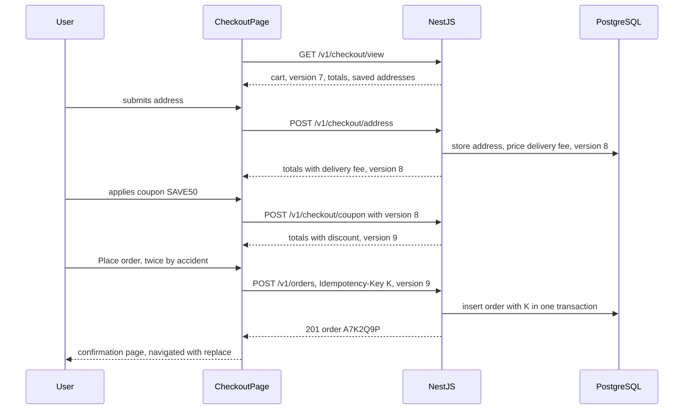

## 73.13 Worked example: a checkout form with address, coupon and payment steps

#### Concept

We now assemble the Part into one feature: a three-step checkout for a grocery delivery app, built with React 18, React Hook Form 7, zod and TanStack Query v5 on top of the NestJS API used throughout this Volume.

Requirements, written the way a senior would write them before coding:

- **Steps**: address, then coupon (optional), then payment and "Place order". The user can go back to edit the address from the payment step.
- **Server is the truth for money.** Every change that affects price (address changes the delivery fee, coupon changes the discount) returns recomputed totals from the API. The UI never adds numbers.
- **One order per attempt**, even with double taps, timeouts and retries (73.8).
- **Precise errors**: field errors under the field, business errors (postcode not serviceable, coupon expired) mapped to the right input, and an honest "unknown outcome" state.
- **Numbers**: checkout view loads in one request under 300 ms p95; each step transition under 400 ms p95 on 4G; zero duplicate orders in the double-click test; no render of the whole page on keystrokes.

#### The flow



The cart **version** is the thread through the whole flow. Every pricing change increments it. Every write sends the version it was based on. The idempotency key is scoped to the version (73.8), so a coupon change after a failed payment attempt automatically starts a new attempt.

#### The contracts

Additions to `@shop/contracts` (zod 3.23), next to `AddressSchema` from 73.7:

```ts
// packages/contracts/src/checkout.ts
import { z } from 'zod';
import { AddressSchema } from './address';
import { MinorUnitsSchema } from './money';

export const CartTotalsSchema = z.object({
  subtotalMinor: MinorUnitsSchema,
  deliveryFeeMinor: MinorUnitsSchema,
  discountMinor: MinorUnitsSchema,
  totalMinor: MinorUnitsSchema,
  currency: z.string().length(3),
});
export type CartTotals = z.infer<typeof CartTotalsSchema>;

export const CheckoutViewSchema = z.object({
  cartId: z.string().uuid(),
  version: z.number().int().nonnegative(),
  totals: CartTotalsSchema,
  savedAddresses: z.array(AddressSchema.extend({ id: z.string() })).max(20),
  appliedCoupon: z.string().nullable(),
});
export type CheckoutView = z.infer<typeof CheckoutViewSchema>;

export const ApplyCouponSchema = z.object({
  code: z.string().trim().toUpperCase().regex(/^[A-Z0-9]{4,16}$/, 'Enter a valid code'),
  cartVersion: z.number().int().nonnegative(),
});
export type ApplyCoupon = z.infer<typeof ApplyCouponSchema>;

export const PricedCartSchema = z.object({ version: z.number().int(), totals: CartTotalsSchema, appliedCoupon: z.string().nullable() });
export type PricedCart = z.infer<typeof PricedCartSchema>;

export const PlaceOrderRequestSchema = z.object({
  cartId: z.string().uuid(),
  cartVersion: z.number().int().nonnegative(),
  paymentMethodId: z.string().min(1).max(64),
});
export type PlaceOrderRequest = z.infer<typeof PlaceOrderRequestSchema>;
```

#### The API side

| Endpoint | Purpose | Key behaviour |
|---|---|---|
| `GET /v1/checkout/view` | Everything the page needs in one request (73.10) | `Cache-Control: private, no-store` |
| `POST /v1/checkout/address` | Validate, check serviceability, price delivery (73.7) | `422` with `path: "postcode"` when not serviceable |
| `POST /v1/checkout/coupon` | Apply a coupon, reprice | `422` with `path: "code"`; `409 CART_CHANGED` on stale version; throttled |
| `DELETE /v1/checkout/coupon` | Remove the coupon, reprice | Returns the priced cart |
| `POST /v1/orders` | Place the order (73.8) | Requires `Idempotency-Key`; unique index; `409 CART_CHANGED` |

The coupon endpoint shows the patterns that are new in this example: optimistic concurrency on the cart version, business errors with field paths, and rate limiting against code guessing.

```ts
// apps/api/src/checkout/coupon.controller.ts  (@nestjs/throttler v5+)
import { Body, Controller, HttpCode, Post, UseGuards } from '@nestjs/common';
import { Throttle, ThrottlerGuard } from '@nestjs/throttler';
import { ApplyCouponSchema, type ApplyCoupon, type PricedCart } from '@shop/contracts';
import { ZodValidationPipe } from '../common/zod-validation.pipe';
import { JwtAuthGuard } from '../auth/jwt-auth.guard';
import { CurrentUser, type AuthUser } from '../auth/current-user.decorator';
import { CouponService } from './coupon.service';

@Controller('v1/checkout/coupon')
@UseGuards(JwtAuthGuard, ThrottlerGuard)
export class CouponController {
  constructor(private readonly coupons: CouponService) {}

  @Post()
  @HttpCode(200)
  @Throttle({ default: { limit: 10, ttl: 60_000 } })  // 10 attempts a minute: stops brute-forcing codes
  apply(@CurrentUser() user: AuthUser, @Body(new ZodValidationPipe(ApplyCouponSchema)) body: ApplyCoupon): Promise<PricedCart> {
    // In one transaction:
    //   UPDATE carts SET coupon_code = $1, version = version + 1 WHERE id = $2 AND version = $3
    //   0 rows updated -> 409 { code: 'CART_CHANGED', cart: <fresh priced cart> }
    //   coupon invalid -> 422 { code: 'COUPON_REJECTED', issues: [{ path: 'code', code: 'EXPIRED', message: 'This code expired on 31 Oct' }] }
    //   otherwise reprice and return { version, totals, appliedCoupon }
    return this.coupons.apply(user.id, body.code, body.cartVersion);
  }
}
```

The conditional `UPDATE ... WHERE version = $3` is the backend twin of the client's version thread: if another tab changed the cart, the write affects zero rows and the client gets a fresh cart to show, instead of a coupon applied to contents the user never saw (Part 21 — Database Transactions and Concurrency Control).

#### The checkout container

The page loads the view with a data library, then hands it to a flow component keyed by cart ID (73.3), so a different cart always starts with fresh state. The flow owns the reducer from 73.5.

```tsx
// src/checkout/CheckoutPage.tsx  (React 18, TanStack Query v5)
import { useReducer, useState } from 'react';
import { useNavigate } from 'react-router-dom';
import { useSuspenseQuery } from '@tanstack/react-query';
import type { CheckoutView, PricedCart } from '@shop/contracts';
import { fetchCheckoutView, saveAddress } from '../api/checkout';
import { checkoutReducer, type CheckoutState } from './checkoutReducer';  // 77.5
import { AddressForm } from './AddressForm';                              // 77.7
import { CouponStep } from './CouponStep';
import { PaymentStep } from './PaymentStep';
import { PriceSummary } from './PriceSummary';

export function CheckoutPage() {
  const { data: view } = useSuspenseQuery({ queryKey: ['checkout-view'], queryFn: fetchCheckoutView });
  return <CheckoutFlow key={view.cartId} view={view} />;  // wrapped in Suspense and an ErrorBoundary (77.11)
}

function CheckoutFlow({ view }: { view: CheckoutView }) {
  const navigate = useNavigate();
  const [state, dispatch] = useReducer(checkoutReducer, { step: 'address', address: null, totals: view.totals } as CheckoutState);
  const [version, setVersion] = useState(view.version);                   // latest server cart version

  const onPriced = (cart: PricedCart) => setVersion(cart.version);         // every pricing response moves it

  if (state.step === 'placed') return null;                               // navigation already happened
  return (
    <div className="checkout">
      <main>
        {state.step === 'address' && (
          <AddressForm initial={view.savedAddresses[0]} onSaved={async (address) => {
            const cart = await saveAddress(address, version);                 // throws ApiError on 422
            onPriced(cart);
            dispatch({ type: 'ADDRESS_SAVED', address, totals: cart.totals });
          }} />
        )}
        {state.step === 'coupon' && (
          <CouponStep cartVersion={version} applied={state.coupon}
            onApplied={(cart) => { onPriced(cart); dispatch({ type: 'COUPON_APPLIED', coupon: cart.appliedCoupon ?? '', totals: cart.totals }); }}
            onContinue={() => dispatch({ type: 'CONTINUE_TO_PAYMENT' })} />
        )}
        {(state.step === 'payment' || state.step === 'placing') && (
          <PaymentStep cartId={view.cartId} cartVersion={version} error={state.error}
            onStart={() => dispatch({ type: 'PLACE_ORDER' })}
            onResult={(r) => {
              if (r.ok) { dispatch({ type: 'ORDER_PLACED', orderId: r.orderId }); navigate(`/orders/${r.orderId}`, { replace: true }); }
              else dispatch({ type: 'ORDER_FAILED', message: r.message });
            }} />
        )}
      </main>
      <aside><PriceSummary {...state.totals} /></aside>   {/* totals only ever come from a server response */}
    </div>
  );
}
```

Three design points. The **version** is held separately from the reducer because every server response carries it, whatever step we are in. `PriceSummary` renders `state.totals`, which only ever comes from a server response. And the confirmation page is reached with `replace: true`, so the Back button does not return to a live payment form (73.8).

#### The coupon step

A small form, also with React Hook Form, so server errors land under the input:

```tsx
// src/checkout/CouponStep.tsx
import { useForm } from 'react-hook-form';
import { zodResolver } from '@hookform/resolvers/zod';
import { z } from 'zod';
import { ApplyCouponSchema, type PricedCart } from '@shop/contracts';
import { applyCoupon } from '../api/checkout';
import { ApiError, applyServerErrors } from '../api/errors';                // 77.7

const FormSchema = ApplyCouponSchema.pick({ code: true });               // version comes from props
type Form = z.infer<typeof FormSchema>;

type Props = { cartVersion: number; applied: string | null;
               onApplied: (cart: PricedCart) => void; onContinue: () => void };

export function CouponStep({ cartVersion, applied, onApplied, onContinue }: Props) {
  const { register, handleSubmit, setError, formState: { errors, isSubmitting } } =
    useForm<Form>({ resolver: zodResolver(FormSchema), defaultValues: { code: '' }, mode: 'onSubmit' });

  const onValid = async ({ code }: Form) => {
    try {
      onApplied(await applyCoupon({ code, cartVersion }));
    } catch (e) {
      if (e instanceof ApiError && e.code === 'CART_CHANGED') {
        setError('root.server', { message: 'Your cart changed in another tab. Prices have been updated.' });
        return;                                    // the api helper also refreshes the checkout view cache
      }
      if (e instanceof ApiError && applyServerErrors(e, setError)) return; // e.g. "This code expired on 31 Oct"
      setError('root.server', { message: 'Could not apply the code. Please try again.' });
    }
  };

  return (
    <section aria-labelledby="coupon-h">
      <h2 id="coupon-h">Have a coupon?</h2>
      <form onSubmit={handleSubmit(onValid)} noValidate>
        <label htmlFor="code">Coupon code</label>
        <input id="code" autoComplete="off" autoCapitalize="characters" {...register('code')}
          aria-invalid={!!errors.code} aria-describedby="code-err" />
        <p id="code-err" role="alert">{errors.code?.message ?? errors.root?.server?.message}</p>
        <button type="submit" disabled={isSubmitting}>{isSubmitting ? 'Applying...' : 'Apply'}</button>
      </form>
      {applied && <p>{applied} applied.</p>}
      <button type="button" onClick={onContinue}>Continue to payment</button>
    </section>
  );
}
```

Typing in the coupon field re-renders nothing (uncontrolled registration); the summary in the sidebar re-renders once, when the server's new totals arrive.

#### The payment step

The step uses `usePlaceOrder` from 73.8, which owns the synchronous guard, the per-attempt key stored per cart version, timeouts and retries with the same key:

```tsx
// src/checkout/PaymentStep.tsx
import { useState } from 'react';
import { usePlaceOrder } from './usePlaceOrder';                          // 77.8

type Props = { cartId: string; cartVersion: number; error: string | null;
               onStart: () => void; onResult: (r: { ok: true; orderId: string } | { ok: false; message: string }) => void };

export function PaymentStep({ cartId, cartVersion, error, onStart, onResult }: Props) {
  const [method, setMethod] = useState<string>('upi');                     // pure UI state, local
  const { submit, pending } = usePlaceOrder(cartId, cartVersion);

  return (
    <form onSubmit={async (e) => { e.preventDefault(); onStart(); onResult(await submit(method)); }}>
      <fieldset disabled={pending}>
        <legend>Payment method</legend>
        <label><input type="radio" name="pm" value="upi" checked={method === 'upi'} onChange={() => setMethod('upi')} /> UPI</label>
        <label><input type="radio" name="pm" value="card" checked={method === 'card'} onChange={() => setMethod('card')} /> Card</label>
      </fieldset>
      {error && <p role="alert">{error}</p>}
      <button type="submit" disabled={pending}>{pending ? 'Placing your order...' : 'Place order'}</button>
    </form>
  );
}
```

A double tap calls `submit` twice; the second call returns immediately from the ref guard, and the reducer ignores a second `PLACE_ORDER` because the step is already `placing`. If the user is slow and the first request times out, `usePlaceOrder` retries with the same key and the server replays the original order. If the outcome stays unknown, the message points to "My Orders" rather than inviting a new attempt.

#### What can go wrong, and where it is handled

| Failure | Layer that handles it | User sees |
|---|---|---|
| Postcode not serviceable | API `422` path `postcode`, RHF `setError` | Message under postcode, focus moved |
| Coupon expired | API `422` path `code` | "This code expired on 31 Oct" under the input |
| Cart changed in another tab | Conditional `UPDATE`, `409 CART_CHANGED` | "Your cart changed", fresh totals |
| Double tap on Place order | Ref guard, reducer, key, unique index | One order |
| Timeout after the server committed | Same-key retry, server replay | Confirmation page |
| Payment declined | `402`/`422` from API, key cleared | Error, can choose another method |
| A widget throws while rendering | Error boundary around the step (73.11) | Step fallback with request ID |
| Coupon guessing script | `@Throttle` 10/min | `429` with `Retry-After` |

#### Tests and acceptance criteria

Part 79 — Frontend Testing and Quality builds the full test suite; the minimum for this feature:

- **Reducer unit tests**: every legal and illegal transition (73.5).
- **Component tests** with MSW mocking the API: a `422` for the postcode shows the message under the field; a `409 CART_CHANGED` on the coupon shows the notice and new totals; typing the coupon re-renders neither the address nor the summary.
- **API tests**: the coupon endpoint returns `409` for a stale version and `429` after 10 attempts; `POST /v1/orders` without a key returns `400`.
- **One Playwright journey** against a real NestJS and PostgreSQL in Docker: complete all three steps with a double click on "Place order", then assert exactly one row in `orders` for the cart.
- **Profiler check**: no commit over 16 ms on a mid-range Android profile during typing.

What a senior would change at scale: move the checkout aggregation into a BFF if mobile and web need different shapes (Part 75), generate the API client from OpenAPI or keep the zod contracts as the single source (Part 76), and add real-user monitoring of step timings and error codes so a regression in "postcode not serviceable" rates shows up as a dashboard alert, not a support queue (Part 80).

## Senior Checklist — Part 73

- [ ] I understand the concept
- [ ] I can explain it simply
- [ ] I can implement it
- [ ] I understand its failure modes
- [ ] I understand its scaling limitations
- [ ] I understand its security implications
- [ ] I understand its operational implications
- [ ] I can choose between alternatives
- [ ] I can explain the tradeoffs
- [ ] I can answer senior-level interview questions
- [ ] I can split a page into components by data ownership and keep most of them pure and presentational
- [ ] I can explain what triggers a re-render, why state is a snapshot, and why mutation does not update the screen
- [ ] I choose keys from stable data IDs, use `key` to reset components, and know why the API must return stable IDs and cursor pages
- [ ] I write effects only to synchronise with external systems, with cleanup that survives Strict Mode's double mount
- [ ] I use a data library or the framework for fetching instead of hand-written effects, and I can describe the race they prevent
- [ ] I know when `useReducer`, `useRef` and `useContext` fit, and I keep context values memoised and split by change frequency
- [ ] I memoise only with a measured reason, and I know what the React Compiler changes
- [ ] I can build a form with React Hook Form and a shared zod schema, and map server field errors onto inputs
- [ ] I protect submits with a synchronous guard, a per-attempt idempotency key, server replay and a unique constraint
- [ ] I can virtualise a long list and design the cursor-paginated, slim API behind it
- [ ] I place error boundaries and Suspense boundaries per independent region with actionable fallbacks
- [ ] I can profile a slow interaction in a production build and fix it structurally before adding `memo`
- [ ] I know which APIs need React 19 (`use`, Actions, `useActionState`, `useFormStatus`, ref as a prop) and which work in React 18

## Part 73 — Key Takeaways

- A component is a pure function from props and state to a UI description; React, not your code, changes the DOM.
- State is a snapshot per render; setters schedule a new render, and React detects changes by identity, so replace objects instead of mutating them.
- Keys are primary keys for list items: stable IDs from the API, never indexes for dynamic lists, never random values.
- Effects synchronise with external systems and must clean up; most data fetching belongs in a data library or the framework.
- `useReducer` makes client state machines explicit, but the server must enforce the same transitions atomically.
- Memoisation is a measured optimisation, not a habit; the React Compiler is making most of it automatic.
- Forms need one shared schema, server-authoritative validation and an error contract with field paths.
- Double-submit protection is layered: UI guard, per-attempt idempotency key, server replay and a database constraint.
- Large lists are a DOM problem first: virtualise, and make the API a capped cursor over slim rows.
- Error boundaries set the blast radius of a render failure; Suspense sets the shape of loading; both belong in the page design.
- Profile before optimising, and remember the backend's share: payload size, deterministic responses and `304`s cut render work.
- Most of React's correctness depends on the API being honest: stable IDs, server-computed money, clear status codes and a request ID on every response.
