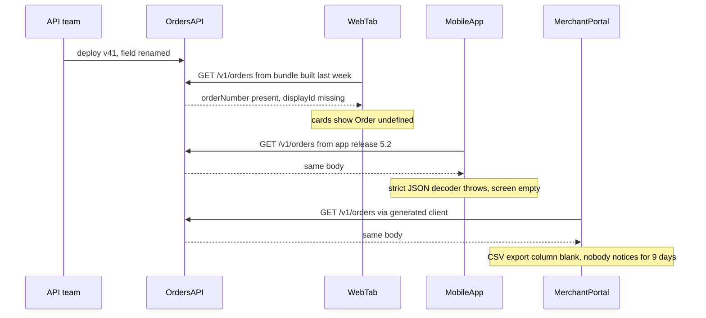

# Part 74 — Frontend–Backend Contracts

Parts 70–73 kept assuming something they never fully examined: that the browser and the API agree. `@shop/contracts` (70.9, 70.12) gave both sides one set of zod schemas, the `ApiError` class (71.7) parsed one error shape, and every `fetch` in Parts 72, 73 ended with `Schema.parse(await res.json())`. That works well inside one repository, built and deployed by one team, on the day of the build. It stops working the moment there is a second consumer in another repository, a browser tab that has been open since Monday, a mobile app on last quarter's release, or a field that means something slightly different on each side.

This Part is about the agreement itself: how it is written down (OpenAPI, zod, tRPC routers, GraphQL schemas), how each side checks it (generated clients, validation at both ends, contract tests), how the awkward data types travel (dates, money, large integers, enums), how errors, uploads and downloads are shaped, and how you change any of it while old clients are still running. Part 15 — API Design and Part 25 — Backward Compatibility covered the rules from the server's side; Part 16 — GraphQL and gRPC covered the protocols. Here the frontend is in the loop, and the questions are "what does the UI do with this?" and "what breaks in a browser that is already open?".

The stack is the one the volume has used: NestJS 10 with `@shop/contracts` (zod 3.23), React 18, Next.js 14 App Router, TanStack Query v5. The error shape `{ code, issues, requestId }` from 71.7 becomes a full RFC 9457 problem document in 74.6, without breaking any code written so far.

## 74.1 Why contracts break between frontend and backend teams

#### Concept

A **contract** between a frontend and a backend is everything one side relies on the other to do: the URL and method, the request body, the response fields and their types, the status codes, the headers (`ETag`, `Retry-After`, `X-Request-Id`), the error shape, the meaning of each value (is `total` before or after tax?), the ordering of lists, and the timing (does `POST /orders` return before or after payment is captured?). Only part of that is ever written down. The rest lives in people's heads and in the code that happens to work today.

A contract **breaks** when one side changes something the other relies on, and the other side does not change at the same moment. Because the frontend and backend are deployed separately, and because browsers keep running old code long after you deploy new code, "at the same moment" is never true. There is always a window where version N of one side talks to version N+1 of the other.

The cost of "just change the field name" is therefore not one pull request. It is the size of that window multiplied by every consumer in it.

#### Why does it exist?

Contracts break for organisational reasons first and technical reasons second:

1. **Different owners, different calendars.** The API team ships twice a day; the web team ships on Tuesdays; the mobile team ships every two weeks and users update over a month. Each team's change is safe for its own release and unsafe for someone else's.
2. **Implicit agreements.** The UI sorts by `placedAt` because the API happened to return newest first. Nobody wrote "newest first" anywhere. A query planner change in PostgreSQL (a new index, Part 20 — Database Indexing) flips the order, and the API team never knew they had promised it.
3. **Types that lie.** A hand-written TypeScript interface in the web app says `totalMinor: string`. The API sends a number for orders created by an old code path. TypeScript checks nothing at runtime, so the error appears three components later as `"1999".padStart is not a function`, or worse, as a wrong total.
4. **Semantic drift.** The field keeps its name and type but changes meaning: `deliveryEta` was "when the rider will arrive" and becomes "when the kitchen will finish". Every type check passes. The UI is now wrong.
5. **Clients you cannot update.** A browser tab, a cached service worker, an installed mobile app, a partner's integration, a BFF pod that has not rolled yet. Part 25.5 and 25.6 cover these from the server's side; this Part looks at them from the client.

#### Mental model

Imagine two people building a bridge from opposite banks of a river. They agreed on the height in a meeting and each went back to their own bank. If one side raises the deck by 30 cm to clear a new boat, their half is now perfect and the bridge is broken. A **contract** is the drawing both sides build from. **Contract checks** are surveyors who measure both halves against the drawing every day. And **compatibility rules** are the rule that you may widen your half or add a lane, but you may not move where the two halves meet without building a temporary ramp first.

#### How it works

The life of one innocent rename, `displayId` to `orderNumber` on `GET /v1/orders`, with three consumers:



What happened, step by step:

1. The API team renamed the field in the DTO and the mapper. Their unit and e2e tests passed, because their tests asserted the new name.
2. The web app in the same monorepo was updated in the same pull request (70.12 shows how the shared package makes that a compile error). But the web *deployment* lags: CDN caches, open tabs and the Tuesday release mean the old bundle stays live for days.
3. The mobile app parses JSON into a strict model. A missing required key throws. The screen shows its generic error state.
4. The merchant portal, in another repository, uses a client generated from last month's `openapi.json`. Its types still say `displayId`. It does not crash; it silently renders blank cells.

The total cost: a rollback or a hotfix, a mobile release that cannot be hurried through app review, nine days of bad exports, and a postmortem. The change that would have been safe is the **expand and contract** sequence from Part 25 — Backward Compatibility (25.2): add `orderNumber` next to `displayId`, move every consumer over, measure that nobody reads `displayId` any more, then remove it.

Where contracts usually break, in the order you meet them:

| Break | Example | Caught by types in a monorepo? | Caught by a spec diff? | Caught by a consumer contract test? |
|---|---|---|---|---|
| Field renamed or removed | `displayId` to `orderNumber` | Yes, for code built from the same commit | Yes | Yes, if the consumer reads it |
| Type changed | `totalMinor` number to string | Yes | Yes | Yes |
| Required became optional | `placedAt` missing for drafts | Partly (only if the schema says so) | Yes | Yes |
| New enum value | `status: 'PARTIALLY_REFUNDED'` | No | Warning (25.7) | Only if a pact uses it |
| New required request field | `POST /orders` now needs `channel` | Yes | Yes | Yes |
| Error shape or code changed | `409` became `422` | No | Yes, if errors are documented | Yes, if the error case is in a pact |
| Ordering, pagination or meaning | newest first becomes oldest first | No | No | Rarely |
| Header removed | `ETag` dropped by a new proxy | No | Only if documented | Only if asserted |

The bottom rows are why this Part is not only about tools. Tools catch shape. Meaning and behaviour are caught by writing them down, naming them in the contract, and testing them on purpose.

#### Practical example

A food delivery company has `apps/api` (NestJS), `apps/web` (Next.js), an iOS and Android app, and a restaurant tablet app maintained by a different team. The tablet app shows incoming orders sorted by `acceptBy`. A backend engineer adds a `priority` field and changes the list endpoint to sort by priority first "because the web app needs it". The web app and the API ship together. The tablet app, which relied on the order without anyone writing it down, now shows a 30-minute-old order below a new one, and restaurants miss acceptance deadlines. Nothing in any type check, spec diff or log looked wrong. The fix was a `sort` query parameter defaulting to the old order, and one line in the OpenAPI description: "Default order: `acceptBy` ascending. Stable."

#### React / Next.js example

The single most effective defence on the frontend is to treat every response as **unknown until parsed**, at one place, with a schema. The 70.12 code already does this; the important part is what happens when parsing fails:

```ts
// apps/web/src/api/parse.ts
import type { ZodType } from 'zod';
import { reportContractViolation } from '../telemetry/contract';

export class ContractError extends Error {
  constructor(public endpoint: string, public issues: { path: string; message: string }[], public requestId?: string) {
    super(`Contract violation on ${endpoint}`);
  }
}

// One choke point: every response goes through here.
export function parseResponse<T>(schema: ZodType<T>, endpoint: string, body: unknown, res: Response): T {
  const result = schema.safeParse(body);
  if (result.success) return result.data;
  const issues = result.error.issues.map((i) => ({ path: i.path.join('.'), message: i.message }));
  const requestId = res.headers.get('X-Request-Id') ?? undefined;
  // Report the drift with the build version, so the API team sees "web@a91f3c fails on items.3.status".
  reportContractViolation({ endpoint, issues, requestId, build: process.env.NEXT_PUBLIC_BUILD_ID });
  throw new ContractError(endpoint, issues, requestId); // the nearest error boundary shows a real error state
}
```

Two decisions are hidden in those lines. First, a contract violation is **reported**, not just thrown: a counter per endpoint and per build turns "some users see blank cards" into a dashboard line that moves at the minute of the API deploy. Second, the schema decides what counts as a violation. A schema that rejects unknown enum values or extra properties makes every additive backend change a frontend outage; 74.3 and 74.7 cover how to make schemas strict where it protects you and tolerant where it does not.

#### Backend side (NestJS)

The API's part of the bargain:

- **Write the implicit promises down.** Default sort order, page size limits, which fields can be `null`, what `total` includes, which errors each endpoint can return. If it is not in the OpenAPI description or the contracts package, the frontend should not rely on it, and the backend cannot know they do.
- **Additive by default.** New fields optional, new endpoints instead of changed ones, old fields kept until measured unused (Part 25.2).
- **Know your consumers.** Log a client identifier and build version on every request (the web app sends `X-Client: web` and `X-Client-Version: a91f3c`; 74.9 shows the interceptor). Without that, "is anyone still using `displayId`?" has no answer.
- **Fail loudly on the server, tolerate on the client.** Validate requests strictly (reject unknown fields on input, 74.3) and evolve responses tolerantly (add, never remove or retype without a version).

#### Production scenario

A grocery platform with 14 frontend and backend teams counted contract-caused incidents over a year: 23. Thirteen were removed or renamed fields, four were type changes, three were new enum values that crashed strict mobile decoders, two were changed default orders, and one was a status code change (`404` to `410`) that a frontend treated as "retry". After adding a committed, diffed OpenAPI spec (74.2), runtime response validation with telemetry on the web (above), and Pact for the two highest-traffic consumers (74.10), the next year had five, all semantic or ordering changes. Median time from API deploy to detection fell from 6 hours (customer complaints) to 4 minutes (contract violation alert).

#### Failure scenario

At 11:40 on a Friday the checkout team deployed an API change that made `deliverySlot.end` nullable, to support "deliver anytime today" slots. The web checkout's zod schema said `z.string().datetime({ offset: true })`. For the 6 % of orders with the new slot type, `parse` threw, the checkout page's error boundary rendered "Something went wrong", and customers could not pay. The web app's contract telemetry fired within two minutes, but the alert routed to the web team's channel, and the web team had not deployed anything. They spent 35 minutes looking for their own bug.

The fixes were organisational as much as technical: contract violation alerts now name the endpoint and are routed to the owning API team; the spec diff in CI marks "required became nullable" as breaking (Part 25.7 lists it); and the change was redone as a new `slotType: 'WINDOW' | 'ANYTIME'` field with `end` still present for windowed slots.

#### Edge cases & failure modes

- **The same commit is not the same deployment.** Types prove the code in one commit agrees; production runs several commits at once.
- **A BFF is a consumer too.** The Next.js tier in 73.8 parses NestJS responses; during a rolling deploy, old BFF pods talk to new API pods.
- **Cached responses outlive deploys.** An ISR page rendered from the old shape (73.2) or a TanStack Query cache persisted to storage (72.10) holds data in the old contract after the API changed.
- **Serialisation libraries change shapes quietly.** Upgrading `class-transformer` or switching NestJS from Express to Fastify can change how `undefined`, `Date` and `BigInt` serialise.
- **Proxies are part of the contract.** A CDN that strips `ETag`, or a WAF that rewrites error bodies as HTML, changes what the browser receives without touching your code.

#### How a Senior Full-Stack Engineer thinks about this

The senior assumes there is always more than one version of every client running, and designs every change for that. They ask, before any API change: who consumes this, how long do their old versions live, and how will we know when they are gone? They insist that the contract includes behaviour (ordering, nullability, error codes, idempotency) and not just field names. They want three layers of defence, because each catches what the others miss: types for the code you build, a spec diff for the API you publish, and runtime validation with telemetry for what actually arrives.

To a product manager: "Renaming a field is a five-minute change and a three-week migration, because the phone apps and open browser tabs still use the old name. We'll add the new name now and remove the old one when our dashboards show nobody uses it."

#### Common mistakes

- **Treating the monorepo type check as the whole safety net**, forgetting deployed clients.
- **Hand-written frontend interfaces** that nobody updates, so the types describe the API as it was.
- **Casting responses** with `as Order` instead of parsing them, so drift becomes a crash far from the cause.
- **Relying on undocumented behaviour**, such as default ordering or a field always being present.
- **Routing contract alerts to the consumer's team** instead of the producer's.

#### Interview questions

1. **Why do contracts break even in a monorepo with shared types?** Expected answer: types check one commit; production runs several versions at once (open tabs, mobile releases, rolling pods, caches). Follow-up: what closes that gap? (Expand and contract, a spec diff against what is deployed, and consumer contract tests.)
2. **Which kinds of contract break are not caught by types or a spec diff?** Expected answer: semantic changes, ordering, pagination behaviour, timing, headers stripped by proxies. Why it matters: they need documentation and targeted tests.
3. **How would you find out whether any client still uses a field?** Expected answer: client and version headers logged per request, field-level usage where possible (GraphQL makes it easy, REST needs a deprecation period and telemetry), plus Pact's list of consumers.
4. **What should a web app do when a response fails validation?** Expected answer: fail at one choke point with a typed error, show an honest error state, report it with endpoint, build and request id to the owning team.
5. **Explain expand and contract for a field rename.** Expected answer: add the new field, write both, migrate consumers, measure old-field usage to zero, then remove.

#### Practical exercise

Take one real endpoint your web app uses and list every assumption the UI makes about it: fields, types, nullability, ordering, page size, headers, error codes, and timing.

Acceptance criteria:

- The list has at least 12 items, and each is marked "written in the contract", "tested", or "implicit".
- Every implicit item is either added to the OpenAPI description or removed from the UI's assumptions.
- The web app parses that endpoint's responses through one `parseResponse` choke point that reports violations with the build version.
- A staging deploy of the API that removes one field produces a contract violation event within one minute.

