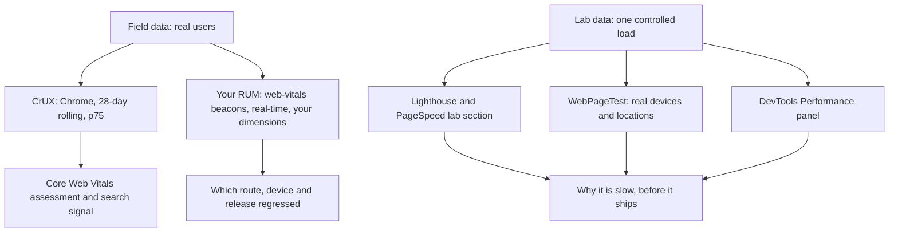

## 74.2 Core Web Vitals: what they are, how they are judged, field vs lab

#### Concept

**Core Web Vitals** are three user-centric metrics Google defines and publishes thresholds for, each covering one part of the experience:

| Metric | Measures | Good | Needs improvement | Poor |
|---|---|---|---|---|
| **LCP**, Largest Contentful Paint | Loading: when the largest image or text block in the viewport was rendered | ≤ 2.5 s | 2.5 s to 4.0 s | > 4.0 s |
| **INP**, Interaction to Next Paint | Responsiveness: how long interactions take to produce the next frame, across the whole visit | ≤ 200 ms | 200 ms to 500 ms | > 500 ms |
| **CLS**, Cumulative Layout Shift | Visual stability: the largest burst of unexpected layout shift | ≤ 0.1 | 0.1 to 0.25 | > 0.25 |

A page **passes** when the **75th percentile** of real page loads is in the "good" range for all three, measured separately for mobile and desktop. Around the core three sit **diagnostic metrics** that are not Core Web Vitals but explain them: **TTFB** (time to first byte, "good" at 800 ms or under), **FCP** (first contentful paint, "good" at 1.8 s or under) and, in the lab only, **TBT** (total blocking time).

#### Why does it exist?

Before Core Web Vitals, teams measured `onload`, "fully loaded", or a synthetic score, none of which matched what users felt. `onload` waits for every image below the fold and every iframe; a page can be usable long before it or unusable long after. Different tools reported different numbers for the "same" metric.

Core Web Vitals give everyone the same definitions, implemented in the browser itself, with public thresholds. They are also a ranking signal in Google Search (a modest one, as part of "page experience"), which made business stakeholders pay attention. For an engineer the value is simpler: three numbers with a precise meaning that can be measured identically in the field, in DevTools and in CI.

FID, the original responsiveness metric, measured only the *input delay* of the *first* interaction. A page could hydrate quickly enough to make the first tap feel fine and then take 700 ms on every filter click. INP replaced it in March 2024 because it covers every interaction and the full time to the next paint.

#### Mental model

Imagine a restaurant inspector with three questions. How long until the food you ordered is on the table (LCP)? When you wave at the waiter during the meal, how long until they visibly respond, judged on almost your worst wait, not your first (INP)? Did the table get moved while you were eating (CLS)? The restaurant passes when three out of four diners would answer "fine" to each question.

#### How it works

The definitions you need to reason with:

1. **LCP** is the render time of the largest **image or text block** visible in the viewport, reported by the browser through the `largest-contentful-paint` performance entry. Candidates are `` elements, `<image>` inside SVG, `<video>` poster images (and the first frame of a video in recent Chrome), elements with a CSS `background-image` loaded through `url()`, and block-level elements containing text. The browser reports a new candidate whenever a larger one paints, and stops after the first user input (a tap, click or key press; scrolling stops it too). Invisible elements (`opacity: 0`) and placeholder-like low-entropy images are ignored. Detail in 74.3.
2. **INP** observes every click, tap and key press during the visit (not hover or scroll). For each, it measures from the input to the next frame painted after the event handlers ran. The reported INP is the slowest interaction, except that on pages with many interactions one outlier is ignored per 50 interactions, so it approximates a high percentile of that visit's interactions. Detail in 74.4.
3. **CLS** sums the layout-shift scores (impact fraction multiplied by distance fraction, 67.5) of shifts not caused by recent user input, groups them into session windows (shifts less than 1 s apart, up to 5 s per window), and reports the worst window. Detail in 74.5.
4. **Field data** (real user monitoring, RUM) is collected from real visits. Google's public field dataset is the **Chrome User Experience Report (CrUX)**: Chrome users who opted into usage statistics, aggregated over a rolling 28 days, at origin level and for URLs with enough traffic. PageSpeed Insights, Search Console and the CrUX API all read it. Your own RUM (`web-vitals` or `useReportWebVitals`) gives you every browser that supports the APIs, real-time, with your own dimensions.
5. **Lab data** comes from a controlled run: Lighthouse, WebPageTest or a DevTools Performance recording, on a fixed device profile and network. Lab data is reproducible and debuggable, but it is one load, on one profile, with no real interactions, so it cannot measure INP directly. TBT, the sum of the part of each long task beyond 50 ms between FCP and the page becoming quiet, is the lab proxy for main-thread responsiveness.



The two kinds of data answer different questions, and confusing them causes most performance arguments:

| Question | Use | Why not the other |
|---|---|---|
| Are real users having a good experience? | Field (CrUX, RUM) | Lab is one load on one profile |
| Did yesterday's deploy regress mobile LCP? | Your RUM by build id | CrUX lags by up to 28 days |
| Why is this page's LCP slow? | Lab (DevTools, WebPageTest) plus RUM attribution | Field gives the number, not the trace |
| Will this pull request make the page slower? | Lab in CI (Lighthouse CI, bundle size) | Field data does not exist yet |
| What is our INP? | Field only | Lab has no real interactions; TBT is a proxy |

A good mental check: lab tells you *what could happen*, field tells you *what did happen*. When they disagree, field wins, and the lab profile is probably wrong for your users (74.11).

#### Practical example

A listing page's numbers from the three sources on the same day:

```text
Source                         LCP       INP      CLS     Notes
CrUX, mobile, p75 (28 days)    3.1 s     260 ms   0.04    includes 3 weeks before last fix
Own RUM, mobile, p75 (today)   2.6 s     230 ms   0.03    after the image fix 6 days ago
Lighthouse mobile, one run     3.4 s     n/a      0.00    TBT 610 ms; simulated slow 4G
Developer laptop, DevTools     0.9 s     40 ms    0.00    no throttling, warm cache
```

All four are "correct". CrUX still averages in the slower weeks. RUM shows the fix working. Lighthouse's simulated profile is slower than the real median user, which is fine for catching regressions. The laptop number is irrelevant to customers. The team reports RUM p75 internally, watches CrUX for the external assessment, and uses Lighthouse in CI for relative changes.

#### React / Next.js example

`useReportWebVitals` in Next.js is a thin wrapper over the `web-vitals` library. When you need **attribution**, the "why" behind each value, use the library's attribution build directly in a client component:

```tsx
// apps/web/src/perf/VitalsWithAttribution.tsx  (web-vitals v4; same function names in v5)
'use client';
import { useEffect } from 'react';
import { onLCP, onINP, onCLS, onTTFB, onFCP, type Metric } from 'web-vitals/attribution';

function send(metric: Metric, extra: Record<string, unknown>) {
  const body = JSON.stringify({ name: metric.name, value: metric.value, rating: metric.rating,
    id: metric.id, navigationType: metric.navigationType, route: location.pathname, ...extra });
  navigator.sendBeacon('/api/v1/rum/vitals', new Blob([body], { type: 'application/json' }));
}

export function VitalsWithAttribution() {
  useEffect(() => {
    onLCP((m) => send(m, {
      lcpTarget: m.attribution.target,                     // CSS selector of the LCP element
      ttfb: m.attribution.timeToFirstByte,                 // the four LCP subparts (82.3)
      loadDelay: m.attribution.resourceLoadDelay,
      loadDuration: m.attribution.resourceLoadDuration,
      renderDelay: m.attribution.elementRenderDelay,
    }));
    onINP((m) => send(m, {
      inpTarget: m.attribution.interactionTarget, type: m.attribution.interactionType,
      inputDelay: m.attribution.inputDelay, processing: m.attribution.processingDuration,
      presentation: m.attribution.presentationDelay, loadState: m.attribution.loadState,
    }));
    onCLS((m) => send(m, { clsTarget: m.attribution.largestShiftTarget, loadState: m.attribution.loadState }));
    onTTFB((m) => send(m, { dns: m.attribution.dnsDuration, conn: m.attribution.connectionDuration }));
    onFCP((m) => send(m, {}));
  }, []);
  return null;
}
```

Each `on*` function registers once and calls back when the value is final, typically when the page is hidden (`visibilitychange`), or on every change if you pass `{ reportAllChanges: true }` for debugging. The attribution build is about 1.5 KB larger than the standard one; on most pages that is a good trade. Note the v4 field names: `target`, `resourceLoadDuration` and `interactionTarget` were renamed from v3's `element`, `resourceLoadTime` and `eventTarget`, and v5 removed `onFID` entirely. Pin the version in `package.json` and check the changelog when you upgrade.

#### Backend side (NestJS)

The API contributes directly to two of the three metrics and indirectly to the third:

- **LCP** starts with TTFB. HTML rendered by Next.js waits for whatever NestJS calls the page makes; the API's latency, its cacheability and whether calls can run in parallel all land in the TTFB subpart (74.10).
- **CLS** depends on the response shape: image width and height in the product DTO, stable list lengths, predictable banner slots (67.5).
- **INP** depends on payload size and shape more than people expect. A 600 KB JSON response that the client parses, normalises and renders into 400 rows costs main-thread time on every filter change.

The API should also make field data trustworthy: answer the RUM beacon with 204 quickly, validate it with the same zod schema the client uses (`WebVitalReportSchema` in `@shop/contracts`, 74.11), and record the deployment id so the field can be grouped by release.

#### Production scenario

A travel booking site's CrUX report in Search Console showed 61% of mobile URLs "poor" on INP, and the SEO team escalated. The engineering team's own RUM, already sending INP with attribution, showed that 80% of poor interactions were on two elements: the date picker and the "Filter by price" slider on the results page. The `loadState` attribution said 70% of them happened during `dom-content-loaded`, before hydration had finished, so the interaction waited behind a 900 ms hydration task. Fixing hydration cost (74.7) and debouncing the slider moved p75 INP from 380 ms to 170 ms in their RUM within a week. CrUX caught up 28 days later, and Search Console moved the URLs to "good" a few days after that. The team had told the SEO lead in advance to expect the lag, which saved a week of anxious messages.

#### Failure scenario

A team set a release gate: "Lighthouse performance score of at least 90 on the product page". For six months every release passed. Then a quarterly CrUX review showed mobile p75 LCP of 3.6 s. The lab runs had been executing from a CI runner in the same AWS region as the origin, with a warm CDN, testing a product with a small hero image. Real users came from three continents, half hit CDN misses because HTML was personalised, and the top-selling products had 2,400-pixel hero images uploaded by merchandisers. The lab gate measured a page nobody visited, under conditions nobody had. The fix was to gate on RUM as well (alert on p75 per route per release) and to make the lab test representative (74.11): a CDN-miss run, the top five products by traffic, and a realistic throttling profile.

#### Edge cases & failure modes

- **Browser support.** LCP and INP are reported by Chromium-based browsers; Firefox supports LCP and, more recently, the Event Timing API needed for INP; Safari has been adding support behind the others. Your RUM numbers are therefore Chromium-heavy. CrUX is Chrome-only by definition.
- **Back/forward cache restores** are page loads to the user but do not run your page scripts again. `web-vitals` reports them with `navigationType: 'back-forward-cache'` and a near-zero LCP; segment or you will think the site got faster when bfcache eligibility improved (74.9).
- **Prerendered pages** (Speculation Rules, 74.6) report metrics relative to activation, not to the start of the hidden prerender. `navigationType: 'prerender'` distinguishes them.
- **Soft navigations** in single-page apps (client-side route changes) are not page loads; LCP and CLS are attributed to the first page of the visit and INP accumulates across all routes. Chrome has an experimental soft-navigation API; until it ships, attribute interactions to the route that was active when they happened.
- **Long-lived tabs** accumulate CLS and INP for hours. A dashboard opened all day will report its worst interaction from the afternoon.
- **Iframes**: LCP and CLS inside cross-origin iframes are not visible to the parent page's APIs, though CrUX includes some of their effect.

#### How a Senior Full-Stack Engineer thinks about this

A senior treats the three metrics as a contract with users and the diagnostic metrics as the tools to meet it. They state the target in the standard form ("p75 mobile LCP ≤ 2.5 s, INP ≤ 200 ms, CLS ≤ 0.1 on the product, listing and checkout routes") and refuse vaguer goals like "make it faster". They know which data answers which question and do not let a lab score stand in for user experience, or a field number stand in for a diagnosis.

They are also honest about what Core Web Vitals do not cover: they say nothing about whether checkout's API errors, whether search results are relevant, or whether a skeleton screen is shown for nine seconds before real data arrives. Product-specific metrics ("time to first product price", "time until cart count is accurate") belong next to them, measured with `performance.mark` and sent through the same pipeline.

#### Common mistakes

- **Still talking about FID** or tools that report it; it is no longer a Core Web Vital.
- **Treating Lighthouse as field data**, or expecting Lighthouse to report INP.
- **Reading CrUX the day after a fix** and concluding it did not work.
- **Mixing mobile and desktop** in one percentile.
- **Ignoring navigation type**, so bfcache and prerender loads distort the numbers.
- **Sending the full URL as a label**, which explodes metrics cardinality and leaks query strings with personal data.

#### Interview questions

1. **Name the Core Web Vitals and their "good" thresholds.** Expected answer: LCP ≤ 2.5 s, INP ≤ 200 ms, CLS ≤ 0.1, at the 75th percentile of page loads, mobile and desktop separately. Follow-up: why did INP replace FID? (FID measured only the first interaction's input delay; INP covers all interactions and the full time to next paint.)
2. **What is the difference between field and lab data, and when do you use each?** Expected answer: field is real users, the source of truth for experience; lab is controlled and reproducible, used for diagnosis and pre-release checks.
3. **Why can't Lighthouse measure INP, and what does it use instead?** Expected answer: no real user interactions in a page load test; TBT measures long-task blocking during load as a proxy. Follow-up: when do TBT and INP disagree? (INP from interactions long after load, or slow event handlers that do not show in load-time tasks.)
4. **Your CrUX LCP did not improve a week after a fix that your RUM shows working. Why?** Expected answer: CrUX is a 28-day rolling window; it includes the old days. Also check that CrUX's population (Chrome, opted in) matches.
5. **Which elements can be the LCP element?** Expected answer: images, SVG images, video posters or first frames, CSS background images, block-level text. Not invisible elements or low-entropy placeholders; reporting stops at first input.
6. **How would you get attribution for a poor INP from real users?** Expected answer: the `web-vitals/attribution` build: interaction target, type, the three phases, load state and long animation frame entries.

#### Practical exercise

Build a "three sources" view for one route.

Acceptance criteria:

- You pull the route's (or origin's) CrUX p75 for mobile from PageSpeed Insights or the CrUX API.
- Your own RUM reports p75 LCP, INP and CLS for the same route on mobile for the last 7 days, excluding `back-forward-cache` and `prerender` navigations.
- A Lighthouse mobile run and a DevTools recording with CPU and network throttling are recorded for the same URL.
- A short note explains every difference between the four sets of numbers.
