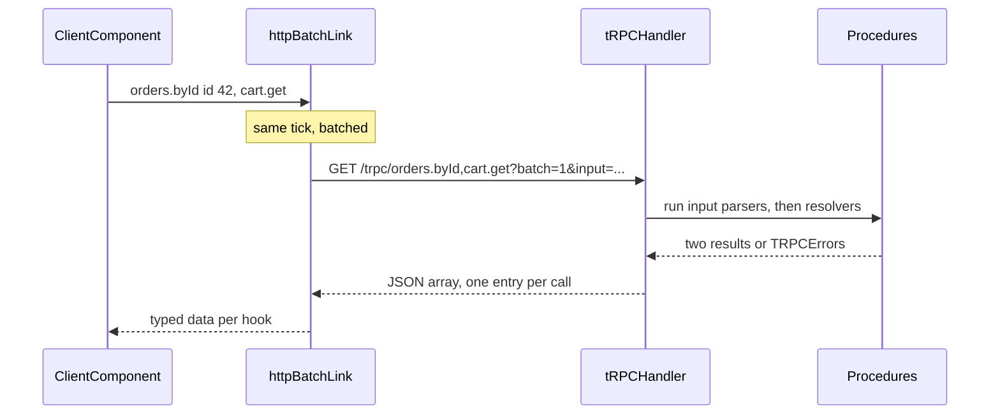

## 74.3 Shared zod schemas: validating at both ends

#### Concept

Part 70.9 created `@shop/contracts`, a package of zod schemas and the types inferred from them, consumed by both the NestJS API and the React app. This section is about using it well: which schema validates what, at which end, how strictly, and how it fits with `class-validator` and OpenAPI.

The rule is short. **The server validates everything it receives, because it trusts nobody. The client validates everything it receives, because it trusts nothing to stay the same.** Both use the same schema definitions, so they cannot disagree about what valid means, but they apply them with different strictness: strict on input, tolerant on output.

#### Why does it exist?

Without a shared schema, there are three definitions of an order: the `class-validator` DTO on the server, a hand-written TypeScript interface in the web app, and a form validation schema in the checkout page. They drift. The form allows 200 characters in `addressLine1`, the DTO allows 120, the database column is `varchar(120)`, and a customer with a long address gets "Something went wrong" (71.7 tells this exact story). A single schema removes the drift between definitions. Validating at both ends then removes the drift between deployed versions: the server rejects bad input with a precise error, and the client detects a response that no longer matches before it renders nonsense.

#### Mental model

Imagine a customs form printed by one office and used at both borders. The exporting country checks the form before the lorry leaves (client validation: helpful, catches mistakes early, but the driver could have forged it). The importing country checks it again at arrival (server validation: the one that counts). Because both use the same printed form, they never argue about which box means what. But the importing border is strict about what goes *in* ("no undeclared goods"), while the exporter, reading the import receipt, only cares that the boxes it needs are filled ("ignore any extra stamps").

#### How it works


1. **Three kinds of schema, not one.** A **request schema** (`CreateOrderRequestSchema`) describes what the client sends. A **response schema** (`OrderSummarySchema`) describes what the server returns. A **form schema** describes what the user types, which often differs: a confirm-email field, a quantity typed as a string, a card number that never reaches your API. Derive forms from requests (`.extend`, `.pick`, `.omit`), never the other way round.
2. **Strict input.** `z.object` by default **strips** unknown keys: they are silently removed from the parsed output. `.strict()` makes unknown keys an error, and `.passthrough()` keeps them. On the server, request schemas should be `.strict()`: a client sending `giftMessag` (a typo) or a field the server does not know yet should get a `400` naming the key, not a silent drop.
3. **Tolerant output.** On the client, response schemas use the default strip mode: a new field from a newer API is removed from the parsed value and the UI carries on. Enums need extra care, because an unknown value fails `z.enum` even in strip mode (74.7).
4. **Wire types without transforms.** Keep `@shop/contracts` describing the JSON exactly: strings for dates, money and large IDs. If a schema has a `.transform` (string to `Date`) or `z.coerce`, its input type and output type differ (`z.input<typeof S>` versus `z.output<typeof S>`), and a server that returns `z.infer<typeof S>` would claim to send a `Date`, which JSON cannot carry. Put transforms in each side's own code, after parsing.
5. **Query strings are strings.** `GET /v1/orders?limit=20` arrives as `{ limit: '20' }`. The server's query schema may use `z.coerce.number().int().max(100)`; that coercion belongs to a server-side query schema, not to the shared response types.

The tradeoff with `class-validator`, the NestJS default:

| | `class-validator` + `class-transformer` DTOs | zod schemas in `@shop/contracts` |
|---|---|---|
| Where it runs | Server (decorators and `reflect-metadata`) | Server, browser, Next.js server, edge, workers |
| NestJS integration | Built in: `ValidationPipe({ whitelist, forbidNonWhitelisted, transform })` | A small custom pipe (70.12) or `nestjs-zod` |
| OpenAPI generation | `@nestjs/swagger` CLI plugin reads it directly | Needs `@asteasolutions/zod-to-openapi`, `nestjs-zod`, or zod 4's `z.toJSONSchema()` |
| Types for the frontend | Classes cannot be imported into a browser bundle cleanly | `z.infer` types and runtime schemas, about 13 KB gzip for zod 3 |
| Unknown keys | `whitelist: true` strips, `forbidNonWhitelisted: true` rejects | Strip by default, `.strict()` rejects |
| Composition | Inheritance, `PartialType`, `PickType` from `@nestjs/swagger` | `.extend`, `.pick`, `.partial`, `.merge`, `z.discriminatedUnion` |
| Best for | API-only teams, OpenAPI-first consumers | TypeScript on both ends, monorepo, forms sharing rules |

Neither is wrong. What is wrong is having both describe the same payload by hand. Pick one source per payload and generate the other artefacts from it.

#### Practical example

The checkout form (71.13) posts an address. `AddressSchema` lives in `@shop/contracts` with `line1: z.string().trim().min(1).max(120)` and `postcode: z.string().regex(/^\d{6}$/)`. The form uses `zodResolver(AddressFormSchema)`, where `AddressFormSchema = AddressSchema.extend({ saveForLater: z.boolean() })`. The server's pipe uses `AddressSchema.strict()`. The response, `{ totals: CartTotals }`, is parsed on the client with `CartTotalsSchema`. When a later API version adds `totals.deliveryFeeWaivedReason`, old browsers strip it and keep working; new browsers show it.

#### React / Next.js example

```ts
// packages/contracts/src/orders.ts  (zod 3.23)
import { z } from 'zod';
import { AddressSchema } from './address';
import { MinorUnitsSchema } from './money';   // z.string().regex(/^\d+$/), 76.12

export const CreateOrderRequestSchema = z.object({
  cartId: z.string().uuid(),
  cartVersion: z.number().int().nonnegative(),  // optimistic concurrency (78.5)
  address: AddressSchema,
  paymentMethodId: z.string().min(1),
  expectedTotalMinor: MinorUnitsSchema,         // server refuses if the price moved (77.13)
});
export type CreateOrderRequest = z.infer<typeof CreateOrderRequestSchema>;

// Response: tolerant by default (unknown keys stripped on parse).
export const OrderCreatedSchema = z.object({
  id: z.string().uuid(),
  displayId: z.string(),
  totalMinor: MinorUnitsSchema,
  currency: z.string().length(3),
});
export type OrderCreated = z.infer<typeof OrderCreatedSchema>;
```

```tsx
// apps/web/src/checkout/AddressStep.tsx (excerpt)
'use client';
import { useForm } from 'react-hook-form';
import { zodResolver } from '@hookform/resolvers/zod';
import { AddressSchema } from '@shop/contracts';
import { z } from 'zod';

const AddressFormSchema = AddressSchema.extend({ saveForLater: z.boolean().default(false) }); // form-only field
type AddressForm = z.infer<typeof AddressFormSchema>;

export function AddressStep({ onSave }: { onSave: (a: AddressForm) => Promise<void> }) {
  const { register, handleSubmit, formState: { errors } } =
    useForm<AddressForm>({ resolver: zodResolver(AddressFormSchema), mode: 'onTouched' });
  return (
    <form onSubmit={handleSubmit(onSave)} noValidate>
      <input {...register('line1')} autoComplete="address-line1" aria-invalid={!!errors.line1} />
      {errors.line1 && <p role="alert">{errors.line1.message}</p>}
      {/* postcode, city, saveForLater ... same pattern */}
    </form>
  );
}
```

The client schema prevents a round trip for "postcode must be 6 digits". It does not replace the server check: the browser's JavaScript is the user's to change.

#### Backend side (NestJS)

The strict server pipe, an upgrade of 70.12's `ZodValidationPipe` that rejects unknown keys and reports them by path:

```ts
// apps/api/src/common/zod-validation.pipe.ts
import { BadRequestException, PipeTransform } from '@nestjs/common';
import { ZodObject, type ZodRawShape, type ZodType } from 'zod';

export class ZodValidationPipe<T> implements PipeTransform<unknown, T> {
  private readonly schema: ZodType<T>;
  constructor(schema: ZodType<T>, opts: { strict?: boolean } = { strict: true }) {
    // Objects become strict on input: an unknown key is a 400, not a silent drop.
    this.schema = opts.strict && schema instanceof ZodObject ? ((schema as ZodObject<ZodRawShape>).strict() as unknown as ZodType<T>) : schema;
  }
  transform(value: unknown): T {
    const result = this.schema.safeParse(value);
    if (result.success) return result.data;
    throw new BadRequestException({
      code: 'VALIDATION_FAILED',
      issues: result.error.issues.map((i) => ({
        path: i.path.join('.'),
        code: i.code === 'unrecognized_keys' ? 'UNKNOWN_FIELD' : i.code.toUpperCase(),
        message: i.message,
      })),
    }); // the ProblemDetailsFilter (80.6) wraps this into application/problem+json
  }
}
```

`.strict()` applies to the top-level object only; nested objects in the shared schemas that must also reject unknown keys should be declared `.strict()` in a server-side variant. Teams usually keep a short `strictRequest()` helper that walks the shape for request schemas.

To publish OpenAPI from the same zod schemas, register them with `@asteasolutions/zod-to-openapi` in the spec script, so non-TypeScript consumers and generated clients (74.2) get the same contract:

```ts
// apps/api/scripts/generate-openapi.ts  (@asteasolutions/zod-to-openapi 7)
import { writeFileSync } from 'node:fs';
import { OpenAPIRegistry, OpenApiGeneratorV3 } from '@asteasolutions/zod-to-openapi';
import { z } from 'zod';
import { CreateOrderRequestSchema, OrderCreatedSchema, OrderSummarySchema, ProblemSchema } from '@shop/contracts';

const registry = new OpenAPIRegistry();
const Order = registry.register('OrderSummary', OrderSummarySchema);    // becomes components.schemas.OrderSummary
const Problem = registry.register('Problem', ProblemSchema);            // 80.6

registry.registerPath({
  method: 'post', path: '/v1/orders', operationId: 'createOrder', tags: ['orders'],
  request: {
    headers: z.object({ 'idempotency-key': z.string().uuid() }),        // required header, Part 15.12
    body: { content: { 'application/json': { schema: CreateOrderRequestSchema } } },
  },
  responses: {
    201: { description: 'Created', content: { 'application/json': { schema: OrderCreatedSchema } } },
    422: { description: 'PRICE_CHANGED, INSUFFICIENT_STOCK', content: { 'application/problem+json': { schema: Problem } } },
  },
});
registry.registerPath({
  method: 'get', path: '/v1/orders/{id}', operationId: 'getOrder', tags: ['orders'],
  request: { params: z.object({ id: z.string().uuid() }) },
  responses: { 200: { description: 'Order', content: { 'application/json': { schema: Order } } } },
});

const doc = new OpenApiGeneratorV3(registry.definitions).generateDocument({
  openapi: '3.0.3', info: { title: 'Shop API', version: process.env.API_VERSION ?? '0.0.0' },
});
writeFileSync('openapi.json', JSON.stringify(doc, null, 2) + '\n');
```

The cost is that paths are registered by hand next to the controllers, so a route can exist without a registration. A test that boots the app, lists routes from the HTTP adapter, and fails if any `v1` route is missing from the registry closes that gap. `nestjs-zod`'s `createZodDto(schema)` is the other common route: it wraps a zod schema in a class that `@nestjs/swagger` can read, keeping registration on the controller itself.

#### Production scenario

A pharmacy platform consolidated three address definitions into one zod schema used by the web form, the Next.js BFF, the NestJS pipe and (through generated OpenAPI) the Android app. Address-related `500`s, previously about 40 a day from database length violations, went to zero. Parse cost was measured on a mid-range Android phone: 0.4 ms for a 20-order page, 18 ms for a 2,000-row admin export preview, which moved to a Web Worker. The web bundle grew by 13 KB gzip for zod, which they accepted for the checkout and account routes only, via code splitting (Part 70.5).

#### Failure scenario

A team added `giftMessage` to the order form and the request schema in one pull request, then deployed the web app at 10:00 and the API at 12:00 because of a release train. For two hours the old API parsed requests with the default strip mode and dropped `giftMessage` without a word. 1,140 orders shipped without the customer's message, and the API logs showed nothing because nothing had failed.

Two rules came out of the postmortem. **Request fields roll out provider first**: the API must accept a field before any client sends it. And **request schemas are strict**: had the old API returned `400 UNKNOWN_FIELD giftMessage`, the web canary would have failed loudly at 10:01 and been rolled back.

#### Edge cases & failure modes

- **`.default()` on response schemas** hides a missing field from monitoring: the UI shows the default and nobody learns the API stopped sending it.
- **`z.coerce` in shared schemas** accepts `"abc"` as `NaN` for numbers before `.int()` catches it, and accepts `""` as `0`; coerce only query and form strings, on the side that needs it.
- **Transforms leaking into types**: a shared `.transform(Number)` makes the API's `z.infer` return type a number while the client parses strings; use `z.input` and `z.output` deliberately.
- **Huge responses**: parsing 10,000 rows costs tens of milliseconds on a phone. Paginate (72.7), or validate a sample in production and everything in tests.
- **Recursive or deeply nested schemas** need `z.lazy`, and generators may emit them poorly.
- **Different zod versions** in web and API (3 and 4) can make shared schemas behave differently; pin one version at the workspace root.

#### How a Senior Full-Stack Engineer thinks about this

The senior keeps the shared package to wire shapes and pure rules (length, pattern, enum membership), and keeps business rules that need data (is this postcode serviceable, is this coupon valid) on the server, returned as `422` issues in the same shape. They make input strict and output tolerant, deploy request changes provider first and response removals consumer first, and treat every `.default()`, `.catch()` and `.transform()` in a shared schema as a decision to review. Asked "class-validator or zod?", they answer "whichever produces one source of truth for this team", and they will not accept two hand-maintained definitions of the same payload.

#### Common mistakes

- **Validating only on the client** because "the form already checks it".
- **Default strip mode on server input**, silently dropping fields during deploy skew.
- **Strict parsing of responses**, so every additive API change breaks old browsers.
- **Putting transforms and coercions in shared wire schemas.**
- **Sharing entity classes or TypeORM models** instead of wire schemas (70.9).

#### Interview questions

1. **Why validate the same payload on both client and server?** Expected answer: client for UX and drift detection on responses; server for trust. Follow-up: which can you skip? (Neither on input; client response validation can be sampled for very large payloads.)
2. **What does zod do with unknown keys by default, and what should a server do?** Expected answer: strips them; a server should reject unknown keys on input with `.strict()`, while clients tolerate unknown keys on responses.
3. **class-validator or zod for a NestJS API with a React frontend?** Expected answer: tradeoffs in the table; key point is one source of truth plus generated OpenAPI.
4. **Why should shared schemas avoid transforms?** Expected answer: input and output types diverge; JSON cannot carry `Date` or `bigint`; each side converts after parsing.
5. **In what order do you deploy a new required request field?** Expected answer: API accepts it as optional first, then clients send it, then the API makes it required once old clients are gone.

#### Practical exercise

Move the order creation payload to one zod schema used by the checkout form, the NestJS pipe and the web response parser, and publish it in `openapi.json`.

Acceptance criteria:

- `POST /v1/orders` with an extra key returns `400` with an issue `{ path: 'giftMessag', code: 'UNKNOWN_FIELD' }`.
- A response with an extra field parses on the client without error, and the field is absent from the parsed value.
- The form schema is derived from the request schema with `.extend` or `.pick`; no field rule is written twice.
- `openapi.json` contains `CreateOrderRequest` and `OrderSummary` generated from the zod schemas, and a test fails if a `v1` route is missing from the registry.

## 74.4 tRPC: end-to-end type safety and what it couples

#### Concept

**tRPC** is a library for TypeScript-only stacks where the server defines **procedures** (typed functions with zod-validated input) grouped into a **router**, and the client calls them through a proxy whose types are inferred directly from the server's router type. There is no spec and no code generation. Rename a procedure or a field on the server, and the client fails to compile at once, because the client's types *are* the server's types, imported with `import type`.

Over the wire it is plain HTTP and JSON: a query is a `GET /trpc/orders.byId?input=...`, a mutation is a `POST /trpc/orders.cancel`, and the default link batches several calls made in the same tick into one request. The version used here is **tRPC v11**, which integrates with TanStack Query v5 through `@trpc/tanstack-react-query`.

#### Why does it exist?

Because for one team writing both ends in TypeScript, the REST ceremony (resource URLs, a spec, generation, a fetch wrapper) is overhead that buys little. tRPC removes it: write a function on the server, call it on the client, with autocompletion and type errors across the network boundary. Teams building internal tools, admin panels and early-stage products ship noticeably faster with it.

#### Mental model

Imagine a house intercom versus a public phone line. The intercom (tRPC) connects rooms in one house: no dialling codes, no directory, you press "kitchen" and talk. It is the fastest way to talk inside the house, and useless for calling the neighbour. A public phone line (REST with OpenAPI) needs numbers and a directory, but anyone can call, from any kind of phone. And if you rewire the intercom, every handset in the house must be replaced at the same time, including the one in the guest room that a visitor (an open browser tab) is still holding.

#### How it works



1. The server builds procedures with `t.procedure.input(schema).query(fn)` or `.mutation(fn)`, and composes them with `t.router`. Middlewares (`t.procedure.use`) add auth and context.
2. It exports **only the router's type**: `export type AppRouter = typeof appRouter`.
3. The client creates a client with `createTRPCClient<AppRouter>` and a link (`httpBatchLink`, or `httpLink` without batching). The generic carries every procedure's input and output types.
4. At runtime, input is validated by the server's zod schema; errors are `TRPCError`s with codes such as `UNAUTHORIZED`, `NOT_FOUND`, `BAD_REQUEST`, mapped to HTTP statuses (401, 404, 400).
5. Nothing is validated on the client: output types are compile-time inference from the resolver's return type.

#### Practical example

An internal warehouse dashboard (apps/ops) is built by four engineers who also own the inventory endpoints it uses. It has no other consumers and is deployed with the API in one pipeline. tRPC is a good fit: procedures like `stock.adjust` and `picklists.today` are written once and consumed with full types. The customer-facing order API, used by web, mobile and the merchant portal, stays REST with OpenAPI.

#### React / Next.js example

The client side with the v11 TanStack Query integration:

```ts
// apps/ops/src/trpc.ts  (tRPC 11, TanStack Query 5)
import { createTRPCClient, httpBatchLink } from '@trpc/client';
import { createTRPCContext } from '@trpc/tanstack-react-query';
import type { AppRouter } from '@shop/api/trpc';   // type-only: no server code enters the bundle

export const { TRPCProvider, useTRPC } = createTRPCContext<AppRouter>();

export const trpcClient = createTRPCClient<AppRouter>({
  links: [
    httpBatchLink({
      url: '/trpc',
      maxURLLength: 2_000,                          // split batches before the URL gets too long for proxies
      headers: () => ({ 'X-Client': 'ops', 'X-Client-Version': import.meta.env.VITE_BUILD_ID }),
    }),
  ],
});
```

```tsx
// apps/ops/src/stock/StockRow.tsx
import { useMutation, useQuery, useQueryClient } from '@tanstack/react-query';
import { useTRPC } from '../trpc';

export function StockRow({ sku }: { sku: string }) {
  const trpc = useTRPC();
  const qc = useQueryClient();
  const stock = useQuery(trpc.stock.bySku.queryOptions({ sku }));      // input and output fully typed
  const adjust = useMutation(trpc.stock.adjust.mutationOptions({
    onSuccess: () => qc.invalidateQueries({ queryKey: trpc.stock.bySku.queryKey({ sku }) }),
  }));
  if (!stock.data) return null;
  return (
    <tr>
      <td>{sku}</td>
      <td>{stock.data.onHand}</td>
      <td><button onClick={() => adjust.mutate({ sku, delta: -1, reason: 'DAMAGED' })}>-1</button></td>
    </tr>
  );
}
```

The app wraps its tree in `<QueryClientProvider>` and `<TRPCProvider trpcClient={trpcClient} queryClient={queryClient}>`. Everything from Part 72 (stale time, invalidation, optimistic updates) still applies, because tRPC produces ordinary query keys and query options.

#### Backend side (NestJS)

tRPC has no official NestJS integration. The robust approach is to mount its Express adapter in `main.ts` and pass Nest-managed services into the tRPC context:

```ts
// apps/api/src/trpc/router.ts
import { initTRPC, TRPCError } from '@trpc/server';
import { z } from 'zod';
import type { StockService } from '../inventory/stock.service';

export type Context = { userId: string | null; roles: string[]; stock: StockService; requestId: string };
const t = initTRPC.context<Context>().create();

const staff = t.procedure.use(({ ctx, next }) => {
  if (!ctx.userId || !ctx.roles.includes('warehouse')) throw new TRPCError({ code: 'FORBIDDEN' });
  return next({ ctx: { ...ctx, userId: ctx.userId } });          // narrowed: userId is a string below
});

export const appRouter = t.router({
  stock: t.router({
    bySku: staff.input(z.object({ sku: z.string().min(1) })).query(({ ctx, input }) => ctx.stock.get(input.sku)),
    adjust: staff
      .input(z.object({ sku: z.string().min(1), delta: z.number().int().min(-1000).max(1000), reason: z.enum(['DAMAGED', 'COUNT', 'RETURN']) }))
      .mutation(({ ctx, input }) => ctx.stock.adjust({ ...input, actorId: ctx.userId, requestId: ctx.requestId })),
  }),
});
export type AppRouter = typeof appRouter;
```

```ts
// apps/api/src/main.ts (excerpt)
import { NestFactory } from '@nestjs/core';
import { createExpressMiddleware } from '@trpc/server/adapters/express';
import { randomUUID } from 'node:crypto';
import { AppModule } from './app.module';
import { appRouter } from './trpc/router';
import { StockService } from './inventory/stock.service';
import { SessionVerifier } from './auth/session-verifier';

async function bootstrap() {
  const app = await NestFactory.create(AppModule);
  const stock = app.get(StockService);          // Nest DI still owns the services
  const sessions = app.get(SessionVerifier);
  app.use('/trpc', createExpressMiddleware({
    router: appRouter,
    createContext: async ({ req }) => {
      const user = await sessions.verify(req.headers.cookie);   // same session check as the Nest guards
      return { userId: user?.id ?? null, roles: user?.roles ?? [], stock, requestId: String(req.headers['x-request-id'] ?? randomUUID()) };
    },
  }));
  await app.listen(3000);
}
void bootstrap();
```

What the backend loses by doing this, and must replace:

- **Nest guards, interceptors, pipes and exception filters do not run** for `/trpc`. Auth, rate limiting, logging, idempotency and error mapping must be rebuilt as tRPC middlewares or Express middleware.
- **No OpenAPI.** Mobile and partners cannot consume procedures without a separate REST surface.
- **Per-endpoint metrics blur.** A batched request carries several procedures; HTTP-level dashboards see `/trpc/stock.bySku,picklists.today`. Record metrics per procedure in a tRPC middleware.
- **Caching is manual.** Queries are `GET`s, so they can be cached, but only if you set `Cache-Control` per procedure (tRPC's `responseMeta` option on the adapter).

When end-to-end types are worth the coupling:

| Question | tRPC fits | REST + OpenAPI (or GraphQL) fits |
|---|---|---|
| Consumers | One or two TypeScript apps you own | Web, mobile, partners, other languages |
| Repository | Monorepo, client can import the router type | Several repositories |
| Release cadence | API and client released together | Independent releases |
| Long-lived clients | Short (internal tool, reload is fine) | Open tabs for days, mobile for months |
| Cross-cutting policy | Small, can live in tRPC middleware | Nest guards, interceptors, gateway policies |
| Team boundary | Same team owns both ends | Different teams negotiate the contract |

#### Production scenario

A logistics start-up built its dispatcher console and API with tRPC: 140 procedures, 6 engineers, one pipeline. Feature lead time from idea to production was about 40 % shorter than on their older REST services, mostly because there was nothing to document or generate. Two years later they launched a driver app in Kotlin and a customer API for enterprise accounts. They kept tRPC for the console and added a REST surface with OpenAPI for the new consumers, sharing the zod schemas and services underneath. The tRPC layer stayed a thin adapter over the same services, which is what made the split cheap.

#### Failure scenario

The same console team renamed `orders.assignRider` to `dispatch.assign` on a Thursday afternoon, updated the client, and deployed both. Dispatchers keep the console open for whole shifts. For the next six hours, every dispatcher with the old tab open got `NOT_FOUND` from tRPC when assigning a rider, rendered as a generic toast. They thought the system was down and assigned riders by phone.

End-to-end types had done their job: the code in the repository agreed perfectly. Nothing protected the deployed tabs. The fix was the same as for REST: keep the old procedure as an alias for one release, add a build-version check that prompts long-lived tabs to reload (74.9), and show `NOT_FOUND` on a procedure as "This page is out of date. Reload" rather than a generic error.

#### Edge cases & failure modes

- **Type-checking cost**: the client's `tsc` now type-checks the server's router, and through it the server's service types. Large routers make editor and CI type checks slow; keep resolver return types explicit and narrow (return view models, not TypeORM entities).
- **Leaking server types**: returning an entity from a resolver exposes every column to the client and couples the UI to the database schema (73.4 makes the same point for server components).
- **Batch failure modes**: one slow procedure in a batch delays every result in it; use `splitLink` to send slow or streaming procedures separately.
- **URL length limits** on batched `GET`s: proxies commonly reject URLs above 8 KB; set `maxURLLength`.
- **Serialisation**: `Date`, `Map` and `bigint` do not survive JSON. tRPC supports a `transformer` such as `superjson` on both ends, which changes the wire format to something only tRPC clients read.

#### How a Senior Full-Stack Engineer thinks about this

The senior sees tRPC as an excellent intercom and a poor public phone. They use it where one team owns both ends, clients are short-lived or reload easily, and nobody outside TypeScript needs the API. They keep procedures as thin adapters over services that a REST controller could also call, so adding a public surface later is a few days and not a rewrite. And they remember that end-to-end types end at the deploy boundary: open tabs, BFF pods and caches still run old code, so renames still need aliases and reload prompts.

#### Common mistakes

- **Choosing tRPC for an API that mobile or partners will need**, then building a second API in a hurry.
- **Assuming tRPC removes the need for compatibility rules.**
- **Returning ORM entities from resolvers.**
- **Forgetting that Nest guards and filters do not apply** to the mounted adapter.
- **Using `superjson` and then needing a non-tRPC consumer.**

#### Interview questions

1. **What does tRPC give you that OpenAPI generation does not, and what does it cost?** Expected answer: zero-step type sharing and instant feedback; it costs language lock-in, no spec for other consumers, tight coupling of client build to server types, and manual cross-cutting concerns. Follow-up: how do you add a mobile client later? (REST controllers over the same services and zod schemas.)
2. **Does tRPC protect you from breaking changes?** Expected answer: only at compile time for code built together; deployed clients still break, so aliases, additive changes and reload prompts are still needed.
3. **How would you integrate tRPC into a NestJS app?** Expected answer: mount the Express or Fastify adapter, inject Nest services into the context, rebuild auth, logging and rate limits as tRPC middleware.
4. **What problems does request batching introduce?** Expected answer: blurred metrics and logs, slowest-procedure latency for the whole batch, URL length limits, harder HTTP caching.

#### Practical exercise

Add a tRPC router for two internal warehouse procedures to the NestJS API and call them from a small React app.

Acceptance criteria:

- The client imports only `type AppRouter`; the client bundle contains no server code (check the bundle analyser).
- Calling `stock.adjust` without the `warehouse` role returns HTTP 403 with tRPC code `FORBIDDEN`.
- A tRPC middleware records latency per procedure, visible in metrics even for batched calls.
- Renaming a procedure on the server fails the client's `tsc`; a deployed old client receives `NOT_FOUND` and shows a "reload" message.
