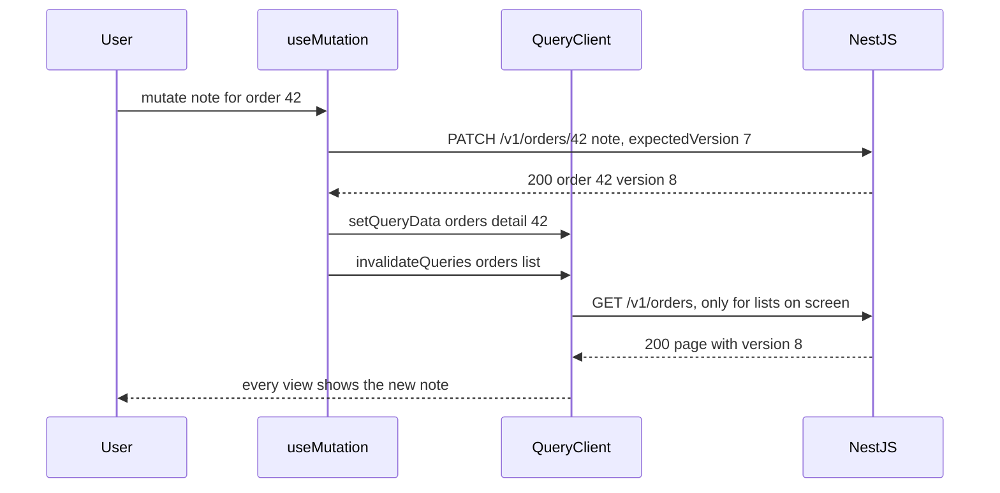
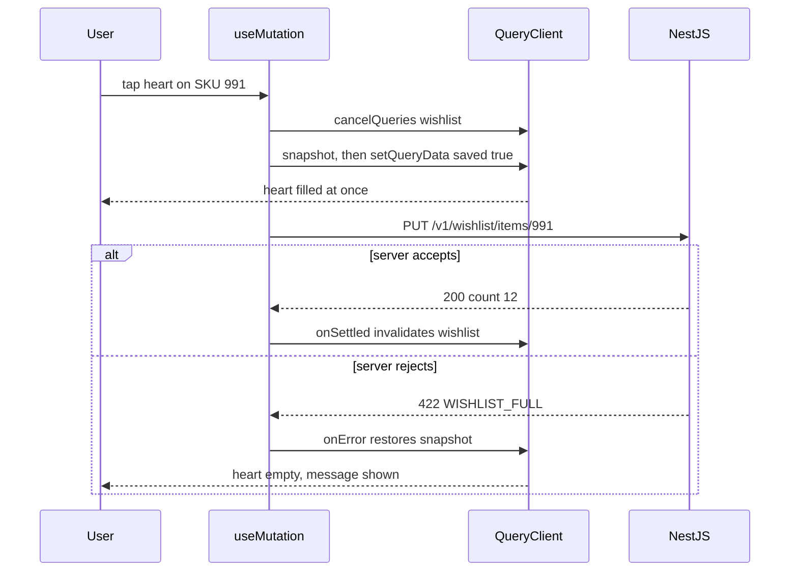

## 74.5 Mutations and invalidation

#### Concept

A **mutation** is a write: create, update, delete, or any action that changes server state (cancel an order, apply a coupon). In TanStack Query v5 it is `useMutation`:

```tsx
const mutation = useMutation({
  mutationFn: (input: UpdateNoteInput) => updateDeliveryNote(input),
  onSuccess: (order) => { /* update the cache */ },
});
// mutation.mutate(input), mutation.mutateAsync(input), mutation.isPending, mutation.error, mutation.reset()
```

Unlike a query, a mutation does not run by itself, is not cached by key, and is not retried by default. Its job is to send the write and then **bring the query cache back in line with the server**, in one of two ways:

- **Invalidate**: `queryClient.invalidateQueries({ queryKey })` marks matching queries stale and refetches those currently on screen. Simple, always correct, costs a round trip.
- **Write the response into the cache**: `queryClient.setQueryData(key, data)` replaces the cached value with the server's answer. Instant, no extra request, correct only if the response has exactly the cached shape.

Most real mutations do both: write the returned resource into its detail entry, invalidate the lists that might contain it.

v5 renamed the mutation's `isLoading` to **`isPending`** (status `'pending'`), matching queries.

#### Why does it exist?

After a write, every cached query that includes the changed data is wrong. Without a rule for fixing them, the user edits the delivery note and the order page still shows the old one, or the list shows a count that no longer matches. Hand-written code fixes the one screen the developer was looking at and misses the other three. Mutations give writes a single place to say "these keys are affected", using the same key factory as reads (74.2).

#### Mental model

Imagine the two strategies a backend uses after `UPDATE orders`: **cache-aside delete** (`DEL order:42`, the next read repopulates from PostgreSQL) and **write-through** (`SET order:42 <new row>`). Invalidation is cache-aside delete with an immediate re-read for anything on screen. `setQueryData` from the response is write-through. Write-through is faster but trusts that you wrote exactly what a read would have returned.

#### How it works



1. `mutate(variables)` calls `mutationFn(variables)`. The mutation's status becomes `pending`.
2. On success, `onSuccess(data, variables, context)` runs. If it **returns a promise**, the mutation stays `pending` until that promise settles. Returning the `invalidateQueries` promise keeps the button's spinner on until the lists have refetched, so the user never sees the old list after a "saved" message.
3. `invalidateQueries({ queryKey: orderKeys.lists() })` matches by prefix. Matching queries are marked stale. Those with mounted observers are refetched now (`refetchType: 'active'`, the default); inactive ones refetch when next used. `refetchType: 'none'` only marks them stale; `'all'` refetches inactive ones too.
4. On failure, `onError(error, variables, context)` runs; `onSettled` runs after either outcome.

Callbacks can be passed in two places. Callbacks on `useMutation({...})` always run. Callbacks passed to `mutate(vars, { onSuccess })` run only if the component is **still mounted** when the mutation finishes. Put cache updates in the first; put UI reactions (close the dialog, navigate) in the second.

`mutate` swallows errors into `mutation.error`; `mutateAsync` returns a promise that rejects, so wrap it in `try/catch` or you get unhandled rejections.

#### Practical example

A customer edits the delivery note on order `A7K2Q9P` ("Leave with the concierge"). Affected cached data: the order detail (`['orders', 'detail', id]`), any order list containing it (`['orders', 'list', ...]`), and nothing else. The API returns the updated order, so the detail is written directly and lists are invalidated. If the customer is on the detail page, one PATCH and zero extra GETs update what they see; the list refetches when they navigate back, because it was marked stale while inactive.

#### React / Next.js example

```tsx
// src/orders/useUpdateDeliveryNote.ts  (TanStack Query v5)
import { useMutation, useQueryClient } from '@tanstack/react-query';
import { OrderSummarySchema, type OrderSummary } from '@shop/contracts';
import { apiSend } from '../api/http';
import { orderKeys } from './orderKeys';

type Input = { orderId: string; note: string; expectedVersion: number };

export function useUpdateDeliveryNote() {
  const queryClient = useQueryClient();
  return useMutation({
    mutationFn: ({ orderId, note, expectedVersion }: Input) =>
      apiSend('PATCH', `/v1/orders/${orderId}`, { note, expectedVersion }, OrderSummarySchema),
    onSuccess: (order: OrderSummary) => {
      // Write-through: the response is a full OrderSummary, validated by the same schema as reads.
      queryClient.setQueryData(orderKeys.detail(order.id), order);
      // Cache-aside for lists: returning the promise keeps isPending true until lists are fresh.
      return queryClient.invalidateQueries({ queryKey: orderKeys.lists() });
    },
  });
}
```

```tsx
// src/orders/DeliveryNoteForm.tsx  (excerpt)
const update = useUpdateDeliveryNote();
const onSubmit = (note: string) =>
  update.mutate(
    { orderId: order.id, note, expectedVersion: order.version },
    { onSuccess: () => setEditing(false) }, // UI reaction: runs only if this form is still mounted
  );
// <button disabled={update.isPending}>{update.isPending ? 'Saving...' : 'Save'}</button>
// {update.error instanceof ApiError && update.error.code === 'VERSION_CONFLICT' && <p>This order changed. Reload?</p>}
```

`apiSend` is the write twin of `apiGet` (74.2): JSON body, `credentials: 'include'`, an optional `Idempotency-Key` header (74.6), `ApiError` on non-2xx, schema parse on success.

#### Backend side (NestJS)

Mutations are only cheap on the client if the API returns enough to update the cache:

- **Return the updated resource** (`200` with the body) from updates and actions, in the same shape as the read endpoint. A `204 No Content` forces a refetch for every write.
- **Use the version for optimistic concurrency.** The client sends the version it edited; the server updates only if it still matches and returns `409 VERSION_CONFLICT` otherwise, in the `{ code, issues, requestId }` shape.
- **Make side effects visible.** If cancelling an order also changes the wallet balance, either return both or document which keys the client must invalidate. Hidden side effects are where stale screens come from.

```ts
// apps/api/src/orders/orders.service.ts  (TypeORM, excerpt)
async updateNote(userId: string, orderId: string, note: string, expectedVersion: number): Promise<OrderSummary> {
  // TypeORM's PostgreSQL driver returns [rows, rowCount] for UPDATE/DELETE through query().
  const [rows] = (await this.ds.query(
    `UPDATE orders
        SET delivery_note = $3, version = version + 1, updated_at = now()
      WHERE id = $1 AND customer_id = $2 AND version = $4
    RETURNING *`,
    [orderId, userId, note, expectedVersion],
  )) as [OrderRow[], number];
  if (rows.length === 0) {
    const exists = await this.ds.query('SELECT version FROM orders WHERE id = $1 AND customer_id = $2', [orderId, userId]);
    if (exists.length === 0) throw new NotFoundException({ code: 'ORDER_NOT_FOUND' });
    throw new ConflictException({ code: 'VERSION_CONFLICT', issues: [], currentVersion: exists[0].version });
  }
  return this.mapper.toSummary(rows[0]); // same mapper as GET, so the client can setQueryData safely
}
```

The conditional `UPDATE ... WHERE version = $4` is one round trip and needs no explicit lock: PostgreSQL's row lock during the update serialises concurrent writers, and the loser matches zero rows (Part 21 — Database Transactions and Concurrency Control).

#### Production scenario

An admin console called `queryClient.invalidateQueries()` with no filter after every mutation "to be safe". The dashboard kept 14 queries active (KPIs, charts, three tables). Each status change by an operations agent triggered 14 refetches, several of them aggregate queries costing 80 to 200 ms of database time. With 120 agents making about 6 changes per minute each, that was 10,000 extra requests per minute and a reporting replica at 70 % CPU. Scoping invalidation to `orderKeys.lists()` and `['kpis', 'orders']` cut it to 2 refetches per change and replica CPU to 25 %.

#### Failure scenario

The "update delivery note" endpoint originally returned `{ id, note, version }` rather than a full order. A developer wrote `setQueryData(orderKeys.detail(id), response)`. TypeScript did not complain because the mutation's return type was `any` from an untyped helper. The detail page re-rendered with an object that had no `items`, and `order.items.map` threw. The error boundary showed "Something went wrong" for every customer who edited a note, about 2,000 people in the first hour.

Fixes: the mutation response was parsed with `OrderSummarySchema`, so a shape mismatch fails in `mutationFn` (an error state, not a corrupted cache); the API returned the full summary; and `apiSend` became generic over the schema so `any` could no longer leak.

#### Edge cases & failure modes

- **Writing a partial response into the cache** corrupts it; parse with the read schema or merge explicitly with `setQueryData(key, (old) => old && { ...old, ...patch })`.
- **Invalidating too broadly** turns each click into a refetch storm; too narrowly leaves stale screens. Use the key hierarchy.
- **Infinite lists refetch every loaded page** when invalidated (74.7); patch them with `setQueriesData` when you know the change.
- **Callbacks in `mutate()`** do not run after unmount; cache updates placed there are silently skipped.
- **`mutateAsync` without `catch`** produces unhandled promise rejections.
- **Double submit**: `isPending` disables the button after a render; a fast double tap can still fire twice. Use the ref guard and idempotency key from 73.8.
- **A mutation that succeeds on the server but times out on the client** has an unknown outcome; refetch the affected keys before letting the user retry.

#### How a Senior Full-Stack Engineer thinks about this

For each mutation the senior lists the affected keys, the same way they would list cache keys to evict after a database write. They prefer write-through from a validated response for the resource itself, scoped invalidation for collections and aggregates, and they make the API return what the client needs to do that. They insist on the version check so two agents editing the same order do not silently overwrite each other.

#### Common mistakes

- **Returning `204` from every write**, forcing refetches.
- **Global `invalidateQueries()`** after every mutation.
- **Cache updates inside `mutate()` callbacks** instead of the hook's options.
- **Trusting an untyped response** in `setQueryData`.
- **No version check**, so last write wins without anyone noticing.

#### Interview questions

1. **Invalidate or `setQueryData` after a mutation: how do you choose?**
   Expected answer: `setQueryData` when the response is exactly the cached shape for a known key; invalidate for lists, aggregates and anything derived; often both. Follow-up: why return the invalidate promise from `onSuccess`? (To keep the mutation pending until fresh data is shown.)
2. **What is the difference between callbacks on `useMutation` and on `mutate`?** Expected answer: the latter run only if the component is mounted; use the former for cache work.
3. **How does the server prevent lost updates between two editors?** Expected answer: optimistic concurrency with a version in the `WHERE` clause and a `409` on mismatch.
4. **What does `refetchType` control?** Expected answer: whether invalidated queries refetch now: active ones (default), all, or none.

#### Practical exercise

Implement "edit delivery note" end to end.

Acceptance criteria:

- Saving on the detail page makes exactly one PATCH and zero GETs; navigating back to the list triggers one list refetch.
- Two browser sessions editing the same order: the second save gets `409 VERSION_CONFLICT` and a "This order changed" message.
- A mocked response missing `items` fails the mutation with a parse error and leaves the cache unchanged.
- The save button stays in "Saving..." until list invalidation completes.

## 74.6 Optimistic updates, rollback and idempotency keys from the client

#### Concept

An **optimistic update** shows the result of a write *before* the server confirms it, and undoes it if the server says no. The heart icon fills the instant you tap it; the request goes out in the background; if it fails, the heart empties again with a message.

TanStack Query v5 supports two styles:

- **Optimistic via the UI**: render `mutation.variables` while `mutation.isPending`, without touching the cache. On error the pending variables simply disappear. Simple, local to one component (or several, via `useMutationState`).
- **Optimistic via the cache**: in `onMutate`, cancel in-flight fetches, snapshot the current cache value, write the expected value, and return the snapshot as **context**; in `onError`, restore it; in `onSettled`, invalidate to reconcile with the truth.

An **idempotency key from the client** is a unique ID generated once per user intent and sent with every attempt of that write (`Idempotency-Key: 7f3c...`), so the server can recognise retries and return the original result instead of applying the write twice (Part 15.12). Optimistic UIs retry more, so they need it more.

#### Why does it exist?

On a 4G connection a write takes 150 to 600 ms; on a congested one, seconds. For frequent, low-risk actions (wishlist, mark as read, reorder a list, toggle a setting) that delay makes the app feel broken. Optimism removes the wait for the common case (the write almost always succeeds) at the cost of handling the rare failure honestly.

Idempotency keys exist because the client cannot tell "the request failed" from "the response was lost". After a timeout, a retry without a key may cancel twice, pay twice or create two orders.

#### Mental model

Imagine writing a cheque into your ledger in pencil the moment you hand it over, then inking it when the bank clears it, or erasing it if it bounces. You need the pencil entry to be distinguishable (a pending marker), you need to remember what the line said before (the snapshot), and you must not erase entries the bank added in the meantime (newer server data). The idempotency key is the cheque number: if the bank sees the same number twice, it pays once.

#### How it works



Cache-style optimistic update, in order:

1. **`onMutate(variables)`** runs before `mutationFn`.
2. **`await queryClient.cancelQueries({ queryKey })`**. Without this, a background refetch that started before the tap can land after the optimistic write and overwrite it with old data: the heart flickers back.
3. **Snapshot**: `const previous = queryClient.getQueryData(key)` (or `getQueriesData({ queryKey })` for several list variants).
4. **Write the expected state** with `setQueryData` (or `setQueriesData`).
5. **Return `{ previous }`**. It arrives as the third argument of `onError` and `onSettled`.
6. **`onError(error, variables, context)`** restores `context.previous`, and tells the user.
7. **`onSettled`** invalidates the key so the cache ends up matching the server either way.

Ordering and retries need two more tools:

- **`scope: { id }`** (v5): mutations with the same scope ID run **one at a time, in order**. Tapping the heart three times quickly sends PUT, DELETE, PUT in sequence rather than racing, so the final server state matches the final tap.
- **Retries with a stable key**: generate the idempotency key when the user acts, pass it in `variables`, and every retry of that mutation reuses it. Only then is `retry: 2` on a mutation safe.

When **not** to be optimistic: payments, placing orders, anything with limited stock, anything with a low success rate, and anything whose failure the user would not notice in time to act. A heart that unfills is fine; a "Paid" badge that reverts is not.

#### Practical example

The wishlist heart on a product grid: the success rate is above 99.8 % (failures are network loss or the 500-item limit), the action is trivially reversible, and it appears on every product card. It is the textbook case for optimism.

Order cancellation is a borderline case, and the worked example in 74.12 handles it carefully: the server rejects about 4 % of cancels because the order shipped in the meantime, so the optimistic state is shown as "Cancelling..." rather than a final "Cancelled", and the rollback explains why.

The backend can often make the idempotency question disappear by **designing naturally idempotent endpoints**: `PUT /v1/wishlist/items/:sku` ("this SKU is saved") and `DELETE /v1/wishlist/items/:sku` can be repeated any number of times with the same result. Keys are needed for writes that are not naturally idempotent: `POST /v1/orders`, `POST /v1/orders/:id/reorder`, payments.

#### React / Next.js example

```tsx
// src/wishlist/useToggleWishlist.ts  (TanStack Query v5)
import { useMutation, useQueryClient } from '@tanstack/react-query';
import { WishlistSchema, type Wishlist } from '@shop/contracts';
import { apiSend } from '../api/http';
import { toast } from '../ui/toast';

const wishlistKey = ['wishlist'] as const;

export function useToggleWishlist(sku: string) {
  const queryClient = useQueryClient();
  return useMutation({
    scope: { id: `wishlist:${sku}` },                    // rapid taps on one SKU run in order
    mutationFn: (save: boolean) =>
      apiSend(save ? 'PUT' : 'DELETE', `/v1/wishlist/items/${sku}`, undefined, WishlistSchema),
    onMutate: async (save) => {
      await queryClient.cancelQueries({ queryKey: wishlistKey });       // stop older refetches landing later
      const previous = queryClient.getQueryData<Wishlist>(wishlistKey); // snapshot for rollback
      queryClient.setQueryData<Wishlist>(wishlistKey, (old) =>
        old && {
          ...old,
          skus: save ? [...new Set([...old.skus, sku])] : old.skus.filter((s) => s !== sku),
        });
      return { previous };
    },
    onError: (_error, _save, context) => {
      if (context?.previous) queryClient.setQueryData(wishlistKey, context.previous);
      toast.error('Could not update your wishlist. Please try again.');
    },
    onSettled: () => queryClient.invalidateQueries({ queryKey: wishlistKey }), // converge on the truth
  });
}
```

For a non-idempotent write, the key is created at intent time and travels in the variables:

```tsx
// src/orders/useReorder.ts  (excerpt): POST creates a new order, so it needs a key
const reorder = useMutation({
  mutationFn: ({ orderId, idempotencyKey }: { orderId: string; idempotencyKey: string }) =>
    apiSend('POST', `/v1/orders/${orderId}/reorder`, {}, OrderCreatedSchema, { idempotencyKey }),
  retry: (count, error) => isRetryable(error) && count < 2, // safe only because the key is stable
});

// In the click handler: one key per user intent, reused by every automatic retry.
const onReorder = () => reorder.mutate({ orderId, idempotencyKey: crypto.randomUUID() });
```

A second component (a header badge counting "items being saved") can read pending mutations anywhere in the tree with `useMutationState({ filters: { status: 'pending' }, select: (m) => m.state.variables })`.

#### Backend side (NestJS)

Optimistic clients send more retries and more out-of-order writes than pessimistic ones. The backend's job is to make every write safe to repeat:

```ts
// apps/api/src/wishlist/wishlist.controller.ts
import { Controller, Delete, HttpCode, Param, Put, UseGuards } from '@nestjs/common';
import type { Wishlist } from '@shop/contracts';
import { JwtAuthGuard } from '../auth/jwt-auth.guard';
import { CurrentUser } from '../auth/current-user.decorator';
import { WishlistService } from './wishlist.service';

@Controller('v1/wishlist/items')
@UseGuards(JwtAuthGuard)
export class WishlistController {
  constructor(private readonly wishlist: WishlistService) {}

  @Put(':sku')
  @HttpCode(200)
  save(@CurrentUser() userId: string, @Param('sku') sku: string): Promise<Wishlist> {
    return this.wishlist.add(userId, sku); // INSERT ... ON CONFLICT DO NOTHING, then return the list
  }

  @Delete(':sku')
  @HttpCode(200)
  remove(@CurrentUser() userId: string, @Param('sku') sku: string): Promise<Wishlist> {
    return this.wishlist.remove(userId, sku); // deleting an absent row is still success
  }
}
```

```sql
-- Repeating the PUT is harmless: the primary key absorbs duplicates.
CREATE TABLE wishlist_items (
  customer_id uuid NOT NULL,
  sku         text NOT NULL,
  created_at  timestamptz NOT NULL DEFAULT now(),
  PRIMARY KEY (customer_id, sku)
);
INSERT INTO wishlist_items (customer_id, sku) VALUES ($1, $2) ON CONFLICT DO NOTHING;
```

For non-idempotent `POST`s, require `Idempotency-Key` and apply the `IdempotencyInterceptor` from Part 15.12 (reserve the key in Redis, fingerprint the request, store and replay the response, back it with a unique constraint). For a browser on another origin, add `Idempotency-Key` to CORS `allowedHeaders` and expose `Idempotent-Replayed` so the client can tell a replay from a fresh result (73.8).

#### Production scenario

A fashion marketplace's product grid showed 48 cards per page, each with a heart. Before optimism, a tap showed a spinner for the request duration: median 210 ms, p95 900 ms on mobile. After moving to optimistic updates with `scope`, perceived latency was zero, and wishlist adds per session rose 14 %. The error rate stayed at 0.15 %, mostly offline taps, each rolled back with a message. Because PUT/DELETE were naturally idempotent, retries and duplicates needed no key storage.

#### Failure scenario

The first optimistic version skipped `cancelQueries`. The wishlist query had `refetchOnWindowFocus` on. A user returned to the tab (refetch started, 400 ms on their connection) and tapped a heart 100 ms later. The optimistic write filled the heart; 300 ms later the refetch landed with the pre-tap list and emptied it; then `onSettled` invalidated and it filled again. Users saw hearts flicker and tapped again, which *removed* the item. Support tickets called it "the wishlist forgets things".

Adding `await queryClient.cancelQueries({ queryKey: wishlistKey })` in `onMutate` and `scope` per SKU removed both the flicker and the double-toggle.

#### Edge cases & failure modes

- **No `cancelQueries`**: an in-flight refetch overwrites the optimistic state.
- **Snapshot rollback overwrites newer data**: if a pushed event updated the entry after the snapshot, restoring the snapshot erases it. Roll back by reverting only the field you changed, or invalidate instead (74.12 shows this).
- **Rapid repeated actions** race without `scope`; the last response to arrive wins, not the last tap.
- **Optimistic writes to several keys** (list and detail) must all be snapshotted and restored.
- **Retried mutations without a stable key** duplicate non-idempotent writes.
- **Keys generated in `mutationFn`** change on every retry, which defeats them; generate at intent time.
- **Offline**: paused optimistic mutations may sit for minutes (74.10); the UI must show them as pending, not done.

#### How a Senior Full-Stack Engineer thinks about this

The senior asks three questions before approving an optimistic update: what is the success rate, what does the user lose if it reverts, and can the server make this write idempotent by design? High, little, yes: go optimistic. Otherwise show a pending state and wait for the server. They keep optimistic state visibly provisional when the stakes are higher ("Cancelling..."), and they always end with invalidation so the cache converges on the truth whatever happened in between.

#### Common mistakes

- **Optimistic updates for money and stock.**
- **Skipping `cancelQueries`** and the snapshot.
- **Rolling back without telling the user** why their action vanished.
- **Generating a new idempotency key per retry.**
- **Retrying non-idempotent mutations** with no key.
- **Forgetting `onSettled` invalidation**, leaving the optimistic guess as permanent truth.

#### Interview questions

1. **Walk through an optimistic update with rollback in TanStack Query.**
   Expected answer: `onMutate` cancels queries, snapshots, writes the expected state and returns the snapshot; `onError` restores; `onSettled` invalidates. Why it matters: each step prevents a specific bug (overwrite, lost rollback, permanent guess). Follow-up: when would you use `variables` instead of the cache?
2. **Why does a client need idempotency keys, and when are they unnecessary?** Expected answer: lost responses make retries ambiguous; unnecessary when the endpoint is naturally idempotent (PUT/DELETE of a state).
3. **How do you stop rapid toggles from ending in the wrong state?** Expected answer: serialise with `scope`, or debounce to the final intent, and make server writes order-insensitive.
4. **When would you refuse an optimistic update?** Expected answer: low success rate, irreversible or costly actions, payments, stock-limited actions.

#### Practical exercise

Build the wishlist heart with optimistic updates.

Acceptance criteria:

- With network throttled to 3G, the heart fills within one frame of the tap.
- With the API returning `422 WISHLIST_FULL`, the heart reverts and a message explains why.
- Five rapid taps produce five ordered requests and a final server state equal to the final UI state.
- A focus refetch started before the tap does not overwrite the optimistic state.
- The reorder mutation sends the same `Idempotency-Key` on every retry, and the NestJS integration test proves a replayed request creates one order.
