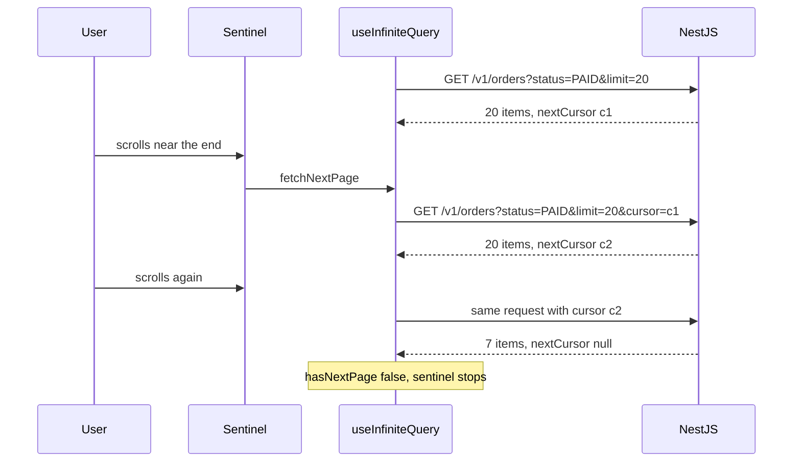
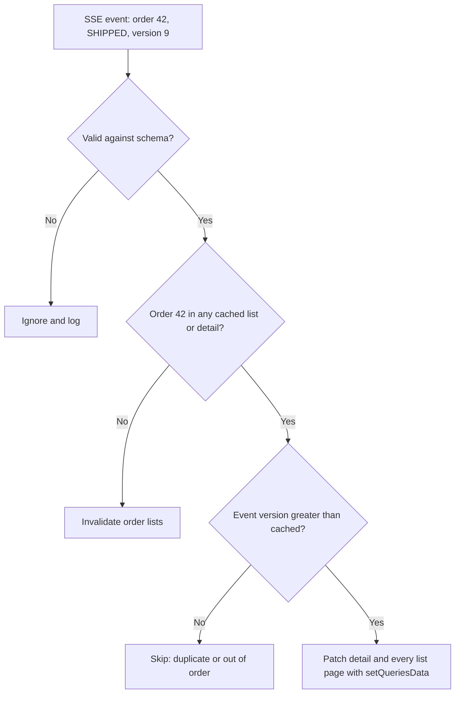

## 74.7 Pagination and infinite scroll from the client

#### Concept

Part 15.5 designed pagination on the API side: offset pages for small admin tables, **cursor (keyset) pages** for anything large or changing. This section is the other end of that contract.

From the client, there are two shapes:

- **Numbered pages** ("Page 3 of 12"): one ordinary `useQuery` per page, with the page number in the key. v5's `placeholderData: keepPreviousData` keeps page 2 on screen while page 3 loads, instead of flashing a spinner. (v4 had a `keepPreviousData: true` option; v5 replaced it with the imported `keepPreviousData` function passed to `placeholderData`.)
- **Infinite lists** ("Load more" or scroll to load): one `useInfiniteQuery` whose cached value is a list of pages. Each page is fetched with a **page parameter** (for cursor APIs, the previous page's `nextCursor`).

```tsx
useInfiniteQuery({
  queryKey,
  queryFn: ({ pageParam, signal }) => fetchPage(pageParam, signal),
  initialPageParam: null as string | null,            // required in v5
  getNextPageParam: (lastPage) => lastPage.nextCursor, // null or undefined means "no more pages"
});
// data.pages, data.pageParams, fetchNextPage(), hasNextPage, isFetchingNextPage
```

#### Why does it exist?

An order history, a product feed or a notification list can hold thousands of rows. Loading everything costs seconds and megabytes; numbered pages are awkward on phones. Infinite lists load 20 rows, then 20 more as the user approaches the end. The client must remember which pages it has, which cursor comes next, whether a request is already running, and what to do when filters change. `useInfiniteQuery` holds all of that as one cache entry.

#### Mental model

Imagine reading a Kafka topic with a consumer that stores its offset. Each poll returns a batch and the position to continue from; you never ask for "batch number 7", you ask for "after offset X". A cursor is that offset for an API, and `useInfiniteQuery` is the consumer that keeps the batches and the next offset together. Change the filter and you are reading a different topic: new key, new consumer, starting from the beginning.

#### How it works



1. **First page**: the query function is called with `initialPageParam`.
2. **Next page**: `fetchNextPage()` calls `getNextPageParam(lastPage, allPages)`. If it returns `null` or `undefined`, `hasNextPage` is `false` and nothing is fetched. Otherwise the query function runs with that cursor and the page is appended.
3. **One fetch at a time**: calling `fetchNextPage` while a fetch is running is ignored by default, so a scroll sentinel firing repeatedly is safe. Still guard with `hasNextPage && !isFetchingNextPage` to avoid wasted renders.
4. **Filters are part of the key.** A new filter is a new cache entry starting at page one; switching back within `gcTime` restores the old pages instantly.
5. **Refetch replays every page.** When an infinite query is refetched (focus, invalidation), v5 refetches **all loaded pages, sequentially, from the first**, recomputing each cursor from the fresh previous page. That keeps the list consistent, but 15 loaded pages means 15 sequential requests.
6. **`maxPages`** (v5) caps how many pages are kept. With `maxPages: 5` and `getPreviousPageParam`, the list keeps a sliding window and can fetch backwards when the user scrolls up.

The cursor contract the client depends on:

| Rule | Why the client needs it |
|---|---|
| `nextCursor` is opaque and `null` at the end | The client never builds cursors, and knows when to stop |
| Total, stable order (`placed_at DESC, id DESC`) | No duplicates or gaps between pages (73.3) |
| Cursor bound to its filters | A cursor from `status=PAID` used with `status=SHIPPED` is rejected, not silently wrong |
| Capped `limit` (max 50) | One client cannot request 10,000 rows |
| No total count | `count(*)` on large filtered sets is slow (Part 15.5); show "Load more", not "page 3 of 120" |

#### Practical example

The "My Orders" page loads 20 orders, shows a skeleton row at the end, and fetches more when that row scrolls within 400 px of the viewport. Filters (status, date range) live in the URL; changing one swaps to another cached list. A customer with 300 orders who scrolls to the bottom triggers 15 requests of about 60 ms each over a minute of scrolling, instead of one 1.4 s request for everything. With `maxPages: 10`, at most 200 orders sit in memory; beyond that, rows are also virtualised (73.9).

#### React / Next.js example

The list hook, keyed by the normalised filters:

```tsx
// src/orders/useOrderList.ts  (TanStack Query v5)
import { useInfiniteQuery } from '@tanstack/react-query';
import { OrderListResponseSchema, type OrderListFilters } from '@shop/contracts';
import { apiGet } from '../api/http';
import { orderKeys } from './orderKeys';

export function useOrderList(filters: OrderListFilters) {
  return useInfiniteQuery({
    queryKey: orderKeys.list(filters),
    queryFn: ({ pageParam, signal }) => {
      const qs = new URLSearchParams({ range: filters.range, limit: '20' });
      if (filters.status) qs.set('status', filters.status);
      if (pageParam) qs.set('cursor', pageParam);
      return apiGet(`/v1/orders?${qs}`, OrderListResponseSchema, signal);
    },
    initialPageParam: null as string | null,
    getNextPageParam: (last) => last.nextCursor,     // null ends the list
    maxPages: 10,                                     // keep at most 200 rows in the cache
    staleTime: 30_000,
  });
}
```

A sentinel that loads more when it nears the viewport, using `IntersectionObserver` in an effect (an external browser API, so an effect is right, 73.4):

```tsx
// src/ui/LoadMoreSentinel.tsx  (React 18)
import { useEffect, useRef } from 'react';

type Props = { onVisible: () => void; disabled: boolean };

export function LoadMoreSentinel({ onVisible, disabled }: Props) {
  const ref = useRef<HTMLDivElement>(null);
  const cb = useRef(onVisible);
  useEffect(() => { cb.current = onVisible; });

  useEffect(() => {
    if (disabled || !ref.current) return;
    const observer = new IntersectionObserver(
      (entries) => { if (entries[0]?.isIntersecting) cb.current(); },
      { rootMargin: '400px 0px' },                    // start loading 400 px before the end
    );
    observer.observe(ref.current);
    return () => observer.disconnect();
  }, [disabled]);

  return <div ref={ref} aria-hidden="true" style={{ height: 1 }} />;
}

// Usage: a real button stays for keyboard and screen-reader users, and when observers fail.
// <LoadMoreSentinel disabled={!hasNextPage || isFetchingNextPage} onVisible={() => fetchNextPage()} />
// <button onClick={() => fetchNextPage()} disabled={!hasNextPage || isFetchingNextPage}>Load more</button>
```

Rendering flattens pages and drops duplicates by ID, a cheap safety net if the API ever returns an overlapping row:

```tsx
const orders = useMemo(() => {
  const seen = new Map<string, OrderSummary>();
  for (const page of data?.pages ?? []) for (const o of page.items) seen.set(o.id, o);
  return [...seen.values()];
}, [data]);
```

#### Backend side (NestJS)

The query schema extends the filters from 74.2 and caps the limit:

```ts
// packages/contracts/src/index.ts  (continued)
export const OrderListQuerySchema = OrderListFiltersSchema.extend({
  cursor: z.string().max(512).optional(),
  limit: z.coerce.number().int().min(1).max(50).default(20), // query strings arrive as text
});
export type OrderListQuery = z.infer<typeof OrderListQuerySchema>;
```

The cursor codec from Part 15.5 (HMAC-signed base64url of `{ t, i }`) gains one field: a short hash of the filters. Decoding a cursor whose filter hash does not match the request throws `400 CURSOR_FILTER_MISMATCH`, which turns a subtle "wrong rows" bug into a loud error. The query uses a composite index per common filter:

```sql
-- One index serves "all statuses" and "status = X" lists for a customer.
CREATE INDEX CONCURRENTLY orders_customer_status_placed_idx
  ON orders (customer_id, status, placed_at DESC, id DESC);

SELECT id, display_id, status, total_minor, currency, placed_at, version, updated_at
FROM orders
WHERE customer_id = $1
  AND status = $2
  AND placed_at >= now() - interval '30 days'
  AND (placed_at, id) < ($3, $4)            -- strictly after the cursor row
ORDER BY placed_at DESC, id DESC
LIMIT 21;                                   -- one extra row says whether nextCursor is needed
```

Each page is an index range scan of 21 rows, 1 to 3 ms at any depth. Because infinite queries refetch every loaded page on invalidation, this per-page cost multiplies: keep it flat.

#### Production scenario

A pharmacy app's order history let users scroll indefinitely. Analytics showed 6 % of sessions loaded more than 10 pages, and those were long-time customers on low-end Android phones. Without `maxPages`, a 40-page session held 800 orders with line items, about 9 MB of JS heap, and scroll jank reached 120 ms frames. With `maxPages: 10`, row virtualisation, and slimmer list rows (items count instead of full line items), heap stayed under 2 MB and frames under 16 ms.

#### Failure scenario

The first release invalidated `orderKeys.lists()` after every cancel. A heavy user had 25 pages loaded. Invalidation refetched all 25, one after another, at about 90 ms each: 2.3 s with `isFetching` true, while the list re-rendered page by page and the scroll position jumped twice. During a sale weekend, cancels spiked and this pattern produced 40 % of all list traffic.

The fix: after a cancel, patch the one order in place across every cached list with `setQueriesData` (74.12), and invalidate only the detail and the summary counts. Lists refetch naturally on focus after their `staleTime`, now capped at 10 pages.

#### Edge cases & failure modes

- **Missing `initialPageParam`** is a type error in v5; code copied from v4 will not compile.
- **Offset pagination under inserts** duplicates or skips rows (73.3); dedupe by ID at render as a guard, fix with cursors.
- **Filter not in the key** shows pages from the previous filter appended to the new one.
- **Cursor expiry**: if cursors embed a signature with a key rotation, old cursors fail; return `400` with a code the client handles by resetting the list.
- **Status filters and live changes**: an order in a "Paid" list that ships is now outside the filter. Decide whether it disappears (refetch) or stays with its new badge until the next refresh (patch); users usually prefer it to stay.
- **Scroll restoration**: navigating to a detail and back must restore the same pages and position; keep the query cached (`gcTime`) and store scroll offset per key.
- **Sentinel without a button** locks keyboard and screen-reader users out of more content.

#### How a Senior Full-Stack Engineer thinks about this

The senior treats the cursor as an API contract with the same care as a field name: opaque, signed, bound to filters, with a documented end marker. On the client they bound memory (`maxPages`, virtualisation) and avoid full invalidation of deep lists, preferring targeted patches. They also push back on "page N of M" in product designs for large lists, because the count query costs more than the page.

#### Common mistakes

- **Building cursors on the client** from the last row's fields.
- **Invalidating deep infinite lists** after every small change.
- **No `maxPages`** for feeds users scroll for minutes.
- **Using `useQuery` with an accumulating array in state** to fake infinite scroll.
- **Asking for totals** on cursor APIs.

#### Interview questions

1. **How does `useInfiniteQuery` refetch, and why does it matter for the backend?**
   Expected answer: it refetches all loaded pages sequentially from the first; deep lists cost N requests, so pages must be cheap and invalidation targeted. Follow-up: what does `maxPages` change?
2. **What should a cursor pagination contract guarantee?** Expected answer: opaque cursor, null at end, total stable order, filter binding, capped limit.
3. **How do you avoid flashing a spinner when moving between numbered pages?** Expected answer: `placeholderData: keepPreviousData` in v5.
4. **An order in a filtered list changes status. What should happen?** Expected answer: a product decision; patch in place with the new badge, or refetch and remove; explain the tradeoff.

#### Practical exercise

Build the infinite order history.

Acceptance criteria:

- Initial render makes one request with `limit=20`; scrolling to the end loads the next page once per sentinel crossing.
- Changing the status filter starts a new list; switching back within 5 minutes shows the old pages instantly.
- A cursor from one filter sent with another returns `400 CURSOR_FILTER_MISMATCH`.
- With `maxPages: 10`, the cache never holds more than 10 pages (checked in Devtools).
- `EXPLAIN (ANALYZE, BUFFERS)` for page 30 shows an index range scan with fewer than 30 buffers read.

## 74.8 Real-time data in the UI: polling, SSE and WebSockets, merged into the cache

#### Concept

Pull-based freshness (74.3) is enough for most data. For order status on a tracking page, a kitchen ticket board or a support queue, users expect changes within a second or two. The browser has three ways to get them:

- **Polling**: ask on a timer. In TanStack Query, `refetchInterval`.
- **Server-Sent Events (SSE)**: one long-lived HTTP response that the server writes events into; the browser API is `EventSource`. One direction (server to client), automatic reconnection, plain HTTP.
- **WebSockets**: a full-duplex connection; the browser API is `WebSocket`. Both directions, binary or text, no automatic reconnection.

Part 35 — Real-Time Systems covers the server side of all three (35.1 to 35.4) and fan-out with pub/sub (35.5). This section is about the browser: opening and closing connections correctly, and **merging pushed events into the query cache**, so pushed data and fetched data never become two competing truths.

#### Why does it exist?

Without push, the order page learns that the rider picked up the food only when the user refocuses the tab or a poll runs. Without merging, pushed events update one widget's local state while the cached list and detail still show the old status: the header says "Out for delivery", the list says "Preparing". The cache must stay the single source the UI reads, with events as one of its writers.

#### Mental model

Imagine a CDC (change data capture) consumer keeping a read model up to date from a stream of row changes. Each event carries the row's version; the consumer applies it only if it is newer than what it has; if it falls too far behind or misses events, it rebuilds from a snapshot. The query cache is the read model, the SSE stream is the change feed, and invalidation is "rebuild from snapshot".

#### How it works

Choosing a transport from the browser's point of view (server tradeoffs are in Part 35.1):

| Need | Polling | SSE | WebSocket |
|---|---|---|---|
| Server to client updates, seconds of latency acceptable | Good, simplest | Good | Overkill |
| Server to client, sub-second | Wasteful | Best fit | Fine |
| Client sends frequent messages (chat, collaborative edit) | No | No, use normal POSTs | Best fit |
| Works through every proxy and HTTP stack | Yes | Mostly; needs buffering off | Needs upgrade support |
| Reconnection | Not needed | Built in, with `Last-Event-ID` | You write it |
| Auth | Cookies or headers | Cookies only, no custom headers | Cookies, or a ticket in the URL or first message |
| Hidden tab behaviour | Timers throttled, paused by default in TanStack Query | Keeps streaming | Keeps running; may be dropped on mobile |

Two kinds of events, and the merge rule for each:

1. **Payload events** carry the new state (`{ orderId, status, version }`). Apply with `setQueryData` / `setQueriesData` **only if `event.version` is greater than the cached version**. Duplicates and out-of-order events (common after reconnects and replays, Part 35.10) are then harmless.
2. **Signal events** say only "something changed" (`{ type: 'orders-changed' }`). Respond with `invalidateQueries`. Simpler and always correct, but every client refetches at once: a fan-out of N events becomes N GETs.



Connection lifecycle in the browser:

- **`EventSource`** reconnects by itself after a dropped connection, waiting the `retry:` value the server sent (default about 3 s), and sends `Last-Event-ID` with the last `id:` it saw. It stops only if the server answers with a non-200 status or a wrong content type, at which point `readyState` becomes `CLOSED` (2) and you must reconnect yourself.
- **After any reconnect**, events may have been missed. If the server can replay from `Last-Event-ID`, nothing to do; if it cannot (gap too old), it should send a `reset` event and the client invalidates.
- **HTTP/1.1 allows about six connections per origin per browser**, shared across all tabs. Each open `EventSource` holds one. With seven tabs open, every other API request from that origin queues forever. Serve SSE over HTTP/2 (100 or more streams per connection), or keep one stream per browser with a leader tab and `BroadcastChannel`.
- **`WebSocket`** has no reconnection. Reconnect on `close` with exponential backoff and jitter, resubscribe, and refetch to catch up.
- **Background tabs**: Chrome throttles timers in hidden tabs, to once a minute after five minutes, so polling there is unreliable by design. Mobile browsers may close connections when the app is backgrounded; on `visibilitychange` back to visible, check `readyState` and refetch.

#### Practical example

The order list page opens **one** SSE stream per customer (`GET /v1/orders/events`), not one per order row. Events carry `{ orderId, status, version, updatedAt }`. When order `A7K2Q9P` ships, the server publishes one event; the client patches that order in the detail cache and in every cached list page, and the row's badge changes within about 500 ms of the warehouse scan. A brand-new order placed on another device arrives as an unknown ID, which invalidates the lists so it appears at the top.

For a simpler internal dashboard, polling is the right answer: `refetchInterval: 15_000`, paused in background tabs, stopped once all orders are terminal.

#### React / Next.js example

Polling that stops by itself (v5's `refetchInterval` accepts a function of the query):

```tsx
useQuery({
  ...orderDetailQuery(orderId),
  refetchInterval: (query) =>
    query.state.data && ['DELIVERED', 'CANCELLED'].includes(query.state.data.status) ? false : 10_000,
});
```

The SSE hook that merges events into the cache:

```tsx
// src/orders/useOrderEvents.ts  (React 18, TanStack Query v5)
import { useEffect } from 'react';
import { useQueryClient, type InfiniteData } from '@tanstack/react-query';
import { OrderEventSchema, type OrderListResponse, type OrderSummary } from '@shop/contracts';
import { orderKeys } from './orderKeys';

export function useOrderEvents() {
  const queryClient = useQueryClient();

  useEffect(() => {
    const source = new EventSource('/api/v1/orders/events', { withCredentials: true });

    const apply = (msg: MessageEvent<string>) => {
      const parsed = OrderEventSchema.safeParse(JSON.parse(msg.data));
      if (!parsed.success) return;                                   // unknown shape: ignore, never crash
      const e = parsed.data;
      const patch = (o: OrderSummary) =>
        o.id === e.orderId && e.version > o.version ? { ...o, status: e.status, version: e.version, updatedAt: e.updatedAt } : o;

      let found = false;
      queryClient.setQueryData<OrderSummary>(orderKeys.detail(e.orderId), (old) => {
        if (old) found = true;
        return old && patch(old);
      });
      queryClient.setQueriesData<InfiniteData<OrderListResponse>>({ queryKey: orderKeys.lists() }, (old) => {
        if (!old) return old;
        return { ...old, pages: old.pages.map((p) => ({ ...p, items: p.items.map((o) => {
          if (o.id === e.orderId) found = true;
          return patch(o);
        }) })) };
      });
      if (!found) void queryClient.invalidateQueries({ queryKey: orderKeys.lists() }); // new order elsewhere
    };

    const reset = () => void queryClient.invalidateQueries({ queryKey: orderKeys.all }); // gap too old to replay
    source.addEventListener('order', apply as EventListener);
    source.addEventListener('reset', reset);
    return () => { source.removeEventListener('order', apply as EventListener); source.removeEventListener('reset', reset); source.close(); };
  }, [queryClient]);
}
```

Unchanged orders keep their object identity (`patch` returns `o` itself), so structural sharing and memoised rows skip re-rendering everything except the changed row.

#### Backend side (NestJS)

The event contract, shared with the client:

```ts
// packages/contracts/src/index.ts  (continued)
export const OrderEventSchema = z.object({
  orderId: z.string().uuid(),
  status: OrderStatusSchema,
  version: z.number().int().nonnegative(),   // the same version column as OrderSummary
  updatedAt: z.string().datetime({ offset: true }),
});
export type OrderEvent = z.infer<typeof OrderEventSchema>;
```

The stream endpoint, one per customer, with replay and a reset signal:

```ts
// apps/api/src/orders/order-events.controller.ts
import { Controller, Headers, MessageEvent, Sse, UseGuards } from '@nestjs/common';
import { Observable, concat, from, interval, map, merge, mergeMap, of } from 'rxjs';
import { JwtAuthGuard } from '../auth/jwt-auth.guard';
import { CurrentUser } from '../auth/current-user.decorator';
import { OrderEventsBus, type StoredOrderEvent } from './order-events.bus';

const toMessage = (e: StoredOrderEvent): MessageEvent => ({ type: 'order', id: e.streamId, data: e.payload });

@Controller('v1/orders')
@UseGuards(JwtAuthGuard)
export class OrderEventsController {
  constructor(private readonly bus: OrderEventsBus) {}

  @Sse('events')
  stream(
    @CurrentUser() userId: string,
    @Headers('last-event-id') lastEventId: string | undefined, // sent by EventSource on reconnect
  ): Observable<MessageEvent> {
    // Replay what the browser missed, or tell it to refetch if the gap is too old.
    const replay = from(this.bus.replaySince(userId, lastEventId)).pipe(
      mergeMap((r) => (r.ok ? from(r.events.map(toMessage)) : of<MessageEvent>({ type: 'reset', data: '' }))),
    );
    const live = this.bus.subscribe(userId).pipe(map(toMessage)); // teardown unsubscribes on disconnect
    const heartbeat = interval(20_000).pipe(map((): MessageEvent => ({ type: 'ping', data: '' })));
    // An event published while replay runs may arrive twice; the client's version guard absorbs it.
    return merge(concat(replay, live), heartbeat);
  }
}
```

`replaySince` reads a per-customer Redis Stream with `XRANGE` from the last ID (kept for 15 minutes with `MAXLEN`); `subscribe` wraps Redis pub/sub or `XREAD BLOCK` and unsubscribes in its teardown when the browser disconnects (Part 35.5, 35.9). The `version` in each payload comes from the same `UPDATE ... SET version = version + 1` that changed the order, published after commit via the outbox (Part 30.10), so events can never claim a version the database does not have.

#### Production scenario

A meal-kit company's order list polled every 10 s while visible. At 30,000 concurrent viewers that was 3,000 RPS of list requests, 95 % returning unchanged data, and status changes still took 5 s on average to appear. Moving to one SSE stream per customer cut list traffic to under 200 RPS (initial loads and focus refetches), held 30,000 idle connections at about 4 KB each on two gateway pods, and brought median status latency to 600 ms from warehouse scan to badge.

#### Failure scenario

After the SSE release, a support team (who kept eight or more order tabs open) reported that "the whole admin hangs". Each tab held one `EventSource`, the admin API was still served over HTTP/1.1 through an old load balancer listener, and Chrome's limit of six connections per origin was exhausted by streams. The seventh tab's API calls sat in "Stalled" in the Network panel indefinitely.

The immediate fix was enabling HTTP/2 on the listener, which multiplexes all streams on one connection. The longer-term fix was a leader-tab pattern: one tab holds the `EventSource` and rebroadcasts events to the others on a `BroadcastChannel`, with a new leader elected when it closes.

#### Edge cases & failure modes

- **Out-of-order and duplicate events** after reconnects; the version guard makes them no-ops.
- **Events arriving before the initial fetch** finds nothing to patch; the fetch that follows already includes the change, so dropping is correct.
- **Pushed events vs optimistic updates**: an event can land between `onMutate` and the server's reply; roll back by field and version, not by snapshot (74.12).
- **Six-connection limit on HTTP/1.1**, shared by all tabs.
- **Proxy buffering** delivers events in bursts or not at all; disable buffering, send heartbeats every 15 to 30 s (Part 35.8).
- **Session expiry**: `EventSource` cannot refresh tokens; a `401` closes it permanently. Detect `readyState === 2` and reconnect after the auth refresh (Part 77).
- **Signal-event fan-out**: one "orders changed" event to 30,000 clients produces 30,000 GETs within a second; send payloads or add jittered delay.

#### How a Senior Full-Stack Engineer thinks about this

The senior keeps the query cache as the only thing components read, and makes push one more writer with the same rules as mutations: versioned, idempotent, convergent. They pick the least powerful transport that meets the latency requirement (polling, then SSE, then WebSocket) and count connections per browser and per pod before shipping. And they always ask what happens after a gap: replay, or reset and refetch.

#### Common mistakes

- **Storing pushed data in component state** next to a cache that disagrees.
- **Applying events without version checks.**
- **One stream per list row** instead of one per page or user.
- **WebSockets for one-way updates**, then hand-writing reconnection that SSE has built in.
- **Ignoring the hidden-tab and mobile background cases.**

#### Interview questions

1. **How do you merge server-pushed events into a TanStack Query cache safely?**
   Expected answer: validate, patch with `setQueryData`/`setQueriesData` only when the event version is newer, invalidate when the entity is unknown or after a replay gap. Why it matters: the cache stays the single source of truth. Follow-up: payload events vs signal events?
2. **SSE or WebSocket for live order status?** Expected answer: SSE: one direction, auto reconnect with `Last-Event-ID`, plain HTTP; WebSocket if the client must stream messages.
3. **What is the six-connection problem?** Expected answer: HTTP/1.1 per-origin connection limits shared across tabs; long-lived streams starve other requests; use HTTP/2 or one stream per browser.
4. **What should happen after a reconnect?** Expected answer: replay from the last event ID if possible, otherwise a reset event and invalidation.

#### Practical exercise

Add live status to the order list.

Acceptance criteria:

- One `EventSource` per tab, closed on unmount (verified with Strict Mode on).
- A status change in the database appears on the list row within 1 s without a GET.
- Sending the same event twice, or an older version after a newer one, changes nothing.
- Killing the API for 30 s and restoring it: the stream reconnects with `Last-Event-ID`, and missed changes appear, or a `reset` triggers one refetch.
- An unknown order ID in an event causes exactly one list invalidation.
