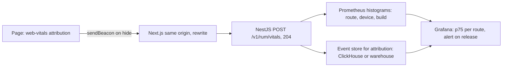

## 74.11 Measuring: Lighthouse, WebPageTest, real-user monitoring and performance budgets in CI

#### Concept

Performance work needs three kinds of measurement, each answering a different question (74.2):

- **Lab tools** reproduce one page load under controlled conditions so you can see *why* it is slow. **Lighthouse** (in Chrome DevTools, PageSpeed Insights, the CLI and Lighthouse CI) runs a scripted load on an emulated mobile device and reports metrics, a score and diagnostics. **WebPageTest** runs loads on real browsers and devices from chosen locations and connection profiles, with filmstrips, request waterfalls and scripted journeys. The **DevTools Performance panel** records a trace you can step through.
- **Real-user monitoring (RUM)** collects metrics from every real visit (`web-vitals`), and tells you *what users actually experienced*, by route, device, connection and release.
- **Performance budgets in CI** turn agreed numbers into failing checks, so a pull request that adds 120 KB of JavaScript or pushes lab LCP past a threshold is stopped before it ships.

Part 76.11 built the backend version of this loop: load tests and latency budgets in CI. This is the frontend version, and the two should report into the same dashboards.

#### Why does it exist?

Performance decays silently. Each change is small, nobody owns the total, and the people adding weight (a feature team, a marketing tag) are not the people who see the RUM dashboard. Teams that fix performance once without a measurement loop are back where they started within two or three quarters. The loop exists to make regressions visible within hours (RUM by build) or before merge (CI budgets), and to make every fix provable.

#### Mental model

Imagine managing your weight. The lab test is the doctor's full check-up: precise, explains causes, but once a year in a controlled setting. RUM is the bathroom scale every morning: less detail, but it tells you the truth about your normal life and catches the trend early. The budget is the rule "no dessert if the scale says more than X". You need all three; the check-up alone does not stop the slow drift.

#### How it works

**Lighthouse.** The default mobile run emulates a mid-range phone with 4x CPU slowdown and a slow 4G network (150 ms RTT, about 1.6 Mbps down) using **simulated throttling**: it loads the page quickly and models how long it would have taken on the slow profile. The performance score (Lighthouse 10 and later) weights five lab metrics: TBT 30%, LCP 25%, CLS 25%, FCP 10% and Speed Index 10%. Single runs vary by 5 to 10 points with network and machine noise, so CI runs three to five times and asserts on the median. Lighthouse 12.6 and 13 have been reorganising diagnostics into "insights" shared with the DevTools Performance panel; audit ids used in CI assertions can change between major versions, so pin the Lighthouse CI version.

**WebPageTest.** Choose a real device class (for example a mid-range Android phone), a location close to your users and a connection profile. Run first view and repeat view. The filmstrip shows what the user saw at each 100 ms; the waterfall shows connection reuse, priorities and chains. Scripted tests can log in or add to cart before measuring. It is the best tool when the question is "what does this look like from Mumbai on a real phone?"

**DevTools Performance panel and CrUX.** For diagnosis on your own machine, the Performance panel's live metrics view shows LCP, CLS and INP as you click through the page, and can show the page's CrUX field values next to your local ones, so you can see at a glance whether your local run is representative. Set CPU throttling to match a mid-range phone (recent Chrome versions can calibrate a throttling preset to your machine) and a network preset such as Slow 4G, then record. The insights sidebar breaks LCP into the four subparts (74.3) and INP into its three phases (74.4) for that recording, and names the LCP element and the slow interaction's handlers. For field numbers outside your own RUM, the **CrUX API** (`records:queryRecord` with an `origin` or `url` and a `formFactor`) returns p75 values and good, needs-improvement and poor shares for the last 28 days, and the CrUX History API returns weekly values for trend lines. Both are free with an API key and are the fastest way to see a competitor's or a new acquisition's field performance, or your own for browsers your RUM does not reach.

**RUM pipeline.**



Two storage needs: **histograms** for cheap, real-time p75 per route and device with alerts, and **raw events** with attribution for diagnosis ("which LCP element, which script"). Bucket boundaries at the "good" and "poor" thresholds (2,500 and 4,000 ms for LCP; 200 and 500 for INP; 0.1 and 0.25 for CLS) make the share of good experiences exact even though the p75 is interpolated.

**Budgets in CI.** Three kinds, each failing the build:

| Budget type | Example | Tool |
|---|---|---|
| Quantity | First-load JS for `/p/[slug]` ≤ 170 KB compressed; images on first view ≤ 300 KB | `size-limit` or a script over the build output; Lighthouse resource assertions |
| Lab timing | Median of 3 Lighthouse mobile runs: LCP ≤ 2,500 ms, TBT ≤ 200 ms, CLS ≤ 0.1 | Lighthouse CI against the preview deployment |
| Field timing | p75 mobile LCP per route for a new build ≤ 2.5 s and not worse than the previous build by > 10% | RUM alert after deploy (Part 76 turns this into a frontend SLO) |

#### Practical example

A team's measurement setup for its storefront: Lighthouse CI runs on every pull request against the preview deployment, testing three URLs (home, a top category, the top product) three times each; `size-limit` checks the product route's JavaScript; WebPageTest runs nightly from two locations on a real mid-range Android device to catch CDN and third-party regressions that CI cannot see; RUM alerts the owning team when a route's p75 mobile LCP or INP for the newest build crosses the threshold with at least 2,000 samples.

#### React / Next.js example

```js
// apps/web/lighthouserc.js  (Lighthouse CI; run with `lhci autorun` after the preview deploy)
module.exports = {
  ci: {
    collect: {
      url: [
        `${process.env.PREVIEW_URL}/`,
        `${process.env.PREVIEW_URL}/c/running-shoes`,
        `${process.env.PREVIEW_URL}/p/trail-runner-gtx`,
      ],
      numberOfRuns: 3,                                   // assertions use the median run; default mobile profile
    },
    assert: {
      assertions: {
        'largest-contentful-paint': ['error', { maxNumericValue: 2500 }],
        'total-blocking-time': ['error', { maxNumericValue: 200 }],
        'cumulative-layout-shift': ['error', { maxNumericValue: 0.1 }],
        'categories:performance': ['warn', { minScore: 0.85 }],   // the score is a hint, not the gate
      },
    },
    upload: { target: 'temporary-public-storage' },      // or an LHCI server for history
  },
};
```

```json
{
  "size-limit": [
    { "name": "product page client JS", "path": ".next/static/chunks/app/p/[slug]/*.js", "limit": "60 kB" },
    { "name": "shared framework JS", "path": ".next/static/chunks/{framework,main-app,webpack}-*.js", "limit": "110 kB" }
  ]
}
```

The `size-limit` entry lives in `apps/web/package.json`; `limit` is compressed size by default. Glob paths depend on the Next.js version's chunk naming, so check them after each Next.js upgrade.

#### Backend side (NestJS)

The RUM endpoint, validated with the shared contract and cheap enough to take every beacon:

```ts
// packages/contracts/src/rum.ts
import { z } from 'zod';
export const WebVitalReportSchema = z.object({
  name: z.enum(['LCP', 'INP', 'CLS', 'FCP', 'TTFB']),
  value: z.number().nonnegative().max(120_000),       // CLS arrives x1000 as an integer
  rating: z.enum(['good', 'needs-improvement', 'poor']),
  id: z.string().max(64),
  navigationType: z.string().max(32),
  route: z.string().max(80).regex(/^\/[\w\-\[\]\/]*$/), // route template, never a raw URL with query
  effectiveType: z.string().max(16).optional(),
  buildId: z.string().max(40),
  attribution: z.record(z.string(), z.union([z.string().max(200), z.number()])).optional(),
});
export type WebVitalReport = z.infer<typeof WebVitalReportSchema>;
```

```ts
// apps/api/src/rum/rum.controller.ts
import { Body, Controller, HttpCode, Post, Req } from '@nestjs/common';
import { Throttle } from '@nestjs/throttler';
import { Histogram } from 'prom-client';
import type { Request } from 'express';
import { WebVitalReportSchema, type WebVitalReport } from '@shop/contracts';
import { ZodValidationPipe } from '../common/zod-validation.pipe';
import { RumEventsProducer } from './rum-events.producer';

const vitals = new Histogram({
  name: 'web_vitals_value',
  help: 'Core Web Vitals from real users (ms; CLS x1000)',
  labelNames: ['metric', 'route', 'device'],            // no build label here: raw events carry it
  buckets: [100, 200, 250, 500, 800, 1000, 1800, 2500, 4000, 6000, 10000], // thresholds are edges
});

@Controller('v1/rum')
export class RumController {
  constructor(private readonly events: RumEventsProducer) {}

  @Post('vitals')
  @HttpCode(204)
  @Throttle({ default: { limit: 60, ttl: 60_000 } })     // per IP; a page sends about 5 beacons
  ingest(@Body(new ZodValidationPipe(WebVitalReportSchema)) r: WebVitalReport, @Req() req: Request) {
    const device = /Mobi|Android/i.test(req.get('user-agent') ?? '') ? 'mobile' : 'desktop'; // coarse on purpose
    vitals.labels(r.name, r.route, device).observe(r.value);
    this.events.enqueue({ ...r, device, receivedAt: Date.now() }); // buffered, batched to Kafka; never awaited
  }
}
```

Points that matter in production:

- **Content type**: `sendBeacon` with a plain string sends `text/plain`, which NestJS's JSON body parser ignores, leaving `@Body()` empty. Send a `Blob` typed `application/json` (same-origin, so no CORS preflight issue), as 74.1 does.
- **Cardinality**: labels are route templates and a device class, never URLs, user ids or build ids. Prometheus cost grows with every label combination; builds belong in the raw event store.
- **Never on the critical path**: respond 204 immediately; do the write asynchronously; drop under pressure rather than slowing down.
- **Abuse**: the endpoint is public and unauthenticated. Validate strictly, cap sizes, rate-limit, and treat RUM data as untrusted when computing anything important.
- **Query**: `histogram_quantile(0.75, sum by (le, route) (rate(web_vitals_value_bucket{metric="LCP",device="mobile"}[1h])))` gives p75 LCP per route.

#### Production scenario

A marketplace with 600 deploys a quarter added Lighthouse CI and a RUM release alert in the same sprint. In the following quarter, CI blocked 14 pull requests: nine for JavaScript size (mostly accidental client imports of server-only libraries), three for TBT and two for CLS. The RUM alert fired four times; two were real regressions CI could not catch (a third-party script update and a CDN configuration change), and two were mix shifts from campaigns, which the team learned to recognise by checking device and connection segments first. Mobile p75 LCP for the top routes stayed within 100 ms of target for the whole quarter, against a drift of about 600 ms in the previous one.

#### Failure scenario

Lighthouse CI was introduced with a single run per URL and a hard performance-score threshold of 90. Within a week, developers learned to click "re-run" until it passed: scores varied from 82 to 95 for identical code because the CI runners shared CPU with other jobs. Then they asked for the check to be made optional. The team restored trust by running three times and asserting on the median, asserting on metrics instead of the score, moving the runs to dedicated runners, and testing against the deployed preview through the CDN instead of a local `next start`. Flaky gates are worse than no gates, because they teach people to ignore red.

#### Edge cases & failure modes

- **Lab results depend on the runner**: CPU contention, region and whether the CDN cache is warm. Fix the environment and record it with the results.
- **Testing `next dev`** measures the development build, which is much larger and slower; always test a production build.
- **Logged-in pages** need a scripted login (Lighthouse CI puppeteer script, WebPageTest scripting) with a test account.
- **Ad blockers and privacy browsers** block RUM beacons; your field data under-represents those users.
- **Sampling**: on very high traffic, sample RUM (for example 10% of page views) but sample by page view, not by beacon, so all metrics of a page view arrive together.
- **Third-party regressions** happen without your deploy; only RUM and scheduled synthetic tests see them.
- **CrUX eligibility**: URLs and origins below a traffic threshold have no CrUX data at all, and new pages take weeks to appear. Your own RUM is the only field signal for them.
- **Clock and timing differences**: RUM values are relative to navigation start in the user's browser, so client clocks do not matter, but `receivedAt` on the server does for grouping by deploy time. Group by build id, not by arrival time.

#### How a Senior Full-Stack Engineer thinks about this

A senior builds the loop before the optimisation: RUM with attribution and a build id, a small set of lab tests on representative URLs, and budgets that fail the build. They choose few, stable assertions over many noisy ones, and they make the backend part of the same picture (`Server-Timing`, API p95 per route next to TTFB p75). They treat a budget breach like a failing test: fix it or record an explicit, time-limited exception, never quietly raise the limit.

#### Common mistakes

- **Gating on the Lighthouse score** instead of specific metrics and sizes.
- **Single Lighthouse runs** in CI, producing flaky results.
- **RUM without dimensions** (route, device, build), so a regression cannot be located.
- **Raw URLs as metric labels**, exploding cardinality and leaking personal data.
- **No owner for alerts**, so RUM regressions sit unread on a dashboard.

#### Interview questions

1. **What does the Lighthouse performance score measure, and why should you not gate on it alone?** Expected answer: a weighted blend of five lab metrics (TBT, LCP, CLS, FCP, Speed Index) on one emulated load; it varies between runs and does not represent field experience.
2. **How would you design a RUM pipeline for Core Web Vitals?** Expected answer: `web-vitals` with attribution, beacons on page hide, a cheap validated endpoint, histograms for p75 and alerts, raw events for attribution, low-cardinality dimensions including build id in the event store.
3. **What kinds of performance budgets exist and where is each enforced?** Expected answer: quantity (bytes, requests) and lab timing in CI; field timing as post-deploy alerts or SLOs.
4. **Why use WebPageTest when you have Lighthouse?** Expected answer: real devices and locations, filmstrips, repeat views, scripted journeys, connection-level detail.
5. **How do you keep lab performance tests from being flaky?** Expected answer: dedicated runners, multiple runs and medians, metric assertions, production builds, consistent CDN state.
6. **Your RUM says p75 LCP is 2.2 s but CrUX says 2.9 s. Which do you believe?** Expected answer: both may be right: CrUX is Chrome-only, opted-in users, 28 days, and includes users your beacons miss; RUM includes other browsers and only recent builds. Compare the same window, browser and form factor before concluding. Follow-up: which one does search use? (CrUX.)

#### Practical exercise

Build the measurement loop for your web app.

Acceptance criteria:

- RUM sends LCP, INP and CLS with attribution, route template, device and build id to a NestJS endpoint that validates with the shared schema and returns 204.
- A Grafana panel shows p75 per route for mobile and the share of "good" experiences, using bucket boundaries at the thresholds.
- Lighthouse CI runs three times per URL on the preview deployment with metric assertions, and `size-limit` checks the product route's JavaScript.
- A deliberately bloated pull request (add a 100 KB library to the product page) fails CI with a clear message.
