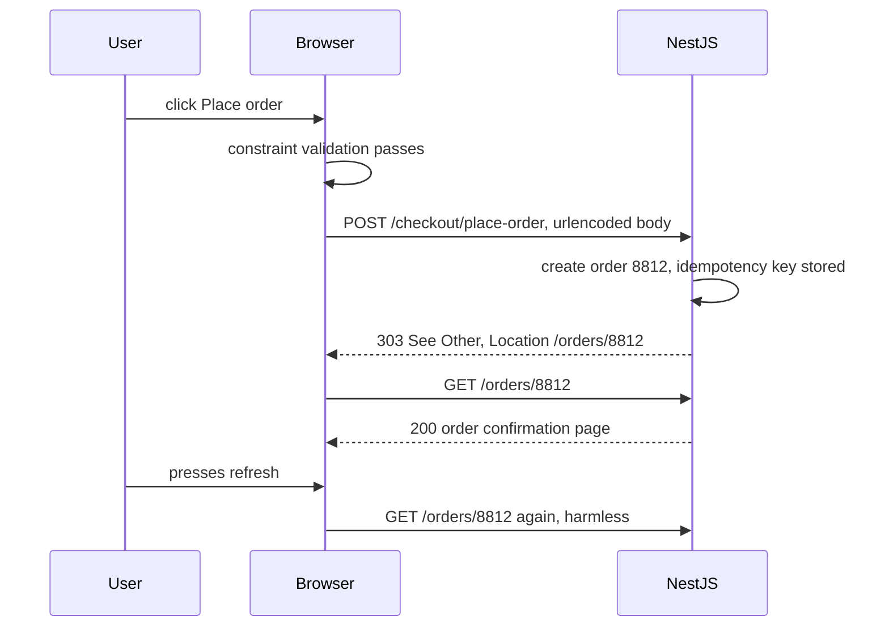

## 75.2 HTML that matters: semantic elements and forms

#### Concept

HTML is the structure of a page. Each element carries meaning, not just appearance. A `<button>` is something you press, an `<a href>` is something that navigates, a `<nav>` is a block of site navigation, an `<h1>` is the main heading, a `<form>` collects input and sends it to a server. Using the element that matches the meaning is called **semantic HTML**.

Semantic elements come with behaviour the browser provides for free: a `<button>` is focusable, activates on Enter and Space, and submits its form; an `<a href>` can be opened in a new tab, bookmarked and crawled; a `<label>` makes clicking its text focus the input; an `<input type="email">` brings up the right mobile keyboard and validates the format. A `<div onClick>` has none of that. You have to rebuild each behaviour in JavaScript, and in practice nobody rebuilds all of it.

Forms deserve special attention from backend engineers, because a plain HTML form is a fully working HTTP client. With zero JavaScript, a `<form method="post" action="/checkout/address">` builds a request body, sets a `Content-Type`, sends a `POST` and follows the response, including redirects. Many frontend bugs (double orders, lost input, the "Confirm Form Resubmission" dialog) come from not knowing what that default behaviour is.

#### Why does it exist?

Without semantics, a page is a pile of boxes that only humans with good eyesight and a mouse can use. Semantics let three other consumers understand the page:

1. **Assistive technology.** Screen readers build their interface from elements: "heading level 1, Ergonomic Office Chair", "button, Add to cart", "navigation landmark". See 75.9.
2. **The browser itself.** Keyboard navigation, form autofill, password managers, reader mode, translation and "open in new tab" all rely on real elements.
3. **Machines.** Search engine crawlers, link previews and price comparison bots read headings, links and structured data.

Forms exist because the web needed a way to send user input to servers long before JavaScript existed. That default behaviour is still there, under every React form, and it still fires unless you stop it.

#### Mental model

Imagine a building. Semantic HTML is the signage and the standard fittings: doors that look like doors and have handles, lifts with numbered buttons and Braille, fire exits marked as exits. A `<div>` styled to look like a button is a painting of a door on a wall. It looks right in a photo, but you cannot walk through it, a blind visitor cannot find it, and the fire marshal (the browser's accessibility and keyboard features) does not know it exists.

A form is a pre-printed envelope with the address already written on it. Fill in the fields, press submit, and the post office (the browser) delivers it with the correct stamp (`Content-Type`) to the address in `action`. If you want to deliver it yourself by courier (`fetch`), you must first stop the post office from also delivering it (`event.preventDefault()`).

#### How it works

**Semantic structure of a typical product page:**

```html
<body>
  <a class="skip-link" href="#main">Skip to content</a>
  <header>
    <nav aria-label="Primary">
      <ul><li><a href="/chairs">Chairs</a></li><li><a href="/desks">Desks</a></li></ul>
    </nav>
  </header>
  <main id="main">
    <article>
      <h1>Ergonomic Office Chair</h1>
      <p><data value="1249900">Rs 12,499</data></p>
      <form method="post" action="/cart/items">
        <input type="hidden" name="sku" value="CHR-ERG-001">
        <label for="qty">Quantity</label>
        <input id="qty" name="qty" type="number" min="1" max="10" value="1" inputmode="numeric">
        <button type="submit">Add to cart</button>
      </form>
      <section aria-labelledby="reviews-h"><h2 id="reviews-h">Reviews</h2></section>
    </article>
  </main>
  <footer>...</footer>
</body>
```

Each landmark (`header`, `nav`, `main`, `footer`) shows up in a screen reader's landmark list. Headings form an outline (`h1` then `h2`, no skipped levels) that users jump through. The "Add to cart" form works even if JavaScript fails to load.

**What a form submission does, step by step:**

1. **Triggering.** A submit happens when the user clicks a submit button, presses Enter in a single-line text input while the form has a submit button (this is called **implicit submission**), or JavaScript calls `form.requestSubmit()`. A `<button>` inside a form with no `type` attribute is `type="submit"` by default. This single rule causes many accidental submits: a "Show password" or "Apply coupon" button with no `type` submits the whole checkout form.
2. **Validation.** Unless the form has `novalidate`, the browser checks constraints: `required`, `type="email"`, `min`, `max`, `minlength`, `maxlength`, `pattern`. If anything fails, it shows a native message, focuses the first invalid field, and does not send anything. This is a convenience for users, never a security control; anyone can send a request with `curl`.
3. **The `submit` event** fires. Calling `event.preventDefault()` here stops the browser's own submission. Every single-page app does this and then calls `fetch`.
4. **Building the body.** The browser collects every **successful control**: enabled, has a `name`, and (for checkboxes and radios) is checked. Disabled fields are not sent. An unchecked checkbox sends nothing at all, not `false`. A `readonly` field *is* sent.
5. **Encoding.** With `method="get"` the fields become the query string: `/search?q=chair&sort=price`. With `method="post"` the body is encoded per `enctype`: the default `application/x-www-form-urlencoded` (`sku=CHR-ERG-001&qty=2`), `multipart/form-data` for file uploads (required for `<input type="file">`), or `text/plain` (rarely useful).
6. **Navigation.** The browser sends the request as a navigation and renders whatever comes back. If the server answers with a redirect, the browser follows it.
7. **Refresh behaviour.** If the response to a `POST` is a page (200), pressing refresh offers to re-send the `POST`, the classic "Confirm Form Resubmission" dialog. That is how duplicate orders happen. The fix is **Post/Redirect/Get (PRG)**: answer the `POST` with `303 See Other` pointing at a result page, so refresh only repeats the harmless `GET`.



**Attributes that make forms usable and correct:**

| Attribute | Example | What it does |
|---|---|---|
| `autocomplete` | `autocomplete="email"`, `"postal-code"`, `"cc-number"`, `"one-time-code"` | Lets the browser and password managers fill fields correctly; `one-time-code` enables SMS code autofill on phones |
| `inputmode` | `inputmode="numeric"` | Shows a numeric keypad without the quirks of `type="number"` (spinners, scroll-to-change) |
| `type` | `email`, `tel`, `url`, `date`, `search` | Right keyboard on mobile plus basic validation |
| `name` | `name="shipping.postalCode"` | The key in the submitted body; no `name` means not submitted |
| `required`, `pattern`, `min`, `max` | `pattern="[1-9][0-9]{5}"` | Native validation; mirror server-side rules, never replace them |
| `enctype` | `multipart/form-data` | Required to upload files |
| `formaction`, `formmethod` | on a second submit button | One form, two actions (for example "Save draft" versus "Submit") |

#### Practical example

A checkout address step has an "Apply coupon" button and a "Continue to payment" button in the same form. A developer wired the coupon button with an `onClick` handler and no `type`. In production, every click on "Apply coupon" applied the coupon *and* submitted the form, moving the user to payment with half-filled address fields. The backend saw a burst of `400 Bad Request` responses for missing `postalCode`. The fix was one attribute: `<button type="button">`. The backend fix was to return field-level errors (75.9) so the page could show what was missing instead of a generic toast.

#### React / Next.js example

In a React single-page form, you control submission yourself, but you still use the native form so that Enter submits, the browser validates, and password managers recognise the fields. React 18's `useId` creates stable ids for label and error association, even with server rendering.

```tsx
// AddressForm.tsx  (React 18)
import { useId, useState, type FormEvent } from 'react';

type FieldErrors = Partial<Record<'fullName' | 'postalCode', string>>;

export function AddressForm({ onSaved }: { onSaved: (addressId: string) => void }) {
  const id = useId();
  const [errors, setErrors] = useState<FieldErrors>({});
  const [submitting, setSubmitting] = useState(false);

  async function handleSubmit(e: FormEvent<HTMLFormElement>) {
    e.preventDefault();                      // stop the browser's own POST navigation
    if (submitting) return;                  // ignore a second Enter or double click
    setSubmitting(true);
    const body = Object.fromEntries(new FormData(e.currentTarget)); // only named, enabled fields
    try {
      const res = await fetch('/api/v1/addresses', {
        method: 'POST',
        headers: { 'Content-Type': 'application/json' },
        body: JSON.stringify(body),
      });
      if (res.status === 422) { setErrors((await res.json()).fieldErrors); return; }
      if (!res.ok) throw new Error(`HTTP ${res.status}`);
      onSaved((await res.json()).id);
    } finally {
      setSubmitting(false);
    }
  }

  return (
    <form onSubmit={handleSubmit}>
      <label htmlFor={`${id}-name`}>Full name</label>
      <input id={`${id}-name`} name="fullName" autoComplete="name" required
             aria-invalid={!!errors.fullName} aria-describedby={`${id}-name-err`} />
      <p id={`${id}-name-err`}>{errors.fullName}</p>

      <label htmlFor={`${id}-pin`}>PIN code</label>
      <input id={`${id}-pin`} name="postalCode" autoComplete="postal-code" inputMode="numeric"
             pattern="[1-9][0-9]{5}" required aria-invalid={!!errors.postalCode}
             aria-describedby={`${id}-pin-err`} />
      <p id={`${id}-pin-err`}>{errors.postalCode}</p>

      <button type="button" onClick={() => alert('coupon')}>Apply coupon</button>
      <button type="submit" disabled={submitting}>Continue to payment</button>
    </form>
  );
}
```

With the Next.js 14 App Router, you can go further and let the form work without client JavaScript using a **Server Action**: `<form action={saveAddress}>` where `saveAddress` is an async function marked `'use server'`. The browser submits a real `POST`; after hydration, React intercepts it and sends it with `fetch` instead. Next.js 14 bundles a React canary build that also exports `useFormStatus` from `react-dom` for a pending state; in plain React 18 that hook does not exist (it is stable in React 19).

#### Backend side (NestJS)

A NestJS API used by HTML forms must accept form encodings, not just JSON. By default `NestFactory.create()` with the Express adapter registers both a JSON and a URL-encoded body parser, so `application/x-www-form-urlencoded` bodies arrive in `@Body()`. Every value arrives as a string, so the DTO must transform types.

```ts
// checkout.controller.ts
import { Body, Controller, Headers, Post, Res, UsePipes, ValidationPipe } from '@nestjs/common';
import type { Response } from 'express';
import { Type } from 'class-transformer';
import { IsInt, IsString, Matches, Max, Min } from 'class-validator';
import { CheckoutService } from './checkout.service';

export class PlaceOrderForm {
  @IsString() @Matches(/^[A-Z0-9-]{3,32}$/) sku!: string;
  @Type(() => Number) @IsInt() @Min(1) @Max(10) qty!: number;  // form fields are strings: "2" -> 2
  @IsString() @Matches(/^[0-9a-f-]{36}$/) idempotencyKey!: string; // hidden input rendered with the page
}

@Controller('checkout')
export class CheckoutController {
  constructor(private readonly checkout: CheckoutService) {}

  @Post('place-order')
  @UsePipes(new ValidationPipe({ transform: true, whitelist: true }))
  async placeOrder(
    @Body() form: PlaceOrderForm,
    @Headers('accept') accept: string | undefined,
    @Res() res: Response,
  ): Promise<void> {
    // The hidden idempotency key turns a double submit into a replay of the same order.
    const order = await this.checkout.placeOrder(form, form.idempotencyKey);

    if (accept?.includes('application/json')) {
      res.status(201).json({ id: order.id, status: order.status }); // fetch() callers
      return;
    }
    // Plain HTML form: Post/Redirect/Get. 303 forces the follow-up to be a GET.
    res.redirect(303, `/orders/${order.id}`);
  }
}
```

The points that make the frontend correct:

- **Return 303, not 302, after a form `POST`.** Browsers historically turn 302 into a `GET` anyway, but 303 states it explicitly and is the documented status for PRG.
- **Accept the idempotency key as a field.** Render a fresh UUID into a hidden input when the page is generated. A double click, a refresh or a retry then reuses the key, and the service returns the original order instead of creating a second one (see Part 18 — API Design (REST first), 18.12 Idempotency, for the storage side).
- **Expect strings and missing fields.** An unchecked checkbox is simply absent, so `@IsOptional()` plus a default of `false` is correct; `@IsBoolean()` on a form field will always fail, because the value is the string `"on"`.
- **Return field-level errors with status 422** (or 400) so the page can attach each message to its input.
- **Set a body size limit.** `multipart/form-data` uploads should go through a dedicated interceptor with explicit limits (see Part 36 — File Storage and Uploads), not the global parser.

#### Production scenario

A grocery-delivery site processes about 40,000 orders per day. Their analytics showed 0.6 % of orders were exact duplicates placed within 10 seconds of each other, about 240 per day, each one needing a manual refund and an apologetic support ticket. Session replays showed three causes: users double-tapping "Place order" on slow 3G, users pressing Enter twice, and users refreshing the confirmation page that was rendered directly in the `POST` response.

The fix was layered. Frontend: disable the button on submit and ignore re-entry. HTML: switch to PRG with a 303 redirect. Backend: require an idempotency key from a hidden field and enforce a unique constraint on `(customer_id, idempotency_key)`. Duplicates fell to under 5 per day, all from users genuinely ordering twice.

#### Failure scenario

A team rebuilt their login page as a polished React component. Inputs were custom `<div contenteditable>` elements styled beautifully, and the "Sign in" control was a `<div role="button" onClick>`. Within a week, support tickets doubled. Password managers no longer filled credentials because there was no `<input type="password">` and no `<form>`. Pressing Enter did nothing. iOS users could not paste their password. Screen reader users heard "group" with no name.

The backend team noticed first, oddly: login attempts per successful login went from 1.3 to 2.6, and password reset requests tripled, because users who relied on password managers could not remember their passwords. The rollback restored a plain `<form>` with `<input type="email" autocomplete="username">` and `<input type="password" autocomplete="current-password">`, and the numbers recovered the same day.

#### Edge cases & failure modes

- **Button default type**: any `<button>` inside a `<form>` without `type="button"` submits it.
- **Disabled versus readonly**: disabled fields are excluded from the body; a disabled "price" field is not sent, a readonly one is (and must never be trusted).
- **Checkbox absence**: unchecked boxes send nothing; the server must treat "missing" as "false".
- **Multiple values**: `<select multiple>` or several checkboxes with the same `name` send repeated keys (`tag=a&tag=b`); `Object.fromEntries(formData)` keeps only the last one, so use `formData.getAll('tag')`.
- **GET forms leak data**: a search form with `method="get"` puts every field in the URL, server logs, browser history and the `Referer` header. Never use GET for anything sensitive.
- **Back-forward cache**: pressing Back can restore a form page from the back-forward cache with the previous values, including a "submitting" spinner that never stops if your state assumed a fresh load.

#### How a Senior Full-Stack Engineer thinks about this

A senior reaches for the native element first and asks "what does the browser already do here?" before writing any handler. They see a `<form>` as an HTTP client with well-defined behaviour and design the endpoint to support it: accept form encoding, validate strings, return 303 after writes, expect retries.

They view double submission as a backend problem with a frontend helper, not the other way round. Disabling the button reduces duplicates, but only an idempotency key and a unique constraint eliminate them, because the network can always retry. To a product manager: "We can make the button harder to press twice, but only the server can guarantee one click equals one order."

They also insist that a page's core action works with the network flaky and JavaScript late: a server-rendered form that posts and redirects is the most robust checkout you can build, and frameworks like Next.js Server Actions exist precisely to keep that robustness while adding a nicer client experience.

#### Common mistakes

- **Using `<div onClick>` instead of `<button>`.** You lose keyboard support, focus, form submission and the accessible role.
- **Using `<button>` for navigation or `<a href="#">` for actions.** Links navigate, buttons act; mixing them breaks middle-click, history and screen reader expectations.
- **Forgetting `event.preventDefault()`.** The page navigates away and the `fetch` is cancelled, so the API sees an aborted request or nothing at all.
- **Rendering a page directly in response to a POST.** Refresh then re-submits; use PRG.
- **Trusting hidden or readonly fields.** A hidden `price` field is a field the user can change with DevTools in five seconds.
- **Removing `name` or `autocomplete` from inputs** in a redesign, breaking autofill and password managers.

#### Interview questions

1. **What does a plain HTML form do on submit, without JavaScript?**
   Expected answer: runs constraint validation, collects successful controls, encodes them per method and `enctype`, sends a navigation request to `action`, follows redirects and renders the response. Follow-up: which controls are left out? (Disabled, unnamed, unchecked.)
2. **Why use 303 after a form POST?**
   Expected answer: Post/Redirect/Get, so refreshing repeats only a GET and cannot re-submit the order. Follow-up: what else protects against duplicates? (Idempotency key with a unique constraint.)
3. **Why is `<button>` better than a styled `<div>`?** Expected answer: focusable, keyboard activation, form submission, accessible role and name, all built in.
4. **A user reports the checkout jumps to payment when they apply a coupon. What do you suspect?** Expected answer: a button inside the form with no `type`, defaulting to submit.
5. **How does a NestJS endpoint receive a form-encoded body and what types does it get?** Expected answer: Express's URL-encoded parser fills `@Body()`; all values are strings, so the DTO must use `@Type(() => Number)` or similar with `transform: true`.
6. **When is `method="get"` the right choice for a form?** Expected answer: for safe, bookmarkable queries like search and filters; never for writes or sensitive data.

#### Practical exercise

Build an order "Place order" flow that works with JavaScript disabled. A NestJS endpoint renders a page with a form containing a hidden idempotency key. The `POST` handler validates a form-encoded body, creates the order idempotently and answers with a 303 to the confirmation page. Then add a React enhancement that intercepts the submit, sends JSON, and disables the button while pending.

Acceptance criteria:

- With JavaScript disabled in DevTools (Command Menu, "Disable JavaScript"), the order can be placed and refreshing the confirmation page does not create a second order.
- Double-clicking the button with JavaScript enabled creates exactly one order row in PostgreSQL.
- Sending the same request twice with `curl` and the same idempotency key returns the same order id.
- The coupon button does not submit the form.

