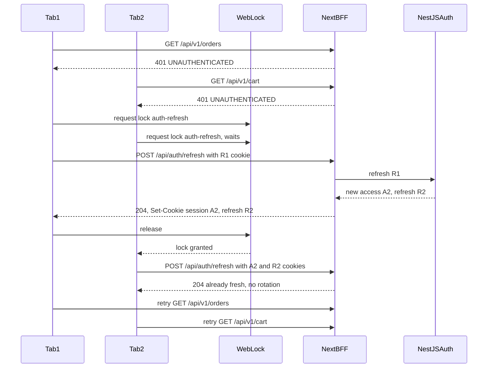

## 75.3 Access and refresh tokens in a browser app: silent refresh, rotation, reuse detection, logout everywhere

#### Concept

Part 40.3 built the server half: a short-lived access token (a JWT, 10 to 15 minutes), a long-lived opaque refresh token stored hashed in PostgreSQL, rotation on every use, and **reuse detection** that revokes the whole token *family* when an already-used refresh token is presented again. This section is the browser half, which is where those mechanics meet tabs, sleeping laptops, parallel requests and users who expect "Log out" to mean everywhere.

Four browser-side jobs:

1. **Silent refresh**: getting a new access token before or when the old one expires, without the user noticing.
2. **Single-flight**: making sure one expiry produces one refresh, not one per request or per tab.
3. **Reacting to reuse detection**: when the server revokes a family, every tab must log out cleanly instead of looping.
4. **Logout and logout everywhere**: ending this tab, every tab on this device, and every device, each with a known delay.

#### Why does it exist?

Short access tokens limit the damage of a stolen token (40.3) and let the web tier verify locally without calling the auth service (73.9). The price is that every user's token expires four times an hour. If the app handles that badly, users see random logouts, half-saved forms and "Something went wrong" toasts at 15-minute intervals. Rotation adds a second failure mode: two requests refreshing with the same refresh token look exactly like an attacker replaying a stolen one, and reuse detection will log the user out on every device. The browser is where both problems are caused, so it is where most of the fix lives.

#### Mental model

Imagine a building where your day pass expires every 15 minutes and you renew it at a machine using a renewal card. Each renewal swallows the card and prints a new one. If the machine ever sees a card it already swallowed, it assumes the card was copied and cancels every card you own.

Now imagine you arrive with four colleagues who all hold photocopies of your renewal card (four tabs), and your pass expires while you are all in the lift (a laptop waking from sleep). If all five of you rush the machine at once, the second person's card is "already swallowed" and everyone is locked out. The fix is simple: one person renews and tells the others (single-flight and broadcast), and the machine forgives a second identical card within a few seconds (a grace window).

#### How it works

In the BFF design used by this volume, the browser holds two `HttpOnly` cookies (75.2): `__Host-session` (the access JWT, 15 minutes) and `__Secure-refresh` (opaque, 14 days, sent only to `/api/auth`). There are two places a refresh can start:

- **On navigation**: middleware sees no valid session cookie but a request that may have a refresh cookie, and redirects to `GET /api/auth/refresh?next=/orders`. The handler rotates the tokens, sets both cookies and redirects back with `303`. One extra round trip, at most once per 15 minutes per user.
- **On a client-side API call**: a `fetch('/api/v1/...')` through `rewrites` returns `401 UNAUTHENTICATED`. The client calls `POST /api/auth/refresh` once, then retries the original request once.

Middleware cannot refresh inline and hand the new token to server components without extra plumbing, because server components cannot set cookies (75.2); the redirect keeps one place responsible for rotation. 75.10 shows both paths end to end. The client-side path, with single-flight across tabs:



Step by step:

1. **Classify the 401.** Only `UNAUTHENTICATED` (expired or missing access token) triggers a refresh. `FORBIDDEN` is a 403 and never refreshes; `REFRESH_REUSED` and `SESSION_REVOKED` go straight to logout (74.6's classifier sends 401s to the `reauth` treatment).
2. **Single-flight inside the tab.** A module-level promise means ten concurrent 401s in one tab share one refresh.
3. **Single-flight across tabs.** The **Web Locks API** (`navigator.locks.request(name, callback)`) grants a named lock to one tab at a time on the same origin. Tab 2 waits while Tab 1 refreshes. When Tab 2 gets the lock, the browser already holds the new cookies, so its refresh request carries a valid access token, and the handler answers "already fresh" without rotating. No second use of R1 ever reaches the server.
4. **Retry once.** The original request is retried exactly once. A second 401 means the session is really gone.
5. **Broadcast the outcome.** A **`BroadcastChannel`** named `auth` tells every tab "refreshed" or "logged out", so idle tabs update their UI without waiting for their own failed request.

Proactive versus reactive refresh:

| Approach | How | Strength | Weakness |
|---|---|---|---|
| Reactive (on 401) | Refresh when a request fails, retry once | Simple; no timers; works after sleep | First request after expiry pays one extra round trip |
| Proactive timer | Refresh at 80 % of lifetime | No visible delay | Background tabs throttle timers (Chrome runs them at most once a minute after 5 minutes hidden); laptops sleep through them; every open tab refreshes |
| On `visibilitychange` | Check when the tab becomes visible | Catches wake from sleep | Still needs the reactive path |
| On navigation (middleware redirect) | Refresh before rendering a protected page | Server-rendered pages never see an expired token | One redirect per expiry |

The pragmatic combination is **reactive plus navigation**, with an optional check on `visibilitychange`. Timers alone are not reliable in browsers.

**Reuse detection, from the user's side.** When NestJS sees a used refresh token outside its grace window, it revokes the family and returns `401 REFRESH_REUSED`. The BFF clears both cookies, and the client broadcasts "logged out" and navigates to `/login?reason=security`. The login page explains: "For your security, please sign in again." Without that copy, users file bugs.

**Logout everywhere** has three reach levels with different delays:

| Scope | Mechanism | Delay |
|---|---|---|
| This tab | Clear cookies, clear TanStack Query cache, navigate | Immediate |
| Other tabs, same browser | Cookies are shared, so they are already gone; `BroadcastChannel` updates their UI | Immediate |
| Other devices | Revoke all refresh families; bump a per-user **auth epoch** in Redis that NestJS checks on every request | Next API call, typically seconds; the web tier's local JWT check still passes for up to 15 minutes, but every data call fails |

The epoch is a timestamp (`auth:epoch:<userId>`). Any access token whose `iat` is older than the epoch is rejected. One Redis `GET` per request (0.2 to 0.5 ms) turns "logged out within 15 minutes" into "logged out on the next call". Many teams apply it only to cookie-authenticated browser routes and sensitive endpoints, and accept the 15-minute window elsewhere.

#### Practical example

A food delivery customer has the app open in three tabs (menu, cart, order tracking) and closes the laptop at 13:00. At 13:50 she opens it. The order tracking tab's SSE connection reconnects (72.8), the cart tab refetches on window focus (72.3), and the menu tab prefetches two links. That is five requests within 200 ms, all with an access token that expired at 13:15.

With single-flight across tabs: five 401s, one lock, one rotation, four "already fresh" answers, five successful retries. Total delay about 40 ms on top of each request. Without it: three tabs each refresh with R1, the server rotates for the first, the next two arrive inside the grace window (below) and get the same R2 back. Without the grace window either: reuse detection fires and she is logged out on her phone too.

#### React / Next.js example

The fetch wrapper that every `apiGet` and `apiSend` call (72.2, 72.4) goes through:

```ts
// apps/web/src/api/auth-fetch.ts
import { toApiError } from './errors';

const channel = typeof BroadcastChannel !== 'undefined' ? new BroadcastChannel('auth') : null;
let inFlight: Promise<boolean> | null = null;                 // single-flight inside this tab

async function doRefresh(): Promise<boolean> {
  const res = await fetch('/api/auth/refresh', { method: 'POST', credentials: 'include', cache: 'no-store' });
  if (res.ok) { channel?.postMessage({ type: 'refreshed' }); return true; }
  const err = await toApiError(res);
  channel?.postMessage({ type: 'logged-out', reason: err.code }); // REFRESH_REUSED, SESSION_EXPIRED, ...
  return false;
}

export function refreshOnce(): Promise<boolean> {
  inFlight ??= (navigator.locks
    ? navigator.locks.request('auth-refresh', doRefresh)       // single-flight across tabs of this origin
    : doRefresh()
  ).finally(() => { inFlight = null; });
  return inFlight;
}

export async function authFetch(input: string, init: RequestInit = {}): Promise<Response> {
  const res = await fetch(input, { ...init, credentials: 'include' });
  if (res.status !== 401) return res;
  const code = res.headers.get('X-Auth-Error');                // exposed by NestJS on 401s, see below
  if (code !== 'UNAUTHENTICATED') return res;                  // revoked or reused: let the caller log out
  if (!(await refreshOnce())) return res;
  return fetch(input, { ...init, credentials: 'include' });   // retry exactly once; a body must be re-sendable
}
```

`init.body` must be a string or another re-readable value for the retry to work; a `ReadableStream` body cannot be sent twice, so upload code (74.8) refreshes *before* starting rather than retrying after. Mutations retried here keep their `Idempotency-Key` header (72.6), so a request that actually reached the server before the 401 cannot create a duplicate.

Every tab listens for the broadcast:

```tsx
// apps/web/src/auth/AuthBroadcastListener.tsx
'use client';
import { useEffect } from 'react';
import { useRouter } from 'next/navigation';
import { useQueryClient } from '@tanstack/react-query';

export function AuthBroadcastListener() {
  const router = useRouter();
  const queryClient = useQueryClient();
  useEffect(() => {
    const channel = new BroadcastChannel('auth');
    channel.onmessage = (e: MessageEvent<{ type: string; reason?: string }>) => {
      if (e.data.type === 'logged-out') {
        queryClient.clear();                                   // no other user's data survives in memory
        router.replace(`/login?reason=${encodeURIComponent(e.data.reason ?? 'signed-out')}`);
      }
      if (e.data.type === 'refreshed') void queryClient.invalidateQueries({ queryKey: ['me'] });
    };
    return () => channel.close();
  }, [router, queryClient]);
  return null;
}
```

Mount it once in the root layout's client providers. `BroadcastChannel` does not deliver a message to the tab that posted it, so the tab that initiated logout handles its own navigation.

#### Backend side (NestJS)

Three API-side pieces make the browser logic safe: a machine-readable reason on every 401, a grace window for concurrent rotation, and the auth epoch.

```ts
// apps/api/src/auth/refresh.service.ts  (the parts 82.3 did not show)
import { Injectable, UnauthorizedException } from '@nestjs/common';
import { InjectRedis } from '@nestjs-modules/ioredis';
import type Redis from 'ioredis';
import { TokenStore } from './token.store';                     // 22.3's refresh_tokens repository
import type { TokenPair } from './types';

const GRACE_SEC = 20;

@Injectable()
export class RefreshService {
  constructor(private readonly store: TokenStore, @InjectRedis() private readonly redis: Redis) {}

  async rotate(rawRefresh: string): Promise<TokenPair> {
    const hash = this.store.hash(rawRefresh);
    const graceKey = `refresh:grace:${hash}`;
    const cached = await this.redis.get(graceKey);             // a sibling request rotated this token moments ago
    if (cached) return JSON.parse(cached) as TokenPair;

    const row = await this.store.findByHash(hash);
    if (!row || row.revokedAt || row.expiresAt < new Date()) throw this.unauth('SESSION_EXPIRED');
    const claimed = await this.store.markUsedIfUnused(row.id); // UPDATE ... WHERE id = $1 AND used_at IS NULL
    if (!claimed) {                                            // used before, and outside the grace window
      await this.store.revokeFamily(row.familyId);
      throw this.unauth('REFRESH_REUSED');
    }
    const pair = await this.store.issueChild(row);             // new access JWT plus new refresh in the same family
    await this.redis.set(graceKey, JSON.stringify(pair), 'EX', GRACE_SEC);
    return pair;
  }

  async logoutEverywhere(userId: string): Promise<void> {
    await this.store.revokeAllForUser(userId);                 // UPDATE refresh_tokens SET revoked_at = now() ...
    await this.redis.set(`auth:epoch:${userId}`, Math.floor(Date.now() / 1000), 'EX', 60 * 60);
  }

  private unauth(code: string) {
    return new UnauthorizedException({ code, title: 'Not signed in', status: 401 });
  }
}
```

The grace cache holds a live token pair in Redis for 20 seconds, keyed by the hash of the token it replaced. That is a deliberate tradeoff: a Redis compromise during those 20 seconds exposes freshly issued tokens, in exchange for not logging users out when their own tabs race. Encrypt the cached value with a key from your secrets manager if Redis is shared with other services. The epoch key expires after one hour because any access token issued before the bump is dead by then anyway (15-minute lifetime).

The guard that enforces the epoch and labels every 401:

```ts
// apps/api/src/auth/jwt-auth.guard.ts
import { ExecutionContext, Injectable, UnauthorizedException } from '@nestjs/common';
import { AuthGuard } from '@nestjs/passport';
import { InjectRedis } from '@nestjs-modules/ioredis';
import type Redis from 'ioredis';
import type { Response } from 'express';

@Injectable()
export class JwtAuthGuard extends AuthGuard('jwt') {
  constructor(@InjectRedis() private readonly redis: Redis) { super(); }

  async canActivate(ctx: ExecutionContext): Promise<boolean> {
    const res = ctx.switchToHttp().getResponse<Response>();
    try {
      await super.canActivate(ctx);                           // signature, exp, iss, aud via JwtStrategy
    } catch {
      res.setHeader('X-Auth-Error', 'UNAUTHENTICATED');        // the browser may refresh and retry
      throw new UnauthorizedException({ code: 'UNAUTHENTICATED', title: 'Not signed in', status: 401 });
    }
    const user = ctx.switchToHttp().getRequest().user as { id: string; issuedAt: number };
    const epoch = Number(await this.redis.get(`auth:epoch:${user.id}`)) || 0;
    if (user.issuedAt < epoch) {
      res.setHeader('X-Auth-Error', 'SESSION_REVOKED');        // do not refresh: the family is gone
      throw new UnauthorizedException({ code: 'SESSION_REVOKED', title: 'Signed out', status: 401 });
    }
    return true;
  }
}
```

`@nestjs-modules/ioredis` is a community module; if you use another Redis provider, inject its client the same way. The response body already carries `code` in the problem document (74.6); the header exists because `authFetch` must decide before reading the body, and a body can be read only once. If the API is ever called cross-origin, list `X-Auth-Error` in CORS `exposedHeaders`.

#### Production scenario

A grocery app with 60,000 concurrent web sessions at the evening peak and 15-minute access tokens performs about 67 refreshes per second (60,000 / 900). Each refresh is a unique-index probe, a conditional `UPDATE` and an `INSERT` in PostgreSQL (about 4 ms p50, 11 ms p99) plus two Redis calls. After adding cross-tab single-flight, refresh traffic fell 38 %, because users averaged 1.7 open tabs and each tab had been refreshing separately. False reuse detections, measured as families revoked within 20 seconds of a legitimate rotation, fell from 1,900 per day to 12, almost all from users with clock-skewed devices replaying very old tabs.

#### Failure scenario

At 07:30 every weekday for two weeks, support saw a wave of "I keep getting logged out on my phone" tickets, about 3 % of morning users. The web team had just enabled viewport prefetching for order links on the home page. On waking a laptop, the home page's `<Link>` components prefetched up to 12 order pages at once. Each prefetch hit middleware with an expired session cookie, each was redirected to `GET /api/auth/refresh`, and the browser followed all 12 redirects concurrently with the same refresh cookie. The first rotated; the other eleven presented a used token. There was no grace window, so the auth service revoked the family. The user's phone, signed in through the same family since a "continue on web" link, was logged out too.

Three fixes shipped: the 20-second grace window above; the refresh handler skipping rotation when the incoming access token still has more than 60 seconds left; and middleware answering prefetch requests (identified by the `Next-Router-Prefetch` request header) with `204` instead of a refresh redirect, so only real navigations trigger rotation. False revocations stopped the next morning.

#### Edge cases & failure modes

- **Request bodies that cannot be replayed** (streams, `FormData` from a large file input) must refresh first, not retry after.
- **Refresh during a long form**: a 20-minute checkout form submitted after expiry must refresh and retry transparently, with the idempotency key preserved, or the user loses their input.
- **Clock skew on the client** does not matter for cookie-held tokens, because the browser never inspects `exp`; it matters for SPAs that schedule refresh from a decoded JWT.
- **Offline and flaky networks**: a refresh that times out is not a logout. Treat network errors as "retry later", and only an explicit `401` from the refresh endpoint as signed out.
- **Safari private browsing and old browsers** lack `BroadcastChannel` or Web Locks in some versions; the code falls back to per-tab behaviour, and the grace window covers the race.
- **Refresh loops**: if the refresh handler itself is matched by middleware and redirected to refresh, the browser loops until it gives up. Exclude `/api/auth` from the matcher.
- **"Remember me" off**: issue a refresh cookie with no `Max-Age`, so it dies with the browser session, and a family with a short absolute lifetime (12 hours).
- **Absolute lifetime**: rotation must not extend a family forever; enforce a 30-day maximum from the original login and force re-authentication after it.

#### How a Senior Full-Stack Engineer thinks about this

The senior designs refresh as a concurrency problem first and a security feature second, because the bugs users feel are races. They want one owner for rotation (the BFF's refresh handler), one owner for the decision to refresh (the fetch wrapper and the navigation redirect), machine-readable reasons on every 401, and a grace window sized to the real race (seconds, not minutes). They make "logout everywhere" a product promise with a stated delay, and they buy a shorter delay with the epoch check where the data is sensitive. They measure: refreshes per second, rotations served from grace, families revoked by reuse, and logouts per session hour. A sudden rise in reuse revocations after a frontend deploy is a race the deploy introduced, not an attack.

#### Common mistakes

- **Refreshing on every 401**, including 403s and revoked sessions, which creates refresh loops.
- **No single-flight**, so ten parallel requests produce ten rotations and a reuse alarm.
- **Relying on `setTimeout` for proactive refresh** in background tabs and sleeping laptops.
- **No grace window** on rotation, turning ordinary tab races into "logged out on every device".
- **Logout that clears cookies but not the client cache**, leaving the previous user's orders in memory for the next person at a shared computer.
- **Calling "logout everywhere" done** after revoking refresh tokens, while access tokens stay valid for 15 more minutes on every API.

#### Interview questions

1. **How do you prevent multiple tabs from racing on refresh-token rotation?** Expected answer: single-flight per tab with a shared promise, across tabs with the Web Locks API, an "already fresh" short circuit on the server, and a short grace window that returns the same child pair. Follow-up: what does the server see without these? (Reuse of a rotated token, which looks like theft.)
2. **What is refresh token reuse detection, and how can it hurt legitimate users?** Expected answer: a used token presented again revokes the family; concurrent legitimate refreshes trigger it unless the client serialises and the server allows grace.
3. **How long after "log out everywhere" can a stolen access token still be used, and how do you shorten it?** Expected answer: up to its lifetime (15 minutes); an epoch or denylist check in the API makes it immediate, at the cost of a Redis read per request.
4. **Proactive or reactive refresh in a browser?** Expected answer: reactive on 401 plus refresh on navigation, optionally on `visibilitychange`; timers are throttled in background tabs and stop during sleep.
5. **Why does the 401 need a machine-readable reason?** Expected answer: the client must distinguish "expired, refresh" from "revoked, log out" without guessing, or it loops or logs users out unnecessarily.
6. **How do you make a mutation safe to retry after a refresh?** Expected answer: idempotency key reused on the retry, re-sendable body, retry once only.

#### Practical exercise

Implement `authFetch`, `AuthBroadcastListener`, the grace window and the epoch check.

Acceptance criteria:

- With three tabs open and the access cookie deleted in DevTools, triggering a refetch in all three produces exactly one rotation in the `refresh_tokens` table.
- Replaying a used refresh token from `curl` 30 seconds after rotation revokes the family and every open tab lands on `/login?reason=REFRESH_REUSED` within one second.
- "Log out everywhere" from a phone session makes the laptop's next `GET /api/v1/orders` return `401 SESSION_REVOKED` without a refresh attempt.
- A checkout submitted 20 minutes after the form was loaded succeeds after one transparent refresh, and the order table contains one order for that idempotency key.
