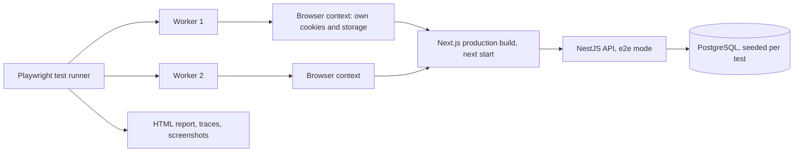

## 75.7 End-to-end tests with Playwright: locators, auto-waiting and test data

#### Concept

An **end-to-end (e2e) test** drives a real browser through the real production build of the web app, talking to a real backend, and checks what a user would see and what the system recorded. **Playwright** (Microsoft, `@playwright/test`) is the test runner and browser automation library most teams choose today. It controls Chromium, Firefox and WebKit through their own protocols, runs tests in parallel worker processes, and gives each test a fresh **browser context**: an isolated profile with its own cookies, storage and cache, created in milliseconds.

Three Playwright ideas do most of the work:

- **Locators** describe how to find an element (`page.getByRole('button', { name: 'Place order' })`) and are evaluated lazily every time they are used, so they survive re-renders.
- **Auto-waiting**: before clicking, Playwright waits until the element is attached, visible, stable (not animating), enabled and receiving events.
- **Web-first assertions**: `await expect(locator).toHaveText('Paid')` retries until it passes or the assertion timeout (5 s by default) expires.

#### Why does it exist?

Component tests fake the network and run in jsdom, so they cannot see four classes of bugs:

1. **Integration across real boundaries**: the BFF's cookies (73.2), redirects, CORS, the idempotency interceptor and the database's unique index.
2. **The production bundle**: code splitting, tree shaking, environment variables baked at build time (68.6), CSS ordering. Part 136.3 tells the story of a bug visible only in `vite build` output.
3. **Real browser behaviour**: layout, focus, history and the Back button, `<dialog>`, file inputs, Safari's differences.
4. **Deploy-shaped problems**: a missing route, a 404 on a lazy chunk, a wrong `basePath`.

Older tools (Selenium WebDriver, early Cypress) made such tests slow and flaky enough that teams gave up on them. Playwright's isolation, auto-waiting and tracing made a small e2e layer cheap enough to run on every pull request.

#### Mental model

Imagine a secret shopper who visits the real shop, with real stock and a real till, at opening time. They follow a short script: pick a toothbrush, apply a coupon, pay twice by accident, check the receipt, check the stockroom ledger. Each shopper gets a fresh, empty basket and a fresh loyalty card, so two shoppers in the shop at the same time never see each other's baskets.

#### How it works



1. **`playwright.config.ts`** declares where tests live, which browsers (**projects**) to run, how many **workers**, retries, the base URL, and a **`webServer`** block that starts the app (and optionally the API) and waits for a URL to answer before tests start.
2. **Each test** receives fixtures: `page`, `context`, `request` (an HTTP client for API calls that shares nothing with the page unless asked), and any custom fixtures you define with `test.extend`.
3. **Locators** are built from roles, labels and text, in the same priority order as Testing Library (75.3). `page.getByTestId('order-row')` exists, reading `data-testid` by default (configurable with `testIdAttribute`).
4. **Actions** (`click`, `fill`, `press`, `selectOption`, `setInputFiles`) auto-wait; assertions retry. There is almost never a reason for `page.waitForTimeout(ms)`.
5. **Network control**: `page.route(pattern, handler)` can fulfil, abort or modify requests in the browser, for failure drills; `page.waitForResponse(predicate)` waits for a specific API response.
6. **Tracing**: with `trace: 'on-first-retry'`, a failed test that is retried records a trace file: every action, DOM snapshot before and after, network requests with headers and bodies, console logs. `npx playwright show-trace trace.zip` (or the HTML report) replays it.

#### Practical example

The checkout journey for e2e, chosen because every step crosses a boundary component tests cannot:

1. A fresh customer with a seeded cart (one toothbrush, `₹999.00`) is signed in through the real BFF login.
2. They enter an address; the API prices delivery (`₹40.00`).
3. They apply `SAVE50`; the API recomputes totals (cart version moves from 8 to 9).
4. They double-click "Place order".
5. The browser lands on `/orders/<id>` with `replace`, so Back goes to the cart, not to a live payment form.
6. The test asks the API, through the test-support endpoint, how many orders exist for the cart: exactly one.

#### React / Next.js example

The configuration:

```ts
// apps/web/playwright.config.ts  (Playwright 1.5x)
import { defineConfig, devices } from '@playwright/test';

const CI = !!process.env.CI;
const BASE_URL = process.env.E2E_BASE_URL ?? 'http://localhost:3000';

export default defineConfig({
  testDir: './e2e',
  fullyParallel: true,                                 // tests in one file also run in parallel
  forbidOnly: CI,                                      // a stray test.only fails CI
  retries: CI ? 2 : 0,
  workers: CI ? 4 : undefined,
  reporter: CI ? [['blob'], ['github']] : [['html', { open: 'never' }]],
  timeout: 30_000,                                     // per test
  expect: { timeout: 5_000 },                          // per assertion retry window
  use: {
    baseURL: BASE_URL,
    trace: 'on-first-retry',
    screenshot: 'only-on-failure',
    video: 'retain-on-failure',
    locale: 'en-IN',
    timezoneId: 'Asia/Kolkata',                        // dates render the same on every runner
  },
  projects: [
    { name: 'chromium', use: { ...devices['Desktop Chrome'] } },
    { name: 'mobile-safari', use: { ...devices['iPhone 13'] }, grep: /@mobile/ },   // a tagged subset on WebKit
  ],
  webServer: process.env.E2E_BASE_URL ? undefined : {  // against a preview URL, start nothing (Part 76)
    command: 'pnpm build && pnpm start',               // the production build, never next dev
    url: `${BASE_URL}/api/health`,
    reuseExistingServer: !CI,
    timeout: 180_000,
  },
});
```

The journey. Test data comes from a fixture (defined in 75.8), and every assertion is web-first:

```ts
// apps/web/e2e/checkout.spec.ts
import { expect } from '@playwright/test';
import { test } from './fixtures';                     // adds `customer` with a seeded cart and a signed-in page

test('places exactly one order for a double click @mobile', async ({ page, customer, api }) => {
  await page.goto('/checkout');
  await expect(page.getByRole('heading', { name: 'Delivery address' })).toBeVisible();

  await page.getByLabel('Full name').fill('Asha Rao');
  await page.getByLabel('Mobile number').fill('9876543210');
  await page.getByLabel('House number and street').fill('12 MG Road');
  await page.getByLabel('City').fill('Bengaluru');
  await page.getByLabel('Postcode').fill('560038');
  await page.getByRole('button', { name: 'Save address' }).click();

  const summary = page.getByRole('complementary', { name: 'Order summary' });
  await expect(summary).toContainText('Delivery ₹40.00');            // priced by the real API

  await page.getByLabel('Coupon code').fill('SAVE50');
  await page.getByRole('button', { name: 'Apply' }).click();
  await expect(summary).toContainText('Total ₹989.00');              // 999 + 40 - 50
  await page.getByRole('button', { name: 'Continue to payment' }).click();

  const placed = page.waitForResponse((r) => r.url().endsWith('/api/v1/orders') && r.request().method() === 'POST');
  await page.getByRole('button', { name: 'Place order' }).dblclick();
  const res = await placed;
  expect(res.status()).toBe(201);

  await expect(page).toHaveURL(/\/orders\/[0-9a-f-]{36}$/);
  await expect(page.getByRole('heading', { name: /^Order [A-Z0-9]{7}$/ })).toBeVisible();

  expect(await api.ordersForCart(customer.cartId)).toHaveLength(1);  // the database agrees: one order
  await page.goBack();
  await expect(page).not.toHaveURL(/\/checkout/);                    // replace: no live payment form behind us
});
```

The test reads like the acceptance criteria in 69.13 because it is written in the same vocabulary: labels, roles and visible amounts. Nothing in it depends on component names, CSS or the order of DOM nodes.

#### Backend side (NestJS)

E2E tests need the API to support them without weakening production:

- **A test-support module**, imported only when `E2E_SUPPORT=enabled`, exposing `POST /__e2e/customers` (creates a user, a cart and returns IDs), `GET /__e2e/carts/:id/orders`, and `POST /__e2e/reset`. It is guarded by a separate secret header and absent from production images by configuration and by a startup assertion.
- **A health endpoint** the `webServer` can wait on (Part 80.12), returning `200` only when the database is reachable.
- **Production behaviour everywhere else**: real guards, real idempotency, real throttling (with limits raised by config in e2e, not disabled).

```ts
// apps/api/src/e2e-support/e2e-support.module.ts
import { Module, type DynamicModule } from '@nestjs/common';
import { E2eSupportController } from './e2e-support.controller';
import { E2eSupportService } from './e2e-support.service';

@Module({})
export class E2eSupportModule {
  static register(): DynamicModule {
    if (process.env.NODE_ENV === 'production' && process.env.E2E_SUPPORT === 'enabled') {
      throw new Error('E2E support must never run in production');   // fail the boot, loudly
    }
    return process.env.E2E_SUPPORT === 'enabled'
      ? { module: E2eSupportModule, controllers: [E2eSupportController], providers: [E2eSupportService] }
      : { module: E2eSupportModule };                                 // empty module: no routes exist
  }
}
```

```ts
// apps/api/src/e2e-support/e2e-support.controller.ts
import { Body, Controller, Get, Param, ParseUUIDPipe, Post, UseGuards } from '@nestjs/common';
import { E2eSecretGuard } from './e2e-secret.guard';                // compares x-e2e-secret with timingSafeEqual
import { E2eSupportService } from './e2e-support.service';

@Controller('__e2e')
@UseGuards(E2eSecretGuard)
export class E2eSupportController {
  constructor(private readonly support: E2eSupportService) {}

  @Post('customers')                                                // one transaction: user + cart + items
  createCustomer(@Body() body: { cart?: { sku: string; quantity: number }[] }) {
    return this.support.createCustomer(body.cart ?? [{ sku: 'TB-SONIC-01', quantity: 1 }]);
  }

  @Get('carts/:id/orders')
  ordersForCart(@Param('id', ParseUUIDPipe) id: string) {
    return this.support.ordersForCart(id);                         // SELECT id FROM orders WHERE cart_id = $1
  }
}
```

#### Production scenario

A storefront runs 26 Playwright journeys on every pull request: checkout (3 variants), login, refresh and logout (from 73.10), order list with filters and infinite scroll, live status, cancel, returns, address book, search. On 4 shards of 2 workers each, the suite takes 3 min 40 s; the slowest journey (checkout with payment retry) takes 21 s. Monthly cost on GitHub-hosted runners is about 4,000 runner-minutes. Over a year the suite blocked 38 pull requests for real bugs, 22 of which no component test could have caught (cookie paths, a missing `await` in a Server Action, a chunk that failed to load under `basePath`).

#### Failure scenario

A team wrote 140 e2e tests in their first month with Playwright, one per acceptance criterion, all against a shared staging environment with shared test accounts. By month three, the suite took 38 minutes and failed on 30 % of runs: two tests cancelled the same order in parallel, a test expected "3 orders" while another test added a fourth, a staging deploy restarted the API mid-run, and a coupon used by tests hit its global redemption limit. Developers stopped looking at results. The recovery took a quarter: move field-level criteria into component tests (140 became 24 journeys), run e2e against an ephemeral stack per job (75.11), create a fresh customer per test, and treat every flaky test as a bug with an owner (75.8).

#### Edge cases & failure modes

- **Testing against `next dev`**: different code (no minification, no static optimisation, on-demand compilation that makes the first navigation take seconds). Always test `next build` output.
- **`page.waitForTimeout`** used as a fix for timing; it hides the race and adds seconds.
- **CSS selectors and `nth-child`**: break on every layout change; use roles and labels.
- **Assertions without `await`** (`expect(locator).toBeVisible()` without `await`) pass immediately and test nothing; the `@typescript-eslint/no-floating-promises` lint rule catches them.
- **Shared accounts across workers**: counts, carts and order lists collide.
- **Third-party scripts** (analytics, chat, payment iframes) slow or break tests; block them with `page.route` in e2e or use the provider's test mode.
- **Time**: "Delivers tomorrow" depends on the clock; set `timezoneId` and control time with `page.clock` (Playwright 1.45+) where the UI computes dates.

#### How a Senior Full-Stack Engineer thinks about this

The senior keeps e2e tests few, valuable and boring. Each journey must cross a boundary only e2e can cross, and must check a business outcome (one order row), not only UI text. They insist on the production build, fresh data per test, roles and labels for locators, and traces on failure, so a red build can be diagnosed from the report without re-running it locally. They budget e2e time like any other resource: if the suite passes 5 minutes, something moves down to component tests. And they make the backend a partner: the test-support module is designed, reviewed and guarded like production code, because it is code that can create users.

#### Common mistakes

- **Writing e2e tests for every validation message.**
- **Logging in through the UI in every test** (75.8 shows storage state).
- **Asserting only on UI text** when the risk is in the data (duplicates, wrong totals).
- **No traces or screenshots on failure**, so every failure needs a local reproduction.
- **Disabling auth, CSRF or throttling for e2e**, so the tested system is not the deployed one.

#### Interview questions

1. **What makes Playwright tests less flaky than older tools?** Expected answer: isolated contexts per test, auto-waiting actionability checks, retrying web-first assertions, lazy locators; plus traces for diagnosis.
2. **Why run e2e against the production build?** Expected answer: dev servers differ in bundling, splitting, env handling and compilation timing; bugs live in the build.
3. **How do you check a business outcome in an e2e test?** Expected answer: query the system of record through a guarded test-support endpoint or the API, for example one order for the cart.
4. **How would you expose test-only backend endpoints safely?** Expected answer: a dynamic module registered only under an explicit flag, a separate secret, a boot-time assertion that refuses production, and no such routes in production images.
5. **When is `page.route` appropriate in an e2e test?** Expected answer: failure drills (API down, slow response) and blocking third parties; not for faking the happy path, which defeats the purpose.

#### Practical exercise

Write the checkout journey above against the monorepo from Part 68.

Acceptance criteria:

- The suite starts `next build` output through `webServer`, or targets `E2E_BASE_URL` when set.
- The journey creates its own customer through the test-support API and asserts exactly one order row after a double click.
- No locator uses CSS selectors, XPath or `nth`; no `waitForTimeout` anywhere.
- A failed run produces a trace with the network log, and the API's request ID is visible in it.
- The API refuses to boot with `NODE_ENV=production` and `E2E_SUPPORT=enabled`.

## 75.8 Auth state, parallel runs and flakiness control

#### Concept

Three practices make an e2e suite fast and trustworthy:

- **Authentication state reuse**: sign in once, save the browser's cookies and storage to a file (**storage state**), and start each test's context from that file instead of logging in again.
- **Isolation for parallelism**: every worker and every test owns its data (its own user, cart and orders), so tests can run in any order and at the same time.
- **Flakiness control**: a **flaky test** passes and fails on the same code. Retries detect flakiness; they must not hide it. Each flaky test is diagnosed, fixed or quarantined with an owner.

#### Why does it exist?

Logging in through the UI takes 1-3 s; across 200 test runs per pipeline that is minutes of nothing. Shared data forces serial execution, so the suite gets slower with every test. And flaky tests destroy trust: Part 83.18 described the backend version; on the frontend, timing, animation, data collisions and third parties add more causes. A team that re-runs red builds until they go green has stopped testing.

#### Mental model

Imagine a hotel. Each guest gets a key card cut once at reception (storage state), not a new check-in every time they return to their room. Each guest has their own room (data isolation), so housekeeping can clean all rooms at once. And when a guest reports that the lift sometimes stops between floors, the hotel does not tell them to press the button again; it calls the engineer.

#### How it works

1. **Per-worker accounts.** A worker-scoped fixture creates one customer per worker through the test-support API, signs in through the real login page once, and saves `context.storageState()` to `playwright/.auth/worker-<n>.json`. Tests in that worker start their context from that file.
2. **Per-test data.** A test-scoped fixture creates the test's own cart (and anything else it changes) for that worker's customer, so tests in the same worker do not share mutable state.
3. **Cookies with prefixes.** The BFF's `__Host-session` and `__Secure-refresh` cookies (73.2) require `Secure`. Chromium and Firefox accept `Secure` cookies from `http://localhost`; if a browser in your matrix does not, serve the e2e stack over HTTPS with a local certificate (a Caddy container in the compose file) rather than weakening the cookie attributes.
4. **Sharding** splits the suite across CI machines: `npx playwright test --shard=2/4`. Each shard writes a **blob report**; a final job runs `npx playwright merge-reports --reporter html ./blob-reports` to produce one report.
5. **Flake detection**: with `retries: 2`, a test that fails then passes is reported as **flaky**, not passed. New or changed tests run with `--repeat-each=10` in a nightly job (or `--only-changed=origin/main`, Playwright 1.46+, on pull requests) to flush out flakiness before it reaches `main`.
6. **Quarantine** is a tag (`@quarantine`), excluded from the blocking job with `--grep-invert @quarantine` and run in a non-blocking job, with a ticket, an owner and a deadline.

Common causes of e2e flakiness and their fixes:

| Cause | Symptom | Fix |
|---|---|---|
| Shared data between tests | "Expected 3 orders, got 4" | Fresh customer and cart per test |
| Fixed waits | Passes locally, fails on CI | Web-first assertions, `waitForResponse` |
| Animations and transitions | Click lands on a moving element | Playwright waits for stability; disable animations in visual tests (75.9) |
| Clock and time zones | "Delivers tomorrow" vs "today" at 23:59 | `timezoneId`, `page.clock`, fixed seed dates |
| Third-party scripts | Random timeouts | Block with `page.route` in e2e |
| Server cold start | First test times out | `webServer` waits on a health URL; warm-up request in global setup |
| Background jobs | Status not updated yet | `expect.poll` on the API, with a bounded timeout |
| Test order dependence | Fails only with `--shard` | Isolation; run with `fullyParallel` locally too |

#### Practical example

A suite of 26 journeys on 4 shards with 2 workers each uses 8 workers, so 8 customers are created per run, each signed in once (8 logins, about 12 s of total work, spread in parallel). Each test then creates its cart in about 60 ms through the API. Flaky rate over 30 days: 0.3 % of test runs, all reported in the weekly flake review.

#### React / Next.js example

The fixtures file:

```ts
// apps/web/e2e/fixtures.ts
import { test as base, expect, type APIRequestContext } from '@playwright/test';
import fs from 'node:fs';
import path from 'node:path';

type Customer = { userId: string; email: string; password: string; cartId: string };
type Api = { ordersForCart(cartId: string): Promise<{ id: string }[]>; placeSeedOrder(cartId: string): Promise<string> };

const API_URL = process.env.E2E_API_URL ?? 'http://localhost:4000';
const support = (request: APIRequestContext) => ({
  post: (p: string, data: unknown) => request.post(`${API_URL}/__e2e${p}`, { data, headers: { 'x-e2e-secret': process.env.E2E_SECRET! } }),
  get: (p: string) => request.get(`${API_URL}/__e2e${p}`, { headers: { 'x-e2e-secret': process.env.E2E_SECRET! } }),
});

export const test = base.extend<{ customer: Customer; api: Api }, { workerStorageState: string; workerCustomer: Omit<Customer, 'cartId'> }>({
  workerCustomer: [async ({ playwright }, use) => {
    const request = await playwright.request.newContext();
    const res = await support(request).post('/customers', {});
    expect(res.ok()).toBeTruthy();
    await use(await res.json());                                  // { userId, email, password }
    await request.dispose();
  }, { scope: 'worker' }],

  workerStorageState: [async ({ browser, workerCustomer }, use) => {
    const file = path.resolve(test.info().project.outputDir, `.auth/worker-${test.info().parallelIndex}.json`);
    if (!fs.existsSync(file)) {
      const page = await browser.newPage({ storageState: undefined, baseURL: test.info().project.use.baseURL }); // signed out
      await page.goto('/login');
      await page.getByLabel('Email').fill(workerCustomer.email);
      await page.getByLabel('Password').fill(workerCustomer.password);
      await page.getByRole('button', { name: 'Sign in' }).click();
      await expect(page).toHaveURL(/\/orders$/);                 // the real BFF set __Host-session
      await page.context().storageState({ path: file });
      await page.close();
    }
    await use(file);
  }, { scope: 'worker' }],

  storageState: ({ workerStorageState }, use) => use(workerStorageState),   // every context starts signed in

  customer: async ({ request, workerCustomer }, use) => {
    const res = await support(request).post(`/customers/${workerCustomer.userId}/carts`, { items: [{ sku: 'TB-SONIC-01', quantity: 1 }] });
    await use({ ...workerCustomer, cartId: (await res.json()).cartId });   // a fresh cart per test
  },

  api: async ({ request }, use) => {
    await use({
      ordersForCart: async (cartId) => (await support(request).get(`/carts/${cartId}/orders`)).json(),
      placeSeedOrder: async (cartId) => (await (await support(request).post(`/carts/${cartId}/orders`, {})).json()).id,
    });
  },
});
```

The session cookie in saved storage state is a 15-minute access JWT (73.3). Runs longer than that are covered by the refresh flow the app already has: the saved `__Secure-refresh` cookie lets the BFF rotate silently, which is itself worth exercising in e2e. If a single test outlives the refresh token (it should not), the test is too long.

Failure drills inside e2e use `page.route` in the browser, so the rest of the stack stays real:

```ts
// apps/web/e2e/order-live-status.spec.ts (excerpt)
test('shows an honest offline banner when the API is down, and recovers', async ({ page, customer, api }) => {
  await page.goto(`/orders/${await api.placeSeedOrder(customer.cartId)}`);
  await page.route('**/api/v1/orders/**', (route) => route.fulfill({
    status: 503, contentType: 'application/problem+json',
    body: JSON.stringify({ code: 'UPSTREAM_UNAVAILABLE', status: 503, title: 'Unavailable', issues: [], requestId: 'drill-1' }),
  }));
  await page.getByRole('button', { name: 'Refresh' }).click();
  await expect(page.getByRole('status')).toContainText('Showing status from');      // stale but honest (78.10)
  await page.unroute('**/api/v1/orders/**');
  await page.getByRole('button', { name: 'Refresh' }).click();
  await expect(page.getByRole('status')).not.toContainText('Showing status from');
});
```

#### Backend side (NestJS)

Parallel e2e runs put concurrent load on the API that production rarely sees from one client: eight workers each creating customers and placing orders at once. The API should take it without special cases:

- **Throttling keyed by user, with e2e limits from configuration.** `ThrottlerModule.forRootAsync` reads limits from `ConfigService`; e2e sets higher limits rather than removing the guard, so `429` handling is still exercised by one dedicated test.
- **No global state in the test-support service**: each `createCustomer` uses unique emails (`e2e+<uuid>@shop.test`), so parallel workers never collide on a unique index.
- **Background work made observable**: if order confirmation emails or status changes are done by a worker (Part 35), the test-support API exposes "jobs pending for this order", and tests poll it with `expect.poll` instead of sleeping.

```ts
// apps/api/src/app.module.ts (excerpt)  @nestjs/throttler v5+
ThrottlerModule.forRootAsync({
  inject: [ConfigService],
  useFactory: (config: ConfigService) => [{
    name: 'default',
    ttl: 60_000,
    limit: config.get<number>('THROTTLE_LIMIT_PER_MIN', 120),   // e2e sets 5000; the guard still runs
  }],
}),
```

#### Production scenario

After introducing per-worker accounts and per-test carts, a team moved from `workers: 1` to 4 shards of 2 workers. Wall-clock time fell from 19 minutes to 3 min 40 s. They added a weekly 30-minute "flake review": the CI dashboard lists every test reported flaky that week; each gets an owner. Over two quarters the flaky rate fell from 2.1 % to 0.3 % of test runs, and "re-run" clicks on the e2e job fell from about 60 a week to 4.

#### Failure scenario

A test for "logout everywhere" (73.10) revoked all sessions for its user by bumping the Redis epoch. It used the worker's shared customer. Every other test in that worker, running afterwards, started from a storage state whose session was now revoked, and failed with a redirect to `/login`. The failures appeared random because they depended on which worker ran the logout test and when. The fix: tests that change the identity itself (logout everywhere, password change, account deletion) create their own customer and sign in inside the test, never using the worker's storage state.

#### Edge cases & failure modes

- **Storage state committed to Git**: it contains live session cookies for a test environment; add `playwright/.auth` to `.gitignore`.
- **Storage state reused across environments**: cookies for `localhost` do not apply to a preview URL; key the file by base URL.
- **`retries` hiding real races**: a test that fails 1 in 20 runs in CI may be a real race in the product (a double submit, a stale cache), not a test problem; read the trace before blaming the test.
- **Shards with uneven duration**: one shard takes 6 minutes while others take 2; Playwright splits by test count, so split long files or balance by tagging.
- **`test.describe.configure({ mode: 'serial' })`** used to paper over shared data; when one test fails, the rest of the group is skipped.
- **Worker-scoped fixtures that leak data**: a worker's customer accumulates hundreds of orders over a long run, slowing list pages; create carts and orders per test and reset per run.

#### How a Senior Full-Stack Engineer thinks about this

The senior designs test data like a multi-tenant system: every worker is a tenant, every test a session within it, nothing shared that can be mutated. They treat retries as a sensor, not a cure, and they make flakiness visible with a number on a dashboard and an owner per test. When a test is flaky they first suspect the product (a race the user could also hit), then the test, then the environment, in that order, because the trace usually shows which.

#### Common mistakes

- **Logging in through the UI in every test.**
- **One shared test account for the whole suite.**
- **Using `retries` as the flakiness policy.**
- **Quarantining without an owner or a deadline**, so the quarantine becomes a graveyard.
- **Disabling the throttler** instead of configuring its limits.

#### Interview questions

1. **How do you avoid logging in for every e2e test?** Expected answer: save storage state once per worker (or per role) and start contexts from it; tests that change identity create their own user.
2. **How do you make e2e tests safe to run in parallel?** Expected answer: per-worker accounts, per-test data, unique identifiers, no shared mutable fixtures, no serial mode.
3. **What is your policy for flaky tests?** Expected answer: retries detect and report, a dashboard and owner per flaky test, quarantine with a deadline, suspect the product first.
4. **How do you shard Playwright in CI and still get one report?** Expected answer: `--shard=i/n` with the blob reporter per shard, then `merge-reports` in a final job.
5. **How would you test behaviour that depends on a background job?** Expected answer: poll an observable signal (`expect.poll` on an API) with a bounded timeout, never a fixed sleep.

#### Practical exercise

Convert a serial, shared-account e2e suite into a parallel one.

Acceptance criteria:

- Worker-scoped customers and storage state; no test logs in through the UI except the auth tests and identity-changing tests.
- The suite passes with `--repeat-each=5 --workers=8` and with `--shard=1/4` through `--shard=4/4`.
- CI merges blob reports into one HTML report with traces for retried tests.
- A flaky-test report lists each test that needed a retry in the last 7 days.
- The throttler stays enabled, with one test that asserts the `429` and `Retry-After` behaviour.
