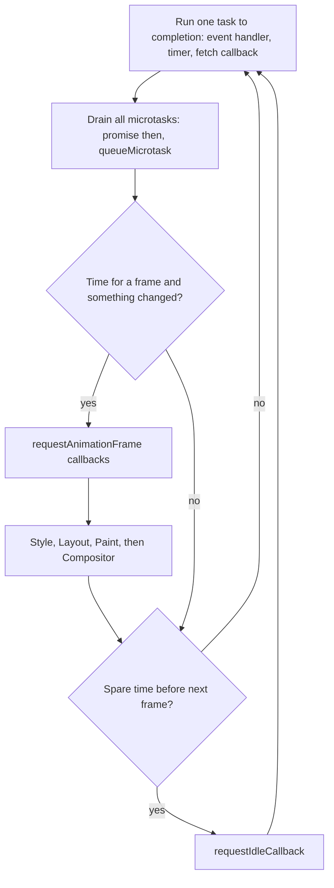

## 75.6 Script loading: classic, `defer`, `async` and modules

#### Concept

How a `<script>` tag is written decides when its file is downloaded, when it runs, and whether the HTML parser has to stop for it. There are four forms that matter:

- **Classic script** `<script src="app.js">`: download and execute immediately, and the parser waits for both.
- **`defer`** `<script defer src="app.js">`: download in parallel with parsing, execute after the document is parsed, in document order, before `DOMContentLoaded`.
- **`async`** `<script async src="widget.js">`: download in parallel, execute as soon as it arrives, in whatever order downloads finish, pausing the parser while it runs.
- **Module** `<script type="module" src="app.js">`: an ES module with `import` and `export`; deferred by default, can also be `async`, always strict mode, fetched with CORS.

#### Why does it exist?

Classic scripts block because of `document.write()`. A script can write raw HTML into the stream at the point where it appears, so the parser cannot safely continue past a script it has not run. That made sense in 1997; today almost no script needs it, but the browser must still assume it might. `defer` and `async` exist so you can tell the browser "this script will not `document.write`, keep parsing". Modules exist to give the browser a native dependency system instead of global variables and concatenated files.

#### Mental model

Imagine a tour guide (the parser) walking a group through a museum, reading each placard aloud. A classic script is a placard that says "stop and wait here until the curator arrives from the other building and gives a speech". `defer` is "the curator will give a speech at the end of the tour; keep walking". `async` is "the curator will interrupt the tour the moment they arrive, wherever you are". A module is a deferred curator who brings a list of colleagues who must also arrive first.

#### How it works



```mermaid
gantt
    title Script loading relative to HTML parsing
    dateFormat X
    axisFormat %s
    section Classic
    Parse HTML      :a1, 0, 3
    Download script :a2, 3, 7
    Execute script  :a3, 7, 9
    Parse rest      :a4, 9, 12
    section Defer
    Parse HTML      :b1, 0, 8
    Download script :b2, 2, 6
    Execute after parse :b3, 8, 10
    section Async
    Parse HTML      :c1, 0, 5
    Download script :c2, 2, 5
    Execute on arrival :c3, 5, 7
    Parse rest      :c4, 7, 9
```

| Form | Blocks parser | Execution order | When it runs | Good for |
|---|---|---|---|---|
| Classic in `<head>` | Yes, download and run | Document order | Immediately | Almost nothing today; tiny inline config only |
| Classic at end of `<body>` | Yes, but little left to parse | Document order | When reached | Legacy pages |
| `defer` | No | Document order | After parsing, before `DOMContentLoaded` | Your application bundle |
| `async` | Only while executing | Arrival order, unpredictable | As soon as downloaded | Independent third-party scripts (analytics) |
| `type="module"` | No (deferred by default) | Document order | After parsing | Modern application code |
| `type="module" async` | Only while executing | Arrival order | As soon as the module graph is ready | Independent modules |
| Inline `<script>` | Yes (waits for pending stylesheets) | Document order | Immediately | Small bootstrapping data; `defer` is ignored on inline classic scripts |

Details that matter in production:

1. **A classic script waits for earlier stylesheets.** It might read computed styles, so it cannot run until preceding CSS is parsed. A slow CSS file therefore also delays a classic script and the rest of the parse.
2. **Module graphs are discovered lazily.** The browser fetches `app.js`, parses it, finds `import './cart.js'`, fetches that, finds its imports, and so on: one network round trip per level of the graph. That is why bundlers still exist (Part 76 — Frontend Tooling and TypeScript in the Browser) and why `<link rel="modulepreload">` helps.
3. **Modules are fetched with CORS.** A module served from a CDN on another origin needs `Access-Control-Allow-Origin` on the response, and must be served with a JavaScript MIME type (`text/javascript`). Browsers refuse to execute a module served as `text/plain` or `application/octet-stream`, with a "Strict MIME type checking is enforced for module scripts" console error.
4. **Download is not the only cost.** A 160 KB compressed bundle is often 550 to 650 KB of JavaScript after decompression. On a mid-range phone, parse and compile plus first execution of that much code commonly takes 400 to 900 ms of main-thread time. Network throttling alone hides this; CPU throttling reveals it.
5. **Dynamic `import()`** loads a module on demand and returns a promise. Frameworks use it for code splitting by route or component.

#### Practical example

A product page has four scripts: the app bundle, a vendor chunk, an analytics script from a third party, and a chat widget. The right arrangement is: app and vendor as `type="module"` (or `defer`, in order, vendor first) so they never block parsing and run in dependency order; analytics as `async` because nothing depends on it; the chat widget loaded by your own code after the `load` event or on the first user interaction, because it is 300 KB of JavaScript that 2 % of visitors use. That alone moved the chat widget's 280 ms long task out of the window where users first try to tap.

#### React / Next.js example

Next.js generates and orders its own framework and page scripts. For anything you add, `next/script` (Next.js 13 and 14) controls the loading strategy explicitly:

```tsx
// app/layout.tsx or a page  (Next.js 14 App Router)
import Script from 'next/script';

export function ThirdPartyScripts() {
  return (
    <>
      {/* afterInteractive (default): injected after hydration starts; fine for analytics */}
      <Script src="https://analytics.example/a.js" strategy="afterInteractive" />

      {/* lazyOnload: injected during browser idle time after load; for chat and feedback widgets */}
      <Script src="https://chat.example/widget.js" strategy="lazyOnload"
              onLoad={() => console.info('chat widget ready')} />

      {/* beforeInteractive: only in the root layout, for scripts that must run before hydration,
          such as a consent manager. Use rarely: it delays your app. */}
    </>
  );
}
```

For your own heavy components, `next/dynamic` (or `React.lazy` with `<Suspense>` in plain React 18) splits them into separate chunks:

```tsx
import dynamic from 'next/dynamic';
// The 3D product viewer (220 KB) is only fetched when this component renders, never on first load.
const ProductViewer3D = dynamic(() => import('./ProductViewer3D'), {
  ssr: false, loading: () => <p>Loading 3D view...</p>,
});
```

#### Backend side (NestJS)

When NestJS (or the same container as your API) serves the built frontend assets, three headers decide whether scripts load quickly and at all:

```ts
// main.ts: serving a built SPA from NestJS
import { NestFactory } from '@nestjs/core';
import type { NestExpressApplication } from '@nestjs/platform-express';
import { join } from 'node:path';
import { AppModule } from './app.module';

async function bootstrap() {
  const app = await NestFactory.create<NestExpressApplication>(AppModule);

  // Hashed files (app.81bd2e.js) never change content: cache for a year, immutable.
  app.useStaticAssets(join(__dirname, '..', 'web', 'assets'), {
    prefix: '/assets/',
    maxAge: '365d',
    immutable: true,
    setHeaders: (res, path) => {
      if (path.endsWith('.js')) res.setHeader('Content-Type', 'text/javascript; charset=utf-8');
      // Only needed if pages on another origin load these as modules:
      res.setHeader('Access-Control-Allow-Origin', 'https://shop.example.com');
    },
  });

  // index.html must always be revalidated, or users keep pointing at old hashed bundles.
  app.useStaticAssets(join(__dirname, '..', 'web'), { index: false, maxAge: 0, etag: true });
  await app.listen(3000);
}
bootstrap();
```

- **`Content-Type: text/javascript`** for every `.js` and `.mjs` file. A misconfigured static server or object store serving `application/octet-stream` breaks module scripts completely.
- **Long-lived immutable caching only for content-hashed filenames**, and `no-cache` (or `max-age=0` with an ETag) for the HTML that references them (see Part 14 — Networking and HTTP, 14.11). Part 84 — Shipping and Operating Frontends covers what happens to users on the old version during a deploy.
- **CORS on cross-origin modules**: if the CDN origin differs from the page origin, module scripts need `Access-Control-Allow-Origin`, and fonts need it too.

#### Production scenario

A ticketing site moved its application bundle from a classic `<script>` at the end of `<body>` to `type="module"` in the `<head>`, plus `modulepreload` for its three largest chunks. On a slow 4G profile, the bundle request now started at 540 ms (when the head arrived) instead of 1,100 ms (when the parser reached the end of the body), and hydration finished 480 ms earlier at p75. Separately, they moved a session-replay vendor script from synchronous to `async` and then to "load after first interaction", which removed a 190 ms long task from the first second.

#### Failure scenario

At 09:05 a platform team migrated static assets from NGINX to an object storage bucket behind the CDN. The upload script did not set content types, so every `.js` object was stored as `application/octet-stream`. The site's HTML used `<script type="module">`. Within minutes, every page rendered its server-rendered HTML and then nothing worked: no add to cart, no search, no menus. The console showed "Failed to load module script: Expected a JavaScript module script but the server responded with a MIME type of application/octet-stream". Backend dashboards were green; API traffic simply dropped by 70 %, because the client code that made API calls never ran. The fix was re-uploading with explicit `Content-Type` and purging the CDN. The lesson: a drop in API traffic with no errors is often a frontend that failed to boot.

#### Edge cases & failure modes

- **`async` scripts that depend on each other** run in random order and fail intermittently, depending on which one downloads first.
- **Mixing `defer` and inline scripts**: an inline script that uses a library loaded with `defer` runs before the library exists.
- **`document.write` from a third-party script** loaded asynchronously is ignored by browsers, with a console warning, which silently breaks old ad tags.
- **A module that throws during evaluation** stops every module that imports it; one bad import can take down the whole app.
- **Chunk load errors after a deploy**: an old tab requests `chunk.a1b2.js`, which no longer exists, and gets the HTML 404 page; Part 84 covers keeping old assets around.

#### How a Senior Full-Stack Engineer thinks about this

A senior sees every script tag as a scheduling decision with a cost in download, parse, compile and execution time, and every third-party script as a dependency on someone else's uptime running with full access to the page. Their defaults: application code as modules or `defer`, third parties `async` or deferred until interaction, nothing synchronous in the head. They budget JavaScript in kilobytes and main-thread milliseconds, not just requests. They also make sure the backend serves scripts with the right MIME type, caching and CORS, because those failures break the page while every server metric stays green.

#### Common mistakes

- **Putting a classic `<script src>` in `<head>`** "so it runs early".
- **Using `async` for scripts that depend on each other.**
- **Loading heavy widgets on page load** when they are only used after a click.
- **Measuring JavaScript cost by bytes over the wire only**, ignoring parse and execution on slow CPUs.
- **Serving assets without correct `Content-Type`** or with long caching on unhashed file names.

#### Interview questions

1. **What is the difference between `defer` and `async`?**
   Expected answer: both download in parallel without blocking the parser; `defer` runs after parsing in document order, `async` runs on arrival in any order and pauses the parser while executing. Follow-up: which one for an analytics script, and which for your app bundle?
2. **Why do module scripts fail with a MIME type error and how do you fix it on the backend?** Expected answer: browsers enforce a JavaScript MIME type for modules; set `Content-Type: text/javascript` on the server, CDN or object store.
3. **Why is a 160 KB script slower on a phone than a 160 KB image?** Expected answer: the script must be decompressed, parsed, compiled and executed on the main thread; the image is decoded off the main thread and does not block interaction.
4. **What does `modulepreload` solve?** Expected answer: the round-trip-per-level discovery of an ES module graph, by fetching and compiling dependencies early.

#### Practical exercise

Create a page with three scripts: `a.js` logs and sets `window.A`, `b.js` uses `window.A`, and `c.js` is independent. Load them as classic, `defer`, `async` and modules, and use the Network panel's throttling plus the "Block request URL" option to delay or block each.

Acceptance criteria:

- A written table of observed execution order for each form, matching the rules above.
- You can reproduce the `async` race where `b.js` fails, and fix it.
- Serving `c.js` as a module with `Content-Type: text/plain` from a NestJS route reproduces the MIME type error, and fixing the header resolves it.

## 75.7 The main thread, the browser event loop and long tasks

#### Concept

Each page (more precisely, each renderer and its frames) has one **main thread**. It runs your JavaScript, handles input events, computes styles, runs layout and paints. While it is busy with one thing, it cannot do any of the others. A **long task** is any task that occupies the main thread for more than 50 ms. During a long task, clicks wait, typing lags and animations that need the main thread freeze.

The browser schedules work on the main thread with an **event loop**, like Node.js does (see Part 13 — Operating Systems and the Node.js Runtime, 13.16 and 13.17). The difference is that the browser's loop also has to produce frames: between tasks it decides whether to render, and rendering competes for the same thread as your code.

#### Why does it exist?

JavaScript was designed to run on the same thread as the DOM so that scripts never see a half-updated page and never need locks. That simplicity is why the DOM is easy to program and why one slow function can freeze a page. The event loop is how the browser shares that single thread fairly between network callbacks, timers, user input and rendering. Long tasks are the measurable symptom of the sharing going wrong, and **Interaction to Next Paint (INP)** is the Core Web Vital that measures how badly it hurts users: the time from a click or key press to the next frame that shows a response, with "good" at or under 200 ms.

#### Mental model

Imagine a restaurant with a single chef who also has to plate and send every dish. Orders (tasks) arrive on tickets. After each ticket, the chef must immediately handle any "quick follow-ups" pinned to it (microtasks), and roughly every 16 ms a runner shouts "plates out!" (a rendering opportunity). If the chef spends 400 ms on one elaborate dish, nothing goes out, new customers wave for attention (input events) and are ignored, and the dining room sees a frozen kitchen. The fix is never "a faster chef" alone; it is splitting the elaborate dish into steps so the runner can take plates out in between, or handing prep work to a kitchen assistant in another room (a Web Worker).

#### How it works

One turn of the browser event loop:

1. **Pick one task** from a task queue: a parsed HTML chunk, a `setTimeout` callback, a `fetch` response callback, a `click` event handler, a `message` from a worker. Browsers keep several queues and prioritise input over timers.
2. **Run it to completion.** Nothing can interrupt synchronous JavaScript.
3. **Microtask checkpoint.** Run every queued microtask (promise reactions, `queueMicrotask`, `MutationObserver` callbacks), including microtasks queued by microtasks, until the queue is empty.
4. **Maybe render.** If it is time for a new frame (about every 16.7 ms at 60 Hz) and something changed, run the rendering steps: `requestAnimationFrame` callbacks, style, layout, paint, then hand off to the compositor. If the page is hidden, rendering is skipped.
5. **Idle.** If there is time left before the next frame and nothing urgent, run `requestIdleCallback` callbacks.
6. Repeat.



**Browser versus Node.js:**

| Aspect | Browser | Node.js |
|---|---|---|
| Task sources | DOM events, input, timers, network, `postMessage`, parsing | libuv phases: timers, poll (I/O), check (`setImmediate`), close |
| Microtasks | Promises, `queueMicrotask`, `MutationObserver` | Promises, `queueMicrotask`, plus `process.nextTick` which runs before promises |
| Rendering | Built into the loop, about every 16.7 ms | None |
| Main cost of blocking | Frozen UI, bad INP | All requests on that process stall, latency spikes for every user |
| `setTimeout` minimum | Clamped to 4 ms after 5 nested levels; throttled to 1 s or more in background tabs | About 1 ms, no nesting clamp |
| Escape hatch for CPU work | Web Workers | `worker_threads` |
| Exclusive APIs | `requestAnimationFrame`, `requestIdleCallback` | `setImmediate`, `process.nextTick` |

The most important shared rule: **microtasks starve everything**. A promise chain that keeps scheduling more promise work never gives the loop a chance to render or handle input, in both runtimes. In the browser, that looks like a frozen tab; in Node, like an unresponsive server.

**What creates long tasks in real pages:**

- **Hydration**: React walking the whole server-rendered tree, attaching event handlers, often 150 to 600 ms on phones for a large page.
- **Parsing big JSON**: `JSON.parse` of a 5 MB response takes roughly 40 to 80 ms on a mid-range phone, plus the time to render what it contains.
- **Rendering large lists**: 2,000 table rows produce 2,000 component renders plus a big layout.
- **Third-party scripts**: tag managers, A/B testing, chat widgets.
- **Synchronous storage**: `localStorage.getItem` on a large value blocks (75.8).

**Measuring them:**

```ts
// Report long tasks and long animation frames from real users (Chromium browsers).
const longTasks = new PerformanceObserver((list) => {
  for (const entry of list.getEntries()) {
    if (entry.duration > 100) {
      navigator.sendBeacon('/api/v1/rum/long-task', JSON.stringify({
        page: location.pathname, durationMs: Math.round(entry.duration),
        startMs: Math.round(entry.startTime),
      }));
    }
  }
});
longTasks.observe({ type: 'longtask', buffered: true });
// 'long-animation-frame' (Chrome 123+) also attributes the time to specific scripts.
```

**Breaking up long tasks:** yield to the event loop between chunks of work so input and rendering can run.

```ts
// Yield control so pending input and rendering can run between chunks.
function yieldToMain(): Promise<void> {
  // scheduler.yield() exists in Chromium (Chrome 129+); fall back to a macrotask elsewhere.
  const s = (globalThis as { scheduler?: { yield?: () => Promise<void> } }).scheduler;
  if (s?.yield) return s.yield();
  return new Promise((resolve) => setTimeout(resolve, 0));
}

export async function indexOrdersForSearch(orders: { id: string; items: string[] }[]) {
  const index = new Map<string, string[]>();
  let lastYield = performance.now();
  for (const order of orders) {
    for (const item of order.items) {
      const key = item.toLowerCase();
      index.set(key, [...(index.get(key) ?? []), order.id]);
    }
    if (performance.now() - lastYield > 40) {   // keep each slice under the 50 ms long-task line
      await yieldToMain();
      lastYield = performance.now();
    }
  }
  return index;
}
```

Note that `await Promise.resolve()` would *not* yield: it is a microtask, so the loop never reaches input or rendering.

#### Practical example

An admin "Orders" screen loads 5,000 orders in one 6.2 MB JSON response and renders them into a table. On an office laptop: `JSON.parse` 35 ms, React render 410 ms, layout 180 ms, one 625 ms long task. Typing in the search box above the table lags by half a second per keystroke because each keystroke filters and re-renders 5,000 rows. Three changes fix it: the API paginates to 50 rows with a cursor, the table virtualises rows (Part 77 — React Fundamentals for Backend Engineers), and filtering happens on the server. The longest task drops to 38 ms.

#### React / Next.js example

React 18 can keep input responsive while expensive re-renders happen, by marking them as non-urgent. `useDeferredValue` lets the input update immediately while the filtered list catches up; React's concurrent renderer works in small slices and yields to the browser between them.

```tsx
// ProductSearch.tsx  (React 18)
import { memo, useDeferredValue, useMemo, useState } from 'react';

type Product = { id: string; name: string };

const Results = memo(function Results({ query, products }: { query: string; products: Product[] }) {
  const matches = useMemo(
    () => products.filter((p) => p.name.toLowerCase().includes(query.toLowerCase())).slice(0, 200),
    [query, products],
  );
  return <ul>{matches.map((p) => <li key={p.id}>{p.name}</li>)}</ul>;
});

export function ProductSearch({ products }: { products: Product[] }) {
  const [query, setQuery] = useState('');
  const deferredQuery = useDeferredValue(query);     // lags behind during heavy renders
  const stale = query !== deferredQuery;
  return (
    <>
      <input value={query} onChange={(e) => setQuery(e.target.value)} aria-label="Search products" />
      <div style={{ opacity: stale ? 0.6 : 1 }}>
        <Results query={deferredQuery} products={products} />
      </div>
    </>
  );
}
```

`useTransition` and `startTransition` do the same for state updates you trigger yourself, such as switching a tab. These tools make React yield between components; they do not make a single slow component or a single 300 ms loop faster. That still needs less work, chunking, or a Web Worker.

#### Backend side (NestJS)

The backend decides how much work lands on the main thread. Every byte of JSON is parsed on it, and every item becomes DOM. The API should make the cheap path the default:

```ts
// orders.controller.ts: bounded, shaped responses for UI lists
import { Controller, Get, Query } from '@nestjs/common';
import { Type } from 'class-transformer';
import { IsIn, IsInt, IsOptional, IsString, Max, Min } from 'class-validator';
import { OrdersService } from './orders.service';

export class ListOrdersQuery {
  @IsOptional() @Type(() => Number) @IsInt() @Min(1) @Max(100) limit = 25; // hard upper bound
  @IsOptional() @IsString() cursor?: string;                              // keyset pagination
  @IsOptional() @IsString() q?: string;                                   // filter on the server
  @IsOptional() @IsIn(['summary', 'full']) view: 'summary' | 'full' = 'summary';
}

@Controller('v1/orders')
export class OrdersController {
  constructor(private readonly orders: OrdersService) {}

  @Get()
  async list(@Query() query: ListOrdersQuery) {
    // 'summary' returns 6 fields per order (about 300 bytes) instead of 40 (about 4 KB).
    const page = await this.orders.list(query);
    return { items: page.items, nextCursor: page.nextCursor, hasMore: page.nextCursor !== null };
  }
}
```

- **Cap page sizes** (`@Max(100)`), so no client can request 5,000 rows by accident.
- **Offer summary views** for lists and full views for detail pages.
- **Filter, sort and aggregate on the server** where the index is (see Part 18 — API Design (REST first), 18.5 Pagination). Totals computed in SQL cost 2 ms; computed in the browser over 5,000 rows they cost a long task.
- **Send preformatted values sparingly**: a `totalLabel` string saves the client a few microseconds but couples the API to one locale; usually return minor units plus currency and format with `Intl.NumberFormat` on the client.

#### Production scenario

A logistics dashboard showed 3,000 live shipment rows updated over a WebSocket at 20 messages per second. Each message triggered a full re-render of the table: about 70 ms per update, so the main thread was busy over 100 % of the time and clicks took 1 to 2 seconds to respond. INP at p75 was 1,400 ms. The team batched updates on a 500 ms interval, virtualised the table to render only the 40 visible rows, and moved the backend to send a `version` per shipment so the client could skip unchanged rows. Main-thread busy time fell to 12 % and INP to 160 ms.

#### Failure scenario

A food-delivery checkout used a client-side "address autocomplete" that downloaded a 9 MB JSON file of all street names for the city on first focus of the address field, then parsed and indexed it on the main thread. On a 2019 budget Android phone the parse alone took 240 ms and the indexing 1.9 s, during which the page was frozen. Users tapped "Place order" repeatedly; when the thread freed up, the queued taps were processed and some orders were sent twice (only the idempotency key saved them, 75.2). The fix moved autocomplete to a server endpoint (`GET /v1/addresses/suggest?q=`) backed by a PostgreSQL trigram index, returning 8 suggestions in about 12 ms.

#### Edge cases & failure modes

- **Microtask loops**: recursive promise chains starve rendering; the tab freezes without any long-task entry pointing at an obvious event handler.
- **`await` does not yield to rendering**: awaiting an already-resolved promise continues in the same turn.
- **Background tabs**: timers are throttled to once per second, and Chrome's intensive throttling can reduce chained timers to once per minute after 5 minutes hidden; polling loops slow down silently.
- **Input queued during a long task** is delivered afterwards, so users trigger double actions.
- **Web Workers cannot touch the DOM**; they communicate by `postMessage`, which copies data (structured clone) unless you transfer ownership of an `ArrayBuffer`.

#### How a Senior Full-Stack Engineer thinks about this

A senior treats the main thread like a single-threaded server with a 50 ms SLO per task: anything above it is an incident in miniature. They measure with a throttled CPU, look for long tasks in the Performance panel and in real-user data, and fix the biggest ones first. Their first instinct is to *do less* (smaller payloads, fewer DOM nodes, server-side filtering), then to *do it later* (defer, lazy load, yield), and only then to *do it elsewhere* (Web Workers). They recognise the parallel with Node: a 300 ms synchronous loop in a NestJS handler freezes every request on that process, and a 300 ms loop in a click handler freezes every interaction on that page.

#### Common mistakes

- **Thinking `async` functions run in the background.** They run on the same thread; only the waiting is asynchronous.
- **Loading entire datasets into the browser** and filtering there.
- **Profiling on a fast laptop** without CPU throttling.
- **Using `await Promise.resolve()` to "yield"**, which never lets rendering run.
- **Re-rendering a whole list for every real-time update** instead of batching and updating only changed rows.

#### Interview questions

1. **How does the browser event loop differ from Node's?**
   Expected answer: both run one task then drain microtasks, but the browser adds rendering steps (rAF, style, layout, paint) between tasks and prioritises input; Node has libuv phases, `process.nextTick` and no rendering. Follow-up: what does a microtask loop do in each?
2. **What is a long task and why 50 ms?** Expected answer: a main-thread task over 50 ms; it leaves no room to respond to input within about 100 ms, which users perceive as lag.
3. **How would you break up a long task?** Expected answer: chunk the work and yield with `scheduler.yield()` or a macrotask, use React transitions for rendering work, or move pure computation to a Web Worker.
4. **What is INP and what usually makes it bad?** Expected answer: time from a user interaction to the next paint, at the 98th percentile of interactions on a page; long tasks, heavy event handlers and large re-renders.
5. **What can the backend do to reduce main-thread work?** Expected answer: smaller, paginated, shaped responses; server-side filtering and aggregation; fewer round trips that each trigger re-renders.

#### Practical exercise

Build an orders page that first loads 5,000 orders from a NestJS endpoint and renders them, with a search box that filters on each keystroke. Record a Performance trace with 6x CPU throttling and note the longest task and the input delay when typing. Then implement server-side pagination and filtering (`limit` at most 100, cursor, `q`) and `useDeferredValue` for the input.

Acceptance criteria:

- Before: at least one task over 300 ms and visible typing lag in the trace.
- After: no task over 50 ms during typing, and each keystroke's interaction in the Performance panel's Interactions track is under 200 ms.
- The API rejects `limit=5000` with a 400 response from the `ValidationPipe`.
