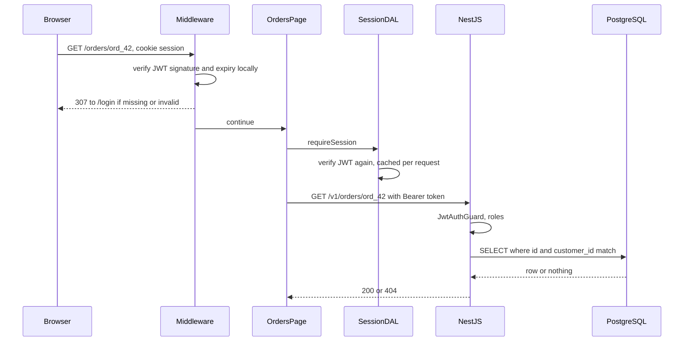

## 75.9 Edge vs Node runtime, middleware, and where auth checks run

#### Concept

Next.js server code runs in one of two **runtimes**:

- The **Node.js runtime** (the default): a normal Node.js process with every Node API, native modules, TCP sockets, `node:crypto`, the PostgreSQL and Redis drivers, and most npm packages.
- The **Edge runtime**: a lightweight V8 isolate (the same engine without Node.js around it) that offers Web-standard APIs only: `fetch`, `Request`, `Response`, Web Crypto (`crypto.subtle`), streams, `TextEncoder`, `URL`. No file system, no native modules, no raw TCP. It starts in milliseconds and, on platforms that support it, runs in many locations close to users.

A route chooses with `export const runtime = 'edge'` (or `'nodejs'`) in its segment config.

**Middleware** is a single file, `middleware.ts` at the project root (or in `src/`), whose exported `middleware(request)` function runs **before** every request it matches: before routing, before the Full Route Cache, before static pages are served. It can redirect, rewrite, set headers and cookies, or return a response directly. In Next.js 14, middleware always runs on the Edge runtime. Next.js 15.5 made the Node.js runtime stable for middleware (`export const config = { runtime: 'nodejs' }`), and Next.js 16 renamed the file to `proxy.ts` with an exported `proxy` function on the Node.js runtime, keeping `middleware.ts` only as a deprecated Edge option.

#### Why does it exist?

Some decisions must happen before any page renders, for every request: redirect a logged-out user away from `/orders`, send `/` to `/en-in` based on `Accept-Language`, assign an A/B test bucket cookie, block a bad bot. Doing these inside each page repeats code and runs after rendering has started. Middleware gives one choke point. The Edge runtime exists because those decisions are small and latency-sensitive: a few milliseconds near the user beats a round trip to one region.

#### Mental model

Imagine an office building. Middleware is the receptionist in the lobby: quick, checks that you have a badge, points you to the right floor, turns away people without one. The receptionist does not check whether you may open a specific filing cabinet on the fifth floor; that lock is on the cabinet itself (NestJS's guard and the ownership check in SQL). And if someone finds a side door, the lobby check never happens, which is why the cabinets have locks too.

#### How it works

Where auth decisions sit for a request to `/orders/ord_42`:



1. **Middleware: the optimistic check.** Is there a session cookie, and is its signature valid and unexpired? That needs no network call if the token is a JWT verified against cached public keys (JWKS). If not, redirect to login. This is a user-experience check, not the security boundary.
2. **The data access layer (DAL): the real check in the web tier.** Every server component, Server Action and Route Handler that touches user data calls `getSession()` or `requireSession()` itself. Next.js documentation recommends this explicitly, for two reasons: a matcher can miss a path, and layouts do not re-render on client navigation (75.3), so a check placed only in a layout does not run for every page.
3. **NestJS: the authority.** The API verifies the token in a guard and enforces ownership in the query (`WHERE customer_id = $2`). Whatever the web tier does or forgets, the API refuses data the user may not see.

Choosing a runtime:

| Need | Node.js runtime | Edge runtime |
|---|---|---|
| PostgreSQL, Redis, gRPC or other TCP clients | Yes | No |
| `node:crypto`, `fs`, `sharp`, most vendor SDKs | Yes | No (Web Crypto only) |
| Calls to a NestJS API in one region | Best: deploy next to the API | Pays the distance per call |
| Redirects, rewrites, headers, cookie checks without backend calls | Works | Best: tiny and close to users |
| Cold start | Hundreds of ms on serverless | A few ms |
| Code size | Large bundles fine | Platform limits (low single-digit MB on Vercel) |

The trap with Edge is distance. An Edge function running in Sydney that calls a NestJS API in Mumbai pays about 120 ms per call; three sequential calls cost more than rendering the whole page on a Node server next to the API. Edge wins only when the work needs no backend, or the data is replicated to the edge too.

#### Practical example

The storefront uses middleware for three things only: redirect unauthenticated users away from `(account)` routes, set an A/B bucket cookie on first visit (so server and client render the same variant, 75.10), and add security headers. Every account page calls `requireSession()` before fetching. Every NestJS endpoint under `/v1/orders` uses a JWT guard and ownership filtering. The middleware matcher excludes `_next/static`, images and the public storefront, so the 95 % of traffic that hits cached product pages never runs middleware at all.

#### React / Next.js example

```ts
// apps/web/middleware.ts  (Next.js 14, Edge runtime; in 16 this file is proxy.ts exporting proxy())
import { NextResponse, type NextRequest } from 'next/server';
import { createRemoteJWKSet, jwtVerify } from 'jose';         // jose runs on Web Crypto; jsonwebtoken does not

const JWKS = createRemoteJWKSet(new URL(`${process.env.AUTH_ISSUER}/.well-known/jwks.json`)); // keys cached per isolate

export async function middleware(req: NextRequest) {
  const token = req.cookies.get('session')?.value;
  if (token) {
    try {
      await jwtVerify(token, JWKS, { issuer: process.env.AUTH_ISSUER, audience: 'shop-web', clockTolerance: 5 });
      return NextResponse.next();
    } catch { /* expired, wrong key or forged: fall through to login */ }
  }
  const login = new URL('/login', req.url);
  login.searchParams.set('next', req.nextUrl.pathname);      // the login page allows only relative paths
  return NextResponse.redirect(login);
}

export const config = {
  matcher: ['/orders/:path*', '/cart', '/account/:path*'],   // the storefront never pays for middleware
};
```

```ts
// apps/web/lib/session.server.ts  (the data access layer used by 79.6 and 79.8)
import 'server-only';
import { cache } from 'react';
import { cookies } from 'next/headers';
import { redirect } from 'next/navigation';
import { createRemoteJWKSet, jwtVerify } from 'jose';

const JWKS = createRemoteJWKSet(new URL(`${process.env.AUTH_ISSUER}/.well-known/jwks.json`));

export const getSession = cache(async () => {                 // once per request, however many components ask
  const token = cookies().get('session')?.value;              // Next.js 15+: (await cookies()).get(...)
  if (!token) return null;
  try {
    const { payload } = await jwtVerify(token, JWKS, { issuer: process.env.AUTH_ISSUER, audience: 'shop-web' });
    return { userId: String(payload.sub), roles: (payload.roles as string[] | undefined) ?? [], accessToken: token };
  } catch {
    return null;
  }
});

export async function requireSession() {
  const session = await getSession();
  if (!session) redirect('/login');                           // throws; nothing after this runs
  return session;
}
```

An account page then starts with `const session = await requireSession();` before any fetch, and passes `session.accessToken` to NestJS. Token refresh, rotation and logout are covered in Part 77.

#### Backend side (NestJS)

NestJS issues the cookie the web tier reads and remains the authority:

```ts
// apps/api/src/auth/auth.controller.ts  (excerpt)
import { Body, Controller, HttpCode, Post, Res } from '@nestjs/common';
import type { Response } from 'express';
import { LoginRequestSchema, type LoginRequest } from '@shop/contracts';
import { ZodValidationPipe } from '../common/zod-validation.pipe';
import { AuthService } from './auth.service';

@Controller('v1/auth')
export class AuthController {
  constructor(private readonly auth: AuthService) {}

  @Post('login')
  @HttpCode(204)
  async login(@Body(new ZodValidationPipe(LoginRequestSchema)) body: LoginRequest,
              @Res({ passthrough: true }) res: Response): Promise<void> {
    const { accessToken } = await this.auth.login(body);      // RS256 JWT, 15 min, kid header for key rotation
    res.cookie('session', accessToken, {
      httpOnly: true, secure: true, sameSite: 'lax', path: '/', maxAge: 15 * 60 * 1000,
    });
  }
}
```

This is the simplest working shape: one short-lived cookie, set by NestJS. Part 77 hardens it for production. The Next.js BFF becomes the only thing that sets cookies (`__Host-session` for the access token, `__Secure-refresh` scoped to `/api/auth`, and a `__Host-csrf` token). NestJS returns tokens only to the BFF, and refresh rotation keeps users signed in past 15 minutes (77.2, 77.3, worked end to end in 77.10). The verification rules below stay the same.

- **Publish a JWKS endpoint** (`/.well-known/jwks.json`) with the public keys and a `kid` per key, so middleware and the DAL verify locally and keys can rotate without a deploy of the web tier.
- **Keep tokens short-lived.** Local verification cannot see revocation; a 15-minute access token bounds how long a logged-out or banned session passes the web tier's checks. NestJS can additionally check a revocation list in Redis for sensitive operations.
- **Enforce ownership in the query**, not just in a guard: `SELECT ... WHERE id = $1 AND customer_id = $2` returns nothing for someone else's order, and the API answers `404`.

#### Production scenario

A travel marketplace's middleware called NestJS `GET /v1/auth/session` on every request to check login, and its matcher was the default (everything). Static assets, images and prefetches all ran it: about 3,000 session checks per second, each a 40 to 90 ms round trip from the edge location to the API region. Replacing the call with local JWT verification against a cached JWKS and narrowing the matcher to account routes cut middleware time from 95 ms p50 to 1.5 ms, took 3,000 RPS off the auth service, and improved TTFB on every page, including static ones that had been waiting on the auth call.

#### Failure scenario

In March 2025, CVE-2025-29927 showed that a crafted `x-middleware-subrequest` header made self-hosted Next.js skip middleware entirely (fixed in 20.3.5, 13.5.9, 14.2.25 and 15.2.3). One retailer's back-office reports at `/admin/exports` were protected *only* by a role check in middleware; the page fetched data from NestJS with the web tier's service token. Within days of the advisory, a scanner sent the header and downloaded a customer export. Nothing in the API logs looked wrong: the requests carried a valid service token.

The response: upgrade Next.js the same day, strip `x-middleware-subrequest` at the load balancer, add `requireSession()` with a role check in the admin layout *and* in each admin data function, and replace the service token with the staff user's own token so NestJS's `RolesGuard` made the decision. Middleware went back to being what it should have been: a redirect for convenience.

#### Edge cases & failure modes

- **Matcher gaps**: `'/orders'` does not match `/orders/ord_42`; locale prefixes and trailing slashes create more gaps. The DAL check catches what the matcher misses.
- **Middleware on static assets** when the matcher is too broad: every image request pays for it.
- **`node:crypto` in Edge middleware** fails; use Web Crypto or `jose`, or the Node.js middleware runtime in 23.5 and later.
- **Redirect loops** when `/login` itself is matched and redirects to `/login`.
- **Revoked sessions** still pass local JWT verification until expiry.
- **Clock skew** between the token issuer and the edge location rejects fresh tokens; allow a few seconds (`clockTolerance`).
- **Edge functions far from the API** turn a fast redirect layer into a slow data layer.

#### How a Senior Full-Stack Engineer thinks about this

The senior places auth in three layers and knows which one is the boundary: middleware for convenience, the web tier's DAL for correct rendering, NestJS for enforcement. They never let a check exist only in middleware or only in a layout. They choose the Edge runtime for small, backend-free decisions and the Node.js runtime, deployed next to the API, for anything that fetches. And they count middleware as per-request cost on every matched path, so they keep its matcher narrow and its work local.

#### Common mistakes

- **Authorisation only in middleware**, bypassable by a bug or a matcher gap.
- **Auth checks only in a layout**, which does not re-run on client navigation.
- **Network calls from middleware** on every request.
- **Using `jsonwebtoken` in Edge middleware** and discovering at build or runtime that it needs Node's crypto.
- **Service tokens for user-scoped reads**, which make the web tier the only authorisation layer.

#### Interview questions

1. **What is the difference between the Edge and Node.js runtimes in Next.js?** Expected answer: Edge is a V8 isolate with Web APIs only, fast start, near users; Node has full APIs and drivers. Follow-up: when is Edge slower? (When it calls a backend far away.)
2. **Where should authentication and authorisation checks live in a Next.js plus NestJS app?** Expected answer: optimistic check in middleware, verified session in a DAL used by every data access, enforcement and ownership in NestJS.
3. **Why is a layout a bad place for an auth check?** Expected answer: layouts are not re-rendered on client navigation between child pages.
4. **What did CVE-2025-29927 teach about middleware?** Expected answer: it can be bypassed; never make it the only check; defence in depth.
5. **How can middleware verify a session without calling the auth service?** Expected answer: signed JWT verified against a cached JWKS, short expiry, `kid` for rotation.

#### Practical exercise

Implement layered auth for the `(account)` route group.

Acceptance criteria:

- Logged-out requests to `/orders` and `/orders/anything` redirect to `/login?next=...`; `next=https://evil.example` is ignored by the login page.
- Deleting `middleware.ts` entirely still leaves every account page unable to show data without a valid session (DAL check).
- Calling NestJS directly with user A's token for user B's order returns `404`.
- Middleware p95 under 5 ms under load, with no network calls in its trace.

## 75.10 Hydration and hydration errors

#### Concept

**Hydration** is the step where React, in the browser, takes HTML that the server already rendered and makes it interactive. It renders the client components again in memory, walks the existing DOM in step, attaches event listeners and runs effects, without recreating the DOM nodes. The precondition is strict: **the first client render must produce exactly the same output as the server render.** When it does not, React reports a **hydration mismatch** (a hydration error).

Server components are not hydrated; they have no client code. Only the client component islands (75.4) are.

#### Why does it exist?

Server rendering gives fast, visible HTML, but HTML alone cannot respond to clicks. Throwing it away and rendering from scratch in the browser would waste the server's work and cause a flash. Hydration reuses the server's DOM and only adds behaviour. It is cheaper than rendering, but not free: React still runs every client component once on the main thread.

#### Mental model

Imagine furniture delivered already assembled, with the instruction manual. The electrician (React) walks through the room with the manual, wiring each lamp where the manual says it is. If the manual says a lamp is on the left and it is on the right, the electrician cannot guess; they tear that part of the room down and rebuild it from the manual. The room still ends up correct, but slower, with a visible flash.

#### How it works

1. The server renders the tree to HTML and inlines the RSC payload (75.4).
2. The browser paints the HTML. The page is visible but not interactive.
3. Client chunks download; React calls `hydrateRoot` on the document.
4. React renders the client components and compares the result with the DOM it finds, node by node.
5. On a match, it attaches listeners; effects (`useEffect`) run afterwards, and only then can state differ from the server.
6. On a mismatch, React 18 logs an error in development ("Text content does not match server-rendered HTML", "Hydration failed because the initial UI does not match what was rendered on the server") and **recovers by client-rendering**: it discards the server HTML up to the nearest `<Suspense>` boundary and renders that subtree from scratch. With no boundary above the mismatch, the whole root is client-rendered. In production the message is short, and the recovery is reported through `onRecoverableError`. React 19 prints one error with a diff of the mismatched content.
7. **Selective hydration** (React 18): with Suspense boundaries, React hydrates in chunks and, if the user clicks inside a boundary that is not hydrated yet, hydrates that one first.

Common causes and fixes:

| Cause | Example | Fix |
|---|---|---|
| Time and time zone | `new Date(iso).toLocaleString()` on a UTC server vs an IST browser | Format with an explicit `timeZone` both sides, or render relative times after mount |
| Locale defaults | `toLocaleString()` with no locale; Node's ICU differs from the browser's | Always pass a locale (75.1 uses `en-IN`) |
| Randomness | `Math.random()`, `crypto.randomUUID()` for element ids | `useId()` for ids; decide random values on the server and pass them as props |
| Browser-only branches | `typeof window !== 'undefined' ? a : b` in render | Same render both sides; switch in `useEffect` or `useSyncExternalStore` with a server snapshot |
| Browser storage | Reading `localStorage` during render | `useSyncExternalStore`, or read in an effect |
| Invalid HTML nesting | `<div>` inside `<p>`, `<a>` inside `<a>` | The browser's parser repairs the DOM, so it no longer matches; fix the markup |
| Outside modification | Browser extensions adding attributes to `<body>`, CDN HTML rewriting | `suppressHydrationWarning` on `<html>`/`<body>` only; disable HTML rewriting at the CDN |
| Separately decided flags | A/B variant chosen on server and client independently | Decide once (middleware cookie, 75.9) and read the same value both sides |

#### Practical example

The order history page shows "Delivered at 11:40 PM" for each order. The server runs in UTC; customers are in India (UTC+05:30). The fix is to make the server and browser format the same instant in the same zone, by using the customer's time zone from their profile (sent by NestJS) on both sides. "Delivered 3 minutes ago" cannot be correct on both sides at all, because time passes between the server render and hydration, so it renders the absolute time first and switches to relative after mount.

#### React / Next.js example

```tsx
// apps/web/components/DeliveredAt.tsx
'use client';
import { useEffect, useState } from 'react';

const fmt = (timeZone: string) =>
  new Intl.DateTimeFormat('en-IN', { timeZone, dateStyle: 'medium', timeStyle: 'short' });

export function DeliveredAt({ iso, timeZone }: { iso: string; timeZone: string }) {
  const absolute = fmt(timeZone).format(new Date(iso));     // identical on server and client: same zone, same locale
  const [relative, setRelative] = useState<string | null>(null);
  useEffect(() => {                                          // runs only after hydration
    const mins = Math.round((Date.now() - Date.parse(iso)) / 60_000);
    if (mins < 60) setRelative(`${mins} min ago`);
  }, [iso]);
  return <time dateTime={iso} title={absolute}>{relative ?? absolute}</time>;
}
```

A value that exists only in the browser, read without a mismatch:

```tsx
// apps/web/components/useRecentlyViewed.ts
'use client';
import { useSyncExternalStore } from 'react';

const subscribe = (cb: () => void) => { window.addEventListener('storage', cb); return () => window.removeEventListener('storage', cb); };

export function useRecentlyViewedCount(): number {
  return useSyncExternalStore(
    subscribe,
    () => JSON.parse(localStorage.getItem('recently_viewed') ?? '[]').length, // client snapshot
    () => 0,                                                                   // server snapshot, also used while hydrating
  );
}
```

For a component that cannot render on the server at all (a map widget touching `window` on import), load it with `next/dynamic` and `{ ssr: false }` from inside a client component, and give the placeholder a fixed size so it does not shift the layout (71.5).

#### Backend side (NestJS)

- **Send instants, not formatted strings.** ISO 8601 in UTC with the `Z` suffix (`2026-11-04T18:10:00Z`). The frontend formats; the backend never sends "11:40 PM" built in its own zone.
- **Store and expose the user's time zone** as an IANA name (`Asia/Kolkata`) on the profile, so server and browser can format identically.
- **Deterministic ordering.** `ORDER BY delivered_at DESC, id DESC`. Without a tie-breaker, PostgreSQL may return rows with equal timestamps in a different order on the server's request and a client refetch, which reorders rows under the user and, with `HydrationBoundary` data plus an immediate refetch, causes flicker.
- **No per-request randomness in responses** that the server and client might fetch separately ("shuffled recommendations"); seed it with a stable value such as the A/B bucket or the date.

#### Production scenario

A grocery app's product listing hydrated 1,900 DOM nodes of client components on every category page because the whole grid was one `'use client'` module. On a Moto G-class phone, hydration took 1.1 s of main-thread time, and taps on "Add" in the first second were queued, giving a p75 INP of 420 ms. Converting the grid to server components with a small client `AddButton` per tile cut hydration to 280 ms and INP to 170 ms (Part 78 — Web Performance). Adding a Suspense boundary around the below-the-fold "Recently viewed" rail let React hydrate the visible grid first.

#### Failure scenario

An order-tracking page rendered the delivery time with `new Date(order.deliveredAt).toLocaleString('en-IN')`. In development, server and browser shared the laptop's IST time zone, so nothing was wrong. In production, the server ran in UTC. Every order page hit a text mismatch in the page header, outside any Suspense boundary, so React 18 discarded the server HTML for the whole root and client-rendered it, on every visit. The page flashed, p75 LCP went from 1.2 s to 2.9 s, and the error tracker received 400,000 "Hydration failed" events a day, which the team muted as "noise" for two weeks.

The fix passed `timeZone` from the profile into an explicit `Intl.DateTimeFormat`, added a Suspense boundary around the order body so any future mismatch would be contained, and turned hydration errors into an alert with a threshold instead of a muted issue. The CI pipeline now runs Playwright with `timezoneId: 'Asia/Kolkata'` against a server started with `TZ=UTC`, which reproduces the bug class.

#### Edge cases & failure modes

- **Stale HTML with a new bundle**: a CDN serving HTML from the old deploy with JavaScript from the new one produces mismatches across the page (75.11).
- **`suppressHydrationWarning`** works one level deep, on one element's text and attributes; using it widely hides real bugs.
- **Mismatches outside Suspense** client-render the whole root; boundaries contain the damage.
- **Translation extensions** rewrite text nodes and can break hydration and later updates; there is no complete fix, only resilience.
- **Heavy client trees** hydrate slowly even when correct; the fix is fewer client components, not faster hydration.

#### How a Senior Full-Stack Engineer thinks about this

The senior sees hydration as a contract: the server and browser must compute the same first render from the same inputs. Anything that differs between them (clock, time zone, locale, storage, randomness, flags) is either passed in explicitly from the server or deferred until after mount. They treat hydration errors as real production errors with alerts, because each one costs a full client re-render and the user sees it. And they reduce hydration work structurally, by keeping client components small (75.4).

#### Common mistakes

- **Formatting dates without an explicit time zone and locale.**
- **Branching on `typeof window` during render.**
- **Muting hydration errors** in the error tracker.
- **Sprinkling `suppressHydrationWarning`** instead of fixing the cause.
- **Testing only with the server and browser in the same time zone.**

#### Interview questions

1. **What is hydration, and what must be true for it to succeed?** Expected answer: React attaching to server HTML by rendering the same tree on the client; the first client render must match the server output. Follow-up: what does React 18 do on a mismatch? (Client-renders up to the nearest Suspense boundary, or the whole root.)
2. **Give four causes of hydration mismatches and their fixes.** Expected answer: time zones, locale defaults, randomness, browser-only branches, storage reads, invalid nesting, extensions; explicit inputs, `useId`, effects, `useSyncExternalStore`, valid HTML.
3. **How do server components change hydration cost?** Expected answer: they are not hydrated, so only client islands cost main-thread time.
4. **What can the backend do to prevent hydration bugs?** Expected answer: send UTC instants and the user's IANA time zone, stable sort orders, deterministic responses.

#### Practical exercise

Break and fix hydration on an order history page.

Acceptance criteria:

- Run the server with `TZ=UTC` and a Playwright browser with `timezoneId: 'Asia/Kolkata'`; capture the hydration error in the console.
- After the fix, the same test passes with no hydration errors in the console, and the rendered time matches the profile's time zone.
- A `<div>` nested in a `<p>` is caught by a test that fails on any console error during hydration.
- Hydration main-thread time for the page, measured in the Performance panel with 4x CPU slowdown, is recorded before and after converting at least one large client component to a server component.
