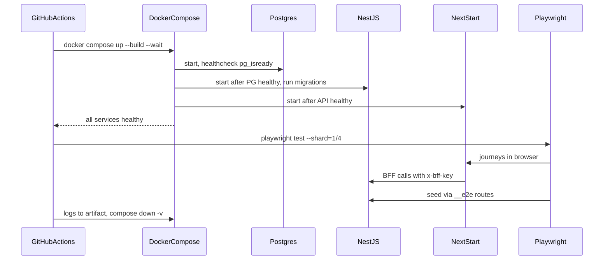

## 75.11 Testing against a real NestJS backend in CI with Docker Compose

#### Concept

An **ephemeral test stack** is a complete, short-lived copy of the system started for one CI job and thrown away afterwards: PostgreSQL, Redis, the NestJS API in e2e mode, and the web app's production build. **Docker Compose** describes it in one file; the CI job starts it, waits for every service to be healthy, runs Playwright against it, collects logs and reports, and stops it. Each pull request gets its own stack, so no two runs share data or versions.

#### Why does it exist?

The alternatives fail in known ways. A **shared staging environment** is deployed by other people at random times, holds data other tests mutate, and runs whatever API version was merged last, not the one in your pull request (the 38-minute, 30 %-flaky suite of 75.7). **Mocking the backend in e2e** with `page.route` everywhere turns the slowest tests into expensive component tests. A stack per job costs 60-90 seconds to start and gives each run a known version of every component and an empty, seeded database.

#### Mental model

Imagine a flight simulator that is built fresh for each pilot, with the exact aircraft model they will fly, and dismantled after the session. No previous pilot's coffee cup in the cockpit, no surprise software update mid-flight.

#### How it works



1. **Images are built from the pull request's commit**: the API's Dockerfile (Part 86.13) and the web's standalone Next.js image (71.11). In a monorepo, Turborepo's `prune` keeps each image to its own dependencies (68.12).
2. **Health checks gate start order**: `depends_on: { db: { condition: service_healthy } }`. `docker compose up --wait` returns only when every service with a health check reports healthy, or fails the job.
3. **Migrations run before the API serves traffic**, as in production (Part 23): a one-shot `migrate` service that the API depends on with `condition: service_completed_successfully`.
4. **Configuration mirrors production** except for test-only flags: `E2E_SUPPORT=enabled`, raised throttle limits, a fixed clock if visual tests need it, a fake payment provider in test mode.
5. **Playwright runs on the CI host** (or in the Playwright container) against `http://localhost:3000`, with `E2E_BASE_URL` set so its own `webServer` block starts nothing.
6. **On failure**, the job uploads the Playwright report and `docker compose logs`, so the browser trace's request IDs can be matched to API log lines.
7. **Teardown**: `docker compose down -v` removes containers and volumes.

GitHub Actions **service containers** (`services: postgres:`) are an alternative for the database alone; Compose is better when the stack includes your own images and their start order.

#### Practical example

The stack for the storefront: PostgreSQL 16, Redis 7, the API (migrations, then `node dist/main.js`), the web (`node server.js` from Next.js standalone output) and a stub payment provider. Cold start on a GitHub-hosted 4-vCPU runner: image builds with the Docker layer cache 50-70 s, `up --wait` 18 s. Four Playwright shards each start their own stack, so shards never share a database.

#### React / Next.js example

```yaml
# e2e/compose.yaml
services:
  db:
    image: postgres:16-alpine
    environment: { POSTGRES_USER: shop, POSTGRES_PASSWORD: shop, POSTGRES_DB: shop_e2e }
    tmpfs: [/var/lib/postgresql/data]                  # in memory: faster, and nothing survives the job
    healthcheck: { test: ["CMD-SHELL", "pg_isready -U shop -d shop_e2e"], interval: 2s, retries: 30 }
  redis:
    image: redis:7-alpine
    healthcheck: { test: ["CMD", "redis-cli", "ping"], interval: 2s, retries: 30 }
  migrate:
    build: { context: .., dockerfile: apps/api/Dockerfile, target: runtime }
    command: ["node", "dist/migrate.js"]               # runs TypeORM migrations, then exits 0
    environment: { DATABASE_URL: postgres://shop:shop@db:5432/shop_e2e }
    depends_on: { db: { condition: service_healthy } }
  api:
    build: { context: .., dockerfile: apps/api/Dockerfile, target: runtime }
    environment:
      DATABASE_URL: postgres://shop:shop@db:5432/shop_e2e
      REDIS_URL: redis://redis:6379
      E2E_SUPPORT: enabled
      E2E_SECRET: ${E2E_SECRET}
      BFF_KEY: ${BFF_KEY}
      THROTTLE_LIMIT_PER_MIN: "5000"
      PAYMENTS_BASE_URL: http://payments-stub:8080
    ports: ["4000:4000"]
    depends_on:
      migrate: { condition: service_completed_successfully }
      redis: { condition: service_healthy }
    healthcheck: { test: ["CMD", "wget", "-qO-", "http://localhost:4000/health/ready"], interval: 2s, retries: 60 }
  web:
    build: { context: .., dockerfile: apps/web/Dockerfile }
    environment: { API_INTERNAL_URL: http://api:4000, BFF_KEY: ${BFF_KEY}, NODE_ENV: production }
    ports: ["3000:3000"]
    depends_on: { api: { condition: service_healthy } }
    healthcheck: { test: ["CMD", "wget", "-qO-", "http://localhost:3000/api/health"], interval: 2s, retries: 60 }
  payments-stub:
    image: wiremock/wiremock:3.9.1
    volumes: ["./payments-stub:/home/wiremock"]        # canned approve and decline responses
```

```yaml
# .github/workflows/web-e2e.yml
name: web-e2e
on: { pull_request: { paths: ['apps/**', 'packages/**', 'e2e/**'] } }
jobs:
  e2e:
    runs-on: ubuntu-latest
    timeout-minutes: 20
    strategy: { fail-fast: false, matrix: { shard: [1, 2, 3, 4] } }
    env: { E2E_SECRET: e2e-${{ github.run_id }}, BFF_KEY: bff-${{ github.run_id }}, E2E_BASE_URL: http://localhost:3000, E2E_API_URL: http://localhost:4000 }
    steps:
      - uses: actions/checkout@v4
      - uses: pnpm/action-setup@v4
      - uses: actions/setup-node@v4
        with: { node-version: 20, cache: pnpm }
      - run: pnpm install --frozen-lockfile
      - run: docker compose -f e2e/compose.yaml up --build --wait
      - run: pnpm --filter web exec playwright install --with-deps chromium
      - run: pnpm --filter web exec playwright test --shard=${{ matrix.shard }}/4
      - if: always()
        run: docker compose -f e2e/compose.yaml logs --no-color > compose-logs.txt
      - if: always()
        uses: actions/upload-artifact@v4
        with:
          name: e2e-shard-${{ matrix.shard }}
          path: |
            apps/web/blob-report
            compose-logs.txt
          retention-days: 7
      - if: always()
        run: docker compose -f e2e/compose.yaml down -v
  report:
    if: always()
    needs: e2e
    runs-on: ubuntu-latest
    steps:
      - uses: actions/checkout@v4
      - uses: actions/download-artifact@v4
        with: { pattern: e2e-shard-*, path: all-blob-reports, merge-multiple: true }
      - run: npx playwright merge-reports --reporter html ./all-blob-reports
      - uses: actions/upload-artifact@v4
        with: { name: e2e-html-report, path: playwright-report, retention-days: 14 }
```

The secrets are generated per run: nothing in this stack is a real credential, and the test-support secret dies with the job.

#### Backend side (NestJS)

What the API must provide so the stack starts reliably and the tests are honest:

- **Separate liveness and readiness** (Part 80.12, `@nestjs/terminus`): `/health/ready` checks PostgreSQL and Redis; Compose waits on it.
- **Migrations as a separate command**, not run inside `main.ts` on every boot, so a failed migration fails the `migrate` service with a clear log instead of a crash loop.
- **Configuration validated at boot** (`ConfigModule.forRoot({ validate })`) so a missing `BFF_KEY` fails in 2 seconds with a message, not 20 minutes later as 401s in a trace.
- **Fast shutdown on SIGTERM** (`app.enableShutdownHooks()`), so `compose down` takes 1 s, not the 10 s default kill timeout.
- **Structured logs with the request ID**, so the uploaded compose logs can be searched for the ID shown in the Playwright trace.

```ts
// apps/api/src/health/health.controller.ts  (@nestjs/terminus 10)
import { Controller, Get } from '@nestjs/common';
import { HealthCheck, HealthCheckService, TypeOrmHealthIndicator } from '@nestjs/terminus';
import { RedisHealthIndicator } from './redis.health';           // small custom indicator: PING with 500 ms timeout

@Controller('health')
export class HealthController {
  constructor(private health: HealthCheckService, private db: TypeOrmHealthIndicator, private redis: RedisHealthIndicator) {}

  @Get('live') live() { return { status: 'ok' }; }               // process is up; no dependencies

  @Get('ready')
  @HealthCheck()
  ready() {
    return this.health.check([
      () => this.db.pingCheck('postgres', { timeout: 1000 }),
      () => this.redis.isHealthy('redis'),
    ]);
  }
}
```

#### Production scenario

A team running 26 journeys against per-shard Compose stacks measured, over a quarter: median e2e job time 5 min 10 s (stack start 1 min 25 s, tests 3 min 30 s, teardown and upload 15 s), 0.3 % flaky runs, and zero failures caused by "someone else's deploy". Moving from the shared staging environment cost about 1,500 extra runner-minutes a month and saved an estimated 30 engineer-hours a month previously spent re-running and investigating staging-caused failures.

#### Failure scenario

The e2e job passed for weeks while production checkout broke twice. The compose file used `image: shop/api:latest` from the registry instead of building from the pull request's commit, so e2e always tested the last image someone had pushed manually, sometimes days old. A web change that needed a new API field passed against an old API that happened to include it on an abandoned branch image. The fix: build both images from the commit under test (`build:` in compose, with the layer cache), tag them with the SHA, and print the SHA of each service in the test report header via a `/version` endpoint.

#### Edge cases & failure modes

- **Images not built from the commit under test**, testing a different version from the one being merged.
- **Health checks missing or checking the wrong thing** (a port being open instead of the app being ready).
- **Persistent volumes reused** between runs on self-hosted runners; use `tmpfs` or `down -v`.
- **Port clashes** on self-hosted runners running two jobs; use a Compose project name per job (`-p e2e-${{ github.run_id }}`) and dynamic ports.
- **Real third parties** called from the stack (payments, SMS); stub them (WireMock, a fake service) and keep one contract test against the provider's sandbox elsewhere.
- **ARM laptops versus x86 CI**: images built locally on Apple Silicon differ from CI; build in CI, or use multi-platform builds.
- **Slow image builds**: without a layer cache (`docker/build-push-action` with `cache-from: type=gha`), every run reinstalls dependencies.

#### How a Senior Full-Stack Engineer thinks about this

The senior wants the e2e environment to be a function of the commit: same commit, same stack, same result. They build every image from the commit under test, start dependencies with health checks, keep test-only behaviour behind explicit flags, stub external parties, and collect logs automatically. They count the minutes and accept them, because a reproducible red build is worth more than a fast unreliable one. They also design the API's health, configuration and shutdown behaviour with this environment in mind, since a service that starts cleanly in Compose usually starts cleanly in Kubernetes too.

#### Common mistakes

- **Testing against shared staging.**
- **`image: latest`** in the e2e compose file.
- **No logs collected**, so failures cannot be traced to the backend.
- **Disabling auth or CSRF in the e2e stack** to make tests easier.
- **Running migrations inside the API's boot** with no separate failure signal.

#### Interview questions

1. **Why an ephemeral stack per CI job instead of a shared staging environment?** Expected answer: versions match the commit, data is isolated, no interference from other deploys, reproducible failures.
2. **How do you make sure services start in the right order?** Expected answer: health checks plus `depends_on` conditions, `up --wait`, a one-shot migration service.
3. **How do you connect a failed browser test to a backend error?** Expected answer: request IDs in responses and logs, the Playwright trace's network log, compose logs uploaded as artifacts.
4. **What do you do about third-party services in the stack?** Expected answer: stub them with canned responses; test the real integration separately against the provider's sandbox.

#### Practical exercise

Build the Compose stack and the GitHub Actions job above for the monorepo of Part 68.

Acceptance criteria:

- Images are built from the commit under test; the report shows each service's commit SHA.
- `docker compose up --wait` fails the job within 60 s if the API cannot reach PostgreSQL.
- Four shards each start their own stack; one merged HTML report is published.
- On failure, the job uploads compose logs, and a request ID from a failed trace can be found in them.
- The API refuses to boot with a missing `BFF_KEY`, with a clear message, in under 5 s.

## 75.12 Code review for frontend changes: what a backend reviewer should look for

#### Concept

Backend engineers are often asked to review frontend pull requests: in a full-stack team, in a monorepo where the change touches `packages/contracts`, or because the frontend change calls a new endpoint. A useful review does not require knowing every React idiom. It requires knowing where frontend changes break production, and those places overlap heavily with what a backend engineer already understands: contracts, errors, retries, caching, security, data volume and tests.

#### Why does it exist?

Because the most expensive frontend bugs are full-stack bugs, and a reviewer who only reads one side misses them. A frontend reviewer may approve a perfectly idiomatic component that retries a non-idempotent `POST`, shows a server error in the wrong place, or puts an access token in `localStorage`. A backend reviewer who knows what to look for catches those in minutes.

#### Mental model

Imagine an electrician inspecting a kitchen renovation. They do not judge the cabinet colours. They check every place where the new kitchen connects to the building's wiring: sockets, load, earthing, what happens when a fuse trips. The backend reviewer inspects every place where the screen connects to the API.

#### How it works

The review, in the order a senior reads a frontend pull request:

| Area | Questions | Where in this book |
|---|---|---|
| Contract | Does it use the shared schema or generated client, or a hand-written type? Does it handle unknown enum values and nullable fields? | 72.3, 72.7 |
| Errors | Is every API error mapped (field, banner, toast, reauth, wait)? Is the request ID shown? Is "unknown outcome" distinguished from "failed"? | 72.6, 77.8 |
| Writes | Is every write protected against double submit? Does every retried write send an `Idempotency-Key`? | 69.8, 78.6 |
| Retries and timeouts | Are there timeouts (`AbortSignal.timeout`)? Are retries limited, with backoff, and only for safe or idempotent calls? | 70.10, Part 30 |
| Data volume | Is a list paginated by cursor? Is the payload slim? Any N+1 request patterns (one request per row)? | 70.7, 82.10 |
| Caching | Are query keys complete? Is personal data kept out of shared caches? Are `revalidate` and tags right on Next.js fetches? | 70.2, 79.7 |
| Security | Tokens only in HttpOnly cookies? No `dangerouslySetInnerHTML` with API data? Redirect targets validated? Secrets not in `NEXT_PUBLIC_*`? | 73.1, 73.7, 73.9, 76.6 |
| Server and client boundary | Does a Client Component import server-only code? Does a Server Component leak secrets into props? | 71.4 |
| Performance | Does it add a large dependency to the entry chunk? Images sized? Layout shift? | 74.7, 74.8 |
| Accessibility | Labels, roles, keyboard path, focus after errors? | 67.9, 83.10 |
| Tests | Component tests for each new state with MSW? A journey only if a boundary is crossed? No mocks of the app's own client? | This Part |
| Observability | Are errors reported with release and request ID? Are new user actions measurable? | Part 76 |

#### Practical example

A pull request adds "Reorder" to the order page: a button that calls `POST /v1/orders/:id/reorder` and navigates to the cart. A backend reviewer reads 140 lines of TSX and leaves four comments in ten minutes:

1. "The mutation has `retry: 2` (from a copied hook). This `POST` creates a cart; without an `Idempotency-Key` a timeout plus retry can create two. Add a per-attempt key or set `retry: 0`." (69.8)
2. "On `409 ITEMS_UNAVAILABLE` the toast says 'Something went wrong'. The API returns `issues` listing the unavailable SKUs; show them." (72.6)
3. "The button has an icon and no text; add an accessible name." (67.9)
4. "Tests mock `reorderOrder` with `vi.mock`; use the MSW handler so the real client and parser run, and add the `409` case." (75.5)

None of these needs deep React knowledge.

#### React / Next.js example

A diff that looks fine to a reader who does not think about the backend:

```tsx
// apps/web/src/orders/ReorderButton.tsx (as submitted)
'use client';
import { useMutation } from '@tanstack/react-query';
import { useRouter } from 'next/navigation';

export function ReorderButton({ orderId }: { orderId: string }) {
  const router = useRouter();
  const m = useMutation({
    mutationFn: () => fetch(`/api/v1/orders/${orderId}/reorder`, { method: 'POST' }).then((r) => r.json()),
    retry: 2,                                            // review: retried non-idempotent POST
    onSuccess: () => router.push('/cart'),
    onError: () => alert('Something went wrong'),        // review: drops code, issues and requestId
  });
  return <button onClick={() => m.mutate()}><CartIcon /></button>;   // review: no accessible name, no double-submit guard
}
```

And after review:

```tsx
// apps/web/src/orders/ReorderButton.tsx (after review)
'use client';
import { useMutation } from '@tanstack/react-query';
import { useRouter } from 'next/navigation';
import { useRef } from 'react';
import { reorder } from '@/api/orders';                  // shared client: timeout, toApiError, schema parsing
import { useErrorTreatment } from '@/api/useErrorTreatment';

export function ReorderButton({ orderId }: { orderId: string }) {
  const router = useRouter();
  const key = useRef(crypto.randomUUID());               // one key per attempt; retries reuse it
  const treat = useErrorTreatment();                     // classify(): fields, banner, toast with request ID
  const m = useMutation({
    mutationFn: () => reorder(orderId, key.current),     // sends Idempotency-Key
    retry: (count, e) => count < 2 && isRetryable(e),    // only timeouts and 409 IDEMPOTENCY_IN_PROGRESS
    onSuccess: (cart) => router.push(`/cart?from=${encodeURIComponent(cart.sourceOrderId)}`),
    onError: treat,
  });
  return (
    <button type="button" onClick={() => m.mutate()} disabled={m.isPending}>
      <CartIcon aria-hidden /> {m.isPending ? 'Adding to cart...' : 'Reorder'}
    </button>
  );
}
```

#### Backend side (NestJS)

The review often ends with a backend change, and the backend reviewer is the right person to see it:

- The new endpoint must accept `Idempotency-Key` (the interceptor from 14.12) and document it in OpenAPI.
- `409 ITEMS_UNAVAILABLE` must list SKUs in `issues` with stable codes, so the UI can show them.
- The response should return the new cart, so the client does not need a second request.
- The endpoint needs a rate limit and an ownership check (the order belongs to the caller, Part 74.12).

The pull-request template makes the full-stack questions explicit for both sides:

```text
## Full-stack checklist
- [ ] Uses shared contracts or the generated client; unknown enum values handled
- [ ] Every API error code this screen can receive is mapped; request ID shown on unexpected errors
- [ ] Writes are idempotent (key sent) and double-submit safe; retries only for safe or idempotent calls
- [ ] Lists use cursor pagination; no request per row
- [ ] No tokens or secrets in client code or NEXT_PUBLIC_ variables; no unsanitised HTML
- [ ] Component tests with MSW for loading, empty, error and success; e2e only for new boundaries
- [ ] Accessible names, labels and a keyboard path for new controls
```

#### Production scenario

A team added a rotating backend reviewer to every frontend pull request that touched the API client or contracts, about 30 % of frontend pull requests. Review time per pull request rose by a median of 12 minutes. In the following two quarters, production incidents classified as "frontend-backend mismatch" (wrong error handling, duplicate writes, missing pagination, contract drift) fell from 9 to 2.

#### Failure scenario

A frontend pull request replaced the order history's cursor pagination with "load all orders and filter in the browser", because the new filter UI needed client-side filtering. Two frontend engineers approved it; the component was clean and well tested with a 20-order fixture. In production, customers with 2,000+ orders (B2B clinics) loaded a 6 MB response, the API's p99 for that endpoint went from 120 ms to 4.2 s, and the database's CPU doubled at 10:00 when clinics opened. A backend reviewer would have asked the first question in the checklist's data-volume row: "what is the largest list this can fetch?" The fix added server-side filter parameters to the cursor endpoint (Part 14.6).

#### Edge cases & failure modes

- **Reviewing only the TSX** and missing that the change requires an API change nobody made.
- **Approving tests that mock the client**, so the new error codes are never exercised.
- **Missing the server/client boundary**: an import that pulls a server secret into a Client Component's bundle.
- **Copied hooks** carrying retry or cache settings that are wrong for the new call.
- **Fixtures with 3 rows** hiding volume problems.

#### How a Senior Full-Stack Engineer thinks about this

The senior reviews every connection between the screen and the system: what is sent, what can come back, what happens on retry, how much data moves, what is cached and for whom, what is exposed to the browser, and how anyone will know it broke. They leave idiom and style to frontend specialists and lint rules, and spend their attention where a mistake costs money. They ask for the backend half of the change in the same pull request or a linked one, and they treat the checklist as a conversation starter, not a gate to tick.

#### Common mistakes

- **Commenting on style** while missing a retried `POST`.
- **Assuming the framework handles errors.**
- **Not asking about the largest realistic data size.**
- **Not checking what ends up in the client bundle** (`NEXT_PUBLIC_`, server imports).

#### Interview questions

1. **You are a backend engineer reviewing a React pull request. What do you look at first?** Expected answer: the API calls: contract types, error handling, idempotency and retries, pagination and volume, caching, security of tokens and HTML, tests at the network boundary.
2. **How can a frontend change cause a backend incident?** Expected answer: removed pagination, retry storms, request-per-row patterns, polling too often, cache keys that defeat caching.
3. **What would you check in a Next.js pull request specifically?** Expected answer: server and client boundary, secrets in props or `NEXT_PUBLIC_`, fetch caching and revalidation, Server Action authorisation.
4. **How do you make full-stack review routine?** Expected answer: code owners for the API client and contracts, a pull-request checklist, paired backend reviewers on API-touching changes.

#### Practical exercise

Review three real frontend pull requests from your team's history using the table above.

Acceptance criteria:

- For each, list every comment you would leave, labelled with the row of the table it belongs to.
- At least one comment per pull request results in a backend change (idempotency, error codes, pagination, rate limit or ownership check).
- Propose a `CODEOWNERS` rule that adds a backend reviewer to changes under `apps/web/src/api/` and `packages/contracts/`.
- Write the pull-request template for your repository, under 12 items.
