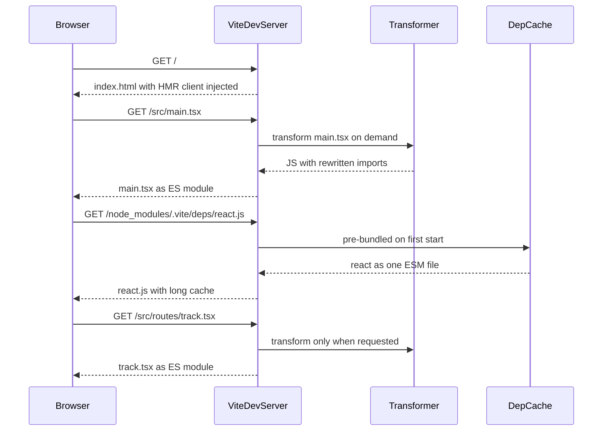
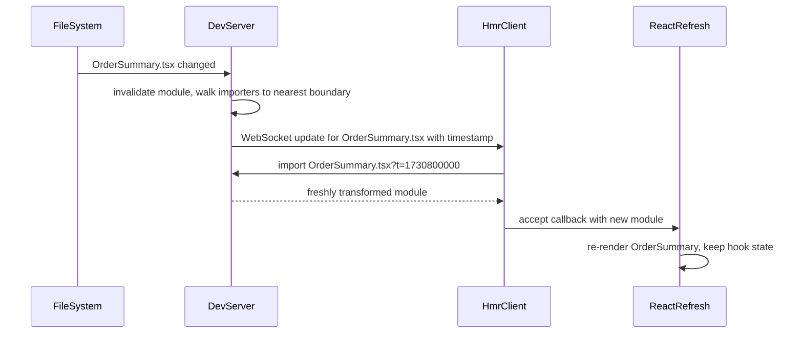

## 76.3 Bundlers and dev servers: Vite, esbuild, webpack and Turbopack

#### Concept

A **bundler** takes your entry file, follows every import to build the module graph (76.1), and writes a small number of optimised output files. A **dev server** serves your app to the browser during development and updates it when you save a file. Historically one tool did both. The big change of the last five years is that the fastest tools now treat development and production differently.

Four names cover most of what you will meet:

- **webpack** (v5 since 2020): the long-time standard. Bundles everything, in development and production, through a highly configurable system of loaders and plugins. Next.js used it by default up to version 15.
- **esbuild** (Go, 2020): an extremely fast bundler and transpiler with a deliberately small feature set. Rarely used alone for apps; used inside other tools.
- **Vite** (v1 2020, v5 2023, v6 late 2024, v7 mid 2025, v8 with Rolldown): a dev server that does *not* bundle your source during development and a production build that does. It is the default for new React SPAs since Create React App was deprecated in February 2025.
- **Turbopack** (Rust): the bundler built by Vercel for Next.js, based on fine-grained incremental computation. Opt-in for `next dev` in Next.js 13.4 and 14, stable for development in Next.js 15, and the default for both `next dev` and `next build` in Next.js 16.

You will also meet **Rollup** (Vite's production bundler up to Vite 7, strong at tree shaking and library builds), **Rolldown** (a Rust rewrite of Rollup's ideas that replaces both Rollup and esbuild inside Vite 8) and **Rspack** (a Rust implementation of webpack's API, 1.0 in 2024, for teams with large webpack configs who want speed without a rewrite).

#### Why does it exist?

Bundling solves the network problem (76.1), but it creates a development problem. A webpack dev server must build the entire graph before it can serve the first page. On a 3,000-module app that is 30 to 90 s on start and 1 to 3 s after each save, because even an incremental rebuild has to re-emit the bundle that contains the changed file. Developers save files hundreds of times a day. Three seconds per save is a quarter of an hour of waiting every day, and it breaks concentration.

Vite's insight was that during development the network is `localhost`, so the module waterfall that makes unbundled ES modules slow in production barely matters. Let the browser request modules natively, transform each one only when it is requested, and the dev server starts in under a second regardless of app size. Only third-party dependencies, which often consist of hundreds of internal files or ship as CommonJS, are pre-bundled once.

Turbopack took a different route to the same goal: keep bundling in development (so dev matches production more closely), but make it incremental at the level of individual functions, caching every intermediate result so a change recomputes only what depends on it.

#### Mental model

Imagine a magazine print shop. The webpack way rebinds the whole issue every time an editor changes a sentence. The Vite way, during editing, hands editors loose pages as they ask for them and binds only the final print run. The Turbopack way keeps a ledger of which sentence fed which page, so a change reprints exactly the affected lines.

#### How it works

**Vite in development.**



1. **Dependency pre-bundling.** On first start, Vite scans your source for bare imports, then bundles each dependency (React, TanStack Query, `lodash-es`) into a single ESM file in `node_modules/.vite/deps/`. This converts CommonJS to ESM and collapses packages with hundreds of internal modules (`lodash-es` has over 600) into one request. Vite 2 to 7 use esbuild for this; Vite 8 uses Rolldown. Results are cached until the lock file or config changes.
2. **On-demand source transforms.** Your own files are served as native ES modules. When the browser requests `/src/routes/track.tsx`, Vite transforms that one file (strip types, JSX, rewrite `import 'react'` to `/node_modules/.vite/deps/react.js?v=hash`) and responds. A route you never open is never transformed.
3. **Caching.** Pre-bundled dependencies are served with `Cache-Control: max-age=31536000, immutable`; source modules use `304 Not Modified` revalidation, so a reload re-sends only changed files.

**Vite in production.** `vite build` uses a real bundler: Rollup up to Vite 7, Rolldown from Vite 8. This dual approach has one real cost: the dev server and the production build are different programs, so a few bugs appear only in production (a CommonJS interop edge case, a different chunk order, a module with side effects that tree shaking removes). That inconsistency is one of the reasons Vite 8 moved both dev pre-bundling and production bundling onto Rolldown.

**webpack.** Everything is a module, and everything that is not JavaScript is turned into JavaScript by a **loader** (`ts-loader` or `babel-loader` for TypeScript, `css-loader` for CSS). **Plugins** hook into the compilation for everything else: `HtmlWebpackPlugin` writes `index.html`, `MiniCssExtractPlugin` extracts CSS files, `DefinePlugin` replaces constants. The dev server (`webpack-dev-server`) builds the whole graph into memory and serves it. webpack 5 added a persistent filesystem cache (`cache: { type: 'filesystem' }`) that cuts warm starts by 60 to 90 %, and **Module Federation**, which lets separately deployed apps load each other's modules at runtime (the basis of most "micro-frontend" setups).

**esbuild** alone is a command:

```bash
# Bundle, minify, split chunks and write source maps in about a second for a mid-size app.
npx esbuild src/main.tsx --bundle --minify --sourcemap --splitting --format=esm \
  --target=es2020,safari15 --outdir=dist/assets --define:process.env.NODE_ENV=\"production\"
```

It has no HMR (it has a `--watch` mode and a simple `--serve` with live reload), and code splitting works only with `--format=esm`. That is why apps use esbuild through Vite rather than directly, while small libraries, CLIs and Lambda functions often use it alone.

**Turbopack** computes the build as a graph of small cached functions ("parse this file", "resolve this import", "chunk this route"). On a change it invalidates only the functions whose inputs changed. It bundles per route on demand in development, so opening `/checkout` does not compile `/admin`. It is not a general-purpose bundler you configure for any app; it is built into Next.js and configured through `next.config.js`.

Typical numbers for a 2,000-module React app on a 2023 laptop (they vary a lot with plugins and machine; treat them as orders of magnitude):

| Tool | Dev server cold start | Update after save | Production build |
|---|---|---|---|
| webpack 5 with `babel-loader` | 25 to 45 s (8 to 12 s with warm filesystem cache) | 1 to 3 s | 90 to 150 s |
| Rspack 1.x | 3 to 6 s | 100 to 300 ms | 10 to 25 s |
| Vite 6 or 7 (Rollup build) | under 1 s to start; first page 2 to 4 s while modules transform | 20 to 80 ms | 30 to 60 s |
| Vite 8 (Rolldown build) | similar to Vite 7 | 20 to 80 ms | 5 to 15 s |
| Next.js 16 with Turbopack | 1 to 3 s per first route visit | under 100 ms | 20 to 45 s for the whole app |
| esbuild alone | no dev server | rebuild 50 to 200 ms with `--watch` | 1 to 3 s |

#### Practical example

A merchant dashboard on Create React App (webpack 4 underneath) took 52 s to start and 2.5 s per change. The two-day Vite migration: move `index.html` to the root with `<script type="module" src="/src/index.tsx">`, rename `process.env.REACT_APP_*` to `import.meta.env.VITE_*` (76.6), replace CRA's `proxy` field with `server.proxy`, add `vite-plugin-svgr` for SVG-as-component imports CRA did implicitly, and remove one dynamic `require()`. Dev start went to 0.8 s, updates to about 40 ms, the production build from 140 s to 34 s, and the bundle shrank 11 % from better tree shaking.

#### React / Next.js example

A Vite config for a React SPA that talks to a NestJS API on another port, with the dev proxy that removes the need for CORS in development:

```ts
// apps/web/vite.config.ts  (Vite 6 or 7)
import { defineConfig } from 'vite';
import react from '@vitejs/plugin-react';
import { fileURLToPath, URL } from 'node:url';

export default defineConfig({
  plugins: [react()],
  resolve: {
    alias: { '@': fileURLToPath(new URL('./src', import.meta.url)) }, // matches tsconfig paths (76.8)
  },
  server: {
    port: 5173,
    strictPort: true, // fail instead of silently moving to 5174 and breaking cookie and CORS assumptions
    proxy: {
      // Browser calls /api/... on :5173; Vite forwards to NestJS on :3000. Same origin, no CORS.
      '/api': { target: 'http://localhost:3000', changeOrigin: true },
      // Server-Sent Events and WebSockets for live order status (Part 38)
      '/realtime': { target: 'ws://localhost:3000', ws: true },
    },
  },
  build: { outDir: 'dist', sourcemap: 'hidden' }, // 'hidden': maps generated but not referenced (76.7)
  preview: { port: 4173 },
});
```

In Next.js 14 you opt into Turbopack for development only:

```json
{
  "scripts": {
    "dev": "next dev --turbo",
    "build": "next build",
    "start": "next start"
  }
}
```

In Next.js 15 the flag is `--turbopack` (with `--turbo` still accepted), and in Next.js 16 Turbopack is the default for both commands, with `--webpack` to opt out. A custom `webpack()` function in `next.config.js` is ignored by Turbopack, which is the main migration cost for older Next.js apps.

#### Backend side (NestJS)

The dev server topology decides what the API must do in development, and getting it wrong creates bugs that only exist on laptops.

With a **proxy** (recommended), the browser sees one origin (`http://localhost:5173`). Cookies set by NestJS on `/api/auth/login` are first-party, `SameSite=Lax` works, and the API needs no CORS configuration at all in development. Production usually looks the same, with a CDN or load balancer routing `/api/*` to NestJS, so dev mirrors prod.

Without a proxy, the browser on `:5173` calls `:3000` directly. That is cross-origin (different port means different origin), so NestJS must enable CORS, and cookies need `credentials: 'include'` on every `fetch`. Keep that configuration explicit and development-only:

```ts
// main.ts
import { NestFactory } from '@nestjs/core';
import { ConfigService } from '@nestjs/config';
import { AppModule } from './app.module';

async function bootstrap() {
  const app = await NestFactory.create(AppModule);
  const config = app.get(ConfigService);
  app.setGlobalPrefix('api'); // matches the '/api' proxy prefix, so paths are identical in dev and prod

  // Only for setups without a dev proxy. Never use origin: true or '*' together with credentials.
  const devOrigins = config.get<string>('CORS_DEV_ORIGINS'); // e.g. "http://localhost:5173"
  if (config.get('NODE_ENV') !== 'production' && devOrigins) {
    app.enableCors({
      origin: devOrigins.split(','),
      credentials: true,
      exposedHeaders: ['X-Request-Id', 'Retry-After'], // headers the frontend must be able to read
    });
  }

  app.enableShutdownHooks();
  await app.listen(config.get<number>('PORT', 3000));
}
bootstrap();
```

Two backend details matter with proxies: `changeOrigin: true` rewrites the `Host` header, so NestJS sees `localhost:3000` (fine for most apps, wrong if you build absolute URLs from `Host`; use a configured public base URL instead), and the proxy adds `X-Forwarded-For`, so trust it only in development or behind your real load balancer (Part 14 — Networking and HTTP covers forwarded headers).

#### Production scenario

An online grocery company with 14 frontend engineers logged rebuild durations and found 41 minutes per engineer per day spent waiting on webpack 5 (a 3,400-module app, 2.1 s average update). Their config had eight custom loaders and relied on Module Federation. Rspack accepted it with two changes, brought updates to 180 ms and production builds from 2 min 40 s to 22 s. They chose it over a Vite rewrite because it was a one-week migration rather than a six-week one.

#### Failure scenario

A Vite app worked perfectly in development and passed all tests. After deploy, the order history page threw `TypeError: Cannot read properties of undefined (reading 'default')`.

The page imported a CommonJS charting library. In development, esbuild's pre-bundling interop exposed `module.exports` one way; in production, Rollup's `@rollup/plugin-commonjs` produced a slightly different shape, and the code's `Chart.default.render(...)` only worked with one of them. Nobody had run `vite build && vite preview` before merging.

The fix was a one-line import change. The process fix was a CI job that builds, starts `vite preview` and runs the Playwright smoke tests against the production bundle (Part 83 — Frontend Testing and Quality), not the dev server.

#### Edge cases & failure modes

- **Dev and production bundlers differ** (Vite up to 7): CommonJS interop, chunk ordering and side-effect removal can behave differently. Always test the production build.
- **First page load in a big Vite app is slow** (hundreds of on-demand transforms). It is a one-time cost per session; `server.warmup` in Vite 5.1+ pre-transforms listed files.
- **Pre-bundle cache stale after linking a local package** (for example a workspace package changed outside Vite's watch). `vite --force` rebuilds it.
- **`strictPort: false`** silently moves to the next port; your proxy, CORS allow-list or OAuth redirect URI then points at the wrong one.
- **Custom webpack config ignored by Turbopack** in Next.js; features that relied on it break silently in dev.
- **Proxy timeouts**: long-polling and SSE endpoints proxied through the dev server need `ws: true` or longer timeouts, or the stream drops every 2 minutes in development only.

#### How a Senior Full-Stack Engineer thinks about this

A senior picks the bundler that the framework already chose (Next.js gives you Turbopack or webpack; a React SPA gets Vite) and spends their energy elsewhere. They do not hand-roll a webpack config in a new project in 2026. For an existing large webpack codebase they weigh a compatible speed-up (Rspack) against a rewrite (Vite) by migration cost, not by benchmark headlines. They measure developer wait time, because it is real money: 30 minutes a day across 20 engineers is more than a full-time salary.

They also insist that CI tests the artefact that ships: the production bundle, served the way production serves it. "It works in `vite dev`" is not evidence.

#### Common mistakes

- **Choosing a bundler by benchmark** instead of by framework fit and migration cost.
- **Never running the production build locally.**
- **Enabling CORS with `origin: true` and `credentials: true`** "just for dev" and shipping it to production.
- **Using Node-only libraries in browser code** and expecting the bundler to polyfill them.

#### Interview questions

1. **Why does Vite start in under a second when webpack takes 40 s on the same app?**
   Expected answer: Vite does not bundle source in development; it serves native ES modules and transforms each file on request, and pre-bundles dependencies once with a fast tool. webpack builds the whole graph first. Follow-up: what does that cost? (Dev and prod differ; slow first page on very large apps.)
2. **What is dependency pre-bundling and why does Vite need it?**
   Expected answer: converting CommonJS dependencies to ESM and collapsing many-file packages into one request, so the browser does not make hundreds of requests for one library.
3. **When would you choose Rspack over migrating to Vite?** Expected answer: large existing webpack configuration, custom loaders, Module Federation; Rspack keeps the config and gives most of the speed.
4. **How do you avoid CORS in local development?** Expected answer: a dev server proxy so the browser sees one origin, matching production routing.
5. **What is the main migration risk when moving a Next.js app to Turbopack?** Expected answer: custom webpack configuration and loaders are not used; equivalent configuration must be found or the feature replaced.

#### Practical exercise

Take an existing React app (or the one from 76.1) and measure: dev server cold start, time from save to visible change, and production build time. Then add a Vite `server.proxy` for `/api` pointing at a NestJS app.

Acceptance criteria:

- A table with the three timings, measured three times each.
- The browser's Network panel shows API calls to `localhost:5173/api/...` and no CORS preflight `OPTIONS` requests.
- A login endpoint in NestJS sets an `HttpOnly` cookie that the browser sends on the next `/api` call without any CORS configuration.
- `vite build && vite preview` runs the same flows successfully.

## 76.4 Hot module replacement

#### Concept

**Hot module replacement (HMR)** swaps a changed module into the running page without a full reload. You edit the padding on the order summary card, press save, and within 50 ms the card updates while the cart still holds its three items, the checkout form keeps what you typed, and the modal stays open. A full reload would lose all that state.

**React Fast Refresh** is React's HMR integration. It re-renders edited components while keeping their `useState` and `useReducer` state, as long as the edit does not change the component's hook order. Next.js has it built in; in Vite it comes from `@vitejs/plugin-react` or `@vitejs/plugin-react-swc`.

#### Why does it exist?

Frontend work is iterative and visual. Reaching the screen you are working on often takes clicks: log in, add items, go to checkout, open the coupon dialog. With full reloads, every CSS tweak costs those clicks again. HMR keeps the app in the state you set up and changes only the code you edited. It is the single biggest contributor to frontend developer speed after a fast dev server.

#### Mental model

Imagine changing a tyre on a moving car without stopping. A full reload is pulling over, switching off the engine, changing the tyre, and starting the journey again from home. HMR replaces exactly one tyre while the car keeps rolling, and only if the car was designed with a hub that allows it. A module that declares "I can be replaced in place" is that hub, called an **HMR boundary**. If the changed module has no such hub anywhere above it, the only option left is to stop the car: a full page reload.

#### How it works



1. **Watch.** The dev server watches the file system. When `OrderSummary.tsx` changes, it invalidates that module's transform cache.
2. **Find the boundary.** It walks up the importers of the changed module until it finds one that **accepts** updates, meaning it called `import.meta.hot.accept()` (Vite) or `module.hot.accept()` (webpack). React plugins inject this automatically into files that export only React components.
3. **Notify.** It sends a message over a WebSocket to the HMR client script injected into the page.
4. **Re-import.** The client imports the new version of the module with a cache-busting query (`?t=timestamp`), so the browser fetches fresh code.
5. **Apply.** The boundary's accept callback runs. For React Fast Refresh, React re-renders every mounted instance of the changed components with the new function body, keeping their state.
6. **Fallback.** If no boundary is found (for example the change is in `main.tsx`, or in a module that exports both a component and a constant), the client does a full reload.

A module can also clean up after itself before being replaced, which matters for anything with side effects:

```ts
// src/realtime/orderSocket.ts  (Vite)
const socket = new WebSocket(`${location.origin.replace('http', 'ws')}/realtime/orders`);
export { socket };

if (import.meta.hot) {
  // Without this, every save opens another socket and the old ones keep running.
  import.meta.hot.dispose(() => socket.close(1000, 'hmr'));
  import.meta.hot.accept();
}
```

The `if (import.meta.hot)` block is removed entirely from production builds, because `import.meta.hot` is replaced with `undefined` and the dead branch is eliminated.

Rules that decide whether Fast Refresh keeps state:

- A file must export only React components to be a refresh boundary. Export a component and a helper constant from the same file, and every edit triggers a full reload. `eslint-plugin-react-refresh` has an `only-export-components` rule for this.
- Editing hooks order (adding a `useState` above another) resets that component's state.
- Class components are remounted, not refreshed.
- Edits to non-component modules (an API client, a zod schema) propagate up to the components that import them, which re-render with the new code.

#### Practical example

Styling the "Payment failed, retry?" banner at step 3 of checkout takes about 40 s of clicking to reach each time. With Fast Refresh each change appears in 30 to 60 ms with the checkout still on step 3: over 150 saves, 5 minutes instead of 100.

#### React / Next.js example

Keep components and non-component exports in separate files so every component file is a clean refresh boundary:

```tsx
// src/checkout/PaymentFailedBanner.tsx: exports only a component, so edits keep state
import { useState } from 'react';
import { PAYMENT_RETRY_LIMIT } from './checkout.constants'; // constants live elsewhere

type Props = { attempt: number; onRetry: () => Promise<void> };

export function PaymentFailedBanner({ attempt, onRetry }: Props) {
  const [retrying, setRetrying] = useState(false); // preserved across edits by Fast Refresh

  if (attempt >= PAYMENT_RETRY_LIMIT) {
    return <p role="alert">Payment failed again. Please try another card.</p>;
  }
  return (
    <div role="alert" className="banner banner--error">
      <p>Your payment did not go through.</p>
      <button
        disabled={retrying}
        onClick={async () => {
          setRetrying(true);
          try { await onRetry(); } finally { setRetrying(false); }
        }}
      >
        {retrying ? 'Retrying...' : 'Retry payment'}
      </button>
    </div>
  );
}
```

```ts
// src/checkout/checkout.constants.ts: non-component exports, no JSX
export const PAYMENT_RETRY_LIMIT = 3;
```

Next.js has Fast Refresh built in for both the Pages Router and the App Router (for client components). Server components in the App Router are re-rendered on the server and the new result is streamed in, which keeps client state in client components below them.

#### Backend side (NestJS)

HMR touches the backend in two ways.

First, **HMR multiplies connections**. A module that opens a WebSocket or `EventSource` at import time opens a new one on every save unless it disposes the old one. A developer saving 200 times an hour can leave 200 open SSE connections against a shared development or staging API, and a NestJS gateway that loads per-connection state (subscriptions, Redis pub/sub channels) will feel it. Cap connections per user on the server, which is good production hygiene anyway:

```ts
// order-status.gateway.ts  (@nestjs/websockets with socket.io)
import { WebSocketGateway, OnGatewayConnection, OnGatewayDisconnect } from '@nestjs/websockets';
import { Logger } from '@nestjs/common';
import type { Socket } from 'socket.io';

const MAX_SOCKETS_PER_USER = 5;

@WebSocketGateway({ namespace: '/realtime/orders' })
export class OrderStatusGateway implements OnGatewayConnection, OnGatewayDisconnect {
  private readonly logger = new Logger(OrderStatusGateway.name);
  private readonly perUser = new Map<string, Set<string>>();

  handleConnection(client: Socket): void {
    const userId = client.handshake.auth?.userId as string | undefined; // set after auth middleware
    if (!userId) { client.disconnect(true); return; }
    const sockets = this.perUser.get(userId) ?? new Set<string>();
    if (sockets.size >= MAX_SOCKETS_PER_USER) {
      this.logger.warn(`user ${userId} exceeded ${MAX_SOCKETS_PER_USER} sockets; closing oldest`);
      const oldest = sockets.values().next().value as string;
      client.nsp.sockets.get(oldest)?.disconnect(true);
      sockets.delete(oldest);
    }
    sockets.add(client.id);
    this.perUser.set(userId, sockets);
  }

  handleDisconnect(client: Socket): void {
    for (const [userId, sockets] of this.perUser) {
      if (sockets.delete(client.id) && sockets.size === 0) this.perUser.delete(userId);
    }
  }
}
```

(In a multi-instance deployment this map must live in Redis; Part 38 — Real-Time Systems covers that.)

Second, **the backend has its own reload loop**. `nest start --watch` restarts the whole Node process on each change (2 to 6 s for a mid-size app). The NestJS docs have a webpack HMR recipe (`module.hot.accept()` with `module.hot.dispose(() => app.close())` in `main.ts`); the SWC builder (`nest start --watch -b swc`) is usually fast enough without it. During each restart the dev proxy sees `ECONNREFUSED`, so the frontend should retry idempotent reads rather than show a fatal error.

#### Production scenario

HMR is a development feature, but it can leak into production. Vite and Next.js strip the HMR client automatically; a hand-written webpack config with `HotModuleReplacementPlugin` left in the production config does not, and one retailer found it as 2 million failed WebSocket attempts to `localhost` per day in their real-user monitoring.

#### Failure scenario

A team's staging environment started returning `503` from the notifications service every afternoon. The service's Redis instance hit its `maxclients` limit of 10,000. Each SSE connection to the notifications endpoint subscribed to a Redis pub/sub channel on its own connection.

The source: 12 developers pointing their local frontends at the shared staging API. The notifications client opened an `EventSource` at module import time with no `import.meta.hot.dispose`. Every save in any file that the notification module's importers touched re-executed the module and opened a new stream; old streams stayed open until the tab closed. By mid-afternoon, about 9,000 orphaned streams were open from 12 laptops.

Fixes: `dispose()` in the client module, a per-user connection cap in the NestJS gateway, and a shared Redis subscriber that multiplexes channels instead of one Redis connection per SSE client.

#### Edge cases & failure modes

- **Mixed exports** (component plus constant) make every edit a full reload.
- **Module-level side effects** (sockets, intervals, global event listeners, analytics init) run again on each update unless disposed.
- **State shape changes** (renaming a `useState` value's fields) keep the old state object, so the component renders with stale shapes until you reload.
- **HMR WebSocket blocked** by a corporate proxy or a remote dev environment behind HTTPS: set `server.hmr.clientPort` or `server.hmr.protocol: 'wss'` in Vite.
- **Backend restarts during HMR** show as transient network errors in the frontend.

#### How a Senior Full-Stack Engineer thinks about this

A senior treats "this file keeps doing full reloads" as a code smell: it usually means mixed responsibilities or import-time side effects, which also hurt testability. They keep side effects inside effects or explicit `init()` functions with cleanup, and they cap per-user connections on the backend, because a development habit can become a staging outage and a buggy client a production one.

#### Common mistakes

- **Opening sockets, timers or listeners at module scope** without HMR disposal.
- **Exporting constants and hooks from component files**, breaking Fast Refresh.
- **Leaving HMR plugins in a production webpack config.**
- **Pointing many local frontends at a shared staging backend** without connection limits.
- **Assuming HMR state is real state**: always do a full reload before declaring a UI bug fixed.

#### Interview questions

1. **Walk me through what happens between saving a file and seeing the change with HMR.**
   Expected answer: file watcher, invalidate module, walk importers to an accepting boundary, WebSocket message, client re-imports with a timestamp query, accept callback applies it; full reload if no boundary. Follow-up: what makes a React file a boundary?
2. **Why does Fast Refresh sometimes reset component state?** Expected answer: hook order changes, class components, or the file exports non-components so it is not a boundary and a parent remounts.
3. **What is `import.meta.hot.dispose` for?** Expected answer: cleaning up side effects (sockets, timers, listeners) of the old module instance before the new one runs.
4. **How can frontend development habits cause a backend incident?** Expected answer: leaked long-lived connections from HMR re-execution against shared environments; mitigate with client disposal and server connection caps.

#### Practical exercise

In a Vite React app, create a module that opens an `EventSource` to a NestJS SSE endpoint (`@Sse('orders/stream')`) at import time and logs messages.

Acceptance criteria:

- Without `dispose`, saving the module five times leaves six open connections, visible in the Network panel and in a NestJS counter of active streams.
- With `import.meta.hot.dispose(() => source.close())`, the count stays at one.
- You move a constant out of a component file and show, with a counter in `useState`, that edits now keep state where previously they reloaded the page.
