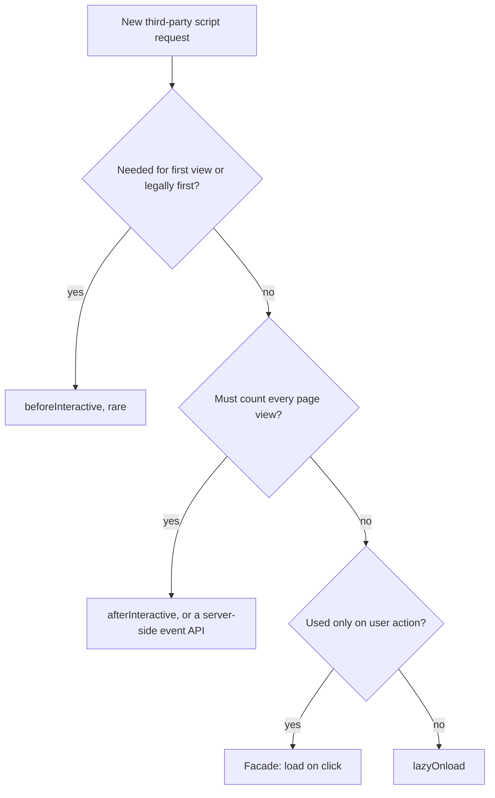
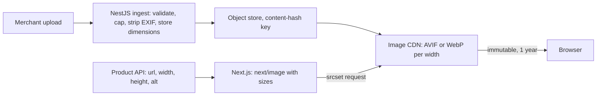

## 76.7 JavaScript cost: budgets, code splitting, lazy loading and third-party scripts

#### Concept

JavaScript is the most expensive byte on the web. An image byte is downloaded and decoded, often off the main thread. A JavaScript byte is downloaded, then **parsed, compiled and executed on the main thread**, and in a React app the execution includes **hydration**: rebuilding the component tree in the browser and attaching event handlers to server-rendered HTML. 300 KB of compressed JavaScript is roughly 1 MB of source, which on a mid-range phone can mean 1 to 2 seconds of main-thread work. During that time, taps wait (input delay, 76.4) and, if the LCP element depends on the code, LCP waits too.

A **bundle budget** is a hard limit on how much JavaScript a route may ship, enforced in CI. **Code splitting** divides the code so each route loads only what it needs. **Lazy loading** defers code until it is actually needed: on interaction or when it scrolls into view. **Third-party scripts** (analytics, tag managers, chat, A/B testing, reviews, ads) are JavaScript you did not write, do not review and cannot fully control, and they are usually the biggest single source of main-thread time on commercial sites.

#### Why does it exist?

JavaScript grows by accretion. Each feature adds a library; each library seems small; nobody removes the date library from the feature that was cut last year. Part 70.5 showed how bundlers split code at build time and tree-shake unused exports. That machinery only helps if someone decides what belongs in the first load and watches the number. Budgets exist because without a number that fails a build, the bundle grows by a few kilobytes every week until the product page needs 900 KB.

Third-party scripts need their own discipline because they are added by people outside engineering (marketing, analytics, sales), often through a tag manager that bypasses code review entirely.

#### Mental model

Imagine a delivery van with a fixed loading time per box, and every box must also be unpacked and assembled at the customer's door before they can use anything. Images are flat-packed posters: quick to unload. JavaScript boxes need assembly, by one person (the main thread), while the customer waits at the door. A budget is the van's capacity. Code splitting is sending only the boxes for today's room. Lazy loading is "we'll bring the garden furniture when you go into the garden". Third-party scripts are boxes your neighbours asked you to deliver on the same trip.

#### How it works

The cost of a script on the critical path:

```text
download (network)  ->  parse + compile (main thread, or background for large scripts)
                    ->  execute module top level  ->  hydrate React tree  ->  handlers attached
```

What a Next.js App Router page ships:

1. **Framework and shared chunks** used by every route (React, the router, shared components).
2. **Route chunks** for the client components used by this route. **Server components ship no component JavaScript**; only components marked `'use client'` and their imports go to the browser.
3. **The RSC payload**: a serialised description of the server component tree plus the props passed to client components, inlined in the HTML in `self.__next_f.push(...)` script tags and parsed on load. Large props passed to client components are therefore paid for twice: once as HTML and once as payload.
4. **Lazy chunks** loaded later with `next/dynamic` or `import()`.

The tools to see it: `@next/bundle-analyzer` (a treemap of every chunk), the DevTools **Coverage** panel (how much of each downloaded script ran during load), and Lighthouse's "Reduce unused JavaScript" diagnostic. Next.js 14 and 15 print "First Load JS" per route in `next build` output; Next.js 16 removed those size columns, so use the analyzer or a dedicated size check (76.11) instead.

The levers, in order of usual impact:

| Lever | Typical saving | Note |
|---|---|---|
| Move work to server components | Whole components and their libraries | Markdown rendering, date formatting, data mapping need not ship |
| Remove or defer third-party scripts | 100 to 500 KB and hundreds of ms of main-thread time | Governance more than code (table below) |
| `next/dynamic` for heavy, below-the-fold or on-click components | 50 to 300 KB from first load | Zoom viewers, 3D, maps, rich editors, charts |
| Replace heavy libraries | 20 to 70 KB each | `Intl.DateTimeFormat` instead of a date library, native `fetch`, small validators |
| Fix barrel imports | 10 to 200 KB | `experimental.optimizePackageImports` for icon and UI libraries |
| Modern browser targets | 5 to 15% | Fewer polyfills and transforms via `browserslist` (70.2) |

Third-party scripts in Next.js are loaded with `next/script`:

| `strategy` | When it loads | Use for |
|---|---|---|
| `beforeInteractive` | In the initial HTML, before hydration | Almost nothing: consent managers that legally must run first, bot detection |
| `afterInteractive` (default) | After some hydration | Tag managers, analytics that must count every page view |
| `lazyOnload` | During browser idle time after `load` | Chat widgets, social embeds, survey tools, retargeting pixels |
| `worker` (experimental) | In a Web Worker via Partytown | Pages Router only; not supported in the App Router |



`@next/third-parties` wraps common ones (Google Tag Manager, Google Analytics, YouTube and Google Maps embeds) with sensible defaults. For heavy embeds, a **facade** is often better than any strategy: show a static image of the chat bubble or video thumbnail and load the real script only on click.

#### Practical example

A product page ships 612 KB compressed JavaScript on first load. The analyzer and Coverage show: 140 KB framework (fixed), 118 KB a 3D viewer used by 4% of visitors after a click, 64 KB a date library used to format "Delivery by Thu, 14 Nov", 92 KB a reviews widget's client bundle, 41 KB an icon library imported through its barrel, and 157 KB of third-party scripts (tag manager plus four tags it loads). Actions: the 3D viewer becomes `next/dynamic`, loaded on click; the delivery date is formatted on the server; the reviews section becomes a server component with a small client "helpful" button; `optimizePackageImports` is set for the icon library; the tag manager loses two dead tags and the chat widget becomes a facade. First load JS falls to 228 KB, hydration on a mid-range phone from 780 ms to 290 ms, and p75 INP from 260 to 170 ms.

#### React / Next.js example

```tsx
// apps/web/app/p/[slug]/ProductActions.tsx
'use client';
import dynamic from 'next/dynamic';
import { useState } from 'react';

// Separate chunk; nothing downloads until the component first renders. ssr: false is
// allowed here because this is a client component (Next.js 15 rejects it in server components).
const ModelViewer = dynamic(() => import('./ModelViewer'), {
  ssr: false,
  loading: () => <div className="viewer-placeholder" aria-busy="true" />,  // same size: no CLS
});

export function ProductActions({ modelUrl }: { modelUrl: string | null }) {
  const [show3d, setShow3d] = useState(false);
  return (
    <>
      {modelUrl && (
        <button
          type="button"
          onPointerEnter={() => void import('./ModelViewer')}   // warm the chunk on hover: free head start
          onClick={() => setShow3d(true)}
        >
          View in 3D
        </button>
      )}
      {show3d && modelUrl && <ModelViewer src={modelUrl} />}
    </>
  );
}
```

```tsx
// apps/web/app/layout.tsx  (excerpt)
import Script from 'next/script';
import { GoogleTagManager } from '@next/third-parties/google';

export default function RootLayout({ children }: { children: React.ReactNode }) {
  return (
    <html lang="en-IN">
      <body>
        {children}
        <GoogleTagManager gtmId={process.env.NEXT_PUBLIC_GTM_ID!} />
        {/* Survey tool: not needed for any first-visit task, so idle time only. */}
        <Script src="https://surveys.vendor.example/s.js" strategy="lazyOnload" />
      </body>
    </html>
  );
}
```

```js
// apps/web/next.config.mjs  (excerpt)
import bundleAnalyzer from '@next/bundle-analyzer';
const withBundleAnalyzer = bundleAnalyzer({ enabled: process.env.ANALYZE === 'true' });

export default withBundleAnalyzer({
  experimental: { optimizePackageImports: ['lucide-react', 'date-fns'] }, // rewrite barrel imports
});
```

#### Backend side (NestJS)

The API decides how much data ends up in JavaScript-land:

- **Props crossing the server/client boundary are serialised into the page.** If a server component passes the full 40 KB `ProductDetailDto` to a client component that uses four fields, the HTML carries those 40 KB again as RSC payload. Shape view models in the BFF or ask the API for what the screen needs (76.10).
- **Formatting on the server** (prices with currency, dates in the store's time zone, `statusLabel`) can remove whole client libraries. Part 74.7 kept money as minor-unit strings in the contract; formatting for display can still happen in a server component.
- **Third-party server-side alternatives**: many analytics and marketing tags have server-to-server APIs. Sending conversion events from NestJS (after the order is committed, with an outbox, Part 28) is more accurate than a browser pixel and removes a script from the page.

#### Production scenario

A furniture retailer's tag manager had grown to 31 tags across six teams. A LoAF-based report (76.4) showed third-party scripts responsible for 58% of long animation frame time on product pages for real users. The team introduced a **third-party budget**: 120 KB compressed and 150 ms of main-thread time at p75, owned by a named person, with a quarterly review where each tag needed a business owner and a usage number. Eleven tags were removed (four belonged to campaigns that had ended over a year earlier), three moved to server-side event APIs and five to `lazyOnload`. Product page p75 INP went from 310 ms to 180 ms with no change to first-party code.

#### Failure scenario

On Black Friday at 09:05, mobile conversion dropped by a third. The A/B testing vendor's script, loaded synchronously in the head with an "anti-flicker" snippet that set `body { opacity: 0 }` until the experiment loaded or 4 s passed, was being served slowly by the vendor's CDN under global load. Every page was invisible for up to 4 s: LCP render delay jumped by that amount. The site's own servers were healthy. The emergency fix was removing the snippet through the tag manager, at 09:40. The permanent fix moved experiment assignment to the edge and server (73.9), so variants were in the HTML, and banned render-hiding snippets in the third-party policy.

#### Edge cases & failure modes

- **Third-party script outages** can block rendering (synchronous scripts) or hang `load`; anything in the head is a single point of failure.
- **Hydration of a huge tree** is a long task no matter how the code is split; reduce client components on the page, not just bytes.
- **Over-splitting** creates many tiny requests and request chains; a chunk loaded on click must still download on a slow network, so prefetch it on hover or when idle.
- **`next/dynamic` with `ssr: false`** renders nothing on the server, which can harm SEO and cause layout shift if the placeholder size differs.
- **Shared chunks change on every deploy** if a commonly used module changes, invalidating long-term caches for every user (76.9).
- **Polyfills for old browsers** sent to every browser waste bytes; differential serving is mostly obsolete now that ES2020 support is near-universal.

#### How a Senior Full-Stack Engineer thinks about this

A senior thinks of JavaScript as CPU time on the user's device, not as kilobytes. They set a budget per route type (for example, 170 KB compressed first-load JavaScript for landing routes like product and category pages, more for the logged-in dashboard), make it fail CI, and require a written exception to exceed it. Their default for a new component is "server component" and they need a reason to add `'use client'`.

For third parties they act as a governance owner, not a gatekeeper: every tag has an owner, a purpose, a size and a review date, and the cheapest loading strategy that still meets its purpose. To a marketing lead: "Each tag costs us about this much speed, which costs about this much conversion; let's keep the ones that earn more than they cost."

#### Common mistakes

- **Marking a whole page `'use client'`** to use one hook, shipping everything below it.
- **Measuring bundle size only after compression**, forgetting that parse and execute cost follows the uncompressed size.
- **Letting the tag manager bypass review** and performance budgets.
- **Lazy loading above-the-fold content**, trading LCP for a smaller bundle.
- **Passing whole DTOs to client components**, doubling page weight through the RSC payload.

#### Interview questions

1. **Why is a kilobyte of JavaScript more expensive than a kilobyte of image?** Expected answer: it must be parsed, compiled and executed on the main thread, plus hydration in React; images decode mostly off the main thread.
2. **How do server components reduce JavaScript, and where can they increase page weight?** Expected answer: their code never ships; but props passed to client components are serialised into the RSC payload in the HTML.
3. **How would you choose `next/script` strategies for a tag manager, a chat widget and a consent manager?** Expected answer: `afterInteractive` for the tag manager, `lazyOnload` or a facade for chat, `beforeInteractive` only where consent legally must run first. Follow-up: which strategy does not work in the App Router? (`worker`.)
4. **What does a bundle budget look like and how is it enforced?** Expected answer: a per-route compressed size limit checked in CI with a size tool or Lighthouse CI assertions, with exceptions reviewed.
5. **What are the risks of a client-side A/B testing script?** Expected answer: render blocking, anti-flicker hiding the page, late content swaps causing CLS and LCP changes, a third-party single point of failure.

#### Practical exercise

Put one route on a JavaScript diet.

Acceptance criteria:

- The analyzer treemap and Coverage report for the route are saved, with the top ten modules by size and their usage during load.
- At least one heavy component is moved to a server component or `next/dynamic`, and at least one third-party script changes strategy or becomes a facade.
- First-load JavaScript for the route is under an agreed budget, enforced in CI (76.11).
- p75 INP and hydration long-task duration are compared before and after on a mid-range device profile.

## 76.8 Images and fonts: formats, responsive images, lazy loading and font loading

#### Concept

Images are usually the largest bytes on a page and the most common LCP element. Fonts are small but sit on the critical path for text and can cause both render delay and layout shift. The engineering choices are few and well understood:

- **Format**: AVIF (typically 40 to 50% smaller than JPEG at similar quality), WebP (25 to 35% smaller), JPEG or PNG as fallback. SVG for icons and logos.
- **Size**: serve each device an image close to the pixels it will display, with `srcset` (the available widths) and `sizes` (how wide the image will be in the layout).
- **Loading**: `loading="lazy"` for images below the fold, eager and `fetchpriority="high"` for the LCP image, `decoding="async"` for the rest.
- **Fonts**: WOFF2, subsetted to the characters you use, self-hosted, at most two families, loaded with a `font-display` strategy and a fallback font adjusted to the same metrics.

#### Why does it exist?

A merchandiser uploads a 4,000 by 3,000 pixel, 3.8 MB photo. Without a pipeline it is served as-is to a phone that displays it 390 CSS pixels wide (about 1,170 device pixels at 3x density). That is fifteen times the needed pixels and one of the most common causes of poor LCP load duration. Fonts have the opposite problem: they are small, but the browser hides text while it waits for them (up to 3 s in most browsers with the default `font-display: auto`) or swaps them in late and shifts every line.

#### Mental model

Imagine printing a photo for a wallet, a frame and a billboard. You would not print the billboard and fold it into the wallet. `srcset` is the set of print sizes you keep in stock; `sizes` tells the shop how big the frame is; the browser picks the smallest print that still looks sharp. Fonts are the typeface on a shop sign: if the sign painter is late, you can leave the sign blank (block), put up a temporary sign in a similar typeface and repaint later (swap), or keep the temporary sign for today (optional).

#### How it works

The browser's image selection, for `` on a 390 px wide phone at 3x density:

1. Evaluate `sizes`: the viewport is under 768 px, so the slot is 100vw = 390 CSS px.
2. Multiply by device pixel ratio: 390 x 3 = 1,170 device px needed.
3. Pick the smallest candidate at least that wide. `a-1080.avif` is just short of 1,170, so the browser takes `a-1920.avif`, nearly three times the pixels it needs. Adding a 1,200 px candidate fixes that. Browsers may also pick a smaller candidate on slow connections, and many sites cap the effective density at 2x, because the visual difference above 2x is small and the bytes nearly double.

`next/image` generates this for you. Its loader requests `/_next/image?url=...&w=1080&q=75`, and the optimiser resizes, converts to the best format the browser's `Accept` header allows (configure `images.formats` to include `image/avif`), and caches the result. Without `sizes`, `next/image` assumes the image is full-viewport width on every device and generates a `srcset` of 1x and 2x for its fixed width, which is often far too large for responsive layouts.

Font loading:

| `font-display` | Text before the font loads | Risk |
|---|---|---|
| `block` (and usually `auto`) | Invisible for up to about 3 s | Render delay on text LCP |
| `swap` | Fallback immediately, swap when loaded | Layout shift if metrics differ |
| `fallback` | Invisible about 100 ms, fallback, swap only within about 3 s | Compromise |
| `optional` | Invisible about 100 ms, then the font is used only if already available | Best for CLS and LCP; first visit may never show the web font |

The CLS risk of `swap` is solved by **fallback metric adjustment**: CSS `@font-face` descriptors `size-adjust`, `ascent-override`, `descent-override` and `line-gap-override` make a local fallback (Arial, Roboto) occupy the same space as the web font. `next/font` computes and applies these automatically (`adjustFontFallback` defaults to true), self-hosts the font files at build time, and preloads them.



#### Practical example

A product listing page with 24 product cards on mobile: originals are 1,600 px JPEGs averaging 240 KB. With `next/image`, AVIF, `sizes="(max-width: 640px) 50vw, 25vw"` and lazy loading below the first row, the first viewport downloads four images at about 18 KB each instead of 240 KB, and the rest load as the user scrolls. Image bytes on initial load fall from 5.7 MB (all 24 eager) to 72 KB plus the hero. The brand font, previously two weights from a third-party host with `display=block`, moves to `next/font/local` with one variable font file subsetted to Latin (38 KB), `display: 'swap'` and an adjusted fallback; text appears at FCP and CLS from the font swap drops to near zero.

#### React / Next.js example

```tsx
// apps/web/app/fonts.ts
import localFont from 'next/font/local';

export const brand = localFont({
  src: './fonts/Brand-Variable-latin.woff2',   // one variable file for all weights, Latin subset
  display: 'swap',
  variable: '--font-brand',
  adjustFontFallback: 'Arial',                // size-adjust etc. so the swap does not shift layout
  preload: true,
});
```

```js
// apps/web/next.config.mjs  (images excerpt)
export default {
  images: {
    formats: ['image/avif', 'image/webp'],     // AVIF first; falls back by Accept header
    remotePatterns: [{ protocol: 'https', hostname: 'img.shop-cdn.example', pathname: '/products/**' }],
    deviceSizes: [640, 750, 828, 1080, 1200, 1920], // drop 2048 and 3840 for a storefront
    minimumCacheTTL: 2678400,                  // 31 days: product image URLs are versioned
  },
};
```

For cards below the fold, `next/image` lazy-loads by default; pass `priority` (Next.js 16: `preload`) only to the LCP image. Set `placeholder="blur"` with a tiny `blurDataURL` from the API if you want a low-quality preview; it does not change LCP, which counts the full image.

#### Backend side (NestJS)

The image pipeline is backend work:

```ts
// apps/api/src/media/media.service.ts  (excerpt; uses the sharp library)
import sharp from 'sharp';
import { BadRequestException, Injectable } from '@nestjs/common';
import { createHash } from 'node:crypto';
import { ObjectStore } from './object-store';        // thin wrapper over the S3 client (Part 33)

@Injectable()
export class MediaService {
  constructor(private readonly objects: ObjectStore) {}

  async ingest(buffer: Buffer, alt: string) {
    const meta = await sharp(buffer).metadata();
    if (!meta.width || !meta.height) throw new BadRequestException('UNREADABLE_IMAGE');
    if (meta.width * meta.height > 40_000_000) throw new BadRequestException('IMAGE_TOO_LARGE'); // 40 MP cap
    const master = await sharp(buffer)
      .rotate()                                   // apply EXIF orientation, then strip metadata
      .resize({ width: 2400, withoutEnlargement: true })
      .jpeg({ quality: 85, mozjpeg: true })
      .toBuffer({ resolveWithObject: true });
    // Content-hash key: the URL changes when the bytes change, so the CDN can cache it forever.
    const key = `products/${createHash('sha256').update(master.data).digest('hex').slice(0, 32)}.jpg`;
    await this.objects.put(key, master.data, 'image/jpeg');
    return { key, width: master.info.width, height: master.info.height, alt };
  }
}
```

- **Normalise at upload**: cap dimensions, fix orientation, strip EXIF (which also removes GPS location, a privacy issue), record width and height.
- **Versioned URLs**: a content-hash key lets the CDN cache images for a year with `immutable` (76.9).
- **Where to resize**: the Next.js optimiser runs `sharp` on your Node servers; at high traffic or with many product images, that is real CPU and a cache-miss latency spike. A dedicated image CDN (or an image service behind CloudFront) moves that load off the web tier. `remotePatterns` must be strict, or anyone can use your optimiser to resize arbitrary internet images at your expense.
- **`Vary: Accept`** when negotiating AVIF or WebP by `Accept` header, so a CDN does not serve AVIF to a browser that asked for JPEG.

#### Production scenario

A classifieds site with 40 million listing photos served originals averaging 410 KB through CloudFront. Moving to an image service that generated AVIF and WebP variants at four widths, keyed by content hash, cut image transfer by 71%, saved about 38 TB of CDN egress a month (Part 51 prices that), and moved p75 mobile LCP on listing pages from 3.3 s to 2.4 s, almost entirely through the load duration subpart.

#### Failure scenario

After enabling the Next.js image optimiser on a self-hosted Node deployment, the web tier's CPU went to 95% during a sale and HTML TTFB tripled. Each of 12 pods was resizing product images on cache misses, because the optimiser's cache lived on each pod's local disk and pods were replaced frequently by autoscaling. The team moved images to a separate image CDN path with its own cache and kept `next/image` with a custom `loader` that built CDN URLs, so the Node servers did no image work at all.

#### Edge cases & failure modes

- **Missing `sizes`** with responsive layouts makes phones download desktop images.
- **Art direction** (a different crop on mobile) needs `<picture>` with `<source media>`, not just `srcset`.
- **AVIF encoding is slow**; generate variants ahead of time or cache them aggressively.
- **Icon fonts** are text to screen readers and block rendering; use inline SVG.
- **Too many font weights**: each is a separate file unless you use a variable font.
- **Fonts for non-Latin scripts** (Devanagari, Chinese) are large; use `unicode-range` subsets so pages download only the ranges they use.
- **Lazy images in a horizontal carousel** may never be "near the viewport" by the browser's heuristic until scrolled; set eager for the first slides.

#### How a Senior Full-Stack Engineer thinks about this

A senior sees images as a pipeline with a contract: the API returns a versioned URL, dimensions and alt text; the frontend declares how big the image is in the layout (`sizes`); an image service does the conversion; the CDN caches it forever. They make sure no single layer can undo the others (no 4 MB uploads, no missing `sizes`, no lazy LCP). For fonts their default is one self-hosted variable font, `swap` with adjusted fallback metrics, or `optional` where brand typography is not essential on first view.

#### Common mistakes

- **Serving originals** and relying on CSS to shrink them.
- **Omitting `sizes`** on `next/image` in responsive layouts.
- **Running image optimisation on the web tier** without a shared cache at scale.
- **Third-party font CSS with `display=block`**.
- **Forgetting width and height**, causing layout shift (69.5).

#### Interview questions

1. **How does the browser choose an image from `srcset` and `sizes`?** Expected answer: computes the slot width from `sizes`, multiplies by device pixel ratio, picks the smallest adequate candidate.
2. **What are the tradeoffs between `font-display: swap` and `optional`?** Expected answer: swap always shows the web font eventually but can shift layout; optional avoids late swaps but may not show the web font on first visit.
3. **What should the backend do at image upload time?** Expected answer: validate, cap dimensions, fix orientation, strip EXIF, store dimensions and a content-hashed URL.
4. **What can go wrong with the Next.js image optimiser at scale?** Expected answer: CPU load and cache misses on the web tier, per-pod caches, and abuse if `remotePatterns` is too broad.

#### Practical exercise

Fix the image and font pipeline for one page.

Acceptance criteria:

- Every image on the page is served as AVIF or WebP at a width within 1.5x of its displayed device pixels, verified in the Network panel on a phone profile.
- Only the LCP image is eager and high priority; all others below the fold are lazy.
- Fonts are self-hosted WOFF2, at most two files on first load, with adjusted fallback metrics; CLS from font swap is under 0.01.
- The upload endpoint rejects oversized images and stores dimensions.
