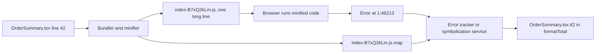

## 76.7 Source maps, minification and debugging production bundles

#### Concept

**Minification** rewrites JavaScript to be as small as possible while behaving the same: whitespace and comments removed, local names shortened to one letter (**mangling**), constant expressions folded, unreachable branches deleted. **Compression** (gzip or Brotli) then shrinks the minified file further on the wire.

A **source map** is a separate JSON file that maps every position in the minified output back to a file, line and column in your original source. With it, DevTools and error trackers can show `OrderSummary.tsx:42` instead of `index-B7xQ2kLm.js:1:48213`. Source maps let you ship small, unreadable code and still debug it.

#### Why does it exist?

Size, again. A real entry chunk might be 640 KB of JavaScript as written by the bundler. Minified it is about 230 KB; gzip brings it to about 72 KB; Brotli to about 62 KB. Minification alone usually removes 55 to 70 % of the bytes and, just as important, reduces parse time, which scales with the size of the uncompressed source.

The cost is debuggability. A production error from a minified bundle reads `TypeError: Cannot read properties of undefined (reading 'a') at n (index-B7xQ2kLm.js:1:48213)`. Every file is on line 1, every function is `n` or `t`. Without source maps, production frontend errors are close to useless.

#### Mental model

Imagine a book translated into dense shorthand to save paper. The shorthand edition is what you sell. The source map is the translator's index: "shorthand page 1, character 48,213 corresponds to chapter 7, paragraph 42 of the original". You do not print the index in every copy; you keep it in the office, so when a reader reports "something is wrong at character 48,213", you can find the original sentence.

#### How it works



**Minifiers.** esbuild (Vite's default up to Vite 7, very fast), Terser (JavaScript, slightly smaller output, 5 to 20x slower; `build.minify: 'terser'` in Vite, the default in webpack 5 through `TerserPlugin`), SWC (Next.js 13+), and Oxc (Vite 8). Differences in output size between them are usually 1 to 3 %.

**Source map format (v3).** A `.map` file is JSON:

```json
{
  "version": 3,
  "file": "index-B7xQ2kLm.js",
  "sources": ["../../src/checkout/OrderSummary.tsx", "../../node_modules/react/cjs/react.production.min.js"],
  "sourcesContent": ["import { formatMoney } from '../money';\n..."],
  "names": ["formatTotal", "order", "items"],
  "mappings": "AAAA,SAASA,EAAYC,GACnB..."
}
```

`mappings` encodes, with base64 VLQ numbers, "generated column X maps to source file S, line L, column C, name N". `sourcesContent` embeds your original source code, so the map works even without access to the repository. That is convenient and it is also your entire frontend source code, comments included.

**How a map is found.** The minified file ends with a comment `//# sourceMappingURL=index-B7xQ2kLm.js.map`, or the server sends a `SourceMap: /maps/index-B7xQ2kLm.js.map` response header. DevTools fetches the map only when DevTools is open, so normal users never download it. The map is typically 2.5 to 4 times the size of the minified file.

**The options that matter.**

| Tool | Setting | Map file written | Reference comment in JS | Use |
|---|---|---|---|---|
| Vite | `build.sourcemap: true` | yes | yes | Public maps (open-source, internal tools) |
| Vite | `build.sourcemap: 'hidden'` | yes | no | Upload to error tracker, do not serve publicly |
| Vite | `build.sourcemap: 'inline'` | inside the JS as a data URL | yes | Never in production: doubles the download |
| webpack | `devtool: 'hidden-source-map'` | yes | no | Same as Vite hidden |
| webpack | `devtool: 'nosources-source-map'` | yes, without `sourcesContent` | yes | Readable stack traces without exposing source |
| Next.js | `productionBrowserSourceMaps: true` | yes, served publicly | yes | Off by default; error-tracker plugins usually upload hidden maps instead |

**The production debugging workflow.**

1. Build with hidden maps.
2. Upload the maps to your error tracker (Sentry, Datadog, Bugsnag, or your own service), tagged with the **release** (the git SHA). Newer tooling injects a **debug ID** into both the JS file and its map so they can be matched without relying on file names.
3. Delete the `.map` files from the artefact before uploading it to the CDN, or serve them only on an internal network.
4. When an error arrives, the tracker finds the map for that release and file, maps each stack frame and shows the original code.

For one-off debugging, Chrome DevTools can attach a map manually: in the Sources panel, right-click the minified file and choose "Add source map...", pointing it at a URL reachable from your machine (for example an internal artefact store). The `{}` "pretty print" button helps when you have no map at all.

#### Practical example

A user reports that applying coupon `WELCOME10` at checkout shows a blank screen. The error tracker shows `TypeError: Cannot read properties of undefined (reading 'percent')` at `index-B7xQ2kLm.js:1:48213`. With the release's hidden map uploaded, the same frame reads `src/checkout/applyCoupon.ts:27 in discountFor` with the line `return coupon.rule.percent * subtotal`. The API had returned a fixed-amount coupon with `rule: null` and `amountMinor: 10000`. A two-minute diagnosis instead of an afternoon.

#### React / Next.js example

A Vite build that produces hidden maps, uploads them in CI, and removes them from the deployable artefact:

```bash
#!/usr/bin/env bash
# ci/build-web.sh: run in CI after tests pass
set -euo pipefail
RELEASE="web@${GITHUB_SHA}"

pnpm --filter web exec vite build --sourcemap hidden   # maps written, no sourceMappingURL comment

# Upload maps to the private symbolication store, keyed by release.
aws s3 cp apps/web/dist/assets/ "s3://shop-sourcemaps/${RELEASE}/" \
  --recursive --exclude '*' --include '*.map'

# Never ship maps to the public CDN.
find apps/web/dist -name '*.map' -delete
echo "built ${RELEASE}; $(ls apps/web/dist/assets/*.js | wc -l) JS files, maps uploaded privately"
```

In the app, send errors with the release so the backend can find the right maps:

```ts
// src/errors/report.ts
const RELEASE = import.meta.env.VITE_RELEASE; // set to web@<sha> at build time; public and harmless

export function reportError(error: unknown): void {
  const err = error instanceof Error ? error : new Error(String(error));
  const body = JSON.stringify({ release: RELEASE, message: err.message, stack: err.stack, url: location.href });
  // sendBeacon survives page unload; fall back to fetch with keepalive.
  if (!navigator.sendBeacon('/api/client-errors', new Blob([body], { type: 'application/json' }))) {
    void fetch('/api/client-errors', { method: 'POST', body, keepalive: true, headers: { 'Content-Type': 'application/json' } });
  }
}
```

#### Backend side (NestJS)

If you run your own error collection, the backend symbolicates. The `source-map` library (Mozilla, v0.7) does the lookup; maps come from a private bucket, never from the public CDN:

```ts
// client-errors.service.ts
import { Injectable, Logger } from '@nestjs/common';
import { SourceMapConsumer, type RawSourceMap } from 'source-map';
import { SourcemapStore } from './sourcemap.store'; // reads s3://shop-sourcemaps/<release>/<file>.map, LRU-cached

const FRAME = /(https?:\/\/[^\s)]+\/assets\/([^/:]+\.js)):(\d+):(\d+)/; // Chrome and Firefox frame formats

@Injectable()
export class ClientErrorsService {
  private readonly logger = new Logger(ClientErrorsService.name);
  constructor(private readonly maps: SourcemapStore) {}

  async symbolicate(release: string, stack: string): Promise<string[]> {
    const out: string[] = [];
    for (const line of stack.split('\n').slice(0, 20)) {        // cap work per report
      const m = FRAME.exec(line);
      if (!m) { out.push(line.trim()); continue; }
      const [, , file, lineNo, colNo] = m;
      const raw: RawSourceMap | null = await this.maps.get(release, `${file}.map`);
      if (!raw) { out.push(`${line.trim()} (no map for ${release})`); continue; }
      const pos = await SourceMapConsumer.with(raw, null, (c) =>
        c.originalPositionFor({ line: Number(lineNo), column: Number(colNo) - 1 }), // columns are 0-based in maps
      );
      out.push(pos.source ? `${pos.source}:${pos.line}:${pos.column} in ${pos.name ?? '<anonymous>'}` : line.trim());
    }
    return out;
  }
}
```

The controller in front of it should be rate-limited with `@nestjs/throttler`, accept a small body (an error storm from one buggy release can send thousands of reports per second), and log the release so a bad deploy is visible as a spike for one release value. Part 84 — Shipping and Operating Frontends covers correlating these browser errors with backend traces.

#### Production scenario

A marketplace with 1.2 million daily sessions receives about 30,000 frontend error reports per day, 95 % of them from browser extensions and ad blockers. Release-tagged, symbolicated stacks let them group by original source location; the top three groups each mapped to one line of their code and were fixed in a day. Their maps total about 9 MB per release, stored privately for 90 days at negligible cost.

#### Failure scenario

After a CI refactor, every production error in the tracker pointed to nonsense: React internals for code that was clearly in the checkout, or lines in the middle of comments. Engineers lost two days chasing a "bug in React" that did not exist.

The cause: the pipeline built the app twice, once for tests with source maps and once for deployment, and uploaded the maps from the first build. The two builds were not byte-identical (one had a different `VITE_RELEASE` value inlined, which shifted every column after it), so every mapping was off. The fix was to build once, upload maps from that exact build, and deploy those exact files. Debug IDs, which tie a JS file to its map by an ID injected into both, make this mistake impossible.

#### Edge cases & failure modes

- **Public maps with `sourcesContent`** publish your full source, including comments, internal URLs and commented-out code.
- **Maps from a different build** produce confident but wrong stack traces.
- **`inline` maps in production** double or triple download size.
- **Minifier-sensitive code**: logic that depends on `function.name` or `constructor.name` breaks after mangling (common with class-based "type" checks and some dependency injection libraries).
- **Third-party scripts** produce `Script error.` with no stack unless loaded with `crossorigin` and served with CORS headers.
- **Huge error bursts** from one bad release can overload a self-hosted collector; sample and rate-limit.

#### How a Senior Full-Stack Engineer thinks about this

A senior treats source maps as sensitive build artefacts, like debug symbols for a native binary: generated for every release, stored privately, tied to the exact build, and never served to the public unless the source is public anyway. They insist on "build once, deploy the same bytes" so maps and code always match. They also make sure the release identifier flows from the bundle to the error report to the backend logs, so the first question in a frontend incident ("which release?") answers itself.

#### Common mistakes

- **Turning source maps off entirely** to "protect the code", then debugging blind.
- **Leaving `.map` files on the public CDN** by default.
- **Uploading maps from a different build** than the one deployed.
- **Not tagging errors with a release.**
- **Pretty-printing and guessing** instead of setting up symbolication once.

#### Interview questions

1. **What is in a source map, and why might it be sensitive?**
   Expected answer: mappings from generated to original positions, original file names, symbol names and often the full original source in `sourcesContent`. Follow-up: how do you keep readable stack traces without exposing source? (Hidden maps uploaded privately; or `nosources` maps.)
2. **What does `hidden` mean in `build.sourcemap: 'hidden'`?** Expected answer: maps are generated but the JS has no `sourceMappingURL` comment, so browsers do not look for them.
3. **Your error tracker shows wrong source lines. What do you check?** Expected answer: whether maps came from the same build and release as the deployed files.
4. **How much does minification save and what else does it change?** Expected answer: typically 55 to 70 % before compression; it also mangles names and removes dead code, which can break code that relies on names.

#### Practical exercise

Build a Vite app with `sourcemap: 'hidden'`, throw an error from a nested function, and capture the minified stack trace.

Acceptance criteria:

- The deployed JS contains no `sourceMappingURL` comment and no `.map` file is reachable over HTTP.
- A NestJS endpoint using `SourceMapConsumer` turns the stack into original file, line and function names.
- Rebuilding with a different inlined value and reusing the old maps produces wrong lines, which you explain.

## 76.8 TypeScript configuration for frontends

#### Concept

`tsconfig.json` controls two different things in a frontend project: how strictly your code is checked, and which environment the checker assumes (which global types exist, how imports are resolved, how JSX is understood). Because the bundler, not `tsc`, produces the output (76.2), a frontend `tsconfig` is almost entirely about **checking**: `noEmit: true`, with options chosen to describe the browser and the bundler accurately.

The same codebase often also needs to **share types with the backend**: the shape of an order, the allowed status values, the request body of "place order". Doing that well means understanding how a frontend `tsconfig` differs from a NestJS one.

#### Why does it exist?

Types are only as good as the environment they describe. If the checker thinks `process` and `Buffer` exist (because `@types/node` was pulled in by some dependency), it will happily approve browser code that crashes (the 76.1 incident). If it does not know that `import.meta.env` exists, every config read is an error. If it resolves imports differently from the bundler, it will report errors that the build does not have, or miss ones it does. And without strict options, the most common production crash in frontends, reading a property of `undefined`, passes type checking.

#### Mental model

Imagine a building inspector. You must tell them which building code applies (browser or server), which floor plan to use (how imports resolve), and how strict to be. An inspector using the wrong code approves a design that collapses; one who is not strict signs off on missing handrails. `tsconfig` is the inspector's brief.

#### How it works

A frontend config for a Vite React app, close to what `create-vite` generates, with the options that matter annotated:

```json
{
  "compilerOptions": {
    "target": "ES2022",
    "lib": ["ES2022", "DOM", "DOM.Iterable"],
    "types": ["vite/client"],
    "module": "ESNext",
    "moduleResolution": "bundler",
    "jsx": "react-jsx",
    "noEmit": true,
    "isolatedModules": true,
    "verbatimModuleSyntax": true,
    "allowImportingTsExtensions": true,
    "strict": true,
    "noUncheckedIndexedAccess": true,
    "exactOptionalPropertyTypes": true,
    "noFallthroughCasesInSwitch": true,
    "noUnusedLocals": true,
    "skipLibCheck": true,
    "paths": { "@/*": ["./src/*"] }
  },
  "include": ["src"]
}
```

- **`lib: ["ES2022", "DOM", "DOM.Iterable"]`** declares the browser globals (`window`, `fetch`, `HTMLInputElement`) and the language features available. A NestJS config has no `DOM`.
- **`types: ["vite/client"]`** limits which `@types/*` packages are loaded automatically. Without it, TypeScript includes every package in `node_modules/@types`, so `@types/node` (pulled in transitively by almost anything) makes `process.env.X` type-check in browser code, and makes `setTimeout` return `NodeJS.Timeout` instead of `number`. Portable code uses `ReturnType<typeof setTimeout>`.
- **`moduleResolution: "bundler"`** (TypeScript 5.0+) resolves imports the way Vite, webpack and esbuild do: `package.json` `exports` are honoured and extensionless relative imports are allowed. NestJS projects use `"node10"` (formerly `"node"`) with CommonJS, or `"nodenext"` for native ESM.
- **`strict: true`** turns on `strictNullChecks`, `noImplicitAny`, `strictFunctionTypes` and the rest. Non-negotiable for new code.
- **`noUncheckedIndexedAccess`** makes `items[0]` and `pricesBySku[sku]` typed as `T | undefined`. It catches the "first item of an empty list" crash. It is not part of `strict`; turn it on explicitly.
- **`exactOptionalPropertyTypes`** distinguishes "property missing" from "property set to `undefined`", which matters for PATCH request bodies where sending `"coupon": undefined` (dropped by `JSON.stringify`) and `"coupon": null` (an explicit removal) mean different things.
- **`paths`** affects **only type checking**. The bundler needs the same alias (`resolve.alias` in Vite, or `vite-tsconfig-paths`), Vitest reads Vite's config, Jest needs `moduleNameMapper`. On the NestJS side, `tsc` does not rewrite aliases in emitted JavaScript, so a backend using `paths` needs `tsconfig-paths` at run time or a tool such as `tsc-alias` after the build, or it fails with `Cannot find module '@/orders/...'` in production.

Vite's template splits configuration with **project references**: a root `tsconfig.json` with `"files": []` and `"references"` to `tsconfig.app.json` (browser code, `DOM`, `vite/client`) and `tsconfig.node.json` (`vite.config.ts`, which runs in Node and needs `@types/node`). `tsc -b` checks both, each in the right environment.

**Frontend and backend configs side by side:**

| Option | `apps/web` (Vite React) | `apps/api` (NestJS 10 or 11) | Why they differ |
|---|---|---|---|
| `module` / `moduleResolution` | `ESNext` / `bundler` | `commonjs` / `node10` | Bundler resolves for the browser; Node loads CommonJS |
| `lib` | `ES2022`, `DOM` | `ES2021` or later, no `DOM` | Different global environment |
| `experimentalDecorators`, `emitDecoratorMetadata` | off | on | NestJS DI, TypeORM and class-validator need legacy decorators and metadata |
| `noEmit` | true | false (emits `dist`) | The bundler emits for the web; `tsc` or SWC emits for Node |
| `jsx` | `react-jsx` | not set | |
| `strict` | true | true (Nest's CLI default is looser; tighten it) | |

**Sharing types with the backend.** The two configs differ enough that sharing *code* is risky, but sharing *types and schemas* is easy and valuable:

- Share plain TypeScript types and string union enums (`type OrderStatus = 'PENDING' | 'PAID' | 'SHIPPED'`), and zod schemas if you want runtime validation at both ends. These compile under both configs.
- Import them with `import type` in the frontend, so they vanish from the bundle when they are only types.
- **Do not import NestJS DTO classes or TypeORM entities into the frontend.** They carry decorators that need `experimentalDecorators`, pull `class-validator`, `class-transformer` or `typeorm` into the bundle (hundreds of KB), and describe your database, not your API.
- Types are compile-time promises, not runtime guarantees. The API can still send something else. Validate at the boundary (Part 80 — Frontend–Backend Contracts goes deep on OpenAPI clients, zod and contract testing).

#### Practical example

A team turned on `noUncheckedIndexedAccess` in a 600-file app. It produced 214 errors. About 180 were genuine "this might be undefined" cases that needed a guard or a default; 11 of them were real bugs that had already caused production errors, including `const primary = order.addresses[0].city` on accounts with no saved address and `PRICES[sku].amount` for SKUs removed from the catalogue. The migration took two days, done one folder at a time.

#### React / Next.js example

A component that consumes shared types and benefits from the strict options:

```tsx
// apps/web/src/orders/OrderRow.tsx
import type { OrderSummary, OrderStatus } from '@shop/contracts'; // type-only: erased from the bundle

const STATUS_LABEL = {
  PENDING: 'Awaiting payment',
  PAID: 'Preparing',
  SHIPPED: 'On the way',
  DELIVERED: 'Delivered',
  CANCELLED: 'Cancelled',
} satisfies Record<OrderStatus, string>; // adding a status in contracts breaks this until a label is added

export function OrderRow({ order }: { order: OrderSummary }) {
  const firstItem = order.items[0]; // OrderItem | undefined thanks to noUncheckedIndexedAccess
  return (
    <tr>
      <td>{order.displayId}</td>
      <td>{STATUS_LABEL[order.status]}</td>
      <td>{firstItem ? firstItem.name : 'No items'}{order.items.length > 1 ? ` +${order.items.length - 1}` : ''}</td>
      <td>{new Intl.NumberFormat('en-IN', { style: 'currency', currency: order.currency })
            .format(Number(order.totalMinor) / 100)}</td>
    </tr>
  );
}
```

The `satisfies` operator (TypeScript 4.9+) checks that the object covers every status without widening its type, so the backend adding `'RETURNED'` to `OrderStatus` fails the frontend type check until someone writes a label.

#### Backend side (NestJS)

The NestJS side implements the same shared types, so the compiler checks that the API and the client agree:

```ts
// apps/api/src/orders/dto/order-summary.dto.ts
import type { OrderSummary, OrderStatus } from '@shop/contracts';
import { ApiProperty } from '@nestjs/swagger';

// The DTO class stays in the backend (decorators, Swagger metadata);
// "implements" makes tsc fail if it drifts from the shared contract.
export class OrderSummaryDto implements OrderSummary {
  @ApiProperty() id!: string;
  @ApiProperty() displayId!: string;
  @ApiProperty({ enum: ['PENDING', 'PAID', 'SHIPPED', 'DELIVERED', 'CANCELLED'] }) status!: OrderStatus;
  @ApiProperty({ description: 'Integer minor units as a string, e.g. "129900"' }) totalMinor!: string;
  @ApiProperty() currency!: string;
  @ApiProperty({ type: () => [Object] }) items!: OrderSummary['items'];
  @ApiProperty() placedAt!: string; // ISO 8601 with offset
}
```

Note `totalMinor: string`. PostgreSQL `numeric` and `bigint` columns come back from the `pg` driver as strings by default (TypeORM and Sequelize pass that through), because JavaScript numbers cannot represent every value exactly. Make the contract say so, rather than declaring `number` and hoping.

#### Production scenario

A B2B ordering portal shared a `contracts` package between NestJS and React. Over six months, `tsc` in CI caught 37 contract mismatches before merge: renamed fields, new enum values without UI labels, optional fields made required. Each would otherwise have been a runtime error found by a customer. The type check for both apps took 48 s in CI, cached by Turborepo when neither app nor the contracts package changed (76.9).

#### Failure scenario

On a Saturday at 11:00, the order history page started crashing for every user with `TypeError: order.total.toFixed is not a function`. The shared type said `total: number`. A backend refactor had replaced a hand-written query with a TypeORM `find()` on an entity whose `total` column was `numeric(12,2)`. The `pg` driver returned `"1299.00"` as a string, exactly as it always does for `numeric`; the old query had cast to `float8`. TypeScript was satisfied on both sides because the entity property was declared `number`, and nothing checked at run time.

The fix: declare the column honestly (`@Column({ type: 'numeric', precision: 12, scale: 2 }) total!: string` or use a column `transformer`), send money as integer minor units in a string field, and validate API responses on the client with a zod schema in development and tests. Types describe what you believe; only runtime validation checks it.

#### Edge cases & failure modes

- **`@types/node` leaking into browser code** hides Node-only globals behind green type checks; set `types`.
- **Aliases configured in only one place** work in the editor and fail in the bundler, the test runner or the NestJS runtime.
- **Shared types that import from backend packages** drag `typeorm` or `@nestjs/common` into the frontend's type check and sometimes into its bundle.
- **`skipLibCheck: true`** hides type errors inside `.d.ts` files, including your own built contracts package; check the package itself in its own build.
- **`any` from `res.json()`**: `fetch` returns `Promise<any>`, which silently disables checking for everything downstream. Parse into a known type at the boundary.
- **Numeric and bigint columns** arrive as strings from `pg`; the type must match reality.

#### How a Senior Full-Stack Engineer thinks about this

A senior configures TypeScript to describe the real runtime accurately, browser or Node, and as strictly as the team can sustain, with `noUncheckedIndexedAccess` included. They share types and schemas, never classes with decorators, and they let `implements` and `satisfies` turn contract drift into compile errors on both sides. They also remember that the type system ends at the network boundary: anything that arrives over HTTP is `unknown` until validated.

#### Common mistakes

- **Leaving `strict` off** in a new project "to move faster".
- **Importing entity or DTO classes into the frontend.**
- **Declaring `number` for `numeric` and `bigint` columns.**
- **Configuring path aliases only in `tsconfig`.**
- **Trusting `res.json()` as the declared type** without validation.

#### Interview questions

1. **What does `moduleResolution: "bundler"` do and why not use it in NestJS?**
   Expected answer: it mirrors how bundlers resolve imports, including `exports` and extensionless paths; NestJS output is run by Node, which resolves CommonJS or native ESM differently. Follow-up: what breaks if the frontend uses `node10`?
2. **Why set `types` in a browser tsconfig?** Expected answer: to stop `@types/node` and other ambient types from making Node globals look valid in browser code.
3. **What does `noUncheckedIndexedAccess` catch that `strict` does not?** Expected answer: indexed reads possibly being `undefined`, the most common source of "cannot read properties of undefined".
4. **How do you share types between NestJS and React safely?** Expected answer: a contracts package with plain types or zod schemas, `import type` on the frontend, `implements` on backend DTOs, no decorated classes or entities shared, runtime validation at the boundary.
5. **Why can a fully type-checked frontend still crash on an API field type?** Expected answer: types are erased at run time; the API may send a different shape (for example `numeric` as string), and only runtime validation catches it.

#### Practical exercise

Take a React app and a NestJS app in one repository. Create a shared `OrderSummary` type.

Acceptance criteria:

- The web `tsconfig` has `strict`, `noUncheckedIndexedAccess`, `types: ["vite/client"]` and `moduleResolution: "bundler"`, and `process.env.X` in a component is a type error.
- The NestJS DTO `implements OrderSummary`; renaming a field in the shared type breaks both builds.
- A `satisfies Record<OrderStatus, string>` map in the UI fails type checking when a new status is added.
- The web bundle contains no code from `class-validator`, `typeorm` or `@nestjs/*` (checked with the bundle treemap).
