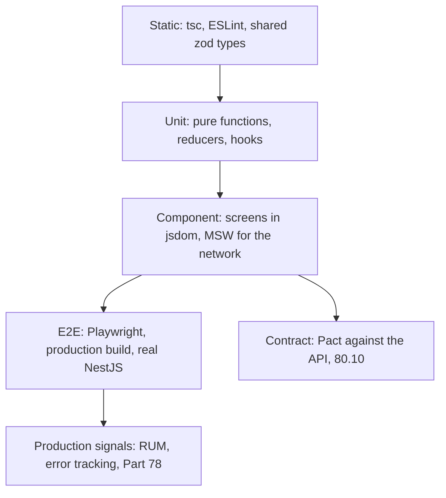

# Part 77 — Frontend Testing and Quality

Part 41 — Testing Backend Systems with Jest and NestJS built the backend's test practice: the pyramid and the trophy (41.1), test doubles (41.4), what to mock (41.5), integration tests against a real PostgreSQL (41.7), contract tests (41.14), flaky tests (41.18) and CI organisation (41.19). Part 74.10 added consumer-driven contracts between the web app and the API. This Part does the same job for the screens: what to test where, how to test components by their behaviour, how to fake the network without lying about it, how to run a browser against a real NestJS backend in CI, and what a backend engineer should look for when reviewing a frontend pull request.

Stack and versions, as in the rest of the volume: React 18 (notes for 19), Next.js 14 App Router (notes for 15), Vitest 3 (notes for 2 and 4), `@testing-library/react` 16 with `@testing-library/dom` 10 and `@testing-library/user-event` 14, `@testing-library/jest-dom` 6, MSW 2, Playwright 1.5x, `@axe-core/playwright` 4 and `vitest-axe`, and the NestJS 10 API with PostgreSQL 16 from the rest of the book. The feature under test throughout is the checkout of 71.13 and the order pages of 72.12.

## 77.1 The frontend testing pyramid and trophy: what to test where

#### Concept

A **test level** is how much of the real system a test runs. On the frontend there are four useful levels:

- **Static checks**: TypeScript, ESLint and the shared contract types (70.8, 70.10, 80.3). They run in seconds and catch a whole class of mistakes without executing anything.
- **Unit tests**: one pure function, reducer or hook, with no DOM layout and no network. Milliseconds each.
- **Component tests** (often called integration tests on the frontend): render a component or a whole screen into a simulated DOM (jsdom), interact with it the way a user would, and fake only the network. Tens to hundreds of milliseconds each.
- **End-to-end (e2e) tests**: a real browser, the real production build of the web app, and a real or nearly real backend. Seconds each.

The **testing pyramid** says "many unit tests, fewer integration tests, very few e2e tests". Kent C. Dodds' **testing trophy** reshapes it for user interfaces: a wide base of static checks, a modest layer of unit tests, the **largest** layer of component/integration tests, and a thin top of e2e tests. Part 41.1 explained both shapes for the backend. On the frontend the trophy usually wins, for a reason specific to UIs: most frontend bugs live in how pieces are wired together (a form, its validation schema, the API client, the error mapper, the loading state), not inside any single function.

#### Why does it exist?

Because every level has a price and a blind spot, and a team without a deliberate split ends up at one of two extremes.

- **All unit tests.** Every component is rendered with shallow mocks of its children and its hooks. Coverage reads 90 %. Then a renamed prop breaks the checkout and every test stays green, because each test mocked the thing that broke.
- **All e2e tests.** Every behaviour is checked by clicking through a real browser. The suite takes 45 minutes, fails 3 % of the time for reasons nobody can reproduce, and developers learn to press "re-run" instead of reading failures.

The split exists so each question is asked at the cheapest level that can answer it honestly.

#### Mental model

Imagine checking a restaurant. You taste the sauce on its own (unit test): fast, and you learn whether the sauce is right. You order a full dish at the pass and eat it at the counter (component test): you learn whether the sauce, the pasta and the plating work together, without waiting for a table. Once a week you book a table as a stranger, arrive through the front door and pay (e2e test): slow and expensive, but it is the only way to learn that the door sticks and the card machine is offline. You do not book a table to check the salt.

#### How it works



A working rule for deciding where a test goes:

1. **Is it a rule about data?** Money formatting, date bucketing, a reducer's legal transitions, a URL builder. Unit test. If the rule is shared with the backend, it lives in `@shop/contracts` and is tested once there.
2. **Is it something a user sees or does on one screen?** "A `422` for the postcode shows a message under the postcode field", "the Place order button is disabled while placing". Component test, with the network faked at the HTTP layer (77.5).
3. **Does it cross a boundary that a fake cannot represent honestly?** Cookies and redirects through the BFF (Part 75), real CSS layout, a real database constraint stopping a duplicate order, the production bundle's code splitting. E2E test.
4. **Is it about the API's shape rather than its behaviour?** Contract test (74.10), not e2e.
5. **Is it about how it looks?** Visual regression (77.9), on a few stable screens.

Typical cost per level on a mid-size storefront (a laptop and a 4-vCPU CI runner):

| Level | Time per test | Typical count | Suite time in CI | Flake rate if done well |
|---|---|---|---|---|
| Static (tsc, ESLint) | n/a | whole repo | 20-60 s | 0 |
| Unit (Vitest) | 1-20 ms | 400-1,500 | 5-20 s | ~0 |
| Component (Vitest + Testing Library + MSW) | 30-300 ms | 300-1,000 | 30-120 s | < 0.1 % |
| Contract (Pact consumer) | 50-200 ms | 10-40 | 10-20 s | ~0 |
| E2E (Playwright, 4 shards) | 3-30 s | 15-60 journeys | 3-8 min | < 0.5 % with the rules of 77.8 |
| Visual (Playwright screenshots) | 1-3 s | 10-40 screens | 1-2 min | < 0.5 % in a pinned Docker image |

#### Practical example

The checkout of 71.13 has these risks, each placed at one level:

| Risk | Level | Why there |
|---|---|---|
| The reducer allows `ORDER_PLACED` from `payment` | Unit | Pure function, every transition in a table |
| `formatMoney('129900', 'INR')` shows `₹1,299.00` | Unit | Pure; also run in the API's tests via `@shop/contracts` |
| A `422` with `path: "postcode"` appears under the postcode input and takes focus | Component | Needs a rendered form and a faked response, not a database |
| A `409 CART_CHANGED` on the coupon shows the notice and new totals | Component | Same |
| A double click on Place order sends one request | Component | Needs real event handling and a counted fake endpoint |
| A double click creates exactly one row in `orders` | E2E | Only the real API, idempotency interceptor and unique index can prove it |
| The confirmation page is reached and Back does not show a live payment form | E2E | Real browser history |
| `POST /v1/orders` still returns `problem+json` with `code` | Contract | Shape, not behaviour |
| The price summary did not move 40 px after a CSS refactor | Visual | Only pixels can tell |

#### React / Next.js example

The scripts in `apps/web/package.json` make the split visible, so a developer knows which command answers which question:

```json
{
  "scripts": {
    "typecheck": "tsc --noEmit",
    "lint": "next lint",
    "test": "vitest run",
    "test:watch": "vitest",
    "test:coverage": "vitest run --coverage",
    "test:pact": "vitest run --config vitest.pact.config.ts",
    "e2e": "playwright test",
    "e2e:ui": "playwright test --ui",
    "e2e:visual": "playwright test --project=visual"
  }
}
```

In Next.js 14 and 15, one more boundary decides the level: **async Server Components cannot be rendered by Vitest and Testing Library** today (the Next.js testing guide says so explicitly). Synchronous Server Components and all Client Components can be. So the senior split for an App Router page is: keep data fetching in a thin async page component, pass plain props into synchronous components, component-test those, and cover the async page in e2e.

```tsx
// app/orders/[id]/page.tsx: thin async Server Component, covered by e2e
import { getOrderForPage } from '@/server/orders';      // calls NestJS through the BFF client (79.8)
import { OrderView } from './OrderView';

export default async function OrderPage({ params }: { params: { id: string } }) {
  const order = await getOrderForPage(params.id);        // Next.js 15: params is a Promise, await it
  return <OrderView order={order} />;                     // synchronous, component-tested with plain props
}
```

#### Backend side (NestJS)

The API decides how testable the frontend can be. Four things make the split above possible:

- **Stable, documented error codes in one shape.** Component tests fake `{ code: 'CART_CHANGED', issues: [...], requestId }` (74.6). If the API sometimes returns `{ message: 'cart changed' }` from a different filter, the fake and reality drift and the component test lies.
- **A shared schema package.** `@shop/contracts` lets the frontend build fixtures through the same zod schemas the API validates with (77.6), so a fixture that the API could never produce fails at the fixture, not in production.
- **Deterministic seeding for e2e.** A test-only module that creates a user, a cart and a product in one call, enabled only in the e2e environment (77.11).
- **A request ID on every response** (`X-Request-Id`, exposed under CORS). When an e2e test fails, the Playwright trace shows the request ID, and the API log for that ID shows what the server thought.

```ts
// apps/api/src/common/request-id.middleware.ts
import { Injectable, NestMiddleware } from '@nestjs/common';
import type { NextFunction, Request, Response } from 'express';
import { randomUUID } from 'node:crypto';

@Injectable()
export class RequestIdMiddleware implements NestMiddleware {
  use(req: Request, res: Response, next: NextFunction) {
    const incoming = req.header('x-request-id');
    const id = incoming && /^[\w-]{8,64}$/.test(incoming) ? incoming : randomUUID(); // never trust arbitrary input
    req.headers['x-request-id'] = id;
    res.setHeader('X-Request-Id', id);                    // the test report and the log line now share a key
    next();
  }
}
```

#### Production scenario

A grocery delivery web app had 2,100 frontend tests: 1,700 unit tests on hooks and components rendered with every child mocked, 380 component tests, and 22 Playwright journeys. The unit layer took 40 s, the component layer 95 s, e2e 6 minutes over 4 shards. An audit of the last 50 production frontend bugs found: 3 would have been caught by a unit test, 31 by a component test that did not exist (wrong error message, missing loading state, a field not cleared on step change), 9 only by e2e (cookie path, redirect loop, chunk splitting), and 7 only in production (a Safari 16 bug, a third-party script, a CDN header). The team stopped writing mocked-children unit tests for components, moved that effort into screen-level component tests with MSW, and kept e2e at 25 journeys. Six months later, escaped frontend bugs per release had fallen from 1.9 to 0.7, and the suite was 30 s faster because 900 low-value unit tests had been deleted.

#### Failure scenario

At 18:40 on a sale day, the "Apply coupon" button stopped working for every customer. All 2,100 tests were green. The coupon component's unit test rendered `<CouponStep>` with `applyCoupon` mocked by `vi.mock`, and the mock resolved with `{ totals }`. A backend change two days earlier had wrapped the response as `{ cart: { version, totals } }` behind an API version header the web app already sent. The real `applyCoupon` parsed it with `PricedCartSchema`, threw a `ZodError`, and the component showed "Could not apply the code" for every code.

The unit test had mocked the module that broke, so it could not see the break. A component test with MSW returning a fixture built through `PricedCartSchema` would have run the real client and parser. A Pact interaction for the coupon endpoint (74.10) would have stopped the API deploy. The postmortem added both, and a review rule: do not `vi.mock` your own API client in component tests.

#### Edge cases & failure modes

- **Mocking the thing under test.** `vi.mock('../api/checkout')` in a test about checkout behaviour removes the client, the parser and the error mapper from the test.
- **Snapshot tests of whole component trees** (`toMatchSnapshot()` on rendered HTML) change on every harmless markup edit; reviewers approve the diffs without reading them.
- **E2E as the only safety net** for validation messages: 40 journeys for one form, each 20 s, and the suite is too slow to run on every pull request.
- **Coverage as a target.** 90 % line coverage of components says nothing about whether the error states render; Part 41.16 explains what the number means.
- **Async Server Components** pushed into component tests with hacks (calling the function and awaiting the JSX) test React internals, not the page.
- **Tests that only pass on a fast laptop**: a `waitFor` with a 1 s timeout that passes locally in 200 ms and times out on a loaded CI runner.

#### How a Senior Full-Stack Engineer thinks about this

The senior asks, for each risk, "what is the cheapest test that would fail if this broke, without lying?" They accept a small number of slow, honest tests over a large number of fast tests that mock the interesting parts. They treat the network boundary as the natural seam for frontend tests, because it is the boundary the backend owns and can describe precisely (zod schemas, OpenAPI, problem documents). They keep e2e for things only a real browser and a real backend can prove: cookies, redirects, the production bundle, database constraints. To a product manager they say: "Most of our tests check each screen in seconds with a fake server; about twenty slower tests walk the money paths through a real browser and a real database before every release."

#### Common mistakes

- **Writing component tests that assert on internal state** (`wrapper.state()`, hook return values of a component) instead of what the user sees.
- **One e2e test per acceptance criterion**, instead of component tests for most criteria and one journey for the path.
- **Mocking `fetch` with `vi.fn()`** per test, so each test invents its own response shapes.
- **No static layer in CI**: `tsc --noEmit` not run, because `next build` "already type-checks" (it does, but only for files it builds, and late in the pipeline).
- **Keeping tests that nobody would miss.** A test that has never failed for a real bug and breaks on every refactor is a cost, not an asset.

#### Interview questions

1. **Why does the testing trophy fit frontends better than the pyramid?**
   Expected answer: most UI bugs are in the wiring of components, hooks, schemas and the network client; component tests with a faked network catch them at low cost, while isolated unit tests with mocked children miss them.
   Why it matters: it decides where a team spends its testing effort.
   Follow-ups: when would you still write many unit tests? (Dense pure logic: pricing display, date bucketing, reducers.)
2. **Where would you test that a server field error appears under the right input?** Expected answer: a component test with MSW returning the real problem document; not e2e (too slow for every field), not a unit test of `applyServerErrors` alone (misses the wiring).
3. **What can only an e2e test prove?** Expected answer: real cookies, redirects and BFF behaviour, the production bundle, CSS layout, real database constraints and idempotency across the stack.
4. **How do you test an async Server Component in Next.js 14?** Expected answer: you do not unit-render it; keep it thin, component-test the synchronous children with props, and cover the page in e2e.
5. **A team has 95 % coverage and frequent UI regressions. What do you look at first?** Expected answer: what the tests mock and what they assert; likely mocked children and API modules, and assertions on implementation details.
6. **How does the backend make the frontend easier to test?** Expected answer: one error shape with stable codes, shared schemas, deterministic seeding, request IDs.

#### Practical exercise

Take the order pages of 72.12 and write a one-page test plan.

Acceptance criteria:

- Every risk listed in the 72.12 failure-drill table is assigned to exactly one level, with one sentence on why.
- At most 5 e2e journeys; each covers a boundary that a component test cannot (cookies, redirects, database, production bundle).
- No test in the plan mocks the web app's own API client module.
- The plan names the API features it depends on (error codes, seeding endpoint, request ID) and who owns each.
