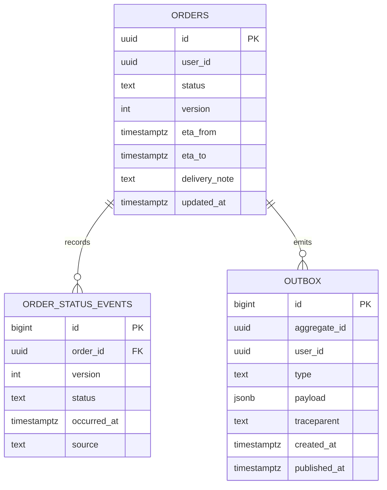

## 77.3 NestJS backend: PostgreSQL schema, status transitions and the outbox

#### Concept

The backend has one job that everything else depends on: change an order's status **correctly** and tell the world **exactly once per committed change**. Three pieces do it:

- **The `orders` row** holds the current status, a `version` that increases on every change, the arrival window and the delivery note. Changes use **optimistic concurrency** (Part 5.5): `UPDATE ... WHERE id = $1 AND version = $2`.
- **`order_status_events`** records the history (the timeline the page shows), one row per change, unique per `(order_id, version)`.
- **The transactional outbox** (Part 71.10): in the same transaction as the status change, a row is written to `outbox`. A separate **relay** reads unpublished rows and appends them to the customer's Redis Stream, from which the SSE controller of 70.8 replays and streams.

#### Why does it exist?

Because the obvious code, "update the row, then publish to Redis", has two failure windows (the dual-write problem, Part 71.9). If the process dies after the commit and before the publish, the customer never sees the change until they reload. If the publish happens before the commit and the transaction then rolls back, the customer sees a status that never happened. At 400,000 orders a day, "rarely" is several times a day. The outbox makes the event a consequence of the commit: if the change is committed, the event will be published, possibly twice, never zero times, and never for a change that did not commit.

#### Mental model

Imagine a bank clerk who, in the same stroke of the pen, updates your balance and writes a line in the "letters to send" book. A courier comes by every few moments, posts every unsent letter, and ticks it off. If the courier is ill, the letters wait in the book; nobody forgets them, and no letter is sent for a payment that was torn up before it was entered.

#### How it works



The DDL, as a migration (Part 23: additive, safe on a live table):

```sql
-- migrations/1730800000000-order-tracking.sql (expand step: only additions)
ALTER TABLE orders
  ADD COLUMN eta_from      timestamptz,
  ADD COLUMN eta_to        timestamptz,
  ADD COLUMN delivery_note text CHECK (char_length(delivery_note) <= 200),
  ADD CONSTRAINT eta_window_ordered CHECK (eta_from IS NULL OR eta_to IS NULL OR eta_from <= eta_to);
-- status is text with a CHECK listing allowed values; adding PACKING and OUT_FOR_DELIVERY replaces the CHECK
ALTER TABLE orders DROP CONSTRAINT orders_status_check,
  ADD CONSTRAINT orders_status_check CHECK (status IN
    ('PENDING','PAID','PACKING','OUT_FOR_DELIVERY','SHIPPED','DELIVERED','CANCELLED')) NOT VALID;
ALTER TABLE orders VALIDATE CONSTRAINT orders_status_check;   -- validates without blocking writes for long (Part 23)

CREATE TABLE order_status_events (
  id          bigserial PRIMARY KEY,
  order_id    uuid NOT NULL REFERENCES orders(id),
  version     integer NOT NULL,
  status      text NOT NULL,
  occurred_at timestamptz NOT NULL DEFAULT now(),
  source      text NOT NULL,                                  -- 'customer', 'warehouse', 'dispatch', 'support'
  UNIQUE (order_id, version)                                  -- one history row per version: replays cannot duplicate
);

CREATE TABLE outbox (
  id           bigserial PRIMARY KEY,
  aggregate_id uuid NOT NULL,
  user_id      uuid NOT NULL,                                 -- which customer stream receives it
  type         text NOT NULL,                                 -- 'order.status_changed', 'order.note_changed'
  payload      jsonb NOT NULL,                                -- an OrderEvent, already shaped for the wire
  traceparent  text,                                          -- links the relay's span to the request (85.11)
  created_at   timestamptz NOT NULL DEFAULT now(),
  published_at timestamptz
);
-- The relay only ever reads unpublished rows, oldest first: a small partial index stays small forever.
CREATE INDEX outbox_unpublished ON outbox (id) WHERE published_at IS NULL;
```

**Transitions are rules, shared and tested** (75.2). The allowed moves live in `@shop/contracts`, so the API enforces them and the web can explain them:

```ts
// packages/contracts/src/order-transitions.ts
import type { z } from 'zod';
import type { OrderStatusSchema } from './orders';

type Status = z.infer<typeof OrderStatusSchema>;
const NEXT: Record<Status, readonly Status[]> = {
  PENDING: ['PAID', 'CANCELLED'],
  PAID: ['PACKING', 'CANCELLED'],
  PACKING: ['OUT_FOR_DELIVERY', 'SHIPPED'],
  OUT_FOR_DELIVERY: ['DELIVERED'],
  SHIPPED: ['DELIVERED'],
  DELIVERED: [],
  CANCELLED: [],
};
export const canTransition = (from: Status, to: Status): boolean => NEXT[from].includes(to);
export const allowedFrom = (to: Status): Status[] => (Object.keys(NEXT) as Status[]).filter((s) => NEXT[s].includes(to));
```

**One transaction per change.** The service applies a transition with a conditional `UPDATE`, writes the history row and the outbox row, all or nothing:

```ts
// apps/api/src/orders/order-status.service.ts  (TypeORM 0.3)
import { ConflictException, Injectable, NotFoundException } from '@nestjs/common';
import { DataSource } from 'typeorm';
import { propagation, context } from '@opentelemetry/api';
import { allowedFrom, type OrderEvent } from '@shop/contracts';
import { statusSummary } from './status-summary';                 // "Out for delivery. Arriving 7:25 to 7:40 pm."

type Change = { orderId: string; to: OrderEvent['status']; source: string; eta?: { from: Date; to: Date } | null };

@Injectable()
export class OrderStatusService {
  constructor(private readonly ds: DataSource) {}

  async transition(c: Change): Promise<OrderEvent> {
    return this.ds.transaction(async (m) => {
      // Conditional update: only from a status that allows this move. No SELECT ... FOR UPDATE needed.
      // TypeORM's query() on PostgreSQL returns [rows, rowCount] for UPDATE and DELETE, so destructure.
      const [rows]: [{ id: string; user_id: string; version: number; updated_at: Date; eta_from: Date | null; eta_to: Date | null;
                    store_time_zone: string }[], number] = await m.query(
        `UPDATE orders
            SET status = $2, version = version + 1, updated_at = now(),
                eta_from = COALESCE($4, eta_from), eta_to = COALESCE($5, eta_to)
          WHERE id = $1 AND status = ANY($3)
        RETURNING id, user_id, version, updated_at, eta_from, eta_to, store_time_zone`,
        [c.orderId, c.to, allowedFrom(c.to), c.eta?.from ?? null, c.eta?.to ?? null],
      );
      const row = rows[0];
      if (!row) {
        const exists = await m.query('SELECT status FROM orders WHERE id = $1', [c.orderId]);
        if (!exists.length) throw new NotFoundException({ code: 'NOT_FOUND' });
        throw new ConflictException({ code: 'INVALID_TRANSITION', issues: [{ code: exists[0].status, message: `Cannot move to ${c.to}` }] });
      }
      await m.query(
        'INSERT INTO order_status_events (order_id, version, status, source) VALUES ($1, $2, $3, $4)',
        [row.id, row.version, c.to, c.source],
      );
      const event: OrderEvent = {
        orderId: row.id, status: c.to, version: row.version, updatedAt: row.updated_at.toISOString(),
        etaWindow: row.eta_from && row.eta_to ? { from: row.eta_from.toISOString(), to: row.eta_to.toISOString() } : null,
        summary: statusSummary(c.to, row.eta_from, row.eta_to, row.store_time_zone),
      };
      const carrier: Record<string, string> = {};
      propagation.inject(context.active(), carrier);              // W3C traceparent of the current request (85.11)
      await m.query(
        `INSERT INTO outbox (aggregate_id, user_id, type, payload, traceparent) VALUES ($1, $2, 'order.status_changed', $3, $4)`,
        [row.id, row.user_id, JSON.stringify(event), carrier.traceparent ?? null],
      );
      return event;                                               // committed when this callback resolves
    });
  }
}
```

The `WHERE status = ANY($3)` makes the transition **state-idempotent**: the warehouse sending "PACKING" twice moves the order once; the second call finds no row in an allowed state and gets `409 INVALID_TRANSITION`, which the warehouse integration treats as "already done". This matters because upstream systems retry (Part 71.12).

**The relay.** A small worker loop (Part 35) claims a batch of unpublished rows, appends each to the customer's Redis Stream, and marks them published, using `FOR UPDATE SKIP LOCKED` so several relay instances can run without double-claiming (Part 5.10):

```ts
// apps/api/src/orders/outbox.relay.ts
import { Injectable, Logger, OnApplicationShutdown, OnModuleInit } from '@nestjs/common';
import { InjectRedis } from '@nestjs-modules/ioredis';             // or a small provider wrapping ioredis
import type Redis from 'ioredis';
import { DataSource } from 'typeorm';

const BATCH = 200;
const STREAM_MAXLEN = 500;                                         // per customer: about 15 minutes of history (78.8)

@Injectable()
export class OutboxRelay implements OnModuleInit, OnApplicationShutdown {
  private readonly log = new Logger(OutboxRelay.name);
  private running = true;

  constructor(private readonly ds: DataSource, @InjectRedis() private readonly redis: Redis) {}

  onModuleInit() { void this.loop(); }
  onApplicationShutdown() { this.running = false; }

  private async loop() {
    while (this.running) {
      const published = await this.tick().catch((e) => { this.log.error(e); return 0; });
      if (published < BATCH) await new Promise((r) => setTimeout(r, published ? 20 : 100)); // idle: poll every 100 ms
    }
  }

  async tick(): Promise<number> {
    return this.ds.transaction(async (m) => {
      const rows: { id: string; user_id: string; payload: unknown }[] = await m.query(
        `SELECT id, user_id, payload FROM outbox
          WHERE published_at IS NULL ORDER BY id LIMIT $1 FOR UPDATE SKIP LOCKED`, [BATCH]);
      if (!rows.length) return 0;
      const pipe = this.redis.pipeline();
      for (const r of rows) {
        const key = `orders:events:${r.user_id}`;
        pipe.xadd(key, 'MAXLEN', '~', STREAM_MAXLEN, '*', 'payload', JSON.stringify(r.payload));
        pipe.expire(key, 3600);                                     // idle customers' streams disappear after an hour
        pipe.publish(`orders:live:${r.user_id}`, '1');              // wake live SSE subscribers (78.8's subscribe)
      }
      await pipe.exec();                                            // if Redis fails, the transaction rolls back: retried
      await m.query('UPDATE outbox SET published_at = now() WHERE id = ANY($1)', [rows.map((r) => r.id)]);
      return rows.length;
    });
  }
}
```

If the process dies after `pipe.exec()` and before the commit, the rows are published again on the next tick: **at least once**. Duplicates are harmless because every consumer applies events by version (70.8). The order of events per customer is preserved because rows are claimed in `id` order and a customer's events land in one stream.

#### Practical example — one transition, timed

The warehouse system marks order `1d6c...` as packed and handed to rider R-221 at 19:15:27 store time:

```text
13:45:27.391Z  POST /internal/orders/1d6c.../status {to: OUT_FOR_DELIVERY, eta: 13:55-14:10}  (service auth)
13:45:27.394Z  BEGIN; UPDATE orders ... WHERE status = ANY('{PACKING}') RETURNING version=7      2.1 ms
13:45:27.396Z  INSERT order_status_events (version 7); INSERT outbox                             0.9 ms
13:45:27.402Z  COMMIT                                                                            1.8 ms
13:45:27.471Z  relay tick claims outbox id 88412311 (idle poll, waited 69 ms)
13:45:27.473Z  XADD orders:events:u-5f2... -> 1730813127412-0; PUBLISH orders:live:u-5f2...      0.6 ms
13:45:27.475Z  SSE controller writes "event: order" to the customer's connection
13:45:27.6xxZ  browser receives it (network 60-150 ms on 4G); cache patched; status heading re-renders
```

Commit to screen: about 200-300 ms, well under the 2 s p95 target. The idle poll interval (100 ms) is the largest controllable delay; PostgreSQL `LISTEN/NOTIFY` from a trigger could wake the relay instantly, at the cost of another moving part, and is not needed at this target.

#### Backend side (NestJS)

The internal endpoint that upstream systems call, separate from customer routes:

```ts
// apps/api/src/orders/internal-status.controller.ts
import { Body, Controller, HttpCode, Param, ParseUUIDPipe, Post, UseGuards } from '@nestjs/common';
import { z } from 'zod';
import { OrderStatusSchema } from '@shop/contracts';
import { ZodValidationPipe } from '../common/zod-validation.pipe';
import { ServiceAuthGuard } from '../auth/service-auth.guard';       // mTLS or a signed service token (Part 82.19)
import { OrderStatusService } from './order-status.service';

const InternalStatusChange = z.object({
  to: OrderStatusSchema,
  source: z.enum(['warehouse', 'dispatch', 'support']),
  eta: z.object({ from: z.coerce.date(), to: z.coerce.date() }).nullable().optional(),
});

@Controller('internal/orders')
@UseGuards(ServiceAuthGuard)                                         // never reachable with a customer cookie
export class InternalStatusController {
  constructor(private readonly status: OrderStatusService) {}

  @Post(':id/status')
  @HttpCode(200)
  change(@Param('id', ParseUUIDPipe) id: string,
         @Body(new ZodValidationPipe(InternalStatusChange)) body: z.infer<typeof InternalStatusChange>) {
    return this.status.transition({ orderId: id, to: body.to, source: body.source, eta: body.eta ?? null });
  }
}
```

The relay's query plan, with 40 million historical outbox rows and a few hundred unpublished:

```text
EXPLAIN (ANALYZE, BUFFERS) SELECT id, user_id, payload FROM outbox
 WHERE published_at IS NULL ORDER BY id LIMIT 200 FOR UPDATE SKIP LOCKED;

 Limit  (cost=0.29..18.71 rows=200 width=612) (actual time=0.031..0.402 rows=163 loops=1)
   Buffers: shared hit=171
   ->  LockRows  (cost=0.29..39.12 rows=421 width=612) (actual time=0.030..0.388 rows=163 loops=1)
         ->  Index Scan using outbox_unpublished on outbox  (cost=0.29..34.91 rows=421 width=612)
               (actual time=0.017..0.211 rows=163 loops=1)
 Planning Time: 0.118 ms
 Execution Time: 0.431 ms
```

The partial index contains only unpublished rows, so it stays a few pages in size however large the table grows. A nightly job deletes published rows older than 7 days in batches (`DELETE ... WHERE id IN (SELECT id ... LIMIT 10000)`), keeping vacuum cheap (Part 18).

#### Production scenario

At the evening peak the relay publishes 120 to 600 rows a second in batches of 20 to 200, using about 4 % of one vCPU on each of two instances. Outbox backlog (unpublished rows) averages 3 and peaked at 2,100 during a 40-second Redis failover; the relay caught up 6 seconds after Redis returned, and every event was delivered. The `order_status_events` table grows by 2 million rows a day; it is partitioned by month (Part 22) once it passes 500 million rows.

#### Failure scenario

During testing, a developer "optimised" the relay to publish first and update `published_at` in a separate statement without a transaction. When a relay instance was killed mid-batch during a deploy, 140 rows were published but never marked, and a second instance had already claimed overlapping rows because nothing held their locks. Customers received duplicated events, which the version guard absorbed, and a few events were stuck as "unpublished" until the next tick, which was also fine. The real damage was elsewhere: the analytics consumer of the same stream counted each event as a delivery milestone and double-counted 140 deliveries in a finance report. The rule written into the code review checklist: every consumer of order events must be idempotent by `(orderId, version)`, not only the browser.

#### Edge cases & failure modes

- **Two upstream systems race** (support cancels while the warehouse starts packing): the conditional `UPDATE` lets exactly one win; the other gets `409 INVALID_TRANSITION`.
- **Redis down**: the relay's transaction rolls back and retries; the outbox grows; SSE clients stop receiving events and the page falls back (77.12).
- **Relay down**: same as Redis down, but nothing alerts unless outbox backlog and age are monitored (77.11).
- **Hot rows**: an order changes at most a handful of times; no hot-row contention. The outbox insert is an append on a sequence, also fine at this rate.
- **Clock in events**: `updated_at` comes from the database's `now()`, one clock for every writer, not the API task's clock.
- **Transaction scope**: never call external services (dispatch, SMS) inside the transaction (Part 5.8); they consume the outbox stream too.
- **Long transactions block vacuum** on `outbox`; keep the relay's transaction to one batch.

#### How a Senior Full-Stack Engineer thinks about this

The senior makes the database row the only truth and every other representation (history, stream, cache, screen) a derivation of committed changes, carried by an outbox. They express transitions as data in the shared package, enforce them with one conditional `UPDATE`, and design every consumer to be idempotent by version. They size the relay from bursts, monitor backlog and age, and choose polling at 100 ms because it meets the target with fewer moving parts than triggers or CDC (Part 38), which they would adopt at 10x (77.13).

#### Common mistakes

- **Publishing to Redis in the request after commit** (dual write).
- **`SELECT` then `UPDATE`** for transitions, which races.
- **Outbox without a partial index**, so the relay's query slows as the table grows.
- **Consumers that are not idempotent** by version.
- **Calling external services inside the status transaction.**

#### Interview questions

1. **Why an outbox instead of publishing after commit?** Expected answer: a crash between commit and publish loses the event; publishing before commit can announce a change that rolls back; the outbox ties the event to the commit and gives at-least-once delivery.
2. **How do you make status transitions safe under concurrency?** Expected answer: a conditional `UPDATE ... WHERE status = ANY(allowed)` (and a version), checked by rows affected; one writer wins.
3. **What does `FOR UPDATE SKIP LOCKED` give the relay?** Expected answer: several instances can claim disjoint batches without blocking each other.
4. **Why is at-least-once delivery acceptable here?** Expected answer: every consumer applies events by `(orderId, version)`, so duplicates are no-ops.
5. **How do you keep the outbox query fast with 40 million rows?** Expected answer: a partial index on unpublished rows and regular deletion of old published rows.

#### Practical exercise

Build the schema, the transition service and the relay.

Acceptance criteria:

- A migration that only adds (columns, tables, a replaced `CHECK` validated with `NOT VALID` then `VALIDATE`).
- An integration test (Testcontainers, Part 75.7) firing two concurrent transitions from `PAID` (to `PACKING` and to `CANCELLED`): exactly one succeeds, one history row and one outbox row exist.
- Killing the relay between `XADD` and commit, then restarting it, produces a duplicate stream entry and no missing one.
- `EXPLAIN (ANALYZE)` of the relay query uses `outbox_unpublished` with 10 million published rows present.
