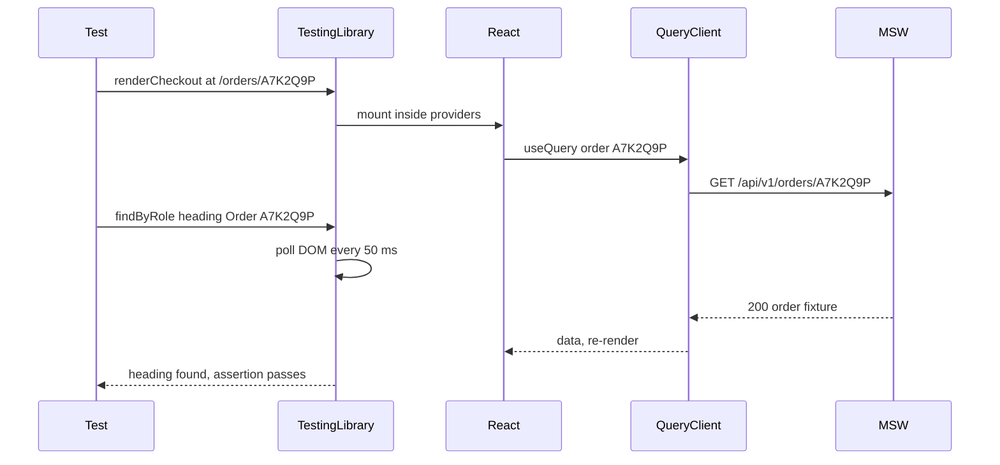

## 77.3 Component tests with Testing Library: behaviour, not implementation

#### Concept

A **component test** renders a real component tree (a form, a dialog, a whole checkout step) into a simulated DOM and drives it the way a user would: find the input by its label, type, press the button, read what appears. **Testing Library** (`@testing-library/react` on top of `@testing-library/dom`) is the standard tool. Its guiding principle, in its author's words: *the more your tests resemble the way your software is used, the more confidence they can give you.*

In practice that means three habits:

- **Find elements the way a user or a screen reader would**: by role and accessible name (`getByRole('button', { name: 'Place order' })`), by label, by visible text. Not by CSS class, component name or internal state.
- **Interact with real events** through `@testing-library/user-event`, which types character by character, moves focus, fires `pointerdown`, `mousedown`, `focus`, `pointerup`, `mouseup`, `click` in the browser's order, and respects `disabled`.
- **Assert on the result a user could observe**: text, focus, disabled state, the accessible description of an input, the request that was sent.

#### Why does it exist?

Older React testing tools (Enzyme) encouraged reaching inside components: read `state`, call instance methods, shallow-render and find children by component type. Those tests broke on every refactor (renaming a state variable, converting a class to hooks, splitting a component) while staying green when the user-visible behaviour broke. They tested the code's shape, not its job. Enzyme also never supported React 18. Testing Library replaced it by making the implementation unreachable on purpose: there is no API to read a component's state.

There is a bonus that matters to the whole team: a test that finds the Postcode field by `getByRole('textbox', { name: 'Postcode' })` fails if the label is missing or not linked to the input. Accessibility bugs become test failures (69.9).

#### Mental model

Imagine a mystery shopper who is not allowed into the kitchen. They can only read the menu, order, and judge what arrives. If the chef reorganises the kitchen, the shopper's report does not change. If the dish arrives cold, it does. Testing Library is the rule that keeps your tests out of the kitchen.

#### How it works

1. **`render(<AddressForm onSaved={onSaved} />)`** creates a container `div` in `document.body`, mounts the tree with `createRoot`, and wraps the mount in `act()`, so effects have run before you assert.
2. **Queries** search `document.body` (via `screen`) or a container (via `within(el)`). There are three families:

   | Prefix | Not found | More than one | Async | Use for |
   |---|---|---|---|---|
   | `getBy...` | throws | throws | no | Elements that must be there now |
   | `queryBy...` | returns `null` | throws | no | Asserting absence: `expect(queryByRole('alert')).toBeNull()` |
   | `findBy...` | rejects after timeout (1,000 ms default) | rejects | yes, retries | Elements that appear after a request or a timer |

   Each family has `All` variants (`getAllByRole`) that return arrays.
3. **Query priority** (Testing Library's own guidance): `getByRole` (with `name`), then `getByLabelText`, `getByPlaceholderText`, `getByText`, `getByDisplayValue`; then `getByAltText`, `getByTitle`; and only as a last resort `getByTestId`. Role queries use the same accessibility tree a screen reader uses, computed by `dom-accessibility-api`.
4. **`userEvent.setup()`** creates a user session. Every interaction returns a promise and must be awaited: `await user.type(input, '560001')`, `await user.click(button)`, `await user.tab()`, `await user.keyboard('{Enter}')`.
5. **Matchers** from `@testing-library/jest-dom` read the DOM the way a user perceives it: `toBeVisible`, `toBeDisabled`, `toHaveFocus`, `toHaveValue`, `toHaveAccessibleName`, `toHaveAccessibleDescription`, `toHaveAttribute('aria-invalid', 'true')`.
6. **Cleanup** unmounts the tree after each test (77.2's setup file).

```text
test code                 Testing Library                     React + jsdom
---------                 ---------------                     -------------
render(<Form/>)     ->    createRoot + act()            ->    DOM nodes in document.body
user.type(postcode) ->    keydown/keypress/input/keyup  ->    RHF register onChange, re-render
user.click(submit)  ->    pointer + mouse + click       ->    handleSubmit -> zod -> setError
findByRole('alert') ->    poll DOM every 50 ms          ->    <p role="alert">Postcode must be 6 digits</p>
```

#### Practical example

The address form of 71.7 has five behaviours worth a test, all observable without reading its code:

1. Submitting empty shows field messages and does not call `onSaved`.
2. A wrong postcode shows "Postcode must be 6 digits" after the field loses focus (`mode: 'onTouched'`).
3. A valid form calls `onSaved` once with trimmed values.
4. A server `422` with `path: "postcode"` shows the server's message under the postcode and moves focus there.
5. While saving, the submit button is disabled.

The form's input is a prop (`onSaved`), so the test passes a `vi.fn()`. That is not "mocking the network"; it is supplying the component's real input. The network version of the same flow, through the real client and MSW, is in 77.5.

#### React / Next.js example

```tsx
// apps/web/src/checkout/AddressForm.test.tsx
import { render, screen } from '@testing-library/react';
import userEvent from '@testing-library/user-event';
import { describe, expect, it, vi } from 'vitest';
import { AddressForm } from './AddressForm';
import { ApiError } from '../api/errors';

async function fillValid(user: ReturnType<typeof userEvent.setup>) {
  await user.type(screen.getByRole('textbox', { name: 'Full name' }), '  Asha Rao ');
  await user.type(screen.getByRole('textbox', { name: 'Mobile number' }), '9876543210');
  await user.type(screen.getByRole('textbox', { name: 'House number and street' }), '12 MG Road');
  await user.type(screen.getByRole('textbox', { name: 'City' }), 'Bengaluru');
  await user.type(screen.getByRole('textbox', { name: 'Postcode' }), '560001');
}

describe('AddressForm', () => {
  it('shows field messages and does not save an empty form', async () => {
    const user = userEvent.setup();
    const onSaved = vi.fn();
    render(<AddressForm onSaved={onSaved} />);

    await user.click(screen.getByRole('button', { name: 'Save address' }));

    expect(screen.getByRole('textbox', { name: 'Full name' })).toHaveAccessibleDescription('Enter your full name');
    expect(screen.getByRole('textbox', { name: 'Postcode' })).toHaveAttribute('aria-invalid', 'true');
    expect(onSaved).not.toHaveBeenCalled();
  });

  it('validates the postcode when the field loses focus', async () => {
    const user = userEvent.setup();
    render(<AddressForm onSaved={vi.fn()} />);
    const postcode = screen.getByRole('textbox', { name: 'Postcode' });

    await user.type(postcode, '5600');
    expect(postcode).toHaveAccessibleDescription('');      // quiet while typing: mode 'onTouched'
    await user.tab();
    expect(postcode).toHaveAccessibleDescription('Postcode must be 6 digits');
  });

  it('saves trimmed values once', async () => {
    const user = userEvent.setup();
    const onSaved = vi.fn().mockResolvedValue(undefined);
    render(<AddressForm onSaved={onSaved} />);
    await fillValid(user);
    await user.click(screen.getByRole('button', { name: 'Save address' }));

    expect(onSaved).toHaveBeenCalledTimes(1);
    expect(onSaved.mock.calls[0][0]).toMatchObject({ fullName: 'Asha Rao', postcode: '560001' }); // zod trimmed it
  });

  it('puts a server field error under the field and focuses it', async () => {
    const user = userEvent.setup();
    const onSaved = vi.fn().mockRejectedValue(new ApiError(422, 'ADDRESS_REJECTED', [
      { path: 'postcode', code: 'NOT_SERVICEABLE', message: 'We do not deliver to 560001 yet' },
    ]));
    render(<AddressForm onSaved={onSaved} />);
    await fillValid(user);
    await user.click(screen.getByRole('button', { name: 'Save address' }));

    const postcode = screen.getByRole('textbox', { name: 'Postcode' });
    expect(postcode).toHaveAccessibleDescription('We do not deliver to 560001 yet');
    expect(postcode).toHaveFocus();                         // applyServerErrors: shouldFocus on the first issue
  });
});
```

Notice what the test never mentions: React Hook Form, `register`, the zod resolver, `useState`. The form could be rewritten with React 19 Actions (71.7) and these four tests would still be the specification.

Notice also the query `getByRole('textbox', { name: 'Postcode' })`. The input has `inputMode="numeric"` but no `type="number"`, so its role is `textbox`; a `type="number"` input would be `spinbutton`. When a role query cannot find an element, Testing Library prints the accessibility tree it did find, which usually shows the problem at once ("you have a `textbox` named 'Pincode'").

Testing the presentational pieces of 71.10 is even simpler, because they take only props:

```tsx
// apps/web/src/orders/CancelReasonPicker.test.tsx
import { render, screen } from '@testing-library/react';
import userEvent from '@testing-library/user-event';
import { expect, it, vi } from 'vitest';
import { CancelReasonPicker } from './CancelReasonPicker';

it('reports the chosen reason and supports the keyboard', async () => {
  const user = userEvent.setup();
  const onChange = vi.fn();
  render(<CancelReasonPicker value={null} onChange={onChange} />);

  const group = screen.getByRole('radiogroup', { name: 'Why are you cancelling?' });
  expect(group).toBeInTheDocument();
  await user.tab();                                          // focus enters the group
  await user.keyboard('{ArrowDown}');                        // native radios move with arrows
  expect(onChange).toHaveBeenLastCalledWith('ORDERED_BY_MISTAKE');
});
```

#### Backend side (NestJS)

The fourth address test depends on a contract the API must keep: a `422` problem document whose `issues[].path` matches the form's field names (`postcode`, not `address.postcode` or `zip`). The API's own e2e test should assert the same shape, so both sides hold the same example:

```ts
// apps/api/test/checkout-address.e2e-spec.ts  (Jest + supertest, Part 41.13)
it('rejects a non-serviceable postcode with a field path the form understands', async () => {
  const res = await request(app.getHttpServer())
    .post('/v1/checkout/address')
    .set('Authorization', `Bearer ${token}`)
    .send({ ...validAddress, postcode: '560001' })            // seeded as not serviceable
    .expect(422)
    .expect('Content-Type', /application\/problem\+json/);

  expect(res.body).toMatchObject({
    code: 'ADDRESS_REJECTED',
    issues: [{ path: 'postcode', code: 'NOT_SERVICEABLE' }],  // path equals the RHF field name
    requestId: expect.any(String),
  });
});
```

When the frontend test and the backend test use the same literal example (`postcode`, `NOT_SERVICEABLE`), a reviewer can see the contract in both pull requests. Pact (74.10) makes that link mechanical.

#### Production scenario

A storefront's 420 component tests cover 31 screens and run in 68 s on a 4-vCPU runner (Vitest's default parallelism, one worker per core). The slowest 10 % are full-screen tests of checkout steps at 400-900 ms each, mostly `user.type` on long forms. Two changes halved them. `userEvent.setup({ delay: null })` skips the macrotask pause user-event v14 inserts between keystrokes. And long fixed inputs that no test inspects per keystroke use `await user.click(el)` then `await user.paste('12 MG Road')`, which fires one input event instead of one per character. Tests that check per-keystroke behaviour (formatting a phone number as you type) keep `type`.

#### Failure scenario

A design-system upgrade changed the `Button` component to render `<div role="button" tabIndex={0}>` so it could hold a loading spinner. All 420 component tests still passed: `getByRole('button')` matched the `div`, and `user.click` fired click events on it. In production, keyboard users could no longer submit checkout: the `div` had no handler for `Enter` and `Space`, and the form's implicit submission on `Enter` stopped working because there was no submit button inside the form.

The tests had only used the mouse. Adding one keyboard path per form (`await user.keyboard('{Enter}')` in the postcode field, then expect `onSaved` called) failed immediately on the new `Button`. The fix restored a native `<button type="submit">` with the spinner inside it, and an axe check (77.10) now flags role-button `div`s in forms.

#### Edge cases & failure modes

- **`getByText` for interactive elements** passes when the text exists anywhere, even in a non-clickable `span`; prefer `getByRole` with `name`.
- **`fireEvent` instead of `user-event`**: `fireEvent.change` sets a value without focus, key events or `disabled` checks; a test can "type" into a disabled field.
- **Not awaiting `user` calls** produces assertions that run before React re-renders, and `act` warnings.
- **Multiple matches**: two "Remove" buttons in a cart list; scope with `within(row)` instead of `getAllByRole(...)[1]`.
- **Hidden elements**: role queries ignore elements with `display: none` or `aria-hidden` by default (`hidden: false`); a modal behind another modal is invisible to them, which is usually what a user experiences too.
- **Translations**: tests that query by English text break when copy changes; for i18n apps render with the real message catalogue of one locale and query by those strings, or by role plus the message key's output.
- **Portals**: dialogs rendered into `document.body` via a portal are found by `screen`, not by the `container` returned from `render`.

#### How a Senior Full-Stack Engineer thinks about this

The senior writes component tests as executable acceptance criteria, in the user's vocabulary. If a test needs a `data-testid`, they first ask whether the element is missing an accessible name, because a real user would have the same problem. They keep every test independent and short, and they read a failing test's printed DOM before reaching for a debugger. They test at least one keyboard path for every form and dialog. And they insist the server's error contract is part of the test, because the most common frontend bug in a checkout is not a crash, it is a correct server message shown in the wrong place.

#### Common mistakes

- **Asserting on CSS classes** (`toHaveClass('error')`) instead of `aria-invalid` and the accessible description.
- **Testing third-party components** (React Hook Form's internals, a date picker library) instead of your use of them.
- **Huge setup per test**: 60 lines of providers and mocks before one assertion; extract a `renderCheckout()` helper (77.4).
- **Snapshotting rendered HTML** instead of asserting behaviour.
- **Mouse-only tests**, which miss the most common accessibility regressions.

#### Interview questions

1. **Why prefer `getByRole` over `getByTestId`?** Expected answer: it finds elements by what users and assistive technology perceive, survives refactors, and fails when accessibility is broken; test IDs are invisible to users and prove nothing about them.
2. **`getBy`, `queryBy` or `findBy`: which for what?** Expected answer: `getBy` for present now, `queryBy` to assert absence, `findBy` for elements that appear asynchronously.
3. **Why `user-event` rather than `fireEvent`?** Expected answer: realistic event sequences, focus, keyboard, `disabled` handling; `fireEvent` dispatches one synthetic event.
4. **How do you test that a server error lands on the right field?** Expected answer: return the problem document with `path`, assert the field's accessible description and focus, and keep the API's own test asserting the same `path`.
5. **What does a component test not prove?** Expected answer: real layout, CSS, browser quirks, cookies, redirects, the production bundle.

#### Practical exercise

Write component tests for the coupon step of 71.13 using only props for its callbacks.

Acceptance criteria:

- No query uses a CSS selector or test ID.
- Tests cover: invalid code syntax (client), a server `422` with `path: "code"`, a `409 CART_CHANGED` banner, the button disabled while applying, and applying with the `Enter` key.
- Each test runs in under 300 ms.
- Renaming the internal state variables or replacing React Hook Form with plain `useState` requires no test change.

## 77.4 Async UI, providers and framework seams in component tests

#### Concept

Real screens are asynchronous and live inside providers: a TanStack Query client, a router, a session context, a Zustand store, sometimes the Next.js App Router. A component test must supply these the way the app does, wait for asynchronous UI correctly, and replace only the seams that a test environment cannot provide (the Next.js router, `IntersectionObserver`, the clock). Getting this wrong produces the two classic frontend test diseases: `act()` warnings and tests that pass or fail depending on machine speed.

#### Why does it exist?

Because "wait one second and check" is how flaky tests are born. A test that renders the order page and immediately asserts "Order A7K2Q9P" fails, because the data arrives after a request. A test that waits a fixed 500 ms passes on a laptop and fails on a busy CI runner. And a test that renders a component without the app's providers either crashes (`No QueryClient set, use QueryClientProvider to set one`) or, worse, uses a shared client from another test and sees its cached data.

#### Mental model

Imagine testing a vending machine. You must plug it in (providers) before pressing buttons, and after pressing "B4" you watch the slot until the can drops, up to a sensible limit, rather than counting to three and looking once. You also start every test with a freshly stocked machine, not the one the last tester half-emptied.

#### How it works

1. **A test render helper** builds the providers per test: a **new** `QueryClient` each time (so no cache leaks), with `retry: false` so an error response shows the error state at once instead of after three retries with backoff.
2. **Waiting**: `findBy...` and `waitFor(() => expect(...))` poll the DOM every 50 ms until the assertion passes or a timeout (1,000 ms default) expires. They are the only correct way to wait for UI. `waitForElementToBeRemoved(() => screen.queryByText('Loading...'))` waits for a loading state to go away.
3. **`act()` warnings** ("An update to OrderPage inside a test was not wrapped in act(...)") mean a state update happened after the test stopped waiting: usually a request that resolved after the last assertion. The fix is to wait for the final UI state, not to wrap things in `act` by hand.
4. **Framework seams** are replaced at module level: `next/navigation` (`useRouter`, `usePathname`, `useSearchParams`) has no App Router context in Vitest, so the test mocks the module with `vi.mock('next/navigation', ...)`. Browser APIs missing from jsdom (`IntersectionObserver`, `matchMedia`, `ResizeObserver`) get small fakes with `vi.stubGlobal`.
5. **Stores** created at module level (Zustand) keep state between tests in the same file; reset them in `beforeEach` from their initial state.
6. **Render counts** can be measured with React's `<Profiler onRender>`, which works in tests, so "typing in the coupon does not re-render the summary" (71.13) becomes an assertion.



#### Practical example

The order detail screen of 72.12 uses `useQuery` for the order, `useMutation` for cancel, `useRouter` from `next/navigation` to go back to the list, and a Zustand store for the "compact view" toggle. The tests need: fresh providers, the network faked with MSW (77.5 explains the handlers), the router mocked, the store reset, and waits on visible states.

#### React / Next.js example

The shared render helper:

```tsx
// apps/web/src/test/render.tsx  (TanStack Query v5)
import { QueryClient, QueryClientProvider } from '@tanstack/react-query';
import { render, type RenderOptions } from '@testing-library/react';
import userEvent from '@testing-library/user-event';
import type { ReactElement, ReactNode } from 'react';
import { SessionProvider, type Session } from '@/session/SessionProvider';

export function makeTestQueryClient() {
  return new QueryClient({
    defaultOptions: {
      queries: { retry: false, gcTime: Infinity, staleTime: 0 },   // errors show at once; no GC timers during the test
      mutations: { retry: false },
    },
  });
}

type Options = RenderOptions & { session?: Session | null; queryClient?: QueryClient };

export function renderWithProviders(ui: ReactElement, { session = aSession(), queryClient = makeTestQueryClient(), ...rest }: Options = {}) {
  const Wrapper = ({ children }: { children: ReactNode }) => (
    <QueryClientProvider client={queryClient}>
      <SessionProvider value={session}>{children}</SessionProvider>
    </QueryClientProvider>
  );
  return { user: userEvent.setup(), queryClient, ...render(ui, { wrapper: Wrapper, ...rest }) };
}

export const aSession = (overrides: Partial<Session> = {}): Session =>
  ({ userId: 'u1', name: 'Asha', roles: ['customer'], ...overrides });
```

The App Router seam. `next/navigation` hooks read a context that only the Next.js runtime provides, so the test replaces the module and keeps a handle on `push`:

```ts
// apps/web/src/test/next-navigation.ts
import { vi } from 'vitest';

export const router = { push: vi.fn(), replace: vi.fn(), back: vi.fn(), refresh: vi.fn(), prefetch: vi.fn() };
export let searchParams = new URLSearchParams();
export const setSearchParams = (q: string) => { searchParams = new URLSearchParams(q); };

vi.mock('next/navigation', () => ({
  useRouter: () => router,
  usePathname: () => '/orders/A7K2Q9P',
  useSearchParams: () => searchParams,       // a URLSearchParams is close enough to ReadonlyURLSearchParams for reads
  notFound: () => { throw new Error('NEXT_NOT_FOUND'); },
}));
```

A test of the order screen's three states, waiting correctly:

```tsx
// apps/web/src/orders/OrderDetail.test.tsx
import '../test/next-navigation';                            // registers the vi.mock before the component imports it
import { screen, waitForElementToBeRemoved, within } from '@testing-library/react';
import { http, HttpResponse } from 'msw';
import { beforeEach, describe, expect, it } from 'vitest';
import { server } from '../test/msw/server';
import { anOrder } from '../test/builders';
import { renderWithProviders } from '../test/render';
import { router } from '../test/next-navigation';
import { useViewPrefs } from './viewPrefsStore';
import { OrderDetail } from './OrderDetail';

const API = 'http://localhost:3000/api/v1';

describe('OrderDetail', () => {
  beforeEach(() => useViewPrefs.setState(useViewPrefs.getInitialState(), true)); // Zustand 4.5+/5: reset the store

  it('shows the order once loaded', async () => {
    server.use(http.get(`${API}/orders/:id`, () => HttpResponse.json(anOrder({ displayId: 'A7K2Q9P', status: 'PAID' }))));
    renderWithProviders(<OrderDetail orderId="A7K2Q9P" />);

    await waitForElementToBeRemoved(() => screen.queryByRole('status', { name: 'Loading order' }));
    expect(screen.getByRole('heading', { name: 'Order A7K2Q9P' })).toBeVisible();
    expect(within(screen.getByRole('region', { name: 'Status' })).getByText('Paid')).toBeVisible();
  });

  it('shows a retryable error with the request ID on a 503', async () => {
    server.use(http.get(`${API}/orders/:id`, () => HttpResponse.json(
      { code: 'UPSTREAM_UNAVAILABLE', status: 503, title: 'Service unavailable', issues: [], requestId: 'req-42' },
      { status: 503, headers: { 'Content-Type': 'application/problem+json' } },
    )));
    const { user } = renderWithProviders(<OrderDetail orderId="A7K2Q9P" />);

    const alert = await screen.findByRole('alert');
    expect(alert).toHaveTextContent('We could not load this order');
    expect(alert).toHaveTextContent('req-42');                 // support can find the server log
    server.use(http.get(`${API}/orders/:id`, () => HttpResponse.json(anOrder({ displayId: 'A7K2Q9P' }))));
    await user.click(within(alert).getByRole('button', { name: 'Try again' }));
    expect(await screen.findByRole('heading', { name: 'Order A7K2Q9P' })).toBeVisible();
  });

  it('goes back to the list after a successful cancel', async () => {
    server.use(
      http.get(`${API}/orders/:id`, () => HttpResponse.json(anOrder({ displayId: 'A7K2Q9P', status: 'PAID' }))),
      http.post(`${API}/orders/:id/cancel`, () => HttpResponse.json(anOrder({ displayId: 'A7K2Q9P', status: 'CANCELLED' }))),
    );
    const { user } = renderWithProviders(<OrderDetail orderId="A7K2Q9P" />);
    await user.click(await screen.findByRole('button', { name: 'Cancel order' }));
    await user.click(screen.getByRole('radio', { name: 'Ordered by mistake' }));
    await user.click(within(screen.getByRole('dialog')).getByRole('button', { name: 'Cancel order' }));
    await expect.poll(() => router.push.mock.calls.length).toBe(1);   // Vitest 1.3+: retries until it passes
    expect(router.push).toHaveBeenCalledWith('/orders?cancelled=A7K2Q9P');
  });
});
```

Measuring renders, for the 71.13 criterion "typing the coupon re-renders neither the address nor the summary":

```tsx
// apps/web/src/checkout/CheckoutFlow.renders.test.tsx (excerpt)
import { Profiler, type ProfilerOnRenderCallback } from 'react';

const commits: string[] = [];
const onRender: ProfilerOnRenderCallback = (id) => { commits.push(id); };

it('typing a coupon does not re-render the price summary', async () => {
  const { user } = renderWithProviders(<CheckoutFlowAtCouponStep wrapSummary={(n) => <Profiler id="summary" onRender={onRender}>{n}</Profiler>} />);
  commits.length = 0;                                        // ignore the mount
  await user.type(screen.getByRole('textbox', { name: 'Coupon code' }), 'SAVE50');
  expect(commits.filter((id) => id === 'summary')).toHaveLength(0);
});
```

#### Backend side (NestJS)

Component tests wait for states; the API must make those states distinguishable and stable:

- **Error responses always carry `requestId`** in the body and `X-Request-Id` in headers, so the error state can show it and a test can assert it.
- **`Retry-After` on `429` and `503`**, exposed with CORS `exposedHeaders`, so the client's "wait" treatment (74.6) is testable with a fixed value.
- **Mutation responses return the updated resource** (`POST /cancel` returns the cancelled order), so the client can update its cache without a second request and the test needs one handler, not two.
- **Deterministic ordering** for lists (`ORDER BY placed_at DESC, id DESC`), so fixtures and screenshots are stable and the UI does not reorder rows between refetches.

```ts
// apps/api/src/orders/orders.controller.ts (excerpt)
@Post(':id/cancel')
@HttpCode(200)
async cancel(@CurrentUser() user: AuthUser, @Param('id', ParseUUIDPipe) id: string,
             @Body(new ZodValidationPipe(CancelOrderSchema)) body: CancelOrder): Promise<OrderSummary> {
  const order = await this.orders.cancel(user.id, id, body.reason); // 409 ORDER_NOT_CANCELLABLE if shipped
  return toOrderSummary(order);                                     // the new state: the client needs no refetch
}
```

#### Production scenario

On a 4-vCPU runner, 420 component tests run in 68 s with a fresh `QueryClient` per test. An earlier version shared one module-level client "for speed"; it saved about 2 ms per test and produced 11 order-dependent failures a month, each costing an engineer 20 minutes to re-run and dismiss. Vitest's `--sequence.shuffle` flag, run nightly, now catches any new order dependence within a day.

#### Failure scenario

A test suite passed for months with `await new Promise((r) => setTimeout(r, 300))` after each render, "to let the query settle". A CI runner upgrade moved the jobs to shared ARM instances. Response times from MSW stayed under 5 ms, but React's rendering in jsdom slowed by about 40 % under contention, and 9 % of runs failed. The team deleted every fixed sleep (147 of them), replaced them with `findBy` and `waitFor` on the final visible state, and the flake rate fell to zero. The suite also got 44 s faster, because the sleeps had been waiting even when nothing was pending.

#### Edge cases & failure modes

- **`waitFor` with side effects inside**: `waitFor(() => user.click(...))` clicks many times; only assertions go inside `waitFor`.
- **Empty `waitFor`** (`await waitFor(() => {})`) waits for nothing useful and hides `act` warnings without fixing them.
- **Retries on in tests**: TanStack Query's default 3 retries with exponential backoff make an error state appear after about 7 s, past every timeout.
- **`gcTime` timers** keep the process alive or warn after the test; `gcTime: Infinity` in the test client avoids scheduling them.
- **Mocking `next/navigation` after import**: `vi.mock` is hoisted within its own file; importing a helper that calls `vi.mock` must happen before the component's import, or the mock must be in the setup file.
- **Server Components imported into a test** fail on `server-only` imports or async rendering; test their synchronous children.
- **Fake timers with MSW**: MSW's `delay()` uses timers; with fake timers active it never resolves unless you advance time.

#### How a Senior Full-Stack Engineer thinks about this

The senior makes the correct test the easy test: one `renderWithProviders` helper, one router mock, builders for every fixture, and lint rules (`testing-library/prefer-find-by`, `testing-library/no-wait-for-side-effects`, `testing-library/await-async-events` from `eslint-plugin-testing-library`) that reject the flaky patterns in review. They wait for outcomes, never for time. They mock framework seams (router, observers) at their thinnest point and never the app's own data layer. And they treat a new `act` warning as a failing test, because it is a real asynchronous update the test did not account for.

#### Common mistakes

- **One `QueryClient` for the whole suite.**
- **Fixed sleeps** instead of `findBy`/`waitFor`.
- **Mocking `useQuery`** to return `{ data }` directly, which skips loading, error and the real fetch.
- **Forgetting to reset module-level stores**, so test order matters.
- **Raising the global async timeout** to 10 s to hide slow tests instead of finding what is slow.

#### Interview questions

1. **What does an `act()` warning tell you, and how do you fix it?** Expected answer: a state update after the test stopped waiting; wait for the final UI state with `findBy` or `waitFor` rather than wrapping in `act` manually.
2. **How do you configure TanStack Query for tests, and why?** Expected answer: a new client per test, `retry: false`, `gcTime: Infinity`; isolation and immediate error states.
3. **How do you test a Client Component that uses `useRouter` from `next/navigation`?** Expected answer: mock the module and assert calls on `push` or `replace`; cover real navigation in e2e.
4. **How would you prove a keystroke does not re-render an expensive component?** Expected answer: wrap it in `<Profiler>` and count commits during typing.
5. **Why are fixed sleeps in tests both slow and flaky?** Expected answer: they wait even when nothing is pending, and they are too short on slow machines.

#### Practical exercise

Build the test harness for the order list of 72.12.

Acceptance criteria:

- One `renderWithProviders` helper, one `next/navigation` mock, and a store reset; no test file creates its own `QueryClient`.
- Tests cover loading, empty, filtered-empty, error with request ID and retry, and a successful optimistic cancel, using only `findBy`, `waitFor` and `waitForElementToBeRemoved` for waiting.
- `vitest run --sequence.shuffle` passes 20 times in a row.
- `eslint-plugin-testing-library` is enabled with its recommended React config and reports zero problems.
