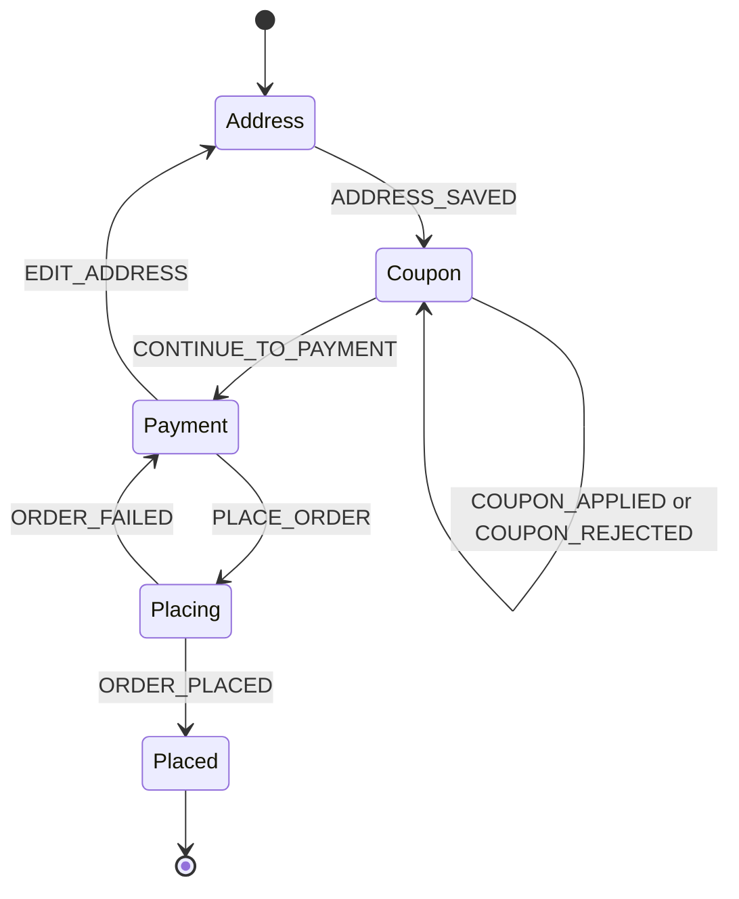

## 77.5 `useRef`, `useReducer` and `useContext`

#### Concept

Three hooks cover most needs beyond `useState` and `useEffect`:

- **`useRef(initial)`** returns a mutable object `{ current: initial }` that survives re-renders and **does not cause a re-render when changed**. It has two uses: holding a reference to a DOM node (`<input ref={inputRef} />`, then `inputRef.current.focus()`), and holding a mutable value that is not displayed (a timer ID, the latest callback, an idempotency key for the current checkout attempt).
- **`useReducer(reducer, initialState)`** is `useState` for state with several fields that change together according to rules. You describe changes as **actions** (`{ type: 'COUPON_APPLIED', totals }`) and a pure **reducer** function computes the next state: `(state, action) => newState`. It returns `[state, dispatch]`.
- **`useContext(SomeContext)`** reads a value provided by the nearest `<SomeContext.Provider value={...}>` above in the tree, without passing it through every intermediate component's props. It is how the current user, theme, locale or feature flags reach deep components.

#### Why does it exist?

**`useRef`**: some values must persist across renders without triggering them (a timer ID in state would re-render for nothing; in a local variable it is lost), and some operations are imperative by nature: focus an input, scroll to an error, hand a DOM node to a map SDK.

**`useReducer`**: a checkout has a step, address, coupon, totals, payment status and error. With six `useState` calls, "coupon applied" must call four setters correctly in every handler, and forgetting one creates impossible states. A reducer puts every transition in one pure, unit-testable function.

**`useContext`**: without it, the current user is passed through `Layout`, `Page`, `OrderList` and `OrderCard` just to reach `ReorderButton`. This **prop drilling** pollutes every intermediate interface.

#### Mental model

- **`useRef`** is an instance field on a class: `this.timerId`. You can read and write it freely, and nothing reacts to the change.
- **`useReducer`** is a state machine with an event log, exactly like the order status machine in your backend: `PENDING` + `PAYMENT_CAPTURED` -> `PAID`. Events go in, the reducer decides the next state, illegal transitions are refused in one place. If you have used CQRS or event sourcing (`@nestjs/cqrs`), the reducer is the aggregate's `apply` method.
- **`useContext`** is NestJS dependency injection, scoped to a subtree. A provider at the top registers a value; any component below asks for it by token (the context object) and gets the nearest one. Like DI, it is convenient and it hides dependencies, so use it for genuinely cross-cutting things.

#### How it works

**`useRef`.** React returns the same ref object every render; writing `ref.current` mutates it without React knowing. For DOM refs, React sets `ref.current` to the node during commit and to `null` on unmount. Read and write refs in effects and event handlers, **not during render**, where they may be stale.

Passing a ref to your own component: in **React 18**, function components cannot receive `ref` as a prop; you wrap them in `forwardRef((props, ref) => ...)`. In **React 19**, `ref` is an ordinary prop for function components (`function TextField({ ref, ...props })`), and `forwardRef` is no longer needed (it still works and will be deprecated later). React 19 also lets a ref callback return a cleanup function.

**`useReducer`.**



1. `dispatch(action)` queues the action, like a setter.
2. On the next render, React calls `reducer(currentState, action)` for each queued action.
3. If the result is the same object (`Object.is`), React may bail out; otherwise it re-renders.
4. The reducer must be pure: no API calls, no `Date.now()`, no mutation. Side effects happen in event handlers that dispatch before and after (`PLACE_ORDER`, then `ORDER_PLACED` or `ORDER_FAILED`).

`dispatch` has a stable identity across renders, so you can pass it to children or effects without memoisation.

**`useContext`.**

1. `createContext(defaultValue)` creates a context object. The default is used only when there is no provider above.
2. `<Ctx.Provider value={v}>` makes `v` available below. In **React 19** you can write `<Ctx value={v}>` directly; `Ctx.Provider` still works.
3. `useContext(Ctx)` returns the nearest provider's value and **subscribes** the component: when the provider's `value` changes (by `Object.is`), every component that reads that context re-renders, even if it uses only one field and even if a `memo` parent sits between them.
4. **React 19** adds `use(Ctx)`, which reads context like `useContext` but can be called conditionally (inside `if` or after an early return).

The performance trap is point 3. `value={{ user, flags, cart }}` is a new object every provider render, so every consumer re-renders every time, and a cart change re-renders components that only read `user`. Memoise the value and **split contexts** by change frequency; for fast-changing global client state, a store with selectors (Zustand, Redux Toolkit) beats context (Part 78).

#### Practical example

On a checkout page:

| Need | Hook | Why |
|---|---|---|
| Focus the first invalid field after submit | `useRef` on the input | Imperative DOM operation |
| Idempotency key for this "Place order" attempt | `useRef` | Must persist across renders, must not re-render, must not change on retry |
| The latest `onEvent` callback for an SSE subscription | `useRef` | Avoids reopening the stream (77.4) |
| Step, address, coupon, totals, payment status, error | `useReducer` | Several fields that change together by rules |
| Current user, currency, locale | `useContext` | Needed in many places, changes rarely |
| Feature flag `newCouponFlow` | `useContext` | Cross-cutting, loaded once per session |
| Cart line items | Neither: server cache (Part 78) | Server-owned data |

#### React / Next.js example

A checkout reducer, tested without React:

```ts
// src/checkout/checkoutReducer.ts: pure, no React import needed
import type { Address, CartTotals } from '@shop/contracts';

export type CheckoutState =
  | { step: 'address'; address: Address | null; totals: CartTotals }
  | { step: 'coupon'; address: Address; coupon: string | null; totals: CartTotals; couponError: string | null }
  | { step: 'payment' | 'placing'; address: Address; coupon: string | null; totals: CartTotals; error: string | null }
  | { step: 'placed'; orderId: string };

export type CheckoutAction =
  | { type: 'ADDRESS_SAVED'; address: Address; totals: CartTotals }      // totals include delivery fee
  | { type: 'COUPON_APPLIED'; coupon: string; totals: CartTotals }
  | { type: 'COUPON_REJECTED'; message: string }
  | { type: 'CONTINUE_TO_PAYMENT' }
  | { type: 'PLACE_ORDER' }
  | { type: 'ORDER_PLACED'; orderId: string }
  | { type: 'ORDER_FAILED'; message: string };

export function checkoutReducer(state: CheckoutState, action: CheckoutAction): CheckoutState {
  switch (action.type) {
    case 'ADDRESS_SAVED':
      return { step: 'coupon', address: action.address, coupon: null, totals: action.totals, couponError: null };
    case 'COUPON_APPLIED':
      if (state.step !== 'coupon') return state;                  // illegal transition: ignore
      return { ...state, coupon: action.coupon, totals: action.totals, couponError: null };
    case 'COUPON_REJECTED':
      if (state.step !== 'coupon') return state;
      return { ...state, couponError: action.message };
    case 'CONTINUE_TO_PAYMENT':
      if (state.step !== 'coupon') return state;
      return { step: 'payment', address: state.address, coupon: state.coupon, totals: state.totals, error: null };
    case 'PLACE_ORDER':
      if (state.step !== 'payment') return state;                 // a second click while placing is a no-op
      return { ...state, step: 'placing', error: null };
    case 'ORDER_PLACED':
      return state.step === 'placing' ? { step: 'placed', orderId: action.orderId } : state;
    case 'ORDER_FAILED':
      return state.step === 'placing' ? { ...state, step: 'payment', error: action.message } : state;
  }
}
```

Because the state is a discriminated union, TypeScript stops you from reading `state.totals` when `step` is `'placed'`. Impossible states cannot be represented.

A session context, split from the fast-changing cart and memoised:

```tsx
// src/session/SessionContext.tsx  (React 18; in React 19 <SessionContext value={...}> also works)
import { createContext, useContext, useMemo, type ReactNode } from 'react';
import type { SessionView } from '@shop/contracts';

type Session = { user: SessionView['user']; flags: SessionView['flags']; currency: string };
const SessionContext = createContext<Session | null>(null);

export function SessionProvider({ session, children }: { session: SessionView; children: ReactNode }) {
  // New object only when the session itself changes, not on every render of the provider.
  const value = useMemo(
    () => ({ user: session.user, flags: session.flags, currency: session.currency }),
    [session],
  );
  return <SessionContext.Provider value={value}>{children}</SessionContext.Provider>;
}

export function useSession(): Session {
  const ctx = useContext(SessionContext);
  if (!ctx) throw new Error('useSession must be used inside <SessionProvider>'); // fail loudly in dev
  return ctx;
}
```

A DOM ref is equally small: `const postcodeRef = useRef<HTMLInputElement>(null)`, `<input ref={postcodeRef} />`, then `postcodeRef.current?.focus()` in the submit handler when the server rejects the postcode, so keyboard and screen-reader focus lands on the problem (75.9). React Hook Form does this for you (77.7).

#### Backend side (NestJS)

**The client reducer mirrors a server state machine; it does not replace it.** The checkout reducer refuses `PLACE_ORDER` unless the step is `payment`, but a second tab, a replayed request or a script can still call the API. The backend must enforce the same transitions and say clearly when one is illegal:

```ts
// apps/api/src/orders/order-state.ts
import { ConflictException } from '@nestjs/common';
import type { OrderStatus } from '@shop/contracts';

const allowed: Record<OrderStatus, OrderStatus[]> = {
  PENDING: ['PAID', 'CANCELLED'],
  PAID: ['SHIPPED', 'CANCELLED'],
  SHIPPED: ['DELIVERED'],
  DELIVERED: [],
  CANCELLED: [],
};

export function assertTransition(from: OrderStatus, to: OrderStatus): void {
  if (!allowed[from].includes(to)) {
    // 409 with a machine-readable code: the UI maps it to a message and refetches the order.
    throw new ConflictException({ code: 'INVALID_ORDER_TRANSITION', from, to });
  }
}
```

Apply it inside the transaction that updates the row, with `SELECT ... FOR UPDATE` or a conditional `UPDATE orders SET status = $2 WHERE id = $1 AND status = $3` that checks the affected row count, so two concurrent transitions cannot both succeed (Part 24 — Database Transactions and Concurrency Control).

**Context needs one cheap bootstrap endpoint.** Session context is loaded once at app start. Make that one request carry everything cross-cutting, and make sure no cache stores it:

```ts
// apps/api/src/session/session.controller.ts
import { Controller, Get, Header, UseGuards } from '@nestjs/common';
import type { SessionView } from '@shop/contracts';
import { JwtAuthGuard } from '../auth/jwt-auth.guard';
import { CurrentUser, type AuthUser } from '../auth/current-user.decorator';
import { FlagsService } from '../flags/flags.service';

@Controller('v1/me')
@UseGuards(JwtAuthGuard)
export class SessionController {
  constructor(private readonly flags: FlagsService) {}

  @Get()
  @Header('Cache-Control', 'private, no-store') // per-user: never in a CDN or shared cache
  async me(@CurrentUser() user: AuthUser): Promise<SessionView> {
    return {
      user: { id: user.id, name: user.name, roles: user.roles },
      flags: await this.flags.evaluateFor(user.id),   // e.g. { newCouponFlow: true }
      currency: user.currency,
    };
  }
}
```

Roles in the session context are for showing or hiding UI only. Every endpoint still checks authorisation (Part 81 — Auth and Security in the Browser).

#### Production scenario

A B2B ordering portal put user, permissions, cart, notifications and a "last activity" timestamp (updated on every mouse move for idle detection) into one context with a new value object each render. All 1,100 consumers re-rendered on every mouse move: 40 to 70 ms commits, and visible typing lag.

The fix: the timestamp moved to a `useRef` (it was never displayed), the context split into `SessionContext` and `CartContext`, and both values were memoised. Mouse-move commits went to zero; typical commits fell to 2 to 5 ms.

#### Failure scenario

A payment step stored its idempotency key in `useState`, regenerated in the click handler. A customer on a train clicked "Pay", the request timed out while the server was still processing, and the retry click sent a fresh key: the server saw a new operation and charged the card twice.

The key must identify the **attempt**, not the click: a ref created once per cart version, reused for every retry, replaced only after a definitive answer. 77.8 builds this properly.

#### Edge cases & failure modes

- **Reading `ref.current` in render** shows stale values and breaks under concurrent rendering.
- **Reducers with side effects** (calling the API inside the reducer) run twice in Strict Mode and may run for renders React discards.
- **Context without a provider** silently returns the default value; prefer a `null` default and a hook that throws.
- **Context value recreated every render** re-renders every consumer.
- **One giant context** couples unrelated updates; split by change frequency.

#### How a Senior Full-Stack Engineer thinks about this

A senior writes the reducer first, as a pure function with unit tests, the way they would write a domain aggregate before its controller. Refs are for imperative escape hatches and values that are never displayed; context is for slow-changing, truly global values.

They also hold a firm line: the client state machine is UX. The server state machine is the truth, and it must refuse illegal transitions with a precise, documented error.

#### Common mistakes

- **Six `useState` calls for a multi-step form** with rules scattered across handlers.
- **Putting server data into context** and building a homemade cache on top of it.
- **Generating idempotency keys per click** instead of per attempt.
- **Passing a new object as the context value** every render.
- **Using refs to store values that are rendered**, then wondering why the screen is stale.

#### Interview questions

1. **When would you choose `useReducer` over `useState`?**
   Expected answer: several related fields that change together, transitions with rules, wanting a pure testable function, or next state depending on previous state in complex ways. Follow-up: how do side effects fit? (Dispatch before and after them in event handlers.)
2. **What is the difference between a ref and state?** Expected answer: both persist across renders; changing state re-renders, changing a ref does not; refs are for non-rendered values and DOM access.
3. **Why can context cause performance problems, and how do you fix them?** Expected answer: every consumer re-renders when the value changes; memoise the value, split contexts, or use a store with selectors.
4. **How do you pass a ref to a custom input component in React 18 vs React 19?** Expected answer: `forwardRef` in 18; `ref` is a regular prop in 19.
5. **If the client reducer prevents placing an order twice, why does the server still need to check?** Expected answer: other tabs, retries, scripts and bugs bypass the client; the server enforces transitions atomically.

#### Practical exercise

Implement the checkout reducer above and its NestJS counterpart.

Acceptance criteria:

- At least 10 unit tests for the reducer, including every illegal transition returning the same state object.
- A `SessionProvider` with a memoised value; the React Profiler shows that updating the cart does not re-render a component that only reads `useSession().user`.
- The NestJS order service rejects an illegal transition with `409` and `code: "INVALID_ORDER_TRANSITION"`, and a concurrency test with two simultaneous transitions results in exactly one success.
- After a server field error, focus moves to the invalid input (verified with a Testing Library assertion on `document.activeElement`).

## 77.6 `useMemo`, `useCallback` and custom hooks

#### Concept

**`useMemo(compute, deps)`** caches the result of a calculation between renders and recomputes it only when a dependency changes. **`useCallback(fn, deps)`** caches a function itself, so the same function object is returned until a dependency changes. `useCallback(fn, deps)` is exactly `useMemo(() => fn, deps)`.

Both exist for two reasons: to **skip expensive work** during re-renders, and to keep **referential identity** stable, so that a child wrapped in `memo` or an effect with that value in its dependencies does not see a "new" value every render.

A **custom hook** is a function whose name starts with `use` and that calls other hooks. It lets you extract stateful logic (subscribe to a stream, debounce a value, manage an idempotency key) into a reusable, testable unit. Custom hooks share **logic**, not **state**: two components calling `useDebouncedValue` each get their own independent state.

#### Why does it exist?

Every render re-runs every line of the component. Two situations hurt: **expensive derived data** (filtering 8,000 products or grouping 2,000 orders on every keystroke in an unrelated input, 10 to 50 ms each time), and **identity churn**: an inline object or arrow function is new every render, so a `memo` child re-renders anyway and an effect depending on it re-runs (the SSE churn story in 77.4).

Custom hooks replaced the higher-order components and render props of pre-2019 React, which nested deeply and were hard to type. A custom hook is just a function.

#### Mental model

`useMemo` is a single-entry cache in front of a pure function, keyed by its dependencies, like a memoised getter on a NestJS request-scoped provider. It is not a guarantee: React may throw the cache away (the docs reserve the right), so the code must still be correct without it. Use it for performance, never for correctness.

A custom hook is a NestJS provider you inject into components: it encapsulates behaviour behind a small interface. `useOrderStatusStream(orderId, onEvent)` hides `EventSource`, refs and cleanup, the way an `OrderEventsClient` hides Kafka.

#### How it works

1. On the first render, `useMemo` calls `compute()`, stores the result and the dependency values in the hook slot, and returns the result.
2. On later renders, React compares each dependency with the stored one (`Object.is`). If all are equal, it returns the stored result without calling `compute`. If any differ, it recomputes and stores.
3. `useCallback` stores the function you passed and returns the stored one while dependencies are equal.
4. Memoisation only helps if someone **uses** the stable identity: a `memo` component, a dependency array, or a context value. A `useCallback` passed to a plain `<button onClick>` does nothing useful; the DOM element does not care about identity.

Costs: memoisation is not free. Each `useMemo` stores values, compares dependencies on every render, and adds code. Wrapping a 0.01 ms calculation in `useMemo` makes it slower. Measure first (77.12).

**The React Compiler** (stable 1.0 in October 2025, works with React 17, 18 and 19; React 19 has the runtime built in, older versions need `react-compiler-runtime`) is a Babel/SWC build plugin that analyses your components and inserts memoisation automatically, at a finer grain than you would by hand. In a codebase with the compiler on, most hand-written `useMemo`, `useCallback` and `memo` become unnecessary, and the compiler requires that your code follows the rules of React (pure renders, no mutation of props or state). Without the compiler, the guidance below applies.

**Custom hooks** follow the rules of hooks (top level, React functions only) and can return anything: a value, a tuple, an object of functions. Name them `useSomething` so the lint rules check them.

When to use which:

| Situation | Tool |
|---|---|
| Expensive pure calculation (> about 1 ms measured) depending on props or state | `useMemo` |
| Object or array passed to a `memo` child or used in an effect dependency | `useMemo` |
| Callback passed to a `memo` child or used in an effect dependency | `useCallback` |
| Callback passed to a DOM element | Nothing |
| Cheap calculation | Nothing |
| Latest callback inside a long-lived subscription | `useRef` pattern (77.4) or React's `useEffectEvent` (stable in React 19.2) |
| Repeated hook combination in 2+ components | Custom hook |

#### Practical example

A pharmacy branch screen holds 6,000 SKUs on the client for offline stock lookups. Without `useMemo`, opening the cart drawer re-filters all of them (14 ms on a mid-range phone); keyed on `[query, inStockOnly, products]`, it costs 0.4 ms. For most catalogues, though, the right answer is server search, debounced on the client with a custom hook, as below.

#### React / Next.js example

Two custom hooks and a component that uses them, with memoisation where it pays:

```ts
// src/hooks/useDebouncedValue.ts
import { useEffect, useState } from 'react';

export function useDebouncedValue<T>(value: T, delayMs = 250): T {
  const [debounced, setDebounced] = useState(value);
  useEffect(() => {
    const t = setTimeout(() => setDebounced(value), delayMs); // external system: a timer
    return () => clearTimeout(t);                              // cancel if value changes first
  }, [value, delayMs]);
  return debounced;
}
```

```ts
// src/hooks/useIdempotencyKey.ts: one key per logical attempt, survives re-renders and retries
import { useCallback, useRef } from 'react';

export function useIdempotencyKey() {
  const keyRef = useRef<string | null>(null);
  const get = useCallback(() => (keyRef.current ??= crypto.randomUUID()), []);  // lazily create
  const reset = useCallback(() => { keyRef.current = null; }, []);              // after a final answer
  return { get, reset };
}
```

```tsx
// src/catalog/ProductSearch.tsx  (React 18, TanStack Query v5 for the request; Part 78 covers it)
import { memo, useCallback, useMemo, useState } from 'react';
import { useQuery } from '@tanstack/react-query';
import { useDebouncedValue } from '../hooks/useDebouncedValue';
import { searchProducts, type ProductHit } from '../api/catalog';

const ResultList = memo(function ResultList(
  { hits, onAdd }: { hits: ProductHit[]; onAdd: (sku: string) => void },
) {
  return <ul>{hits.map((h) => <li key={h.sku}>{h.name} <button onClick={() => onAdd(h.sku)}>Add</button></li>)}</ul>;
});

export function ProductSearch({ addToCart }: { addToCart: (sku: string) => Promise<void> }) {
  const [query, setQuery] = useState('');
  const [drawerOpen, setDrawerOpen] = useState(false);
  const q = useDebouncedValue(query.trim(), 250);           // 1 request per pause, not per keystroke

  const { data, isFetching } = useQuery({
    queryKey: ['product-search', q],
    queryFn: ({ signal }) => searchProducts(q, signal),    // signal aborts superseded requests
    enabled: q.length >= 2,
    staleTime: 30_000,
  });

  const hits = useMemo(() => (data?.items ?? []).filter((h) => h.inStock), [data]); // stable array
  const onAdd = useCallback((sku: string) => { void addToCart(sku); }, [addToCart]); // stable for memo

  return (
    <>
      <input value={query} onChange={(e) => setQuery(e.target.value)} aria-label="Search products" />
      <button type="button" onClick={() => setDrawerOpen((o) => !o)}>Cart</button>
      {isFetching && <span aria-live="polite">Searching...</span>}
      <ResultList hits={hits} onAdd={onAdd} /> {/* skips re-render when only drawerOpen changes */}
      {drawerOpen && <aside>{/* cart drawer */}</aside>}
    </>
  );
}
```

Note that `onAdd` is only stable if the parent passes a stable `addToCart`; memoisation is a chain, and one unstable link breaks it. That fragility is the main argument for the React Compiler.

#### Backend side (NestJS)

**Debouncing on the client is a courtesy; rate limiting on the server is the guarantee.** A 250 ms debounce turns "wireless headphones" (19 keystrokes) into 2 or 3 requests instead of 19. But old clients, scripts and bugs will still send every keystroke. Protect the search endpoint with `@nestjs/throttler` and make it cheap:

```ts
// apps/api/src/catalog/catalog.controller.ts  (@nestjs/throttler v5+)
import { Controller, Get, Header, Query, UseGuards } from '@nestjs/common';
import { Throttle, ThrottlerGuard } from '@nestjs/throttler';
import { ProductSearchQuerySchema, type ProductSearchQuery, type ProductSearchResponse } from '@shop/contracts';
import { ZodValidationPipe } from '../common/zod-validation.pipe';
import { CatalogService } from './catalog.service';

@Controller('v1/catalog')
@UseGuards(ThrottlerGuard)
export class CatalogController {
  constructor(private readonly catalog: CatalogService) {}

  @Get('search')
  @Throttle({ default: { limit: 20, ttl: 10_000 } })   // 20 searches per 10 s per client
  @Header('Cache-Control', 'public, max-age=30')       // identical queries from many users hit the CDN
  search(@Query(new ZodValidationPipe(ProductSearchQuerySchema)) q: ProductSearchQuery): Promise<ProductSearchResponse> {
    // q.text is 2..64 chars, q.limit is capped at 50: the UI never needs more than one screen of hits.
    return this.catalog.search(q.text, q.limit);
  }
}
```

And compute aggregates on the server. Shipping 40,000 orders so the browser can `useMemo` "revenue by day" costs 8 MB and 60 ms of main-thread work; a `GROUP BY date_trunc('day', placed_at)` returns 90 rows in milliseconds. The best memoisation is work the client never does.

#### Production scenario

An admin analytics page computed seven chart series from 25,000 rows in render, so every tooltip hover re-ran them (180 ms). `useMemo` cut hover renders to 6 ms; the real fix moved the aggregations to a NestJS endpoint over a PostgreSQL materialised view, taking the payload from 5.4 MB to 38 KB and load from 3.1 s to 0.6 s.

#### Failure scenario

A developer added `useCallback` to every function in a checkout component "for performance", including one that read the selected delivery slot:

```tsx
const placeOrder = useCallback(() => api.placeOrder({ cartId, slotId }), [cartId]); // slotId missing
```

The lint rule had been disabled for the file. The callback captured the first render's `slotId`, so customers who changed their slot had orders placed for the original one: about 600 orders over two days.

The fix restored the dependency, made `react-hooks/exhaustive-deps` an error repo-wide, removed most `useCallback` calls (no measurable benefit), and showed the chosen slot in the confirmation the API returned.

#### Edge cases & failure modes

- **Missing dependencies** in `useMemo`/`useCallback` produce stale values: correctness bugs disguised as optimisations.
- **Unstable dependencies** (an inline object) make memoisation recompute every render: cost with no benefit.
- **Memoising cheap work** adds overhead and noise.
- **Relying on `useMemo` for correctness** (for example to keep a generated ID stable) breaks if React discards the cache; use `useRef` or `useState` for that.
- **Custom hooks that hide effects** with surprising network traffic; name them for what they do (`useOrderStatusStream`, not `useOrder`).
- **Debounce without abort** still lets an old slow response overwrite a newer one; abort or key the request by query (as the data library does).

#### How a Senior Full-Stack Engineer thinks about this

A senior memoises when the Profiler says so or when identity matters for a `memo` child or an effect. With the React Compiler on, they remove manual memoisation over time. They extract custom hooks when a pattern appears twice, name them for their side effects, and test them with `renderHook` (Part 83).

They push heavy computation to the backend when the data comes from the backend anyway, because a `GROUP BY` on an indexed table beats any amount of client-side memoisation.

#### Common mistakes

- **Wrapping everything in `useCallback`** without a `memo` consumer.
- **Disabling exhaustive-deps** to make the warning go away.
- **Using `useMemo` to cache server data** instead of a data library.
- **Custom hooks that are just one `useState`** with a new name, adding indirection without value.
- **Shipping 40,000 rows for a client-side aggregation.**

#### Interview questions

1. **What is the difference between `useMemo` and `useCallback`?**
   Expected answer: `useMemo` caches a computed value, `useCallback` caches a function; `useCallback(fn, d)` equals `useMemo(() => fn, d)`. Follow-up: when is `useCallback` useless? (When nothing depends on the function's identity.)
2. **What does the React Compiler change?** Expected answer: automatic, fine-grained memoisation at build time; manual memo hooks become mostly unnecessary; code must follow the rules of React.
3. **Do two components using the same custom hook share state?** Expected answer: no; each call has its own state. Share state through lifting, context or a store.
4. **Your search box sends a request per keystroke. What do you change on both sides?** Expected answer: client debounce plus abort of superseded requests; server rate limit, input bounds, result cap and caching.

#### Practical exercise

Build a product search against a NestJS endpoint with 50,000 products in PostgreSQL.

Acceptance criteria:

- Typing a 15-character query sends at most 3 requests, and superseded requests show as cancelled in the Network panel.
- The endpoint is throttled (a script sending 50 requests in 2 s receives `429` with `Retry-After`) and validates `text` length and `limit`.
- A `pg_trgm` GIN index makes the search query run in under 20 ms (`EXPLAIN (ANALYZE, BUFFERS)` output included).
- The Profiler shows that toggling the cart drawer does not re-render `ResultList`; removing the `useCallback` shows that it does.
- `useDebouncedValue` and `useIdempotencyKey` have unit tests using `renderHook` and fake timers.
