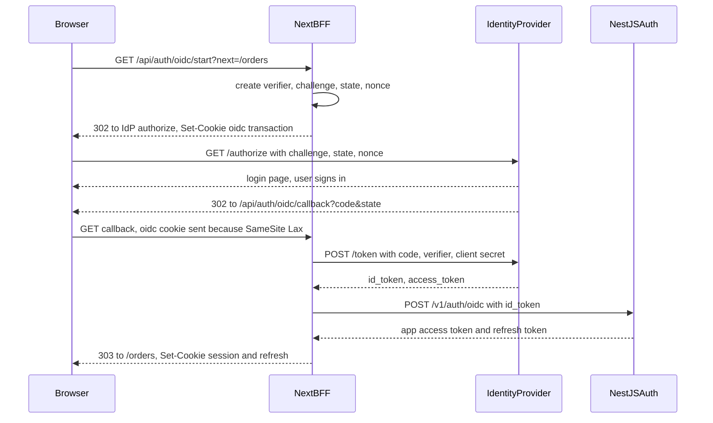

## 77.4 OIDC for single-page apps: authorization code with PKCE, and why the implicit flow is dead

#### Concept

Part 40.4 and 40.5 explained OAuth 2.0 and OpenID Connect from the server's side: the roles, scopes, ID tokens, discovery and the `state` and `nonce` checks. This section answers the browser question: **when the login is done by an external identity provider** (Keycloak, Auth0, Okta, Microsoft Entra ID, Google), how does a browser app run the flow safely, and who ends up holding the tokens?

The answer in 2026 is the **authorization code flow with PKCE** for every browser-based client, and the recommended architecture, per the IETF's *OAuth 2.0 for Browser-Based Applications* guidance, is that the browser does not hold the tokens at all: a **BFF** runs the flow as a *confidential client* and gives the browser a session cookie. A pure SPA can still run code plus PKCE itself as a *public client*, with tighter rules on refresh tokens. The **implicit flow**, which returned tokens directly in the URL, is deprecated by the OAuth 2.0 Security Best Current Practice (RFC 9700, January 2025) and removed in the OAuth 2.1 draft.

#### Why does it exist?

Early SPAs could not keep a client secret (anything in a bundle is public, Part 72.6) and could not easily make cross-origin `POST`s to a token endpoint before CORS was widespread. The implicit flow worked around both: the authorization server redirected back with `#access_token=...` in the URL fragment, and JavaScript picked it up. It had four structural problems:

1. **Tokens in the URL** end up in browser history, can leak through the `Referer` header and through analytics scripts that record the full URL, and are visible to every script on the page.
2. **No proof that the token was meant for this client**: an attacker could inject a token obtained elsewhere (token injection), because nothing bound the response to the browser that started the flow.
3. **No refresh tokens**, so apps "renewed" by loading the authorization server in a hidden iframe with `prompt=none`, which relied on the identity provider's cookie being sent in a third-party context.
4. **That iframe trick broke** when Safari (Intelligent Tracking Prevention) and Firefox (Total Cookie Protection) blocked or partitioned third-party cookies. Chrome still allows them by default after Google abandoned its deprecation plan in 2025, but a login design that fails in two of three engines is not a design.

PKCE (Proof Key for Code Exchange, RFC 7636) fixed the original reason for implicit: it lets a public client use the code flow safely without a secret.

#### Mental model

Imagine collecting a parcel from a depot. In the implicit flow, the depot hands your parcel to the courier at your door, who leaves it on the doorstep in full view of the street. In the code flow, the courier leaves a collection slip instead (the code), and you fetch the parcel yourself from the counter (the token endpoint). PKCE adds one more step: before you ordered, you wrote a secret word on a piece of paper and gave the depot only a fingerprint of it (the challenge). At the counter you must show the original paper (the verifier). Someone who steals the collection slip from your doorstep cannot collect the parcel, because they never had the paper.

#### How it works

The PKCE mechanics, which are the same for an SPA and a BFF:

1. The client generates a **code verifier**: a random string of 43 to 128 characters (32 random bytes, base64url-encoded, gives 43).
2. It computes the **code challenge**: `BASE64URL(SHA-256(verifier))`, and sends it with `code_challenge_method=S256` in the authorization request, together with a random `state` (CSRF protection for the callback) and a random `nonce` (bound into the ID token).
3. The user signs in at the identity provider, which stores the challenge with the issued **authorization code** and redirects to the exact registered `redirect_uri` with `?code=...&state=...` (and `iss=...` when the provider supports RFC 9207, which defends against mix-up between several providers).
4. The client checks `state`, then `POST`s the code and the **verifier** to the token endpoint. The provider hashes the verifier, compares it with the stored challenge, and only then returns tokens.
5. The client validates the ID token (signature, `iss`, `aud`, `exp`, `nonce`) and creates its session.

The BFF variant, which this volume uses:



Notice what the browser holds at every step: a transaction cookie for a few minutes, then the same two `HttpOnly` cookies as a password login (77.2). The identity provider's tokens never reach JavaScript. And NestJS issues the app's own session after verifying the ID token, so password login, Google login and enterprise SSO all end in one session model, one refresh flow (77.3) and one logout.

The choices side by side:

| | Implicit (dead) | SPA with code plus PKCE | BFF with code plus PKCE |
|---|---|---|---|
| Client type | Public | Public | Confidential (has a secret or private key) |
| Tokens visible to JavaScript | Yes, in the URL | Yes, in memory or storage | No |
| Refresh tokens | No | Yes, must rotate or be sender-constrained (RFC 9700) | Yes, held server-side |
| Renewal | Hidden iframe, broken by cookie blocking | Refresh token | Refresh token on the server |
| Works with third-party cookies blocked | No | Yes | Yes |
| Needs a server | No | No | Yes, the Next.js tier |
| XSS outcome | Token theft | Token theft (77.1) | Session riding only |

#### Practical example

A B2B ordering platform sells to clinics and hospital groups. Small clinics sign in with email and password; hospital groups require single sign-on with their own Microsoft Entra ID or Okta tenant. The platform's Next.js BFF runs one OIDC client per enterprise tenant (discovered from the issuer URL stored for that customer), and every path ends at NestJS issuing the platform's own token pair. When a hospital group disables an employee in Entra ID, the next refresh at the platform (within 15 minutes) re-checks the identity link and the user's status, and the employee loses access, without the platform holding Entra's refresh tokens at all.

#### React / Next.js example

The BFF side, with `openid-client` version 6 (the functional API, built on Web Crypto):

```ts
// apps/web/app/api/auth/oidc/start/route.ts  (Next.js 14, Node.js runtime)
import { NextResponse, type NextRequest } from 'next/server';
import * as oidc from 'openid-client';
import { getOidcConfig } from '@/lib/oidc.server';
import { safeNextPath } from '@/lib/safe-redirect';
import { sealTransaction } from '@/lib/seal.server';

export async function GET(req: NextRequest) {
  const config = await getOidcConfig();                         // oidc.discovery(...) once, cached per process
  const codeVerifier = oidc.randomPKCECodeVerifier();
  const state = oidc.randomState();
  const nonce = oidc.randomNonce();
  const url = oidc.buildAuthorizationUrl(config, {
    redirect_uri: `${process.env.APP_ORIGIN}/api/auth/oidc/callback`, // exact, registered, never from the request
    scope: 'openid email profile',
    code_challenge: await oidc.calculatePKCECodeChallenge(codeVerifier),
    code_challenge_method: 'S256',
    state,
    nonce,
  });
  const res = NextResponse.redirect(url);
  res.cookies.set(`__Host-oidc-${state.slice(0, 8)}`,           // one cookie per attempt: two tabs do not collide
    await sealTransaction({ codeVerifier, state, nonce, next: safeNextPath(req.nextUrl.searchParams.get('next')) }),
    { httpOnly: true, secure: true, sameSite: 'lax', path: '/', maxAge: 600 });
  return res;
}
```

```ts
// apps/web/app/api/auth/oidc/callback/route.ts
import { NextResponse, type NextRequest } from 'next/server';
import * as oidc from 'openid-client';
import { getOidcConfig } from '@/lib/oidc.server';
import { unsealTransaction } from '@/lib/seal.server';
import { setAuthCookies } from '@/lib/auth-cookies';
import { setCsrfCookie } from '@/lib/csrf.server';
import { exchangeIdToken } from '@/lib/auth-api.server';

export async function GET(req: NextRequest) {
  const state = req.nextUrl.searchParams.get('state') ?? '';
  const cookieName = `__Host-oidc-${state.slice(0, 8)}`;
  const tx = await unsealTransaction(req.cookies.get(cookieName)?.value);
  if (!tx || tx.state !== state) return NextResponse.redirect(new URL('/login?reason=oidc_state', process.env.APP_ORIGIN));

  // Rebuild the callback URL from configuration: behind a proxy, req.url may say http://10.0.3.7:3000.
  const callbackUrl = new URL(`${process.env.APP_ORIGIN}/api/auth/oidc/callback${req.nextUrl.search}`);
  const tokens = await oidc.authorizationCodeGrant(await getOidcConfig(), callbackUrl, {
    pkceCodeVerifier: tx.codeVerifier,
    expectedState: tx.state,
    expectedNonce: tx.nonce,
    idTokenExpected: true,
  });
  const pair = await exchangeIdToken(tokens.id_token!);          // NestJS verifies again and issues the app session
  const res = NextResponse.redirect(new URL(tx.next, process.env.APP_ORIGIN), 303);
  setAuthCookies(res.cookies, pair);                             // same cookies as a password login (81.10)
  setCsrfCookie(res.cookies, pair.sessionId);
  res.cookies.set(cookieName, '', { httpOnly: true, secure: true, sameSite: 'lax', path: '/', maxAge: 0 });
  return res;
}
```

`sealTransaction` encrypts and authenticates the small transaction object (AES-GCM through Web Crypto, or `jose`'s `EncryptJWT`) so the verifier is not readable or forgeable by anyone who sees the cookie. `safeNextPath` is the open-redirect guard from 77.9. If token exchange throws (an expired code, a reused code after the back button), catch it and redirect to `/login?reason=oidc_failed` rather than showing a stack trace.

For a pure SPA with no server tier (a Vite app on S3, Part 80), use a maintained certified library such as `oidc-client-ts`, keep its state in `sessionStorage` rather than `localStorage`, and require the provider to rotate refresh tokens. The PKCE pieces it does for you are small enough to show:

```ts
// What a browser PKCE implementation does internally (Web Crypto, all modern browsers)
function base64url(bytes: Uint8Array): string {
  return btoa(String.fromCharCode(...bytes)).replace(/\+/g, '-').replace(/\//g, '_').replace(/=+$/, '');
}

export async function createPkcePair(): Promise<{ verifier: string; challenge: string }> {
  const verifier = base64url(crypto.getRandomValues(new Uint8Array(32)));             // 43 characters
  const digest = await crypto.subtle.digest('SHA-256', new TextEncoder().encode(verifier));
  return { verifier, challenge: base64url(new Uint8Array(digest)) };
}
```

Never write the whole flow yourself; the validation steps (issuer, audience, nonce, `iss` response parameter, algorithm allow-lists) are where hand-written clients fail.

#### Backend side (NestJS)

NestJS turns a verified external identity into the platform's session. Part 40.5 covered account linking rules (never merge accounts by email alone); the endpoint the BFF calls looks like this:

```ts
// apps/api/src/auth/oidc.controller.ts
import { Body, Controller, HttpCode, Post, UseGuards, UnauthorizedException } from '@nestjs/common';
import { createRemoteJWKSet, jwtVerify } from 'jose';
import { z } from 'zod';
import { ZodValidationPipe } from '../common/zod-validation.pipe';
import { BffClientGuard } from './bff-client.guard';
import { IdentityService } from './identity.service';
import { SessionIssuer } from './session-issuer';

const Body_ = z.object({ idToken: z.string().min(20).max(8_000) });
const jwks = createRemoteJWKSet(new URL(`${process.env.IDP_ISSUER}/.well-known/jwks.json`)); // cached, kid-aware

@Controller('v1/auth/oidc')
@UseGuards(BffClientGuard)                                        // only the Next.js tier may call this (81.10)
export class OidcController {
  constructor(private readonly identities: IdentityService, private readonly sessions: SessionIssuer) {}

  @Post()
  @HttpCode(200)
  async exchange(@Body(new ZodValidationPipe(Body_)) body: z.infer<typeof Body_>) {
    const { payload } = await jwtVerify(body.idToken, jwks, {
      issuer: process.env.IDP_ISSUER, audience: process.env.IDP_CLIENT_ID, clockTolerance: 30,
    }).catch(() => { throw new UnauthorizedException({ code: 'OIDC_TOKEN_INVALID', status: 401, title: 'Sign-in failed' }); });
    const user = await this.identities.findOrLink('idp', String(payload.sub), payload); // (provider, subject) is the key
    if (user.status !== 'active') throw new UnauthorizedException({ code: 'ACCOUNT_DISABLED', status: 401, title: 'Account disabled' });
    return this.sessions.issueFamily(user, { amr: payload.amr, via: 'oidc' }); // same pair shape as password login
  }
}
```

Discovery documents publish `jwks_uri`; read it from discovery rather than assuming the `/.well-known/jwks.json` path, which differs between providers. Other API-side rules:

- **Register exact redirect URIs**, one per environment. No wildcards, no "any path under the domain".
- **Key the user link on `(issuer, sub)`**, never on email; email is mutable and, at some providers, unverified.
- **Record `amr` and `acr`** (how the user authenticated, for example `mfa`) in the session, so step-up checks (77.5) can require a recent strong login.

#### Production scenario

A clinic software vendor ran an SPA with `oidc-client-ts` and silent renew through a hidden iframe, with one-hour access tokens. After a Safari release tightened tracking prevention, 22 % of their users (everyone on Safari, including every iPad at reception desks) were logged out every hour on the hour, mid-appointment. Moving to a Next.js BFF as a confidential client with server-held refresh tokens took six weeks, removed the iframe and its 400 ms renew cost, and made the session behave identically in every browser. The identity provider's token endpoint load dropped too: one refresh per user per 15 minutes from the BFF, instead of one per tab.

#### Failure scenario

At 10:12 on launch day for enterprise SSO, logins for the first hospital customer failed with "state mismatch" for about one in five staff. The transaction cookie was a single `__Host-oidc` name. Staff habitually opened the platform in several tabs from a bookmarks bar; each tab, redirected to login, started its own flow and overwrote the shared transaction cookie. Whichever tab finished first succeeded; the others came back with a `state` that no longer matched.

The fix was the per-attempt cookie name shown above, keyed by a prefix of `state`, plus a cleanup that deletes stale transaction cookies on success. A second issue appeared the same week: the identity provider was configured for `response_mode=form_post`, so the callback was a cross-site `POST`, and the `SameSite=Lax` transaction cookie was not sent at all. Switching back to the default query response mode fixed it; the alternative, `SameSite=None` on the transaction cookie, would also have worked but reopens it to cross-site requests.

#### Edge cases & failure modes

- **Back button after the callback** replays a used code; the token endpoint returns `invalid_grant`. Treat it as "already signed in or start again", not an error page.
- **Redirect URI mismatch behind a proxy**: building the callback from `req.url` gives an internal host or `http`. Always build it from configuration.
- **Clock skew** between the identity provider and your servers rejects fresh ID tokens; allow 30 to 60 seconds.
- **Popup-based login** breaks when `Cross-Origin-Opener-Policy: same-origin` severs `window.opener`; use `same-origin-allow-popups` on the page that opens the popup, or use a full redirect.
- **Logout at the provider**: clearing your cookies does not end the provider's session, so the next "Sign in" is instant. Use RP-initiated logout (`end_session_endpoint`, built with `oidc.buildEndSessionUrl`) when users expect a full sign-out, for example on shared clinic computers.
- **Multiple providers** need the `iss` check on the authorization response, or a mix-up attack can send a code from one provider to another's token endpoint.
- **Embedded webviews** (in-app browsers inside social apps) are blocked by Google and others for OAuth; detect and ask the user to open the system browser.

#### How a Senior Full-Stack Engineer thinks about this

The senior does not build an identity provider, does not hand-roll the OIDC client, and does not let the identity provider's tokens become the app's session. They use code plus PKCE everywhere, run it in the BFF when there is a server tier, and convert the external identity into the platform's own short session at NestJS, so every login method shares one refresh, revocation and logout path. They check the flow under real browser conditions: Safari with tracking prevention, several tabs, the back button, an IdP clock five seconds off. When a vendor or an old library still offers the implicit flow or a silent-renew iframe as the default, the senior treats that as a reason to choose a different vendor or library.

#### Common mistakes

- **Using the implicit flow** or `response_type=id_token token` because an old tutorial did.
- **Storing the PKCE verifier in `localStorage`** where it persists after the flow, instead of a short-lived sealed cookie or `sessionStorage`.
- **Skipping `state` or `nonce`** because "PKCE covers it"; they protect different things (callback CSRF and ID token replay).
- **Building `redirect_uri` from the incoming request**, which breaks behind proxies and invites host-header tricks.
- **Linking accounts by email** across providers.
- **Using the provider's access token as the app session**, coupling every API to the provider's token format, lifetime and revocation.

#### Interview questions

1. **Explain authorization code with PKCE from the browser's point of view. What attack does PKCE stop?** Expected answer: verifier and S256 challenge; the code is useless without the verifier, so interception of the redirect does not yield tokens. Follow-up: do `state` and `nonce` still matter? (Yes: callback CSRF and ID token binding.)
2. **Why is the implicit flow deprecated?** Expected answer: tokens in URLs, no binding to the client, no refresh tokens, silent renew dependent on third-party cookies that browsers now block. RFC 9700 says not to use it.
3. **SPA as public client or BFF as confidential client?** Expected answer: BFF when a server tier exists (tokens never reach JavaScript, refresh tokens held server-side); public client only when there is no server, with rotating or sender-constrained refresh tokens.
4. **Why should NestJS issue its own session after OIDC instead of using the IdP's tokens?** Expected answer: one session model across login methods, short app-controlled lifetimes, local revocation, and no coupling of every API to the provider.
5. **Users in several tabs get "state mismatch". Why?** Expected answer: one shared transaction cookie overwritten by parallel flows; key the transaction by `state`.
6. **The callback works in Chrome but not when the provider uses `form_post`. Why?** Expected answer: a cross-site `POST` does not carry `SameSite=Lax` cookies.

#### Practical exercise

Add "Sign in with Keycloak" to the Next.js app through the BFF, ending in a NestJS-issued session.

Acceptance criteria:

- The browser's Network panel never shows an identity-provider token in any response body or URL readable by page JavaScript.
- Starting sign-in in three tabs at once results in three successful logins, not state mismatches.
- An ID token with the wrong `aud`, an expired `exp` or a mismatched `nonce` is rejected, each with a distinct error code in the logs.
- Pressing Back after a successful login lands on a signed-in page, not an error.
- The resulting cookies are identical in name and attributes to a password login, and `POST /api/auth/refresh` works the same for both.
