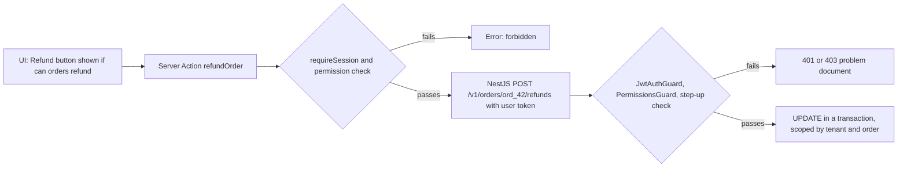
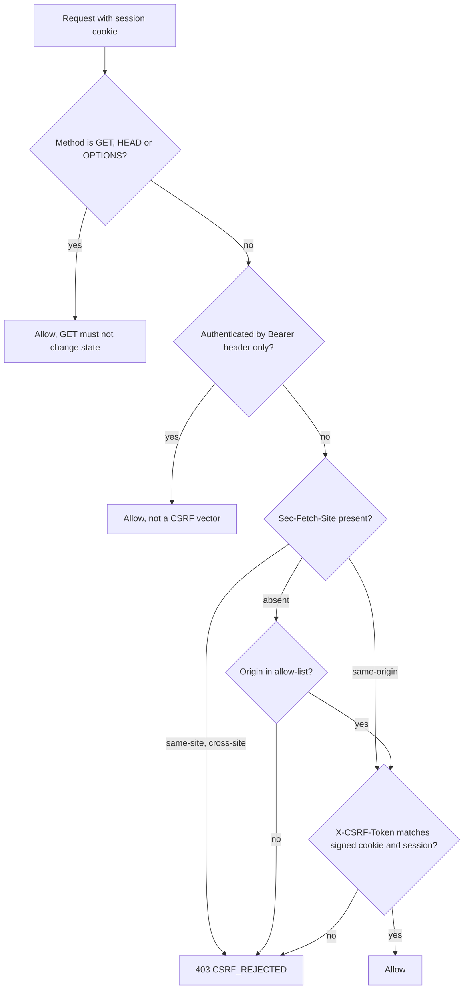

## 77.5 Protecting routes and UI: guards, role-based UI, and why hiding a button is not authorization

#### Concept

A browser app makes three different kinds of access decision, and only one of them is security:

1. **Route guards** decide which *pages* a user is sent to: a logged-out user on `/orders` is redirected to `/login`; a customer on `/admin` sees "no access". In Next.js that is middleware plus the data access layer (75.9).
2. **Role-based UI** decides which *controls* a user sees: the "Refund" button appears only for support supervisors, "Export" only for finance.
3. **Authorization** decides which *operations* succeed: the API refuses a refund from anyone without the permission, and refuses to show order `ord_42` to anyone who does not own it.

The first two are user experience. They keep honest users away from dead ends. The third is the security boundary, and it lives on the server: in NestJS, and in every Next.js Server Action and Route Handler that touches data. **Hiding a button is not authorization**, because the request the button would have sent can be sent without the button.

#### Why does it exist?

Everything in the browser is under the user's control. They can open DevTools, edit the React state that says `role: 'customer'`, unhide the button, copy a request as `curl` from the Network panel, change `ord_41` to `ord_42`, and send it again. In the App Router there is an extra trap: **every Server Action is a public HTTP endpoint.** Next.js compiles each action into an ID that the client posts to; anyone who can load a page that references the action can find its ID in the JavaScript and call it with any arguments, whether or not the button is rendered for them. Part 40.24 covered broken access control in APIs; this section is about the frontend habits that create it.

#### Mental model

Imagine a theatre. The usher who shows you to your row is the route guard and the role-based UI: helpful, and wrong seats are rare when ushers are good. The ticket check at the door is authorization. A theatre that removed the ticket check because "the ushers only show people to seats they paid for" would fill up with people who walked past the ushers.

#### How it works

The layers for one sensitive action, a refund on order `ord_42`:



1. **The UI asks a question it cannot enforce.** The permission list comes from `/v1/me` (73.3), computed by the server. The client renders `<Can permission="orders:refund">`. A tampered list only changes what the tampering user sees.
2. **The Server Action checks again**, because it is an endpoint. It calls `requireSession()` and verifies the permission before calling the API, so a forged call fails fast with a clear error.
3. **NestJS decides.** It verifies the token, checks the permission from its own data (not from anything the client sent), checks freshness of authentication for high-value actions (**step-up**), and scopes the query by tenant and owner (40.12).
4. **Step-up authentication** asks a signed-in user to prove themselves again for a dangerous action: change email, add a payout account, refund over a threshold. The token carries `auth_time` (when the user last entered credentials) and `amr` (how: `pwd`, `otp`, `hwk`). If `auth_time` is older than five minutes, the API answers `401` with `code: 'STEP_UP_REQUIRED'`, the client shows a re-authentication dialog, and retries. Step-up is the main defence against session riding (77.1): a malicious script can send the request, but cannot type the password.

What the browser must still be told: hide what users cannot do (fewer confusing 403s), and expect 403s anyway (permissions change while a page is open).

#### Practical example

A food delivery support console has three roles: agent (view orders, add notes), supervisor (refunds up to 50 USD), and finance (any refund, exports). A supervisor's console shows a "Refund" button; an agent's does not. When an agent's role is upgraded at 14:00, their open console still hides the button until `/v1/me` is refetched (five-minute stale time, or on focus). When a supervisor is downgraded at 14:00, their open console still *shows* the button until the refetch, and clicking it returns `403 FORBIDDEN`, which the UI renders as "You no longer have permission for this action" and refetches `/v1/me`. Both cases are correct because the server decides.

#### React / Next.js example

The UI helper, display only:

```tsx
// apps/web/src/auth/Can.tsx
'use client';
import type { ReactNode } from 'react';
import { useSession } from './SessionProvider';

export function Can({ permission, children, fallback = null }: { permission: string; children: ReactNode; fallback?: ReactNode }) {
  const session = useSession();
  // Display decision only. The Server Action and NestJS check again; this cannot grant anything.
  return <>{session?.permissions.includes(permission) ? children : fallback}</>;
}
```

The Server Action, which is an endpoint and checks like one:

```ts
// apps/web/app/(console)/orders/[id]/actions.ts
'use server';
import { z } from 'zod';
import { revalidatePath } from 'next/cache';
import { requireSession } from '@/lib/session.server';
import { apiServer } from '@/lib/api.server';

const RefundInput = z.object({
  orderId: z.string().regex(/^ord_[A-Za-z0-9]{6,32}$/),
  amountMinor: z.string().regex(/^\d{1,9}$/),            // money as a string of minor units (80.7)
  reason: z.enum(['LATE', 'MISSING_ITEM', 'QUALITY', 'OTHER']),
  idempotencyKey: z.string().uuid(),
});

export async function refundOrder(input: unknown) {
  const session = await requireSession();                    // anyone can POST this action's ID
  if (!session.roles.some((r) => r === 'supervisor' || r === 'finance')) {
    return { ok: false as const, code: 'FORBIDDEN' };        // fail fast; NestJS would refuse anyway
  }
  const data = RefundInput.parse(input);                     // arguments are attacker-controlled too
  const res = await apiServer(session, `/v1/orders/${data.orderId}/refunds`, {
    method: 'POST',
    body: JSON.stringify({ amountMinor: data.amountMinor, reason: data.reason }),
    headers: { 'Idempotency-Key': data.idempotencyKey },
  });
  if (!res.ok) return { ok: false as const, code: (await res.json()).code as string }; // 403, STEP_UP_REQUIRED, ...
  revalidatePath(`/orders/${data.orderId}`);
  return { ok: true as const };
}
```

Two habits are visible. The action validates its own input with zod, because its parameters arrive from the network, not from your component. And the role check in the action is coarse (is this user staff at all), while NestJS makes the fine decision (refund limits, tenant, step-up), so the rule lives in one place.

Admin pages follow the same pattern as 75.9: `requireSession()` plus a role check in the page *and* in each data function, never only in a layout or in middleware.

#### Backend side (NestJS)

A permission decorator and guard, using `Reflector.createDecorator` (NestJS 10):

```ts
// apps/api/src/auth/permissions.ts
import { CanActivate, ExecutionContext, ForbiddenException, Injectable, UnauthorizedException } from '@nestjs/common';
import { Reflector } from '@nestjs/core';
import { PermissionService } from './permission.service';

export const RequirePermissions = Reflector.createDecorator<{ all: string[]; stepUpWithinSec?: number }>();

@Injectable()
export class PermissionsGuard implements CanActivate {
  constructor(private readonly reflector: Reflector, private readonly perms: PermissionService) {}

  async canActivate(ctx: ExecutionContext): Promise<boolean> {
    const rule = this.reflector.getAllAndOverride(RequirePermissions, [ctx.getHandler(), ctx.getClass()]);
    if (!rule) return true;
    const user = ctx.switchToHttp().getRequest().user as { id: string; tenantId: string; authTime?: number };
    const granted = await this.perms.forUser(user.id, user.tenantId);   // server data, cached 60 s in Redis
    if (!rule.all.every((p) => granted.has(p))) {
      throw new ForbiddenException({ code: 'FORBIDDEN', title: 'Not allowed', status: 403 });
    }
    const now = Math.floor(Date.now() / 1000);
    if (rule.stepUpWithinSec && (!user.authTime || now - user.authTime > rule.stepUpWithinSec)) {
      throw new UnauthorizedException({ code: 'STEP_UP_REQUIRED', title: 'Please confirm it is you', status: 401 });
    }
    return true;
  }
}

// usage on the controller method:
// @RequirePermissions({ all: ['orders:refund'], stepUpWithinSec: 300 })
```

The `JwtStrategy` from 77.1 maps the `auth_time` claim to `user.authTime`. A step-up 401 is not an expired session, so the guard from 77.3 must not label it `UNAUTHENTICATED`; `authFetch` then leaves it to the UI, which opens the re-authentication dialog instead of refreshing. Ownership is enforced in the query itself: `UPDATE ... WHERE id = $1 AND tenant_id = $2`, and a zero-row result becomes `404`, never "refund someone else's order".

#### Production scenario

A marketplace's seller dashboard served 40,000 sellers and had 61 Server Actions. A security review generated a list of every action ID from the production build's client manifest and called each one with a logged-in *buyer* account. Fifty-eight refused correctly through `requireSession()` plus a role check or through NestJS. Three succeeded: `updateStoreHours`, `toggleListing` and `replyToReview`, which called NestJS with a shared service token instead of the user's token, so NestJS saw "the web tier" and allowed it. The fix replaced the service token with the user's token for all user-initiated actions, and added a CI test that calls every exported action with a buyer session and asserts a refusal. Review time per release went up by about four minutes of CI.

#### Failure scenario

At 18:40 on a Friday, a merchant posted in a community forum that they could change the delivery fee of *other* merchants' stores. The store settings page rendered a `saveDeliveryFee(storeId, feeMinor)` Server Action. The page itself only listed the merchant's own stores, and the form only offered their own store ids. The action checked that a session existed and called `PATCH /v1/stores/:id` with the merchant's token. NestJS checked `stores:write`, which every merchant had, but did not check that the store belonged to the caller. Changing `storeId` in a replayed request was enough. Eleven stores had their fees changed before the endpoint was patched at 19:25 with `WHERE id = $1 AND merchant_id = $2`.

Nothing in the UI was wrong. The UI only ever showed the right stores. The bug was believing that what the UI offers limits what can be sent.

#### Edge cases & failure modes

- **Stale permissions in open tabs**: the UI shows or hides wrongly until `/v1/me` refetches; the server is right regardless. Refetch on 403.
- **Client bundles reveal admin code**: an admin page's client components ship to anyone who can load the route's JavaScript. That reveals endpoints and action IDs, not data, but never put secrets or hidden "admin mode" switches in them.
- **`server-only`** on modules that hold service credentials makes accidental import into a client component a build error.
- **Feature flags are not permissions**: a flag that hides a beta feature from 95 % of users does not stop the other 95 % from calling it.
- **Step-up and session riding**: without step-up, an XSS can change the account email and then reset the password, converting session riding into permanent takeover.
- **Prefetched or cached pages**: a page rendered for an admin must not be cached in the Full Route Cache or a CDN and served to a customer (75.7, 81.9).

#### How a Senior Full-Stack Engineer thinks about this

The senior keeps one rule: the browser asks, the server decides. They use UI checks generously, because hiding impossible actions is good UX, and they never let one replace a server check. They treat Server Actions and Route Handlers as API endpoints with the same review checklist as a NestJS controller: authenticate, validate input, authorise with server data, scope by owner, use the user's token. They put step-up on the handful of actions that turn a stolen session into a stolen account. To a product manager: "The button is the menu; the kitchen still checks the order."

#### Common mistakes

- **Authorization only in the UI or only in middleware**, with an API that trusts the web tier.
- **Treating Server Actions as private functions** instead of public endpoints.
- **Calling NestJS with a service token for user actions**, which hides the user from the API's authorization.
- **Trusting client-sent role, tenant or owner ids** in request bodies.
- **No step-up** on email change, password change, payout details and large refunds.

#### Interview questions

1. **Why is hiding a button not authorization?** Expected answer: the request can be crafted without the button; only the server can enforce. Follow-up: what is the UI check for, then? (Usability: avoid dead ends and confusing errors.)
2. **What is special about Server Actions from a security point of view?** Expected answer: each is a public POST endpoint addressable by its ID; arguments are untrusted; it must authenticate, validate and authorise itself.
3. **Where do permissions for role-based UI come from?** Expected answer: a server-computed list (`/v1/me`), refreshed on focus and on 403; never decoded from a token and trusted.
4. **What is step-up authentication and which actions need it?** Expected answer: fresh re-authentication for high-value actions, checked with `auth_time`; it blunts session riding and stolen sessions.
5. **How would you test that no Server Action is missing an authorization check?** Expected answer: enumerate actions from the build, call each with the least-privileged session, assert refusal in CI.

#### Practical exercise

Add `PermissionsGuard`, `<Can>` and step-up to the refund flow.

Acceptance criteria:

- An agent session calling the `refundOrder` action directly (by its ID, with `curl`) receives `FORBIDDEN`, and NestJS logs no refund attempt.
- A supervisor whose last sign-in was 10 minutes ago gets a re-authentication dialog; after entering the password the refund succeeds once, with one idempotency key.
- Downgrading a supervisor while their console is open results in a `403` on the next click and the button disappearing after the `/v1/me` refetch.
- Changing the order id in a replayed request to another tenant's order returns `404`.

## 77.6 CSRF in practice with cookies: SameSite, Fetch Metadata and double-submit

#### Concept

Part 40.22 explained CSRF: another site makes the victim's browser send a request to yours, and the browser attaches your cookies. This section is about what actually reaches your servers in 2026 and the minimum set of checks that closes the gaps, for this volume's architecture where NestJS accepts the session cookie through the `rewrites` proxy (77.1) and Next.js has its own Server Actions and Route Handlers.

The modern layered defence has four parts:

1. **`SameSite=Lax` cookies** (77.2), which stop the browser from attaching the session to cross-site `POST`s, `fetch`es and iframes.
2. **Fetch Metadata**: the `Sec-Fetch-Site` request header, sent by every current browser, which tells the server whether the request came from the same origin, the same site, another site, or the user typing a URL.
3. **An `Origin` check** against an allow-list, for clients that do not send Fetch Metadata.
4. **A signed double-submit token** for the cases the first three miss.

#### Why does it exist?

`SameSite=Lax` closed the classic attack but not every variant:

- **Same-site siblings.** `reviews.shop.example`, a staging site, or a subdomain taken over through a dangling DNS record is *same-site* with `shop.example`. Cookies are attached; `SameSite` does nothing.
- **State changes on `GET`**, which `Lax` sends on top-level navigations.
- **Browsers that do not default to `Lax`** and cookies set without `SameSite` (77.2).
- **Login CSRF**: the attacker logs the victim into the *attacker's* account. The victim then saves a card or an address into it. No session is needed to attack, so `SameSite` on the session cookie is irrelevant.
- **"Simple" requests that skip CORS**: a cross-site form can `POST` with `Content-Type: text/plain`; if your API parses a `text/plain` body as JSON, the CORS preflight that would have blocked a JSON request never happens.

#### Mental model

Imagine a company mailroom. `SameSite` is the rule that letters from outside the building do not get the internal routing stamp. Fetch Metadata is a stamp the postal service adds to every envelope saying "posted from your building", "posted from the business park", or "posted from elsewhere". The `Origin` check reads the return address. The double-submit token is a code word printed on your own internal stationery, which outsiders have never seen.

#### How it works

The server-side decision for every request that carries the session cookie:



1. **Safe methods pass**, because they must not change state. That is a contract with yourself; enforce it in review.
2. **Bearer-only requests pass.** A browser never attaches an `Authorization` header to a cross-site request on its own.
3. **`Sec-Fetch-Site: same-origin`** is required for cookie-authenticated writes. Note: `same-origin`, not `same-site`, so sibling subdomains are rejected. A value of `none` means the user typed the URL or used a bookmark, which never produces a `POST` with a body from your UI.
4. **Older clients** without Fetch Metadata fall back to the `Origin` header, compared with an explicit list (`https://shop.example`). Behind the `rewrites` proxy, compare `Origin` with configured origins, not with the `Host` header, because the proxy changes `Host` to the API's internal name.
5. **The double-submit token**: on login, the BFF sets `__Host-csrf`, a non-`HttpOnly` cookie containing a random value plus an HMAC of that value and the session id (`sid`). Client code reads it and sends it as `X-CSRF-Token`. The server recomputes the HMAC and compares. An attacker on another site cannot read your cookie, and the `__Host-` prefix stops a sibling subdomain from planting one.

**Next.js specifics.** Server Actions accept only `POST`, and Next.js compares the `Origin` header with the `Host` (or `X-Forwarded-Host`) header and rejects mismatches. If a proxy or a second domain legitimately sits in front, list it in `experimental.serverActions.allowedOrigins` in `next.config.js` (the option is still under `experimental` in Next.js 14 and 15). **Route Handlers get no automatic protection**: a `POST` handler that reads cookies needs the same checks as NestJS.

#### Practical example

The storefront's cookie-authenticated writes are: Server Actions (checkout, address book), Route Handlers under `/api/auth` (refresh, logout) and `/api/bff/*`, and NestJS endpoints reached through `rewrites` at `/api/v1/*` (cart updates, order cancellation). Each tier applies the decision above. Mobile apps call `api.shop.example` with Bearer tokens and skip the CSRF check entirely, because they never use the cookie.

#### React / Next.js example

The client side is one line in `authFetch` (77.3): attach the token on unsafe methods.

```ts
// apps/web/src/api/csrf.ts
export function csrfHeader(method: string = 'GET'): Record<string, string> {
  if (['GET', 'HEAD', 'OPTIONS'].includes(method.toUpperCase())) return {};
  const match = document.cookie.match(/(?:^|;\s*)__Host-csrf=([^;]+)/);
  return match ? { 'X-CSRF-Token': decodeURIComponent(match[1]) } : {};
}
// in authFetch: fetch(input, { ...init, credentials: 'include', headers: { ...init.headers, ...csrfHeader(init.method) } })
```

The Route Handler guard on the Next.js side:

```ts
// apps/web/lib/same-origin.server.ts
import 'server-only';

const ALLOWED = new Set((process.env.WEB_ORIGINS ?? '').split(',').filter(Boolean)); // e.g. https://shop.example

export function rejectCrossOrigin(req: Request): Response | null {
  const site = req.headers.get('sec-fetch-site');
  if (site) return site === 'same-origin' ? null : new Response(null, { status: 403 });
  const origin = req.headers.get('origin');                  // older clients without Fetch Metadata
  return origin && ALLOWED.has(origin) ? null : new Response(null, { status: 403 });
}
// usage: export async function POST(req: Request) { const denied = rejectCrossOrigin(req); if (denied) return denied; ... }
```

The auth endpoints in 77.10 use this guard; the refresh endpoint is the one place where `GET` must also work (for the navigation path), which is acceptable only because its sole effect is rotating the caller's own tokens and redirecting to a validated relative path.

#### Backend side (NestJS)

A global guard for cookie-authenticated writes:

```ts
// apps/api/src/security/csrf.guard.ts
import { CanActivate, ExecutionContext, ForbiddenException, Injectable } from '@nestjs/common';
import { createHmac, timingSafeEqual } from 'node:crypto';
import type { Request } from 'express';

const SAFE = new Set(['GET', 'HEAD', 'OPTIONS']);
const ORIGINS = new Set((process.env.WEB_ORIGINS ?? '').split(','));

@Injectable()
export class CsrfGuard implements CanActivate {
  canActivate(ctx: ExecutionContext): boolean {
    const req = ctx.switchToHttp().getRequest<Request>();
    if (SAFE.has(req.method)) return true;
    if (!req.cookies?.['__Host-session']) return true;             // Bearer clients: not a CSRF vector
    const site = req.get('sec-fetch-site');
    if (site ? site !== 'same-origin' : !ORIGINS.has(req.get('origin') ?? '')) throw this.reject();
    if (!req.is('application/json') && req.headers['content-length'] !== '0') throw this.reject(); // no text/plain tricks
    const [value, mac] = String(req.get('x-csrf-token') ?? '').split('.');
    const sid = (req.user as { sessionId?: string } | undefined)?.sessionId ?? '';
    if (!value || !mac || !sid) throw this.reject();
    const expected = createHmac('sha256', process.env.CSRF_SECRET!).update(`${sid}.${value}`).digest('base64url');
    const a = Buffer.from(mac), b = Buffer.from(expected);
    if (a.length !== b.length || !timingSafeEqual(a, b)) throw this.reject();
    return true;
  }
  private reject() { return new ForbiddenException({ code: 'CSRF_REJECTED', title: 'Request blocked', status: 403 }); }
}
```

Register it with `APP_GUARD` *after* `JwtAuthGuard` so `req.user.sessionId` is available. Webhooks and machine endpoints authenticate differently and never carry the session cookie, so they pass the cookie check naturally. Log every rejection with `Sec-Fetch-Site`, `Origin` and the route; a spike right after a frontend deploy is usually a client that stopped sending the token, not an attack.

#### Production scenario

A retailer with 9,000 cookie-authenticated writes per minute deployed the guard in log-only mode for a week. Rejections that would have happened: 0.03 %, of which most were a partner's embedded widget on `deals.shop.example` (same-site, cross-origin) that had been posting to the cart API, unknown to the web team, and a browser extension replaying requests. Enforcement went live after the widget moved to its own Bearer-authenticated endpoint. The HMAC check costs about 5 microseconds per request.

#### Failure scenario

A food platform let restaurants host custom menu pages at `<restaurant>.menus.shop.example`, with a rich-text editor. A restaurant owner embedded a form that auto-submitted `POST /api/v1/me/addresses` on `shop.example` with an attacker's address marked as default. The request was cross-origin but *same-site*. The session cookie was `SameSite=Lax`, so the browser attached it. NestJS checked only `Origin` against a regular expression, `/\.shop\.example$/`, which matched. Customers who viewed that menu page and then ordered had food delivered to the attacker's address until a customer complained 26 hours later.

The fixes: user-generated pages moved to a separate registrable domain (`shopmenus.example`), which makes them cross-site; NestJS required `Sec-Fetch-Site: same-origin` and an exact origin list; and the signed double-submit token became mandatory. Any one of the three would have stopped the attack.

#### Edge cases & failure modes

- **Origin matching with regular expressions or `endsWith`** accepts `evilshop.example` or sibling subdomains. Use an exact set.
- **`Origin: null`** is sent from sandboxed iframes, some redirects and `file:` pages; never allow it.
- **Login and signup forms** need CSRF protection too (login CSRF); use the same `Sec-Fetch-Site` check and a pre-session token.
- **Logout via `GET`** can be triggered by any `` on another site; logout is a `POST`.
- **CORS with `credentials: true` and a reflected origin** turns every site into a trusted caller and defeats all of the above (Part 11.13).
- **Mobile webviews and old browsers** may omit Fetch Metadata; the `Origin` fallback covers them.

#### How a Senior Full-Stack Engineer thinks about this

The senior first asks whether the cookie authenticates the request at all; if not, CSRF is not in scope and they say so in the design doc. When it is, they layer cheap checks (`SameSite`, `Sec-Fetch-Site`, exact `Origin`, signed token), put them in one guard per tier rather than per endpoint, and test with a hostile page on a sibling subdomain, which is the case `SameSite` misses. They treat "user content on a subdomain of our site" as a CSRF and cookie-scoping risk, and move it to its own registrable domain.

#### Common mistakes

- **Relying on `SameSite` alone** and forgetting same-site siblings and login CSRF.
- **Checking `Origin` with a suffix match.**
- **Unsigned double-submit cookies** without the `__Host-` prefix, which a sibling subdomain can overwrite.
- **Assuming Route Handlers are protected like Server Actions.**
- **Accepting `text/plain` bodies** on JSON endpoints.

#### Interview questions

1. **With `SameSite=Lax` cookies everywhere, do you still need CSRF tokens?** Expected answer: usually yes as defence in depth; Lax misses same-site siblings, GET mutations, login CSRF and browsers without Lax defaults. Follow-up: which single check covers sibling subdomains? (`Sec-Fetch-Site: same-origin`.)
2. **What is Fetch Metadata?** Expected answer: `Sec-Fetch-Site`, `Sec-Fetch-Mode`, `Sec-Fetch-Dest` request headers set by the browser, not scriptable, describing the request's context.
3. **How do Next.js Server Actions defend against CSRF, and what do Route Handlers need?** Expected answer: POST only plus Origin versus Host comparison; Route Handlers need explicit checks.
4. **Why must a double-submit cookie be signed and `__Host-` prefixed?** Expected answer: so a sibling subdomain cannot plant a known value, and so the token is bound to the session.
5. **What is login CSRF and why does it matter for a store?** Expected answer: victim is signed into the attacker's account and saves payment details or addresses into it.

#### Practical exercise

Deploy `CsrfGuard` and `rejectCrossOrigin`, then attack them.

Acceptance criteria:

- A hostile page on a sibling subdomain (served locally as `evil.shop.test`) that auto-posts to `/api/v1/me/addresses` is rejected with `403 CSRF_REJECTED`.
- A `text/plain` form post to a JSON endpoint is rejected.
- The real UI performs every write successfully, verified by an end-to-end test.
- Mobile-style Bearer requests without cookies pass without a CSRF token.
- Rejections are logged with route, `Sec-Fetch-Site` and `Origin`, and a dashboard shows their rate.
