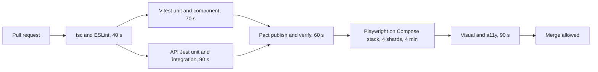

## 77.13 Worked example: tests for the checkout flow from unit to end to end

This example builds the full test suite that 71.13 promised for the three-step checkout (address, coupon, payment), using every tool of this Part. The goal is not the most tests; it is the smallest suite where every serious way the checkout can break makes at least one test fail, at the cheapest level that can see it.

#### The test plan

| # | Risk | Level | File | Time |
|---|---|---|---|---|
| 1 | Illegal step transitions, double `PLACE_ORDER` | Unit | `checkoutReducer.test.ts` | 4 ms |
| 2 | Retry reuses the idempotency key; unknown outcome keeps it | Unit | `usePlaceOrder.test.ts` | 30 ms |
| 3 | Money formatting, large values | Unit | `packages/contracts/src/money.test.ts` | 3 ms |
| 4 | Field errors from zod and from the server land on the right input | Component | `AddressForm.test.tsx` | 0.9 s |
| 5 | The cart version threads through every request | Component | `CheckoutPage.flow.test.tsx` | 1.4 s |
| 6 | `409 CART_CHANGED` shows notice and fresh totals | Component | `CouponStep.msw.test.tsx` | 0.4 s |
| 7 | Double click sends one request with a key | Component | `PaymentStep.msw.test.tsx` | 0.3 s |
| 8 | Proxy `502` HTML and network errors degrade honestly | Component | `CouponStep.msw.test.tsx` | 0.5 s |
| 9 | The API still returns what the web client reads | Contract | `orders.pact.test.ts` | 0.6 s |
| 10 | Concurrent same-key requests create one order row | API integration | `orders.idempotency.int-spec.ts` | 2.1 s |
| 11 | Full journey, double click, one row, Back safe | E2E | `checkout.spec.ts` | 14 s |
| 12 | Payment declined, then approved with another method | E2E | `checkout-decline.spec.ts` | 11 s |
| 13 | Layout of the payment step on mobile and desktop | Visual | `checkout.visual.spec.ts` | 4 s |
| 14 | Accessibility at five checkout states | Accessibility | `checkout.a11y.spec.ts` | 3 s |

Fourteen files, about 40 seconds of test time in total, most of it in two e2e journeys. Every risk the 71.13 failure table listed has a row.

#### The pipeline



The cheap jobs run first and in parallel; the expensive ones run only when the cheap ones pass. A typo in a zod schema fails in 40 s; a broken idempotency interceptor fails in under 3 minutes; a layout break in under 8.

#### Component level: the version thread

The most valuable new test is the one that walks all three steps in jsdom with MSW and checks the **requests**, not only the screen. The cart version (71.13) must move from 7 to 8 to 9 and every write must carry the latest one. A bug here applies a coupon to a cart the user never saw.

```tsx
// apps/web/src/checkout/CheckoutPage.flow.test.tsx
import { screen } from '@testing-library/react';
import { http, HttpResponse } from 'msw';
import { expect, it } from 'vitest';
import { server } from '../test/msw/server';
import { API } from '../test/msw/checkout.handlers';
import { aCheckoutView, aPricedCart } from '../test/builders';
import { renderWithProviders } from '../test/render';
import { CheckoutPage } from './CheckoutPage';
import { fillAddress } from '../test/flows';                       // the five fields, by label

it('sends the latest cart version with every write', async () => {
  const seen: { path: string; version: unknown; key: string | null }[] = [];
  server.use(
    http.get(`${API}/checkout/view`, () => HttpResponse.json(aCheckoutView({ version: 7, totalMinor: '99900' }))),
    http.post(`${API}/checkout/address`, async ({ request }) => {
      const body = (await request.json()) as { cartVersion: number };
      seen.push({ path: 'address', version: body.cartVersion, key: null });
      return HttpResponse.json(aPricedCart({ version: 8, totalMinor: '103900' }));     // + delivery 40.00
    }),
    http.post(`${API}/checkout/coupon`, async ({ request }) => {
      const body = (await request.json()) as { cartVersion: number };
      seen.push({ path: 'coupon', version: body.cartVersion, key: null });
      return HttpResponse.json(aPricedCart({ version: 9, totalMinor: '98900', appliedCoupon: 'SAVE50' }));
    }),
    http.post(`${API}/orders`, async ({ request }) => {
      const body = (await request.json()) as { cartVersion: number };
      seen.push({ path: 'orders', version: body.cartVersion, key: request.headers.get('Idempotency-Key') });
      return HttpResponse.json({ id: 'A7K2Q9P', status: 'PENDING' }, { status: 201 });
    }),
  );
  const { user } = renderWithProviders(<CheckoutPage />);

  await fillAddress(user, await screen.findByRole('form', { name: 'Delivery address' }));
  await user.click(screen.getByRole('button', { name: 'Save address' }));
  const summary = screen.getByRole('complementary', { name: 'Order summary' });
  expect(await screen.findByRole('heading', { name: 'Have a coupon?' })).toBeVisible();
  expect(summary).toHaveTextContent('₹1,039.00');                  // totals come only from the server

  await user.type(screen.getByRole('textbox', { name: 'Coupon code' }), 'SAVE50{Enter}');
  expect(await screen.findByText('SAVE50 applied.')).toBeVisible();
  expect(summary).toHaveTextContent('₹989.00');
  await user.click(screen.getByRole('button', { name: 'Continue to payment' }));
  await user.click(screen.getByRole('button', { name: 'Place order' }));

  await expect.poll(() => seen.map((s) => `${s.path}@${s.version}`)).toEqual(['address@7', 'coupon@8', 'orders@9']);
  expect(seen[2].key).toMatch(/^[0-9a-f-]{36}$/);
});
```

The test fails if any step sends a stale version, if `PriceSummary` ever computes a total itself, or if the order request loses its key. It needs no browser and no database, and runs in 1.4 s.

#### Contract level: what the client reads from `POST /v1/orders`

Two interactions added to the web's pact (74.10): the `201` body the client parses with `OrderCreatedSchema`, and the `409 CART_CHANGED` problem document with a fresh cart. The API's provider verification seeds "cart exists at version 9" and "cart exists at version 10" through state handlers. If an API engineer changes `409` to `422` for stale carts, the API's pull request fails before merge, with the web's interaction named in the error.

#### API level: one row under concurrency

The component test proves the browser sends one request for a double click. It cannot prove that two requests with the same key, from a retry racing the original, create one order. Only the API with a real PostgreSQL can (41.9, 41.17):

```ts
// apps/api/test/orders.idempotency.int-spec.ts  (Jest, Testcontainers PostgreSQL 16)
import request from 'supertest';
import { randomUUID } from 'node:crypto';
import { aPlaceOrderRequest } from '@shop/test-fixtures';
import { bootTestApp, type TestApp } from './support/boot';        // configureApp() as in main.ts

let t: TestApp;
beforeAll(async () => { t = await bootTestApp(); });
afterAll(() => t.close());

it('creates one order for two concurrent requests with the same key', async () => {
  const { token, cartId } = await t.seed.customerWithCart({ version: 9 });
  const key = randomUUID();
  const send = () => request(t.http).post('/v1/orders')
    .set('Authorization', `Bearer ${token}`).set('Idempotency-Key', key)
    .send(aPlaceOrderRequest({ cartId, cartVersion: 9 }));

  const [a, b] = await Promise.all([send(), send()]);
  const statuses = [a.status, b.status].sort();
  // One request wins; the other replays the result (201) or sees the reservation (409 IDEMPOTENCY_IN_PROGRESS)
  expect([[201, 201], [201, 409]]).toContainEqual(statuses);
  const { rows } = await t.pg.query('SELECT count(*)::int AS n FROM orders WHERE cart_id = $1', [cartId]);
  expect(rows[0].n).toBe(1);                                          // the unique index on (user_id, idempotency_key) holds
});
```

#### E2E level: the two journeys

Journey 11 is the test in 77.7: a fresh customer, the real BFF login (storage state from 77.8), address, coupon, a double click on "Place order", exactly one row via the test-support API, and Back not returning to a live payment form.

Journey 12 adds the payment provider. The Compose stack's WireMock stub (77.11) declines card `4000 0000 0000 0002` and approves UPI. The test chooses card, sees the decline under the payment method with focus moved to it, switches to UPI and completes. It asserts one order and one failed payment attempt recorded against it. This is the only test that proves the idempotency key is cleared after a definite decline (71.8), so the second attempt is a new attempt and not a replay of the decline.

#### Visual and accessibility

Two screenshots of the payment step (375 px and 1280 px) in the pinned Playwright container, the promo carousel masked and the clock fixed (77.9). axe checks at five states: empty address, address with errors, coupon with server error, payment, confirmation (77.10). The `vitest-axe` checks of the three step components run in the component job.

#### Proving the suite works: break things on purpose

A suite is only as good as the bugs it catches. Before merging the suite, the team broke the checkout deliberately, one change at a time (a manual form of mutation testing, Part 41.15), and recorded which test failed:

| Deliberate bug | First failing test | Level | Time to red in CI |
|---|---|---|---|
| Remove the `inFlight` ref guard in `usePlaceOrder` | #2, #7 | Unit, component | 1 min 50 s |
| Send `view.version` instead of the latest version to the coupon endpoint | #5 | Component | 1 min 50 s |
| `PriceSummary` adds `subtotal + deliveryFee - discount` itself | #5 (rounding on a 3-way split fixture) | Component | 1 min 50 s |
| Map server issues to `address.postcode` instead of `postcode` | #4 | Component | 1 min 50 s |
| API returns `422` instead of `409` for a stale cart | #9 (API pull request) | Contract | 2 min 30 s |
| Drop the unique index in a migration | #10, #11 | API integration, e2e | 3 min, 6 min |
| Delete the `Idempotency-Key` header from the client | #7, #10 (via #11) | Component, e2e | 1 min 50 s |
| `navigate('/orders/..')` without `replace` | #11 | E2E | 6 min |
| A global CSS change pushes "Place order" below the fold on mobile | #13 | Visual | 8 min |
| Postcode label removed, placeholder only | #4, #14 | Component, a11y | 1 min 50 s |
| Payment decline keeps the idempotency key | #12 | E2E | 6 min |

Every deliberate bug failed at least one test, and 8 of the 11 failed in under two minutes. Two tests the team had planned (a snapshot of the coupon step and an e2e test for each coupon error) were dropped, because no deliberate bug was caught only by them.

#### Numbers

- 14 test files for checkout: 3 unit, 5 component, 1 contract, 1 API integration, 2 e2e, 1 visual, 1 accessibility.
- Pull-request feedback: first red signal in 40 s (types), most behaviour bugs red within 2 minutes, the full pipeline in about 8 minutes.
- Flake rate for the checkout tests over 60 days: 0 for unit and component, 0.4 % for e2e (two cases, both a slow image build timing out the `--wait`; fixed by raising the health check's retries).
- Cost: about 9 runner-minutes per pull request across all jobs.

#### How a Senior Full-Stack Engineer thinks about this

The senior builds the suite from the risk table backwards, not from the components forwards. Each risk gets one honest test at the cheapest level, and each level answers a question the others cannot: the reducer's rules in milliseconds, the screen's behaviour against a faithful fake in a second, the API's promise to each consumer in a contract, the database's guarantee under concurrency, and the whole path through a real browser a handful of times. Then they prove the suite by breaking the product on purpose, and delete tests that catch nothing. The backend work is part of the testing work: error codes with field paths, a seeding module, request IDs, health checks, a fixed clock and a shared fixtures package are what make the frontend suite possible.

#### Practical exercise

Build this suite for your checkout, or for the order list of 72.12.

Acceptance criteria:

- A risk table with one test per risk at the cheapest honest level, and no test without a risk.
- The version-thread component test, the concurrency integration test and one e2e journey exist and pass.
- The deliberate-bug table has at least 10 rows; every bug fails at least one test; at least 7 fail before e2e runs.
- The full pipeline finishes in under 10 minutes on GitHub-hosted runners; unit and component feedback in under 2.
- The flaky rate over 30 days is reported automatically and is under 1 % for e2e.

## Senior Checklist — Part 77

- [ ] I understand the concept
- [ ] I can explain it simply
- [ ] I can implement it
- [ ] I understand its failure modes
- [ ] I understand its scaling limitations
- [ ] I understand its security implications
- [ ] I understand its operational implications
- [ ] I can choose between alternatives
- [ ] I can explain the tradeoffs
- [ ] I can answer senior-level interview questions
- [ ] I can place each frontend risk at the cheapest honest test level: static, unit, component, contract, e2e, visual or accessibility
- [ ] I write unit tests for pure rules and hooks with Vitest, table-driven, with fake timers and `advanceTimersByTimeAsync` for retries
- [ ] I write component tests with Testing Library that query by role and label, use `user-event`, and include a keyboard path
- [ ] I wait for outcomes with `findBy`, `waitFor` and `expect.poll`, never fixed sleeps, and I treat `act` warnings as failures
- [ ] I mock the network with MSW 2, fail on unhandled requests, and never mock the app's own API client in screen tests
- [ ] I build fixtures through the shared zod schemas and keep mocks honest with request validation, a shared error enum and Pact
- [ ] I know which Next.js pieces cannot be component-tested (async Server Components) and cover them in e2e
- [ ] I write Playwright journeys against the production build with fresh data per test, storage state per worker and traces on failure
- [ ] I control flakiness with isolation, retries as a sensor, a flake dashboard, owners and dated quarantine
- [ ] I keep visual tests few, deterministic and generated in a pinned container
- [ ] I run axe at meaningful states in a real browser and know what automated accessibility checks cannot find
- [ ] I can run the whole stack per CI job with Docker Compose, health checks and images built from the commit under test
- [ ] I can review a frontend pull request for contract, errors, idempotency, volume, caching, security and tests
- [ ] I can prove a suite's value by breaking the product on purpose and seeing which test fails

## Part 77 — Key Takeaways

- Most frontend bugs live in wiring, so the testing trophy's wide middle of component tests beats a pyramid of mocked unit tests.
- Test what the user perceives: roles, labels, text, focus and the request that was sent, never internal state.
- The network is the right seam: fake it with MSW, keep the real client, parser and error mapper in every screen test.
- Mocks are a second implementation of the contract; build fixtures through shared schemas and verify the real API with Pact.
- Wait for outcomes, not for time; fixed sleeps are both slow and flaky.
- E2E tests are few and must cross a boundary only a real browser and backend can: cookies, redirects, the production bundle, database constraints.
- Parallel e2e needs tenant-style isolation: an account per worker, data per test, nothing shared that can change.
- Retries detect flakiness; they do not fix it, and the product is the first suspect.
- Visual and accessibility checks catch what behaviour tests cannot, if they are deterministic and run at the states that matter.
- An ephemeral Compose stack built from the commit under test makes e2e failures reproducible and attributable.
- The backend makes the frontend testable: stable error codes with field paths, request IDs, a guarded seeding module, health checks and a controllable clock.
- A suite proves its worth only when you break the product on purpose and watch it fail.
