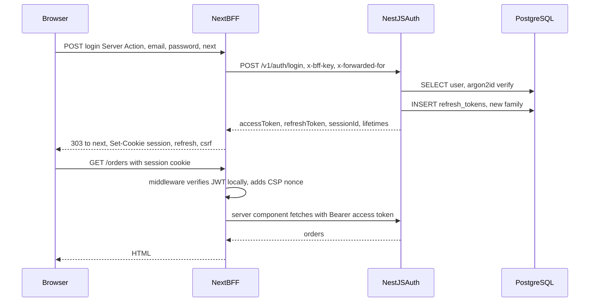
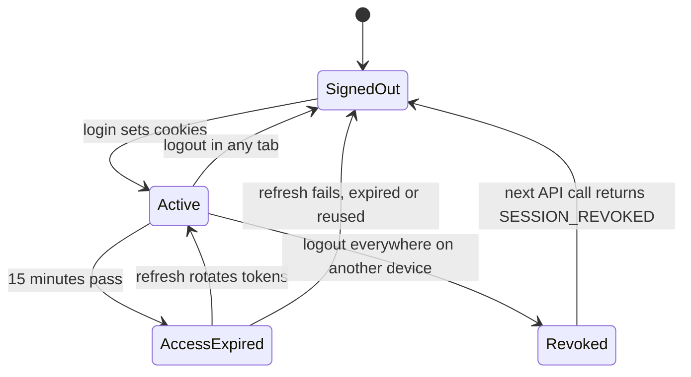

## 77.10 Worked example: login, refresh and logout for a Next.js app against a NestJS auth service

This example assembles the Part into one flow for the storefront: `shop.example` (Next.js 14 App Router, the BFF) in front of a NestJS auth service and the NestJS order API, both on an internal network. It replaces the single 15-minute cookie of 75.9 with the full design: the BFF owns the cookies, NestJS issues and rotates tokens, and the browser holds nothing it can read except a CSRF token. Part 81 — Full-Stack Worked Project builds live order tracking on exactly these names and endpoints.

#### Requirements

- **Sign-in** with email and password through a form that works before JavaScript loads (progressive enhancement), with `next` redirects that cannot leave the site.
- **Lifetimes**: access JWT 15 minutes; refresh token 14 days idle, 30 days absolute, rotated on every use with reuse detection and a 20-second grace window.
- **Silent refresh** on navigation and on client API calls, one rotation per expiry across tabs.
- **Logout** of this browser immediately in every tab; **logout everywhere** effective on the next API call on any device.
- **Security**: no token readable by page JavaScript; CSRF checks on every cookie-authenticated write; CSP with nonces on account pages; login rate-limited per email and per IP.
- **Performance budgets**: middleware under 2 ms p95 with no network calls; refresh under 50 ms p95 at the BFF; login under 400 ms p95 (dominated by argon2id).

#### The flow



The lifecycle of one browser session:



#### The contract

| Caller to endpoint | Method and path | Auth | Result |
|---|---|---|---|
| Browser to BFF | Server Action `login` on `/login` | Next.js Origin check | `303` to `next`, three cookies |
| Browser to BFF | `GET /api/auth/refresh?next=` | Refresh cookie | `303` to `next`, or to `/login` |
| Browser to BFF | `POST /api/auth/refresh` | Refresh cookie, `Sec-Fetch-Site` | `204`, or `401` problem with `code` |
| Browser to BFF | `POST /api/auth/logout` and `/logout-all` | Cookies, `Sec-Fetch-Site` | `204`, cookies cleared |
| BFF to NestJS | `POST /v1/auth/login`, `/refresh`, `/logout` | `x-bff-key` plus internal network | Token pair or `401` problem |
| BFF to NestJS | `POST /v1/auth/logout-all` | `x-bff-key` plus user's Bearer token | `204` |
| Browser via `rewrites` to NestJS | `/api/v1/*` | `__Host-session` cookie, `CsrfGuard` | Resource or `401` with `X-Auth-Error` |

The token pair shape lives in `@shop/contracts`, so the BFF parses it with zod like any other response (76.1):

```ts
// packages/contracts/src/auth.ts
import { z } from 'zod';

export const TokenPairSchema = z.object({
  accessToken: z.string().max(3_800),            // must fit in a cookie (81.2)
  accessExpiresIn: z.number().int().positive(),  // seconds, 900
  refreshToken: z.string().min(43),              // opaque, 32 random bytes base64url
  refreshExpiresIn: z.number().int().positive(), // seconds, idle lifetime
  sessionId: z.string(),                         // the family id, also the JWT's sid claim
});
export type TokenPair = z.infer<typeof TokenPairSchema>;
```

#### Backend: the NestJS auth service

```ts
// apps/auth/src/auth/auth.controller.ts
import { Body, Controller, Header, HttpCode, Post, UseGuards } from '@nestjs/common';
import { Throttle } from '@nestjs/throttler';
import { z } from 'zod';
import type { TokenPair } from '@shop/contracts';
import { ZodValidationPipe } from '../common/zod-validation.pipe';
import { BffClientGuard } from './bff-client.guard';
import { JwtAuthGuard } from './jwt-auth.guard';
import { CurrentUser, type AuthUser } from './current-user.decorator';
import { LoginService } from './login.service';
import { RefreshService } from './refresh.service';

const Login = z.object({ email: z.string().email().max(254), password: z.string().min(1).max(256) });
const Refresh = z.object({ refreshToken: z.string().min(43).max(128) });

@Controller('v1/auth')
@UseGuards(BffClientGuard)                                  // only the Next.js tier holds the x-bff-key secret
export class AuthController {
  constructor(private readonly login_: LoginService, private readonly refresh_: RefreshService) {}

  @Post('login') @HttpCode(200) @Header('Cache-Control', 'no-store')
  @Throttle({ default: { limit: 10, ttl: 60_000 } })        // per IP; LoginService also limits per email
  login(@Body(new ZodValidationPipe(Login)) b: z.infer<typeof Login>): Promise<TokenPair> {
    return this.login_.login(b.email, b.password);          // generic INVALID_CREDENTIALS, constant-time path (22.25)
  }

  @Post('refresh') @HttpCode(200) @Header('Cache-Control', 'no-store')
  refresh(@Body(new ZodValidationPipe(Refresh)) b: z.infer<typeof Refresh>): Promise<TokenPair> {
    return this.refresh_.rotate(b.refreshToken);            // grace window and reuse detection (81.3)
  }

  @Post('logout') @HttpCode(204)
  logout(@Body(new ZodValidationPipe(Refresh)) b: z.infer<typeof Refresh>): Promise<void> {
    return this.refresh_.revokeFamilyOf(b.refreshToken);     // idempotent: unknown or revoked tokens are fine
  }

  @Post('logout-all') @HttpCode(204) @UseGuards(JwtAuthGuard)
  logoutAll(@CurrentUser() user: AuthUser): Promise<void> {
    return this.refresh_.logoutEverywhere(user.id);         // all families revoked, auth epoch bumped
  }
}
```

`BffClientGuard` compares `x-bff-key` with the configured secret using `timingSafeEqual`; the auth service also listens only on an internal load balancer, so the header is a second lock, not the only one. Throttling per IP works because `trust proxy` is set to exactly one hop and the BFF forwards the browser's address in `X-Forwarded-For` (75.8). The access JWT carries `sub`, `sid`, `roles`, `auth_time`, `iat`, `exp`, `iss` and `aud: 'shop-web'`, signed RS256 with a `kid`, and is checked by `assertCookieSafe` (77.2) when issued.

#### Frontend: the login Server Action

```ts
// apps/web/app/login/actions.ts
'use server';
import { cookies, headers } from 'next/headers';
import { redirect } from 'next/navigation';
import { z } from 'zod';
import { setAuthCookies } from '@/lib/auth-cookies';
import { setCsrfCookie } from '@/lib/csrf.server';
import { callAuth } from '@/lib/auth-api.server';
import { safeNextPath } from '@/lib/safe-redirect';

const Form = z.object({ email: z.string().email(), password: z.string().min(1), next: z.string().optional() });

export async function login(_prev: { error?: string } | undefined, formData: FormData) {
  const parsed = Form.safeParse(Object.fromEntries(formData));
  if (!parsed.success) return { error: 'Enter your email and password.' };
  const clientIp = headers().get('x-forwarded-for')?.split(',')[0]?.trim() ?? '';
  const result = await callAuth('login', { email: parsed.data.email, password: parsed.data.password }, clientIp);
  if (!result.ok) {
    return { error: result.code === 'RATE_LIMITED' ? 'Too many attempts. Try again in a minute.' : 'Email or password is incorrect.' };
  }
  setAuthCookies(cookies(), result.pair);                   // __Host-session and __Secure-refresh (81.2)
  setCsrfCookie(cookies(), result.pair.sessionId);          // __Host-csrf = value.HMAC(sid.value) (81.6)
  redirect(safeNextPath(parsed.data.next, '/orders'));      // 303 after a Server Action; only relative paths
}
```

The page renders `<form action={formAction}>` with `useFormState(login, undefined)` from `react-dom` (React 19 renames it `useActionState` and moves it to `react`), inputs with `autoComplete="email"` and `autoComplete="current-password"` so password managers work, and a hidden `next` field. Without JavaScript, the form posts to the action and the redirect still happens. Server Actions already reject cross-origin posts (77.6), which covers login CSRF. `callAuth` is a small `fetch` wrapper: `AUTH_API_URL`, the `x-bff-key` header, `X-Forwarded-For`, `AbortSignal.timeout(3_000)`, `TokenPairSchema.parse` on success and the problem `code` on failure.

#### Frontend: middleware

```ts
// apps/web/middleware.ts  (Next.js 14, Edge runtime)
import { NextResponse, type NextRequest } from 'next/server';
import { createRemoteJWKSet, jwtVerify } from 'jose';
import { withCsp } from './lib/csp';                       // 81.7

const JWKS = createRemoteJWKSet(new URL(`${process.env.AUTH_ISSUER}/.well-known/jwks.json`));
const PROTECTED = ['/orders', '/account', '/checkout', '/cart'];

export async function middleware(req: NextRequest) {
  const { pathname, search } = req.nextUrl;
  if (!PROTECTED.some((p) => pathname === p || pathname.startsWith(`${p}/`))) return withCsp(req); // e.g. /login
  const token = req.cookies.get('__Host-session')?.value;
  if (token) {
    try {
      await jwtVerify(token, JWKS, { issuer: process.env.AUTH_ISSUER, audience: 'shop-web', clockTolerance: 5 });
      return withCsp(req);                                 // optimistic check passed; the DAL and NestJS check again
    } catch { /* expired or invalid: refresh below */ }
  }
  if (req.headers.get('next-router-prefetch')) return new NextResponse(null, { status: 204 }); // never rotate for prefetches
  const refresh = new URL('/api/auth/refresh', req.url);
  refresh.searchParams.set('next', `${pathname}${search}`);
  return NextResponse.redirect(refresh, 307);              // the refresh cookie is only sent to /api/auth
}

export const config = { matcher: ['/orders/:path*', '/account/:path*', '/checkout/:path*', '/cart', '/login'] };
```

Middleware cannot see `__Secure-refresh` (its `Path` is `/api/auth`), so it redirects whenever the session cookie is missing or invalid, and the refresh handler decides between "rotate" and "go to login". Logged-out users on a protected page pay one extra redirect; that is cheaper than sending the refresh token on every request. Static storefront pages are outside the matcher and get their headers (a report-only CSP, `frame-ancestors 'none'`, `Referrer-Policy`) from `headers()` in `next.config.js`.

#### Frontend: the refresh handler

```ts
// apps/web/app/api/auth/refresh/route.ts  (Node.js runtime)
import { NextResponse, type NextRequest } from 'next/server';
import { REFRESH_COOKIE, SESSION_COOKIE, setAuthCookies, clearAuthCookies } from '@/lib/auth-cookies';
import { secondsLeft } from '@/lib/session.server';
import { callAuth } from '@/lib/auth-api.server';
import { rejectCrossOrigin } from '@/lib/same-origin.server';
import { safeNextPath } from '@/lib/safe-redirect';

export const dynamic = 'force-dynamic';
type Outcome = { kind: 'fresh' } | { kind: 'rotated'; pair: Parameters<typeof setAuthCookies>[1] }
  | { kind: 'signed-out'; code: string } | { kind: 'unavailable' };

async function rotate(req: NextRequest): Promise<Outcome> {
  if ((await secondsLeft(req.cookies.get(SESSION_COOKIE)?.value)) > 60) return { kind: 'fresh' }; // another tab won
  const raw = req.cookies.get(REFRESH_COOKIE)?.value;
  if (!raw) return { kind: 'signed-out', code: 'SESSION_EXPIRED' };
  const r = await callAuth('refresh', { refreshToken: raw }, req.headers.get('x-forwarded-for') ?? '');
  if (r.ok) return { kind: 'rotated', pair: r.pair };
  return r.status === 401 ? { kind: 'signed-out', code: r.code } : { kind: 'unavailable' };
}

export async function GET(req: NextRequest) {                // navigation path from middleware
  const next = safeNextPath(req.nextUrl.searchParams.get('next'), '/orders');
  const o = await rotate(req);
  if (o.kind === 'unavailable') return new NextResponse('Sign-in is temporarily unavailable. Retry in a moment.', { status: 503, headers: { 'Retry-After': '5' } });
  const target = o.kind === 'signed-out' ? `/login?reason=${o.code}&next=${encodeURIComponent(next)}` : next;
  const res = NextResponse.redirect(new URL(target, process.env.APP_ORIGIN), 303);
  if (o.kind === 'rotated') setAuthCookies(res.cookies, o.pair);
  if (o.kind === 'signed-out') clearAuthCookies(res.cookies);
  res.headers.set('Cache-Control', 'no-store');
  return res;
}

export async function POST(req: NextRequest) {               // client path from authFetch (81.3)
  const denied = rejectCrossOrigin(req);
  if (denied) return denied;
  const o = await rotate(req);
  if (o.kind === 'unavailable') return NextResponse.json({ code: 'UPSTREAM_UNAVAILABLE', status: 503, title: 'Try again' }, { status: 503 });
  if (o.kind === 'signed-out') {
    const res = NextResponse.json({ code: o.code, status: 401, title: 'Signed out' }, { status: 401, headers: { 'Content-Type': 'application/problem+json' } });
    clearAuthCookies(res.cookies);
    return res;
  }
  const res = new NextResponse(null, { status: 204, headers: { 'Cache-Control': 'no-store' } });
  if (o.kind === 'rotated') setAuthCookies(res.cookies, o.pair);
  return res;
}
```

`secondsLeft` verifies the session JWT with the same `jose` setup as the DAL and returns its remaining lifetime, or `0`. The "fresh" short circuit is what makes the Web Locks single-flight in 77.3 produce one rotation instead of one per tab. A `503` from the auth service is not a logout: the user keeps their cookies and retries.

#### Frontend: logout

```ts
// apps/web/app/api/auth/logout/route.ts
import { NextResponse, type NextRequest } from 'next/server';
import { REFRESH_COOKIE, clearAuthCookies } from '@/lib/auth-cookies';
import { clearCsrfCookie } from '@/lib/csrf.server';
import { callAuth } from '@/lib/auth-api.server';
import { rejectCrossOrigin } from '@/lib/same-origin.server';

export async function POST(req: NextRequest) {
  const denied = rejectCrossOrigin(req);                     // logout is a POST; a GET logout is CSRF-able
  if (denied) return denied;
  const raw = req.cookies.get(REFRESH_COOKIE)?.value;
  if (raw) await callAuth('logout', { refreshToken: raw }, '').catch(() => undefined); // best effort, 1.5 s timeout
  const sharedDevice = req.nextUrl.searchParams.get('device') === 'shared';
  const res = new NextResponse(null, { status: 204 });
  clearAuthCookies(res.cookies);
  clearCsrfCookie(res.cookies);
  res.headers.set('Clear-Site-Data', sharedDevice ? '"cookies", "storage", "cache"' : '"storage"');
  res.headers.set('Cache-Control', 'no-store');
  return res;
}
```

The client's logout button posts there, then calls `queryClient.clear()`, posts `{ type: 'logged-out' }` on the `auth` `BroadcastChannel` so every other tab runs `AuthBroadcastListener` (77.3), and navigates with `router.replace('/login?reason=signed-out')`. "Log out everywhere" posts to `/api/auth/logout-all`, which calls NestJS with the user's Bearer token first and then does the same cleanup. If the NestJS call fails, the browser is still logged out; the response tells the UI that other devices may stay signed in until their refresh tokens are used, and the UI offers a retry.

#### Failure drills

| Drill | Expected behaviour | What proves it |
|---|---|---|
| Auth service down for 10 minutes | Existing sessions keep working until their access tokens expire; refresh returns `503` and navigation shows a retry page; new logins fail with a clear message | Synthetic check of `/orders` stays green for active sessions; no cookies cleared |
| Laptop wakes with 6 tabs and 12 prefetches | One rotation; prefetches get `204`; no reuse revocation | `refresh_tokens` shows one child row; reuse counter unchanged |
| Stolen refresh cookie replayed after the user refreshed | Family revoked; attacker and user both signed out; security alert | `401 REFRESH_REUSED`; audit log entry with both IPs |
| Signing key rotated (new `kid`) | `jose` fetches the JWKS once on the unknown `kid`; no logouts | Middleware p95 spike under 50 ms for one request per isolate |
| Redis down | Epoch check fails open for reads with an alert, closed for step-up actions; grace window off, so racing tabs may be signed out | Dashboard shows `auth_epoch_unavailable`; error budget burn measured |
| Access token grows past 2 KB after a roles change | CI fails on `assertCookieSafe` fixture | Red build, not a silent cookie drop |
| Phishing link with `next=/\evil.example` | Lands on `/orders` after login | The redirect test table (77.9) |

#### Numbers

At the evening peak of 60,000 concurrent sessions: about 67 rotations per second, NestJS refresh p50 6 ms and p95 18 ms, BFF refresh handler p95 31 ms including the internal hop. Middleware JWT verification with a cached JWKS takes about 0.4 ms. Login p95 is 290 ms, of which argon2id is about 70 ms and the rest network and PostgreSQL. The cookies cost about 850 bytes (session) plus 90 bytes (CSRF) on each page and API request, roughly 40 bytes after HTTP/2 header compression. "Logout everywhere" reaches another device's next API call through the Redis epoch check (0.3 ms per request).

#### How a Senior Full-Stack Engineer thinks about this

The senior keeps every responsibility in exactly one place: cookie attributes in `auth-cookies.ts`, rotation in the refresh handler, the decision to refresh in middleware and `authFetch`, token issuing and revocation in NestJS, redirect validation in `safeNextPath`. They separate "the auth service is unavailable" from "the user is signed out" everywhere, because conflating them turns a five-minute outage into a mass logout. They test the races (tabs, prefetches, sleep) and the hostile cases (replay, phishing redirects, cross-site posts) as named drills, and they measure rotations, reuse revocations and logout reach, so a frontend change that breaks auth shows up as a graph, not as support tickets.

#### Practical exercise

Build the flow end to end on the monorepo from Part 72, with a Playwright test suite (Part 79).

Acceptance criteria:

- With JavaScript disabled, a user can sign in and land on the `next` page; a `next` of `https://evil.example` lands on `/orders`.
- No response readable by page JavaScript contains an access or refresh token; `document.cookie` shows only `__Host-csrf`.
- Deleting `__Host-session` in DevTools and navigating to `/orders` causes one redirect to `/api/auth/refresh` and back, with one new row in `refresh_tokens`.
- Opening 5 tabs, expiring the session, and focusing all tabs produces one rotation.
- Logging out in one tab sends the other four to `/login` within one second, and Back from `/login` does not show order data.
- "Log out everywhere" on browser A makes browser B's next `GET /api/v1/orders` return `401 SESSION_REVOKED`, and B lands on `/login` without a refresh attempt.
- Stopping the auth service for two minutes does not sign anyone out.

## Senior Checklist — Part 77

- [ ] I understand the concept
- [ ] I can explain it simply
- [ ] I can implement it
- [ ] I understand its failure modes
- [ ] I understand its scaling limitations
- [ ] I understand its security implications
- [ ] I understand its operational implications
- [ ] I can choose between alternatives
- [ ] I can explain the tradeoffs
- [ ] I can answer senior-level interview questions
- [ ] I can explain what XSS gets with each token storage option, and why `HttpOnly` limits theft but not session riding
- [ ] I set session cookies with `__Host-`, no `Domain`, `Secure`, `HttpOnly` and an explicit `SameSite`, and I keep tokens under the 4 KB cookie limit
- [ ] I can implement silent refresh with single-flight across tabs, a server-side grace window, and machine-readable 401 reasons
- [ ] I can state how long "logout everywhere" takes in my system and how the auth epoch shortens it
- [ ] I run OIDC as authorization code with PKCE, in a BFF where possible, and convert the external identity into our own session
- [ ] I treat every Server Action and Route Handler as a public endpoint that authenticates, validates and authorises itself
- [ ] I layer `SameSite`, `Sec-Fetch-Site`, exact `Origin` checks and a signed double-submit token on cookie-authenticated writes
- [ ] I can list the XSS sinks in a React app and keep each behind one reviewed helper, with CSP nonces on pages that hold sessions
- [ ] I keep an inventory of third-party scripts, isolate payment fields, pin with SRI where possible and contain the rest with CSP
- [ ] I validate every redirect target with the URL parser and send `frame-ancestors`, `no-store` and `Clear-Site-Data` where they belong

## Part 77 — Key Takeaways

- No token storage defeats XSS; choose what XSS gets, and prefer that the browser holds nothing it can read.
- The BFF pattern keeps tokens on the server and gives the browser one `HttpOnly` cookie; CSRF is the price, and it is cheap to pay.
- `__Host-` cookies, no `Domain`, explicit `SameSite`, small tokens: cookie mistakes fail silently.
- Refresh is a concurrency problem first: single-flight across tabs, an "already fresh" check, and a short grace window prevent false reuse alarms.
- Every 401 needs a machine-readable reason, so the client knows whether to refresh, step up or sign out.
- "Logout everywhere" has a delay; state it, and shorten it with an epoch check where data is sensitive.
- Authorization code with PKCE is the only browser flow; the implicit flow and silent-renew iframes are gone.
- The browser asks, the server decides: hidden buttons, route guards and middleware are UX, and every Server Action is an endpoint.
- `SameSite` misses same-site siblings and login CSRF; `Sec-Fetch-Site: same-origin` and a signed token close the gaps.
- React escapes text; XSS lives in a short list of sinks, and CSP nonces cost you static rendering on the pages that use them.
- Every third-party script and npm package runs with your origin's power; inventory, isolate, pin, contain and monitor.
- Small browser-only attacks (open redirects, clickjacking, bfcache after logout) each need one default in one place.
