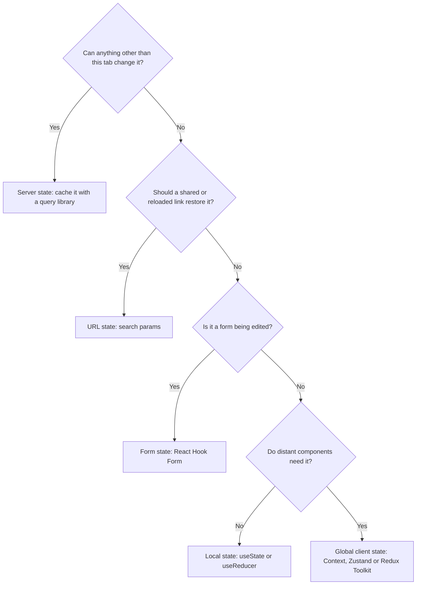

# Part 78 — Client State, Data Fetching and Caching

## 78.1 Server state vs client state: why API data in a global store goes wrong

#### Concept

Every value a React app holds belongs to one of two families.

**Server state** is data whose source of truth lives on a server: orders, products, stock levels, the cart, the customer profile. The browser never owns it. It holds a **copy**, taken at some moment, that other actors can change at any time: a warehouse worker marks the order shipped, a support agent issues a refund, the same customer cancels from their phone. Server state is asynchronous (you must ask for it), shared (many screens and many users read it) and always potentially out of date.

**Client state** is data the browser owns outright: whether the filter drawer is open, which tab is selected, the text typed into a half-finished form, the theme, a queue of toasts waiting to be shown. Nobody else can change it, it is available synchronously, and it is never stale because there is nothing to be stale against.

In practice it helps to split client state further, because each kind has a natural home:

| Kind | Example on an order list page | Owner | Natural home |
|---|---|---|---|
| Server state | The orders, their statuses, the cart count badge | The API and its database | A server-state cache (TanStack Query, RTK Query, SWR) |
| URL state | Status filter, date range, sort order, search text | The address bar | `useSearchParams` (React Router) or `searchParams` (Next.js) |
| Local UI state | "Cancel" dialog open, row expanded | One component | `useState` / `useReducer` (Part 77 — React Fundamentals for Backend Engineers) |
| Form state | Cancel reason being typed | The form | React Hook Form (77.7) |
| Global client state | Toast queue, list density preference, dismissed banners | The tab or the device | Context, Zustand or Redux Toolkit (78.9) |

The rule of this section is short: **server state is a cache, so manage it with a cache.** Putting API responses into a general-purpose global store and treating that store as the truth is the single most common architectural mistake in React apps.

#### Why does it exist?

The distinction exists because the two families have opposite problems.

Client state has a *coordination* problem: several components need the same value and must change it consistently. A store solves that.

Server state has a *freshness* problem. Once you copy server data into the browser, you inherit every question a backend cache answers (Part 30 — Caching and Redis): when does this copy expire, who invalidates it after a write, what happens when two requests for the same key are in flight, when is memory released, and what does the user see while a refresh is running. A general store answers none of these. If you put orders into Redux or a Context and fetch them once, you have built a cache with **no TTL, no invalidation, no deduplication and no eviction**, and you will rebuild each of those features by hand, one bug at a time.

What goes wrong in practice:

1. **Staleness with no expiry.** Orders loaded at login are shown for the whole session. The order shipped two hours ago; the screen still says "Paid".
2. **Duplicate copies that drift.** The list holds order `A7K2Q9P` as `PAID`, the detail page fetched it again and holds `CANCELLED`, the header badge holds a count from login. Three copies, three answers.
3. **Hand-rolled loading flags.** `ordersLoading`, `ordersError`, `orderDetailLoading`, `cancelPending`, multiplied by every resource. Each flag is a chance for a stuck spinner.
4. **Race conditions.** Two components dispatch the same fetch; responses arrive out of order and the older one wins (77.4 described the effect version of this race).
5. **Memory that never shrinks.** A store keeps every page the user ever visited. A B2B buyer with 1,800 orders scrolls the history and the tab holds 3 MB of JSON forever.
6. **Leaks across users.** The store is not cleared on logout, and on a shared counter terminal the next person sees the previous customer's orders.

#### Mental model

Imagine your NestJS service read the whole `orders` table into a `Map` at startup and served every request from it, forever. Nobody would accept that design on the backend: you would put Redis in front of PostgreSQL with a key per query, a TTL, explicit invalidation after writes and a single-flight lock to stop stampedes (Part 30.5).

A server-state library is exactly that Redis layer, running inside the browser tab. The query key is the Redis key. The query function is the loader that reads from the source of truth. The stale time is the TTL. `invalidateQueries` is `DEL` after a write. The global store, by contrast, is the `Map` loaded at startup. It is a perfectly good tool for client state, which has no source of truth elsewhere, and a bad one for data that does.

#### How it works

A useful classification test is one question: **"Can anything other than this browser tab change this value?"** If yes (the server, a worker, another device, another user, another tab), it is server state.



What a server-state cache does that a store does not:

1. **Keys data by the request that produced it.** `['orders', 'list', { status: 'PAID' }]` and `['orders', 'detail', 'a1b2...']` are separate entries with separate lifetimes.
2. **Tracks freshness per entry.** Each entry records when it was fetched. After its stale time it is still shown, but the next trigger (a component mounting, the tab regaining focus, the network reconnecting) refetches it in the background.
3. **Deduplicates.** Ten components asking for the same key while a request is in flight share one request.
4. **Garbage-collects.** When no component uses an entry for a while (five minutes by default in TanStack Query), it is deleted.
5. **Exposes status, not flags.** Every entry has a status (`pending`, `error`, `success`) and a fetch status (`fetching`, `paused`, `idle`), so loading UI is derived, not hand-maintained.
6. **Gives writes a way to invalidate.** After a mutation, you mark related keys stale and they refetch if on screen.

What stays in a store is small: UI preferences, ephemeral global UI, and sometimes a long-lived client-side domain model (a drawing canvas, an offline-first editor) that genuinely has no server truth until it is saved.

#### Practical example

The "My Orders" page of a grocery delivery app, classified:

| Value | Classification | Why |
|---|---|---|
| List of orders with status | Server state | Riders, warehouses and support change it |
| Count in the "Active orders" badge | Server state | Derived from server data; do not keep a separate counter |
| Status filter `PAID`, range `30d` | URL state | A support agent asks the customer to share the link; it must reproduce the view |
| "Cancel order" dialog open for order `A7K2Q9P` | Local state | One component, gone on close |
| Cancel reason being chosen | Form state | Validated, submitted once |
| Compact vs comfortable row density | Global client state, persisted | A device preference |
| "Your refund is on its way" toast queue | Global client state | Triggered from many places, shown in one |

Notice what is *not* in a global store: the orders. Teams that put them there usually also put the filter there, which breaks the back button and shared links, and the badge count, which drifts from the list.

#### React / Next.js example

The store-shaped version most teams start with (Redux Toolkit 2):

```ts
// src/orders/ordersSlice.ts  (the anti-pattern: server data as store truth)
import { createAsyncThunk, createSlice } from '@reduxjs/toolkit';
import { OrderListResponseSchema, type OrderSummary } from '@shop/contracts';

export const loadOrders = createAsyncThunk('orders/load', async () => {
  const res = await fetch('/api/v1/orders', { credentials: 'include' });
  if (!res.ok) throw new Error(`orders ${res.status}`);
  return OrderListResponseSchema.parse(await res.json());
});

type OrdersState = { items: OrderSummary[]; loading: boolean; error: string | null; loadedOnce: boolean };
const initialState: OrdersState = { items: [], loading: false, error: null, loadedOnce: false };

const ordersSlice = createSlice({
  name: 'orders',
  initialState,
  reducers: {},
  extraReducers: (b) => {
    b.addCase(loadOrders.pending, (s) => { s.loading = true; s.error = null; });
    b.addCase(loadOrders.fulfilled, (s, a) => { s.items = a.payload.items; s.loading = false; s.loadedOnce = true; });
    b.addCase(loadOrders.rejected, (s, a) => { s.loading = false; s.error = a.error.message ?? 'failed'; });
  },
});
export default ordersSlice.reducer;
// Missing: expiry, refetch on focus, dedupe, cancellation, pagination, invalidation after cancel,
// eviction, per-filter entries, clearing on logout. Each becomes a hand-written reducer case.
```

The same need expressed as server state (TanStack Query v5):

```tsx
// src/orders/RecentOrders.tsx  (React 18, TanStack Query v5)
import { useQuery } from '@tanstack/react-query';
import { OrderListResponseSchema } from '@shop/contracts';

async function fetchRecentOrders(signal: AbortSignal) {
  const res = await fetch('/api/v1/orders?limit=5', { credentials: 'include', signal });
  if (!res.ok) throw new Error(`orders ${res.status}`);
  return OrderListResponseSchema.parse(await res.json());
}

export function RecentOrders() {
  const { data, isPending, isError } = useQuery({
    queryKey: ['orders', 'list', { limit: 5 }],          // the cache key
    queryFn: ({ signal }) => fetchRecentOrders(signal),   // the loader; signal aborts on unmount
    staleTime: 30_000,                                    // fresh for 30 s, then refetched on next trigger
  });

  if (isPending) return <p>Loading your orders...</p>;
  if (isError) return <p role="alert">We could not load your orders.</p>;
  return <ul>{data.items.map((o) => <li key={o.id}>{o.displayId}: {o.status}</li>)}</ul>;
}
```

Fewer lines, and every missing feature in the first version is a default or one option in the second. The rest of this Part explains each of those options, because defaults you do not understand are bugs you have not met yet.

#### Backend side (NestJS)

A client cache can only be as correct as the API lets it be. Five things the API owes a server-state cache:

1. **Stable IDs on every resource** (77.3), so cached entries and list rows can be matched across responses.
2. **A version or `updatedAt` on every mutable resource**, so the client can tell which of two copies is newer. This matters the moment real-time events and optimistic updates meet (78.6, 78.8).
3. **Mutations that return the updated resource.** A `200` with the new order lets the client write it straight into the cache instead of refetching.
4. **Compatible shapes between list and detail.** If the list item is a strict subset of the detail, the detail page can show the list's copy instantly while the full record loads.
5. **Honest HTTP cache headers.** Per-user data must not be cached by shared caches, and must not be cached by the browser in a way that hides fresh data from the query library (78.4).

This Part extends the shared contract from Part 76.12 with two fields:

```ts
// packages/contracts/src/index.ts  (zod 3.23; OrderSummarySchema from 76.12 with two new fields)
export const OrderSummarySchema = z.object({
  id: z.string().uuid(),
  displayId: z.string(),
  status: OrderStatusSchema,
  totalMinor: MinorUnitsSchema,
  currency: z.string().length(3),
  items: z.array(OrderItemSchema),
  placedAt: z.string().datetime({ offset: true }),
  version: z.number().int().nonnegative(),           // new: increments on every change to the order row
  updatedAt: z.string().datetime({ offset: true }),  // new: for "updated 2 min ago" and debugging
});
export type OrderSummary = z.infer<typeof OrderSummarySchema>;
```

On the backend, TypeORM's `@VersionColumn()` increments the column on every `save()`; for raw `UPDATE` statements, increment it explicitly (`SET version = version + 1`). The controller sets cache headers that keep shared caches out and let the browser revalidate:

```ts
// apps/api/src/orders/orders.controller.ts  (excerpt)
import { Controller, Get, Header, Param, ParseUUIDPipe, UseGuards } from '@nestjs/common';
import type { OrderSummary } from '@shop/contracts';
import { JwtAuthGuard } from '../auth/jwt-auth.guard';
import { CurrentUser } from '../auth/current-user.decorator';
import { OrdersService } from './orders.service';

@Controller('v1/orders')
@UseGuards(JwtAuthGuard)
export class OrdersController {
  constructor(private readonly orders: OrdersService) {}

  @Get(':id')
  @Header('Cache-Control', 'private, no-cache') // browser may store it, but must revalidate; CDNs must not store it
  findOne(@CurrentUser() userId: string, @Param('id', ParseUUIDPipe) id: string): Promise<OrderSummary> {
    return this.orders.findForUser(userId, id); // 404 for another user's order, never 403 (no existence leak)
  }
}
```

#### Production scenario

A B2B dental supplies marketplace loaded the buyer's entire order history into a Redux slice at login: one `GET /v1/orders?all=true`. For a typical clinic that was 40 orders; for hospital buyers it was 1,800 orders and 3.4 MB of JSON, taking 1.9 s at p95 and blocking the dashboard. Statuses were refreshed only on full page reload, so buyers who kept the tab open all day (most of them) saw "Processing" on orders that had shipped in the morning. "Where is my order" support tickets made up 31 % of all contacts.

The team moved orders to TanStack Query with cursor pages of 20 (78.7), `staleTime: 30_000` and refetch on focus. The dashboard request became 22 KB and 120 ms at p95. Buyers saw shipped status within 30 s of returning to the tab, and later within 2 s once status events were pushed over SSE (78.8). "Where is my order" tickets fell to 18 % of contacts in six weeks. The Redux store kept three slices: UI preferences, the toast queue and a draft purchase-order builder.

#### Failure scenario

At 10:40 a support agent cancelled order `A7K2Q9P` on the customer's behalf because a product was out of stock. The customer's laptop had the orders page open since 08:15, with orders in a Context loaded once on mount. At 11:05 the customer clicked "Track", saw "Paid, preparing", and called support again. The agent said it was cancelled; the customer refreshed and saw "Cancelled"; trust dropped and the call took 9 minutes.

Worse, the same Context held the order list, and the "Cancel order" button read the stale status. Several customers clicked "Cancel" on orders that had already shipped, got a `409 ORDER_NOT_CANCELLABLE` with no explanation, and assumed the site was broken.

The post-incident review named the root cause precisely: **the UI treated a copy as the truth and had no rule for when the copy expires.** The fix was not "refresh more often"; it was moving server data into a cache with freshness rules, invalidation after the user's own writes, and pushed events for other people's writes.

#### Edge cases & failure modes

- **Derived server state stored separately**, such as a cart count kept in a store and incremented locally, drifts from the server's cart after a failed add or an add from another device. Derive it from the cart query.
- **Filters in a store instead of the URL** break the back button, shared links and reloads.
- **Server data copied into `useState` "to edit it"** stops receiving updates. Copy only into a form's default values, keyed by the resource version so a newer version resets the form (77.3).
- **Logout without clearing caches** leaks one user's data to the next on shared devices (78.10).
- **Multiple tabs** each have their own cache. A cancel in tab 1 is invisible to tab 2 until it refetches. Refetch on focus, a `BroadcastChannel` message or pushed events close the gap.
- **Huge "load everything" endpoints** created to fill a store become the slowest endpoint in the API.

#### How a Senior Full-Stack Engineer thinks about this

A senior classifies before choosing tools. They ask "who else can change this?" and "should a link reproduce this?" for each value, and the tool choice falls out of the answers. They refuse to let a global store become a second database: if a reviewer sees `orders` or `products` in a Redux slice, the first question is "what invalidates this?"

They also see that the backend shapes how hard this is. An API with versions on resources, mutation responses that return the new resource, and stable IDs makes the client cache simple. An API that returns `204 No Content` from every write and has no version field forces the client to refetch everything and guess which copy is newer.

To a product manager: "The screen shows a copy of the order. We are choosing how old that copy may get and how quickly it updates after a change. Thirty seconds on focus is cheap; two seconds needs live updates and costs a little more infrastructure."

#### Common mistakes

- **Fetching once into a global store** and never expiring it.
- **Storing the same entity in several places** (list slice, detail slice, badge counter) that drift apart.
- **Keeping filter and sort state in a store** instead of the URL.
- **Copying query data into `useState`** and editing the copy, which silently stops updates.
- **Adding `loading`/`error` flags per resource by hand** instead of using a library's status.
- **Building "load everything" endpoints** to feed a store.

#### Interview questions

1. **What is the difference between server state and client state, and why does it matter for tool choice?**
   Expected answer: server state has a remote source of truth, is async, shared and can be stale; client state is owned by the browser and synchronous. Server state needs caching semantics (keys, freshness, dedupe, invalidation, garbage collection) that general stores lack. Why it matters: most data bugs in React apps come from managing server data as if it were client data. Follow-up: where does a status filter belong? (The URL.)
2. **A teammate puts the product catalogue in Redux "for performance". What do you ask?** Expected answer: what invalidates it, how stale can it be, how much memory, what happens on price changes and on logout; propose a query cache with a long stale time instead.
3. **How do you decide whether a value belongs in the URL?** Expected answer: if reloading, sharing a link or pressing Back should restore it.
4. **What does the API need to provide so the client can cache correctly?** Expected answer: stable IDs, versions or `updatedAt`, mutation responses returning the new resource, consistent list and detail shapes, correct `Cache-Control`.
5. **Two tabs are open; the user cancels in one. What does the other show and how do you fix it?** Expected answer: the stale status until refetch; refetch on focus, `BroadcastChannel`, or server-pushed events.

#### Practical exercise

Take an existing page that keeps API data in a Context or store.

Acceptance criteria:

- A table classifies every value on the page into the five kinds above, with the reason.
- Filters move to the URL; reloading and sharing the link reproduce the view.
- API data moves to TanStack Query; the store or Context shrinks to genuine client state.
- After a support-side status change in the database, returning to the tab shows the new status within the configured stale time, without a manual reload.
- The NestJS order endpoints return `version` and `updatedAt`, and `GET /v1/orders/:id` sends `Cache-Control: private, no-cache`.

