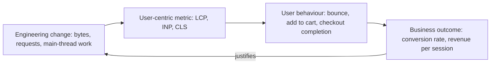

# Part 78 — Web Performance

Part 42 — Performance Engineering taught you to measure an API with percentiles, find the N+1 query, size the connection pool and keep p99 inside a budget. Part 11 — Networking and HTTP covered compression, HTTP/2 and cache headers; Part 46 — Cloud Architecture (46.3) put a CDN in front of everything; Part 51 — Cost-Aware Engineering priced the bytes. Part 71 — How the Browser Builds a Page then followed one product page from the first byte to interactive and showed you how to *read* a waterfall. This Part is about *changing* what you read: how to take a page that real users experience as slow and make it fast, and how to keep it fast after the next twenty deploys.

The backend engineer's instinct is that a page is slow because an API is slow. Sometimes that is true. More often the API answers in 80 ms and the user still waits four seconds, because the image the user is looking at was discovered late, the JavaScript that makes the button work is 900 KB, a third-party script hides the page while it decides which experiment to show, and the server rendered the HTML only after four sequential calls. Each of those has an owner, a number and a fix, and roughly half of them sit on the backend's side of the line. Every section of this Part therefore ends in the same place: what the NestJS API and the Next.js server must send, cache or aggregate so that the browser can be fast.

Stack and versions, as in the rest of the volume: Next.js 14 with the App Router (with notes where 15 and 16 differ), React 18, the `web-vitals` library v4 (with notes for v5), Lighthouse 12 and Lighthouse CI, current Chrome DevTools, and the NestJS API with `@shop/contracts` from Parts 75–77. The metrics are the current Core Web Vitals: **Largest Contentful Paint (LCP)**, **Interaction to Next Paint (INP)** and **Cumulative Layout Shift (CLS)**. INP replaced First Input Delay (FID) as a Core Web Vital in March 2024; FID appears in this Part only as history. The worked example in 78.12 takes a real-world-shaped product page from a p75 LCP of 4.8 s to under 2.5 s, one measured step at a time, and Part 81 — Full-Stack Worked Project reuses the measurement pipeline and budgets defined here.

## 78.1 Why frontend performance is revenue

#### Concept

Web performance is how quickly a page shows the user what they came for, how quickly it responds when they act, and how stable it stays while they read. It is not one number. A page can show a price in 1.2 s and still ignore the "Add to cart" tap for 600 ms; another can be fully interactive and then jump the "Place order" button down by 80 pixels just as the user's thumb lands.

Performance is revenue because every one of those delays and jumps costs a fraction of users. Some leave before the page appears. Some tap twice and get annoyed. Some give up on a slow checkout step. On a storefront doing a million sessions a week, a fraction of a percent is real money, and on a cheap phone over a congested mobile network the fractions are much larger than on the laptop where the page was built.

#### Why does it exist?

Engineers optimise what they can see. The team that builds a page sees it on a recent MacBook, on office Wi-Fi, with a warm cache and a CDN edge 5 ms away. The median customer of an Indian, Brazilian or Indonesian e-commerce site sees it on a two- to four-year-old Android phone with four slow CPU cores, on a 4G connection whose round-trip time swings between 70 and 400 ms, often with a cold cache. The same JavaScript bundle that parses in 120 ms on the laptop takes 600 to 900 ms on that phone.

Without a discipline of measuring real users, nobody notices. The page "feels fine", the API dashboards are green, the Lighthouse score on the developer's machine is 92, and the conversion rate on mobile is 40% lower than on desktop for reasons the business attributes to "mobile users browse more". Web performance as a practice exists to make that invisible cost visible, attach it to money, and give each team a number it can move.

#### Mental model

Imagine a shop on a busy street. Customers walk in (navigation). If the door is heavy and the lights take a while to come on (slow first paint), some turn around on the pavement. If the shelves are visible but the shop assistant ignores them for a few seconds when they ask a question (slow interaction), some walk out. If the shelves slide around while they reach for a product (layout shift), they grab the wrong thing and leave annoyed. The shop never sees the people who turned around on the pavement; it only sees fewer sales. Web performance is putting a counter at the door that records how long each customer waited and what they did next.

#### How it works

The chain from milliseconds to money has four links, and a senior engineer can explain each one.



1. **An engineering change** alters bytes on the wire, the number of round trips, server time or main-thread work. You control this.
2. **A user-centric metric** measures what the user experiences: when the main content appeared (LCP), how long an interaction took to show a result (INP), how much the layout moved (CLS). These are defined in 78.2 to 78.5.
3. **User behaviour** changes with the metric: bounce rate, pages per session, add-to-cart rate, checkout completion. The relationship is not linear. Going from 1.5 s to 1.2 s LCP rarely moves anything measurable; going from 5 s to 2.5 s often does.
4. **The business outcome** is conversion rate and revenue per session, which is what the product manager and the finance team understand.

Published case studies give a sense of scale. Treat them as directional, not as promises for your site; most are correlations from the companies' own analysis.

| Source | What they reported |
|---|---|
| Deloitte and Google, "Milliseconds Make Millions" (2020) | A 0.1 s improvement in mobile site speed went with about 8% higher retail conversion and about 10% higher travel conversion |
| Vodafone (web.dev case study, 2021) | A 31% LCP improvement in an A/B test went with 8% more sales |
| Google and SOASTA research (2017) | As mobile load time grows from 1 s to 3 s, bounce probability rises 32%; to 5 s, 90% |
| redBus (web.dev case study, 2023) | Reducing INP went with roughly 7% higher sales |
| Akamai retail study (2017) | A 100 ms delay in load time went with a conversion drop of up to 7% |

The Vodafone result is the most useful kind, because it came from an **A/B test**: half the traffic got the faster page, so the difference in sales can be attributed to speed rather than to season or marketing. When you argue for performance work inside your own company, aim for the same: a holdout experiment, or at least a before-and-after on the same traffic mix.

The second half of the mechanism is **who** is slow. Performance problems are not evenly distributed:

- **Network**: a 4G connection in a busy city centre often has 100 to 200 ms round-trip time and 2 to 10 Mbps of real throughput, with frequent stalls. Every extra round trip (a redirect, a new origin's handshake, a request chain) costs that RTT again. Part 11.5 explains why bandwidth rarely helps and latency always hurts.
- **CPU**: JavaScript is parsed, compiled and executed on the device. A budget Android phone is commonly four to six times slower than a developer laptop at this. 500 KB of compressed JavaScript is roughly 1.5 to 2 MB uncompressed, and on that phone it can mean one to two seconds of main-thread work before the page responds.
- **Memory**: low-end phones have 2 to 4 GB of RAM shared with the OS and other apps. Large images and heavy JavaScript heaps cause tab reloads and jank.
- **Cache state**: a first-time visitor from a search result or a social link has nothing cached. Those are exactly the users you most want to convert, and they get the slowest experience.

This is why every performance number in this Part is quoted at the **75th percentile of real users on mobile**, not at the median on desktop.

#### Practical example

A food delivery marketplace serves 3.2 million restaurant-menu page views a day, 78% on mobile. Its analytics team segments sessions by the LCP each user experienced on the first page:

```text
LCP bucket (first page)   Share of mobile sessions   Order conversion
under 2.5 s               41%                        7.9%
2.5 s to 4.0 s            34%                        6.6%
over 4.0 s                25%                        4.8%
```

This table does not prove that speed causes conversion. Users with slow phones may also be users with less spending power, and users in areas with poor networks may have fewer restaurants available. But it frames the opportunity: if the "over 4 s" quarter converted like the middle group, the business would gain about 1.8 points of conversion on a quarter of mobile traffic. The team then runs a real experiment (78.12 shows the steps) to measure the causal part.

#### React / Next.js example

The first engineering step is to collect the metric per user and join it to behaviour. Part 71.10 showed `useReportWebVitals` sending raw values. For revenue analysis you also need the dimensions that let analysts segment: the route template (not the full URL), the device class, the connection type, and an id that joins the metric to the analytics session.

```tsx
// apps/web/src/perf/WebVitalsReporter.tsx  (Next.js 14 App Router, rendered once in app/layout.tsx)
'use client';
import { useReportWebVitals } from 'next/web-vitals';
import { usePathname } from 'next/navigation';
import { routeTemplate } from './route-template';           // '/p/trail-runner-gtx' -> '/p/[slug]'

type NetInfo = { effectiveType?: string; saveData?: boolean };

export function WebVitalsReporter({ sessionId, buildId }: { sessionId: string; buildId: string }) {
  const pathname = usePathname();
  useReportWebVitals((metric) => {
    const conn = (navigator as Navigator & { connection?: NetInfo }).connection; // Chromium only
    const body = JSON.stringify({
      name: metric.name,                    // 'LCP' | 'INP' | 'CLS' | 'FCP' | 'TTFB'
      value: Math.round(metric.name === 'CLS' ? metric.value * 1000 : metric.value), // CLS x1000 as an integer
      rating: metric.rating,                // 'good' | 'needs-improvement' | 'poor'
      id: metric.id,                        // unique per page load and metric
      navigationType: metric.navigationType,
      route: routeTemplate(pathname),       // low-cardinality label
      effectiveType: conn?.effectiveType ?? 'unknown',
      deviceMemory: (navigator as Navigator & { deviceMemory?: number }).deviceMemory ?? null,
      sessionId,                            // joins to analytics: conversion per LCP bucket
      buildId,                              // which deploy produced this experience
    });
    // A JSON Blob keeps the Content-Type as application/json, so NestJS parses it (82.11).
    navigator.sendBeacon('/api/v1/rum/vitals', new Blob([body], { type: 'application/json' }));
  });
  return null;
}
```

Three choices are deliberate. The **route template** keeps the number of distinct values small, so dashboards and Prometheus labels stay cheap (78.11). The **buildId** lets you see a regression the hour it ships instead of a month later in CrUX. The **sessionId** is what turns a performance dashboard into a revenue argument.

#### Backend side (NestJS)

The backend's first job in a revenue conversation is to be measurable on the same timeline as the frontend. Three things make that possible:

- **`Server-Timing` on HTML and API responses** (71.10), so a slow TTFB in the field can be split into "Next.js render", "NestJS product call" and "database" without opening a second tool.
- **A RUM ingestion endpoint** that accepts beacons cheaply, validates them, and forwards them to the metrics and analytics pipeline. It must never be on the critical path: it answers `204 No Content` without waiting for any downstream write. The full controller is in 78.11.
- **Stable identifiers** in responses: the same `X-Request-Id` the frontend can attach to a slow-interaction report, and a build or deployment id in a response header so RUM data can be grouped by release.

The backend should also expose its own percentiles per route in a way that matches the frontend's segmentation. "p95 of `GET /v1/products/:id` is 85 ms" is far more useful when a dashboard next to it shows "p75 TTFB of `/p/[slug]` on mobile is 1.4 s", because the gap between those numbers is the part of the problem the API latency dashboard cannot see.

#### Production scenario

A fashion retailer with 9 million monthly mobile sessions found that its product listing pages had a p75 LCP of 3.9 s and its checkout a p75 INP of 420 ms. Engineering estimated three sprints of work. The product manager asked what it would earn. The team ran a 50/50 holdout for two weeks on listing pages only, after shipping image resizing and moving a tag manager off the critical path:

```text
                         Control    Faster variant
p75 LCP, mobile          3.9 s      2.4 s
Bounce rate              47.1%      44.0%
Product page views/sess  3.1        3.4
Add-to-cart rate         9.2%       9.8%
```

The add-to-cart lift of 0.6 points on that traffic was worth about four times the cost of the remaining work over a year. The rest of the roadmap was approved in one meeting, because the argument was in the business's own units.

#### Failure scenario

At 10:30 on the first day of a summer sale, the marketing team launched a new homepage with an autoplaying hero video, a countdown timer and a personalised banner pulled from a recommendation service. On the office network it looked great. By 13:00 the operations dashboard showed orders 14% below forecast, although sessions were 20% above. Every backend dashboard was green: API p99 at 140 ms, no errors, Redis hit rate 97%.

The RUM dashboard, which nobody had open, told the story. p75 mobile LCP on the homepage had gone from 2.3 s to 6.1 s: the hero video's poster image was 1.4 MB, the recommendation call ran in the server render before any HTML was sent (adding 700 ms of TTFB under sale load), and the countdown's JavaScript ran a 30 ms layout-thrashing update every 100 ms, pushing INP to 650 ms. Users on mid-range phones were leaving the homepage before it rendered. The fix, a static poster at 90 KB, the banner moved behind a `<Suspense>` boundary so it streamed after the shell, and a CSS-only countdown, went out at 15:40. Orders recovered within the hour.

The postmortem's main action was not technical: the RUM dashboard was added to the launch checklist and to the on-call's sale-day view, with an alert on p75 LCP per top route.

#### Edge cases & failure modes

- **Correlation is not causation.** Slow users differ from fast users in device, location and intent. Use A/B tests or before-and-after on stable traffic to claim revenue impact.
- **Survivorship in RUM.** Users who leave before the page loads may never send a beacon, so field data can look better than reality. `sendBeacon` on `visibilitychange` (which `web-vitals` uses) catches most, but not users whose browser never ran your script.
- **Bots and synthetic traffic** inflate or deflate numbers. Filter known bots, your own monitoring agents and prerender services from RUM.
- **Mix shift.** A marketing campaign that brings many new users on cheap phones makes p75 worse with no code change. Segment by device class and connection type before blaming a deploy.
- **Desktop hides mobile.** An "all devices" p75 can be good while mobile p75 is poor. Always report mobile separately.
- **Average instead of percentile.** A mean LCP of 2.1 s can hide a p75 of 3.4 s. Report p75 for Web Vitals and p95 for internal diagnosis.

#### How a Senior Full-Stack Engineer thinks about this

The senior refuses to have the performance conversation in engineering units only. "We cut 400 KB of JavaScript" is a task; "we moved 18% of mobile sessions from poor to good LCP, and in the holdout that segment added to cart 0.6 points more often" is a business result. They set up the measurement before the optimisation, because without a baseline nobody will believe the improvement.

They also know where the leverage is. They look at the slowest quartile on the most valuable routes first: the product page, the listing page and checkout, on mobile. They do not chase a Lighthouse score of 100 on the About page.

To a product manager: "About a quarter of our mobile visitors wait more than four seconds to see the product. Those visitors buy less. We can measure how much less with a two-week experiment, and the fixes are mostly smaller images, less script and a faster server response."

#### Common mistakes

- **Measuring only on developer hardware** and concluding the site is fast.
- **Using the Lighthouse score as the business metric.** It is a lab diagnostic with a weighted formula; users and search ranking use field metrics.
- **Reporting averages** or all-device numbers that hide the slow mobile tail.
- **Claiming revenue from correlation** and losing credibility when a later experiment shows a smaller effect.
- **Treating performance as a one-off project** instead of a budget that every change must respect (78.11).

#### Interview questions

1. **How would you convince a product manager to fund performance work?** Expected answer: measure field metrics per route and device, join them to conversion, run a holdout on one route, and present the result in revenue terms. Why it matters: performance work competes with features. Follow-up: what if the experiment shows no effect? (Check that the change actually moved p75 for the affected users and that the metric is the one users feel; some pages are already fast enough.)
2. **Why quote web performance at the 75th percentile on mobile?** Expected answer: it reflects the experience of most real users including slower devices and networks, it is the threshold Core Web Vitals use, and mobile is usually both slower and the majority of traffic.
3. **The API p99 is 120 ms but users say the page is slow. What could be happening?** Expected answer: client-side waterfalls, late resource discovery, large JavaScript and hydration, render-blocking third parties, sequential server-side calls, uncached HTML. Follow-up: how do you prove it? (Waterfall plus `Server-Timing` plus RUM attribution.)
4. **What makes low-end devices disproportionately slow?** Expected answer: JavaScript parse, compile and execute is CPU-bound and several times slower; memory pressure; the network RTT on mobile multiplies every round trip.
5. **How would you avoid survivorship bias in RUM?** Expected answer: send on `visibilitychange` with `sendBeacon`, load the reporting snippet early and small, compare beacon counts to server-side page views to measure loss.

#### Practical exercise

Join performance to behaviour for one high-traffic route you own.

Acceptance criteria:

- Every page load on that route sends LCP, INP and CLS with route template, device memory, effective connection type, build id and analytics session id.
- A query or dashboard shows conversion (or your route's key action) per LCP bucket (good, needs improvement, poor), for mobile only.
- The beacon count is compared with server-side page views for the same route and day, and the loss rate is written down.
- A one-paragraph note to your product manager estimates the opportunity and proposes a holdout experiment to measure the causal part.

