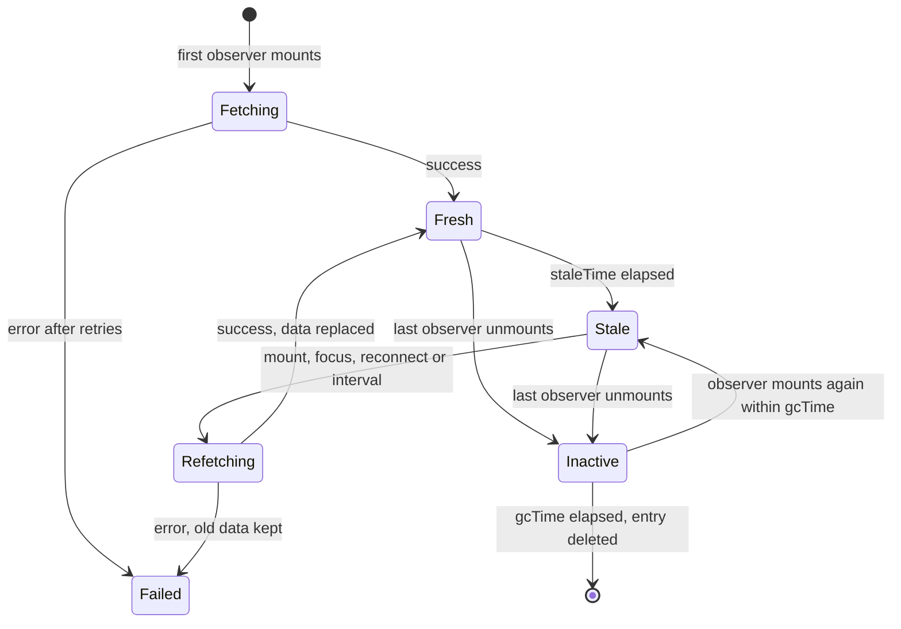
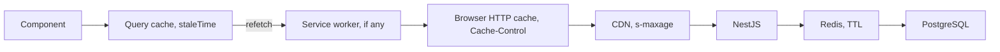

## 78.3 Stale time, garbage-collection time, background refetch and retries

#### Concept

Two timers decide the life of every cached query, and they are constantly confused.

- **`staleTime`** (default `0`) is how long data counts as **fresh** after it was fetched. While fresh, nothing triggers a refetch: new components mounting, the tab regaining focus, all of them read the cache silently. Once stale, the data is still shown, but the next trigger refetches it in the background.
- **`gcTime`** (default 5 minutes) is how long an **inactive** query (one with no mounted observers) stays in memory before it is garbage-collected. It has nothing to do with freshness. A query that is on screen is never collected, however old.

In v4 `gcTime` was called **`cacheTime`**. v5 renamed it because "cache time" made people think it controlled how long data is reused without refetching, which is `staleTime`'s job. If you see `cacheTime` in code, it is v4 or a migration that was not finished.

**Background refetch** is how stale data becomes fresh without a spinner: the cached value stays on screen, `isFetching` becomes `true`, and the new data replaces it when it arrives. **Retries** are how a failed fetch gets more chances before the query reports an error: by default 3 retries for queries, with exponential backoff, and 0 retries for mutations.

#### Why does it exist?

There are only two ways to keep a copy in sync with a source of truth: the source tells you when it changes (push, 78.8) or you ask again at sensible moments (pull). TanStack Query's triggers are a good default answer to "sensible moments": when a new screen needs the data, when the user comes back to the tab (they may have been away for an hour), and when the network returns. `staleTime` stops those triggers from firing pointlessly; `gcTime` stops memory from growing with every screen visited; retries absorb the transient failures that are normal on mobile networks.

#### Mental model

Imagine a supermarket shelf with "best before" and "remove from shelf" dates. Best before is `staleTime`: before it, sell without a second thought; after it, still sell, but order a fresh batch the next time someone looks. "Remove from shelf if nobody has picked it up" is `gcTime`: it applies only to items nobody is holding. An item in someone's basket (a mounted component) is never removed, however old.

#### How it works



The refetch triggers, all on by default and each a per-query option:

| Trigger | Option | v5 behaviour |
|---|---|---|
| A new observer mounts | `refetchOnMount` | Refetch if stale; `'always'` ignores freshness |
| Tab becomes visible again | `refetchOnWindowFocus` | Listens to `visibilitychange` only (v4 also used `focus`, which fired on every devtools click) |
| Network comes back | `refetchOnReconnect` | Driven by the browser `online` event via `onlineManager` |
| Timer | `refetchInterval` | Off by default; paused in hidden tabs unless `refetchIntervalInBackground: true` |
| Explicit | `refetch()`, `invalidateQueries` | Always fetches |

Retries follow `retry` (default `3`) and `retryDelay` (default `Math.min(1000 * 2 ** attempt, 30_000)`): 1 s, 2 s, 4 s. A query against a dead API therefore shows its error after about 7 s plus four request durations. During retries the query stays `pending` (or keeps its old data) and exposes `failureCount` and `failureReason`, so the UI can say "Still trying..." instead of spinning silently.

Two rules make retries safe. Retry only failures that can succeed on a second attempt (network errors, timeouts, 502/503/504, 429 after a wait), never a 400, 401, 403, 404, 409 or 422, nor a contract parse error. And remember that every retry is extra load arriving exactly when the server is already struggling (Part 34 — Reliability Engineering, 34.3 and 34.4).

#### Practical example

Choosing `staleTime` per data type is a product decision with a backend cost:

| Data | `staleTime` | Reasoning |
|---|---|---|
| Product catalogue, categories | 5 to 10 min | Changes rarely; a minute's lag is harmless |
| Customer profile (`/v1/me`) | `Infinity` + invalidate on edit | Only this user changes it, through this app |
| Order list | 30 s | Changes through other actors; pushed events cover urgent changes (78.8) |
| Live order status on tracking page | 0 + SSE | Freshness is the feature |
| Stock and price at checkout | 0, and the server rechecks on submit | The UI hint can lag; the server decides (77.13) |
| Feature flags | 60 s | Rollouts tolerate a minute; kill switches use a push channel |

`gcTime` rarely needs tuning. Raise it (say 30 min) for data users navigate back to often, so Back renders instantly. Lower it for very large responses on memory-poor devices.

#### React / Next.js example

App-wide defaults that encode the retry rules:

```ts
// src/api/queryClient.ts  (TanStack Query v5)
import { QueryCache, QueryClient } from '@tanstack/react-query';
import { ZodError } from 'zod';
import { ApiError } from './errors';
import { toast } from '../ui/toast';

export function isRetryable(error: unknown): boolean {
  if (error instanceof ZodError) return false;                       // contract mismatch: retrying cannot fix it
  if (error instanceof ApiError) return error.status === 429 || error.status >= 500;
  return true;                                                       // network error, timeout: worth another try
}

export const queryClient = new QueryClient({
  queryCache: new QueryCache({
    // v5 removed onError from useQuery; global side effects live on the cache.
    // Only toast when a background refetch fails and old data is still on screen.
    onError: (error, query) => {
      if (query.state.data !== undefined) toast.warn('Could not refresh. Showing the last saved data.');
    },
  }),
  defaultOptions: {
    queries: {
      staleTime: 30_000,
      gcTime: 5 * 60_000,
      retry: (failureCount, error) => isRetryable(error) && failureCount < 2, // at most 2 retries
      retryDelay: (attempt, error) =>
        error instanceof ApiError && error.status === 429
          ? 5_000                                                    // rate limited: back off hard
          : Math.min(1_000 * 2 ** attempt, 8_000) + Math.random() * 500, // jitter spreads the herd
    },
    mutations: { retry: 0 },                                         // writes retry only with an idempotency key (78.6)
  },
});
```

Per-query overrides where the table says so:

```tsx
// src/catalog/useCategories.ts and src/session/useMe.ts
export const useCategories = () =>
  useQuery({ queryKey: ['categories'], queryFn: ({ signal }) => apiGet('/v1/categories', CategoriesSchema, signal),
    staleTime: 10 * 60_000, gcTime: 30 * 60_000 });

export const useMe = () =>
  useQuery({ queryKey: ['me'], queryFn: ({ signal }) => apiGet('/v1/me', MeSchema, signal),
    staleTime: Infinity }); // refetched only when a profile mutation invalidates ['me']
```

#### Backend side (NestJS)

Pull-based freshness puts a predictable, bursty load on the API. Design for it:

- **Focus refetches arrive in waves.** A push notification ("Your order is out for delivery") makes tens of thousands of users switch back to the tab within seconds, and every stale query on the visible page refetches. Make those GETs cheap: indexed, small, and answerable with `304 Not Modified` (78.4).
- **Retries need signals.** Send `Retry-After` on `429` and `503` so clients back off for the right time; `@nestjs/throttler` returns `429` through `ThrottlerGuard`, and a load-shedding guard (Part 34.8) should return `503` early rather than queue work it will time out on.
- **GETs must be safe to repeat.** Every GET will be sent twice at some point (retries, Strict Mode, two tabs). Never write in a GET handler; "mark notifications as seen on read" belongs in a `POST`.
- **Errors must be classifiable.** The client's `isRetryable` depends on honest status codes: a validation failure returned as `500` gets retried; a database timeout returned as `400` does not. Map exceptions deliberately in the exception filter (77.11).

#### Production scenario

A food delivery app sent "Your rider is 2 minutes away" pushes at dinner peak. Each tap brought the web tab back to the foreground. With `staleTime: 0`, the visible tracking page refetched six queries on every focus. At 19:05 on a Friday, 58,000 users came back within about 10 s: roughly 35,000 RPS against an API sized for 9,000. p99 rose from 120 ms to 2.4 s, retries tripled the load, and the tracking page showed errors to people whose orders were fine.

The fix combined both sides. The client set `staleTime: 30_000` on everything except the live status (fed by SSE and so never needing focus refetches), cut retries to 2 with jitter, and skipped retries on 4xx. The backend made the five static-ish queries answer `304` from a version check that cost one indexed lookup. Peak focus traffic fell to about 6,000 RPS, 80 % of which were 304s of under 200 bytes.

#### Failure scenario

During a PostgreSQL failover the API returned `503` for 40 s. Each page had four queries, each with the v5 default of 3 retries, and users who saw the error page pressed "Try again", which called `refetch()` on all four, each again with 3 retries. Load on the recovering primary was about 4.5x normal when it came back, its connection pool saturated, and the outage stretched to 6 minutes as the herd kept it down. This is a textbook **retry storm** (Part 34.3).

The changes: at most 2 retries, exponential backoff with jitter, `Retry-After: 10` on `503` honoured by the client, and the "Try again" button disabled for the `Retry-After` period with a countdown. The next failover recovered in 55 s.

#### Edge cases & failure modes

- **`gcTime` shorter than the time users spend away** makes Back show a spinner instead of instant data.
- **`staleTime: Infinity` without invalidation** shows stale data for the whole session; every `Infinity` needs a named invalidation path.
- **Hidden tabs with `refetchIntervalInBackground: true`** poll all night on laptops left open; multiply by every open tab.
- **Retries on non-idempotent work disguised as a GET** duplicate side effects.
- **Long retry sequences with no UI feedback** look like a frozen page; show `failureCount`.
- **A refetch that fails after earlier success** leaves `status: 'error'` *and* the old `data`; a component that checks `isError` first throws away good data (78.11).
- **Server rendering**: on the server, TanStack Query defaults `retry` to 0 and `gcTime` to `Infinity`; do not copy client tuning into SSR prefetch code blindly.

#### How a Senior Full-Stack Engineer thinks about this

The senior picks `staleTime` from a freshness requirement ("how wrong may this be, for how long?") and states it in the code review. They treat refetch triggers as load generators and do the arithmetic: focus refetches per minute equal active tabs times queries per page times the fraction of stale queries. They allow retries only where the server can tell transient from permanent failure, and they want backoff with jitter on every client, because a thundering herd is still a herd when it lives in browsers.

#### Common mistakes

- **Confusing `staleTime` with `gcTime`** (or with v4's `cacheTime`) and setting the wrong one.
- **Leaving `staleTime: 0` everywhere**, which turns every mount and focus into requests.
- **Retrying 4xx and parse errors** three times before showing the error.
- **Disabling `refetchOnWindowFocus` globally** because it "makes too many requests", instead of raising `staleTime`.
- **Polling with `refetchInterval` when push already exists**, or polling fast in background tabs.

#### Interview questions

1. **Explain `staleTime` and `gcTime`. Why did v5 rename `cacheTime`?**
   Expected answer: `staleTime` is freshness, deciding whether triggers refetch; `gcTime` is how long inactive queries stay in memory. The rename stopped people reading "cache time" as freshness. Follow-up: what does the user see with `staleTime: 0` and `gcTime: 5 min` when they navigate back? (Cached data instantly, plus a background refetch.)
2. **What triggers a background refetch in v5?** Expected answer: new observer mount, window visibility, reconnect, interval, explicit refetch or invalidation; only when stale except explicit calls and `'always'`.
3. **How would you configure retries for an API client?** Expected answer: retry only transient failures, cap at 2 or 3, exponential backoff with jitter, honour `Retry-After`, no retries for mutations without idempotency keys.
4. **Why can client defaults cause a backend outage?** Expected answer: focus refetch waves and retries multiply load during incidents; staleTime and backoff bound it.

#### Practical exercise

Configure the app-wide `QueryClient` and simulate failures with the network throttled to "Fast 4G".

Acceptance criteria:

- A `404` shows an error immediately with no retries; a `503` retries twice with jittered backoff, visible as "Still trying (attempt 2)".
- Switching tabs away and back within 30 s causes zero requests; after 30 s, only queries on the current screen refetch.
- Navigating away and back within `gcTime` renders cached data instantly and refetches in the background without a spinner.
- The NestJS API returns `Retry-After` on `429` and `503`, and the client waits at least that long before retrying.

## 78.4 Cache layers end to end: query cache, HTTP cache and the backend cache

#### Concept

When a React component asks for an order, the answer can come from up to six caches: the TanStack Query cache in memory, a service worker's Cache API, the browser's HTTP cache, a CDN, a Redis cache in the NestJS service, and PostgreSQL's own buffer cache. Each has its own key, its own lifetime and its own invalidation rule. **Invalidating one layer does nothing to the others.** A refetch from the query cache can still be answered by a stale browser cache or a stale Redis entry.

#### Why does it exist?

Each layer earns its place: the query cache avoids re-rendering spinners, the HTTP cache avoids bytes, the CDN avoids trips to the origin, Redis avoids database work (Part 30). But a user-visible staleness bug happens when one layer is invalidated and the next one down is not. Seniors therefore think of freshness as a **budget across layers**, not a property of one cache.

#### Mental model

Imagine asking a colleague for the latest sales figure. They check their notes (query cache); if those are old, they check the printout on their desk (browser cache); if that is old, they ring the regional office (CDN), who check their spreadsheet (Redis) before asking finance (PostgreSQL). Telling your colleague "your notes are out of date" helps only if the printout, the regional office and the spreadsheet are also current, or at least not older than you can tolerate.

#### How it works



1. The **query cache** decides whether to call the query function at all (78.3).
2. `fetch()` goes through a **service worker** if one is registered (Part 84 covers them).
3. The **browser HTTP cache** applies `Cache-Control` from the last response. With `max-age=60`, any `fetch` within 60 s is served from disk without contacting the server, and JavaScript sees an ordinary `200`. With `no-cache`, the browser always revalidates, sending `If-None-Match` with the stored `ETag`; on `304` it serves the stored body, and again JavaScript sees a `200` with the full body (Part 14.11).
4. A **CDN** stores responses marked `public` or with `s-maxage`. Per-user API data must be `private` so shared caches never store it.
5. **Redis** in the API (Part 30.2) serves cache-aside reads with a TTL.
6. **PostgreSQL** is the truth.

The worst-case staleness a user can see is roughly the sum of the lifetimes of every layer that was *not* invalidated by the write. A 30 s `staleTime`, a 60 s `max-age` and a 120 s Redis TTL add up to three and a half minutes, even though each looked harmless on its own.

| Layer | Who invalidates on a write | Recommended for per-user order data |
|---|---|---|
| Query cache | The client, `invalidateQueries` or `setQueryData` | `staleTime` 30 s, invalidated by the user's own mutations |
| Browser HTTP cache | Nobody: it obeys headers only | `Cache-Control: private, no-cache` with an `ETag` |
| CDN | Purge API, slow and global | Do not cache: `private` |
| Redis | The API, in the same code path as the write | Delete or update the key after the transaction commits |
| PostgreSQL | Not applicable | The truth |

#### Practical example

The order list endpoint answers `GET /v1/orders?status=PAID` for one customer. The right header set is `Cache-Control: private, no-cache` plus an `ETag`. The query cache absorbs re-mounts; the browser revalidates cheaply; a `304` costs about 150 bytes instead of 22 KB; the CDN never sees personal data; the API owns Redis invalidation. When the user cancels an order, client-side invalidation is enough, because every layer below either revalidates or was updated by the write.

#### React / Next.js example

Nothing in the query function changes, which is the point: `fetch` hides 304 handling. Two client options matter only when the server's headers are wrong and cannot be fixed quickly:

```ts
// src/api/http.ts  (excerpt): a temporary guard while a backend header fix ships
export async function apiGetNoStore<T>(path: string, schema: ZodType<T>, signal?: AbortSignal): Promise<T> {
  // cache: 'no-store' bypasses the browser HTTP cache entirely for this request:
  // no stored response is used and none is written. 'no-cache' would revalidate instead.
  const res = await fetch(`/api${path}`, { credentials: 'include', signal, cache: 'no-store' });
  if (!res.ok) throw await toApiError(res); // { code, issues, requestId } from 77.8
  return schema.parse(await res.json());
}
```

Use it as a stopgap, not a default: `no-store` throws away cheap 304 revalidation.

#### Backend side (NestJS)

Express, under NestJS's default platform, already computes a weak `ETag` from every JSON body and answers `304` when `If-None-Match` matches. That saves bandwidth but not work: the handler still ran the queries and serialised the response before Express hashed it. For hot endpoints, compute the validator **before** loading data, from a cheap aggregate:

```ts
// apps/api/src/orders/orders.controller.ts  (excerpt; Express platform)
import { Controller, Get, Query, Req, Res, UseGuards } from '@nestjs/common';
import type { Request, Response } from 'express';
import { OrderListQuerySchema, type OrderListQuery, type OrderListResponse } from '@shop/contracts';
import { ZodValidationPipe } from '../common/zod-validation.pipe';
import { hashQuery } from '../common/hash-query'; // stable sha1 of the normalised query object
import { JwtAuthGuard } from '../auth/jwt-auth.guard';
import { CurrentUser } from '../auth/current-user.decorator';
import { OrdersService } from './orders.service';

@Controller('v1/orders')
@UseGuards(JwtAuthGuard)
export class OrdersController {
  constructor(private readonly orders: OrdersService) {}

  @Get()
  async list(
    @CurrentUser() userId: string,
    @Query(new ZodValidationPipe(OrderListQuerySchema)) q: OrderListQuery,
    @Req() req: Request,
    @Res({ passthrough: true }) res: Response,
  ): Promise<OrderListResponse | undefined> {
    // One index-only lookup: max(updated_at) and count for this customer (about 0.3 ms).
    const stamp = await this.orders.listStamp(userId);
    const etag = `W/"o:${userId}:${stamp.maxUpdatedAt}:${stamp.count}:${hashQuery(q)}"`;
    res.setHeader('Cache-Control', 'private, no-cache');
    res.setHeader('ETag', etag);
    if (req.headers['if-none-match'] === etag) {
      res.status(304);
      return undefined;                       // no list query, no serialisation, no body
    }
    return this.orders.listForUser(userId, q); // 3 to 8 ms with joins and mapping
  }
}
```

```sql
-- The stamp query, served from an index on (customer_id, updated_at)
SELECT max(updated_at) AS max_updated_at, count(*) AS count
FROM orders
WHERE customer_id = $1;
```

Including `count` catches deletions that do not move `max(updated_at)`. Redis entries for the same list must be deleted in the same service method that cancels the order, after the transaction commits (Part 30.5 covers the race between delete and a concurrent read-repopulate).

#### Production scenario

A grocery app's order list endpoint served 4,200 RPS at evening peak, mostly from focus refetches and back navigation, at 22 KB per response. After switching to `private, no-cache` with the pre-computed `ETag`, 78 % of requests ended in `304`. Egress fell from about 92 MB/s to 21 MB/s, median API CPU per request from 6 ms to 0.9 ms, and on the client nothing re-rendered for unchanged lists, because structural sharing found identical data.

#### Failure scenario

A developer added `@Header('Cache-Control', 'max-age=60')` to `GET /v1/orders` to "reduce load". Ten minutes after the deploy, customer support saw a wave of complaints: "I cancelled, but it still says Paid". The cancel mutation worked and called `invalidateQueries`; TanStack Query dutifully refetched; the browser served the 40-second-old response from its HTTP cache without contacting the server. Every layer did what it was told. Some customers cancelled twice and got `409 ORDER_NOT_CANCELLABLE` for the second attempt.

The header was reverted within the hour. The postmortem added a contract test asserting `private, no-cache` on every per-user endpoint, and a lint rule rejecting `max-age` in `@Header` decorators outside the catalogue module.

#### Edge cases & failure modes

- **`max-age` on per-user data** makes client invalidation useless for that window.
- **`public` or missing `private` on authenticated responses** lets a CDN or corporate proxy serve one user's data to another (Part 14.11).
- **ETag from the body only** still runs the expensive query on every request.
- **Redis cache not invalidated by the write** means the client's refetch gets the old value from the API: correct client code, stale screen.
- **Service worker caching API responses** with a "stale-while-revalidate" recipe copied from a blog serves stale orders after the user's own writes.
- **Weak vs strong ETags**: `W/` validators are fine for `If-None-Match`; range requests need strong ones, which JSON APIs rarely use.

#### How a Senior Full-Stack Engineer thinks about this

The senior draws the layers for each endpoint and writes down, per layer, its lifetime and who invalidates it. Anything personal is `private`. Anything the user can change is `no-cache` with a validator, so the browser never holds back fresh data. Server caches are invalidated in the write path, not by hoping for TTLs. And they add up the worst-case staleness and compare it with the product requirement, because users experience the sum.

#### Common mistakes

- **Fixing client staleness with `max-age`**, which makes it worse.
- **Using `no-store` everywhere**, losing cheap revalidation.
- **Forgetting that `fetch` turns `304` into `200`** and building client logic around `304` that never runs.
- **Invalidating the query cache but not Redis**, or the reverse.
- **No test for cache headers**, so one decorator change ships a privacy bug.

#### Interview questions

1. **A user cancels an order, the client invalidates the list, and the old status still shows. Where do you look?** Expected answer: browser HTTP cache (`max-age`), service worker, CDN, the API's Redis cache; check response headers and `X-Cache`-style diagnostics in the Network panel.
2. **What `Cache-Control` should a per-user, frequently changing JSON endpoint send?** Expected answer: `private, no-cache` with an `ETag`; why: no shared caching, always revalidate, cheap 304s.
3. **How do you make a 304 save database work and not just bandwidth?** Expected answer: compute the validator from a cheap aggregate or version before running the main query.
4. **How do you reason about end-to-end staleness?** Expected answer: sum the lifetimes of every layer not invalidated by the write, and compare with the requirement.

#### Practical exercise

Instrument the order list across all layers.

Acceptance criteria:

- With DevTools open, a focus refetch of an unchanged list shows a `304` in the Network panel and no React commit in the Profiler.
- After a cancel, the next list response is a `200` with the new status within one round trip; a test fails if `Cache-Control` on any `/v1/orders` route contains `max-age` or `public`.
- The NestJS handler skips the list query on a matching `If-None-Match` (verified by a query counter in an integration test).
- The cancel service method deletes the customer's Redis list keys after commit, with a test proving the next read misses the cache.
