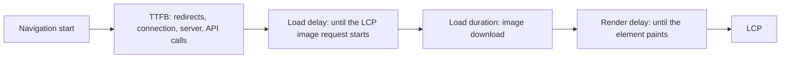
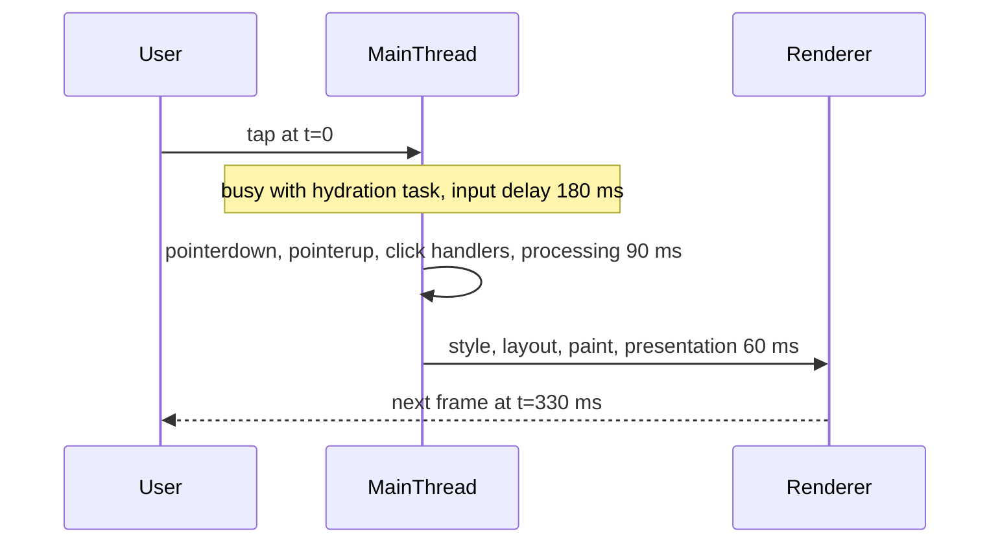

## 78.3 LCP: the four subparts and what moves each

#### Concept

LCP is one number, but it is the sum of four consecutive stages, and each stage has different owners and different fixes. Chrome's own guidance names them the **LCP subparts**:

1. **Time to first byte (TTFB)**: from the start of navigation until the first byte of HTML arrives. Redirects, DNS, TCP, TLS, CDN, server rendering and API calls all live here.
2. **Resource load delay**: from TTFB until the browser *starts* fetching the LCP resource (usually an image). Zero for a text LCP element.
3. **Resource load duration**: how long the LCP resource takes to download.
4. **Element render delay**: from the end of the download until the element is actually painted. Render-blocking CSS, fonts, scripts that hide the page, and main-thread work all live here.

Optimising LCP without knowing which subpart dominates is guessing.

#### Why does it exist?

"LCP is 4.2 s" tells you nothing about what to do. Teams used to respond with a generic list: compress images, add a CDN, minify JavaScript. Sometimes that worked. Often the real problem was that the hero image was not in the HTML at all and only started downloading after 1.5 s of JavaScript, and shrinking it from 200 KB to 100 KB saved 150 ms of a 2,000 ms delay. The subpart breakdown exists so that each fix is aimed at the stage that is actually slow.

#### Mental model

Imagine ordering a pizza for delivery. TTFB is how long the shop takes to answer the phone and confirm the order. Load delay is how long until the driver actually leaves; perhaps the order sat on the counter because nobody saw the ticket. Load duration is the drive. Render delay is the time between the driver arriving and you eating: finding your keys, the dog in the way, a neighbour who insists on chatting. Buying a faster scooter only helps the drive.

#### How it works



The healthy shape, from Chrome's published guidance, is roughly 40% TTFB, under 10% load delay, about 40% load duration and under 10% render delay. A 2.5 s LCP budget therefore looks like about 1,000 ms TTFB, 250 ms delay, 1,000 ms download, 250 ms render. The two "delay" subparts should be close to zero; when they are large, the page is doing something wrong rather than doing something hard.

What moves each subpart:

| Subpart | Common causes when large | Fixes |
|---|---|---|
| TTFB | Redirect chains, CDN miss on dynamic HTML, sequential server-side API calls, cold serverless starts, no connection reuse to the origin | Cache HTML at the CDN (ISR, static), parallelise or aggregate calls (78.10), stream the shell first (75.2), remove redirects, keep connections warm |
| Load delay | LCP image injected by client JavaScript, set as a CSS background, lazy-loaded, on a new origin without `preconnect`, low default image priority | Put the `` in server HTML, `fetchpriority="high"`, never `loading="lazy"` on it, serve from the same origin or preconnect (71.3) |
| Load duration | Oversized image, wrong format, no responsive variants, bandwidth shared with large scripts | AVIF or WebP, `srcset` and `sizes`, image CDN, fewer competing high-priority downloads (78.8) |
| Render delay | Render-blocking CSS or sync scripts, web fonts blocking text, anti-flicker A/B snippets that hide the page, LCP element hidden until hydration, long main-thread tasks | Inline or split critical CSS, `font-display` and fallback metrics, remove hiding snippets, render the element in HTML, break up long tasks (78.6, 78.7) |

Two rules decide most cases:

- **The LCP resource must be discoverable from the HTML.** The preload scanner (71.1) reads raw HTML bytes. If the image URL is only known after JavaScript runs, load delay includes the whole script download, parse, execution and often a data fetch.
- **The LCP element must not depend on JavaScript to become visible.** If a carousel renders its first slide only after hydration, render delay includes hydration, even when the image downloaded early.

#### Practical example

RUM attribution for a product page, mobile, p75 of each subpart over a week:

```text
Subpart              p75        Share   Verdict
TTFB                 1,320 ms   33%     high for a CDN-cacheable page
Resource load delay  1,410 ms   35%     should be under 10%: image found late
Resource load dur.     820 ms   20%     image is 290 KB JPEG at 1600 px
Element render delay   480 ms   12%     web font blocks the caption overlay
LCP (p75, measured)  3,980 ms
```

(The p75 of each subpart does not add up exactly to the p75 of LCP, because different page loads are at the 75th percentile for different subparts. The proportions are still the right guide.)

The biggest subpart is load delay, and the `lcpTarget` attribution says `div.gallery > div.swiper-slide-active > img`. The gallery is a client component; the image URL arrives in a JSON response after hydration. Image compression alone would cut at most a few hundred milliseconds. Making the first image part of the server HTML removes over a second.

#### React / Next.js example

Render the first gallery image as a server component with `next/image`, and let the interactive carousel take over after hydration:

```tsx
// apps/web/app/p/[slug]/ProductHero.tsx  (server component, Next.js 14)
import Image from 'next/image';
import { GalleryCarousel } from './GalleryCarousel';            // 'use client' component
import type { ProductView } from '@shop/contracts';

export function ProductHero({ product }: { product: ProductView }) {
  const [first, ...rest] = product.images;                       // ordered by the API
  return (
    <div className="hero" style={{ aspectRatio: `${first.width} / ${first.height}` }}>
      {/* In the server HTML: the preload scanner sees it, no JavaScript needed to show it. */}
      <Image
        src={first.url}
        alt={first.alt}
        width={first.width}
        height={first.height}
        priority                     // adds a preload link and fetchpriority="high", disables lazy loading
        sizes="(max-width: 768px) 100vw, 50vw"                   // phones download a ~750 px variant
      />
      {/* Hydrates later; it reuses the first slide and adds the rest. */}
      <GalleryCarousel images={rest} />
    </div>
  );
}
```

In Next.js 16 the `priority` prop is deprecated in favour of `preload` (plus `fetchPriority="high"` and `loading="eager"` when you want them separately); the intent is the same. Check the rendered HTML with View Source, not the Elements panel: the `` has `fetchpriority="high"` and no `loading="lazy"`, and exactly one `<link rel="preload" as="image">` matches its `imagesrcset` and `imagesizes`. A second preload with a different URL means a double download.

#### Backend side (NestJS)

The API decides two of the four subparts more than any frontend code does.

```ts
// apps/api/src/catalog/dto/product-image.dto.ts
import { Expose } from 'class-transformer';

export class ProductImageDto {
  @Expose() url!: string;      // image CDN URL without size params; the frontend loader adds w= and format
  @Expose() width!: number;    // intrinsic pixels, so the page reserves space (CLS) and picks srcset widths
  @Expose() height!: number;
  @Expose() alt!: string;      // required for accessibility (75.9); never empty for the hero
  @Expose() position!: number; // 0 is the hero: the frontend must not guess which image is the LCP
}
```

- **TTFB**: the product endpoint must be fast *and cacheable*. If the page is ISR or statically rendered, the API's latency moves out of the user's path entirely; if the page is dynamic, every millisecond of the slowest sequential call is in every user's LCP (78.10).
- **Discoverability**: return the hero image in the main product response, first, with dimensions. A separate `GET /v1/products/:id/media` that the client fetches after hydration guarantees a large load delay.
- **Image bytes**: store originals, serve variants from an image CDN or the Next.js image optimiser, and reject 6,000-pixel uploads at ingestion or resize them then. A merchandising tool that lets 4 MB images through is an LCP bug in the backend.

#### Production scenario

An electronics retailer moved its product page from a client-rendered React app to the Next.js App Router, and p75 LCP improved only from 4.1 s to 3.4 s. Attribution showed load delay at 1.1 s: the old `<ProductGallery>` client component read the selected colour from the URL hash, which the server never sees, so it rendered no image. Moving the colour to a `?colour=` search parameter let the server render the right hero. Load delay fell to 90 ms and p75 LCP to 2.2 s.

#### Failure scenario

At 11:00 after a routine design-system upgrade, a listing page's p75 LCP alert fired: 2.1 s to 3.7 s for builds after `web@4.18.0`. Nothing in the listing code had changed. The new version of the shared `<ProductCard>` component set `loading="lazy"` on every image by default, "for performance". The first two cards in the viewport were the LCP candidates; lazy images are not fetched until layout confirms they are near the viewport, so their requests started after layout, at low priority, behind 300 KB of JavaScript. The fix was a `priority` prop on the first row of cards and a lint rule rejecting lazy loading on the first N items of any list rendered by a server component. Default-lazy is right below the fold and wrong above it.

#### Edge cases & failure modes

- **The LCP element differs by viewport.** On desktop it might be the hero image; on a narrow phone, a long product title paragraph. Check attribution per device class.
- **Text LCP waits for fonts.** If the font blocks text rendering (`font-display: block` or a slow font with no fallback), render delay grows (78.8).
- **Background images** in CSS are invisible to the preload scanner until the CSS is parsed and the element is styled.
- **Cookie consent banners** can become the LCP element when they are the largest text block. That is "fine" for the metric and bad for the product; check what the element actually is.
- **Video heroes**: the poster image is the candidate; make it small and preloaded, and do not autoplay a multi-megabyte video on mobile data.
- **Redirects** (`http` to `https`, `example.com` to `www`, `/p/123` to `/p/123-slug`) each add a round trip to TTFB, often 100 to 300 ms on mobile.
- **A/B testing on the client**: swapping the hero after load creates a new, later LCP candidate.

#### How a Senior Full-Stack Engineer thinks about this

A senior asks one question first: "Which subpart is biggest, on mobile, at p75, for this route?" Then they ask who owns it. TTFB belongs to the server, CDN and API teams together. Load delay is almost always a rendering architecture issue: the element is not in the HTML. Load duration is image pipeline work. Render delay is CSS, fonts, third parties and main-thread work. They refuse to approve "optimise images" as the first task when attribution says the image request starts 1.4 s after the HTML.

They also budget LCP the way they budget an API: a number per route, broken into the four subparts, with the API's share written down. "The product page gets 600 ms of TTFB on a CDN miss, of which the NestJS product call may use 150 ms" is a requirement a backend team can design to.

#### Common mistakes

- **Optimising image bytes when the problem is discovery.**
- **Rendering the hero through a client-only carousel or a CSS background.**
- **Lazy-loading the LCP image**, often through a component default.
- **More than one `fetchpriority="high"`** or preloads for images that are not the LCP element, which compete for bandwidth.
- **Ignoring TTFB on "fast" APIs** whose calls are sequential or uncached in the server render.

#### Interview questions

1. **What are the four LCP subparts?** Expected answer: TTFB, resource load delay, resource load duration, element render delay. Why it matters: each needs a different fix. Follow-up: what are healthy proportions? (Roughly 40/10/40/10, with both delays near zero.)
2. **Your LCP image downloads quickly but LCP is late. Where do you look?** Expected answer: render delay: render-blocking CSS, fonts, scripts hiding the page, the element waiting for hydration, long tasks.
3. **Why does a client-rendered carousel hurt LCP even if its images are small?** Expected answer: the image URL is unknown to the preload scanner; the request waits for JavaScript and often a data fetch; the slide may only become visible after hydration.
4. **What can the backend change to improve LCP without touching frontend code?** Expected answer: make HTML cacheable or faster to render (parallel calls, aggregated endpoints), remove redirects, return the hero image first with dimensions, serve resized images.
5. **Is `priority` on `next/image` always good?** Expected answer: only for the LCP image; it preloads and raises priority, so on other images it steals bandwidth. Follow-up: what changed in Next.js 16? (`priority` deprecated in favour of `preload`.)

#### Practical exercise

Break down LCP for your highest-traffic route.

Acceptance criteria:

- RUM with `web-vitals/attribution` reports the four subparts and the LCP target selector for at least one week, segmented by mobile and desktop.
- You identify the largest subpart at p75 on mobile and name the cause with evidence (a waterfall or a Performance trace).
- One fix aimed at that subpart is shipped, and the subpart's p75 moves by at least 30%.
- The rendered HTML (View Source) contains the LCP `` with `fetchpriority="high"`, explicit dimensions and no `loading="lazy"`.

## 78.4 INP: input delay, processing and presentation

#### Concept

**Interaction to Next Paint** measures how long the page takes to visibly respond to the user. For every click, tap or key press it records the time from the input until the browser paints the next frame after the event handlers have run, and it reports (approximately) the worst of these over the whole visit.

Each interaction has three phases:

1. **Input delay**: from the input until event handlers start. Large when the main thread is busy with something else, such as hydration, a timer, or a third-party script.
2. **Processing duration**: the time the event handlers themselves run (all `pointerdown`, `pointerup`, `click` or `keydown`, `keyup` handlers for that interaction).
3. **Presentation delay**: from the end of the handlers until the frame is painted: React rendering work scheduled by the handler that runs before paint, style recalculation, layout, paint and compositing.

#### Why does it exist?

Users judge responsiveness by feedback. If they tap "Add to cart" and nothing changes for 400 ms, they tap again, or assume the site is broken. FID only measured the input delay of the first interaction, and most sites passed it easily while still feeling sluggish on every filter, tab and dropdown. INP measures what users actually notice: the time until they see that something happened, for all interactions, not just the first.

For backend engineers this is the least intuitive Core Web Vital: a click that shows a spinner at once has a good INP even if the API takes two seconds, while synchronously filtering 5,000 items has a bad INP with no network involved. The API's influence is indirect, through how much data the client must process.

#### Mental model

Imagine pressing a lift button. INP is not how long the lift takes to arrive; it is how long until the button lights up. A button that lights instantly feels fine even if the lift takes 40 seconds; one that stays dark for two seconds feels broken. Input delay is the controller busy with another floor; processing is its own decision; presentation is the bulb warming up.

#### How it works



1. The browser records each event through the **Event Timing API**. Events belonging to one user action share an `interactionId`.
2. Durations are measured to the next paint and rounded to 8 ms. The interaction's latency is the longest duration among its events.
3. The page keeps the slowest interactions. At the end of the visit (or when the page is hidden), INP is the slowest, ignoring the single highest for every 50 interactions. On a typical page with fewer than 50 interactions, it is simply the slowest one.
4. To find *what* made an interaction slow, use the **Long Animation Frames API** (LoAF, Chrome 123+). A long animation frame is any frame that took more than 50 ms from the start of its work to paint, and its entry lists the **scripts** that ran in it: `sourceURL`, `sourceFunctionName`, `invoker` (for example `BUTTON#add-to-cart.onclick` or a `setTimeout` callback), their duration and how much of it was forced style and layout. `web-vitals/attribution` attaches the LoAF entries that overlapped the INP interaction.

What moves each phase:

| Phase | Typical causes | Fixes |
|---|---|---|
| Input delay | Hydration of a large tree, long tasks from third-party scripts, timers and polling doing heavy work, interaction during load | Less JavaScript (78.7), split hydration with Suspense and lazy client components, defer third parties, break up long tasks (71.7) |
| Processing | Synchronous filtering or sorting of big arrays, JSON parsing in handlers, synchronous `localStorage` writes, analytics calls in the click handler, large state updates that re-render a whole page | Do the minimum before paint, `useTransition` for non-urgent updates, move analytics and storage to after paint, smaller payloads from the API, Web Workers for heavy compute |
| Presentation | Huge DOM (10,000+ nodes), layout thrashing, expensive CSS (large blurs, many shadows), rendering long lists without virtualisation | Virtualise lists (73.6), `content-visibility: auto` for offscreen sections, avoid reading layout after writing styles, smaller DOM |

The core technique for processing time is **"paint first, work later"**: in the handler, make the smallest state change that shows feedback, let the browser paint, and then do the rest in a later task.

#### Practical example

An order history page lists 300 orders loaded in one response. Typing in the search box filters by product name on every keystroke. RUM shows p75 INP of 340 ms on mobile, attributed to `input#order-search` with `type: 'keyboard'`, processing duration 220 ms. The LoAF script attribution names `OrdersTable` render work inside the `onChange` handler: every keystroke re-filters 300 orders with nested items and re-renders all 300 rows synchronously.

Three changes, each with a measured effect: the input's own state stays urgent while the filtered list moves into a transition (INP 340 to 150 ms); the list is virtualised so only 20 rows render (150 to 90 ms); and the API gains `?q=` search with cursor pagination, so the client never holds more than 50 orders (memory and parse time drop as well).

#### React / Next.js example

```tsx
// apps/web/app/orders/OrderSearch.tsx
'use client';
import { useState, useTransition, useDeferredValue } from 'react';
import { OrdersTable } from './OrdersTable';
import type { OrderSummary } from '@shop/contracts';

function yieldToMain(): Promise<void> {
  const s = (globalThis as { scheduler?: { yield?: () => Promise<void> } }).scheduler;
  return s?.yield ? s.yield() : new Promise((r) => setTimeout(r, 0)); // scheduler.yield: Chrome 129+
}

export function OrderSearch({ orders, onSearchTracked }: {
  orders: OrderSummary[]; onSearchTracked: (q: string) => void;
}) {
  const [query, setQuery] = useState('');             // urgent: the input must echo the key at once
  const deferredQuery = useDeferredValue(query);      // the table renders with this, in the background
  const [isPending, startTransition] = useTransition();

  async function onChange(e: React.ChangeEvent<HTMLInputElement>) {
    const q = e.target.value;
    setQuery(q);                                       // smallest update that gives feedback
    await yieldToMain();                               // let the browser paint the keystroke first
    startTransition(() => onSearchTracked(q));         // analytics and non-urgent state after paint
  }

  return (
    <>
      <input id="order-search" value={query} onChange={onChange} aria-busy={isPending} />
      <OrdersTable orders={orders} query={deferredQuery} />  {/* memoised; virtualised rows */}
    </>
  );
}
```

`useDeferredValue` lets React render the input with the new value first and the expensive table with the deferred value in an interruptible background render, so a second keystroke abandons the stale table render instead of queueing behind it. `useTransition` does the same for updates you trigger yourself. Neither makes a single slow component faster; the table still needs memoisation and virtualisation (73.6, 73.8).

To see which scripts are behind slow frames in the field, a small LoAF observer is enough:

```ts
// apps/web/src/perf/loaf.ts  (Chromium 123+; feature-detect elsewhere)
// TypeScript's DOM lib may not ship LoAF types yet, so declare the fields we read.
type LoafScript = { invoker: string; sourceURL: string; sourceFunctionName: string;
  duration: number; forcedStyleAndLayoutDuration: number };
type LoafEntry = PerformanceEntry & { scripts: LoafScript[] };

export function observeLongFrames(report: (s: object) => void) {
  if (!PerformanceObserver.supportedEntryTypes?.includes('long-animation-frame')) return;
  new PerformanceObserver((list) => {
    for (const f of list.getEntries() as LoafEntry[]) {
      if (f.duration < 150) continue;                       // keep only the worst frames
      for (const s of f.scripts) {
        report({ invoker: s.invoker, source: s.sourceURL, fn: s.sourceFunctionName,
          ms: Math.round(s.duration), layoutMs: Math.round(s.forcedStyleAndLayoutDuration) });
      }
    }
  }).observe({ type: 'long-animation-frame', buffered: true });
}
```

Aggregate by `source` in your RUM backend and you get a ranked list of the scripts, including third-party ones, that cause slow frames for real users.

#### Backend side (NestJS)

The API shapes INP through the data the client must handle during interactions:

- **Filter, sort and search on the server** for anything larger than a few hundred items. Return a page (Part 15.5, 72.7), not the whole collection for client-side filtering.
- **Return view-shaped data.** If the UI shows `totalFormatted` and `statusLabel`, consider returning the raw values plus what the client needs to render quickly; avoid nested structures the client must normalise on every update.
- **Keep payloads small.** A 900 KB JSON response costs roughly 10 to 20 ms per 100 KB to parse on a mid-range phone, plus the rendering of everything in it. Trimming unused fields (78.10) is an INP fix.
- **Make mutations acknowledge fast** and support optimistic UI with idempotency keys (74.6), so a tap can show its result immediately while the request completes.

```ts
// apps/api/src/orders/orders.controller.ts  (excerpt)
@Get()
async list(@Query(new ZodValidationPipe(OrderListQuerySchema)) q: OrderListQuery, @CurrentUser() user: AuthUser) {
  // q: { q?: string; status?: OrderStatus; cursor?: string; limit: 1..50, default 20 }
  return this.orders.search(user.id, q);  // pg_trgm index on product names; returns { items, nextCursor }
}
```

#### Production scenario

A grocery delivery site's checkout had p75 INP of 470 ms on the "Choose delivery slot" step. Attribution showed input delay as the largest phase, with `loadState: 'complete'`, so the page had finished loading. LoAF entries named a chat widget's `setInterval` callback that polled every 2 s and took 120 to 180 ms each time on mid-range phones, plus a slot grid that re-rendered 168 slots on every tap. Loading the chat widget only after a user opened "Help", and memoising slot cells, brought p75 INP to 160 ms. The share of users who completed the slot step rose from 88% to 91%.

#### Failure scenario

On a Monday morning, after a release that added a "recently viewed" feature, the support team reported that "Add to cart" sometimes added two items. The RUM dashboard showed INP on product pages up from 190 ms to 520 ms for the new build. The feature's click handler on "Add to cart" synchronously serialised the entire recently-viewed list (with product JSON) into `localStorage`, about 400 KB, before the optimistic cart update ran. On slow phones the button gave no feedback for half a second, users tapped again, and the second tap was a new request without an idempotency key. The fix was twofold: update the cart badge first and move the storage write into an idle callback, and send an `Idempotency-Key` per add-to-cart intent (Parts 14 and 728.6) so double taps were harmless regardless of speed.

#### Edge cases & failure modes

- **Interactions during load** are often the worst, because hydration blocks the main thread. Check `loadState` in attribution before optimising handlers.
- **Hover and scroll do not count**, but a scroll handler that does heavy work still delays the next tap's input.
- **Keyboard interactions** on text inputs fire for every key; a slow `onChange` is multiplied by typing speed.
- **Third-party scripts** can attach their own listeners to your buttons (analytics auto-tracking) and add processing time you cannot see in your code.
- **Single-page apps**: INP is reported for the whole visit; the worst interaction may be on a route different from the one where the page loaded. Record the active route with each interaction.
- **`await` does not yield to paint** if the promise is already resolved (71.7); use `scheduler.yield()` or a macrotask.

#### How a Senior Full-Stack Engineer thinks about this

A senior reads INP attribution in phases, like an API trace in spans. Large input delay means "the main thread was busy with something else": find it with LoAF, usually hydration or a third party. Large processing means "our handler does too much before paint": split it. Large presentation means "the DOM or CSS is too heavy": shrink it. They push large data operations to the server, and they insist every mutation shows immediate feedback and is idempotent, because slow feedback creates duplicate requests.

They profile before adding `useMemo` anywhere. To a product manager: "When people tap, the screen should react within a fifth of a second. On cheaper phones ours sometimes takes half a second, mostly because of a chat widget; loading it only when someone asks for help fixes most of it."

#### Common mistakes

- **Assuming slow APIs cause poor INP.** INP ends at the next paint; a spinner shown immediately is a fast interaction.
- **Doing analytics, storage and logging inside click handlers** before the visual update.
- **Loading every third-party widget on page load** and blaming React for input delay.
- **Rendering hundreds of rows on each keystroke** instead of deferring and virtualising.
- **Measuring INP in the lab** with TBT only, missing slow interactions that happen after load.

#### Interview questions

1. **What are the three phases of an INP interaction?** Expected answer: input delay, processing duration, presentation delay. Follow-up: which is usually large during page load? (Input delay, from hydration and scripts.)
2. **How does INP choose its value for a visit?** Expected answer: the slowest interaction, ignoring one highest per 50 interactions; reported when the page is hidden.
3. **How would you find which script causes slow interactions for real users?** Expected answer: Long Animation Frames API script attribution (`invoker`, `sourceURL`), collected through RUM, or the LoAF entries in `web-vitals/attribution`.
4. **What does `useTransition` change about INP?** Expected answer: it marks the update as non-urgent and interruptible, so the urgent update can paint first; it does not make the expensive render cheaper.
5. **How can the backend improve INP?** Expected answer: server-side filtering and pagination, smaller payloads, view-shaped data, fast acknowledgements and idempotent mutations for optimistic UI.
6. **Why does "paint first, work later" need a real yield?** Expected answer: microtasks run before rendering; only a new task (or `scheduler.yield()`) lets the browser paint.

#### Practical exercise

Fix the worst interaction on one page.

Acceptance criteria:

- RUM reports INP with interaction target, type, the three phases, load state and LoAF script attribution for that page.
- You name the worst interaction at p75 on mobile and its largest phase, with a DevTools Performance recording that reproduces it under 4x CPU throttling.
- After your change, that interaction's p75 INP is under 200 ms in RUM for the new build.
- Any mutation triggered by the interaction shows feedback within one frame and sends an idempotency key.
