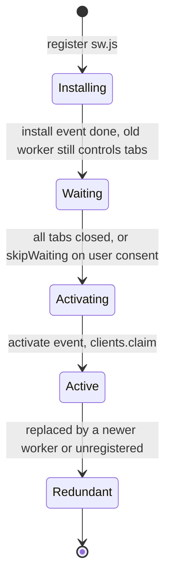
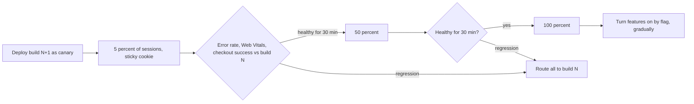

## 78.4 What happens to users on the old version during a deploy

#### Concept

**Version skew** is the period when a client runs code from one release and talks to servers, files or APIs from another. Part 73.11 named it for Next.js and Part 74.9 covered the API side (version headers, reload nudges, minimum versions). This section is the operations view: the four places old frontend code keeps living, the specific errors each produces after a deploy, and the handling that turns each error into a quiet reload instead of a broken page.

The four places:

1. **Open tabs.** The JavaScript loaded at 09:00 is still running at 17:00. Lazy routes (70.5) are fetched only when the user clicks.
2. **Cached HTML.** A CDN or browser copy of the old HTML references the old build's chunk names.
3. **The back/forward cache.** Pressing Back restores a frozen snapshot of an old page, JavaScript and all (76.9).
4. **Service workers.** A registered worker can keep serving an old app shell until a new worker installs and activates.

#### Why does it exist?

Because the browser, not the server, decides when code is replaced. The server can only offer new code; the tab picks it up on its next full page load, which may be hours away. The errors this causes are intermittent, affect only some users, cluster right after deploys, and look like random JavaScript errors in the error tracker unless you know their signatures.

#### Mental model

Imagine a restaurant that changes its menu at noon. Diners seated at 11:50 still have the old menu in their hands. If the kitchen throws away every ingredient for old dishes at noon, those diners' orders fail. A good kitchen keeps cooking old dishes for a while, and a good waiter, seeing an old menu, offers the new one politely instead of letting the order fail.

#### How it works

The errors and their signatures:

| What the old client does | What fails | Signature |
|---|---|---|
| Lazy-loads a route chunk deleted by the deploy | Dynamic import | Vite: `TypeError: Failed to fetch dynamically imported module`; webpack/Next.js: `ChunkLoadError: Loading chunk 482 failed` |
| Lazy-loads a chunk and gets HTML (bad SPA fallback, 78.1) | Script parse | `SyntaxError: Unexpected token '<'` |
| Navigates client-side in the App Router after the server changed | RSC payload from a different build | Hard navigation fallback, or errors about missing client references |
| Posts to a Server Action removed or renamed by the new build | Action lookup | `Failed to find Server Action "...". This request might be from an older or newer deployment.` (73.11) |
| Calls the API with an old request shape | Contract skew | `400 VALIDATION_FAILED`, `CLIENT_OUTDATED` (74.9) |
| A service worker serves the old shell | Everything above, for days | A user reports "still the old design" after a reload |

The handling, layer by layer:

1. **Keep old assets** (78.3). This alone removes most chunk errors.
2. **Catch chunk errors and reload once.** Vite (11.4+) dispatches a `vite:preloadError` event on `window` when a dynamic import's preload fails; webpack-based apps catch `ChunkLoadError` in an error boundary (71.11). Either way: save any form draft (72.10), reload the page so the browser fetches the new HTML, and guard with `sessionStorage` so a genuinely broken deploy cannot cause a reload loop.
3. **Route old clients to old servers** where the platform supports it. Next.js's `deploymentId` option tags asset requests with `?dpl=<id>` and RSC and action requests with an `x-deployment-id` header; Vercel's Skew Protection uses this to route an old client to the old deployment for a configurable window. Self-hosted, the cheap version is: keep old assets, and treat a Server Action skew error as "reload".
4. **Nudge long-lived tabs** to reload at a safe moment (74.9's `X-App-Version` check): switch client-side navigations to full page loads once a newer version is known.
5. **Update service workers deliberately**: detect a waiting worker, ask the user, activate on consent, reload on `controllerchange`. Keep a kill switch.



A new worker waits until no tab is controlled by the old one. That is a safety feature: activating immediately (`skipWaiting()` on install) can leave a running page with old JavaScript fetching through a new worker's caches, which is version skew inside one tab.

#### Practical example

The storefront deploys at 14:00. At 14:10, 18 % of active sessions are still on the 11:00 build (from version telemetry). Over the next hour those users generate: 0 chunk errors (assets retained), 37 Server Action skew errors (a renamed action for "save address"), each turned into a reload with the address draft restored from `sessionStorage`, and 2 `CLIENT_OUTDATED` responses from an API endpoint whose old shape was removed too early. By 16:00, under 2 % of sessions are on the old build.

#### React / Next.js example

The admin SPA's chunk-error handler (Vite 5):

```ts
// apps/admin/src/boot/chunk-reload.ts
const KEY = 'chunk-reload-at';

export function installChunkReload(saveDrafts: () => void): void {
  window.addEventListener('vite:preloadError', (event) => {
    const last = Number(sessionStorage.getItem(KEY) ?? 0);
    if (Date.now() - last < 30_000) return;      // reloaded in the last 30 s: let the error surface, avoid a loop
    event.preventDefault();                       // stop Vite from throwing the error to the app
    sessionStorage.setItem(KEY, String(Date.now()));
    saveDrafts();                                 // form drafts to sessionStorage (78.10)
    window.location.reload();                     // fetch the new index.html and its new chunks
  });
}
```

The storefront's equivalent lives in the App Router's error boundary for a segment, plus the API client's handling of the action skew error:

```tsx
// apps/web/app/(shop)/error.tsx  (Next.js 14 App Router segment error boundary)
'use client';
import { useEffect } from 'react';
import { reportError } from '@/observability/report';

const isSkew = (e: Error) =>
  e.name === 'ChunkLoadError' || /Failed to find Server Action|Loading chunk \d+ failed/.test(e.message);

export default function ShopError({ error, reset }: { error: Error & { digest?: string }; reset: () => void }) {
  useEffect(() => {
    if (isSkew(error) && !sessionStorage.getItem('skew-reloaded')) {
      sessionStorage.setItem('skew-reloaded', '1');      // cleared on the next successful page load
      window.location.reload();                         // new HTML, new build: the user barely notices
      return;
    }
    reportError(error, { tags: { boundary: 'shop', digest: error.digest } });   // 84.6
  }, [error]);
  return (
    <div role="alert">
      <p>Something went wrong on this page.</p>
      <button type="button" onClick={reset}>Try again</button>
    </div>
  );
}
```

The service worker update flow, for the delivery-partner app that does use one (76.9):

```ts
// apps/partner/src/sw/register.ts
export async function registerServiceWorker(onUpdateReady: (activate: () => void) => void) {
  if (!('serviceWorker' in navigator)) return;
  const reg = await navigator.serviceWorker.register('/sw.js', { updateViaCache: 'none' }); // always fetch sw.js fresh
  const offer = (worker: ServiceWorker) => onUpdateReady(() => worker.postMessage({ type: 'SKIP_WAITING' }));

  if (reg.waiting) offer(reg.waiting);                          // an update was already waiting
  reg.addEventListener('updatefound', () => {
    const next = reg.installing;
    next?.addEventListener('statechange', () => {
      if (next.state === 'installed' && navigator.serviceWorker.controller) offer(next);  // update, not first install
    });
  });
  let reloading = false;
  navigator.serviceWorker.addEventListener('controllerchange', () => {
    if (!reloading) { reloading = true; window.location.reload(); }   // the new worker took over: load new code
  });
  setInterval(() => reg.update(), 60 * 60_000);                 // long-lived tabs check hourly
}
```

```ts
// apps/partner/public/sw.js (excerpt): only activates when the page asks
self.addEventListener('message', (event) => {
  if (event.data?.type === 'SKIP_WAITING') self.skipWaiting();
});
```

The **kill switch** for a broken worker is a new `sw.js` at the same URL that removes itself:

```ts
// apps/partner/public/sw.js (emergency version)
self.addEventListener('install', () => self.skipWaiting());
self.addEventListener('activate', async () => {
  await self.registration.unregister();                        // no worker after this
  const clients = await self.clients.matchAll({ type: 'window' });
  clients.forEach((c) => c.navigate(c.url));                   // reload every tab from the network
});
```

#### Backend side (NestJS)

The API's part in surviving skew (74.9 has the full rollout rules):

- **Accept the previous web build's requests** for at least the measured old-tab window; expand-and-contract every change (Part 25).
- **Return machine-readable skew signals**: `CLIENT_OUTDATED` as a problem document, so the client reloads instead of showing an error.
- **Send `Clear-Site-Data` only as a last resort**: `Clear-Site-Data: "cache", "storage"` on a response (for example the logout or a special `/reset` route) tells the browser to drop caches and storage for the origin, which also removes service worker registrations when `"storage"` is included. It is a blunt tool: it logs users out and deletes drafts.
- **Serve `sw.js` with `Cache-Control: no-cache`** if NestJS or the BFF serves it, so the browser's update check sees new versions promptly.

```ts
// apps/api/src/common/client-outdated.exception.ts
import { HttpException, HttpStatus } from '@nestjs/common';

export class ClientOutdatedException extends HttpException {
  constructor(minVersion: string) {
    super({ code: 'CLIENT_OUTDATED', status: 426, title: 'Please reload to continue', issues: [], minVersion },
          HttpStatus.UPGRADE_REQUIRED);              // 426; the client treats CLIENT_OUTDATED as "reload now"
  }
}
```

#### Production scenario

Version telemetry for the storefront over a month: after a deploy, 25 % of sessions are on the previous build at +5 minutes, 9 % at +1 hour, 1.5 % at +24 hours, and a tail of 0.1 % at +7 days (kiosk tablets in partner clinics that are never reloaded). Assets are retained for 30 days, which covers everyone except devices nobody restarts; those get the `CLIENT_OUTDATED` reload when an API change finally requires it.

#### Failure scenario

The delivery-partner app's first service worker called `self.skipWaiting()` in `install` and `clients.claim()` in `activate`, so each new worker took over open tabs immediately. One release changed the shape of the cached offline route data. Riders with the app open during the deploy kept running the old JavaScript, now served route data by the new worker's caches in the new shape; the map screen crashed for 640 riders in the evening peak. Riders had to force-close the browser to recover. The team moved to the consent-based flow above, versioned cache names per release (`routes-v42`), and deleted old caches only in `activate`.

#### Edge cases & failure modes

- **Reload loops** when the new build itself is broken; always guard reloads with a time-based flag.
- **Lost input** on automatic reload; save drafts first.
- **Chunk errors from ad blockers or flaky networks**, not deploys; a single reload attempt handles both, but measure them separately by checking whether a newer version exists.
- **`skipWaiting()` on install**, mixing versions in one page.
- **`sw.js` cached by the CDN** with a long `max-age`; browsers cap the HTTP cache for service worker scripts at 24 hours, but use `no-cache` anyway.
- **bfcache restores** an old page after a deploy; listen for `pageshow` with `event.persisted` and run the version check.

#### How a Senior Full-Stack Engineer thinks about this

The senior designs every deploy for the users who will not reload: old files stay, the API stays compatible, skew errors are recognised by signature and turned into a single safe reload, and long-lived tabs are nudged at a safe moment. They measure the old-version tail per release and set retention and compatibility windows from data. They are cautious with service workers, because a worker is a cache you cannot purge from the server, and they always ship a kill switch before they ship the worker.

#### Common mistakes

- **Treating chunk errors as random bugs** instead of deploy symptoms.
- **Automatic reloads without a loop guard or draft saving.**
- **Immediate `skipWaiting()`** in service workers.
- **No kill switch** for a service worker.

#### Interview questions

1. **Why does a frontend deploy cause errors for users who did nothing wrong?** Expected answer: old code in open tabs, cached HTML and service workers references deleted chunks, removed Server Actions or old API shapes.
2. **How do you handle `ChunkLoadError` or `vite:preloadError`?** Expected answer: keep old assets; on the error, save drafts and reload once with a loop guard; report it tagged as skew.
3. **How do you update a service worker safely?** Expected answer: let the new worker wait, offer a reload, `skipWaiting` on consent, reload on `controllerchange`; versioned caches; a kill-switch worker.
4. **What does Next.js's `deploymentId` do?** Expected answer: tags asset, RSC and action requests with the deployment so a platform can route old clients to the old deployment or detect skew.

#### Practical exercise

Make the storefront and admin survive three deploys in a row with an open tab.

Acceptance criteria:

- A tab opened on build N can navigate to every lazy route after builds N+1, N+2 and N+3 are deployed.
- A removed Server Action triggers one reload with the form draft restored, and no reload loop when the new build is broken.
- Chunk-skew errors are reported with a `skew` tag and excluded from the error-rate alert.
- The partner app's worker updates only after consent, and the kill-switch worker removes it from every tab within one navigation.

## 78.5 Rollouts for frontends: canaries, feature flags, kill switches and rollback

#### Concept

A **rollout** is how a new version reaches users: all at once, or gradually with checks along the way. For frontends there are four tools, each with a different blast radius and speed:

- **Canary release**: a small share of users (1-10 %) get the new build while the rest stay on the old one; metrics decide whether to continue.
- **Feature flag**: the new behaviour ships dark inside the build and is switched on per user, segment or percentage, without a deploy (Part 47.8).
- **Kill switch**: a flag whose only job is to turn a feature or a third-party integration off instantly when it misbehaves.
- **Rollback**: return everyone to the previous build.

#### Why does it exist?

Because some frontend failures only appear with real users: a Safari version the test matrix lacks, a low-end Android phone, a payment provider's widget, a CSS change that breaks a locale with long words. A canary limits who sees a bad build; a flag limits who sees a bad feature; a kill switch limits how long they see it; rollback is the last resort. And frontend rollback has a twist backend rollback does not: users who loaded the bad build keep running it after you roll back (78.4).

#### Mental model

Imagine opening a new kitchen layout in one branch of a restaurant chain before all of them (canary), adding a new dish to the menu but only offering it to regulars who ask (flag), keeping a big red button that pulls a dish off every menu at once (kill switch), and, if the new layout is a disaster, moving the cooks back to the old kitchen (rollback), knowing that the diners already served from the new kitchen still have their plates.

#### How it works



**Canaries by hosting model:**

1. **Next.js servers on ECS**: run the new task set beside the old one and use **ALB weighted target groups** (for example 95/5). Enable target group stickiness so a session does not flip between versions on every request, which would create skew on every navigation. ECS blue/green deployments through CodeDeploy automate the shift and rollback on CloudWatch alarms.
2. **Static SPAs on CloudFront**: **CloudFront continuous deployment** attaches a staging distribution to the production one and sends a percentage of traffic (up to 15 %) or requests with a specific header to it, with optional session stickiness. Alternatively a CloudFront Function assigns a sticky `canary` cookie and rewrites `/index.html` to `/index-canary.html`; because assets are content-hashed and retained, both versions' files coexist in one bucket.
3. **Managed platforms**: rolling releases or traffic splitting between deployments are built-in features on some platforms.

**Flags for frontends** need two properties backend flags do not:

- **Evaluate on the server when the flag changes what renders first.** A client-side flag evaluated after hydration produces a flicker (old UI, then new) and layout shift (76.5). In Next.js, evaluate in the server component or middleware and pass the result down; bootstrap the client SDK with the server's values.
- **Same answer in web and API** (74.9): one flag service, one bucketing key (the user ID), and an API that accepts both the old and the new request shape while the flag is partial.

**Kill switches** default to "feature on" only when the flag service answers; if the flag service is down, the SDK uses the last known value or a safe default. Third-party widgets (chat, reviews, a new payment method) each get one.

**Rollback** by hosting model, assuming assets are retained:

| Hosting | Rollback action | Time |
|---|---|---|
| SPA on S3 | Copy the previous build's `index.html` (kept in an archive prefix) over the live one; invalidate it | 10-30 s |
| Next.js on ECS | Update the service to the previous task definition (same image digest as before) | 2-5 min (task start, health checks, drain) |
| ECS blue/green with CodeDeploy | Reroute the listener back to the blue target group | Under 1 min |
| Managed platform | Point the production alias at the previous deployment | Seconds |

Rollback does not reach tabs already running the bad build. For those, the options are the `X-App-Version` nudge (74.9), a kill switch for the broken feature, or, for a severe bug, a minimum version enforced by the API with `CLIENT_OUTDATED`.

Choosing the tool:

| Situation | Use |
|---|---|
| Risky new feature (new checkout) | Flag, ramped by percentage with metrics per variant |
| Framework or dependency upgrade (React, Next.js major) | Canary of the whole build |
| Third-party script or widget | Kill switch |
| Bad deploy found after full rollout | Rollback, plus nudge or kill switch for open tabs |
| Bug in a flagged feature | Turn the flag off; no deploy |

#### Practical example

The storefront upgrades from Next.js 14 to 15. The build goes out as a canary at 5 % on ECS with ALB weights and stickiness. After 30 minutes the canary's p75 INP is 12 % worse on Android (a hydration change in a product carousel); the error rate and checkout success are unchanged. The team holds at 5 %, fixes the carousel, ships a new canary, and completes the rollout the next day. Separately, the new "Reorder" button (77.12) ships behind a flag, off; it is turned on for staff, then 10 %, 50 % and 100 % of customers over a week while the API watches the reorder endpoint's error rate and latency.

#### React / Next.js example

Server-side flag evaluation in a server component, with the result passed to the client so there is no flicker:

```tsx
// apps/web/app/(shop)/orders/[id]/page.tsx
import { getFlags } from '@/flags/server';                 // wraps the flag provider's server SDK, cached per request
import { getSession } from '@/auth/session';
import { OrderView } from './OrderView';
import { getOrderForPage } from '@/server/orders';

export default async function OrderPage({ params }: { params: { id: string } }) {
  const session = await getSession();
  const [order, flags] = await Promise.all([
    getOrderForPage(params.id),
    getFlags({ userId: session.userId, keys: ['reorder-button', 'kill-reviews-widget'] }),
  ]);
  return <OrderView order={order} showReorder={flags['reorder-button']} reviewsEnabled={!flags['kill-reviews-widget']} />;
}
```

```ts
// apps/web/src/flags/server.ts
import 'server-only';
import { cache } from 'react';
import { flagClient } from './client';                       // the provider's server SDK, initialised once per process

type FlagKey = 'reorder-button' | 'kill-reviews-widget' | 'new-checkout';
const SAFE_DEFAULTS: Record<FlagKey, boolean> = { 'reorder-button': false, 'kill-reviews-widget': false, 'new-checkout': false };

export const getFlags = cache(async ({ userId, keys }: { userId: string; keys: FlagKey[] }) => {
  const out = {} as Record<FlagKey, boolean>;
  await Promise.all(keys.map(async (k) => {
    try {
      out[k] = await flagClient.getBooleanValue(k, SAFE_DEFAULTS[k], { targetingKey: userId }); // OpenFeature-style call
    } catch {
      out[k] = SAFE_DEFAULTS[k];                              // flag service down: safe default, never block the page
    }
  }));
  return out;
});
```

The admin SPA's rollback, in the pipeline:

```bash
#!/usr/bin/env bash
# ci/rollback-admin.sh <previous_sha>: assets are retained, so only the HTML pointer moves
set -euo pipefail
PREV="${1:?previous sha}"
aws s3 cp "s3://shop-admin/releases/${PREV}/index.html" s3://shop-admin/admin/index.html --cache-control 'no-cache'
aws cloudfront create-invalidation --distribution-id "$ADMIN_DIST_ID" --paths '/admin/index.html' >/dev/null
echo "admin rolled back to ${PREV}; open tabs on the bad build will be nudged by X-App-Version"
```

#### Backend side (NestJS)

- **Accept both shapes while a flag is partial**: the API's DTO accepts the old and new request (`deliveryWindow` or `deliverySlotId`, 74.9) until the flag is at 100 % and old tabs are gone.
- **Evaluate the same flag** with the same key when the API's behaviour depends on it, through the same provider.
- **Tag metrics with the client version and variant**: error rate and latency per `X-Client-Version` and per flag variant show a bad canary or a bad flag variant without waiting for averages to move.
- **Enforce a minimum version** only for severe cases, with `CLIENT_OUTDATED` (78.4).

```ts
// apps/api/src/common/client-metrics.interceptor.ts
import { CallHandler, ExecutionContext, Injectable, NestInterceptor } from '@nestjs/common';
import { Histogram } from 'prom-client';
import { tap } from 'rxjs/operators';

const httpDuration = new Histogram({
  name: 'http_server_duration_seconds', help: 'API latency by route and client build',
  labelNames: ['route', 'status', 'client', 'client_version'],   // client_version: a handful of live builds, bounded
  buckets: [0.01, 0.025, 0.05, 0.1, 0.25, 0.5, 1, 2.5],
});

@Injectable()
export class ClientMetricsInterceptor implements NestInterceptor {
  intercept(ctx: ExecutionContext, next: CallHandler) {
    const req = ctx.switchToHttp().getRequest();
    const end = httpDuration.startTimer({ route: req.route?.path ?? 'unknown', client: req.header('x-client') ?? 'unknown',
      client_version: (req.header('x-client-version') ?? 'unknown').slice(0, 12) });
    return next.handle().pipe(tap({
      next: () => end({ status: ctx.switchToHttp().getResponse().statusCode }),
      error: (e) => end({ status: e?.status ?? 500 }),
    }));
  }
}
```

Client version labels are bounded only if the number of live builds is: map anything older than the last five builds to `old` before recording, or the label's cardinality grows with every deploy (Part 43.3).

#### Production scenario

The storefront runs about 30 flags at any time: 8 release flags for features being ramped, 6 kill switches for third parties, the rest experiments. Release flags have an owner and an expiry; a weekly job lists flags at 100 % for more than 14 days, and their removal is a normal ticket. Over a year, 11 incidents were mitigated by turning a flag off (median time to mitigate 4 minutes), 3 by canary aborts before reaching 10 % of users, and 2 needed a full rollback.

#### Failure scenario

A new product-review widget from a third party was loaded on every product page without a kill switch. On a Saturday evening the vendor's CDN slowed to 8-second responses. The widget's script was loaded synchronously in the head by a tag manager. LCP on product pages went from 2.1 s to 9 s, and conversion dropped by a third. Removing the script needed a deploy through a frozen weekend pipeline; it took 2 hours and 10 minutes. The postmortem added a kill switch for every third-party script, loaded them with `async` after the main content (76.7), and added a synthetic check on the vendor's script latency.

#### Edge cases & failure modes

- **Canary without stickiness**: a user alternates between versions on each request, causing skew errors on every navigation.
- **Canary metrics compared to the wrong baseline**: compare canary and control in the same time window, not canary today versus last Tuesday.
- **Client-side flag evaluation** causing flicker and layout shift.
- **Flags evaluated differently by web and API**, so the UI sends a request the API rejects.
- **Kill switch that fails closed**: if the flag service is unreachable, the switch should keep the last known state or a safe default, not break the page.
- **Rollback without retained assets**: the previous HTML references files the bad deploy deleted.
- **Rolling back the web but not a dependent API change**, or the reverse.

#### How a Senior Full-Stack Engineer thinks about this

The senior separates deploy from release: the code goes out continuously, the behaviour goes out by flag, gradually, with metrics per variant. They canary builds whose risk is in the platform (framework upgrades, build config) and flag features whose risk is in the product. Every third party gets a kill switch before it gets a contract. And they remember that rollback is not time travel for a frontend: tabs keep the bad code, so the plan for a bad release always includes how those tabs are reached.

#### Common mistakes

- **Big-bang releases** of risky features without a flag.
- **Flags without owners or expiry**, turning into permanent configuration.
- **No stickiness** in canaries.
- **Assuming rollback fixes open tabs.**

#### Interview questions

1. **How do you canary a static SPA on CloudFront?** Expected answer: CloudFront continuous deployment with weighted or header-based routing, or an edge function with a sticky cookie choosing between two `index.html` files, with retained hashed assets.
2. **Why evaluate frontend flags on the server?** Expected answer: no flicker or layout shift, same value as the API, secrets and targeting rules stay server-side.
3. **What does a kill switch need to be useful?** Expected answer: fast propagation, a safe behaviour when the flag service is down, one per risky dependency, tested regularly.
4. **How is frontend rollback different from backend rollback?** Expected answer: open tabs keep running the bad build; you need nudges, kill switches or minimum versions as well as moving the pointer.
5. **Flag or canary for a Next.js major upgrade?** Expected answer: canary; the risk is in the whole build, not one feature.

#### Practical exercise

Add canaries, flags and kill switches to the storefront.

Acceptance criteria:

- A canary at 5 % with sticky sessions on ECS (or CloudFront continuous deployment for the admin), promoted by a script that compares canary and control error rate, p75 INP and checkout success in the same window.
- Flags evaluated server-side and passed as props; no client flicker in a Playwright screenshot test.
- Every third-party script behind a kill switch that keeps working when the flag service is unreachable.
- A rollback runbook for each hosting model, rehearsed, with measured time to restore.
