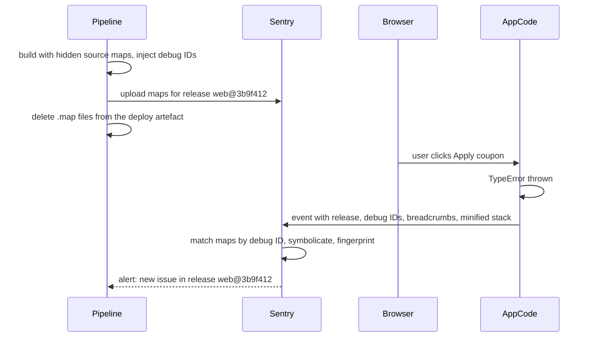
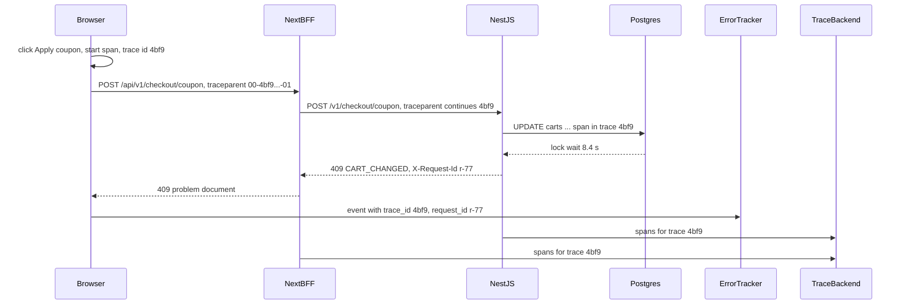

## 78.6 Error tracking with source maps

#### Concept

**Error tracking** collects exceptions from real users' browsers, enriches each with context (release, environment, URL, browser, the user's recent actions), **groups** identical errors into **issues**, and alerts when an issue is new or spikes. **Sentry** is the most widely used tool; Datadog RUM, Bugsnag, Rollbar and Honeybadger work on the same concepts. Part 70.7 explained source maps and showed a home-grown reporter with NestJS-side symbolication. This section covers operating a real error tracker for the storefront: what the SDK captures, how releases and source maps connect, how to keep noise and personal data out, and how to alert on what matters.

The core concepts, in Sentry's vocabulary (the others use similar terms):

- **DSN**: the public URL the SDK sends events to. It identifies a project; it is not a secret (anyone can read it from the bundle), so ingestion is protected by allowed domains, rate limits and quotas, not by hiding it.
- **Event**: one captured error or message, with a stack trace, tags, breadcrumbs and context.
- **Issue**: a group of events with the same **fingerprint** (by default derived from the stack trace).
- **Release**: the version of the code that produced the event (`web@3b9f412`), used to find source maps and to tell "new in this release" from "old problem".
- **Breadcrumbs**: the trail before the error: clicks, navigations, `fetch` calls with status codes, console messages.
- **Debug ID**: an identifier injected into both a minified file and its map, so the tracker matches them without relying on file names and URLs.

#### Why does it exist?

Because browser errors are invisible by default. A NestJS exception is in your logs; a `TypeError` in a customer's Safari tab is not anywhere you can see, unless something sends it to you. Without error tracking, frontend incidents are detected by support tickets, hours late, described as "the page is broken". With it, a new error in the checkout appears within a minute of the first user hitting it, with the release, the browser, the original source line and the API call that preceded it.

#### Mental model

Imagine every customer's device has a small black-box recorder. When something crashes, the recorder sends you the last 30 seconds of what happened, stamped with which version of the software was running. A clerk sorts thousands of reports into piles by cause, and rings you only when a new pile appears or an old pile suddenly grows.

#### How it works



1. **Initialise early** with `dsn`, `release`, `environment` and sampling. The SDK installs global handlers (`window.onerror`, `unhandledrejection`) and wraps timers and event listeners to capture errors with better stacks.
2. **React boundaries report explicitly**: an error caught by an error boundary is "handled" and does not reach the global handler, so boundaries call `captureException` (71.11). In React 19, `createRoot(el, { onCaughtError, onUncaughtError })` is one place to report every error.
3. **Next.js has three runtimes** (browser, Node server, edge); `@sentry/nextjs` initialises each (a client config file, plus `instrumentation.ts` with `register()` loading server and edge configs) and wraps the build with `withSentryConfig` to upload source maps.
4. **Source maps**: the build creates hidden maps (70.7), the Sentry CLI or bundler plugin injects debug IDs and uploads maps for the release, and the maps are deleted from what gets deployed.
5. **Filtering**: `ignoreErrors` and `denyUrls` drop known noise (browser extensions, `ResizeObserver loop` warnings); `beforeSend` scrubs data and can drop or re-fingerprint events.
6. **Sampling and quotas**: errors usually at 100 %, performance traces at 5-20 %, session replays on error only. Spike protection and per-project rate limits stop one bad release from consuming the month's quota.
7. **Alerts**: on new issues in production, on issues regressing (resolved, then seen again in a newer release), and on error rate per release crossing a threshold.

SDK versions differ in visible ways: in v7, integrations were classes (`new Sentry.BrowserTracing()`); in v8 they are functions (`Sentry.browserTracingIntegration()`), and the Node SDK moved onto OpenTelemetry under the hood. Copying v7 snippets into a v8 project fails at type-check.

#### Practical example

The storefront reports from browser, Node and edge runtimes into one Sentry project per app, with environments `preview`, `staging`, `production`. About 40,000 error events a day arrive from production, grouped into roughly 300 open issues; most are noise from extensions and old browsers, filtered before ingestion. Alerts go to the web on-call channel for: any new issue with more than 20 users in an hour, any issue tagged `checkout` with more than 5 users, and a release whose error-session rate is twice the previous release's in its first hour.

#### React / Next.js example

Client initialisation, reading runtime config (78.2). Because environment and release come from the runtime provider rather than `NEXT_PUBLIC_*` variables, the client SDK is initialised by a small Client Component rendered at the top of the root layout:

```tsx
// apps/web/src/observability/SentryInit.tsx  (@sentry/nextjs 8)
'use client';
import * as Sentry from '@sentry/nextjs';
import { usePublicConfig } from '@/config/PublicConfigProvider';

let started = false;
export function SentryInit() {
  const cfg = usePublicConfig();
  if (!started && typeof window !== 'undefined' && cfg.sentryDsn) {
    started = true;                                          // once per page load, during the first client render
    Sentry.init({
      dsn: cfg.sentryDsn,
      environment: cfg.sentryEnvironment,
      release: cfg.release,                                  // web@<sha>: matches uploaded maps and X-Client-Version
      tunnel: '/monitoring',                                 // same-origin route: fewer ad-blocker losses, simpler CSP
      sendDefaultPii: false,
      tracesSampleRate: 0.1,
      tracePropagationTargets: [/^\/api\//],                 // trace headers only on our own BFF calls (84.7)
      replaysSessionSampleRate: 0,
      replaysOnErrorSampleRate: 0.2,                         // replay a fifth of sessions that hit an error
      integrations: [Sentry.browserTracingIntegration(), Sentry.replayIntegration({ maskAllText: true, blockAllMedia: true })],
      ignoreErrors: ['ResizeObserver loop completed with undelivered notifications'],
      denyUrls: [/^chrome-extension:\/\//, /^moz-extension:\/\//],
      beforeSend(event, hint) {
        const err = hint.originalException as Error | undefined;
        if (err && /ChunkLoadError|Failed to fetch dynamically imported module|Failed to find Server Action/.test(`${err.name} ${err.message}`)) {
          event.fingerprint = ['version-skew'];              // one issue for all skew errors (84.4)
          event.tags = { ...event.tags, skew: 'true' };
        }
        if (event.request?.url) event.request.url = event.request.url.replace(/([?&](token|code|email)=)[^&]+/g, '$1[redacted]');
        return event;
      },
    });
  }
  return null;
}
```

The tradeoff: errors thrown before hydration are not captured. If that matters, keep the DSN (public and the same for every environment) in the build-time client config file the Sentry wizard creates, and set only `environment` and `release` from the runtime provider with `Sentry.getCurrentScope().setTag(...)` and the event's release in `beforeSend`.

The reporting helper the error boundaries use, so every report carries the same tags:

```ts
// apps/web/src/observability/report.ts
import * as Sentry from '@sentry/nextjs';
import { ApiError } from '@/api/errors';

export function reportError(error: unknown, opts: { tags?: Record<string, string>; feature?: string } = {}) {
  Sentry.withScope((scope) => {
    if (opts.feature) scope.setTag('feature', opts.feature);       // checkout, orders, account
    for (const [k, v] of Object.entries(opts.tags ?? {})) scope.setTag(k, v);
    if (error instanceof ApiError) {
      scope.setTag('api.code', error.code);
      scope.setTag('api.status', String(error.status));
      if (error.requestId) scope.setTag('request_id', error.requestId);   // jump to the API log line (84.7)
      if (error.status < 500) scope.setLevel('warning');                  // 4xx are expected outcomes, not crashes
    }
    Sentry.captureException(error);
  });
}
```

Source maps for the Vite admin SPA, with the Sentry CLI and debug IDs:

```bash
#!/usr/bin/env bash
# ci/admin-sourcemaps.sh: after `vite build --sourcemap hidden`, before uploading dist/ to S3
set -euo pipefail
RELEASE="admin@${GITHUB_SHA}"
npx @sentry/cli sourcemaps inject apps/admin/dist                       # writes debug IDs into .js and .map
npx @sentry/cli sourcemaps upload --release "$RELEASE" apps/admin/dist  # needs SENTRY_AUTH_TOKEN, SENTRY_ORG, SENTRY_PROJECT
find apps/admin/dist -name '*.map' -delete                              # never publish maps (76.7)
```

For the Next.js storefront, `withSentryConfig(nextConfig, { org, project, authToken: process.env.SENTRY_AUTH_TOKEN, widenClientFileUpload: true, tunnelRoute: '/monitoring' })` does the same during `next build`. Because the image is built once (78.2), the maps are uploaded once, under the release that every environment reports.

#### Backend side (NestJS)

Three backend responsibilities:

- **Request IDs and codes in every error response** (74.6), so a browser event tagged `request_id` and `api.code` leads straight to the API's log line.
- **A tunnel for apps without their own server.** The Next.js storefront's `tunnelRoute` runs in the BFF. The admin SPA has no server, so NestJS forwards its envelopes, after checking they are for the expected Sentry project, which stops the endpoint becoming an open relay.
- **Rate limits and body limits** on the tunnel: a crash loop in one release can send thousands of events per second per user.

```ts
// apps/api/src/monitoring/sentry-tunnel.controller.ts
import { BadRequestException, Controller, HttpCode, Post, Req } from '@nestjs/common';
import { Throttle } from '@nestjs/throttler';
import type { Request } from 'express';

const ALLOWED = { host: 'o123456.ingest.sentry.io', projectIds: new Set(['4507001']) };   // the admin project only

@Controller('monitoring')
export class SentryTunnelController {
  @Post()
  @HttpCode(200)
  @Throttle({ default: { limit: 60, ttl: 60_000 } })            // per client IP: a crash loop cannot flood us
  async forward(@Req() req: Request & { rawBody?: Buffer }) {   // NestFactory.create(AppModule, { rawBody: true })
    const envelope = req.rawBody?.toString('utf8') ?? '';
    if (envelope.length > 200_000) throw new BadRequestException('envelope too large');
    const header = JSON.parse(envelope.split('\n', 1)[0] ?? '{}') as { dsn?: string };
    const dsn = new URL(header.dsn ?? 'http://invalid');
    const projectId = dsn.pathname.replace('/', '');
    if (dsn.hostname !== ALLOWED.host || !ALLOWED.projectIds.has(projectId)) throw new BadRequestException('unknown dsn');
    await fetch(`https://${ALLOWED.host}/api/${projectId}/envelope/`, {
      method: 'POST', body: envelope, headers: { 'Content-Type': 'application/x-sentry-envelope' },
      signal: AbortSignal.timeout(3000),                         // never hold API workers on a slow vendor
    });
  }
}
```

The tunnel's route must accept the envelope's content type (`text/plain` or `application/x-sentry-envelope`) as a raw body; enable `rawBody: true` in `NestFactory.create` and keep the JSON body parser from rejecting it.

#### Production scenario

On a normal day the storefront's production project receives 40,000 events; inbound filters (extensions, legacy browsers, known noise) drop about 55 % before they count against the quota. After a deploy, the "release health" view shows crash-free sessions for the new release within 10 minutes: typically 99.85 %. Median time from the first user hitting a new checkout error to an alert in the on-call channel: 3 minutes. With debug IDs, 99 % of production stack frames symbolicate to original TypeScript lines.

#### Failure scenario

A team uploaded source maps in a separate job that rebuilt the app "with maps on". The rebuild produced different chunk hashes from the deployed build (a dependency had a floating version). For a month, every production stack trace showed minified frames, and an intermittent checkout crash went undiagnosed: the trace said `n is not a function at index-Bx91.js:1:48213`. The fix was build once (78.2): the same build produces the deployed files and the maps, debug IDs tie them together, and a CI check fails if the release has no uploaded maps before deploy.

#### Edge cases & failure modes

- **Maps uploaded for a different build** than the one deployed; build once and use debug IDs.
- **Maps served publicly** by forgetting to delete them from the artefact.
- **Ad blockers** drop requests to well-known tracker domains; a same-origin tunnel recovers many of them.
- **CSP blocks reporting**: `connect-src` must allow the tunnel route or the ingest host (78.9).
- **PII in events**: URLs with tokens, form values in breadcrumbs, user emails; scrub in `beforeSend` and server-side data scrubbing, mask replays.
- **Error storms**: a render loop in one release sends events per animation frame; SDK rate limits, spike protection and the tunnel's throttle contain it.
- **4xx as errors**: reporting every `422` as an exception floods the tracker with expected outcomes; report them as warnings or breadcrumbs.
- **Cross-origin scripts** report only `Script error.` without details unless served with CORS headers and loaded with `crossorigin="anonymous"`.

#### How a Senior Full-Stack Engineer thinks about this

The senior treats the error tracker as a production system with inputs to control: one release identity, maps from the deployed build, noise filtered at the edge, personal data scrubbed by default, quotas protected from storms. They alert on change (new issues, regressions, per-release rates) rather than on totals, and they tag events with the feature and the API's code and request ID, so a browser error becomes a backend investigation in one click. They would rather have 30 well-grouped, owned issues than 3,000 ignored ones.

#### Common mistakes

- **No `release` on events**, so nothing can be tied to a deploy.
- **Maps from a separate build.**
- **Everything reported at error level**, including expected 4xx.
- **No scrubbing**, sending tokens and emails to a third party.
- **Alerting on raw event counts**, which fire on noise and miss a small new checkout bug.

#### Interview questions

1. **Why is a Sentry DSN not a secret, and how is ingestion protected?** Expected answer: it ships in the bundle; protection comes from allowed origins, rate limits, quotas and inbound filters.
2. **How do source maps reach the error tracker without being public?** Expected answer: build with hidden maps, inject debug IDs, upload for the release, delete maps from the deploy artefact.
3. **Why do errors caught by React error boundaries need explicit reporting?** Expected answer: boundaries handle them, so global handlers never see them; call `captureException` in the boundary (or use React 19 root callbacks).
4. **What would you alert on for frontend errors?** Expected answer: new issues above a user threshold, regressions, error-session rate per release versus the previous release, checkout-tagged issues.
5. **How do you stop a tunnel endpoint becoming an open relay?** Expected answer: check the envelope's DSN host and project ID against an allow-list, size limits, rate limits.

#### Practical exercise

Set up error tracking for the storefront and the admin SPA.

Acceptance criteria:

- Every event carries `release`, `environment` and, for API errors, `api.code` and `request_id`.
- Production stack traces show original TypeScript file and line for a deliberately thrown test error; no `.map` file is reachable on the CDN.
- Version-skew errors group into one issue with a `skew` tag.
- A URL containing `?token=abc` appears as `?token=[redacted]` in the event.
- The admin's tunnel through NestJS rejects envelopes for any other DSN and is rate-limited.

## 78.7 Correlating a browser error with a backend trace

#### Concept

A **distributed trace** (Part 43.4) records one operation's journey across services as a tree of **spans**, linked by a shared **trace ID** that travels in a header. The W3C **Trace Context** standard defines that header: `traceparent: 00-<32 hex trace id>-<16 hex parent span id>-<flags>`. Part 43 traced requests from the API inward: NestJS, PostgreSQL, Redis, Kafka. This section extends the trace outward to the browser, so one trace starts with the user's click and ends with the database write, and a browser error report carries the same trace ID as the backend spans and logs.

#### Why does it exist?

Because the most frustrating frontend incidents are full-stack: "Apply coupon is slow for some users" or "Place order failed with no message". The browser sees a 9-second wait; the API's dashboards show p95 of 120 ms. Without correlation, the frontend team and the backend team look at different data and argue. With a shared trace ID, the browser event links to the exact backend trace, showing whether the 9 seconds were spent in the BFF, a cold Next.js task, a lock wait in PostgreSQL (Part 21), or before the request left the phone.

#### Mental model

Imagine a parcel with one tracking number from the moment the customer drops it at the counter. Every depot scans the same number. When the customer complains it took nine days, you type one number and see each depot and how long the parcel sat there, instead of asking each depot separately whether they remember a brown box.

#### How it works



1. **The browser starts or joins a trace** for a user action and sends `traceparent` on its API calls. Two common ways: the error tracker's tracing integration (Sentry's `browserTracingIntegration` sends `sentry-trace` and `baggage` headers to URLs matching `tracePropagationTargets`), or the OpenTelemetry web SDK (`@opentelemetry/sdk-trace-web` with the fetch instrumentation, configured with `propagateTraceHeaderCorsUrls`) sending W3C `traceparent`.
2. **The BFF continues the trace.** Next.js has built-in OpenTelemetry spans for rendering and fetches; with an OpenTelemetry SDK registered in `instrumentation.ts`, incoming `traceparent` is extracted and outgoing `fetch` calls to NestJS carry it.
3. **NestJS continues it** with the OpenTelemetry Node SDK and its HTTP, Express, `pg` and `ioredis` instrumentations (Part 43.4). Logs include `trace_id` and `span_id` (43.2).
4. **The error report carries the trace ID** as a tag, so the error tracker links to the trace backend (Tempo, Jaeger, X-Ray, Datadog, or Sentry's own trace view if both ends use Sentry).
5. **Headers must be allowed**: same-origin calls through the BFF need nothing; cross-origin calls need `traceparent` (and `tracestate`, or `sentry-trace` and `baggage`) in the API's CORS `allowedHeaders`, or the preflight fails and the request never happens.
6. **Sampling must agree**: the sampled flag in `traceparent` tells downstream services the browser decided to sample this trace; the backend should respect the parent's decision (parent-based sampling) so a sampled browser trace is not cut off at the API.

Which header to use:

| Backend tracing | Browser side | Header |
|---|---|---|
| Sentry SDK on BFF and NestJS | Sentry `browserTracingIntegration` | `sentry-trace`, `baggage` |
| OpenTelemetry on BFF and NestJS | OpenTelemetry web SDK, or a small `traceparent` generator | `traceparent`, `tracestate` |
| Mixed | Choose W3C `traceparent` as the common language; configure each SDK to propagate it | `traceparent` |

#### Practical example

"Apply coupon is slow for some users." Sentry shows 140 events in an hour of a client-side timeout on `POST /api/v1/checkout/coupon`, all from users with large carts. Each event has a `trace_id`. Opening one in Tempo shows: browser span 9.2 s; BFF span 9.1 s; NestJS `POST /v1/checkout/coupon` 9.0 s; inside it, `UPDATE carts` waited 8.4 s on a row lock. Another span in the same second shows the cart-recalculation worker holding a transaction open across a call to the pricing service (Part 21, Part 31). One trace, one link, a diagnosis in five minutes instead of a two-team meeting.

#### React / Next.js example

The smallest vendor-neutral version: the API client creates a `traceparent` per user action, sends it on every request of that action, and attaches the trace ID to error reports. Sampling here is a simple 10 % decision per action; a full OpenTelemetry web SDK adds browser-side spans and timings on top of the same idea.

```ts
// apps/web/src/observability/trace.ts
const hex = (bytes: number) =>
  Array.from(crypto.getRandomValues(new Uint8Array(bytes)), (b) => b.toString(16).padStart(2, '0')).join('');

export type TraceCtx = { traceId: string; traceparent: string; sampled: boolean };

export function newTrace(sampleRate = 0.1): TraceCtx {
  const traceId = hex(16);                                   // 32 hex chars, never all zeros in practice
  const sampled = Math.random() < sampleRate;
  return { traceId, sampled, traceparent: `00-${traceId}-${hex(8)}-${sampled ? '01' : '00'}` };
}
```

```ts
// apps/web/src/api/checkout.ts (excerpt): one trace per user action
import { newTrace } from '@/observability/trace';
import { reportError } from '@/observability/report';
import { apiFetch } from './client';                         // timeout, toApiError, schema parsing (80.6)
import { PricedCartSchema, type ApplyCoupon } from '@shop/contracts';

export async function applyCoupon(body: ApplyCoupon) {
  const trace = newTrace();
  try {
    return await apiFetch('/v1/checkout/coupon', PricedCartSchema, {
      method: 'POST', body, headers: { traceparent: trace.traceparent }, timeoutMs: 8000,
    });
  } catch (e) {
    reportError(e, { feature: 'checkout', tags: { trace_id: trace.traceId } });   // the link to the backend trace
    throw e;
  }
}
```

The BFF's server-side tracing, registered once:

```ts
// apps/web/instrumentation.ts  (Next.js 14: set experimental.instrumentationHook: true; stable in 15)
export async function register() {
  if (process.env.NEXT_RUNTIME === 'nodejs') {
    const { registerOTel } = await import('@vercel/otel');  // or a hand-built NodeSDK, as in Part 43.4
    registerOTel({ serviceName: 'shop-web-bff' });           // extracts incoming traceparent, propagates on fetch
  }
}
```

#### Backend side (NestJS)

The NestJS side is Part 43.4's setup plus three details that matter when the trace starts in a browser:

- **Parent-based sampling**: `ParentBasedSampler` honours the browser's sampled flag, with a ratio sampler only for traces that arrive without a parent.
- **Treat incoming trace context as untrusted input**: anyone can send `traceparent`. It must not change behaviour or authorisation; it only links telemetry. Some teams re-root traces at the edge for anonymous traffic to stop clients forcing 100 % sampling.
- **Expose the server's trace to the browser when useful**: a `Server-Timing` header (`Server-Timing: app;dur=118, traceparent;desc="00-4bf9..."`) lets RUM read server timing and the trace ID via `PerformanceResourceTiming.serverTiming`; cross-origin it also needs `Timing-Allow-Origin`.

```ts
// apps/api/src/tracing.ts  (loaded before the app: node -r ./dist/tracing.js dist/main.js)
import { NodeSDK } from '@opentelemetry/sdk-node';
import { getNodeAutoInstrumentations } from '@opentelemetry/auto-instrumentations-node';
import { OTLPTraceExporter } from '@opentelemetry/exporter-trace-otlp-http';
import { ParentBasedSampler, TraceIdRatioBasedSampler } from '@opentelemetry/sdk-trace-base';

new NodeSDK({
  serviceName: 'orders-api',
  traceExporter: new OTLPTraceExporter({ url: process.env.OTEL_EXPORTER_OTLP_ENDPOINT + '/v1/traces' }),
  sampler: new ParentBasedSampler({ root: new TraceIdRatioBasedSampler(0.05) }),  // browser decides when it is the parent
  instrumentations: [getNodeAutoInstrumentations({ '@opentelemetry/instrumentation-fs': { enabled: false } })],
}).start();
```

```ts
// apps/api/src/common/server-timing.interceptor.ts
import { CallHandler, ExecutionContext, Injectable, NestInterceptor } from '@nestjs/common';
import { trace } from '@opentelemetry/api';
import { tap } from 'rxjs/operators';

@Injectable()
export class ServerTimingInterceptor implements NestInterceptor {
  intercept(ctx: ExecutionContext, next: CallHandler) {
    const started = performance.now();
    const res = ctx.switchToHttp().getResponse();
    return next.handle().pipe(tap({ finalize: () => {
      const span = trace.getActiveSpan()?.spanContext();
      const parts = [`app;dur=${(performance.now() - started).toFixed(1)}`];
      if (span) parts.push(`trace;desc="${span.traceId}"`);       // readable by RUM; no secrets in here
      if (!res.headersSent) res.setHeader('Server-Timing', parts.join(', '));
    } }));
  }
}
```

#### Production scenario

With browser-to-database traces at 10 % of user actions (100 % for checkout actions, which are fewer than 2 % of requests), the storefront stores about 3 million spans a day, roughly 40 dollars a month in the trace backend. In the following quarter, 9 of 14 frontend-reported performance incidents were diagnosed from a single linked trace; the median time from alert to root cause fell from 95 minutes to 22.

#### Failure scenario

The admin SPA called `api.shop.example` directly. A developer enabled the OpenTelemetry web SDK with `propagateTraceHeaderCorsUrls: [/.*/]`. The API's CORS configuration did not list `traceparent` in `allowedHeaders`. Every cross-origin request now carried a non-simple header, triggered a preflight, and the preflight was rejected: the admin app stopped loading data entirely. It had worked on the developer's machine because the local proxy made the calls same-origin. The fix: add `traceparent` and `tracestate` to `allowedHeaders`, restrict propagation to the API's exact origin, and add an e2e test against a cross-origin setup.

#### Edge cases & failure modes

- **CORS rejects trace headers** on cross-origin calls; list them in `allowedHeaders`.
- **Propagating trace headers to third parties** (payment providers, analytics) leaks internal IDs and can break their CORS; restrict propagation targets to your own origins.
- **Sampling mismatch**: the browser samples, the API's root sampler drops the trace; use parent-based sampling.
- **Clients forcing sampling** by sending the sampled flag on every request; cap or re-root at the edge.
- **Clock skew** between the user's device and servers makes browser spans look like they start after their children; trace UIs handle it, but do not compute server latency from client timestamps.
- **Long-lived SSE connections** (Part 79) as one span lasting an hour; trace individual events or reconnections instead.

#### How a Senior Full-Stack Engineer thinks about this

The senior wants one identifier to follow a user action across every system it touches, and every report (error event, log line, trace, support ticket) to carry it. They choose W3C Trace Context as the common language, keep propagation to their own origins, honour the client's sampling decision within limits, and make sure the API's CORS and the BFF's forwarding never drop the header. They measure the value in incident minutes saved, which almost always pays for the spans stored.

#### Common mistakes

- **Two disconnected worlds**: frontend errors in one tool, backend traces in another, no shared ID.
- **Trace headers sent to every origin.**
- **Forgetting CORS `allowedHeaders`.**
- **Root sampling in every service**, so browser-started traces arrive incomplete.

#### Interview questions

1. **How do you connect a browser error to a backend trace?** Expected answer: propagate W3C `traceparent` (or the vendor's headers) from the browser through the BFF to the API, and tag the error event with the trace ID.
2. **What breaks when you add `traceparent` to cross-origin requests?** Expected answer: it is a non-simple header, so a preflight is required; the API must allow it in CORS.
3. **Why parent-based sampling?** Expected answer: the first service's decision is honoured end to end, so sampled traces are complete.
4. **Is an incoming `traceparent` trustworthy?** Expected answer: no; it is client input for telemetry only, never for logic; cap client-forced sampling.
5. **What is `Server-Timing` useful for here?** Expected answer: exposing server duration and trace ID to RUM in the browser, readable via the Resource Timing API.

#### Practical exercise

Trace "Apply coupon" from click to database.

Acceptance criteria:

- A deliberately slow coupon request (inject a 3-second `pg_sleep` in a test environment) produces one trace with browser or client, BFF, NestJS and PostgreSQL spans.
- The resulting browser timeout event in the error tracker carries the same `trace_id` and the API's `request_id`.
- Trace headers are sent only to the storefront's own `/api/` routes and the API origin; a request to the payment provider carries none.
- The admin SPA's cross-origin calls succeed with `traceparent` after the CORS change, verified by an e2e test.
