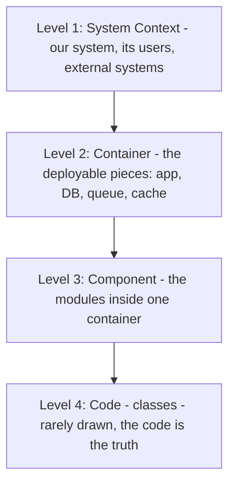
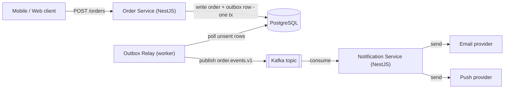

## 78.5 Running design reviews, and diagrams that earn their place

#### Concept

Two more skills that make documents work. The first is running a design review well — both as the author presenting your work and as a reviewer critiquing someone else's. A design review is not a meeting where people admire a diagram; it is a structured attempt to break a design on paper, cheaply, before production breaks it expensively. The second is drawing diagrams that genuinely help: the C4 model for showing systems at the right zoom level, sequence diagrams for flows over time, and data-flow diagrams for how information moves. A good diagram replaces three paragraphs; a bad one adds confusion.

#### Why does it exist?

Imagine a design review with no structure. The author talks for forty minutes. Reviewers interrupt with whatever occurs to them. The loud people dominate, the quiet expert says nothing, and the meeting ends with a vague "looks good" that commits no one. The design ships with its flaws intact, and you find them in production.

Structured review exists to find flaws while they are still cheap to fix — in a document, flaws cost an edit; in production, they cost an incident. Good diagrams exist because systems are spatial and temporal, and prose is neither. Trying to describe a request flowing through six components in a paragraph forces the reader to build the picture in their own head, and every reader builds a slightly different one, so they review different systems.

#### Mental model

For reviews, imagine a structural engineer reviewing a bridge design. They do not say "nice bridge". They systematically ask: what is the maximum load, what happens in high wind, what if this joint fails, how do you inspect it, how do you repair it. They are trying to find the failure before it is built. A design review is the same adversarial, systematic probing, done kindly.

For diagrams, imagine trying to give someone directions to your house using only words, versus handing them a map. The map is not decoration; it is a fundamentally better medium for spatial information. The C4 model is a set of maps at different zoom levels — country, city, street, building — so the reader can zoom to the level they need without getting lost.

#### How it works

**The design review.** As author: send the document at least two days before the meeting with an explicit ask to read it first; the meeting is for discussion, not for reading aloud. Open by stating the decision you need and the specific areas where you want scrutiny. Then shut up and let people probe. As reviewer: come having read it, and probe systematically against the dimensions that matter.

A reviewer's checklist, by dimension:

```text
Reliability:  Can it time out? Fail? Partially succeed? What's the blast radius?
              What happens when a dependency is down?
Data:         Is there a dual-write? Can data be lost or duplicated? Is the
              migration reversible? Any unbounded growth?
Security:     Authn/authz on every path? Any injection surface? Secrets handled?
              Is tenant/user data isolated?
Cost:         What does this cost at peak? Does cost scale with load in a
              surprising way? Any unbounded query or fan-out?
Operability:  How do we know it's healthy? How do we roll back? Who gets paged?
Scaling:      What breaks first at 10x? Is there a hot key, hot partition,
              single-writer bottleneck?
```

**The C4 model.** Four levels of diagram, from most zoomed-out to most zoomed-in. You rarely need all four; pick the levels your reader needs.



- **Level 1, System Context:** your system as one box, surrounded by the users and external systems it talks to. For non-technical and cross-team readers.
- **Level 2, Container:** the deployable units — the NestJS app, PostgreSQL, Redis, Kafka, the workers — and how they connect. The most useful level for most design docs.
- **Level 3, Component:** the modules or services inside one container. For the team building it.
- **Level 4, Code:** class-level detail. Almost never worth drawing; the code is the source of truth and the diagram rots instantly.

**Sequence diagrams** show a flow over time — who calls whom, in what order. Best for request paths and protocols. **Data-flow diagrams** show how data moves and transforms through a system, ignoring timing. Use each for its job: sequence for "what happens when a user clicks buy", data-flow for "how an order event reaches the warehouse".

#### Practical example

The Level 2 container diagram for the notification pipeline, which does more to align reviewers than three pages of prose:



A reviewer sees in one glance: the write and the outbox row are in one transaction (durability), a separate relay publishes to Kafka (so the order path does not wait on Kafka), and notifications are fully off the hot path. Three of the design's most important properties are visible without a word of prose. That is a diagram earning its place.

#### Artifact example

A filled-in reviewer's checklist from an actual review of the notification RFC — this is what a good reviewer hands back, rather than "LGTM".

```markdown
## Review of RFC-114 (reviewer: staff eng, platform)

**Reliability**
- [x] Order path no longer depends on notification service — good.
- [!] What happens if the Outbox Relay crashes? Rows pile up, notifications
      delayed. Need an alert on oldest-unsent-row age. NOT in observability
      section. BLOCKING until added.
- [x] At-least-once + idempotent consumer handles duplicates. Fine.

**Data**
- [x] Outbox write in same tx as order — dual-write avoided. Correct.
- [!] Outbox cleanup: §5 says delete after relay. If relay deletes before
      Kafka ack, a crash loses the row. Confirm: ack from Kafka THEN delete,
      or mark-sent then sweep. Clarify. BLOCKING.
- [x] Topic partitioned by order_id — per-order ordering holds. Good.

**Security**
- [x] Topic is internal, no PII beyond order_id and status. Acceptable.

**Cost**
- [x] One topic, modest volume (~1,200/s). Negligible over existing cluster.

**Operability**
- [!] Rollback flag is good. Add: what if we flip back to sync — do
      un-relayed outbox rows get double-sent? Need a reconciliation note.

**Verdict:** Approve with 3 blocking items (oldest-unsent alert,
relay-delete ordering, rollback double-send). Strong design otherwise.
```

This is a review that does work. It approves the direction, names three specific, fixable blockers with reasons, and is organised so the author can act on each one. It is adversarial in the kind way — it is trying to break the design on paper so production cannot.

#### Real-world scenario

A company institutes a rule: every design review must have at least one reviewer from outside the authoring team, and that reviewer must come with a filled-in checklist, not vibes. At first engineers grumble that it slows reviews. Within two quarters, the data tells a different story: designs reviewed under the new rule have measurably fewer production incidents in their first 90 days, because the outside reviewer catches the assumptions the authoring team shares and therefore cannot see. The classic catch is the authoring team all assuming a dependency is always available, and the outsider asking the obvious question nobody inside thought to ask: "what happens when it is down?"

#### Failure scenario

A design review is scheduled, but nobody reads the document beforehand. The author spends thirty minutes reading it aloud. The remaining fifteen minutes produce a few shallow comments. The design is approved. Nobody noticed that the proposed design did a dual write — writing to the database and publishing to a queue as two separate operations — because reviewing a dual write requires actually thinking about the failure mode, and you cannot think while someone reads slides at you.

In production, the dual write does exactly what dual writes do: the process crashes between the two writes, the data and the event diverge, and a slow drip of inconsistency corrupts downstream systems for weeks before anyone notices. The review existed. It just did not review anything, because the document was read in the meeting instead of before it.

#### Edge cases & failure modes

- **The read-aloud review.** The meeting is spent reading the document, leaving no time to probe it. Send it in advance; refuse to proceed if people have not read it.
- **The rubber stamp.** "Looks good" with no probing. The review happened on paper but not in substance.
- **The pile-on.** Reviewers compete to find flaws to look smart, and the author gets demoralised rather than helped. Reviews are collaborative, not competitive.
- **Only insiders review.** The authoring team's shared blind spots go uncaught. Always include an outside reviewer.
- **Diagram at the wrong zoom.** A Level 4 class diagram in a doc for executives, or a one-box Level 1 diagram for the team who has to build it. Match the level to the reader.
- **Diagrams that lie.** A diagram drawn at design time and never updated, now showing a system that no longer exists. A wrong diagram is worse than none.
- **Everything in one giant diagram.** Twenty-five boxes and fifty arrows. Nobody can read it. Split into several small diagrams at different levels.

#### How a Principal Engineer thinks about this

As an author, they want the review to find flaws, genuinely, because a flaw found in review costs an edit and a flaw found in production costs an incident and their credibility. So they open the review by pointing at the parts they are least sure of, inviting attack, rather than defending. As a reviewer, they probe systematically against reliability, data, security, cost and operability, because they know their intuition will miss a dimension if they do not have a checklist.

On diagrams, they draw at the level the reader needs and no deeper, and they put the container diagram near the top of almost every design doc because it aligns everyone on the shape of the system before any argument about details. They keep diagrams small — several little ones beat one enormous one — and they are honest that Level 4 code diagrams are almost always a waste, because the code is the truth and the diagram is stale the moment it is drawn.

#### Common mistakes

- **Reviewing without reading first.** The meeting becomes a reading, and nothing gets probed.
- **"LGTM" culture.** Approvals without scrutiny, which is the same as no review.
- **No outside reviewer.** Shared blind spots survive.
- **One giant diagram at the wrong zoom level.** Either too detailed for the audience or too vague for the builders.
- **Letting diagrams rot.** Keeping a diagram in a living doc that no longer matches reality.
- **Treating the review as adversarial combat.** Winning the review instead of improving the design.

#### Interview questions

1. **How do you run a design review as the author so that it actually finds problems?**
   *Expected answer:* send the doc in advance and require reading before the meeting; open by naming where you are least confident and inviting attack; let reviewers probe rather than defending; include at least one outside reviewer. *Why it matters:* tests whether they see review as a cheap way to find flaws or as a ritual to survive.

2. **Explain the C4 model and when you would use each level.**
   *Expected answer:* context (system as one box, for cross-team/non-technical readers), container (deployable units, the most useful level for design docs), component (modules inside one container, for the builders), code (class level, rarely worth drawing). Match the level to the reader. *Follow-up:* which level would you put in a doc for executives, and which for the implementing team.

3. **A design with a dual write passed review. How did the review fail, and how would you prevent it?**
   *Expected answer:* reviewers did not probe the data dimension — specifically "can the two writes diverge on a crash" — likely because they had not read the doc beforehand or lacked a checklist. Prevent it with pre-reading, a data-reliability checklist item (dual-write detection), and an outside reviewer. *Why it matters:* connects review discipline to a concrete, common production failure.

#### Practical exercise

Take a system you own and draw its C4 Level 2 container diagram in Mermaid: every deployable unit and datastore, and the connections between them, with the key property of each connection labelled (which calls are synchronous, which are in-transaction, which are async). Then write the reviewer's checklist you would want someone to apply to it, filling in the reliability and data rows with the two questions you are least confident you can answer well.

**Acceptance criteria:** the diagram has fewer than 15 nodes, every connection is labelled, and the checklist surfaces at least one real weakness in your own system that you had not consciously articulated before drawing it.
