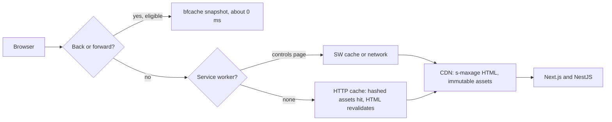
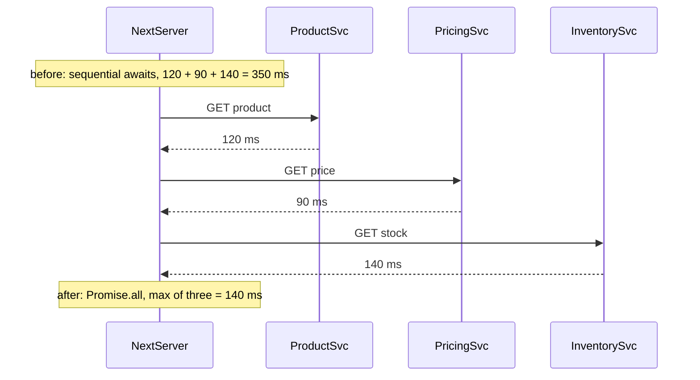

## 78.9 Caching for frontends: immutable assets, HTML caching, service workers and the bfcache

#### Concept

A frontend has four caches between the user and your servers, and each needs a different policy:

1. **Static assets** (JavaScript chunks, CSS, fonts, images) with a content hash in the file name, such as `/_next/static/chunks/app/p/page-3f9c1a2b.js`. The name changes when the content changes, so the file can be cached **forever**: `Cache-Control: public, max-age=31536000, immutable`.
2. **HTML documents**, which have stable URLs (`/p/trail-runner-gtx`) and must change when content or code changes. They get short shared caching at the CDN, revalidation, or no caching at all, depending on whether they are personalised (75.1, 75.7).
3. **Service worker caches**, a programmable cache inside the browser (the Cache API, 71.8) that your own script controls: it can serve repeat visits and offline pages without the network.
4. **The back/forward cache (bfcache)**, an in-memory snapshot of the whole page that the browser keeps when the user navigates away, so pressing Back restores it instantly without reloading anything.

Part 11.11 covered `Cache-Control`, `ETag` and revalidation, Part 27 the backend caches, and Part 75.7 the four Next.js caches. This section is about the policy for a frontend's own files and documents, and the two browser-side caches.

#### Why does it exist?

A returning visitor should download almost nothing: the framework and shared chunks have not changed since yesterday, the font has not changed in a year. Without hashed, immutable assets, the browser must either revalidate every file (a round trip each, even for 304s) or risk running yesterday's JavaScript with today's HTML. Without careful HTML caching, either every request hits the origin (slow TTFB) or users see stale prices. And the fastest navigation of all, Back, is often slow only because a page accidentally opted out of the bfcache.

#### Mental model

Imagine a library. Books with an edition number on the spine (hashed assets) can be shelved permanently: a new edition gets a new number and a new place. The daily newspaper (HTML) has the same title every day, so you must check the date before trusting the copy on the shelf. A service worker is a personal assistant who keeps copies at your desk and decides when to fetch fresh ones; helpful, but if they never check the date, you read last month's paper. The bfcache is leaving your book open on the desk when you step out, rather than shelving it.

#### How it works

The policy table most frontends should start from:

| Resource | `Cache-Control` | Why |
|---|---|---|
| `/_next/static/*` (hashed JS, CSS, fonts, media) | `public, max-age=31536000, immutable` (Next.js sets this) | Name changes with content; never revalidate |
| Content-hashed product images | `public, max-age=31536000, immutable` | Same reason; URL from the API changes on re-upload |
| Unhashed files in `public/` (logo.svg, robots.txt) | `public, max-age=3600` or explicit per file | Next.js defaults to `max-age=0`; set headers or move them under hashed imports |
| Static or ISR HTML (product, category) | `public, s-maxage=60, stale-while-revalidate=300` at the CDN; browser `max-age=0` | Short shared freshness, instant responses while revalidating (75.2) |
| Personalised HTML (cart, account) | `private, no-cache` (or `no-store` for sensitive pages, 77.9) | Never shared; revalidate every time |
| Public API GETs called from the browser | `public, max-age=0, s-maxage=30` plus `ETag` | CDN absorbs load; browser always revalidates |
| Personal API GETs | `private, no-cache` plus `ETag` | 304s save bytes; never shared |



**Service workers** are worth their complexity for apps used repeatedly (a delivery partner's app, an internal dashboard), offline-capable flows, and sites on very poor networks. For a typical storefront, hashed assets with immutable caching already give most of the repeat-visit benefit, and a service worker adds a new failure mode: a bad or stale worker can serve broken pages to every returning user until it updates. If you use one: precache only the app shell and hashed assets, use network-first or stale-while-revalidate for HTML, enable **navigation preload** so the network request for the page starts in parallel with the worker's startup, and ship a kill switch (a no-op worker at the same URL). For Next.js App Router, Serwist (`@serwist/next`) is the maintained successor to the older `next-pwa` plugin; Workbox provides the strategies underneath (`CacheFirst`, `StaleWhileRevalidate`, `NetworkFirst`).

**The bfcache** restores a page only if it is eligible. The common reasons a page is not: an `unload` event listener (use `pagehide` instead), `Cache-Control: no-store` on the document (Chrome has been relaxing this for some pages, but do not rely on it), and open connections or locks the browser cannot freeze. DevTools has a dedicated test under Application, Back/forward cache, that lists the blocking reasons for the current page. Code that must refresh data on restore listens for `pageshow` with `event.persisted === true`.

#### Practical example

A storefront's repeat-visit analysis: returning mobile users on a product page downloaded 410 KB per visit. The waterfall showed the JavaScript chunks were served from cache, but `/public/fonts/brand.woff2` (unhashed, `max-age=0`) revalidated on every page, the hero image URLs included a `?v=timestamp` that changed on every deploy, and HTML was `no-store` because a header component read cookies. Moving the font to `next/font` (hashed), using content-hash image keys from the API, and moving the personalised header to a client component (so HTML could be ISR) cut repeat-visit transfer to 38 KB and repeat-visit p75 LCP from 1.9 s to 0.9 s. Back navigations went from full reloads to bfcache restores once `no-store` was gone.

#### React / Next.js example

```js
// apps/web/next.config.mjs  (headers excerpt)
export default {
  async headers() {
    return [
      { source: '/brand/:file*', headers: [{ key: 'Cache-Control', value: 'public, max-age=86400' }] },
      { source: '/robots.txt', headers: [{ key: 'Cache-Control', value: 'public, max-age=3600' }] },
    ];
  },
};
```

```tsx
// apps/web/src/perf/BfcacheRefresh.tsx
'use client';
import { useEffect } from 'react';
import { useQueryClient } from '@tanstack/react-query';

export function BfcacheRefresh() {
  const qc = useQueryClient();
  useEffect(() => {
    const onShow = (e: PageTransitionEvent) => {
      // Restored from bfcache: the snapshot may be minutes old. Refetch volatile data only.
      if (e.persisted) void qc.invalidateQueries({ queryKey: ['cart'] });
    };
    window.addEventListener('pageshow', onShow);
    return () => window.removeEventListener('pageshow', onShow);
  }, [qc]);
  return null;
}
```

#### Backend side (NestJS)

```ts
// apps/api/src/catalog/products.controller.ts  (excerpt)
import { Controller, Get, Header, Param } from '@nestjs/common';

@Controller('v1/products')
export class ProductsController {
  constructor(private readonly products: ProductsService) {}

  @Get(':slug')
  @Header('Cache-Control', 'public, max-age=0, s-maxage=60, stale-while-revalidate=300')
  @Header('Vary', 'Accept-Encoding')                    // never Vary on Cookie for public data
  findOne(@Param('slug') slug: string) {
    return this.products.findPublicBySlug(slug);        // no per-user fields in a shared response
  }
}
```

- **Public responses must contain nothing personal.** One `isFavourite` field in a CDN-cached product response leaks one user's data to everyone (75.7 has the incident). Split personal fields into a separate `private` endpoint.
- **ETags** on personal GETs let the browser and TanStack Query revalidate cheaply. Express generates weak ETags for responses by default; for streamed or very large responses compute them from a version column.
- **The bfcache and logout** pull in opposite directions: `no-store` on authenticated pages prevents a restored page from showing data after logout (77.9), but disables bfcache for those pages. A senior compromise: `no-store` for pages with sensitive data (account, orders, payment), cacheable documents elsewhere, and a `pageshow` handler that rechecks the session on restore.

#### Production scenario

A media-heavy marketplace measured back-navigation from product to listing: 34% of all listing page views were Back navigations. Only 9% were bfcache restores. The DevTools bfcache test listed two blockers: an analytics library's `unload` listener and `Cache-Control: no-store` on listing HTML. Upgrading the library (it moved to `pagehide`) and serving listings with ISR headers raised bfcache restores to 71% of Back navigations, which RUM showed with `navigationType: 'back-forward-cache'` and near-zero LCP. Listing page server renders dropped by a fifth.

#### Failure scenario

A team shipped a service worker that cached HTML with `CacheFirst` "for offline support". A week later a pricing bug fix went out; support tickets about wrong prices kept arriving for days from returning customers. Their service worker served the old HTML, which referenced old hashed chunks that were still on the CDN, so everything "worked", just with stale prices. The fix was a new worker with `NetworkFirst` for navigations and a three-second timeout falling back to cache, `skipWaiting` plus `clients.claim` to take over quickly, and a server-side `Clear-Site-Data: "cache"` header on one release to clear the poisoned caches. Part 80 — Shipping and Operating Frontends covers what happens to users on old bundles during deploys more generally.

#### Edge cases & failure modes

- **Deleting old hashed assets on deploy** breaks users who loaded yesterday's HTML and lazily request a chunk that no longer exists. Keep previous builds' assets for days (Part 80).
- **Query-string cache busting** (`app.js?v=2`) is ignored by some caches and is not content-based; use hashed file names.
- **`Vary: Cookie`** on a public response makes the CDN cache a copy per cookie value, which is effectively no caching.
- **Service worker scope and updates**: a worker controls pages under its scope until a new one installs and activates; a byte-identical worker never updates.
- **bfcache and real-time connections**: an SSE or WebSocket connection open at navigation time may block bfcache or be closed on freeze; reconnect on `pageshow` (74.8).

#### How a Senior Full-Stack Engineer thinks about this

A senior separates **versioned** things (cache forever) from **named** things (revalidate or cache briefly) and refuses anything in between, such as unhashed scripts with long lifetimes. They treat a service worker as production infrastructure with its own rollout and kill switch, not as a checkbox, and they usually do not add one to a storefront without a specific offline or repeat-use requirement. They measure bfcache restore rate as a performance metric, because it is the cheapest page load there is.

#### Common mistakes

- **Long `max-age` on HTML** without a purge strategy.
- **Unhashed assets in `public/`** with default `max-age=0`, revalidated on every page.
- **`CacheFirst` for HTML in a service worker.**
- **`unload` handlers** in your code or third-party libraries.
- **Personal data in CDN-cacheable responses.**

#### Interview questions

1. **Why can hashed assets be cached forever but HTML cannot?** Expected answer: the hash changes the URL when content changes; HTML has a stable URL and must reflect new content and new asset references.
2. **What blocks the bfcache, and how do you check?** Expected answer: `unload` listeners, `no-store`, some open connections; DevTools Application panel bfcache test, and RUM navigation type.
3. **When is a service worker worth it for a web app?** Expected answer: repeated use, offline needs, poor networks; with network-first HTML, navigation preload and a kill switch.
4. **What goes wrong if you delete old assets immediately on deploy?** Expected answer: open tabs and cached HTML request old chunks and get 404s; lazy routes break.

#### Practical exercise

Audit caching for one route.

Acceptance criteria:

- A table lists every resource on the page with its `Cache-Control`, whether its URL is content-hashed, and whether it is served from cache on a repeat visit.
- Repeat-visit transfer for the page is under 50 KB, excluding API data.
- The DevTools bfcache test passes for the page, and RUM shows bfcache restores as a share of Back navigations.
- No public API response contains per-user fields.

## 78.10 The backend's share: TTFB, API waterfalls, over-fetching, chatty endpoints and BFF aggregation

#### Concept

The backend influences frontend performance through five mechanisms:

1. **TTFB of the HTML**: everything the server does before sending the first byte, including every API call a server component awaits.
2. **API waterfalls**: requests that wait for other requests, on the server (sequential `await`s in a render) or on the client (a fetch inside the callback of another fetch).
3. **Over-fetching**: responses that contain far more than the screen needs, costing transfer, parse time and memory.
4. **Chatty endpoints**: screens that need many small requests because the API is shaped around resources rather than tasks.
5. **Cacheability**: whether responses can be shared by a CDN or the Next.js Data Cache, which decides whether the API is in the user's path at all.

A **BFF aggregation** layer (75.8) is the main tool to fix the last three, and parallelism plus streaming fix the first two.

#### Why does it exist?

Backend engineers measure endpoint latency; users experience the critical path. An endpoint at 60 ms p95 can still cost a user 1.2 s if a page calls it after four other requests in sequence over a 200 ms mobile round trip. The backend's share of web performance is not "make the endpoint faster" alone; it is "make fewer, parallel, cacheable, right-sized calls possible at render time".

#### Mental model

Imagine sending someone to collect five documents from five offices in one building. If they must bring each document back to you before you tell them the next office (a waterfall), the trip takes five times as long. If you give them the full list at once (parallel), it takes as long as the slowest office. If one clerk gathers all five for them at a single counter (aggregation), they make one trip. If the documents are public and photocopied in the lobby (caching), they make no trip at all. Over-fetching is them bringing back the whole filing cabinet.

#### How it works



TTFB itself has parts, visible in the Navigation Timing entry and in `web-vitals` TTFB attribution: waiting (redirects and queuing), cache (service worker or HTTP cache lookup), DNS, connection (TCP and TLS), and request duration (sending the request until the first response byte, which includes server time). Only the last is server-side; `Server-Timing` splits it further.

The fixes, by mechanism:

| Mechanism | Symptom in a trace | Fix |
|---|---|---|
| Sequential server calls | `Server-Timing` spans back to back | `Promise.all`, start independent fetches before awaiting, or one aggregated BFF call |
| Slow non-critical data in render | TTFB grows with the slowest call | Stream it: put the slow component behind `<Suspense>` so the shell flushes first (75.2) |
| Client-side chains | Initiator chain from request to request (71.10) | Fetch on the server, or in parallel on the client, or include in one view model |
| Over-fetching | Large JSON, low field usage | View-shaped endpoints, field selection, `@Expose` serialisation groups, pagination |
| Chatty screens | Many small requests per view | BFF aggregation per screen, or batch endpoints (`GET /v1/products?ids=`) |
| Uncacheable responses | Every render hits the API | Split public from personal data; `s-maxage`, `revalidate` and tags |
| No compression or old protocol | Large transfer for text | Brotli or gzip at the CDN, HTTP/2 or HTTP/3 (Part 11.10, 11.6) |

#### Practical example

A product page in a Next.js server component awaits: product (120 ms), price (90 ms), stock (140 ms), recommendations (380 ms), reviews summary (70 ms), sequentially: 800 ms of server time, all in TTFB. The page cannot be cached because stock and price change often. Changes:

1. Product, price, stock and reviews summary start in parallel: 140 ms.
2. Recommendations move behind `<Suspense>`, so they stream after the shell; they no longer affect TTFB or LCP.
3. The product response is split: a cacheable public part (title, images, description: `s-maxage=300`, tag-revalidated on edits) and a small volatile part (price and stock: 30 s). The page becomes ISR with a 30 s revalidate.

TTFB on a CDN miss falls from about 950 ms to about 260 ms; on a CDN hit, to about 60 ms.

#### React / Next.js example

```tsx
// apps/web/app/p/[slug]/page.tsx  (Next.js 14 App Router)
import { Suspense } from 'react';
import { getProduct, getPrice, getStock, getReviewSummary } from '@/lib/catalog'; // fetch wrappers
import { Recommendations, RecommendationsSkeleton } from './Recommendations';

export const revalidate = 30;                                 // ISR: page cached, re-rendered at most every 30 s

export default async function ProductPage({ params }: { params: { slug: string } }) {
  // Start all independent calls before awaiting any of them.
  const [product, price, stock, reviews] = await Promise.all([
    getProduct(params.slug),            // fetch(..., { next: { revalidate: 300, tags: [`product:${params.slug}`] } })
    getPrice(params.slug),              // fetch(..., { next: { revalidate: 30 } })
    getStock(params.slug),
    getReviewSummary(params.slug),
  ]);
  return (
    <>
      <ProductHero product={product} />
      <PriceAndStock price={price} stock={stock} />
      <ReviewSummary summary={reviews} />
      <Suspense fallback={<RecommendationsSkeleton />}>
        {/* Slow (p95 380 ms) and not needed for LCP: streams after the shell. */}
        <Recommendations productId={product.id} />
      </Suspense>
    </>
  );
}
```

In Next.js 15, `params` becomes a promise (`const { slug } = await params`) and `fetch` is no longer cached by default, so the `next: { revalidate }` options must be explicit (75.5).

#### Backend side (NestJS)

When several screens need the same aggregation, or mobile apps need it too, an aggregated endpoint in NestJS (or a dedicated BFF service) beats repeating `Promise.all` in every frontend:

```ts
// apps/api/src/product-page/product-page.controller.ts
import { Controller, Get, Header, Param, UseInterceptors, ClassSerializerInterceptor, SerializeOptions } from '@nestjs/common';
import { ProductPageService } from './product-page.service';

@Controller('v1/product-pages')
@UseInterceptors(ClassSerializerInterceptor)
export class ProductPageController {
  constructor(private readonly pages: ProductPageService) {}

  @Get(':slug')
  @Header('Cache-Control', 'public, max-age=0, s-maxage=30, stale-while-revalidate=120')
  @SerializeOptions({ groups: ['page'], excludeExtraneousValues: true }) // only @Expose({ groups: ['page'] }) fields
  get(@Param('slug') slug: string) {
    return this.pages.view(slug);
  }
}
```

```ts
// apps/api/src/product-page/product-page.service.ts  (excerpt)
async view(slug: string): Promise<ProductPageView> {
  const product = await this.catalog.bySlug(slug);                 // needed for ids
  const [price, stock, reviews] = await Promise.all([
    this.pricing.current(product.id),
    this.inventory.availability(product.id).catch(() => ({ state: 'unknown' as const })), // degrade, do not fail
    this.reviews.summary(product.id),
  ]);
  return new ProductPageView(product, price, stock, reviews);      // about 6 KB instead of 48 KB of raw DTOs
}
```

The rules that make this work: one round trip per screen for the first render; independent calls in parallel with timeouts and degraded fallbacks (Part 29 for timeouts and circuit breakers); view models that contain what the screen renders; public and personal data in separate responses so the public one can be cached; `Server-Timing` spans for each downstream call (71.10). The Part 75.8 table still applies for deciding whether this aggregation lives in Next.js or NestJS: a single web frontend usually aggregates in Next.js; web plus mobile usually shares an aggregated endpoint.

#### Production scenario

A food delivery restaurant page called nine endpoints from the browser after hydration: restaurant, menu categories, menu items per category (four calls), offers, delivery estimate and favourites. On a 4G phone the last data arrived at 3.4 s. A `GET /v1/restaurant-pages/:id` endpoint returned one 22 KB view model (from 140 KB across the nine responses), the page rendered it on the server with the menu cached for 60 s at the CDN, and favourites and the delivery estimate (personal, location-based) came from one small client call. The menu was visible at 1.3 s p75, and API request volume for the page fell by 80%.

#### Failure scenario

At 19:30 on a Friday, peak dinner time, p75 TTFB for restaurant pages jumped from 300 ms to 2.8 s. Dashboards showed the menu service healthy. `Server-Timing` on the HTML showed a new span, `promo;dur=2400`: a promotions call added that week inside the aggregated endpoint, awaited before rendering, with no timeout. The promotions service was overloaded by a marketing push. Because the call was in the critical path of a non-streamed render, its tail latency became every user's TTFB. The fix was a 150 ms timeout with an empty-promotions fallback, and moving the promo banner behind `<Suspense>` so it could arrive late without blocking the page.

#### Edge cases & failure modes

- **Aggregation amplifies failure**: one slow dependency slows the whole view unless each call has a timeout and a fallback.
- **Aggregated responses are harder to cache** if they mix volatility levels; split by freshness.
- **Over-aggregation**: a "page endpoint" that returns everything for every variant of a screen becomes the new over-fetching.
- **N+1 behind the aggregate**: a view endpoint that loops over items calling another service (Part 42.4) moves the waterfall inside the data centre, where it is faster but still adds up.
- **Streaming and status codes**: once the shell is flushed with 200, a later failure cannot change the status; handle errors inside the streamed component (75.2).
- **Compression of tiny responses** wastes CPU; compress above about 1 KB.

#### How a Senior Full-Stack Engineer thinks about this

A senior budgets server time inside TTFB like any other dependency: "the product page has 300 ms of server time on a CDN miss; the slowest critical call gets 150 ms with a timeout; anything slower streams or loads later". They ask of every call in a render: is it needed for the first paint? Can it run in parallel? Can it be cached, and for how long? What happens if it times out? They choose the aggregation location by who else needs it, not by habit, and they keep business rules in the services, never in the BFF.

To a product manager: "The page waits for five lookups one after another. Doing them at the same time and moving the recommendations lower on the page saves about half a second for everyone, and the recommendations still appear before most people scroll to them."

#### Common mistakes

- **Sequential `await`s** for independent data in server components.
- **Blocking the whole render on non-critical data** instead of streaming it.
- **Returning whole entities** when the screen needs a few fields.
- **Mixing personal fields into public responses**, which makes them uncacheable or leaks data.
- **Aggregating without timeouts**, so the slowest dependency sets everyone's TTFB.

#### Interview questions

1. **How does a backend reduce LCP without touching frontend code?** Expected answer: lower TTFB through caching and parallel calls, view-shaped responses, image metadata first, fewer redirects.
2. **What is an API waterfall and how do you find one?** Expected answer: requests that depend on earlier ones; the Initiator chain in DevTools for the client, `Server-Timing` and traces for the server.
3. **Where should screen aggregation live: Next.js or NestJS?** Expected answer: Next.js when only the web app needs it; a shared endpoint or BFF service when mobile and web need the same shape; never with business rules.
4. **How do you keep an aggregated endpoint from being as slow as its slowest dependency?** Expected answer: parallelise, set per-call timeouts, return degraded fallbacks, stream non-critical parts, cache by freshness.
5. **What is over-fetching's cost in the browser beyond bytes?** Expected answer: parse time, memory, RSC payload duplication, slower interactions when the client processes large data.

#### Practical exercise

Remove one waterfall end to end.

Acceptance criteria:

- `Server-Timing` on the page's HTML shows each downstream call as a span; a before-trace shows at least two sequential independent calls.
- After the change, independent calls run in parallel, each with a timeout and fallback, and non-critical data streams behind `<Suspense>`.
- One client-side request chain is removed or parallelised, verified with the Initiator view.
- p75 TTFB on a CDN miss and the page's total API payload are recorded before and after.
