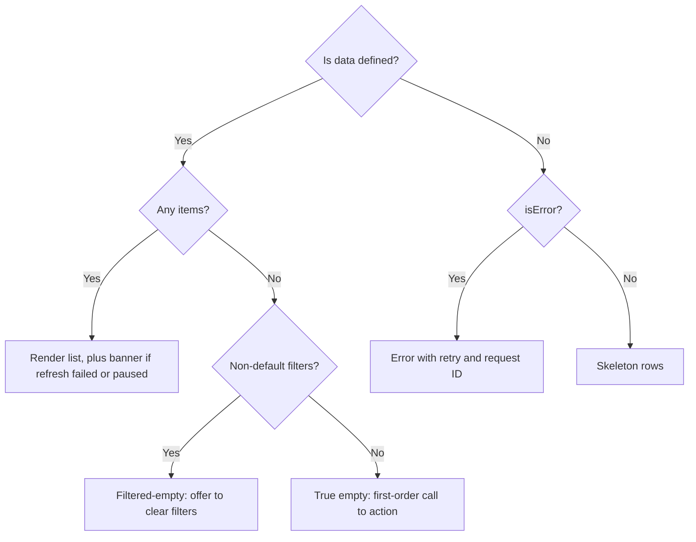
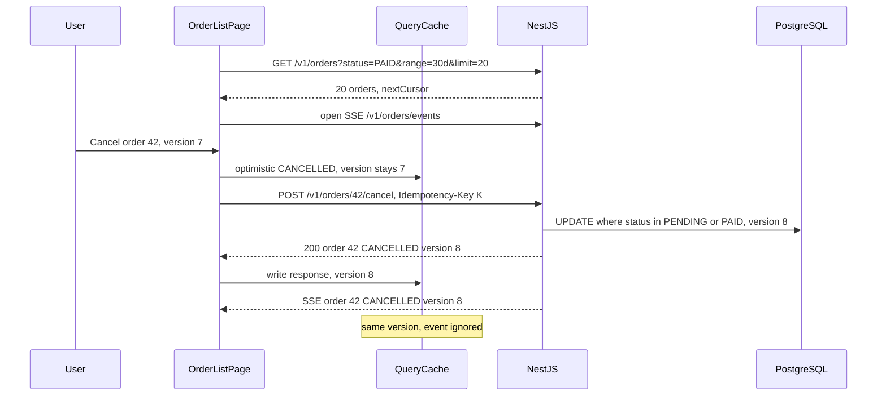

## 78.11 Loading, empty and error states as a design requirement

#### Concept

Every region of a screen that shows server data has more states than "loading" and "done". For an order list, at least these:

| State | What the user should see | TanStack Query v5 signal |
|---|---|---|
| First load, nothing cached | Skeleton rows the size of real rows | `isPending && isFetching` (`isLoading`) |
| Data | The list | `data` defined |
| Refreshing in background | The list, with a subtle indicator at most | `data` and `isFetching` |
| Empty, never had any | "No orders yet" and a link to shop | `data` with no items, default filters |
| Empty because of filters | "No paid orders in the last 30 days" and "Clear filters" | `data` with no items, non-default filters |
| Error, nothing to show | Explanation, "Try again", a reference ID | `isError` and no `data` |
| Refresh failed, old data shown | The list plus "Could not refresh" | `isError` **and** `data` |
| Offline, waiting | The list plus "Reconnecting" | `fetchStatus === 'paused'` |
| Loading more / end of list | Row skeleton at the end / "That is all your orders" | `isFetchingNextPage` / `!hasNextPage` |
| Placeholder while switching pages | The previous page, dimmed | `isPlaceholderData` |

v5 naming matters here: `status` is `'pending' | 'error' | 'success'`; `isPending` means "no data yet" and stays true for a disabled query that never runs; `isLoading` is `isPending && isFetching`, a real first load in progress. v4's `isLoading` meant what v5 calls `isPending`, and v4's `isInitialLoading` is now `isLoading`.

The point of this section is the title: these states are **requirements**. They belong in the design, in the acceptance criteria and in the tests, not in whatever the developer improvised at 6 p.m.

#### Why does it exist?

On good office Wi-Fi the happy path is all anyone sees, so the other states go unbuilt. Real users see them constantly: first loads on 3G, empty accounts, filters that match nothing, outages, tunnels. A missing state is not neutral. A spinner where a skeleton should be causes layout shift (75.5). An empty state shown during loading tells customers their orders are gone. An error page that replaces good data hides information the user had a second ago.

#### Mental model

Imagine a NestJS controller that handles only the `200` case and lets every other outcome become a generic `500`. You would not ship it: each status class (2xx, 4xx, 5xx, timeouts) needs a deliberate response. A UI region is the same: each data state needs a deliberate rendering, and "the happy path plus a spinner" is the frontend's catch-all `500`.

#### How it works

The order of checks is the whole trick: **data first, then error, then loading.**



1. If there is data, render it, whatever else is true. Add a banner for a failed refresh or a paused fetch.
2. Distinguish **true empty** from **filtered empty**. They need different words and different actions.
3. Only without data does an error become the main content, and it must say what happened in human words, offer a retry, and show the `requestId` (77.11) so support can find the trace.
4. Only without data and without error do you show a skeleton. Size skeleton rows like real rows to avoid layout shift, and delay them about 200 ms so fast responses never flash a skeleton at all.

Suspense is the other style (77.11): `useSuspenseQuery` lets a `<Suspense>` boundary show the skeleton and an error boundary show the error, so the component only renders the success case. It needs the same rules: refresh failures with existing data do not throw to the boundary, and empty states are still yours to design.

#### Practical example

The design spec for "My Orders" lists the ten states in the table above with copy and layout for each. The acceptance criteria include one test per state using mocked API responses (MSW, Part 83). The product manager signs off on the filtered-empty copy ("No cancelled orders in the last 6 months. Clear filters") because it is a real screen people will see thousands of times a day.

#### React / Next.js example

```tsx
// src/orders/OrderListBody.tsx  (React 18, TanStack Query v5)
import type { UseInfiniteQueryResult, InfiniteData } from '@tanstack/react-query';
import type { OrderListFilters, OrderListResponse, OrderSummary } from '@shop/contracts';
import { ApiError } from '../api/errors';
import { FreshnessBanner } from '../ui/FreshnessBanner';
import { OrderRowsSkeleton } from './OrderRowsSkeleton'; // rows sized like real rows (75.5)

type Props = {
  query: UseInfiniteQueryResult<InfiniteData<OrderListResponse>, Error>;
  orders: OrderSummary[];
  filters: OrderListFilters;
  onClearFilters: () => void;
  renderRow: (o: OrderSummary) => JSX.Element;
};

export function OrderListBody({ query, orders, filters, onClearFilters, renderRow }: Props) {
  if (query.data) {                                                 // 1. data first, always
    const filtered = filters.status !== undefined || filters.range !== '30d';
    return (
      <>
        <FreshnessBanner updatedAt={query.dataUpdatedAt} failed={query.isError} />
        {orders.length === 0 ? (
          filtered
            ? <p>No orders match these filters. <button onClick={onClearFilters}>Clear filters</button></p>
            : <p>No orders in the last 30 days. <a href="/shop">Start shopping</a></p>
        ) : (
          <ul aria-busy={query.isFetchingNextPage}>{orders.map(renderRow)}</ul>
        )}
        {!query.hasNextPage && orders.length > 0 && <p>That is all your orders for this period.</p>}
      </>
    );
  }
  if (query.isError) {                                              // 2. error only when nothing to show
    const ref = query.error instanceof ApiError ? query.error.requestId : undefined;
    return (
      <div role="alert">
        <p>We could not load your orders.</p>
        <button onClick={() => query.refetch()}>Try again</button>
        {ref && <p>Reference: <code>{ref}</code></p>}
      </div>
    );
  }
  return <OrderRowsSkeleton count={6} />;                           // 3. first load
}
```

#### Backend side (NestJS)

The UI can only distinguish states the API distinguishes:

- **Empty is a `200`.** `GET /v1/orders` with no matches returns `{ items: [], nextCursor: null }`, never `404`. A `404` on a collection reads as an error and triggers retries.
- **"Never ordered" needs a fact the list cannot give.** A filtered-empty list says nothing about older orders. The `GET /v1/orders/summary` endpoint (78.2) returns `{ active: 0, allTime: 37 }`, so the empty state can say "No orders in the last 30 days. Show all 37 orders".
- **Errors carry `code`, `issues` and `requestId`** (76.12, 77.7), so the client maps codes to copy (`ORDER_NOT_CANCELLABLE` becomes "This order has already shipped") and support can search logs by reference.
- **`401` is handled once**, globally: an expired session redirects to login rather than painting an error in every region.
- **`503` with `Retry-After`** lets the error state say "Back in a few seconds" and retry on time.

#### Production scenario

A grocery app audited its top ten screens against a state checklist and found 41 missing states. Building them took two sprints. Afterwards, sessions that hit any error state but continued shopping rose from 38 % to 61 %, mostly because refresh failures stopped replacing lists with error pages, and "my orders disappeared" contacts went to zero (see the failure below).

#### Failure scenario

The order list rendered `if (!data?.pages[0].items.length) return <EmptyOrders />`. While loading, `data` was `undefined`, the optional chain produced `undefined`, and `!undefined` is `true`: every customer saw "You have no orders yet" for 300 to 2,000 ms on every visit. On slow connections it looked permanent. Within a day support had 600 contacts asking where their orders had gone, and some customers re-placed orders they thought were lost.

The fix was the data-first decision order above, plus a component test per state. The team added a lint-style review rule: no `!data?.` checks in render.

#### Edge cases & failure modes

- **Checking `isError` before `data`** throws away good data after a failed refresh.
- **Empty state during loading** from optional chaining, as above.
- **Disabled queries** sit in `isPending` forever; show their own "choose a customer first" state.
- **Spinners for fast responses** flash for 50 ms; delay skeletons about 200 ms.
- **Skeletons of the wrong size** cause layout shift when data arrives.
- **Error copy from raw server messages** leaks internals and is untranslatable; map codes to copy.
- **Partial failure**: one region failing must not blank the page; give each independent region its own boundary (77.11).

#### How a Senior Full-Stack Engineer thinks about this

The senior asks for the state table before the code: "What does this show on first load, empty, filtered-empty, error, stale, offline?" They make those states part of the definition of done and the test suite, and they push the API to provide the facts the states need (an `allTime` count, error codes, request IDs). The happy path is one row of ten.

#### Common mistakes

- **Building only the happy path and a spinner.**
- **One generic "Something went wrong"** for every failure.
- **Treating empty as an error** on the API or in the UI.
- **Not testing states** with mocked responses.

#### Interview questions

1. **In what order should a component check query state, and why?** Expected answer: data, then error, then loading; refetch errors keep old data, and showing an error page would discard it.
2. **What is the difference between `isPending` and `isLoading` in v5?** Expected answer: `isPending` means no data yet (including disabled queries); `isLoading` is `isPending && isFetching`.
3. **How should an API represent an empty collection?** Expected answer: `200` with an empty list and `nextCursor: null`, plus summary facts when the UI needs them.
4. **How do you keep a skeleton from hurting CLS?** Expected answer: size it like real content, reserve space, delay it for fast responses.

#### Practical exercise

Write one component test per state in the table for the order list.

Acceptance criteria:

- Ten tests with MSW handlers, one per state, all passing.
- A refetch failure with existing data keeps the list and shows the banner.
- No "no orders" text ever appears before the first response (asserted with a delayed handler).
- The summary endpoint returns `allTime`, and filtered-empty copy uses it.

## 78.12 Worked example: an order list with filters, infinite scroll, live status and an optimistic cancel

#### Requirements

We now assemble the Part into one screen: "My Orders" for a grocery delivery web app (React 18, Vite, React Router 6, TanStack Query v5, zod), on the NestJS API used throughout this Volume.

- **Filters** (status, date range) live in the URL; reload, Back and shared links reproduce the view.
- **Infinite scroll** over cursor pages of 20, at most 10 pages cached, with a "Load more" button for keyboard users.
- **Live status**: changes made elsewhere (warehouse, rider, support, another device) appear within 1 s, through one SSE stream per tab.
- **Optimistic cancel**: the row shows "Cancelling..." at once; on success it becomes "Cancelled"; if the order shipped meanwhile, it reverts with an explanation, without erasing newer data.
- **Numbers**: first page under 300 ms p95 on 4G from a warm connection; list response under 25 KB; status updates under 1 s p95; zero duplicate cancels under double taps, retries and offline replays.

#### The flow



#### The contract

Built up across this Part in `@shop/contracts`: `OrderSummarySchema` with `version` and `updatedAt` (78.1), `OrderListFiltersSchema` and `OrderListQuerySchema` (78.2, 78.7), `OrderEventSchema` (78.8), and `CancelOrderRequestSchema` from 76.12. One change to 76.12's endpoint: `POST /v1/orders/:id/cancel` now returns **`200` with the updated `OrderSummary`** instead of `202` with no body, so the client can write the result straight into the cache.

#### Backend: the cancel endpoint

```ts
// apps/api/src/orders/orders.service.ts  (TypeORM, excerpt)
async cancel(input: { userId: string; orderId: string; reason: CancelReason }): Promise<OrderSummary> {
  return this.ds.transaction(async (m) => {
    const [rows] = (await m.query(
      `UPDATE orders
          SET status = 'CANCELLED', cancel_reason = $3, version = version + 1, updated_at = now()
        WHERE id = $1 AND customer_id = $2 AND status IN ('PENDING', 'PAID')
      RETURNING *`,
      [input.orderId, input.userId, input.reason],
    )) as [OrderRow[], number];                         // [rows, rowCount] for UPDATE in TypeORM's pg driver

    if (rows.length === 0) {
      const [current] = await m.query('SELECT * FROM orders WHERE id = $1 AND customer_id = $2', [input.orderId, input.userId]);
      if (!current) throw new NotFoundException({ code: 'ORDER_NOT_FOUND', issues: [] });
      if (current.status === 'CANCELLED') return this.mapper.toSummary(current); // repeat cancel: same answer
      throw new ConflictException({
        code: 'ORDER_NOT_CANCELLABLE',
        issues: [{ path: 'status', message: `Order is already ${current.status.toLowerCase()}` }],
        currentVersion: current.version,
      });
    }
    const order = this.mapper.toSummary(rows[0]);
    // Outbox row in the same transaction; a relay publishes it to the customer's Redis stream (Part 33.10).
    await m.query(`INSERT INTO outbox (topic, aggregate_id, payload) VALUES ('order.status', $1, $2)`,
      [order.id, JSON.stringify({ orderId: order.id, status: order.status, version: order.version, updatedAt: order.updatedAt })]);
    return order;
  });
}
```

The conditional `UPDATE` makes the state transition atomic: a rider app marking the order `SHIPPED` at the same instant either wins (cancel gets `409`) or loses (the ship update must then check status itself). A repeat cancel of a cancelled order returns the same result, so the endpoint is idempotent by state; the controller still requires `Idempotency-Key` and applies the `IdempotencyInterceptor` from Part 18.12, with a 24-hour record TTL for offline replays (78.10). The list endpoint keeps the `ETag`/`304` handling from 78.4 and the cursor query from 78.7.

#### Frontend: filters in the URL

```tsx
// src/orders/useOrderFilters.ts  (React Router 6)
import { useSearchParams } from 'react-router-dom';
import { OrderListFiltersSchema, type OrderListFilters } from '@shop/contracts';

export function useOrderFilters() {
  const [params, setParams] = useSearchParams();
  // strip(): ignore unrelated params such as utm_source; the API's schema stays strict.
  const parsed = OrderListFiltersSchema.strip().safeParse(Object.fromEntries(params));
  const filters: OrderListFilters = parsed.success ? parsed.data : { range: '30d' };
  const setFilters = (next: Partial<OrderListFilters>) => {
    const merged = { ...filters, ...next };
    const qs = new URLSearchParams({ range: merged.range });
    if (merged.status) qs.set('status', merged.status);
    setParams(qs, { replace: false });                  // each filter change is a history entry: Back works
  };
  return { filters, setFilters, clear: () => setParams({}) };
}
```

#### Frontend: the optimistic cancel

A small helper patches one order everywhere it is cached, the same way the SSE hook does (78.8):

```ts
// src/orders/orderCache.ts
import type { InfiniteData, QueryClient } from '@tanstack/react-query';
import type { OrderListResponse, OrderSummary } from '@shop/contracts';
import { orderKeys } from './orderKeys';

export function patchOrder(qc: QueryClient, id: string, fn: (o: OrderSummary) => OrderSummary) {
  qc.setQueryData<OrderSummary>(orderKeys.detail(id), (old) => old && fn(old));
  qc.setQueriesData<InfiniteData<OrderListResponse>>({ queryKey: orderKeys.lists() }, (old) => old && {
    ...old,
    pages: old.pages.map((p) => ({ ...p, items: p.items.map((o) => (o.id === id ? fn(o) : o)) })),
  });
}

export function findOrder(qc: QueryClient, id: string): OrderSummary | undefined {
  const detail = qc.getQueryData<OrderSummary>(orderKeys.detail(id));
  if (detail) return detail;
  for (const [, data] of qc.getQueriesData<InfiniteData<OrderListResponse>>({ queryKey: orderKeys.lists() })) {
    const hit = data?.pages.flatMap((p) => p.items).find((o) => o.id === id);
    if (hit) return hit;
  }
  return undefined;
}
```

```tsx
// src/orders/useCancelOrder.ts  (TanStack Query v5)
import { useMutation, useQueryClient } from '@tanstack/react-query';
import { OrderSummarySchema, type CancelOrderRequest } from '@shop/contracts';
import { apiSend } from '../api/http';
import { isRetryable } from '../api/queryClient';
import { findOrder, patchOrder } from './orderCache';

type Vars = { orderId: string; reason: CancelOrderRequest['reason']; idempotencyKey: string };

export function useCancelOrder() {
  const qc = useQueryClient();
  return useMutation({
    mutationKey: ['orders', 'cancel'],                  // lets paused cancels resume after reload (78.10)
    mutationFn: ({ orderId, reason, idempotencyKey }: Vars) =>
      apiSend('POST', `/v1/orders/${orderId}/cancel`, { reason }, OrderSummarySchema, { idempotencyKey }),
    retry: (count, error) => isRetryable(error) && count < 2, // safe: same key on every retry
    onMutate: async ({ orderId }) => {
      await qc.cancelQueries({ queryKey: ['orders'] });  // no in-flight refetch may overwrite the guess
      const before = findOrder(qc, orderId);
      patchOrder(qc, orderId, (o) => ({ ...o, status: 'CANCELLED' })); // version unchanged: still provisional
      return { before };
    },
    onSuccess: (order) => patchOrder(qc, order.id, (o) => (order.version >= o.version ? order : o)),
    onError: (_err, { orderId }, ctx) => {
      // Field-level, version-aware rollback. If an SSE event moved the order to SHIPPED (version 8)
      // while we waited, do NOT restore the version 7 snapshot over it.
      const before = ctx?.before;
      if (!before) return;
      patchOrder(qc, orderId, (o) =>
        o.version === before.version && o.status === 'CANCELLED' ? { ...o, status: before.status } : o);
    },
    onSettled: () => qc.invalidateQueries({ queryKey: ['orders', 'summary'] }), // counts only; lists are patched
  });
}
```

Lists are patched, not invalidated, so a customer with 10 pages loaded does not trigger 10 sequential refetches (78.7). The detail and lists converge anyway through the SSE event and the next focus refetch.

#### Frontend: the page

```tsx
// src/orders/OrderListPage.tsx  (React 18)
import { useMemo } from 'react';
import { useMutationState } from '@tanstack/react-query';
import type { OrderSummary } from '@shop/contracts';
import { useOrderFilters } from './useOrderFilters';
import { useOrderList } from './useOrderList';           // 78.7
import { useOrderEvents } from './useOrderEvents';       // 78.8
import { useCancelOrder } from './useCancelOrder';
import { OrderListBody } from './OrderListBody';         // 78.11
import { LoadMoreSentinel } from '../ui/LoadMoreSentinel';
import { ApiError } from '../api/errors';
import { OrderFilters, StatusBadge } from './components'; // presentational (77.10)

export function OrderListPage() {
  const { filters, setFilters, clear } = useOrderFilters();
  const query = useOrderList(filters);
  useOrderEvents();                                      // one stream per tab, merged into the cache
  const cancel = useCancelOrder();
  const cancelling = new Set(useMutationState({
    filters: { mutationKey: ['orders', 'cancel'], status: 'pending' },
    select: (m) => (m.state.variables as { orderId: string }).orderId,
  }));

  const orders = useMemo(() => {
    const seen = new Map<string, OrderSummary>();
    for (const p of query.data?.pages ?? []) for (const o of p.items) seen.set(o.id, o);
    return [...seen.values()];
  }, [query.data]);

  const renderRow = (o: OrderSummary) => (
    <li key={o.id}>
      {o.displayId} <StatusBadge status={o.status} pending={cancelling.has(o.id)} /> {/* "Cancelling..." */}
      {(o.status === 'PENDING' || o.status === 'PAID') && (
        <button disabled={cancelling.has(o.id)}
          onClick={() => cancel.mutate({ orderId: o.id, reason: 'CHANGED_MIND', idempotencyKey: crypto.randomUUID() })}>
          Cancel
        </button>
      )}
    </li>
  );

  return (
    <main>
      <OrderFilters value={filters} onChange={setFilters} />
      {cancel.error instanceof ApiError && cancel.error.code === 'ORDER_NOT_CANCELLABLE' && (
        <p role="alert">{cancel.error.issues[0]?.message ?? 'This order can no longer be cancelled.'}</p>
      )}
      <OrderListBody query={query} orders={orders} filters={filters} onClearFilters={clear} renderRow={renderRow} />
      <LoadMoreSentinel disabled={!query.hasNextPage || query.isFetchingNextPage} onVisible={() => query.fetchNextPage()} />
      {query.hasNextPage && (
        <button onClick={() => query.fetchNextPage()} disabled={query.isFetchingNextPage}>Load more</button>
      )}
    </main>
  );
}
```

The idempotency key is created in the click handler, once per intent. The button is disabled while that order's cancel is pending, and the key makes any double tap that slips through harmless on the server.

#### Failure drills

| Drill | Expected behaviour | Mechanism |
|---|---|---|
| API down for 60 s | List stays, banner "Could not refresh", retries twice then waits for focus | Data-first rendering, bounded retries (78.3, 78.11) |
| SSE dropped by a proxy restart | Reconnects in about 3 s with `Last-Event-ID`; missed changes replayed or `reset` refetches | `EventSource` reconnect, replay window (78.8) |
| Cancel while the warehouse ships the order | Row shows "Cancelling...", SSE moves it to "Shipped", cancel returns `409`, rollback skipped, message explains | Version-aware rollback |
| Double tap on Cancel | One request; any second request replays the first result | Disabled button, idempotency key, state-idempotent endpoint |
| Cancel tapped offline, page reloaded | Cancel queued, resumed on reconnect with the same key; `409` if it shipped meanwhile | Paused mutations, `setMutationDefaults`, 24 h idempotency TTL (78.10) |
| Filter changed while a page loads | Old request aborted, new list from page one | Key per filter, query `signal` |
| 10 pages loaded, then a cancel | One POST, no list refetch | `patchOrder` instead of invalidation |
| Log out and in as someone else | No trace of the first user's orders | `queryClient.clear()`, persister removed |

#### Numbers

Measured on a staging copy with 2 million orders: first page `GET` 38 ms p95 server time and 21 KB gzip; `304` on unchanged focus refetches in 71 % of cases at 0.9 ms of API CPU; status event from database commit to row badge 420 ms p50, 850 ms p95; optimistic cancel feedback within one frame; cancel conflict rate in production 3.8 %, every one rolled back correctly in the version-aware drill.

#### How a Senior Full-Stack Engineer thinks about this

Every piece of this screen is a cache-coherence decision. Fetched pages, pushed events, optimistic guesses and server responses all write to the same cache, and they stay consistent because they obey one rule: **a write applies only if it is newer, by version, than what is there.** The backend makes that rule possible by versioning every order change in the same statement that makes it and publishing events with that version through an outbox. The frontend makes it safe by never restoring old snapshots over newer data, never invalidating what it can patch, and never letting the network's bad moments erase what the user could already see.

#### Practical exercise

Build the screen and its API end to end.

Acceptance criteria:

- All eight failure drills pass, scripted in Playwright against the NestJS API with a seeded PostgreSQL (Part 83 covers the setup).
- A database-side status change appears on the row in under 1 s without any list `GET`.
- The cancel-versus-ship race, forced with a delayed cancel handler, ends with "Shipped" and an explanatory message, never "Paid".
- The URL fully describes the view; copying it into a new tab reproduces filters and first page.
- With 10 pages loaded, a cancel produces exactly one network request besides the summary refetch.

## Senior Checklist — Part 78

- [ ] I understand the concept
- [ ] I can explain it simply
- [ ] I can implement it
- [ ] I understand its failure modes
- [ ] I understand its scaling limitations
- [ ] I understand its security implications
- [ ] I understand its operational implications
- [ ] I can choose between alternatives
- [ ] I can explain the tradeoffs
- [ ] I can answer senior-level interview questions
- [ ] I can classify every value on a screen as server, URL, local, form or global client state, and put each in its natural home
- [ ] I can design a query key factory, and I know that a variable missing from a key returns someone else's data
- [ ] I can explain `staleTime` vs `gcTime` (and why v5 renamed `cacheTime`), the v5 refetch triggers, and safe retry rules
- [ ] I can trace a stale screen through every cache layer and set `Cache-Control: private, no-cache` with a cheap `ETag`
- [ ] I choose between `setQueryData` and `invalidateQueries` per mutation, and the API returns the updated resource with a version
- [ ] I can write an optimistic update with `cancelQueries`, snapshot, rollback and `onSettled` invalidation, and know when to refuse one
- [ ] I generate idempotency keys once per intent and know when a naturally idempotent endpoint makes them unnecessary
- [ ] I can build cursor-based infinite scroll with `useInfiniteQuery`, `maxPages` and a filter-bound cursor contract
- [ ] I can merge SSE or WebSocket events into the cache with version guards and recover from replay gaps
- [ ] I can choose between Context, Zustand, Redux Toolkit and RTK Query, and avoid the Zustand v5 selector trap
- [ ] Every request I write has a timeout, and my screens show stale data honestly when the network fails
- [ ] I treat loading, empty, filtered-empty, error, stale and offline states as requirements with tests

## Part 78 — Key Takeaways

- Server state is a cache of someone else's truth; manage it with a cache library, not a global store.
- Filters belong in the URL, preferences in a small store, and API data in the query cache.
- The query key is the cache key: include every input, build keys from one factory, and invalidate by prefix.
- `staleTime` controls freshness and `gcTime` controls memory; v5 renamed `cacheTime` to `gcTime` to end the confusion.
- Refetch triggers and retries are load generators; bound them with `staleTime`, jittered backoff and honest status codes.
- Invalidating the query cache is useless if the browser, CDN or Redis still holds stale copies; send `private, no-cache` with an `ETag`.
- Mutations should get the updated resource back with a version, so the client can write through instead of refetching.
- Optimistic updates need `cancelQueries`, a rollback that never overwrites newer data, and a final invalidation.
- Idempotency keys are created once per user intent and reused by every retry and offline replay.
- Infinite queries refetch every loaded page; patch deep lists, cap them with `maxPages`, and keep pages cheap.
- Pushed events, fetched pages and optimistic guesses stay consistent when every write is applied only if its version is newer.
- Render data first, then errors, then loading; a failed refresh must never erase what the user could already see.
