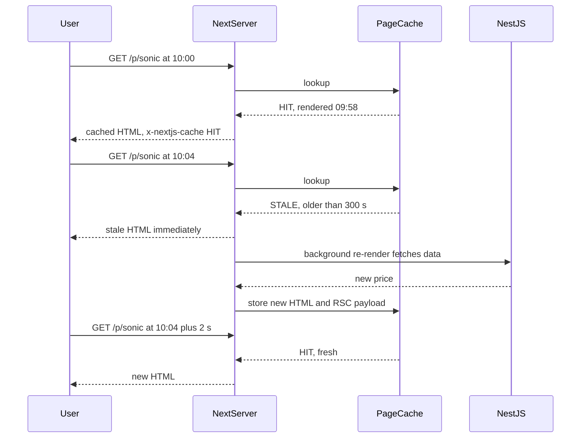
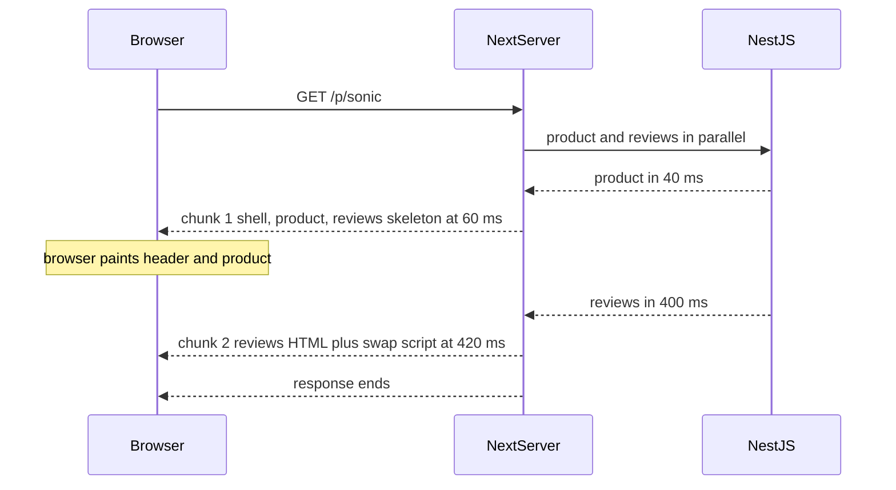

## 79.2 Incremental static regeneration and streaming

#### Concept

**Incremental static regeneration (ISR)** keeps the speed of static pages while bounding staleness. A page is rendered once and cached; after its `revalidate` window passes, the next request still gets the cached (stale) page, and Next.js re-renders it in the background. When the new render succeeds, it replaces the cached copy. This is the **stale-while-revalidate** pattern from HTTP (Part 14.11) applied to whole pages. **On-demand revalidation** skips the timer: your code calls `revalidatePath('/p/sonic-toothbrush')` or `revalidateTag('product:sonic-toothbrush')` when the data changes, and the next request triggers the re-render.

**Streaming** sends server-rendered HTML in pieces. The server sends the page shell (header, layout, skeletons) as soon as it can, keeps the HTTP response open, and sends each slow section as its data resolves, with a tiny inline script that swaps the skeleton for real content. In the App Router, every `<Suspense>` boundary (Part 77 — React Fundamentals for Backend Engineers, 77.11) and every `loading.tsx` file is a streaming point.

#### Why does it exist?

ISR exists because SSG's freshness problem gets worse as sites grow. Rebuilding 40,000 product pages to change one price is absurd, and a rebuild per price change is impossible at a hundred price changes an hour. ISR lets each page refresh on its own schedule or on its own event.

Streaming exists because SSR's TTFB is held hostage by its slowest dependency. If a product page needs product details (40 ms), price (50 ms) and reviews (400 ms), non-streaming SSR sends nothing until all three finish. With streaming, the browser gets the header and product details at about 60 ms, paints them, and the reviews arrive when ready.

#### Mental model

Imagine a newspaper stand. ISR is the stand that keeps yesterday's paper on display until someone buys one, and *then* sends a runner to fetch today's edition for the next customer. The first customer after the deadline gets yesterday's paper; everyone after gets today's. On-demand revalidation is the editor phoning the stand: "big story, replace the stack now".

Streaming is a restaurant that serves bread and water the moment you sit down, then each course as the kitchen finishes it, instead of making you wait at an empty table until dessert is ready.

#### How it works

ISR, time-based, with `revalidate = 300`:



1. At build time (or on first request for paths not prebuilt, 79.5), Next.js renders the page and stores both the HTML and the **RSC payload** (the serialised React Server Component tree used for client-side navigation, 79.4) in the **Full Route Cache** (79.7).
2. Requests within the window are served from cache. Next.js sets the response header `x-nextjs-cache: HIT` and, for CDNs, `Cache-Control: s-maxage=300, stale-while-revalidate` (Next.js 15 adds an explicit long `stale-while-revalidate` value controlled by the `expireTime` config).
3. The first request after the window gets the stale page (`x-nextjs-cache: STALE`) and triggers one background re-render. Concurrent requests during the re-render also get stale; Next.js does not start a second render for the same path on the same server.
4. If the re-render **throws** (API down, validation error), the old page stays in the cache and the next request after the window tries again. Errors in background regeneration never replace good pages with error pages. This is what makes ISR pages survive outages.
5. **On-demand**: `revalidateTag('product:sonic')` marks every Data Cache entry with that tag, and every route that used them, as stale. The next request re-renders. In Next.js 14 and 15 that next request receives the fresh page (it waits for the render); pages are not re-rendered eagerly in the background when you call `revalidateTag`.

Streaming, with one `<Suspense>` boundary around reviews:



Under the hood this is HTTP chunked transfer encoding (Part 14.10) on HTTP/1.1, or a stream of DATA frames on HTTP/2. React's server renderer (`renderToReadableStream` / `renderToPipeableStream`) emits the shell first, then each resolved Suspense boundary as a hidden `<div>` plus an inline `<script>` that moves it into place. The browser can start fetching CSS and JavaScript referenced in chunk 1 while the server is still waiting on reviews.

The big consequence: **the HTTP status code and headers are sent with the first chunk**. Once the shell is out, the response is a `200`. If the reviews section later calls `notFound()` or throws, Next.js cannot change the status; it renders the error boundary inside the stream (and for `notFound()` injects a `<meta name="robots" content="noindex">`). Anything that should decide the status code (product exists or not, user allowed or not) must run *before* the first Suspense boundary, in the page body that is awaited before streaming starts.

**Partial Prerendering (PPR)** combines the two: a static shell served from cache instantly, with dynamic holes streamed in the same response. It was experimental in Next.js 14 (`experimental.ppr`), incremental opt-in per route in 15 (`ppr: 'incremental'` plus `export const experimental_ppr = true`), and in Next.js 16 it became the default model under `cacheComponents: true`. Treat it as the direction of travel, not a 14-era tool.

#### Practical example

A category page "Electric toothbrushes" lists 48 products. Merchandisers change ordering twice a day; prices change through the pricing service maybe 30 times a day across the category; stock changes constantly.

- The listing uses ISR with `revalidate = 600` as a safety net and **on-demand** `revalidateTag('category:electric-toothbrushes')` whenever the catalogue service publishes a change to any product in it.
- Stock is not rendered into the page at all; a small client component asks a cached stock endpoint for the 48 SKUs after paint (79.13).
- The "Customers also viewed" rail is personalised; it streams inside a `<Suspense>` boundary on a dynamic product page, or is a client component on a static one.

With this split, a price change reaches the page in about 2 seconds (event, revalidation, next request re-renders), the page is served from cache 97 % of the time, and stock is never stale by more than the stock endpoint's 15-second cache.

#### React / Next.js example

ISR with time-based and on-demand revalidation, plus a streamed section:

```tsx
// apps/web/app/c/[category]/page.tsx  (Next.js 14)
import { Suspense } from 'react';
import { CategoryPageSchema } from '@shop/contracts';
import { ProductGrid } from './ProductGrid';
import { Bestsellers, BestsellersSkeleton } from './Bestsellers';

export const revalidate = 600;          // safety net: at most 10 min stale even if an event is lost
export const dynamicParams = true;      // categories not prebuilt are rendered on first request, then cached

export default async function CategoryPage({ params }: { params: { category: string } }) {
  const res = await fetch(
    `${process.env.CATALOG_API_URL}/v1/catalog/categories/${params.category}/products?limit=48`,
    { next: { revalidate: 600, tags: ['catalog', `category:${params.category}`] }, signal: AbortSignal.timeout(2_000) },
  );
  if (!res.ok) throw new Error(`catalog ${res.status}`); // throws: ISR keeps the previous good page
  const page = CategoryPageSchema.parse(await res.json());

  return (
    <main>
      <h1>{page.title}</h1>
      <ProductGrid products={page.products} />
      {/* Not on the critical path: streamed when ready, skeleton sized to avoid layout shift (75.5) */}
      <Suspense fallback={<BestsellersSkeleton />}>
        <Bestsellers category={params.category} />
      </Suspense>
    </main>
  );
}
```

```tsx
// apps/web/app/c/[category]/Bestsellers.tsx  (server component, may be slow)
export async function Bestsellers({ category }: { category: string }) {
  const res = await fetch(`${process.env.CATALOG_API_URL}/v1/catalog/categories/${category}/bestsellers`, {
    next: { revalidate: 3_600, tags: [`bestsellers:${category}`] },
    signal: AbortSignal.timeout(1_500),
  });
  if (!res.ok) return null;             // optional section: degrade silently rather than fail the page
  const items: { sku: string; name: string }[] = await res.json();
  return <ul>{items.map((i) => <li key={i.sku}>{i.name}</li>)}</ul>;
}
export function BestsellersSkeleton() { return <div style={{ minHeight: 240 }} aria-busy="true" />; }
```

On a static ISR page, the Suspense boundary still matters during the background render and on cache misses, and it keeps a slow optional section from blocking the cached shell on dynamic pages. The on-demand trigger (a Route Handler NestJS calls on change) is in 79.6 and 79.13.

#### Backend side (NestJS)

ISR moves your API's load from "per page view" to "per revalidation", which changes what NestJS must be good at:

- **Bursts after invalidation.** `revalidateTag('catalog')` on a site with 1,200 cached category pages means the next request to each one re-renders it, and each render calls the catalogue API. Popular pages re-render within seconds: a few hundred calls arrive at once. Tag narrowly (`category:<slug>`, `product:<slug>`), not with one global tag.
- **Errors must be errors.** ISR keeps the old page only if the render throws. An API that returns `200` with an empty list during a database failover produces a perfectly valid, empty category page that gets cached for 10 minutes. Return `503` on dependency failure and let the frontend throw.
- **Streaming needs bounded dependencies.** Every streamed section holds the HTTP response and a slot in the Next.js server open until it finishes. A 30-second reviews endpoint keeps thousands of responses open at peak. Give NestJS endpoints that feed optional sections a tight server-side timeout (Part 34 — Reliability Engineering, 34.1) and expect the frontend to drop the section.
- **Change events.** On-demand revalidation needs the backend to say what changed. The catalogue service should publish a domain event (`ProductPriceChanged { sku, categorySlugs }`) after the transaction commits, and something must turn it into a signed call to the Next.js revalidation endpoint (79.13).

#### Production scenario

A home-goods marketplace with 160,000 product pages used `revalidate = 3600` and nothing else. Price errors reported by customers ("the page said ₹1,499, checkout said ₹1,899") ran at about 40 a day, because a price change took up to an hour to appear. They added on-demand revalidation: the pricing service emitted events to Kafka, a small NestJS consumer called the Next.js revalidation Route Handler with the affected `product:<slug>` tags, batched every 2 seconds.

Median time from price change to page update fell from 31 minutes to 3 seconds. Background renders rose from about 4,000 an hour to about 9,000 an hour, still trivial for three containers. Price-mismatch tickets dropped to one or two a week, all from customers who had the old page open in a tab, which the checkout's server-side repricing already handled.

#### Failure scenario

At 01:40 a database failover on the catalogue service caused 90 seconds of errors. The catalogue controller had a `try/catch` that "helpfully" returned `{ products: [] }` on any exception, so the error rate dashboard stayed green. During those 90 seconds, about 300 category pages hit their revalidation window, re-rendered against the empty response, and cached "No products found" for 10 minutes. Organic search traffic that landed on those pages bounced; Googlebot happened to crawl 40 of them and briefly dropped them from results.

The fix had three parts: the controller stopped swallowing errors and returned `503` with the standard error shape; the Next.js page threw on non-2xx and on an empty product list for a category that the catalogue said was non-empty (`page.totalCount > 0 && page.products.length === 0`); and an alert fired on the ratio of empty category renders.

#### Edge cases & failure modes

- **The first visitor after expiry gets stale data** by design. If that is unacceptable for a field (stock at checkout), it must not be in an ISR page.
- **ISR per server, not per cluster**: with several self-hosted replicas and the default file-system cache, each replica regenerates and stores its own copy, and `revalidateTag` called on one replica does not reach the others (79.11).
- **CDN in front of ISR**: the CDN caches according to `s-maxage`. `revalidateTag` clears Next.js's cache, not CloudFront's; the CDN keeps the old copy until its own TTL expires unless you also purge it (Part 50 — Cloud Architecture, 50.8).
- **Status code locked after the first chunk**: `notFound()` inside a streamed section returns a `200` with a not-found UI.
- **Buffering proxies** (some nginx configs, compression middleware, corporate proxies) collect the whole stream before forwarding it, silently turning streaming into slow SSR. Set `X-Accel-Buffering: no` for nginx, or disable proxy buffering for the Next.js upstream.
- **Many tiny Suspense boundaries** cause content to pop in piece by piece and shift layout; group sections that load together.
- **Background regeneration that keeps failing** means a page can be very stale with no visible error. Monitor regeneration failures, not just page errors.

#### How a Senior Full-Stack Engineer thinks about this

The senior treats ISR as a cache with a freshness budget and an invalidation path, exactly like the Redis caches in Part 30 — Caching and Redis. Time-based revalidation is the safety net; on-demand revalidation is the mechanism. They tag narrowly so invalidation is cheap, and they make sure the data source fails loudly so stale-but-good is kept instead of fresh-but-wrong. For streaming, they decide which data determines the status code and keep it outside Suspense, then put each slow, optional section behind a boundary with a timeout and a skeleton that reserves its space.

#### Common mistakes

- **Using only time-based revalidation** with a long window and then shortening it to "fix" freshness, which multiplies renders.
- **One global tag** that invalidates the whole site on every change.
- **APIs returning empty `200`s on failure**, which ISR happily caches.
- **Calling `notFound()` inside a Suspense boundary** and expecting a `404`.
- **Assuming `revalidateTag` purges the CDN.**

#### Interview questions

1. **Walk through what happens on the first request after an ISR page's revalidate window.** Expected answer: stale page served immediately, background re-render, replace on success, keep old on failure; next request gets fresh. Follow-up: what if the re-render throws? (Old page kept, retried next time.)
2. **Time-based vs on-demand revalidation: when do you use each?** Expected answer: time-based as a bound and safety net; on-demand for event-driven freshness; both together in production.
3. **Why can't a streamed page return 404 after streaming starts?** Expected answer: status and headers go out with the first chunk; decide existence before the first Suspense boundary.
4. **What does the backend have to do differently for an ISR frontend?** Expected answer: fail with real error codes, handle revalidation bursts, publish change events, keep catalogue endpoints cacheable.
5. **How would you debug "the page is still showing the old price"?** Expected answer: check `x-nextjs-cache`, the tag used, whether revalidation reached every replica, the CDN TTL, and the browser's router cache (79.7).

#### Practical exercise

Add ISR and streaming to a category page.

Acceptance criteria:

- `curl -sI` shows `x-nextjs-cache: HIT` on a repeat request, `STALE` after the window, and `HIT` again two seconds later.
- Stopping the catalogue API and waiting past the window still serves the old page; the server logs one regeneration error per attempt.
- A `POST` to the revalidation endpoint with a valid signature makes the next request show the new price.
- With the bestsellers endpoint delayed by 3 s, the page's LCP element paints in under 1 s and the bestsellers section arrives later without layout shift (CLS under 0.05).
