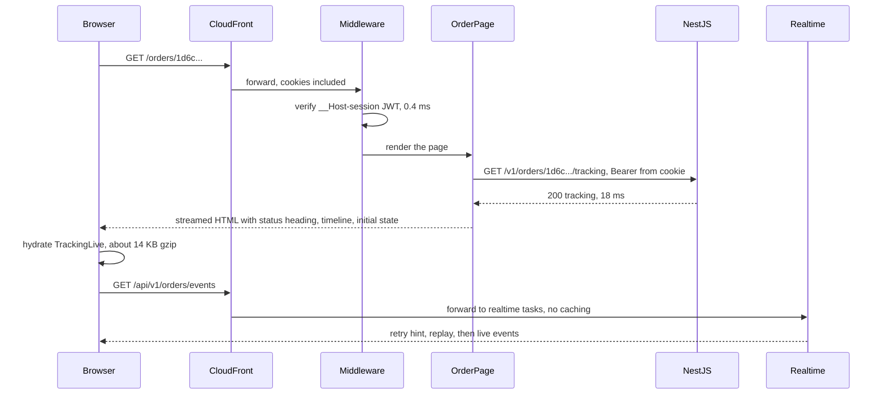

## 79.4 NestJS backend: endpoints, the SSE stream, auth and rate limits

#### Concept

With the data model in place, the API exposes it through four routes (79.2). Each route gets the same treatment the rest of the book gives a production endpoint: authentication and ownership checks, input validation with the shared schemas, idempotency for writes, rate limits, bounded payloads and timeouts, and errors in the one problem-document shape. The SSE route gets three extra rules because it is long-lived: a cap on connections per user, an end at the access token's expiry, and a way to cut it when the session is revoked.

#### Why does it exist?

Because every route is an attack surface and a capacity cost. A tracking endpoint without an ownership check is an IDOR (Part 40.12): anyone can walk order IDs and read names and addresses. A stream without a connection cap lets one buggy client (or a script) hold thousands of sockets. A stream that never re-checks auth keeps delivering a customer's data after "log out everywhere" (75.3). A note endpoint without idempotency writes twice on a retry and burns a version, causing a spurious conflict.

#### Mental model

Imagine a hotel with a front desk (the REST routes) and an intercom in every room (the stream). The desk checks your key card on every visit. The intercom was connected when you checked in, so it needs its own rules: it switches off when your stay ends, it switches off if the hotel cancels your card, and no guest may have more than a few intercoms in their name.

#### How it works

The routes and their guards:

| Route | Guards and pipes | Limits | Errors |
|---|---|---|---|
| `GET /v1/orders/:id/tracking` | `JwtAuthGuard`, ownership in the query | 120/min per user | `404 NOT_FOUND` (also for other users' orders) |
| `GET /v1/orders/events` | `JwtAuthGuard`, `SseConnectionLimitGuard` | 6 concurrent streams per user; 20 connects/min per user | `429 TOO_MANY_STREAMS`; `reauth` event at expiry or revocation |
| `PATCH /v1/orders/:id/delivery-note` | `JwtAuthGuard`, `CsrfGuard` (75.6), `IdempotencyInterceptor` (15.12), `ZodValidationPipe` | 10/min per user | `409 VERSION_CONFLICT` with fresh state; `409 NOTE_LOCKED` once out for delivery |
| `POST /v1/orders/:id/cancel` | As above (72.12) | 5/min per user | `409 ORDER_NOT_CANCELLABLE` |

Per-user limits use the user-keyed throttler guard of 75.10, not IP limits, because many customers share mobile carrier IPs.

**The tracking read** is one query for the order (scoped by user) and one for the last 20 history rows, mapped by `toOrderTracking` (79.2). Express adds a weak `ETag` to JSON responses and answers `304 Not Modified` when the browser's `If-None-Match` matches, which turns TanStack Query's refetch-on-focus (72.3) into a 200-byte round trip when nothing changed.

```ts
// apps/api/src/orders/tracking.controller.ts
import { Controller, Get, Header, NotFoundException, Param, ParseUUIDPipe, UseGuards } from '@nestjs/common';
import { InjectDataSource } from '@nestjs/typeorm';
import { DataSource } from 'typeorm';
import type { OrderTracking } from '@shop/contracts';
import { JwtAuthGuard } from '../auth/jwt-auth.guard';
import { CurrentUser, type AuthUser } from '../auth/current-user.decorator';
import { UserThrottlerGuard } from '../common/user-throttler.guard';   // 81.10
import { Throttle } from '@nestjs/throttler';
import { OrderEntity } from './order.entity';
import { OrderStatusEventEntity } from './order-status-event.entity';
import { toOrderTracking } from './tracking.mapper';

@Controller('v1/orders')
@UseGuards(JwtAuthGuard, UserThrottlerGuard)
export class TrackingController {
  constructor(@InjectDataSource() private readonly ds: DataSource) {}

  @Get(':id/tracking')
  @Throttle({ default: { limit: 120, ttl: 60_000 } })
  @Header('Cache-Control', 'private, no-cache')               // never shared; revalidate with the ETag
  async get(@CurrentUser() user: AuthUser, @Param('id', ParseUUIDPipe) id: string): Promise<OrderTracking> {
    const order = await this.ds.getRepository(OrderEntity).findOne({ where: { id, userId: user.id } }); // ownership in the WHERE
    if (!order) throw new NotFoundException({ code: 'NOT_FOUND' });  // same answer for "missing" and "not yours"
    const events = await this.ds.getRepository(OrderStatusEventEntity)
      .find({ where: { orderId: id }, order: { version: 'ASC' }, take: 20 });
    return toOrderTracking(order, events);                    // about 2.1 KB of JSON, 0.9 KB gzip
  }
}
```

**The delivery note write** uses the version the page last saw (`expectedVersion`) in a conditional `UPDATE`, and emits an outbox event so other tabs learn about it. The event carries the status (unchanged) and the new version, not the note: notes are personal data and stay out of streams and logs (Part 40.31).

```ts
// apps/api/src/orders/delivery-note.service.ts (core)
async updateNote(userId: string, orderId: string, body: UpdateDeliveryNote): Promise<OrderTracking> {
  return this.ds.transaction(async (m) => {
    const [rows]: [{ id: string; version: number; status: string; updated_at: Date }[], number] = await m.query(
      `UPDATE orders SET delivery_note = $3, version = version + 1, updated_at = now()
        WHERE id = $1 AND user_id = $2 AND version = $4 AND status IN ('PENDING','PAID','PACKING')
      RETURNING id, version, status, updated_at`,
      [orderId, userId, body.note, body.expectedVersion],
    );
    if (!rows.length) throw await this.explainNoteConflict(m, userId, orderId, body.expectedVersion); // 404, NOTE_LOCKED or VERSION_CONFLICT
    const r = rows[0];
    await m.query(
      `INSERT INTO outbox (aggregate_id, user_id, type, payload) VALUES ($1, $2, 'order.note_changed', $3)`,
      [r.id, userId, JSON.stringify({ orderId: r.id, status: r.status, version: r.version, updatedAt: r.updated_at.toISOString() })],
    );
    return this.tracking.load(m, userId, orderId);            // the fresh tracking state, so the client needs no refetch
  });
}
```

`explainNoteConflict` reads the order once more (inside the same transaction) to return the precise problem document: `NOT_FOUND`, `NOTE_LOCKED` (status moved past packing) or `VERSION_CONFLICT` with the current tracking state in an extra `current` member, so the client can show what changed without another request (74.6).

**The SSE stream** is 72.8's controller with three additions: a connection cap, an end at token expiry, and a revocation check on the heartbeat.

```ts
// apps/api/src/orders/order-events.controller.ts (78.8, extended)
import { Controller, Headers, MessageEvent, Query, Sse, UseGuards } from '@nestjs/common';
import { Observable, filter, finalize, interval, map, merge, mergeMap, race, share, take, takeUntil, timer } from 'rxjs';
import { JwtAuthGuard } from '../auth/jwt-auth.guard';
import { CurrentUser, type AuthUser } from '../auth/current-user.decorator';
import { SseConnectionLimitGuard, SseConnections } from './sse-connection-limit';
import { SessionEpochs } from '../auth/session-epochs';             // reads auth:epoch:<userId> (81.3)
import { OrderEventsStream } from './order-events.stream';        // 78.8's merge(concat(replay, live), heartbeat)

const ACCESS_TTL_S = 15 * 60;                                       // the access JWT lifetime (81.10)

@Controller('v1/orders')
@UseGuards(JwtAuthGuard, SseConnectionLimitGuard)
export class OrderEventsController {
  constructor(private readonly streams: OrderEventsStream, private readonly epochs: SessionEpochs,
              private readonly conns: SseConnections) {}

  @Sse('events')
  stream(@CurrentUser() user: AuthUser, @Headers('last-event-id') headerId?: string,
         @Query('lastEventId') queryId?: string): Observable<MessageEvent> {
    // EventSource sends the header only on its own reconnects; a stream the page reopens passes ?lastEventId= (85.6)
    const lastEventId = headerId ?? (queryId && /^\d+-\d+$/.test(queryId) ? queryId : undefined);
    const msLeft = Math.max(0, (user.issuedAt + ACCESS_TTL_S) * 1000 - Date.now());
    const expired$ = timer(msLeft).pipe(map((): MessageEvent => ({ type: 'reauth', data: { reason: 'EXPIRED' } })));
    const revoked$ = interval(20_000).pipe(                         // piggybacks on the heartbeat cadence
      mergeMap(() => this.epochs.isRevoked(user.id, user.issuedAt)), // one Redis GET, about 0.3 ms
      filter(Boolean),
      map((): MessageEvent => ({ type: 'reauth', data: { reason: 'REVOKED' } })),
    );
    const end$ = race(expired$, revoked$).pipe(take(1), share());
    return merge(this.streams.forUser(user.id, lastEventId).pipe(takeUntil(end$)), end$)
      .pipe(finalize(() => void this.conns.release(user.id)));    // runs on client disconnect too
  }
}
```

```ts
// apps/api/src/orders/sse-connection-limit.ts
import { CanActivate, ExecutionContext, HttpException, Injectable } from '@nestjs/common';
import { InjectRedis } from '@nestjs-modules/ioredis';
import type Redis from 'ioredis';

const MAX_STREAMS = 6;

@Injectable()
export class SseConnections {
  constructor(@InjectRedis() private readonly redis: Redis) {}
  async acquire(userId: string): Promise<boolean> {
    const key = `sse:conn:${userId}`;
    const n = await this.redis.multi().incr(key).expire(key, 16 * 60).exec();   // every stream ends within 15 min,
    const count = Number(n?.[0]?.[1] ?? 0);                                     // so a crashed task's count self-heals
    if (count > MAX_STREAMS) { await this.redis.decr(key); return false; }
    return true;
  }
  async release(userId: string) { await this.redis.decr(`sse:conn:${userId}`); }
}

@Injectable()
export class SseConnectionLimitGuard implements CanActivate {
  constructor(private readonly conns: SseConnections) {}
  async canActivate(ctx: ExecutionContext): Promise<boolean> {
    const user = ctx.switchToHttp().getRequest().user as { id: string };
    if (await this.conns.acquire(user.id)) return true;
    throw new HttpException({ code: 'TOO_MANY_STREAMS', title: 'Too many live connections' }, 429);
  }
}
```

Three operational details for the stream tasks:

1. **No buffering on the path**: NestJS's `@Sse()` sets `Content-Type: text/event-stream` and `Cache-Control: no-cache`; the response also needs compression disabled for this route (a global `compression()` middleware buffers), and CloudFront's cache behaviour for the path uses caching disabled and an origin response timeout above the 20 s heartbeat (79.10).
2. **Reconnect hint**: the first message sets `retry` (NestJS's `MessageEvent` has a `retry` field) to 3,000 ms plus random jitter up to 2,000 ms, so 60,000 clients do not reconnect in the same second after a blip.
3. **Graceful shutdown**: on `SIGTERM`, each stream sends a `ping` with a randomised `retry` between 1 and 10 s and completes, so a deploy spreads reconnections over ten seconds instead of creating a spike (Part 31.13).

#### Practical example — the stream at work

```bash
$ curl -N -H "Cookie: __Host-session=$SESSION" https://staging.shop.example/api/v1/orders/events
retry: 4120

event: ping
data:

id: 1730813127412-0
event: order
data: {"orderId":"1d6c0b6e-...","status":"OUT_FOR_DELIVERY","version":7,"updatedAt":"2026-11-05T13:45:27.402Z",...}

event: ping
data:

event: reauth
data: {"reason":"EXPIRED"}
$                                                   # stream completed at the token's expiry
```

`curl -N` disables curl's own buffering, so events print as they arrive. Opening a seventh stream for the same user returns `HTTP/2 429` with `{"code":"TOO_MANY_STREAMS",...}`.

#### Backend side (NestJS)

The module wiring keeps the stream route in a module that the realtime deployment loads and the request/response deployment does not (79.10), using one image and two entry points:

```ts
// apps/api/src/main.realtime.ts: the same codebase, only the stream and its dependencies
import { NestFactory } from '@nestjs/core';
import { RealtimeAppModule } from './realtime-app.module';     // AuthModule, RedisModule, OrderEventsModule, HealthModule
import { configureApp } from './configure-app';

async function bootstrap() {
  const app = configureApp(await NestFactory.create(RealtimeAppModule, { bodyParser: false })); // streams take no bodies
  app.enableShutdownHooks();
  await app.listen(4001);
}
bootstrap();
```

#### Production scenario

At the evening peak the realtime service runs 8 tasks of 1 vCPU and 2 GB, holding 58,000 to 64,000 streams (about 7,500 per task, 420 MB of memory per task for connections), with CPU under 20 %. Reauth events close about 70 streams a second (every stream ends within 15 minutes); clients refresh and reconnect with `Last-Event-ID` within 1-2 s and replay what they missed. The tracking read handles 25 requests per second at p95 18 ms, with 61 % answered `304`.

#### Failure scenario

The first staging load test opened 20,000 streams and then restarted all realtime tasks at once. Every client reconnected within the default `EventSource` retry of about 3 seconds, and all 20,000 replays hit Redis and the auth middleware in the same second; p99 connect time went to 9 seconds, and 3 % of clients hit the per-user connect rate limit because the browser retried quickly after errors. The fixes: the jittered `retry` hint, rolling restarts with a 30-second gap between tasks (ECS `minimumHealthyPercent` 100, `maximumPercent` 125), and a connect-rate limit counted per user per minute rather than per 10 seconds.

#### Edge cases & failure modes

- **Ownership by a separate query** (load by ID, then compare `userId`) is easy to forget in one route; put the user in the `WHERE`.
- **`403` for other users' orders** reveals that the ID exists; return `404`.
- **Long-lived auth**: a stream authorised at 10:00 must not deliver after a 10:05 revocation; the epoch check on the heartbeat bounds it to 20 s.
- **Connection counter drift** after a crash; the TTL equal to the maximum stream lifetime heals it.
- **Global compression middleware** buffering SSE; exclude the route.
- **`EventSource` treats any non-200 as final**: a `429` or `401` closes it for good; the client must decide what to do next (79.6).
- **Notes in events or logs**: keep personal data out of streams, outbox payloads and access logs.

#### How a Senior Full-Stack Engineer thinks about this

The senior applies the same checklist to every route (auth, ownership, validation, idempotency, limits, error shape) and then asks what is different about the long-lived one. A stream holds authority for as long as it is open, so it gets an expiry, a revocation check and a cap. It holds memory for as long as it is open, so it lives on its own tasks with its own scaling metric. And it reconnects in herds, so the server tells clients when to come back, with jitter.

#### Common mistakes

- **Authenticating the stream once and never again.**
- **No per-user connection cap.**
- **Serving streams from the same tasks as checkout.**
- **Default `retry` for every client**, so reconnects synchronise.
- **Returning the note in the outbox payload** "for convenience".

#### Interview questions

1. **How do you stop an SSE stream from outliving a revoked session?** Expected answer: end it at the token's expiry with a `reauth` event, check a revocation epoch on the heartbeat, and let the client refresh and reconnect.
2. **Why return 404 instead of 403 for someone else's order?** Expected answer: 403 confirms the ID exists; 404 gives an enumerator nothing.
3. **How do you cap SSE connections per user across many tasks?** Expected answer: a shared counter in Redis incremented on connect and decremented on teardown, with a TTL equal to the maximum stream lifetime.
4. **Why does the delivery-note event not contain the note?** Expected answer: notes are personal data; events are replayed and may be logged; the client refetches when the event's status did not change.

#### Practical exercise

Implement the four routes with their guards and limits.

Acceptance criteria:

- Requesting another user's order returns `404` with the same body as a missing order.
- A second `PATCH` with the same `Idempotency-Key` returns the first response; a stale `expectedVersion` returns `409 VERSION_CONFLICT` with `current`.
- A seventh concurrent stream for one user returns `429 TOO_MANY_STREAMS`; closing one stream allows a new one.
- After "log out everywhere", an open stream receives `reauth` with `REVOKED` within 25 s and completes.
- A rolling restart of the realtime tasks shows reconnections spread over at least 10 s.

## 79.5 Next.js frontend: the server-rendered order page shell

#### Concept

The tracking page is a **server-rendered shell with one live island**. The App Router page (a Server Component, 73.4) fetches the tracking state from NestJS on the server and renders everything a customer needs to read immediately: the status heading, the arrival window, the timeline, items, address and total. One Client Component, `TrackingLive`, takes that state as its initial data, opens the stream and keeps the status, window and timeline current. Everything else stays server-only and ships no JavaScript.

#### Why does it exist?

Because the most important moment on this page is the first second. A customer who taps a push notification wants "Out for delivery, arriving 7:25 to 7:40 pm" on the screen, not a spinner while a JavaScript bundle loads, fetches and renders (73.1). Server rendering puts the answer in the HTML, which makes it the LCP element (76.3) and readable even if JavaScript fails. The live island then makes it current.

#### Mental model

Imagine a printed departure board at a train station that also has one small electronic panel for the platform and delay. The printed parts (the train, its stops) never change, so they are printed once. Only the panel updates. Printing the whole board electronically would be slower and more fragile for no gain.

#### How it works



1. **Middleware** (75.10) verifies the session JWT for `/orders/:path*` and redirects to the refresh route when it is missing or expired, before any rendering.
2. **The page** calls a server-only data function, `getOrderTracking(id)`, which reads the access token from the cookie and calls NestJS on the private network with a 1.5 s timeout. It is dynamic by nature (it reads cookies), so nothing is cached between users (73.7).
3. **`notFound()`** for a `404` renders `not-found.tsx`; any other failure throws to the segment's `error.tsx` (79.6), which shows a retry with the request ID.
4. **Formatting happens once, deterministically**: dates are formatted with `Intl.DateTimeFormat` and the **store's** time zone (74.7) through the same helper on the server and the client, so hydration never mismatches (73.10) and a later live update formats exactly as the server did.
5. **Streaming**: the main content renders immediately; a slower "Buy again" strip is wrapped in `Suspense` so it never delays the status (73.2).
6. **`loading.tsx`** shows a skeleton with the same dimensions as the real heading and window, so nothing shifts when the content arrives (76.5).

#### Practical example

What the customer receives in the first HTML response, before any JavaScript runs (about 11 KB gzip): a heading "Out for delivery", the line "Arriving 7:25 to 7:40 pm", a four-step progress bar with the current step marked with `aria-current="step"`, the timeline with times, items and total, and the address with the delivery note. A customer on a slow connection or with JavaScript blocked still sees the correct status as of page load, plus a "Refresh" link.

#### React / Next.js example

The server-only data function:

```ts
// apps/web/lib/orders.server.ts
import 'server-only';
import { cookies } from 'next/headers';
import { OrderTrackingRead, type OrderTrackingView } from '@/orders/tracking.read';
import { toApiError } from '@/api/errors';

const API = process.env.API_INTERNAL_URL!;                       // server-only runtime config (84.2)

export async function getOrderTracking(id: string): Promise<OrderTrackingView | null> {
  const token = cookies().get('__Host-session')?.value;          // Next.js 15: (await cookies()).get(...)
  const res = await fetch(`${API}/v1/orders/${encodeURIComponent(id)}/tracking`, {
    headers: { Authorization: `Bearer ${token}`, 'X-Client': 'web-ssr' },
    cache: 'no-store',                                           // personal data: never in the Data Cache (79.7)
    signal: AbortSignal.timeout(1500),                           // a slow API must not hold the HTML forever
  });
  if (res.status === 404) return null;
  if (!res.ok) throw await toApiError(res);                      // error.tsx shows code and requestId
  return OrderTrackingRead.parse(await res.json());              // open enums: an unknown status renders "Updated"
}
```

The page:

```tsx
// apps/web/app/(shop)/orders/[id]/page.tsx  (Next.js 14; in 15, params is a Promise: const { id } = await params)
import { notFound } from 'next/navigation';
import { Suspense } from 'react';
import type { Metadata } from 'next';
import { getOrderTracking } from '@/lib/orders.server';
import { getFlags } from '@/flags/server';                       // 84.5
import { getSession } from '@/auth/session';
import { TrackingLive } from './TrackingLive';                   // 'use client'
import { OrderItems } from './OrderItems';                       // server component, no JS
import { BuyAgain } from './BuyAgain';                           // server component, slower, streamed
import { BuyAgainSkeleton } from './BuyAgainSkeleton';

export const metadata: Metadata = { title: 'Track your order', robots: { index: false } };

export default async function OrderTrackingPage({ params }: { params: { id: string } }) {
  const session = await getSession();
  const [tracking, flags] = await Promise.all([
    getOrderTracking(params.id),
    getFlags({ userId: session.userId, keys: ['live-tracking'] }),
  ]);
  if (!tracking) notFound();

  return (
    <main className="tracking">
      <TrackingLive initial={tracking} live={flags['live-tracking']} />   {/* status, window, timeline, note, cancel */}
      <OrderItems items={tracking.items} totalMinor={tracking.totalMinor} currency={tracking.currency} />
      <Suspense fallback={<BuyAgainSkeleton />}>
        <BuyAgain orderId={tracking.id} />
      </Suspense>
    </main>
  );
}
```

`TrackingLive` is a Client Component, but it is still **server-rendered** on the first request (Client Components render on the server too, 73.4), so the status heading is in the HTML. Its props are plain JSON (`OrderTrackingView` and a boolean), which is the rule for crossing the server/client boundary.

The shared formatter, used by server and client:

```ts
// apps/web/src/orders/format.ts
const windowFmt = new Map<string, Intl.DateTimeFormat>();

export function formatEtaWindow(from: string, to: string, timeZone: string, locale = 'en-IN'): string {
  const key = `${locale}|${timeZone}`;
  if (!windowFmt.has(key)) windowFmt.set(key, new Intl.DateTimeFormat(locale, { hour: 'numeric', minute: '2-digit', timeZone }));
  const f = windowFmt.get(key)!;
  return `Arriving ${f.format(new Date(from))} to ${f.format(new Date(to))}`;   // the store's zone, never the device's
}
```

#### Backend side (NestJS)

The server render depends on three API behaviours:

- **Bearer or cookie**: `JwtStrategy` accepts the session JWT from the cookie or the `Authorization` header (75.1), so the server component can forward the same token over the private network.
- **Fast, bounded reads**: the tracking read is two indexed queries (`orders` by primary key and user, `order_status_events` by `(order_id, version)`), p95 under 20 ms, so the 1.5 s SSR timeout is a safety net, not a budget.
- **Request IDs** on every response, which the error page shows and the Next.js server logs alongside its own trace ID (79.11).

#### Production scenario

Field data after launch (p75, mobile, 28 days): TTFB 310 ms (CloudFront to the Next.js task about 40 ms, middleware 1 ms, the API call 22 ms, rendering 35 ms, the rest network), LCP 1.4 s (the status heading, text, no web font blocking thanks to `font-display: swap` and a preloaded subset, 76.8), CLS 0.01, INP 70 ms. The page's JavaScript is the shared framework chunks (cached from earlier visits for 80 % of loads) plus 14 KB gzip for `TrackingLive`.

#### Failure scenario

An early version fetched the tracking state in `TrackingLive` with `useQuery` on mount, and the server rendered only a skeleton. In the lab it looked fine. In the field, customers tapping a notification on a mid-range Android phone over 4G waited 3.8 s at p75 for the status, because the bundle had to download, parse and run before the fetch even started (the waterfall of 76.10). Support saw no change in "where is my order" contacts. Moving the fetch into the Server Component cut LCP to 1.4 s and put the answer in the HTML.

#### Edge cases & failure modes

- **Formatting with the device's time zone** on the client and the server's on the server causes hydration mismatches and wrong times; pass the store's zone explicitly.
- **Fetching with the Data Cache** (`cache: 'force-cache'`) for personal data can serve one customer's order to another in Next.js 14's default caching (73.7); always `no-store` for personal reads.
- **Slow API**: without a timeout, a stuck API call holds the response until the platform times out; with one, `error.tsx` renders quickly with a retry.
- **Params from the URL are input**: encode them when building the API URL; validate the UUID before calling.
- **Search engines and link previews** must not index the page; `noindex`, and personal data only after authentication.
- **The Back button**: authenticated pages and the bfcache pull in opposite directions (76.9, 81.9); the page uses `private, no-cache` plus 81's `BfcacheGuard`, which reloads a restored page after logout, and `TrackingLive` reconnects on `pageshow`.

#### How a Senior Full-Stack Engineer thinks about this

The senior puts the answer to the user's question in the first HTML response and adds interactivity only where the page changes. They draw the server/client boundary around the smallest component that needs state, pass it plain data, and keep formatting deterministic so the server and client agree. They give server data fetching a timeout and treat the API's latency as part of the page's TTFB budget. And they measure the result in the field, because the lab hides the network and device costs that motivated server rendering in the first place.

#### Common mistakes

- **Client-side fetching for the main content** of a page users open from notifications.
- **A Client Component at the page root**, shipping JavaScript for static parts.
- **Device time zone formatting.**
- **No timeout on server fetches.**
- **Data Cache on personal reads.**

#### Interview questions

1. **Why server-render the tracking page instead of fetching on the client?** Expected answer: the status is in the first HTML (LCP, no waterfall, works without JavaScript); the live island takes over afterwards.
2. **How do you pass server data into a Client Component?** Expected answer: as serializable props from the Server Component; the client seeds its cache with them.
3. **How do you avoid hydration mismatches with dates?** Expected answer: format with an explicit locale and time zone through one helper used on both sides, or render the formatted string from the server.
4. **What should happen when the API is slow during server rendering?** Expected answer: a bounded timeout and an error boundary with retry and request ID, not an unbounded wait.

#### Practical exercise

Build the page shell.

Acceptance criteria:

- With JavaScript disabled, the page shows the correct status, window and timeline for a seeded order.
- The LCP element in a Lighthouse mobile run is the status heading; LCP under 2.0 s on the staging preview.
- Another customer's order ID renders `not-found.tsx`; an API `503` renders `error.tsx` with the request ID and a retry button.
- No hydration warnings in the console with the device time zone set to `America/New_York` and the store in `Asia/Kolkata`.
